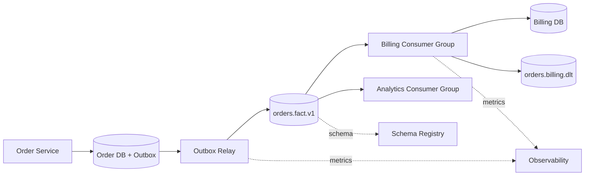

# Hồ sơ thiết kế gồm giả định, bảo đảm và kịch bản lỗi

Một hệ thống Kafka có thể chạy tốt trong môi trường thử nghiệm nhưng thất bại khi broker mất kết nối, consumer xử lý chậm, schema thay đổi hoặc một dịch vụ phụ thuộc ngừng hoạt động. Bản thiết kế chỉ mô tả topic, producer và consumer là chưa đủ để nhóm phát triển, vận hành và ứng phó sự cố hiểu hệ thống sẽ hành xử ra sao.

**Hồ sơ thiết kế** (design dossier) tập hợp bối cảnh, giả định, quyết định kiến trúc, bảo đảm kỹ thuật, giới hạn và kịch bản lỗi của một luồng sự kiện. Nó giúp trả lời trước các câu hỏi: điều gì phải luôn đúng, điều gì có thể xảy ra, hệ thống phản ứng thế nào và bằng chứng nào cho thấy thiết kế đáp ứng yêu cầu.

Trong module Kafka, hồ sơ này cần nối quyết định nghiệp vụ với cơ chế Kafka: topic và partition, key, replication, producer acknowledgement, consumer offset, retry, transaction, schema, KRaft, quan sát và phục hồi. Đây là tài liệu sống; cập nhật khi tải, hợp đồng dữ liệu, topology hoặc yêu cầu dịch vụ thay đổi.

## 1. Hồ sơ thiết kế dùng để làm gì?

Hồ sơ thiết kế tạo ra một nguồn tham chiếu chung cho các vai trò:

- **Product và domain owner** xác nhận sự kiện nào có ý nghĩa nghiệp vụ, dữ liệu nào được phép chia sẻ và mức độ mất dữ liệu có thể chấp nhận.
- **Developer** biết hợp đồng producer/consumer, thứ tự xử lý, retry, idempotency và cách thay đổi schema.
- **Platform và SRE** biết topology, dung lượng, SLO, cảnh báo, quy trình bảo trì và phục hồi.
- **Security và compliance** biết dữ liệu nhạy cảm đi qua topic nào, ai có quyền đọc, lưu trong bao lâu và được xóa theo quy trình nào.
- **Người đánh giá thiết kế** có thể kiểm tra giả định, bằng chứng và trade-off trước khi hệ thống được đưa vào production.

Hồ sơ không phải lời cam kết rằng mọi lỗi đều không xảy ra. Nó ghi rõ phạm vi của từng bảo đảm, điều kiện cần để bảo đảm có hiệu lực và hành động khi điều kiện không còn đúng.

## 2. Cấu trúc đề xuất của một hồ sơ

Một hồ sơ có thể là một tài liệu Markdown trong repository, liên kết tới schema, dashboard và runbook. Với hệ thống có nhiều luồng độc lập, tạo một hồ sơ cho từng luồng hoặc bounded context thay vì gom mọi quyết định vào một tài liệu khổng lồ.

| Phần | Nội dung cần ghi |
|---|---|
| Mục đích và phạm vi | Bài toán, producer, consumer, luồng dữ liệu và phần nằm ngoài phạm vi |
| Yêu cầu và SLO | Throughput, latency, availability, RPO, RTO, retention và yêu cầu bảo mật |
| Giả định | Điều đang được coi là đúng, chủ sở hữu, cách xác minh và hậu quả nếu sai |
| Kiến trúc | Topic, partition, key, broker, controller, schema, consumer group và hệ thống phụ thuộc |
| Quyết định thiết kế | Lựa chọn, phương án thay thế, lý do, trade-off và người phê duyệt |
| Bảo đảm và giới hạn | Guarantee, phạm vi áp dụng, điều kiện, phần không được bảo đảm |
| Kịch bản lỗi | Trigger, ảnh hưởng, phát hiện, ứng phó, phục hồi và kiểm chứng |
| Vận hành | Dashboard, alert, runbook, capacity plan, backup và ownership |
| Kiểm thử và bằng chứng | Contract test, integration test, fault injection, kết quả đo và liên kết artifact |
| Lịch sử và trạng thái | Phiên bản, ngày rà soát, người chịu trách nhiệm, quyết định còn mở |

Hồ sơ nên có mã hoặc tên ổn định, phiên bản, trạng thái (`Draft`, `Review`, `Accepted`, `Deprecated`) và ngày rà soát tiếp theo. Trạng thái `Accepted` chỉ có ý nghĩa khi người chịu trách nhiệm đã xác nhận các giả định và rủi ro quan trọng.

## 3. Ghi giả định một cách có thể kiểm chứng

**Giả định** là điều thiết kế tạm coi là đúng để có thể tiếp tục ra quyết định. Nó chưa phải bảo đảm của Kafka và cũng chưa chắc là sự thật đã được đo lường.

Ví dụ các giả định thường gặp:

- Mỗi đơn hàng có một `orderId` ổn định và mọi sự kiện của đơn hàng dùng giá trị này làm Kafka key.
- Producer có thể phát lại cùng một event khi không nhận được kết quả gửi; `eventId` không thay đổi giữa các lần gửi lại.
- Dịch vụ consumer có thể ngừng hoạt động vài giờ mà không vượt quá thời gian retention của topic.
- Consumer chấp nhận xử lý lặp và có cơ chế idempotency ở nơi ghi dữ liệu.
- Tổng lưu lượng cực đại và kích thước record nằm trong giới hạn đã đo, không chỉ là ước lượng từ tải trung bình.
- Controller voter được phân bố qua các failure domain độc lập theo topology đã phê duyệt.

Mỗi giả định nên có các trường: mã, phát biểu, lý do, cách kiểm chứng, người sở hữu, hạn xác minh và phương án nếu sai.

| ID | Giả định | Cách kiểm chứng | Nếu sai |
|---|---|---|---|
| A-01 | `orderId` có mặt và không đổi trong vòng đời đơn hàng | Kiểm tra domain model và contract test | Chốt quy tắc định danh trước khi chọn key |
| A-02 | Consumer có thể chậm tối đa 24 giờ | Đo outage dự kiến và backlog trong diễn tập | Tăng retention hoặc giảm RTO xử lý backlog |
| A-03 | Consumer ghi dữ liệu idempotent theo `eventId` | Kiểm thử giao lại cùng event nhiều lần | Thêm inbox/deduplication trước khi bật retry tự động |
| A-04 | Peak traffic không vượt tải đã benchmark | Chạy load test với payload và phân bố key gần thực tế | Tăng partition/capacity hoặc điều chỉnh throughput |

Không ghi giả định mơ hồ như “Kafka luôn nhanh” hoặc “mạng ổn định”. Hãy chuyển chúng thành điều kiện có thể đo: p95 latency, tỷ lệ lỗi, băng thông, thời gian outage, kích thước record hoặc số lần retry.

### 3.1. Phân biệt giả định, yêu cầu và sự thật đã xác minh

- **Yêu cầu** là điều hệ thống phải đáp ứng, ví dụ RPO bằng 0 đối với các record đã được xác nhận trong phạm vi cấu hình durability đã định.
- **Giả định** là điều cần đúng để thiết kế có thể đáp ứng yêu cầu, ví dụ ít nhất hai replica trong ISR có thể liên lạc.
- **Sự thật đã xác minh** là điều có bằng chứng, ví dụ load test ghi nhận 18.000 record/giây trong cấu hình cụ thể.
- **Rủi ro** là khả năng một giả định sai hoặc một tình huống chưa được kiểm soát gây ảnh hưởng tới yêu cầu.

Nếu chưa có bằng chứng, hãy ghi `Chưa xác minh` kèm người phụ trách và ngày dự kiến. Không biến ước lượng thành cam kết chỉ vì nó xuất hiện trong tài liệu kiến trúc.

## 4. Viết yêu cầu dịch vụ và giới hạn rõ ràng

Trước khi chọn cấu hình Kafka, ghi lại yêu cầu ở dạng đo được.

| Thuộc tính | Câu hỏi cần trả lời | Ví dụ cách ghi |
|---|---|---|
| Throughput | Lưu lượng trung bình, peak và burst là bao nhiêu? | 5.000 record/s trung bình, 20.000 record/s trong 10 phút |
| Record size | Payload p50, p95 và tối đa? | p95 8 KB, tối đa 256 KB |
| Latency | Từ lúc phát sự kiện tới khi consumer hoàn tất? | p95 dưới 2 giây ở tải chuẩn |
| Availability | Thành phần và luồng nào phải sẵn sàng? | Producer API đạt 99,9% theo tháng |
| RPO | Có thể mất tối đa bao nhiêu dữ liệu khi sự cố? | Không mất record đã được xác nhận trong failure model đã thống nhất |
| RTO | Bao lâu phải khôi phục? | Khôi phục luồng tiêu thụ chính trong 30 phút |
| Retention | Consumer có thể replay trong bao lâu? | 7 ngày cho topic nghiệp vụ |
| Ordering | Thứ tự cần giữ ở phạm vi nào? | Theo từng `orderId`, không yêu cầu thứ tự toàn cục |
| Privacy | Dữ liệu nào được phép lưu và ai được đọc? | Không chứa token; customer identifier chỉ cho nhóm được cấp quyền |

Ví dụ trên chỉ minh họa cách viết yêu cầu, không phải cấu hình khuyến nghị chung. RPO, RTO và SLO phải được domain owner, product và đội vận hành thống nhất dựa trên tác động kinh doanh.

## 5. Mô tả kiến trúc và hợp đồng sự kiện

### 5.1. Vẽ luồng dữ liệu và ranh giới tin cậy

Sơ đồ cần thể hiện producer, database/outbox nếu có, topic, partition, consumer group, hệ thống đích, Schema Registry, retry topic hoặc dead-letter topic, cùng các điểm xác thực và mã hóa.



Mỗi mũi tên cần chỉ rõ protocol, cơ chế xác thực, dữ liệu truyền và hành vi khi đích không sẵn sàng. Nếu sơ đồ chỉ có hộp và đường nối mà không cho biết ai sở hữu dữ liệu, nó chưa đủ để làm runbook.

### 5.2. Định nghĩa topic contract

Với mỗi topic, ghi ít nhất:

- Tên topic và owner chịu trách nhiệm.
- Mục đích nghiệp vụ, loại event và schema subject/version.
- Key, quy tắc partitioning và yêu cầu ordering.
- Số partition, replication factor, `min.insync.replicas` và rack awareness.
- `cleanup.policy`, `retention.ms`, `retention.bytes` và giới hạn record size nếu có.
- Danh sách producer/consumer được phép, ACL và dữ liệu nhạy cảm.
- Chính sách tương thích schema, replay, deprecation và migration.

Ví dụ hợp đồng rút gọn:

| Thuộc tính | Giá trị minh họa |
|---|---|
| Topic | `orders.fact.v1` |
| Owner | Order Platform |
| Event | `OrderPaid` |
| Key | `orderId` |
| Value | `OrderPaidV1` (Avro hoặc Protobuf theo nền tảng đã chọn) |
| Partition | 12, cần benchmark và capacity review trước khi chốt |
| Replication factor | 3 |
| `min.insync.replicas` | 2 |
| Producer `acks` | `all` |
| Consumer group | `billing-projection`, `analytics-sink` |
| Retention | 7 ngày, cần đối chiếu replay và dung lượng |

Không sao chép ví dụ này vào production nếu chưa tính số partition, thông lượng, replication placement, disk capacity và yêu cầu lưu trữ của chính workload.

### 5.3. Key và ordering

Kafka đảm bảo thứ tự record trong một partition. Nếu mọi thay đổi của cùng đơn hàng phải được xử lý theo thứ tự, dùng `orderId` làm key để các record đó được đưa vào cùng partition theo partitioner đã cấu hình.

Hồ sơ phải ghi rõ:

- Thứ tự cần bảo đảm theo aggregate, theo customer, theo partition hay toàn luồng.
- Producer có thể phát đồng thời các sự kiện của cùng key hay không.
- Consumer xử lý tuần tự hay song song; có thể hoàn tất record sau trước record trước hay không.
- Hành vi khi tăng số partition, đổi partitioner hoặc chuyển topic.
- Cách dùng `aggregateVersion` để phát hiện event cũ, trùng hoặc thiếu phiên bản.

Kafka không cung cấp thứ tự toàn cục giữa các partition. Nếu nghiệp vụ yêu cầu thứ tự toàn cục, cần mô tả chi phí và cơ chế điều phối riêng; không suy ra điều đó từ việc topic có một consumer group.

## 6. Viết bảo đảm cùng phạm vi và điều kiện

Một bảo đảm tốt có cấu trúc: **điều gì được bảo đảm + trong phạm vi nào + khi điều kiện nào đúng + điều gì nằm ngoài phạm vi**.

| Chủ đề | Có thể dựa vào Kafka | Điều kiện và giới hạn cần ghi |
|---|---|---|
| Ordering | Thứ tự record trong một partition | Không có thứ tự toàn cục giữa partition; key và cách producer gửi quyết định phân bố |
| Durability | Replication và acknowledgement có thể giảm nguy cơ mất dữ liệu | Phụ thuộc `acks`, ISR, `min.insync.replicas`, replication factor, unclean election, lỗi đồng thời và lưu trữ |
| Producer idempotence | Giảm duplicate do retry của producer trong phạm vi producer session/protocol được hỗ trợ | Không thay thế `eventId` nghiệp vụ và không tự khử trùng lặp giữa các lần tạo event độc lập |
| Consumer delivery | Consumer có thể nhận lại record khi retry hoặc xử lý lại offset | Handler phải chịu được duplicate; commit offset và side effect cần phối hợp |
| Kafka transactions | Có thể giao dịch việc ghi nhiều record và offset trong Kafka | Consumer cần `read_committed` khi phù hợp; tác động vào database/API ngoài Kafka không tự động thuộc transaction |
| Retention | Record được giữ theo policy và điều kiện lưu trữ | Không phải backup; record có thể hết hạn hoặc bị xóa theo compaction/retention |
| KRaft quorum | Metadata được commit theo cơ chế quorum | Cần majority voter; broker process đang sống không đồng nghĩa controller quorum khỏe |

### 6.1. Ví dụ ghi bảo đảm về durability

Một thiết kế có thể chọn replication factor 3, `min.insync.replicas=2` và producer `acks=all`. Hồ sơ nên diễn đạt bảo đảm như sau:

> Trong điều kiện topic có replication factor 3, ít nhất hai replica còn trong ISR, broker hoạt động theo cấu hình đã kiểm chứng và unclean leader election bị tắt, producer dùng `acks=all` chỉ nhận xác nhận sau khi Kafka đáp ứng điều kiện acknowledgement của ISR. Nếu ISR thấp hơn `min.insync.replicas`, thao tác ghi có thể thất bại thay vì hạ mức bảo vệ dữ liệu.

Đây không phải lời hứa chống mọi dạng mất dữ liệu. Cần ghi thêm failure model: mất bao nhiêu broker, lỗi đồng thời của rack/zone, lỗi thiết bị lưu trữ, thao tác quản trị sai, hỏng dữ liệu và mất toàn bộ cluster. Backup, replication liên vùng và disaster recovery cần được thiết kế riêng nếu yêu cầu vượt quá khả năng của một cluster.

### 6.2. Phân biệt at-most-once, at-least-once và exactly-once

- **At-most-once:** có thể mất xử lý nhưng không xử lý lại theo cách thông thường; ví dụ commit offset trước khi thực hiện side effect có thể làm record bị bỏ qua nếu consumer dừng.
- **At-least-once:** side effect được thực hiện trước khi commit offset; nếu consumer dừng giữa hai bước, record có thể được giao lại và xử lý lặp.
- **Exactly-once trong Kafka:** Kafka transactions có thể kết hợp ghi output topic và commit input offsets trong một transaction để các consumer `read_committed` quan sát kết quả đã commit theo ngữ nghĩa được hỗ trợ.

Nếu consumer cập nhật database bên ngoài Kafka, transaction của Kafka không bao trùm transaction database. Cần dùng inbox/idempotency key, transactional outbox, CDC hoặc một giao thức phối hợp phù hợp. Tránh ghi chung chung “hệ thống exactly-once” khi chỉ mới bật producer idempotence.

## 7. Định nghĩa kịch bản lỗi theo một mẫu thống nhất

Mỗi kịch bản nên có:

1. **Trigger:** điều kiện gây lỗi, có thể quan sát được.
2. **Phạm vi ảnh hưởng:** topic, partition, consumer group, dịch vụ và dữ liệu bị tác động.
3. **Phát hiện:** metric, log, alert hoặc tín hiệu từ ứng dụng.
4. **Hành vi mong đợi:** retry, dừng, failover, giữ backlog hay từ chối request.
5. **Ứng phó:** hành động của hệ thống và người trực.
6. **Phục hồi:** cách đưa luồng về trạng thái bình thường và xử lý backlog.
7. **Rủi ro dữ liệu:** duplicate, mất dữ liệu, sai thứ tự, dữ liệu trễ hoặc lộ dữ liệu.
8. **Bằng chứng kiểm thử:** test case, kết quả chaos test hoặc diễn tập runbook.

### 7.1. Bảng kịch bản lỗi tối thiểu

| Kịch bản | Dấu hiệu | Hành vi thiết kế cần xác định |
|---|---|---|
| Producer mất kết nối sau khi gửi nhưng trước khi nhận ack | Timeout, kết quả gửi không rõ | Retry với event identity ổn định; consumer xử lý duplicate an toàn |
| Broker hoặc leader partition dừng | Leader election, request retry, ISR thay đổi | Producer chờ metadata/retry; kiểm tra min ISR và thời gian phục hồi |
| ISR thấp hơn ngưỡng | `NOT_ENOUGH_REPLICAS` hoặc metric ISR giảm | Giữ durability policy, cảnh báo và khôi phục replica |
| Consumer crash sau side effect trước commit offset | Record được giao lại sau restart | Idempotent handler hoặc inbox transaction để tránh side effect lặp |
| Consumer commit offset trước side effect | Offset tiến nhưng dữ liệu đích thiếu | Tránh thứ tự này nếu không chấp nhận mất xử lý; xác định delivery semantics |
| Consumer bị rebalance khi đang xử lý | Revoke partition, xử lý trùng hoặc timeout | Giới hạn thời gian xử lý, xử lý revoke đúng cách, commit an toàn |
| Poison message hoặc schema không đọc được | Deserialization/validation exception lặp | Phân loại lỗi, retry có giới hạn, DLT và quy trình sửa/replay |
| Dịch vụ đích chậm hoặc ngừng hoạt động | Consumer lag tăng, timeout | Backoff, giới hạn concurrency, giữ backlog trong retention |
| Partition key lệch tải | Một partition có lag/throughput cao bất thường | Kiểm tra key skew, cân nhắc chiến lược key/partition và capacity |
| Schema incompatibility | Consumer cũ không đọc được record mới | Compatibility check, rollout theo thứ tự và kế hoạch rollback |
| Disk đầy hoặc log directory offline | I/O error, ISR shrink, broker lỗi | Mở rộng/dọn an toàn, không xóa segment thủ công, theo dõi replica recovery |
| Mất controller quorum KRaft | Không có controller leader hoặc metadata không commit | Khôi phục majority voter; tránh format/xóa metadata tùy tiện |
| Network partition giữa các zone | Request timeout, replica lag | Kiểm tra failure domain, quorum, routing và hành vi khi network hồi phục |
| Hết retention trước khi consumer phục hồi | Offset out of range hoặc dữ liệu đã hết hạn | RPO/replay plan, backup hoặc tái tạo dữ liệu từ nguồn gốc |

### 7.2. Ví dụ chi tiết: consumer ghi database rồi bị crash

Giả sử consumer nhận `OrderPaid`, cập nhật bảng `billing_entry`, sau đó mới commit offset. Nếu process crash sau khi database commit nhưng trước khi offset commit, Kafka có thể giao lại cùng record sau khi consumer khởi động hoặc partition được giao cho instance khác.

Nếu handler chỉ `INSERT` mà không kiểm tra event đã áp dụng, có thể tạo hai bút toán. Một thiết kế idempotent có thể dùng bảng inbox:

```sql
CREATE TABLE processed_event (
    event_id VARCHAR(64) PRIMARY KEY,
    processed_at TIMESTAMP NOT NULL
);
```

Trong cùng transaction database:

1. Thử insert `eventId` vào `processed_event`.
2. Nếu khóa đã tồn tại, coi event đã xử lý và không lặp side effect.
3. Nếu insert thành công, cập nhật `billing_entry`.
4. Commit transaction database; sau đó listener mới hoàn tất xử lý để framework commit offset theo cấu hình đã chọn.

Minh họa logic:

```java
@Transactional
public void apply(OrderPaid event) {
    if (!processedEventRepository.insertIfAbsent(event.eventId())) {
        return;
    }

    billingRepository.createEntry(event.orderId(), event.total());
}
```

`insertIfAbsent` cần được triển khai bằng thao tác có ràng buộc unique/primary key và xử lý xung đột phù hợp với database. Không dùng kiểm tra `SELECT` rồi `INSERT` rời rạc mà không có bảo vệ cạnh tranh. Transaction phải bao trùm cả dấu đã xử lý và side effect. Cách commit offset của Spring Kafka phải được cấu hình nhất quán với listener và transaction boundary.

## 8. Ghi rõ retry, backoff và dead-letter

Không phải mọi lỗi đều nên retry vô hạn. Phân loại ít nhất:

- **Lỗi tạm thời:** timeout mạng, broker leader đổi, dịch vụ đích quá tải. Retry có backoff và jitter, có giới hạn hoặc có điều kiện dừng.
- **Lỗi dữ liệu:** schema sai, trường bắt buộc thiếu, giá trị không hợp lệ. Retry cùng payload thường không giải quyết được; chuyển sang quy trình sửa dữ liệu hoặc DLT.
- **Lỗi cấu hình/quyền:** authentication, authorization, serializer sai hoặc ACL thiếu. Retry liên tục có thể tạo tải và che khuất nguyên nhân; cần alert và can thiệp cấu hình.
- **Lỗi nghiệp vụ không thể xử lý:** ví dụ tham chiếu không tồn tại hoặc trạng thái không cho phép. Quyết định retry, chờ sự kiện bù hoặc từ chối phải do domain owner xác nhận.

Hồ sơ cần mô tả:

- Số lần thử, khoảng backoff, jitter và tổng thời gian retry.
- Retry có chặn partition hay cho phép xử lý record sau trước record lỗi.
- Có retry topic hay retry tại consumer; cách giữ thứ tự theo key.
- DLT chứa payload gốc, exception, timestamp, topic/partition/offset và correlation ID nào.
- Ai được đọc DLT, ai phân loại, cách sửa dữ liệu và điều kiện replay.
- Replay giữ nguyên `eventId` hay tạo event mới; quy tắc này phải rõ ràng theo ngữ nghĩa nghiệp vụ.

Đưa record vào DLT không đồng nghĩa lỗi đã được giải quyết. Cần dashboard số lượng, tuổi record cũ nhất, alert khi tăng và runbook xử lý. Không đưa credential hoặc dữ liệu nhạy cảm vào exception/header một cách vô tình.

## 9. Lập kế hoạch dung lượng và khả năng phục hồi

Hồ sơ phải nối thông lượng với partition, network, disk và retention. Một ước lượng lưu trữ đơn giản cho topic có thể bắt đầu từ:

\[
\text{RawBytes} = \text{records/s} \times \text{avgBytes} \times \text{retentionSeconds}
\]

\[
\text{StoredBytes} \approx \text{RawBytes} \times \text{replicationFactor}
\]

Đây là ước lượng sơ bộ. Cần cộng overhead index, segment, filesystem, compaction, dữ liệu tăng đột biến, replication/recovery và headroom vận hành; compression làm thay đổi kích thước thực tế. Đừng tính dung lượng chỉ từ payload trung bình mà bỏ qua peak và thời gian consumer ngừng đọc.

Với partition, ghi rõ:

- Throughput mục tiêu trên mỗi partition và benchmark đã dùng.
- Số consumer tối đa có thể hoạt động song song trong group (thường không vượt số partition với một assignment thông thường).
- Giới hạn tải của broker, disk IOPS, network và controller.
- Tác động của tăng partition đến key mapping và ordering.
- Tốc độ replica recovery và consumer catch-up sau outage.

Retention phải dài hơn khoảng outage/recovery mà tổ chức cam kết hỗ trợ, cộng thêm thời gian xử lý backlog. Nếu consumer ngừng lâu hơn retention, offset có thể trỏ tới dữ liệu đã hết hạn; hồ sơ phải nêu cách khôi phục dữ liệu từ nguồn hoặc backup.

## 10. Bảo mật và quản trị dữ liệu

Ghi rõ trust boundary và kiểm soát tại từng lớp:

- Mã hóa kết nối broker-client và broker-broker theo cấu hình TLS phù hợp.
- Authentication bằng cơ chế được tổ chức hỗ trợ; không nhúng secret vào source code, event payload hoặc log.
- ACL/RBAC giới hạn quyền produce, consume, describe và quản trị topic theo nguyên tắc least privilege.
- Schema Registry có authentication/authorization và quy tắc ai được đăng ký schema.
- Mã hóa disk/backup theo yêu cầu; kiểm soát truy cập tới log directory và bản sao lưu.
- Phân loại dữ liệu cá nhân, bí mật kinh doanh, dữ liệu thanh toán; chỉ phát các trường thực sự cần thiết.
- Retention, compaction, backup và DLT phải phù hợp với thời hạn lưu và yêu cầu xóa dữ liệu.
- Có quy trình rotate credential, thu hồi quyền và điều tra truy cập bất thường.

Kafka retention hoặc tombstone không tự đảm bảo xóa dữ liệu khỏi mọi bản sao, consumer database, cache, backup hay hệ thống downstream. Hồ sơ cần chỉ ra luồng dữ liệu sau khi rời Kafka và cách thực hiện yêu cầu xóa ở từng nơi.

## 11. Observability và runbook

Thiết kế phải cho biết người vận hành nhận ra lỗi bằng cách nào. Tối thiểu theo dõi:

| Nhóm | Chỉ số hoặc tín hiệu |
|---|---|
| Producer | Send rate, error rate, retry rate, request latency, record size |
| Broker | Request latency, bytes in/out, request handler idle, network processor idle, disk usage |
| Replication | Under-replicated partitions, offline partitions, ISR shrink/expand, replica lag |
| Consumer | Lag theo group/partition, records consumed, processing latency, commit rate, rebalance count |
| KRaft | Controller leader, quorum voters, metadata high watermark, replication lag, election events |
| DLT/retry | Số record, tuổi record cũ nhất, retry attempts, nguyên nhân lỗi |
| Ứng dụng | Tỷ lệ nghiệp vụ thành công, thời gian hoàn tất end-to-end, duplicate được loại bỏ |

Alert cần gắn với tác động và hành động. Ví dụ, consumer lag tăng không phải lúc nào cũng là sự cố nếu producer có burst ngắn; cảnh báo nên xét tốc độ tăng lag, tuổi record cũ nhất, retention còn lại và SLO xử lý.

Mỗi runbook nên có owner, điều kiện bắt đầu, lệnh kiểm tra, bước ứng phó, tiêu chí dừng, tiêu chí phục hồi và đường escalation. Lệnh thay đổi dữ liệu hoặc metadata cần nêu rõ phạm vi và rủi ro. Liên kết dashboard, log query và kịch bản diễn tập ngay trong hồ sơ.

## 12. Kiểm thử giả định và kịch bản lỗi

Một hồ sơ chỉ đáng tin khi các quyết định quan trọng được kiểm chứng. Xây dựng ma trận kiểm thử:

| Loại kiểm thử | Ví dụ | Bằng chứng cần lưu |
|---|---|---|
| Contract test | Producer serialize đúng schema; consumer đọc schema tương thích | Schema version, kết quả test và sample event |
| Integration test | Produce/consume, key và partition, offset commit | Test report và cấu hình môi trường |
| Idempotency test | Gửi lặp cùng `eventId` | Chỉ có một side effect trong database |
| Failure injection | Dừng broker, ngắt network hoặc dừng consumer giữa side effect và commit | Thời gian phục hồi, duplicate/loss quan sát được |
| Load test | Peak throughput, key skew, record size p95 | Throughput, p95/p99 latency, CPU, disk và network |
| Recovery exercise | Replay backlog, phục hồi replica, xử lý DLT | Runbook được thực hiện, RTO đo được và lỗi phát hiện |
| Security test | ACL, TLS, quyền đọc DLT và schema | Kết quả kiểm tra quyền và audit |

Kiểm thử nên chạy trên môi trường có topology và cấu hình đủ gần production. Khi không thể tái tạo toàn bộ failure domain, ghi rõ phần chưa được kiểm chứng và rủi ro còn lại.

## 13. Mẫu hồ sơ rút gọn có thể sao chép

Mẫu sau là điểm khởi đầu cho một luồng `OrderPaid`. Thay các giá trị ví dụ bằng quyết định đã được đo và phê duyệt.

```markdown
# Design Dossier: OrderPaid

## Ownership
- Domain owner: Order Platform
- Technical owner: <team>
- Status: Draft
- Reviewed at: <date>

## Goal and scope
- Goal: publish payment facts for billing and analytics.
- In scope: producer, Kafka topic, consumers, retry and DLT.
- Out of scope: payment gateway internals.

## Requirements
- Throughput: <average / peak>
- End-to-end latency: <p95 / p99>
- Retention: <duration>
- RPO / RTO: <approved values>
- Ordering: per orderId

## Assumptions
- A-01: orderId is stable; evidence: <contract test>.
- A-02: consumers tolerate duplicate delivery; evidence: <test>.
- A-03: outage recovery completes before retention expires; evidence: <exercise>.

## Topic contract
- Topic: orders.fact.v1
- Key: orderId
- Schema: OrderPaidV1
- Partitions: <measured value>
- Replication factor / min ISR: <approved values>
- Retention and cleanup policy: <approved values>
- Owners and ACL: <groups>

## Guarantees and limits
- Ordering: within a partition only.
- Producer durability: <acks, ISR and failure assumptions>.
- Consumer semantics: at-least-once plus idempotent database writes.
- External side effects: <inbox/outbox/compensation design>.

## Failure scenarios
- Producer timeout after send: retry with stable eventId.
- Consumer crash before offset commit: duplicate is deduplicated by inbox.
- Poison event: bounded retry, DLT, owner and replay procedure.
- Broker/controller failure: <runbook and RTO>.

## Observability and operations
- Dashboard: <link>
- Alerts: <links>
- Runbook: <link>
- On-call owner: <team>

## Evidence and decisions
- Contract tests: <link>
- Load/fault tests: <link>
- Open risks: <items, owners, due dates>
```

Không để các placeholder trong mẫu trở thành cấu hình ngầm định. Trước khi đánh dấu `Accepted`, mọi giá trị quan trọng phải được xác nhận hoặc được ghi thành rủi ro có owner và hạn xử lý.

## 14. Ví dụ quyết định kiến trúc (ADR)

Một hồ sơ thường chứa các quyết định quan trọng theo dạng Architecture Decision Record (ADR). Mỗi ADR ghi bối cảnh, lựa chọn, phương án đã cân nhắc, hệ quả và trạng thái.

**ADR-004: Dùng `orderId` làm key cho `orders.fact.v1`**

- **Bối cảnh:** Billing cần áp dụng thay đổi của một đơn hàng theo đúng thứ tự nghiệp vụ.
- **Quyết định:** Producer đặt `orderId` làm Kafka key; consumer kiểm tra thêm `aggregateVersion`.
- **Phương án đã cân nhắc:** key ngẫu nhiên theo `eventId`, hoặc một partition cho toàn topic.
- **Lý do:** key theo aggregate giữ các event của cùng đơn hàng trên cùng partition; một partition duy nhất giới hạn khả năng mở rộng.
- **Hệ quả:** thứ tự chỉ có trong partition; key skew có thể tạo hot partition; tăng số partition có thể thay đổi mapping key và cần kế hoạch migration.
- **Kiểm chứng:** test cùng `orderId` vào cùng partition với partitioner đang dùng; benchmark phân bố key ở tải thực tế.
- **Trạng thái:** Accepted sau khi owner nghiệp vụ xác nhận ordering per order.

Không nên dùng ADR để ghi lại mọi chi tiết triển khai nhỏ. Hãy ghi quyết định có trade-off đáng kể, ảnh hưởng nhiều nhóm hoặc khó đảo ngược.

## 15. Rà soát và duy trì hồ sơ

Rà soát hồ sơ khi có một trong các thay đổi sau:

- Thay đổi schema, event meaning, key hoặc topic contract.
- Tăng partition, đổi replication factor, retention hoặc cleanup policy.
- Thay đổi producer acknowledgement, transaction, retry hoặc consumer offset strategy.
- Thêm consumer mới, thay hệ thống đích hoặc thay đổi quyền truy cập dữ liệu.
- Nâng cấp Kafka, chuyển static/dynamic KRaft quorum hoặc thay topology.
- SLO, throughput, RPO/RTO, retention requirement hoặc phân loại dữ liệu thay đổi.
- Incident hoặc diễn tập cho thấy giả định hay runbook không còn đúng.

Mỗi lần rà soát ghi ngày, người tham gia, quyết định thay đổi, bằng chứng mới và rủi ro còn lại. Khi luồng bị thay thế, đánh dấu `Deprecated`, chỉ rõ topic/schema thay thế và kế hoạch ngừng producer/consumer cũ.

Một hồ sơ thiết kế tốt biến những điều nhóm đang ngầm hiểu thành quyết định có thể kiểm tra. Khi giả định có chủ sở hữu, bảo đảm có điều kiện, kịch bản lỗi có cách phục hồi và kiểm thử có bằng chứng, hệ thống Kafka sẽ dễ phát triển và vận hành hơn trong cả điều kiện bình thường lẫn khi có sự cố.
