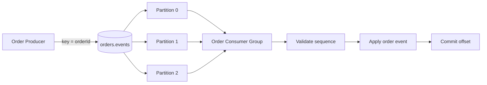

# Luồng đơn hàng bằng Java producer và consumer có key

Trong bài thực hành này, bạn sẽ xây dựng một luồng event đơn hàng nhỏ bằng Kafka và Java. Producer phát các sự kiện `OrderEvent` với Kafka key là `orderId`; consumer đọc topic, kiểm tra thứ tự sequence theo từng đơn hàng và commit offset sau khi xử lý xong batch. Mục tiêu là thấy trực tiếp cách key quyết định partition, cách Kafka giữ thứ tự trong một partition và cách consumer group chia công việc.

Bạn sẽ chạy Kafka KRaft một broker trên máy local, tạo topic nhiều partition, viết Java producer/consumer dùng Kafka client API, sau đó kiểm chứng bằng CLI và thực hiện một số thay đổi để quan sát ordering.

## 1. Kết quả cần đạt

Sau khi hoàn thành, bạn có thể:

- Khởi động một Kafka broker chạy KRaft trên local.
- Tạo topic `orders.events` với nhiều partition.
- Viết Java producer serialize event và gửi với key là `orderId`.
- Viết Java consumer subscribe topic bằng một `group.id`.
- Quan sát các event cùng `orderId` được ghi vào cùng partition.
- Kiểm tra sequence để phát hiện event trùng, thiếu hoặc sai thứ tự trong phạm vi demo.
- Hiểu vì sao Kafka chỉ bảo đảm thứ tự trong một partition và vì sao consumer cần xử lý tuần tự theo partition.
- Commit offset sau khi xử lý batch và hiểu cửa sổ redelivery khi ứng dụng gặp lỗi.

Luồng tổng quát:



## 2. Chuẩn bị môi trường

Cần có:

- JDK 17 trở lên.
- Maven 3.8+.
- Docker Desktop hoặc Docker Engine có Docker Compose.
- Terminal có thể chạy `docker`, `mvn` và Java.

Các lệnh nhiều dòng dưới đây dùng cú pháp Bash/WSL/Git Bash. Nếu dùng Windows PowerShell, có thể ghép từng lệnh thành một dòng hoặc thay dấu `\` nối dòng bằng backtick PowerShell.

Kiểm tra:

```bash
java -version
mvn -version
docker version
docker compose version
```

Trong bài này, Kafka broker và Java app chạy trên cùng máy, kết nối qua `localhost:9092`. Cấu hình một broker chỉ phù hợp học tập và kiểm thử logic producer/consumer; nó không kiểm chứng được replication factor lớn hơn 1, ISR failover hay durability của production.

## 3. Khởi động Kafka KRaft bằng Docker Compose

Tạo thư mục thực hành:

```text
kafka-order-lab/
├── compose.yaml
└── order-stream/
    ├── pom.xml
    └── src/main/java/vn/example/kafka/
        ├── OrderEvent.java
        ├── OrderProducer.java
        └── OrderConsumer.java
```

Tạo file `compose.yaml` ở thư mục gốc:

```yaml
services:
  kafka:
    image: apache/kafka:3.9.1
    container_name: kafka-order-lab
    hostname: kafka
    ports:
      - "9092:9092"
    environment:
      KAFKA_NODE_ID: 1
      KAFKA_PROCESS_ROLES: broker,controller
      KAFKA_LISTENERS: PLAINTEXT://:9092,CONTROLLER://:9093
      KAFKA_ADVERTISED_LISTENERS: PLAINTEXT://localhost:9092
      KAFKA_CONTROLLER_LISTENER_NAMES: CONTROLLER
      KAFKA_CONTROLLER_QUORUM_VOTERS: 1@localhost:9093
      KAFKA_LISTENER_SECURITY_PROTOCOL_MAP: CONTROLLER:PLAINTEXT,PLAINTEXT:PLAINTEXT
      KAFKA_OFFSETS_TOPIC_REPLICATION_FACTOR: 1
      KAFKA_TRANSACTION_STATE_LOG_REPLICATION_FACTOR: 1
      KAFKA_TRANSACTION_STATE_LOG_MIN_ISR: 1
      KAFKA_GROUP_INITIAL_REBALANCE_DELAY_MS: 0
      KAFKA_AUTO_CREATE_TOPICS_ENABLE: "false"
```

Khởi động:

```bash
docker compose up -d
docker compose ps
docker compose logs --tail=50 kafka
```

Đợi broker hoàn tất startup rồi mở terminal khác. Kiểm tra broker có phản hồi:

```bash
docker compose exec kafka /opt/kafka/bin/kafka-broker-api-versions.sh \
  --bootstrap-server localhost:9092
```

Nếu Docker chưa tải image, lần đầu chạy sẽ cần thời gian download. Nếu port 9092 đã được ứng dụng khác sử dụng, đổi port mapping và `KAFKA_ADVERTISED_LISTENERS` đồng bộ, rồi cập nhật `bootstrap.servers` trong Java app.

## 4. Tạo topic có ba partition

Tạo topic rõ ràng thay vì phụ thuộc auto topic creation:

```bash
docker compose exec kafka /opt/kafka/bin/kafka-topics.sh \
  --bootstrap-server localhost:9092 \
  --create \
  --topic orders.events \
  --partitions 3 \
  --replication-factor 1 \
  --config cleanup.policy=delete \
  --config retention.ms=86400000
```

Kiểm tra:

```bash
docker compose exec kafka /opt/kafka/bin/kafka-topics.sh \
  --bootstrap-server localhost:9092 \
  --describe --topic orders.events
```

Bạn sẽ thấy ba partition, mỗi partition có một replica (đồng thời là leader) vì broker local chỉ có một node. Với một broker, `replication-factor` phải là 1.

Ba partition cho phép nhiều order được xử lý song song. Producer dùng `orderId` làm key; theo default partitioner, cùng một key được ánh xạ ổn định vào cùng partition khi partition count không thay đổi.

## 5. Tạo Maven project

Trong thư mục `order-stream`, tạo `pom.xml`:

```xml
<?xml version="1.0" encoding="UTF-8"?>
<project xmlns="http://maven.apache.org/POM/4.0.0"
         xmlns:xsi="http://www.w3.org/2001/XMLSchema-instance"
         xsi:schemaLocation="http://maven.apache.org/POM/4.0.0 https://maven.apache.org/xsd/maven-4.0.0.xsd">
    <modelVersion>4.0.0</modelVersion>

    <groupId>vn.example</groupId>
    <artifactId>order-stream</artifactId>
    <version>1.0.0</version>

    <properties>
        <maven.compiler.release>17</maven.compiler.release>
        <project.build.sourceEncoding>UTF-8</project.build.sourceEncoding>
        <kafka.version>3.9.1</kafka.version>
        <jackson.version>2.18.2</jackson.version>
    </properties>

    <dependencies>
        <dependency>
            <groupId>org.apache.kafka</groupId>
            <artifactId>kafka-clients</artifactId>
            <version>${kafka.version}</version>
        </dependency>
        <dependency>
            <groupId>com.fasterxml.jackson.core</groupId>
            <artifactId>jackson-databind</artifactId>
            <version>${jackson.version}</version>
        </dependency>
        <dependency>
            <groupId>org.slf4j</groupId>
            <artifactId>slf4j-simple</artifactId>
            <version>1.7.36</version>
            <scope>runtime</scope>
        </dependency>
    </dependencies>

    <build>
        <plugins>
            <plugin>
                <groupId>org.apache.maven.plugins</groupId>
                <artifactId>maven-compiler-plugin</artifactId>
                <version>3.13.0</version>
            </plugin>
            <plugin>
                <groupId>org.codehaus.mojo</groupId>
                <artifactId>exec-maven-plugin</artifactId>
                <version>3.5.0</version>
            </plugin>
        </plugins>
    </build>
</project>
```

Kafka client dùng cùng dòng 3.9.1 với broker trong lab để giảm khác biệt phiên bản. Ứng dụng chỉ cần Kafka client API, không cần cài Kafka broker vào Maven project.

## 6. Tạo model `OrderEvent`

Tạo `src/main/java/vn/example/kafka/OrderEvent.java`:

```java
package vn.example.kafka;

public record OrderEvent(
        String eventId,
        String orderId,
        String status,
        int sequence,
        String occurredAt
) {}
```

Các field có ý nghĩa:

| Field | Ý nghĩa |
|---|---|
| `eventId` | ID duy nhất của event để truy vết và phát hiện duplicate |
| `orderId` | Khóa nghiệp vụ; cũng là Kafka record key |
| `status` | Trạng thái đơn hàng như `CREATED`, `PAID`, `SHIPPED` |
| `sequence` | Số thứ tự tăng dần trong một order |
| `occurredAt` | Thời điểm ứng dụng tạo event |

`sequence` giúp consumer phát hiện event đến sai thứ tự. Kafka offset chỉ tăng trong partition; nó không thay thế sequence nghiệp vụ giữa các event của một order.

## 7. Viết Java producer dùng `orderId` làm key

Tạo `src/main/java/vn/example/kafka/OrderProducer.java`:

```java
package vn.example.kafka;

import com.fasterxml.jackson.databind.ObjectMapper;
import org.apache.kafka.clients.producer.KafkaProducer;
import org.apache.kafka.clients.producer.ProducerConfig;
import org.apache.kafka.clients.producer.ProducerRecord;
import org.apache.kafka.clients.producer.RecordMetadata;
import org.apache.kafka.common.serialization.StringSerializer;

import java.time.Instant;
import java.util.List;
import java.util.Properties;
import java.util.UUID;
import java.util.concurrent.TimeUnit;

public final class OrderProducer {
    private static final String TOPIC = "orders.events";

    public static void main(String[] args) throws Exception {
        String bootstrapServers = args.length > 0 ? args[0] : "localhost:9092";
        String runId = UUID.randomUUID().toString();
        String orderA = "ORD-1001-" + runId.substring(0, 8);
        String orderB = "ORD-2002-" + runId.substring(0, 8);
        ObjectMapper mapper = new ObjectMapper();

        Properties props = new Properties();
        props.put(ProducerConfig.BOOTSTRAP_SERVERS_CONFIG, bootstrapServers);
        props.put(ProducerConfig.CLIENT_ID_CONFIG, "order-producer-" + runId);
        props.put(ProducerConfig.KEY_SERIALIZER_CLASS_CONFIG,
                StringSerializer.class.getName());
        props.put(ProducerConfig.VALUE_SERIALIZER_CLASS_CONFIG,
                StringSerializer.class.getName());
        props.put(ProducerConfig.ACKS_CONFIG, "all");
        props.put(ProducerConfig.ENABLE_IDEMPOTENCE_CONFIG, true);
        props.put(ProducerConfig.RETRIES_CONFIG, Integer.MAX_VALUE);
        props.put(ProducerConfig.MAX_IN_FLIGHT_REQUESTS_PER_CONNECTION, 5);

        List<OrderEvent> events = List.of(
                event(runId, orderA, "CREATED", 1),
                event(runId, orderB, "CREATED", 1),
                event(runId, orderA, "PAID", 2),
                event(runId, orderB, "PAID", 2),
                event(runId, orderA, "SHIPPED", 3),
                event(runId, orderB, "SHIPPED", 3)
        );

        try (KafkaProducer<String, String> producer = new KafkaProducer<>(props)) {
            for (OrderEvent event : events) {
                String value = mapper.writeValueAsString(event);
                ProducerRecord<String, String> record =
                        new ProducerRecord<>(TOPIC, event.orderId(), value);

                RecordMetadata metadata = producer.send(record)
                        .get(10, TimeUnit.SECONDS);

                System.out.printf(
                        "sent eventId=%s key=%s partition=%d offset=%d%n",
                        event.eventId(), event.orderId(),
                        metadata.partition(), metadata.offset());
            }
            producer.flush();
        }
    }

    private static OrderEvent event(
            String runId, String orderId, String status, int sequence) {
        String eventId = runId + ":" + orderId + ":" + sequence;
        return new OrderEvent(
                eventId, orderId, status, sequence, Instant.now().toString());
    }
}
```

Điểm quan trọng là constructor `ProducerRecord<>(TOPIC, event.orderId(), value)`: tham số thứ hai là key. Producer gửi lần lượt từ một thread và chờ acknowledgement từng event, nên thứ tự gửi của cùng một order dễ quan sát. Cách chờ từng record này phù hợp bài lab; production thường gửi async có giới hạn in-flight để tăng throughput.

`enable.idempotence=true` giúp producer tránh duplicate do retry protocol trong cùng producer session. Nó không loại bỏ việc ứng dụng chủ động gửi lại cùng event như một lần gửi mới sau restart; `eventId` vẫn cần cho deduplication ở consumer/database nếu nghiệp vụ yêu cầu.

## 8. Viết Java consumer xử lý tuần tự và commit offset

Tạo `src/main/java/vn/example/kafka/OrderConsumer.java`:

```java
package vn.example.kafka;

import com.fasterxml.jackson.databind.ObjectMapper;
import org.apache.kafka.clients.consumer.ConsumerConfig;
import org.apache.kafka.clients.consumer.ConsumerRecord;
import org.apache.kafka.clients.consumer.ConsumerRecords;
import org.apache.kafka.clients.consumer.KafkaConsumer;
import org.apache.kafka.common.errors.WakeupException;
import org.apache.kafka.common.serialization.StringDeserializer;

import java.time.Duration;
import java.util.HashMap;
import java.util.HashSet;
import java.util.Map;
import java.util.Properties;
import java.util.Set;
import java.util.UUID;
import java.util.concurrent.atomic.AtomicBoolean;

public final class OrderConsumer {
    private static final String TOPIC = "orders.events";

    public static void main(String[] args) throws Exception {
        String bootstrapServers = args.length > 0 ? args[0] : "localhost:9092";
        String groupId = args.length > 1 ? args[1] : "orders-projection-demo";

        Properties props = new Properties();
        props.put(ConsumerConfig.BOOTSTRAP_SERVERS_CONFIG, bootstrapServers);
        props.put(ConsumerConfig.GROUP_ID_CONFIG, groupId);
        props.put(ConsumerConfig.CLIENT_ID_CONFIG,
                groupId + "-" + UUID.randomUUID());
        props.put(ConsumerConfig.KEY_DESERIALIZER_CLASS_CONFIG,
                StringDeserializer.class.getName());
        props.put(ConsumerConfig.VALUE_DESERIALIZER_CLASS_CONFIG,
                StringDeserializer.class.getName());
        props.put(ConsumerConfig.AUTO_OFFSET_RESET_CONFIG, "earliest");
        props.put(ConsumerConfig.ENABLE_AUTO_COMMIT_CONFIG, false);
        props.put(ConsumerConfig.MAX_POLL_RECORDS_CONFIG, 100);

        AtomicBoolean running = new AtomicBoolean(true);
        ObjectMapper mapper = new ObjectMapper();
        Map<String, Integer> lastSequenceByOrder = new HashMap<>();
        Set<String> seenEventIds = new HashSet<>();

        try (KafkaConsumer<String, String> consumer = new KafkaConsumer<>(props)) {
            consumer.subscribe(java.util.List.of(TOPIC));

            Runtime.getRuntime().addShutdownHook(new Thread(() -> {
                running.set(false);
                consumer.wakeup();
            }));

            try {
                while (running.get()) {
                    ConsumerRecords<String, String> records =
                            consumer.poll(Duration.ofMillis(500));

                    for (ConsumerRecord<String, String> record : records) {
                        OrderEvent event = mapper.readValue(
                                record.value(), OrderEvent.class);

                        if (!event.orderId().equals(record.key())) {
                            throw new IllegalStateException(
                                    "Kafka key does not match orderId: " + record.offset());
                        }

                        if (!seenEventIds.add(event.eventId())) {
                            System.err.println("DUPLICATE eventId=" + event.eventId());
                        }

                        Integer previous = lastSequenceByOrder.get(event.orderId());
                        if (previous != null && event.sequence() <= previous) {
                            System.err.printf(
                                    "ORDER VIOLATION orderId=%s previous=%d current=%d%n",
                                    event.orderId(), previous, event.sequence());
                        } else {
                            if (previous != null && event.sequence() > previous + 1) {
                                System.err.printf(
                                        "SEQUENCE GAP orderId=%s previous=%d current=%d%n",
                                        event.orderId(), previous, event.sequence());
                            }
                            lastSequenceByOrder.put(event.orderId(), event.sequence());
                        }

                        System.out.printf(
                                "processed key=%s partition=%d offset=%d sequence=%d status=%s eventId=%s%n",
                                record.key(), record.partition(), record.offset(),
                                event.sequence(), event.status(), event.eventId());
                    }

                    // Commit only after every record in this poll batch was processed.
                    if (!records.isEmpty()) {
                        consumer.commitSync();
                    }
                }
            } catch (WakeupException exception) {
                if (running.get()) {
                    throw exception;
                }
            }
        }
    }
}
```

Consumer xử lý record tuần tự trong vòng lặp poll. Vì các event cùng key nằm trong cùng partition, chúng được đọc theo offset order. Consumer commit offset sau khi xử lý hết batch; nếu xử lý lỗi giữa batch, `commitSync()` không được gọi và các record chưa commit có thể được đọc lại.

Hai cấu trúc `seenEventIds` và `lastSequenceByOrder` chỉ lưu trong RAM để minh họa. Khi process restart, chúng mất dữ liệu. Hệ thống production cần lưu event ID/sequence đã áp dụng bền vững, ví dụ unique constraint/inbox table hoặc version check trong database. Kafka offset commit và database transaction không tự động tạo thành một transaction phân tán.

## 9. Build ứng dụng

Từ thư mục `order-stream`:

```bash
mvn -q clean package
```

Nếu build thành công, Maven tạo thư mục `target`. Nếu lỗi dependency download, kiểm tra Maven Central/proxy và JDK đang được Maven sử dụng.

## 10. Chạy consumer rồi producer

Mở terminal thứ nhất trong `order-stream`, khởi động consumer:

```bash
mvn -q exec:java \
  -Dexec.mainClass=vn.example.kafka.OrderConsumer \
  -Dexec.args="localhost:9092 orders-projection-demo"
```

Consumer group mới sẽ join và nhận assignment. Vì `auto.offset.reset=earliest`, group chưa có committed offset sẽ đọc từ đầu topic.

Mở terminal thứ hai, chạy producer:

```bash
mvn -q exec:java \
  -Dexec.mainClass=vn.example.kafka.OrderProducer \
  -Dexec.args="localhost:9092"
```

Producer gửi sáu event cho hai order. Mỗi order có sequence `1 → 2 → 3`. Output producer cho biết partition và offset do broker cấp; output consumer cho biết key, partition, offset và sequence đã xử lý.

Ví dụ output minh họa:

```text
sent eventId=...:ORD-1001:1 key=ORD-1001 partition=1 offset=0
sent eventId=...:ORD-2002:1 key=ORD-2002 partition=2 offset=0
sent eventId=...:ORD-1001:2 key=ORD-1001 partition=1 offset=1
sent eventId=...:ORD-2002:2 key=ORD-2002 partition=2 offset=1
sent eventId=...:ORD-1001:3 key=ORD-1001 partition=1 offset=2
sent eventId=...:ORD-2002:3 key=ORD-2002 partition=2 offset=2
```

Partition và offset thực tế phụ thuộc trạng thái topic; ví dụ trên chỉ minh họa. Điều cần quan sát là các event của `ORD-1001` cùng partition và sequence tăng dần; tương tự với `ORD-2002`.

## 11. Quan sát record trực tiếp bằng Kafka CLI

Mở terminal khác và đọc topic từ đầu, in cả key và partition:

```bash
docker compose exec kafka /opt/kafka/bin/kafka-console-consumer.sh \
  --bootstrap-server localhost:9092 \
  --topic orders.events \
  --from-beginning \
  --property print.key=true \
  --property print.partition=true \
  --property print.offset=true
```

Bạn sẽ thấy record key chính là `orderId`. Đóng console consumer bằng `Ctrl+C` khi quan sát xong.

Kiểm tra consumer group:

```bash
docker compose exec kafka /opt/kafka/bin/kafka-consumer-groups.sh \
  --bootstrap-server localhost:9092 \
  --describe --group orders-projection-demo
```

Quan sát `CURRENT-OFFSET`, `LOG-END-OFFSET`, `LAG` và partition assignment. Sau khi consumer xử lý xong, lag nên về 0.

## 12. Thử nghiệm key và ordering

### Thử nghiệm A — Cùng key

Gửi nhiều event với cùng `orderId=ORD-1001` và sequence tăng dần. Kiểm tra:

- Tất cả event có cùng partition không?
- Offset trong partition có tăng theo thứ tự producer gửi không?
- Consumer có nhận sequence `1, 2, 3` không?

Đây là bảo đảm ordering mà key cung cấp: cùng key được route đến cùng partition, và Kafka giữ thứ tự append trong partition đó.

### Thử nghiệm B — Khác key

Thay `orderId` thành `ORD-3003`, `ORD-4004` rồi chạy producer. Các key khác nhau có thể rơi vào cùng hoặc khác partition. Không có bảo đảm thứ tự toàn cục giữa partition 0, 1 và 2.

### Thử nghiệm C — Bỏ key

Tạm thay:

```java
new ProducerRecord<>(TOPIC, event.orderId(), value)
```

bằng:

```java
new ProducerRecord<>(TOPIC, value)
```

Record không còn key. Với default partitioner, record null key được phân phối theo cơ chế sticky/batching của producer và không còn bảo đảm tất cả event của một order vào cùng partition. Chạy lại test và quan sát partition.

### Thử nghiệm D — Thay đổi partition count

Không giảm partition count của topic hiện hữu bằng lệnh alter; Kafka không hỗ trợ giảm partition count theo cách thông thường. Có thể tạo topic mới với số partition khác để so sánh key mapping. Khi tăng partition count, default hash mapping của key có thể đổi; event cũ và event mới của cùng order có thể nằm ở partition khác nhau. Vì vậy, nếu cần strict ordering lâu dài, phải hoạch định partition count trước hoặc có chiến lược migration/sequence ở ứng dụng.

## 13. Thử nghiệm consumer group và parallelism

Topic có ba partition. Với consumer group truyền thống:

- Một consumer member có thể được assign cả ba partition.
- Hai member có thể chia ba partition giữa hai consumer.
- Ba member có thể nhận tối đa một partition mỗi member.
- Member thứ tư thường không nhận partition nào vì số member lớn hơn số partition.

Mở thêm terminal và chạy consumer thứ hai với cùng group ID:

```bash
mvn -q exec:java \
  -Dexec.mainClass=vn.example.kafka.OrderConsumer \
  -Dexec.args="localhost:9092 orders-projection-demo"
```

Hai process cùng group sẽ chia partition; mỗi record chỉ được giao cho một member trong group tại một thời điểm. Thứ tự trong từng partition vẫn được giữ khi consumer xử lý tuần tự, nhưng output hai terminal có thể xen kẽ vì chúng xử lý các partition khác nhau.

Chạy consumer với group ID khác:

```bash
mvn -q exec:java \
  -Dexec.mainClass=vn.example.kafka.OrderConsumer \
  -Dexec.args="localhost:9092 orders-audit-demo"
```

Group mới độc lập sẽ đọc lại dữ liệu theo `auto.offset.reset=earliest`. Hai group không chia partition cho nhau; mỗi group nhận một bản đọc riêng của topic.

## 14. Thử nghiệm commit offset và redelivery

Consumer trong bài tắt auto commit:

```properties
enable.auto.commit=false
```

và gọi `commitSync()` sau khi xử lý hết batch. Thử nghiệm:

1. Chạy consumer và gửi một số event.
2. Dừng consumer bình thường bằng `Ctrl+C`; kiểm tra group offset.
3. Khởi động lại consumer với cùng group ID; nó tiếp tục từ committed offset.
4. Tạm thêm một lệnh dừng process ngay sau khi in `processed` nhưng trước `commitSync()`.
5. Khởi động lại cùng group ID; các record của batch chưa commit có thể xuất hiện lại.

Điều này minh họa at-least-once: record có thể được xử lý lại nếu side effect đã hoàn tất nhưng offset chưa commit. Với ứng dụng thật, handler phải idempotent. Nếu side effect là database, có thể dùng event ID làm unique key hoặc inbox table để chỉ áp dụng một lần.

Không commit offset trước khi xử lý nếu yêu cầu không mất record. Commit trước xử lý có thể tạo at-most-once và làm mất record khi process crash sau commit.

## 15. Vì sao key không tự giải quyết mọi vấn đề ordering?

Key chỉ định tuyến record đến partition. Nó không tự serialize mọi producer thread hoặc bảo đảm side effect downstream hoàn tất theo thứ tự.

Các giới hạn cần nhớ:

- Nhiều thread/producer cùng gửi một key có thể tạo thứ tự append khác thứ tự nghiệp vụ mà các thread mong muốn.
- Nếu consumer dispatch record cùng partition sang executor song song, event sau có thể hoàn tất side effect trước event trước.
- Retry topic có thể làm event sequence cũ được xử lý sau event mới.
- Thay partition count có thể thay đổi mapping key-to-partition.
- Kafka không tạo total order giữa nhiều partition.

Trong bài lab, một producer thread gửi tuần tự và một consumer thread xử lý tuần tự để quan sát cơ chế cơ bản. Trong production, nếu strict per-order ordering là yêu cầu, hãy serialize event theo order ID ở producer, xử lý tuần tự theo partition hoặc dùng sequencer theo key ở consumer; đồng thời kiểm tra sequence/version trước khi cập nhật trạng thái.

## 16. Dọn môi trường sau khi thực hành

Dừng consumer bằng `Ctrl+C`. Từ thư mục chứa `compose.yaml`, dừng và xóa container:

```bash
docker compose down
```

Trong cấu hình hiện tại không khai báo volume; `docker compose down` sẽ xóa container cùng writable layer chứa dữ liệu broker. Nếu sau này bổ sung named/anonymous volume để giữ dữ liệu qua lần recreate, `docker compose down -v` cũng xóa các volume đó. Chỉ dùng `-v` khi muốn xóa dữ liệu volume của lab.

## 17. Bài tập mở rộng

1. Thêm trạng thái `CANCELLED` và bảo đảm sequence của một order vẫn tăng liên tục.
2. Tạo thêm topic `orders.audit` và viết consumer group độc lập để ghi nhận lịch sử.
3. Thêm header `event-source` và `trace-id`; in các header ở consumer.
4. Chuyển producer từ `send().get()` sang async callback; vẫn giữ một luồng gửi cho mỗi order và so sánh throughput/latency.
5. Chạy hai producer cùng gửi một `orderId`; quan sát vì sao sequence cần được cấp phát/serialize ở tầng nghiệp vụ.
6. Thêm database sink giả lập và làm cho handler idempotent theo `eventId`.
7. Tạo topic mới với một partition và so sánh với topic ba partition.
8. Chạy ba consumer trong cùng group, sau đó chạy consumer thứ tư và quan sát assignment.
9. Dừng broker trong lúc producer đang gửi, quan sát callback/retry và phục hồi sau khi broker lên lại.
10. Chạy lab trên cluster nhiều broker để thử replication factor 3 và `min.insync.replicas=2`.

## 18. Checklist hoàn thành

- [ ] Kafka KRaft local đã khởi động và trả lời API request.
- [ ] Topic `orders.events` có ba partition.
- [ ] Java Maven project build thành công.
- [ ] Producer gửi record với key bằng `orderId`.
- [ ] Các event cùng order được ghi vào cùng partition.
- [ ] Consumer in được key, partition, offset và sequence.
- [ ] Consumer group lag về 0 sau khi xử lý xong.
- [ ] Consumer thứ hai cùng group chia partition với member đầu.
- [ ] Consumer group mới đọc độc lập dữ liệu từ đầu.
- [ ] Đã thử commit offset và quan sát redelivery khi batch chưa commit.
- [ ] Hiểu rằng key bảo đảm routing/order trong partition, không tạo total order toàn topic.

Khi hoàn thành, bạn đã có một pipeline Kafka nhỏ nhưng đầy đủ các thành phần cốt lõi: producer, key, partition, topic, consumer group, offset và thứ tự xử lý. Hãy giữ `orderId` làm key khi mọi thay đổi của cùng một đơn hàng cần đi qua cùng partition; đồng thời dùng `eventId` và sequence để kiểm tra tính đúng đắn ở tầng nghiệp vụ.

## Tài liệu tham khảo

- [Apache Kafka 3.9 Quickstart](https://kafka.apache.org/39/getting-started/quickstart/)
- [Apache Kafka 3.9 Producer API](https://kafka.apache.org/39/javadoc/org/apache/kafka/clients/producer/KafkaProducer.html)
- [Apache Kafka 3.9 Consumer API](https://kafka.apache.org/39/javadoc/org/apache/kafka/clients/consumer/KafkaConsumer.html)
- [Apache Kafka 3.9 Producer Configs](https://kafka.apache.org/39/configuration/producer-configs/)
- [Apache Kafka 3.9 Consumer Configs](https://kafka.apache.org/39/configuration/consumer-configs/)
