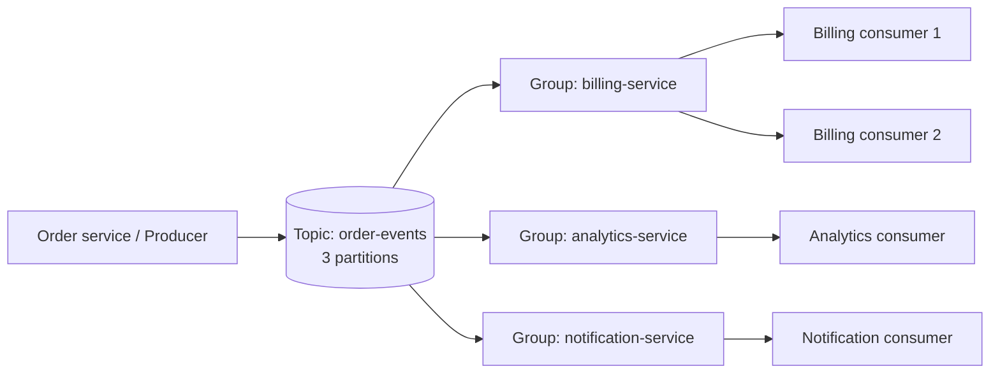

# Nhiều consumer group cùng xử lý một nguồn sự kiện

Một hệ thống thường có nhiều nghiệp vụ cần phản ứng với cùng một sự kiện. Khi đơn hàng được tạo, dịch vụ thanh toán cần ghi nhận khoản phải thu, dịch vụ phân tích cần cập nhật số liệu, còn dịch vụ thông báo cần gửi email hoặc tin nhắn cho khách hàng. Các nghiệp vụ này cần đọc cùng nguồn sự kiện nhưng tiến độ xử lý, tốc độ và thời điểm triển khai của chúng độc lập nhau.

Kafka giải quyết mô hình này bằng **nhiều consumer group cùng subscribe một topic**. Mỗi group có offset riêng và nhận toàn bộ luồng bản ghi của topic. Bên trong một group, các consumer chia nhau partition để mở rộng năng lực xử lý. Nhờ vậy, một topic có thể phục vụ nhiều ứng dụng độc lập mà không cần tạo một bản sao topic cho từng ứng dụng.

Bài thực hành xây dựng luồng `order-events` với ba consumer group: `billing-service`, `analytics-service` và `notification-service`. Người học sẽ tạo topic, chạy consumer bằng Kafka CLI, gửi sự kiện, mở rộng số consumer trong một group, quan sát offset và lag, sau đó triển khai cùng mô hình bằng Spring Kafka.

## Mục tiêu và kết quả cần đạt

Sau bài thực hành, người học có thể:

- Giải thích vì sao nhiều consumer group có thể đọc độc lập cùng một topic.
- Phân biệt broadcast giữa các group với load balancing giữa các consumer trong cùng group.
- Tạo group ID ổn định cho từng ứng dụng nghiệp vụ và mở rộng số instance của một ứng dụng.
- Quan sát offset, lag và trạng thái thành viên theo từng consumer group.
- Kiểm tra hành vi khi một group chậm, dừng hoặc cần đọc lại dữ liệu.
- Viết các listener Spring Kafka có group ID riêng và xử lý bản ghi theo hướng idempotent.

Kết quả mong đợi là khi producer gửi một sự kiện vào `order-events`, cả ba group đều nhận được sự kiện đó. Nếu tăng số consumer của `billing-service`, các consumer trong group thanh toán chia nhau partition; `analytics-service` và `notification-service` vẫn tiếp tục nhận luồng sự kiện độc lập.

## 1. Mô hình cần xây dựng

Giả sử hệ thống bán hàng phát ra sự kiện `OrderCreated`. Topic `order-events` có ba partition và được ghi bởi một producer. Ba ứng dụng đăng ký cùng topic với các group ID khác nhau:

| Consumer group | Trách nhiệm | Tiến độ riêng |
|---|---|---|
| `billing-service` | Tạo khoản phải thu, kiểm tra thanh toán hoặc chuyển đơn hàng sang bước tính tiền. | Offset của group thanh toán. |
| `analytics-service` | Cập nhật số đơn hàng, doanh thu và số liệu theo ngày. | Offset của group phân tích. |
| `notification-service` | Gửi email, SMS hoặc thông báo trong ứng dụng. | Offset của group thông báo. |



Topic là nguồn sự kiện chung. Kafka duy trì vị trí đọc riêng theo cặp consumer group và partition. Do đó, một bản ghi trong topic có thể được đọc một lần bởi mỗi group theo tiến độ của group đó. Bên trong `billing-service`, hai consumer là thành viên của cùng một group nên chúng chia nhau các partition. Cả hai không cùng nhận mọi bản ghi như hai group độc lập.

Fan-out ở đây không có nghĩa Kafka tạo thêm một bản sao vật lý của topic cho từng group. Các group đọc cùng log partition; phần độc lập nằm ở vị trí đọc và trạng thái thành viên của từng group. Trong mô hình at-least-once, một group vẫn có thể nhận lại bản ghi nếu xử lý xong nhưng chưa commit offset trước khi gặp lỗi.

### 1.1. Phân biệt fan-out và load balancing

| Cách đăng ký | Hành vi | Khi nào dùng |
|---|---|---|
| Nhiều ứng dụng dùng group ID khác nhau | Mỗi group đọc toàn bộ luồng topic theo offset riêng. Đây là fan-out ở tầng consumer group. | Nhiều nghiệp vụ độc lập cùng phản ứng với một sự kiện. |
| Nhiều instance dùng chung một group ID | Các instance chia nhau partition; mỗi partition tại một thời điểm được giao cho một consumer trong group. | Mở rộng năng lực xử lý của cùng một nghiệp vụ. |
| Mỗi instance dùng group ID riêng | Mỗi instance trở thành một group độc lập và tự đọc toàn bộ luồng. | Chỉ dùng khi thật sự muốn mỗi instance có một bản đọc độc lập, không dùng để scale một dịch vụ thông thường. |

Quy tắc đặt group ID rất quan trọng: các replica của cùng một dịch vụ phải dùng chung group ID; các dịch vụ có trách nhiệm nghiệp vụ khác nhau phải dùng group ID khác nhau. Nếu tạo group ID ngẫu nhiên cho từng replica, mỗi replica sẽ nhận toàn bộ sự kiện và có thể thực hiện cùng một nghiệp vụ nhiều lần.

### 1.2. Offset và lag độc lập

Kafka lưu committed offset theo consumer group và partition. Nếu `billing-service` đã commit offset kế tiếp là `120` trong partition 0, điều đó không làm thay đổi offset của `analytics-service` hay `notification-service`. Một group có thể xử lý đến cuối log trong khi group khác còn lag nhiều bản ghi.

Offset commit là vị trí tiếp theo cần đọc. Nếu bản ghi offset `119` đã được xử lý thành công, group commit `120`. Lag thường được tính từ log end offset trừ đi committed offset; cách diễn giải chính xác của số liệu phụ thuộc trạng thái group và công cụ quan sát. Mỗi group có lag riêng trên từng partition.

## 2. Chuẩn bị môi trường và tạo topic

Bài thực hành giả định Kafka broker đang chạy và có thể truy cập tại `localhost:9092`. Các lệnh dưới đây dùng tên script `.sh` trên Linux/macOS hoặc trong môi trường container. Nếu dùng Windows, thay bằng script `.bat` tương ứng trong thư mục `bin\windows` của bản Kafka đang cài.

Tạo topic có ba partition. Với cụm Kafka local chỉ có một broker, replication factor phải là `1`:

```bash
kafka-topics.sh --bootstrap-server localhost:9092 \
  --create --topic order-events \
  --partitions 3 --replication-factor 1
```

Kiểm tra cấu trúc topic:

```bash
kafka-topics.sh --bootstrap-server localhost:9092 \
  --describe --topic order-events
```

Kết quả cần cho biết topic có ba partition. Trong cụm nhiều broker, nên chọn replication factor phù hợp với số broker và yêu cầu độ bền dữ liệu; không đặt replication factor lớn hơn số broker khả dụng.

Nếu topic đã tồn tại, không cần tạo lại. Hãy kiểm tra đúng cluster bootstrap và cấu hình partition trước khi tiếp tục. Tránh xóa topic đang có dữ liệu của môi trường dùng chung chỉ để chạy lại bài lab.

## 3. Chạy ba consumer group bằng Kafka CLI

Mở ba terminal riêng. Mỗi terminal chạy một consumer với cùng topic nhưng group ID khác nhau. Chạy consumer trước khi gửi dữ liệu để dễ quan sát luồng mới.

**Terminal 1 — thanh toán:**

```bash
kafka-console-consumer.sh --bootstrap-server localhost:9092 \
  --topic order-events --group billing-service \
  --from-beginning \
  --property print.key=true \
  --property print.partition=true \
  --property print.offset=true
```

**Terminal 2 — phân tích:**

```bash
kafka-console-consumer.sh --bootstrap-server localhost:9092 \
  --topic order-events --group analytics-service \
  --from-beginning \
  --property print.key=true \
  --property print.partition=true \
  --property print.offset=true
```

**Terminal 3 — thông báo:**

```bash
kafka-console-consumer.sh --bootstrap-server localhost:9092 \
  --topic order-events --group notification-service \
  --from-beginning \
  --property print.key=true \
  --property print.partition=true \
  --property print.offset=true
```

`--from-beginning` có tác dụng khi group chưa có committed offset hợp lệ. Nếu group đã có offset, consumer tiếp tục từ tiến độ đã commit; tùy chọn này không tự đặt lại offset của group đang tồn tại.

Mỗi lệnh tạo hoặc tham gia một group khác nhau. Các terminal có thể đang hiển thị cùng một bản ghi, nhưng mỗi group duy trì tiến độ riêng. Việc đọc của terminal thanh toán không làm terminal phân tích hoặc thông báo bỏ qua bản ghi.

## 4. Gửi sự kiện vào topic

Mở terminal thứ tư và chạy console producer với chế độ đọc key. Dấu `:` đầu tiên phân tách key và value; phần JSON sau dấu phân tách được giữ làm value:

```bash
kafka-console-producer.sh --bootstrap-server localhost:9092 \
  --topic order-events \
  --property parse.key=true \
  --property key.separator=:
```

Nhập lần lượt các sự kiện sau, mỗi sự kiện trên một dòng:

```text
order-1001:{"eventId":"evt-001","type":"OrderCreated","orderId":"order-1001","amount":125000,"currency":"VND"}
order-1002:{"eventId":"evt-002","type":"OrderCreated","orderId":"order-1002","amount":250000,"currency":"VND"}
order-1003:{"eventId":"evt-003","type":"OrderCreated","orderId":"order-1003","amount":99000,"currency":"VND"}
order-1001:{"eventId":"evt-004","type":"OrderPaid","orderId":"order-1001","amount":125000,"currency":"VND"}
```

Quan sát cả ba terminal. Mỗi group cần hiển thị đủ bốn sự kiện, dù thứ tự xen kẽ giữa các partition có thể khác nhau. Cùng một key `order-1001` được partitioner mặc định ánh xạ ổn định vào cùng partition trong điều kiện cấu hình partitioner và số partition không thay đổi. Vì vậy, các sự kiện của cùng đơn hàng có thể giữ thứ tự trong partition đó.

Nếu một terminal không nhận được dữ liệu, kiểm tra group ID, topic, bootstrap server và trạng thái consumer trước khi kết luận producer gửi thất bại. Việc một group đang dừng không ngăn các group còn lại đọc topic; tuy nhiên, tất cả vẫn dùng chung tài nguyên broker và chịu ảnh hưởng của retention.

## 5. Mở rộng số consumer trong cùng một group

Hiện tại `billing-service` có một consumer. Mở terminal thứ năm và chạy thêm consumer với **cùng** group ID:

```bash
kafka-console-consumer.sh --bootstrap-server localhost:9092 \
  --topic order-events --group billing-service \
  --property print.key=true \
  --property print.partition=true \
  --property print.offset=true
```

Kafka thực hiện rebalance trong group `billing-service` để phân phối partition cho hai thành viên. Tùy thời điểm khởi chạy và assignment strategy, mỗi consumer có thể nhận một hoặc nhiều partition. Vì topic có ba partition, group có tối đa ba consumer cùng lúc được giao ít nhất một partition; nếu có nhiều hơn ba consumer, một số consumer sẽ không được giao partition và không nhận bản ghi cho đến khi assignment thay đổi.

Gửi thêm một số sự kiện với các key khác nhau. Quan sát hai terminal thuộc `billing-service`: các bản ghi được chia theo partition, và một bản ghi cụ thể được xử lý bởi thành viên đang sở hữu partition của nó. Hai group `analytics-service` và `notification-service` vẫn nhận các sự kiện mới theo tiến độ riêng.

Điều cần xác nhận:

- Cả hai consumer thanh toán có thể nhận bản ghi, nhưng không phải mỗi consumer đều nhận mọi bản ghi.
- Mỗi sự kiện vẫn được đọc bởi group phân tích và group thông báo.
- Thêm consumer vào `billing-service` chỉ làm thay đổi assignment trong group thanh toán; nó không biến các group khác thành thành viên của group này.
- Tăng số consumer vượt quá số partition không làm tăng mức song song hữu ích của group cho topic đó.

## 6. Quan sát group, offset và lag

Liệt kê các group đã được broker ghi nhận:

```bash
kafka-consumer-groups.sh --bootstrap-server localhost:9092 --list
```

Xem offset và lag của group thanh toán:

```bash
kafka-consumer-groups.sh --bootstrap-server localhost:9092 \
  --describe --group billing-service
```

Lặp lại với `analytics-service` và `notification-service`. Kết quả thường có các cột như `TOPIC`, `PARTITION`, `CURRENT-OFFSET`, `LOG-END-OFFSET`, `LAG`, `CONSUMER-ID`, `HOST` và `CLIENT-ID`. Tên hoặc cách hiển thị một số cột có thể khác theo phiên bản Kafka.

Đối chiếu các kết quả:

1. Cùng một topic và partition xuất hiện trong cả ba group.
2. Mỗi group có `CURRENT-OFFSET` riêng.
3. Khi cả ba group xử lý xong, lag của từng group có thể về `0`.
4. Nếu dừng consumer phân tích trong khi vẫn gửi dữ liệu, lag của `analytics-service` tăng; hai group còn lại vẫn có thể tiếp tục tiến độ.
5. Khi khởi động lại consumer phân tích với đúng group ID, nó tiếp tục từ committed offset của group nếu offset còn hợp lệ và dữ liệu vẫn nằm trong retention.

Có thể quan sát thành viên của group thanh toán bằng lệnh sau trên các phiên bản CLI hỗ trợ tùy chọn `--members`:

```bash
kafka-consumer-groups.sh --bootstrap-server localhost:9092 \
  --describe --group billing-service --members --verbose
```

Đừng so sánh offset giữa các group như thể chúng phải luôn bằng nhau. Mỗi ứng dụng có tốc độ, thời gian xử lý và chính sách commit riêng. Điều quan trọng là theo dõi lag của từng group so với yêu cầu nghiệp vụ của chính group đó.

## 7. Thử nghiệm group chậm và đọc lại dữ liệu

### 7.1. Một group bị dừng

Giữ producer hoạt động và dừng terminal của `analytics-service` bằng `Ctrl+C`. Tiếp tục gửi thêm sự kiện. Sau đó chạy lệnh describe cho cả ba group.

Kết quả mong đợi là lag của `analytics-service` tăng trong khi consumer group thanh toán và thông báo tiếp tục xử lý. Khởi động lại consumer phân tích với group ID cũ. Nó sẽ tiếp tục từ offset đã commit, không bắt đầu lại toàn bộ topic nếu offset vẫn tồn tại.

Sự độc lập này là độc lập về tiến độ và assignment. Các group vẫn chia sẻ cluster, network, disk, quota, topic retention và năng lực broker. Một group tiêu thụ quá chậm có thể bị mất khả năng đọc lại dữ liệu nếu bản ghi hết hạn theo retention trước khi group bắt kịp.

### 7.2. Tạo một group mới để đọc lịch sử

Để kiểm tra khả năng một ứng dụng mới nhận lại lịch sử còn được lưu, chạy một consumer với group ID mới:

```bash
kafka-console-consumer.sh --bootstrap-server localhost:9092 \
  --topic order-events --group audit-replay-lab \
  --from-beginning \
  --property print.key=true \
  --property print.partition=true \
  --property print.offset=true
```

Vì `audit-replay-lab` chưa có committed offset, consumer bắt đầu từ đầu log còn được lưu. Đây là cách kiểm thử fan-out cho một subscriber mới. Nó không thay đổi offset của ba group ban đầu.

### 7.3. Đặt lại offset của một group hiện có

Nếu cần chạy lại dữ liệu trong `analytics-service`, có thể đặt offset về đầu log. Trước tiên, dừng **tất cả** consumer đang là thành viên của group đó. Chạy chế độ xem trước:

```bash
kafka-consumer-groups.sh --bootstrap-server localhost:9092 \
  --group analytics-service --topic order-events \
  --reset-offsets --to-earliest --dry-run
```

Chỉ khi kết quả xem trước đúng topic, partition và group mới thực thi:

```bash
kafka-consumer-groups.sh --bootstrap-server localhost:9092 \
  --group analytics-service --topic order-events \
  --reset-offsets --to-earliest --execute
```

Khởi động lại consumer `analytics-service` để đọc lại. Việc reset offset làm thay đổi tiến độ của riêng group này; nó có thể khiến nghiệp vụ được thực hiện lại. Chỉ thực hiện trong môi trường lab hoặc khi đã có kế hoạch xử lý trùng lặp. Không reset group đang hoạt động và không chạy lệnh reset trên group sản xuất khi chưa đánh giá side effect.

## 8. Triển khai nhiều group bằng Spring Kafka

Trong ứng dụng Spring Boot, có thể tạo các `@KafkaListener` cùng subscribe `order-events` nhưng dùng `groupId` khác nhau. Mỗi listener container tham gia một consumer group độc lập.

Ví dụ cấu hình tối thiểu cho payload dạng chuỗi:

```yaml
spring:
  kafka:
    bootstrap-servers: localhost:9092
    consumer:
      auto-offset-reset: earliest
      key-deserializer: org.apache.kafka.common.serialization.StringDeserializer
      value-deserializer: org.apache.kafka.common.serialization.StringDeserializer
```

Không đặt một group ID duy nhất ở cấu hình chung nếu các listener trong ứng dụng cần thuộc những group khác nhau; hãy chỉ định `groupId` tại từng listener như ví dụ dưới đây. Nếu ứng dụng chỉ có một subscriber logic, có thể đặt `spring.kafka.consumer.group-id` làm giá trị mặc định.

```java
import org.apache.kafka.clients.consumer.ConsumerRecord;
import org.springframework.kafka.annotation.KafkaListener;
import org.springframework.stereotype.Component;

@Component
public class OrderEventSubscribers {

    @KafkaListener(
        topics = "order-events",
        groupId = "billing-service",
        concurrency = "2"
    )
    public void updateBilling(ConsumerRecord<String, String> record) {
        System.out.printf(
            "billing partition=%d offset=%d key=%s value=%s%n",
            record.partition(), record.offset(), record.key(), record.value());
        // Gọi nghiệp vụ thanh toán và lưu kết quả idempotent.
    }

    @KafkaListener(
        topics = "order-events",
        groupId = "analytics-service"
    )
    public void updateAnalytics(ConsumerRecord<String, String> record) {
        System.out.printf(
            "analytics partition=%d offset=%d key=%s%n",
            record.partition(), record.offset(), record.key());
        // Cập nhật số liệu phân tích.
    }

    @KafkaListener(
        topics = "order-events",
        groupId = "notification-service"
    )
    public void sendNotification(ConsumerRecord<String, String> record) {
        System.out.printf(
            "notification partition=%d offset=%d key=%s%n",
            record.partition(), record.offset(), record.key());
        // Gửi thông báo hoặc tạo notification job.
    }
}
```

`concurrency = "2"` yêu cầu listener thanh toán tạo hai consumer trong cùng group `billing-service`. Hai listener còn lại mỗi listener tạo một consumer theo cấu hình mặc định. Trong triển khai thực tế, mỗi nghiệp vụ thường được đặt ở service hoặc module riêng để triển khai, cấp quyền và mở rộng độc lập; ví dụ gộp trong một class chỉ nhằm minh họa cách khai báo group ID.

Nếu chạy nhiều replica của ứng dụng thanh toán, tất cả replica cần dùng cùng `billing-service`. Khi đó Kafka phân phối partition của group giữa các replica và các consumer concurrency. Không gắn hậu tố pod ID hoặc UUID vào group ID của từng replica trừ khi mục tiêu là tạo một subscriber độc lập cho từng instance.

### 8.1. Gửi sự kiện bằng KafkaTemplate

Producer chỉ cần gửi một lần vào topic. Kafka phân phối cùng bản ghi cho mỗi consumer group đang subscribe topic đó:

```java
import org.springframework.kafka.core.KafkaTemplate;
import org.springframework.stereotype.Service;

@Service
public class OrderEventPublisher {
    private final KafkaTemplate<String, String> kafkaTemplate;

    public OrderEventPublisher(KafkaTemplate<String, String> kafkaTemplate) {
        this.kafkaTemplate = kafkaTemplate;
    }

    public void publish(String orderId, String eventJson) {
        kafkaTemplate.send("order-events", orderId, eventJson);
    }
}
```

Key là `orderId`, giúp các sự kiện của cùng đơn hàng được gửi về cùng partition theo partitioner mặc định. Producer không cần gửi ba bản sao cho ba group. Nếu cần kiểm tra lỗi gửi, hãy quan sát kết quả future/callback của `send()` theo API Spring Kafka đang dùng và ghi nhận lỗi publish phù hợp.

### 8.2. Commit offset và xử lý idempotent

Các listener trên là ví dụ minh họa nhận bản ghi. Trong ứng dụng thật, phải xác định rõ khi nào một nghiệp vụ được xem là xử lý thành công và cấu hình acknowledgment/commit phù hợp. Nếu consumer hoàn tất side effect nhưng chết trước khi offset được commit, Kafka có thể giao lại bản ghi. Vì vậy, mỗi subscriber cần thiết kế idempotency riêng.

Ví dụ, `billing-service` lưu `eventId` đã áp dụng vào bảng inbox hoặc bảng ledger có ràng buộc duy nhất. Khi nhận lại `evt-001`, dịch vụ kiểm tra event đã được áp dụng hay chưa trước khi tạo bút toán mới. `analytics-service` có thể dùng upsert hoặc cập nhật aggregate theo event ID; `notification-service` có thể lưu notification job với unique key. Mỗi group có side effect khác nhau nên cần cơ chế chống trùng lặp phù hợp với nghiệp vụ của group đó.

Nhiều consumer group không tự tạo ra exactly-once cho side effect ở database, email hoặc hệ thống bên ngoài. Kafka offset và transaction của hệ thống đích cần được phối hợp theo thiết kế cụ thể; không nên suy ra rằng mỗi group chỉ có thể xử lý một lần.

## 9. Ordering, partition và năng lực xử lý

Thứ tự bản ghi được bảo đảm trong một partition. Với key `orderId`, producer thường đưa các sự kiện của cùng đơn hàng vào cùng partition, nhờ đó từng group có thể quan sát thứ tự của các sự kiện đó trong partition. Các group có thể xử lý cùng partition ở những consumer khác nhau, nhưng mỗi group vẫn theo thứ tự log của partition khi xử lý tuần tự.

Nếu listener gửi công việc sang thread pool và xử lý bất đồng bộ, thứ tự hoàn tất side effect có thể khác thứ tự nhận bản ghi. Khi nghiệp vụ yêu cầu ordering nghiêm ngặt theo đơn hàng, cần tuần tự hóa xử lý theo key hoặc dùng cơ chế phân luồng bảo toàn thứ tự. Không nên giả định Kafka tự bảo toàn thứ tự cho các tác vụ đã được ứng dụng tách sang nhiều thread.

Số partition giới hạn mức song song tối đa hữu ích của một consumer group cho topic đó. Ví dụ topic có ba partition thì group có thể dùng tối đa ba consumer cùng lúc để đọc các partition này. Mỗi group được phân phối độc lập, vì thế ba group có thể cùng có tối đa ba consumer đang hoạt động mà không chia sẻ offset với nhau. Tăng partition có ảnh hưởng đến phân phối key và cần cân nhắc khi yêu cầu ordering.

## 10. Ma trận kiểm thử và kết quả mong đợi

| Thử nghiệm | Thao tác | Kết quả cần quan sát |
|---|---|---|
| Fan-out cơ bản | Gửi một sự kiện khi cả ba group đang chạy. | Mỗi group đều đọc được sự kiện. |
| Load balancing | Thêm consumer thứ hai vào `billing-service`. | Các partition được chia giữa thành viên của group thanh toán; group khác vẫn đọc đầy đủ. |
| Group độc lập | Dừng `analytics-service`, tiếp tục publish. | Lag phân tích tăng; hai group còn lại vẫn tiến triển. |
| Resume | Khởi động lại `analytics-service` với group ID cũ. | Tiếp tục từ committed offset nếu offset và dữ liệu còn hợp lệ. |
| Subscriber mới | Khởi chạy `audit-replay-lab` với `--from-beginning`. | Group mới đọc lịch sử còn trong log; offset các group cũ không đổi. |
| Replay có chủ đích | Dừng group phân tích và reset offset về earliest. | Chỉ group phân tích đọc lại dữ liệu. |
| Scale vượt partition | Tăng số consumer trong một group lên lớn hơn ba. | Một số consumer không được gán partition và không xử lý bản ghi. |
| Idempotency | Làm cho một sự kiện được giao lại sau khi side effect hoàn tất nhưng trước commit. | Subscriber không tạo side effect nghiệp vụ trùng lặp. |

Trong mỗi thử nghiệm, ghi lại group ID, topic, partition, offset, consumer ID và lag. So sánh kết quả giữa các group thay vì chỉ xem một terminal consumer.

## 11. Lỗi thường gặp

| Triệu chứng hoặc cấu hình sai | Nguyên nhân | Hướng xử lý |
|---|---|---|
| Chỉ một ứng dụng nhận được sự kiện. | Các ứng dụng vô tình dùng cùng group ID nên đang chia partition với nhau. | Dùng group ID khác nhau cho các subscriber nghiệp vụ độc lập. |
| Mỗi replica đều xử lý toàn bộ sự kiện. | Mỗi replica dùng group ID riêng hoặc group ID sinh ngẫu nhiên. | Dùng một group ID ổn định cho mọi replica của cùng dịch vụ. |
| Consumer mới không đọc lịch sử. | Group đã có committed offset hoặc `auto.offset.reset` là `latest`. | Kiểm tra committed offset; dùng group mới hoặc reset offset có kiểm soát nếu cần replay. |
| Group chậm mất dữ liệu cũ. | Bản ghi đã hết retention trước khi group bắt kịp. | Theo dõi lag, điều chỉnh năng lực xử lý và retention theo yêu cầu lưu giữ. |
| Thêm consumer nhưng throughput không tăng. | Số consumer đã bằng hoặc lớn hơn số partition; hoặc nút thắt nằm ở nghiệp vụ/downstream. | Đánh giá partition count và thời gian xử lý trước khi scale tiếp. |
| Một group xử lý cùng sự kiện nhiều lần. | Retry, crash trước commit hoặc commit policy tạo at-least-once delivery. | Thiết kế idempotency và kiểm tra vị trí commit. |
| Group ID không xuất hiện khi liệt kê. | Group chưa commit offset, chưa hoạt động hoặc broker chưa có metadata group cần hiển thị. | Khởi chạy consumer, kiểm tra subscription và quan sát lại sau khi group có hoạt động. |
| Consumer không tham gia đúng group. | Sai bootstrap server, cấu hình group ID hoặc lỗi xác thực/ACL. | Kiểm tra cluster, cấu hình client, quyền đọc topic và quyền sử dụng group. |

## 12. Bài tập mở rộng

1. Thêm group `fraud-detection` để phát hiện giao dịch bất thường. Xác nhận group này đọc được toàn bộ sự kiện mà không làm thay đổi offset của ba group hiện tại.
2. Tăng topic lên sáu partition trong một môi trường lab riêng. Chạy ba consumer trong `billing-service`, sau đó quan sát assignment và lag.
3. Dừng `notification-service` trong một khoảng thời gian, tiếp tục publish rồi khởi động lại. Đánh giá liệu retention hiện tại có đủ để group bắt kịp hay không.
4. Cố ý làm cho `billing-service` xử lý một `eventId` hai lần. Bổ sung inbox table hoặc unique constraint để side effect chỉ được áp dụng một lần.
5. Đổi group ID của một subscriber trong môi trường lab và quan sát hành vi của group mới với `auto.offset.reset=earliest` và `latest`.
6. Thử key khác nhau và key giống nhau, ghi lại partition để giải thích tác động của key tới ordering và phân phối tải.

## 13. Checklist hoàn thành

- [ ] Topic `order-events` có ba partition và được mô tả đúng.
- [ ] Ba consumer group có group ID riêng và cùng subscribe topic.
- [ ] Một sự kiện producer gửi được cả ba group đọc.
- [ ] Hai consumer trong `billing-service` chia nhau partition.
- [ ] Đã xác nhận một group dừng không làm offset của group khác thay đổi.
- [ ] Đã quan sát committed offset và lag riêng của từng group.
- [ ] Đã thử tạo group mới để đọc lịch sử và hiểu giới hạn retention.
- [ ] Đã biết điều kiện dừng group trước khi reset offset.
- [ ] Spring Kafka listener chỉ định group ID đúng theo subscriber.
- [ ] Side effect của mỗi subscriber có cơ chế idempotency phù hợp.
- [ ] Đã xác định yêu cầu ordering theo key và giới hạn song song theo partition.

## 14. Câu hỏi tự kiểm tra

1. Vì sao ba consumer group khác nhau đều có thể đọc cùng một bản ghi trong `order-events`?
2. Nếu hai instance của `billing-service` dùng hai group ID khác nhau, điều gì xảy ra?
3. Offset của `analytics-service` có thay đổi khi `billing-service` commit không? Giải thích.
4. Topic có ba partition thì điều gì xảy ra nếu một group có năm consumer?
5. Một group dừng trong hai giờ có chắc chắn đọc lại được mọi bản ghi khi khởi động lại không? Yếu tố nào quyết định?
6. Vì sao `--from-beginning` không đồng nghĩa với việc reset offset của group đã có committed offset?
7. Cần làm gì để tránh side effect trùng lặp khi consumer nhận lại một sự kiện?
8. Khi nào nên tạo group ID mới và khi nào nên giữ group ID hiện tại?

## Kết luận

Nhiều consumer group cho phép nhiều nghiệp vụ độc lập cùng khai thác một nguồn sự kiện Kafka. Mỗi group có offset và lag riêng, còn các consumer trong cùng group chia nhau partition để mở rộng xử lý. Thiết kế đúng group ID, key, commit policy, retention và idempotency giúp hệ thống vừa fan-out sự kiện cho nhiều subscriber, vừa scale từng subscriber theo nhu cầu riêng.
