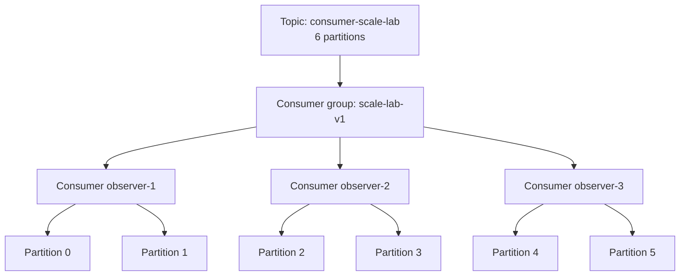

# Thay đổi số consumer và quan sát partition assignment

Trong Kafka, một consumer group có thể gồm nhiều consumer instance cùng đọc một topic. Kafka phân phối partition cho các member trong group; khi số instance thay đổi, group thực hiện rebalance để tạo assignment mới. Bài thực hành này giúp người học tự chạy nhiều consumer dùng chung `group.id`, tăng và giảm số instance, quan sát partition được giao cho từng instance và hiểu giới hạn song song do số partition quyết định.

## 1. Mục tiêu và mô hình thực hành

Sau bài thực hành, người học có thể:

- Tạo topic có nhiều partition và chạy nhiều consumer instance thuộc cùng một group.
- Quan sát `onPartitionsRevoked()` và `onPartitionsAssigned()` khi group rebalance.
- Giải thích quan hệ giữa số partition, số consumer đang hoạt động và consumer không được giao partition.
- Phân biệt mở rộng số process với tăng `concurrency` của một Spring Kafka listener.
- Kiểm tra assignment, committed offset và lag bằng Kafka CLI.

Mô hình sử dụng một topic có sáu partition và một consumer group. Mỗi process chạy chương trình quan sát là một consumer instance độc lập. Tất cả instance trong cùng một lần thử phải dùng chung `group.id`, nhưng có `client.id` riêng để nhận diện log.



Sơ đồ minh họa một assignment cân bằng khi có ba consumer và sáu partition. Partition cụ thể được giao cho từng member phụ thuộc partition assignor và trạng thái group tại thời điểm rebalance; không nên dựa vào sơ đồ để giả định trước số partition ID của từng process.

## 2. Chuẩn bị topic có sáu partition

Khởi động Kafka broker ở môi trường thực hành. Với cụm local chỉ có một broker, đặt replication factor bằng `1`; ở cụm nhiều broker, chọn replication factor phù hợp với cấu hình và chính sách của cụm.

Tạo topic:

```bash
bin/kafka-topics.sh \
  --bootstrap-server localhost:9092 \
  --create --if-not-exists \
  --topic consumer-scale-lab \
  --partitions 6 \
  --replication-factor 1
```

Trên Windows, script thường nằm trong `bin\windows` và có đuôi `.bat`:

```powershell
bin\windows\kafka-topics.bat --bootstrap-server localhost:9092 --create --if-not-exists --topic consumer-scale-lab --partitions 6 --replication-factor 1
```

Xác nhận topic có đúng sáu partition:

```bash
bin/kafka-topics.sh --bootstrap-server localhost:9092 --describe --topic consumer-scale-lab
```

Kết quả cần có các dòng `Partition: 0` đến `Partition: 5`. Assignment có thể được tạo ngay cả khi topic chưa có bản ghi, vì consumer group phân phối partition dựa trên metadata của topic.

Có thể mở một terminal khác để gửi dữ liệu thử:

```bash
bin/kafka-console-producer.sh \
  --bootstrap-server localhost:9092 \
  --topic consumer-scale-lab
```

Nhập nhiều dòng như `order-001`, `order-002`, `order-003` rồi nhấn Enter. Gửi đủ dữ liệu để các consumer có bản ghi đọc và quan sát log xử lý. Việc phân phối partition cho consumer vẫn có thể quan sát ngay cả khi topic rỗng.

## 3. Tạo consumer quan sát assignment

Thêm dependency `kafka-clients` tương thích với Kafka client mà dự án đang dùng. Ví dụ dưới đây là một chương trình Java độc lập. Chương trình nhận bốn tham số theo thứ tự: bootstrap servers, topic, group ID và client ID. Mỗi lần chạy chương trình sẽ tạo một consumer instance.

```java
import org.apache.kafka.clients.consumer.ConsumerConfig;
import org.apache.kafka.clients.consumer.ConsumerRebalanceListener;
import org.apache.kafka.clients.consumer.ConsumerRecord;
import org.apache.kafka.clients.consumer.ConsumerRecords;
import org.apache.kafka.clients.consumer.KafkaConsumer;
import org.apache.kafka.common.TopicPartition;
import org.apache.kafka.common.errors.WakeupException;
import org.apache.kafka.common.serialization.StringDeserializer;

import java.time.Duration;
import java.util.Collection;
import java.util.Collections;
import java.util.Comparator;
import java.util.Properties;
import java.util.concurrent.atomic.AtomicBoolean;
import java.util.stream.Collectors;

public class PartitionAssignmentObserver {

    public static void main(String[] args) {
        if (args.length != 4) {
            throw new IllegalArgumentException(
                    "Usage: <bootstrap-servers> <topic> <group-id> <client-id>");
        }

        String bootstrapServers = args[0];
        String topic = args[1];
        String groupId = args[2];
        String clientId = args[3];

        Properties properties = new Properties();
        properties.put(ConsumerConfig.BOOTSTRAP_SERVERS_CONFIG, bootstrapServers);
        properties.put(ConsumerConfig.GROUP_ID_CONFIG, groupId);
        properties.put(ConsumerConfig.CLIENT_ID_CONFIG, clientId);
        properties.put(ConsumerConfig.KEY_DESERIALIZER_CLASS_CONFIG,
                StringDeserializer.class.getName());
        properties.put(ConsumerConfig.VALUE_DESERIALIZER_CLASS_CONFIG,
                StringDeserializer.class.getName());
        properties.put(ConsumerConfig.AUTO_OFFSET_RESET_CONFIG, "earliest");
        properties.put(ConsumerConfig.ENABLE_AUTO_COMMIT_CONFIG, false);

        KafkaConsumer<String, String> consumer = new KafkaConsumer<>(properties);
        AtomicBoolean shuttingDown = new AtomicBoolean(false);

        Runtime.getRuntime().addShutdownHook(new Thread(() -> {
            shuttingDown.set(true);
            consumer.wakeup();
        }, "shutdown-" + clientId));

        try {
            consumer.subscribe(Collections.singletonList(topic),
                    new ConsumerRebalanceListener() {
                        @Override
                        public void onPartitionsRevoked(
                                Collection<TopicPartition> partitions) {
                            System.out.printf("[%s] REVOKED: %s%n",
                                    clientId, formatPartitions(partitions));
                        }

                        @Override
                        public void onPartitionsAssigned(
                                Collection<TopicPartition> partitions) {
                            System.out.printf("[%s] ASSIGNED: %s%n",
                                    clientId, formatPartitions(partitions));
                        }
                    });

            while (true) {
                ConsumerRecords<String, String> records =
                        consumer.poll(Duration.ofMillis(500));

                for (ConsumerRecord<String, String> record : records) {
                    System.out.printf(
                            "[%s] topic=%s partition=%d offset=%d key=%s value=%s%n",
                            clientId,
                            record.topic(),
                            record.partition(),
                            record.offset(),
                            record.key(),
                            record.value());
                }

                // Chỉ commit sau khi đã xử lý xong batch vừa poll.
                if (!records.isEmpty()) {
                    consumer.commitSync();
                }
            }
        } catch (WakeupException e) {
            if (!shuttingDown.get()) {
                throw e;
            }
        } finally {
            consumer.close();
            System.out.printf("[%s] Consumer closed.%n", clientId);
        }
    }

    private static String formatPartitions(Collection<TopicPartition> partitions) {
        return partitions.stream()
                .sorted(Comparator.comparing(TopicPartition::topic)
                        .thenComparingInt(TopicPartition::partition))
                .map(partition -> partition.topic() + "-" + partition.partition())
                .collect(Collectors.joining(", "));
    }
}
```

Các điểm cần chú ý trong chương trình:

- `subscribe()` đăng ký topic để Kafka quản lý membership và assignment của consumer group. `assign()` là cơ chế gán partition thủ công, không dùng cho bài thực hành này.
- `onPartitionsRevoked()` được gọi khi consumer chuẩn bị nhường các partition trong một đợt rebalance. `onPartitionsAssigned()` cho biết những partition được giao sau đó.
- `client.id` giúp nhận diện process trong log và metric; `group.id` mới quyết định các consumer có cùng tham gia một group hay không.
- `enable.auto.commit=false` và `commitSync()` sau khi xử lý batch giúp ví dụ thể hiện rõ thời điểm commit. Trong ứng dụng thật, cần thiết kế xử lý idempotent vì rebalance hoặc lỗi giữa lúc xử lý và commit vẫn có thể khiến bản ghi được đọc lại.
- Shutdown hook gọi `wakeup()` để đánh thức `poll()` và cho consumer đóng có kiểm soát. Chỉ thread đang sở hữu consumer mới gọi các thao tác thông thường trên consumer; `wakeup()` là ngoại lệ được thiết kế để đánh thức từ thread khác.

Nếu chạy trong cụm có TLS/SASL, bổ sung cấu hình bảo mật và credential qua secret hoặc biến môi trường. Không đưa mật khẩu vào source code hoặc dòng lệnh được lưu trong lịch sử shell.

## 4. Chạy một, hai rồi ba consumer

Đóng gói chương trình thành một ứng dụng có thể chạy bằng `java -jar partition-observer.jar`. Mỗi lệnh sau chạy trong một terminal riêng. Dùng cùng topic và group ID, đồng thời đặt client ID khác nhau.

**Thử nghiệm A — một consumer:**

```bash
java -jar partition-observer.jar localhost:9092 consumer-scale-lab scale-lab-v1 observer-1
```

Chờ dòng `ASSIGNED`. Với một consumer trong group và topic có sáu partition, consumer đó nhận cả sáu partition.

**Thử nghiệm B — thêm consumer thứ hai:**

Mở terminal thứ hai và chạy:

```bash
java -jar partition-observer.jar localhost:9092 consumer-scale-lab scale-lab-v1 observer-2
```

Quan sát cả hai terminal. Group sẽ rebalance: assignment cũ bị thu hồi và assignment mới được công bố. Với một topic có sáu partition và hai consumer, các assignor thông dụng phân phối cân bằng, thường là ba partition mỗi consumer. Không giả định consumer nào sẽ nhận partition ID nào.

**Thử nghiệm C — thêm consumer thứ ba:**

```bash
java -jar partition-observer.jar localhost:9092 consumer-scale-lab scale-lab-v1 observer-3
```

Sau rebalance, ba consumer có thể chia sáu partition thành hai partition mỗi consumer. Ghi lại danh sách `ASSIGNED` của từng terminal.

**Thử nghiệm D — tăng lên bảy consumer:**

Mở thêm bốn terminal với các client ID `observer-4` đến `observer-7`, vẫn giữ group ID `scale-lab-v1`. Chỉ có sáu partition nên tối đa sáu consumer được giao partition tại một thời điểm; ít nhất một consumer sẽ không có partition để đọc. Consumer không có assignment vẫn có thể ở trạng thái thành viên của group và chờ lần rebalance tiếp theo.

## 5. Giảm số consumer và quan sát rebalance

Giảm số consumer bằng cách nhấn `Ctrl+C` ở một terminal. Chương trình đóng consumer có kiểm soát; các partition đã giao cho member rời group sẽ được phân phối lại cho các member còn lại.

Lặp lại với các quy mô khác nhau và ghi kết quả vào bảng:

| Số partition | Số consumer trong group | Số consumer có thể nhận partition | Kết quả cần quan sát |
| ---: | ---: | ---: | --- |
| 6 | 1 | 1 | Một consumer nhận cả sáu partition |
| 6 | 2 | Tối đa 2 | Partition được chia giữa hai member |
| 6 | 3 | Tối đa 3 | Có thể chia hai partition cho mỗi member |
| 6 | 6 | Tối đa 6 | Mỗi member có thể nhận một partition |
| 6 | 7 | Tối đa 6 | Có ít nhất một member không được giao partition |

Số partition được giao phải cộng lại thành sáu. Assignment cụ thể phụ thuộc assignor, số topic mà group đăng ký, thời điểm member tham gia/rời group và metadata của cụm. Khi dừng process đột ngột, broker có thể cần chờ heartbeat hoặc session timeout trước khi loại member; do đó thời gian rebalance có thể dài hơn so với đóng consumer có kiểm soát.

## 6. Kiểm tra group bằng Kafka CLI

Trong khi các consumer đang chạy, mở terminal khác và mô tả group:

```bash
bin/kafka-consumer-groups.sh \
  --bootstrap-server localhost:9092 \
  --describe \
  --group scale-lab-v1
```

Lệnh cho biết topic, partition, committed offset, log end offset, lag và consumer ID được broker ghi nhận cho assignment hiện tại. Tùy phiên bản Kafka và trạng thái group, một số cột có thể hiển thị `-` khi chưa có committed offset hoặc member chưa có assignment.

Có thể xem trạng thái group:

```bash
bin/kafka-consumer-groups.sh \
  --bootstrap-server localhost:9092 \
  --describe \
  --group scale-lab-v1 \
  --state
```

Đối chiếu kết quả CLI với log `ASSIGNED` ở từng terminal. Nếu group có bảy member nhưng topic chỉ có sáu partition, một member có thể không xuất hiện với partition được giao. Dùng `--members --verbose` nếu phiên bản Kafka hỗ trợ để xem thông tin member và assignment chi tiết.

Trên Windows, dùng `bin\windows\kafka-consumer-groups.bat` thay cho script `.sh`.

## 7. Thử thay đổi partition assignor

Partition assignor quyết định cách chia partition giữa các consumer member. Một số assignor phổ biến:

| Assignor | Đặc điểm |
| --- | --- |
| `RangeAssignor` | Chia các partition liên tiếp trong từng topic cho consumer; với nhiều topic, phân phối có thể lệch tổng thể giữa member |
| `RoundRobinAssignor` | Lần lượt phân phối partition của các topic cho member đủ điều kiện |
| `StickyAssignor` | Cố gắng giữ assignment cũ khi có thể, giảm số partition phải chuyển giữa các member |
| `CooperativeStickyAssignor` | Duy trì tính ổn định của sticky assignment và hỗ trợ rebalance hợp tác, thu hồi partition theo từng bước |

Để so sánh, có thể cấu hình `partition.assignment.strategy` trong `Properties` của chương trình. Ví dụ dùng `RoundRobinAssignor`:

```java
properties.put(
        ConsumerConfig.PARTITION_ASSIGNMENT_STRATEGY_CONFIG,
        "org.apache.kafka.clients.consumer.RoundRobinAssignor");
```

Tất cả consumer trong cùng group cần có cấu hình assignor tương thích. Khi đổi chiến lược cho bài thử nghiệm, hãy dừng toàn bộ member, cập nhật cấu hình cho tất cả instance rồi khởi động lại cùng một cấu hình. Không thay assignor tùy tiện trên một member đang chạy vì khác biệt cấu hình có thể làm quá trình chuyển đổi group thất bại hoặc không diễn ra như mong muốn. Khả năng sử dụng cooperative assignor phụ thuộc phiên bản Kafka client và broker.

Với một topic duy nhất có sáu partition, `RangeAssignor` và `RoundRobinAssignor` có thể tạo kết quả phân bố số lượng tương tự. Để thấy khác biệt rõ hơn, hãy tạo thêm topic thứ hai với số partition khác nhau, cho cùng group đăng ký cả hai topic rồi so sánh assignment theo từng topic và tổng số partition trên mỗi member.

## 8. Liên hệ với Spring Kafka

Trong ứng dụng Spring Kafka, thuộc tính `concurrency` của `@KafkaListener` quyết định số consumer container/consumer instance được tạo cho listener trong một application instance. Ví dụ:

```yaml
spring:
  kafka:
    consumer:
      group-id: order-projection-v1
      auto-offset-reset: earliest

app:
  kafka:
    consumer:
      concurrency: 2
```

```java
import org.apache.kafka.clients.consumer.ConsumerRecord;
import org.springframework.kafka.annotation.KafkaListener;
import org.springframework.stereotype.Component;

@Component
public class OrderProjectionListener {

    @KafkaListener(
            topics = "${app.kafka.topic}",
            groupId = "${spring.kafka.consumer.group-id}",
            concurrency = "${app.kafka.consumer.concurrency:1}")
    public void onMessage(ConsumerRecord<String, String> record) {
        System.out.printf("partition=%d offset=%d value=%s%n",
                record.partition(), record.offset(), record.value());
    }
}
```

Có thể tăng `concurrency` hoặc tăng số replica của ứng dụng. Nếu mỗi replica chạy hai consumer và có ba replica cùng `group.id`, group có sáu consumer instance. Với topic sáu partition, tối đa sáu instance có thể nhận partition; tăng thêm instance không làm tăng số partition được xử lý song song. Nếu các replica vô tình dùng group ID khác nhau, mỗi group sẽ nhận một bản sao luồng dữ liệu theo cơ chế riêng của group, dẫn đến hành vi khác với scale-out một group.

Khi dùng Spring Kafka, hãy kiểm tra log assignment của Kafka client và cấu hình logging phù hợp. Nếu cần quan sát callback ở tầng container, có thể cấu hình `ConsumerAwareRebalanceListener` trên `ConcurrentKafkaListenerContainerFactory`; callback này hữu ích để ghi log revoke/assign và hoàn tất công việc cần thiết trước khi partition được chuyển giao.

## 9. Câu hỏi phân tích và lỗi thường gặp

**Vì sao tăng số consumer từ sáu lên tám không làm tăng throughput tương ứng?** Vì topic chỉ có sáu partition. Một partition trong cùng group chỉ được giao cho tối đa một consumer member tại một thời điểm; hai member còn lại không có partition để xử lý. Muốn tăng mức song song vượt giới hạn này cần đánh giá việc tăng số partition và tác động đến key ordering, dữ liệu hiện có, tải broker cùng khả năng xử lý của hệ thống đích.

**Vì sao log có `REVOKED` rồi mới có `ASSIGNED`?** Group đang chuyển assignment. Consumer nhường partition cũ và nhận assignment mới sau khi coordinator hoàn tất giai đoạn rebalance tương ứng. Với cooperative assignor, việc thu hồi có thể diễn ra theo từng phần thay vì thu hồi toàn bộ partition trong một lần.

**Vì sao hai process không chia partition cho nhau?** Kiểm tra chúng có cùng `group.id`, cùng subscribe đúng topic, kết nối cùng cluster và không vô tình dùng `assign()` hay group ID riêng. Kiểm tra trạng thái member bằng `kafka-consumer-groups --describe --group ... --members --verbose` nếu phiên bản hỗ trợ.

**Vì sao consumer mới không đọc lại từ đầu?** `auto.offset.reset=earliest` chỉ áp dụng khi group chưa có committed offset hợp lệ. Nếu group đã commit offset, consumer tiếp tục từ offset đã commit. Dùng group ID mới cho lần thử độc lập hoặc dừng toàn bộ group trước khi thực hiện quy trình reset offset có kiểm soát.

**Vì sao partition vẫn chưa được phân phối lại sau khi tắt process?** Nếu process bị kill hoặc máy bị mất kết nối, broker phải phát hiện member không còn hoạt động dựa trên heartbeat và timeout. Kiểm tra `session.timeout.ms`, trạng thái group và log broker trước khi kết luận assignment bị kẹt.

**Vì sao có thể thấy bản ghi được xử lý lại sau rebalance?** Nếu ứng dụng xử lý bản ghi nhưng chưa commit offset trước khi partition bị thu hồi, consumer mới có thể đọc lại từ committed offset cũ. Thiết kế handler idempotent, chọn commit strategy phù hợp và tránh để xử lý kéo dài vượt `max.poll.interval.ms`.

## 10. Checklist và kết quả cần nộp

- [ ] Tạo topic `consumer-scale-lab` với sáu partition và xác nhận bằng `kafka-topics --describe`.
- [ ] Chạy một consumer, ghi lại sáu partition được giao.
- [ ] Tăng lên hai và ba consumer cùng `group.id`; ghi lại callback revoke/assign.
- [ ] Tăng lên bảy consumer và xác định member không có partition.
- [ ] Giảm số consumer bằng cách đóng process có kiểm soát và quan sát assignment mới.
- [ ] Đối chiếu log của từng process với kết quả `kafka-consumer-groups --describe`.
- [ ] Thử ít nhất một assignor khác với cấu hình đồng nhất trên toàn group.
- [ ] Thử cấu hình `concurrency` của Spring Kafka và giải thích tổng số consumer instance.
- [ ] Ghi nhận số partition, số member, assignment, thời gian rebalance và lag cho từng lần thử.

Báo cáo thực hành nên có bảng kết quả cho các quy mô 1, 2, 3, 6 và 7 consumer; ảnh hoặc log `ASSIGNED`/`REVOKED`; kết quả CLI; cùng phần giải thích giới hạn song song. Sau khi hoàn tất, dừng các consumer, xác nhận group không còn member hoạt động và xóa topic thử nghiệm nếu môi trường không còn cần dùng.
