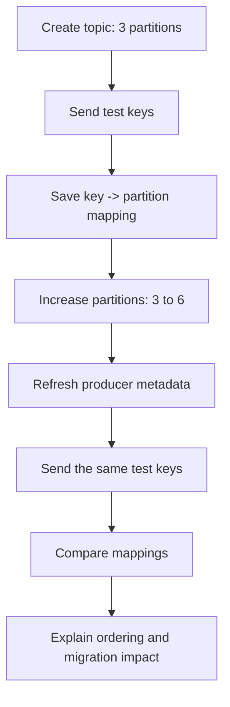

# Tăng partition để kiểm chứng thay đổi ánh xạ key

Trong Kafka, producer thường dùng key để đưa các record liên quan vào cùng một partition. Với partitioner mặc định của Java producer, key được serialize thành byte, băm bằng Murmur2 rồi lấy modulo theo số partition hiện tại. Vì vậy, khi tăng số partition của topic, cùng một key có thể được ánh xạ sang partition khác.

Bài thực hành này tạo một topic có 3 partition, gửi một tập key và ghi lại partition thực tế từ `RecordMetadata`. Sau đó tăng topic lên 6 partition, gửi lại đúng tập key và so sánh kết quả. Bạn sẽ quan sát được key nào giữ nguyên partition, key nào chuyển sang partition mới, đồng thời hiểu ảnh hưởng tới ordering và consumer group.

Bài học thuộc chương **Thực hành tổng hợp** của module **KAFKA**. Module hướng dẫn xây dựng hệ thống event streaming với Apache Kafka, topic, partition, offset, producer, consumer group, replication và KRaft; người học triển khai Java/Spring Kafka, retry, ordering, transaction, Kafka Connect/Streams và vận hành cụm. Lab tập trung vào một thay đổi cấu hình có tác động trực tiếp đến cách producer định tuyến record theo key.

Sau bài này, bạn có thể:

- Tạo topic với số partition xác định và đọc metadata partition.
- Gửi cùng một tập key trước và sau khi tăng partition.
- Dùng `RecordMetadata.partition()` để xác nhận partition thực tế của từng record.
- Giải thích vì sao một số key đổi partition còn một số key có thể giữ nguyên.
- Nhận diện rủi ro ordering khi cùng một key bắt đầu đi vào partition khác.
- Đưa ra phương án tăng khả năng song song mà vẫn bảo toàn hợp đồng ordering của ứng dụng.

## 1. Mục tiêu và nguyên lý cần kiểm chứng

Ta sẽ thay đổi số partition của một topic thử nghiệm theo sơ đồ:



Với key khác null, partitioner mặc định của Kafka Java client thường xác định partition theo công thức:

\[
\text{partition} = \operatorname{toPositive}(\operatorname{murmur2}(\text{serializedKey})) \bmod N
\]

Trong đó `N` là số partition hiện tại của topic. Công thức này áp dụng khi ứng dụng không chỉ định partition cụ thể và không dùng custom partitioner. Nếu dùng custom partitioner, explicit partition hoặc một client khác với thuật toán mặc định, kết quả có thể khác.

Khi `N` đổi từ 3 lên 6, giá trị hash của key không đổi nhưng modulo thay đổi. Không phải mọi key đều chắc chắn đổi partition. Với một hash cụ thể, nếu kết quả modulo 6 thuộc `0`, `1` hoặc `2`, partition có thể trùng với kết quả modulo 3; nếu kết quả modulo 6 thuộc `3`, `4` hoặc `5`, key sẽ chuyển sang một partition mới. Tập key đủ lớn giúp ta quan sát rõ hiện tượng này.

## 2. Chuẩn bị môi trường

Bạn cần:

- Một Kafka cluster đang chạy và có thể truy cập qua `localhost:9092`.
- Quyền tạo topic, mô tả topic và tăng số partition.
- Java project có dependency `org.apache.kafka:kafka-clients` tương thích với broker.
- JDK mà phiên bản Kafka client và project yêu cầu.

Lab dùng replication factor bằng 1 để chạy được trên một broker local. Nếu dùng cluster nhiều broker, có thể chọn replication factor phù hợp với số broker và chính sách lab. Không dùng topic production cho bài thực hành này vì số partition chỉ có thể tăng, không thể giảm bằng thao tác alter thông thường.

Kiểm tra broker có thể truy cập:

```bash
kafka-broker-api-versions.sh --bootstrap-server localhost:9092
```

Trên Windows distribution, dùng script tương ứng trong `bin\windows`, ví dụ `kafka-broker-api-versions.bat`. Nếu cluster bật TLS/SASL, bổ sung cấu hình client theo môi trường.

## 3. Bước 1: Tạo topic có 3 partition

Tạo topic thử nghiệm `key-remap-lab`:

```bash
kafka-topics.sh --bootstrap-server localhost:9092 --create --topic key-remap-lab --partitions 3 --replication-factor 1
```

Mô tả topic để xác nhận số partition:

```bash
kafka-topics.sh --bootstrap-server localhost:9092 --describe --topic key-remap-lab
```

Kết quả cần có ba dòng partition `0`, `1`, `2`. Leader có thể là cùng một broker nếu cluster chỉ có một broker.

Ví dụ dạng kết quả:

```text
Topic: key-remap-lab  PartitionCount: 3  ReplicationFactor: 1
  Topic: key-remap-lab  Partition: 0  Leader: 1  Replicas: 1  Isr: 1
  Topic: key-remap-lab  Partition: 1  Leader: 1  Replicas: 1  Isr: 1
  Topic: key-remap-lab  Partition: 2  Leader: 1  Replicas: 1  Isr: 1
```

Nếu topic đã tồn tại từ lần chạy trước, hãy xóa topic thử nghiệm và đợi việc xóa hoàn tất trước khi tạo lại, hoặc chọn một tên topic thử nghiệm mới. Không xóa topic chứa dữ liệu cần giữ.

## 4. Bước 2: Tạo Java probe để ghi nhận partition

Tạo class `PartitionMappingProbe`. Chương trình gửi cùng một danh sách key, sau đó in phase, key, partition và offset nhận được từ broker. Nó không chỉ tính partition dự kiến ở phía ứng dụng; `RecordMetadata.partition()` là bằng chứng partition thực tế mà producer đã ghi.

```java
import org.apache.kafka.clients.producer.KafkaProducer;
import org.apache.kafka.clients.producer.ProducerConfig;
import org.apache.kafka.clients.producer.ProducerRecord;
import org.apache.kafka.clients.producer.RecordMetadata;
import org.apache.kafka.common.serialization.StringSerializer;

import java.util.Arrays;
import java.util.List;
import java.util.Properties;
import java.util.concurrent.ExecutionException;

public class PartitionMappingProbe {
    private static final String TOPIC = "key-remap-lab";

    private static final List<String> KEYS = Arrays.asList(
            "customer-001", "customer-002", "customer-003",
            "customer-004", "customer-005", "customer-006",
            "customer-007", "customer-008", "customer-009",
            "customer-010", "order-1001", "order-1002",
            "order-1003", "order-1004", "order-1005",
            "account-A", "account-B", "account-C",
            "tenant-east", "tenant-west"
    );

    public static void main(String[] args)
            throws ExecutionException, InterruptedException {
        if (args.length != 2) {
            throw new IllegalArgumentException(
                    "Usage: PartitionMappingProbe <bootstrap-servers> <phase>"
            );
        }

        String bootstrapServers = args[0];
        String phase = args[1]; // before hoặc after

        Properties props = new Properties();
        props.put(ProducerConfig.BOOTSTRAP_SERVERS_CONFIG, bootstrapServers);
        props.put(ProducerConfig.KEY_SERIALIZER_CLASS_CONFIG,
                StringSerializer.class.getName());
        props.put(ProducerConfig.VALUE_SERIALIZER_CLASS_CONFIG,
                StringSerializer.class.getName());
        props.put(ProducerConfig.ACKS_CONFIG, "all");

        try (KafkaProducer<String, String> producer =
                     new KafkaProducer<>(props)) {
            for (String key : KEYS) {
                String value = phase + "-event-for-" + key;
                ProducerRecord<String, String> record =
                        new ProducerRecord<>(TOPIC, key, value);

                RecordMetadata metadata = producer.send(record).get();
                System.out.printf(
                        "%s,%s,%d,%d%n",
                        phase,
                        key,
                        metadata.partition(),
                        metadata.offset()
                );
            }
            producer.flush();
        }
    }
}
```

Nếu project chưa có Kafka client, thêm dependency Maven phù hợp với phiên bản broker/client của môi trường:

```xml
<dependency>
    <groupId>org.apache.kafka</groupId>
    <artifactId>kafka-clients</artifactId>
    <version>${kafka.clients.version}</version>
</dependency>
```

Khai báo `kafka.clients.version` trong `properties` theo phiên bản mà dự án đã chọn. Chạy class từ IDE hoặc cách chạy Java hiện có của project. Truyền hai tham số `localhost:9092 before` cho lần chạy đầu và `localhost:9092 after` cho lần chạy sau.

## 5. Bước 3: Gửi key khi topic có 3 partition

Chạy chương trình với phase `before`:

```text
PartitionMappingProbe localhost:9092 before
```

Ví dụ output (partition thực tế phụ thuộc thuật toán, serialized key và client version):

```text
before,customer-001,1,0
before,customer-002,0,0
before,customer-003,2,0
before,customer-004,1,1
...
```

Lưu toàn bộ output vào file hoặc bảng để so sánh ở bước sau. Mỗi dòng có định dạng:

```text
phase,key,partition,offset
```

Ghi nhận ít nhất các cột `key` và `partition`. Offset của mỗi partition bắt đầu từ vị trí hiện có trong topic; nó không cần bằng 0 nếu topic đã có dữ liệu.

Kiểm tra lại topic:

```bash
kafka-topics.sh --bootstrap-server localhost:9092 --describe --topic key-remap-lab
```

Xác nhận producer đã ghi record vào các partition mà `RecordMetadata` báo. Nếu một partition chưa có record, điều đó có thể chỉ vì tập key thử nghiệm chưa ánh xạ tới partition đó.

## 6. Bước 4: Tăng partition từ 3 lên 6

Thực hiện alter topic:

```bash
kafka-topics.sh --bootstrap-server localhost:9092 --alter --topic key-remap-lab --partitions 6
```

Mô tả lại topic:

```bash
kafka-topics.sh --bootstrap-server localhost:9092 --describe --topic key-remap-lab
```

Kết quả cần hiển thị sáu partition từ `0` tới `5`. Lưu ý:

- Lệnh alter chỉ tăng partition count; không thể giảm từ 6 về 3 bằng lệnh này.
- Kafka không tự di chuyển record cũ từ partition 0–2 sang partition 3–5.
- Các partition mới ban đầu không có dữ liệu cũ; record được gửi sau khi tăng mới có thể đi vào chúng.
- Thay đổi partition count có thể làm thay đổi kết quả partitioner mặc định cho các key.

Đợi metadata cập nhật rồi chạy lại probe. Chương trình tạo producer mới ở mỗi lần chạy nên lấy metadata hiện tại khi kết nối. Nếu dùng một producer đang chạy lâu dài, hãy bảo đảm client đã làm mới metadata trước khi đánh giá kết quả.

## 7. Bước 5: Gửi lại đúng tập key sau khi tăng partition

Chạy lại class với phase `after`:

```text
PartitionMappingProbe localhost:9092 after
```

Chương trình dùng cùng topic, cùng danh sách key và cùng partitioner mặc định. Giá trị payload có phase khác để dễ nhận biết record mới; key giữ nguyên để so sánh ánh xạ.

Ví dụ output minh họa:

```text
after,customer-001,4,0
after,customer-002,0,1
after,customer-003,5,0
after,customer-004,4,1
...
```

Các con số ở ví dụ chỉ minh họa. Kết quả thực tế phải lấy từ output của chương trình trên cluster đang chạy.

## 8. Bước 6: So sánh mapping trước và sau

Lập bảng bằng dữ liệu thu được:

| Key | Partition khi có 3 partition | Partition khi có 6 partition | Kết quả |
|---|---:|---:|---|
| `customer-001` | Điền kết quả before | Điền kết quả after | Giữ nguyên / Thay đổi |
| `customer-002` | Điền kết quả before | Điền kết quả after | Giữ nguyên / Thay đổi |
| `customer-003` | Điền kết quả before | Điền kết quả after | Giữ nguyên / Thay đổi |
| `order-1001` | Điền kết quả before | Điền kết quả after | Giữ nguyên / Thay đổi |
| `account-A` | Điền kết quả before | Điền kết quả after | Giữ nguyên / Thay đổi |

Đếm số key đổi partition và số key giữ nguyên. Với 20 key khác nhau và default partitioner, thường sẽ quan sát thấy cả hai nhóm. Không yêu cầu tất cả key đều phải đổi vì kết quả phụ thuộc hash của serialized key và phép modulo. Nếu cả 20 key đều giữ nguyên trong lần chạy của bạn, tăng danh sách lên 100 key khác nhau rồi chạy lại cả hai phase trên một topic lab mới để có mẫu quan sát lớn hơn.

Giải thích một ví dụ:

- Trước khi tăng, key `customer-001` được ánh xạ tới partition `1` trong topic có 3 partition.
- Sau khi tăng, cùng key có thể được ánh xạ tới partition `4` trong topic có 6 partition.
- Record `before` vẫn nằm ở partition `1`; Kafka không chuyển nó sang partition `4`.
- Record `after` được append vào partition `4`.

Như vậy, lịch sử của cùng một key có thể nằm trên nhiều partition nếu số partition thay đổi trong vòng đời topic.

## 9. Bước 7: Kiểm chứng hệ quả đối với ordering

Trong Kafka, thứ tự được bảo đảm trong phạm vi một partition. Trước khi tăng partition, các event của cùng key thường cùng vào một partition theo default partitioner. Sau khi tăng, event mới của key đó có thể vào partition khác trong khi event cũ vẫn ở partition ban đầu.

Consumer group xử lý các partition độc lập. Một consumer có thể đọc event mới ở partition 4 trước khi consumer khác đọc hết event cũ ở partition 1. Kafka không cung cấp thứ tự toàn cục để khôi phục quan hệ trước/sau giữa hai partition.

Điều này có thể ảnh hưởng các nghiệp vụ như:

- Cập nhật trạng thái đơn hàng theo chuỗi `OrderCreated`, `OrderPaid`, `OrderShipped`.
- Cộng/trừ số dư hoặc cập nhật trạng thái tài khoản theo thứ tự.
- Xây dựng projection theo key khi event cũ và mới có thể được xử lý song song.
- Compaction theo key khi lịch sử cùng key đã phân tán qua nhiều partition.

Để quan sát rõ, có thể gửi thêm một chuỗi event cùng key `order-sequence-001` trước và sau khi tăng partition, mỗi event có trường sequence `1`, `2`, `3`. Kiểm tra partition trong `RecordMetadata`, rồi đọc bằng consumer group có concurrency lớn hơn một. Bạn sẽ thấy Kafka giữ thứ tự trong từng partition, nhưng không hứa consumer xử lý đúng thứ tự nghiệp vụ giữa hai partition.

## 10. Câu hỏi phân tích sau lab

1. Tại sao cùng một key có thể đổi partition khi số partition tăng từ 3 lên 6?
2. Vì sao một số key giữ nguyên partition sau khi tăng partition count?
3. Kafka có di chuyển record cũ sang partition mới không? Bằng chứng nào trong lab cho thấy điều đó?
4. `RecordMetadata.partition()` giúp xác nhận điều gì mà chỉ nhìn công thức hash không xác nhận được?
5. Vì sao tăng partition có thể làm mất giả định ordering theo key qua thời điểm thay đổi?
6. Nếu cần tăng consumer parallelism nhưng vẫn phải bảo toàn thứ tự theo key, bạn sẽ đánh giá những phương án nào?
7. Vì sao không nên tăng partition tùy tiện trên topic production đang dùng default partitioner?

## 11. Hướng xử lý khi cần tăng partition trong hệ thống thật

Trước khi tăng partition, xác định rõ topic có yêu cầu ordering theo key hay không và consumer có dựa vào giả định mọi event của một key luôn nằm trong cùng partition hay không.

Các phương án thường cân nhắc:

- **Giữ nguyên partition count:** nếu ordering theo key quan trọng hơn nhu cầu mở rộng ngay lập tức, có thể scale consumer/broker trong giới hạn hiện tại hoặc tối ưu xử lý từng partition.
- **Tạo topic phiên bản mới:** tạo topic mới với partition count mong muốn, chuyển producer theo một mốc cutover và kiểm soát việc consumer đọc/drain dữ liệu cũ trước khi xử lý dữ liệu mới. Cần thiết kế để không có hai luồng ghi đồng thời gây đảo thứ tự.
- **Custom partitioner hoặc stable shard mapping:** ánh xạ key vào một số shard logic cố định, sau đó quản lý shard-to-partition một cách có chủ đích. Cách này đòi hỏi kiểm soát thuật toán và thay đổi topology cẩn thận.
- **Dùng version/sequence ở cấp nghiệp vụ:** consumer kiểm tra sequence hoặc version của entity để phát hiện event đến muộn, bỏ qua bản cũ hoặc lưu chờ theo quy tắc nghiệp vụ. Cách này bổ sung khả năng kiểm soát nhưng không tạo thứ tự Kafka giữa partition.

Không có một phương án duy nhất phù hợp mọi workload. Cần cân bằng ordering, throughput, khả năng migration và độ phức tạp vận hành.

## 12. Mở rộng quan sát consumer group

Số partition cũng giới hạn mức song song của một consumer group trên topic. Với 3 partition, tối đa ba consumer trong cùng group có thể đồng thời được gán partition của topic đó; consumer dư sẽ không có partition để xử lý. Sau khi tăng lên 6, group có thể sử dụng tối đa sáu consumer cho topic này, tùy assignment strategy và số consumer đang hoạt động.

Có thể kiểm tra consumer group bằng:

```bash
kafka-consumer-groups.sh --bootstrap-server localhost:9092 --describe --group key-remap-lab-group
```

Nếu chưa tạo consumer group, lệnh có thể báo group không tồn tại. Hãy chạy một consumer thử nghiệm với group ID này rồi kiểm tra lại. Quan sát cột partition, current offset, log end offset và lag; lưu ý consumer lag không cho biết thứ tự nghiệp vụ giữa các partition.

## 13. Dọn dẹp môi trường lab

Sau khi lưu kết quả so sánh, có thể xóa topic thử nghiệm:

```bash
kafka-topics.sh --bootstrap-server localhost:9092 --delete --topic key-remap-lab
```

Chỉ xóa đúng topic lab. Nếu cluster tắt auto topic deletion hoặc thao tác xóa đang diễn ra, kiểm tra lại trạng thái trước khi tạo topic cùng tên lần nữa.

## 14. Kết quả cần nộp

Hoàn thành lab khi có đủ:

- Output `kafka-topics --describe` trước và sau thay đổi, chứng minh partition count từ 3 lên 6.
- Danh sách mapping `key -> partition` trước và sau lấy từ `RecordMetadata`.
- Bảng phân loại key giữ nguyên partition và key đổi partition.
- Giải thích vì sao record cũ không được di chuyển và vì sao event mới của cùng key có thể sang partition khác.
- Đánh giá rủi ro ordering và đề xuất cách migration phù hợp với một topic production.

## 15. Checklist tự đánh giá

- [ ] Topic thử nghiệm được tạo với 3 partition.
- [ ] Producer gửi cùng một danh sách key và lưu partition thực tế trước thay đổi.
- [ ] Topic được tăng từ 3 lên 6 partition.
- [ ] Producer lấy metadata mới và gửi lại đúng danh sách key.
- [ ] Đã so sánh mapping trước/sau bằng kết quả thực tế.
- [ ] Đã giải thích được vì sao không phải mọi key đều bắt buộc đổi partition.
- [ ] Đã xác nhận record cũ vẫn ở partition cũ.
- [ ] Đã phân tích ảnh hưởng tới ordering và consumer group.
- [ ] Đã dọn topic thử nghiệm hoặc ghi rõ lý do giữ lại.

## 16. Tài liệu tham khảo

- Apache Kafka documentation — Topic operations: <https://kafka.apache.org/documentation/#basic_ops_modify_topic> — thay đổi số partition và các thao tác topic.
- Apache Kafka documentation — Producer configs: <https://kafka.apache.org/documentation/#producerconfigs> — partitioner và cấu hình producer.
- Apache Kafka Java API — `ProducerRecord` và `RecordMetadata`: <https://kafka.apache.org/40/javadoc/org/apache/kafka/clients/producer/ProducerRecord.html> và <https://kafka.apache.org/40/javadoc/org/apache/kafka/clients/producer/RecordMetadata.html> — key, partition và metadata kết quả gửi.
- Apache Kafka design: <https://kafka.apache.org/documentation/#design> — partition, ordering, consumer và log.

Kết quả ánh xạ cụ thể phụ thuộc byte của key sau serialization, partitioner và số partition hiện tại. Hãy dùng output của broker/client trong lab làm bằng chứng; không sao chép các con số minh họa trong bài thành kết quả thực tế.
