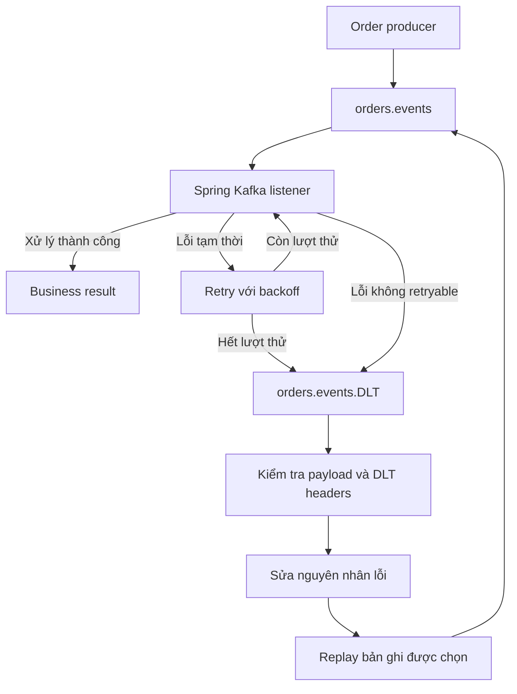

# Luồng Spring Kafka có retry, dead-letter topic và phát lại

Trong một hệ thống event streaming, consumer có thể gặp lỗi tạm thời như database timeout, dịch vụ phụ thuộc không sẵn sàng hoặc lỗi kết nối. Một số bản ghi khác có thể sai định dạng hoặc vi phạm quy tắc nghiệp vụ và sẽ không thành công dù thử lại nhiều lần. Nếu mọi lỗi đều làm consumer dừng, luồng xử lý sẽ khó phục hồi; nếu thử lại vô hạn, một bản ghi lỗi có thể giữ partition và làm backlog tăng.

Bài thực hành này xây dựng một luồng xử lý đơn hàng bằng Java và Spring Kafka. Consumer sẽ thử lại lỗi tạm thời với backoff có giới hạn, chuyển bản ghi hết lượt thử hoặc lỗi không thể khắc phục sang dead-letter topic (DLT), sau đó kiểm tra và phát lại một bản ghi đã được xử lý nguyên nhân lỗi. Mục tiêu là thiết kế được đường đi của một bản ghi từ topic chính đến retry, DLT và replay, đồng thời hiểu tác động của offset, partition, duplicate và ordering.

## 1. Kết quả cần đạt

Sau bài thực hành, người học có thể:

- Cấu hình producer và consumer Spring Kafka cho một luồng event JSON.
- Phân biệt lỗi tạm thời có thể retry với lỗi dữ liệu/nghiệp vụ không nên retry.
- Dùng `DefaultErrorHandler`, `FixedBackOff` và `DeadLetterPublishingRecoverer` để giới hạn số lần xử lý.
- Tạo DLT có partition phù hợp với topic nguồn và đọc metadata lỗi.
- Phát lại có kiểm soát sau khi sửa nguyên nhân lỗi.
- Giải thích vì sao replay có thể tạo duplicate hoặc làm thay đổi thứ tự xử lý.
- Theo dõi consumer lag, retry, DLT và kết quả xử lý để xác định khi nào cần can thiệp.

## 2. Kiến trúc bài lab

Luồng chính sử dụng topic `orders.events`. Consumer group `orders-processor` xử lý mỗi bản ghi. Với lỗi tạm thời, Spring Kafka chờ theo backoff rồi giao lại bản ghi cho listener. Sau số lần thử đã cấu hình, recoverer gửi bản ghi sang `orders.events.DLT`. Lỗi dữ liệu được phân loại là không retryable sẽ đi thẳng đến DLT.



Trong lab, retry dùng `DefaultErrorHandler` với kiểu blocking retry: consumer thử lại bản ghi lỗi theo chính sách của container. Các bản ghi phía sau trên cùng partition có thể phải chờ bản ghi đó được xử lý hoặc phục hồi xong. DLT là nơi lưu những bản ghi không thể xử lý theo chính sách hiện tại, giúp luồng chính tiếp tục tiến lên sau khi recovery thành công.

## 3. Chuẩn bị topic và cấu hình ứng dụng

Giả sử Kafka broker đã chạy tại `localhost:9092` và dự án Spring Boot đã có dependency `spring-kafka` cùng Jackson. Ví dụ dùng payload dạng chuỗi JSON để tập trung vào cơ chế retry và DLT.

### 3.1. Cấu hình `application.yml`

```yaml
spring:
  kafka:
    bootstrap-servers: localhost:9092
    consumer:
      group-id: orders-processor
      auto-offset-reset: earliest
      enable-auto-commit: false
      key-deserializer: org.apache.kafka.common.serialization.StringDeserializer
      value-deserializer: org.apache.kafka.common.serialization.StringDeserializer
    producer:
      key-serializer: org.apache.kafka.common.serialization.StringSerializer
      value-serializer: org.apache.kafka.common.serialization.StringSerializer
      acks: all
      properties:
        enable.idempotence: true

app:
  kafka:
    topics:
      orders: orders.events
      dlt: orders.events.DLT
```

`enable-auto-commit: false` để listener container quản lý commit offset theo kết quả xử lý. Producer dùng `acks: all` và idempotence để tăng độ tin cậy khi gửi trong cấu hình phù hợp. Đây không phải bảo đảm exactly-once cho toàn bộ nghiệp vụ: database hoặc side effect bên ngoài Kafka vẫn cần cơ chế riêng.

### 3.2. Tạo topic

Topic DLT được định tuyến theo partition của bản ghi nguồn. Vì vậy, DLT phải có ít nhất số partition tương ứng với topic nguồn. Ví dụ tạo hai topic với ba partition:

```java
@Configuration
public class OrdersTopicConfiguration {

    @Bean
    public NewTopic ordersTopic() {
        return TopicBuilder.name("orders.events")
            .partitions(3)
            .replicas(1)
            .build();
    }

    @Bean
    public NewTopic ordersDltTopic() {
        return TopicBuilder.name("orders.events.DLT")
            .partitions(3)
            .replicas(1)
            .build();
    }
}
```

Replication factor bằng 1 chỉ phù hợp với broker đơn cho môi trường học tập. Ở production, chọn replication factor, `min.insync.replicas` và `acks` theo yêu cầu độ bền của cụm. DLT cũng cần được bảo vệ, giám sát, cấp ACL và đặt retention phù hợp vì nó có thể chứa dữ liệu lỗi cần điều tra.

Nếu topic đã tồn tại, `KafkaAdmin` có thể tăng số partition khi `NewTopic` khai báo số partition lớn hơn số hiện tại; Kafka không hỗ trợ giảm partition. Hãy kiểm tra cấu hình thực tế bằng công cụ quản trị topic trước khi chạy lab và không tăng partition tùy tiện vì việc đó có thể thay đổi ánh xạ key sang partition.

## 4. Viết mô hình sự kiện và xử lý nghiệp vụ

Một event đơn hàng tối giản có mã đơn, khách hàng và số tiền:

```java
public record OrderEvent(
    String orderId,
    String customerId,
    long amount
) {}
```

Tạo hai loại exception để phân loại lỗi:

```java
public class TemporaryOrderException extends RuntimeException {
    public TemporaryOrderException(String message) {
        super(message);
    }
}

public class InvalidOrderException extends RuntimeException {
    public InvalidOrderException(String message) {
        super(message);
    }

    public InvalidOrderException(String message, Throwable cause) {
        super(message, cause);
    }
}
```

Trong lab, processor mô phỏng ba trường hợp bằng tiền tố `orderId`:

- `normal-`: xử lý thành công ngay.
- `retry-`: lỗi ở hai lần đầu rồi thành công ở lần giao thứ ba.
- `fail-`: luôn phát sinh lỗi tạm thời để kiểm tra chuyển DLT sau khi hết lượt thử.
- `invalid-`: lỗi dữ liệu không retry và chuyển DLT ngay.

```java
@Service
public class OrderProcessor {
    private final Map<String, AtomicInteger> attempts = new ConcurrentHashMap<>();

    public void process(OrderEvent event) {
        String orderId = event.orderId();

        if (orderId.startsWith("invalid-")) {
            throw new InvalidOrderException("Đơn hàng không hợp lệ: " + orderId);
        }

        if (orderId.startsWith("fail-")) {
            throw new TemporaryOrderException("Dependency đang lỗi với " + orderId);
        }

        if (orderId.startsWith("retry-")) {
            int attempt = attempts
                .computeIfAbsent(orderId, key -> new AtomicInteger())
                .incrementAndGet();

            if (attempt <= 2) {
                throw new TemporaryOrderException(
                    "Lỗi tạm thời ở lần giao thứ " + attempt
                );
            }
        }

        System.out.printf("Processed orderId=%s amount=%d%n",
            event.orderId(), event.amount());
    }
}
```

`attempts` chỉ là bộ đếm trong bộ nhớ để mô phỏng dependency lỗi hai lần. Nếu ứng dụng restart, bộ đếm mất; không dùng kỹ thuật này để điều khiển retry trong production. Trong hệ thống thật, lỗi phải xuất phát từ kết quả của dependency hoặc một điều kiện nghiệp vụ có thể quan sát được.

## 5. Tạo listener và error handler

### 5.1. Listener nhận event

Listener đọc chuỗi JSON, chuyển thành `OrderEvent`, rồi gọi processor. JSON sai được chuyển thành `InvalidOrderException` để không lặp lại một payload không thể parse.

```java
@Component
public class OrderEventListener {
    private final ObjectMapper objectMapper;
    private final OrderProcessor processor;

    public OrderEventListener(ObjectMapper objectMapper, OrderProcessor processor) {
        this.objectMapper = objectMapper;
        this.processor = processor;
    }

    @KafkaListener(
        topics = "${app.kafka.topics.orders}",
        containerFactory = "ordersKafkaListenerContainerFactory"
    )
    public void consume(String payload) {
        final OrderEvent event;
        try {
            event = objectMapper.readValue(payload, OrderEvent.class);
        } catch (JsonProcessingException ex) {
            throw new InvalidOrderException("Payload JSON không hợp lệ", ex);
        }

        processor.process(event);
    }
}
```

Không bắt mọi exception rồi chỉ ghi log trong listener. Nếu listener nuốt exception và trả về bình thường, container xem bản ghi đã xử lý thành công và có thể commit offset; error handler sẽ không có cơ hội retry hoặc đưa bản ghi vào DLT.

### 5.2. Cấu hình retry và DLT

`DefaultErrorHandler` nhận một recoverer và chính sách backoff. `FixedBackOff(1000L, 2L)` có nghĩa là chờ một giây giữa các lần thử và cho phép hai lần retry sau lần giao đầu tiên. Như vậy, một bản ghi lỗi tạm thời có tối đa ba lần giao cho listener trong chu kỳ xử lý này.

```java
@Configuration
public class OrdersKafkaConfiguration {

    @Bean
    public DefaultErrorHandler ordersErrorHandler(
            KafkaTemplate<Object, Object> kafkaTemplate,
            @Value("${app.kafka.topics.dlt}") String dltTopic) {

        DeadLetterPublishingRecoverer recoverer =
            new DeadLetterPublishingRecoverer(
                kafkaTemplate,
                (record, exception) -> new TopicPartition(
                    dltTopic,
                    record.partition()
                )
            );

        DefaultErrorHandler errorHandler = new DefaultErrorHandler(
            recoverer,
            new FixedBackOff(1_000L, 2L)
        );

        errorHandler.addNotRetryableExceptions(InvalidOrderException.class);
        return errorHandler;
    }

    @Bean
    public ConcurrentKafkaListenerContainerFactory<Object, Object>
            ordersKafkaListenerContainerFactory(
                ConsumerFactory<Object, Object> consumerFactory,
                DefaultErrorHandler ordersErrorHandler) {

        ConcurrentKafkaListenerContainerFactory<Object, Object> factory =
            new ConcurrentKafkaListenerContainerFactory<>();
        factory.setConsumerFactory(consumerFactory);
        factory.setCommonErrorHandler(ordersErrorHandler);
        factory.getContainerProperties()
            .setAckMode(ContainerProperties.AckMode.RECORD);
        return factory;
    }
}
```

Spring Boot có thể cung cấp `KafkaTemplate` và `ConsumerFactory` từ các thuộc tính cấu hình. Đảm bảo producer factory của template dùng serializer tương thích với dữ liệu và headers cần gửi sang DLT. Ví dụ này dùng key/value dạng chuỗi. Nếu ứng dụng dùng nhiều kiểu payload, cần cấu hình serializer cho cả bản ghi nguồn lẫn bản ghi DLT, hoặc dùng template hỗ trợ đúng các kiểu đó.

Resolver định tuyến `orders.events` sang `orders.events.DLT` và giữ nguyên số partition của bản ghi nguồn. Điều này giúp DLT phản ánh phân vùng nguồn và thuận tiện điều tra. Nếu chọn một partition cố định hoặc chiến lược định tuyến khác, cần đánh giá tải và yêu cầu ordering riêng.

`InvalidOrderException` được đánh dấu không retryable nên đi đến recoverer ngay. Các exception khác trong ví dụ được retry theo backoff; hãy phân loại exception cẩn thận trong ứng dụng thực tế. Không nên retry lỗi xác thực, dữ liệu sai hoặc lỗi lập trình vô thời hạn. Ngược lại, không nên đưa lỗi database timeout thoáng qua vào nhóm không retryable.

Khi dùng trong production, cấu hình recoverer để lỗi publish DLT được phát hiện và không commit bản ghi nguồn như thể recovery đã thành công. Spring Kafka có API để kiểm tra kết quả gửi DLT; tên và hành vi chi tiết cần đối chiếu với phiên bản Spring Kafka của dự án. Cần có metric/alert cho lỗi publish DLT và kiểm tra quyền ghi DLT topic.

## 6. Chạy thử luồng xử lý

Khởi động broker, ứng dụng Spring Boot và xác nhận hai topic `orders.events` cùng `orders.events.DLT` đã tồn tại với ba partition.

### 6.1. Gửi các bản ghi thử nghiệm

Dùng console producer để gửi key và JSON payload vào topic chính:

```bash
kafka-console-producer.sh --bootstrap-server localhost:9092 --topic orders.events --property parse.key=true --property key.separator=:
```

Nhập lần lượt từng dòng sau trong console producer:

```text
normal-001:{"orderId":"normal-001","customerId":"customer-1","amount":120000}
retry-001:{"orderId":"retry-001","customerId":"customer-2","amount":250000}
fail-001:{"orderId":"fail-001","customerId":"customer-3","amount":310000}
invalid-001:{"orderId":"invalid-001","customerId":"customer-4","amount":90000}
```

Kết quả mong đợi:

| Key | Hành vi | Kết quả |
|---|---|---|
| `normal-001` | Listener xử lý lần đầu thành công | Không vào DLT |
| `retry-001` | Hai lần đầu ném lỗi, lần thứ ba thành công | Không vào DLT; log có lần xử lý thành công |
| `fail-001` | Cả ba lần giao đều lỗi tạm thời | Sau hai retry, bản ghi được gửi đến DLT |
| `invalid-001` | Ném `InvalidOrderException` | Không retry; chuyển đến DLT ngay |

Với `FixedBackOff(1000L, 2L)`, hai lần retry cách nhau một giây. Thời gian thực tế còn phụ thuộc vào thời gian xử lý, lịch poll và việc publish DLT.

### 6.2. Đọc DLT và kiểm tra metadata

Dùng một consumer group mới để xem các bản ghi trong DLT:

```bash
kafka-console-consumer.sh --bootstrap-server localhost:9092 --topic orders.events.DLT --from-beginning --property print.key=true --property print.headers=true
```

Kiểm tra key, payload và các header do Spring Kafka thêm vào. DLT record thường mang thông tin về topic, partition và offset nguồn cùng loại exception và thông điệp lỗi. Các header này giúp trả lời bản ghi đến từ đâu và tại sao nó bị phục hồi.

Đối chiếu kết quả với log listener và consumer group. DLT không phải nơi xóa lỗi khỏi hệ thống: nó là hàng đợi điều tra và phục hồi. Cần xác định chủ sở hữu, thời hạn xử lý và chính sách lưu trữ cho bản ghi nằm trong DLT.

## 7. Phát lại bản ghi sau khi sửa lỗi

Replay nghĩa là gửi lại một bản ghi đã được đưa vào DLT sau khi nguyên nhân lỗi được xử lý. Ví dụ, `fail-001` vào DLT vì dependency không sẵn sàng. Sau khi dependency phục hồi hoặc code đã được sửa, người vận hành chọn đúng bản ghi và phát lại vào `orders.events`.

### 7.1. Replay thủ công trong lab

Đầu tiên, xác nhận lỗi gốc đã được khắc phục. Nếu `fail-` vẫn luôn ném exception trong processor, sửa mô phỏng hoặc triển khai code đã sửa trước khi replay. Sau đó gửi lại payload được chọn vào topic chính, giữ key:

```bash
kafka-console-producer.sh --bootstrap-server localhost:9092 --topic orders.events --property parse.key=true --property key.separator=:
```

Ví dụ nhập lại:

```text
fail-001:{"orderId":"fail-001","customerId":"customer-3","amount":310000}
```

Console producer hữu ích cho lab nhưng không tự bảo toàn toàn bộ headers và metadata của bản ghi DLT. Nó cũng chọn partition lại dựa trên key và partitioner của topic đích. Với production, không dùng thao tác copy/paste làm quy trình replay chính thức.

### 7.2. Replay có kiểm soát bằng Java

Một công cụ replay production nên cho phép người vận hành chọn bản ghi cụ thể, xem trước payload và metadata nguồn, xác nhận nguyên nhân đã được sửa, rồi gửi bản ghi đến topic đích. Ví dụ phương thức publisher dưới đây giữ key và chỉ sao chép header nghiệp vụ được cho phép, đồng thời thêm mã replay để truy vết:

```java
@Service
public class DltReplayPublisher {
    private final KafkaTemplate<Object, Object> kafkaTemplate;

    public DltReplayPublisher(KafkaTemplate<Object, Object> kafkaTemplate) {
        this.kafkaTemplate = kafkaTemplate;
    }

    public void replay(ConsumerRecord<String, String> dltRecord)
            throws InterruptedException, ExecutionException, TimeoutException {

        ProducerRecord<Object, Object> replayRecord = new ProducerRecord<>(
            "orders.events",
            dltRecord.key(),
            dltRecord.value()
        );

        Header correlationId = dltRecord.headers().lastHeader("correlation-id");
        if (correlationId != null) {
            replayRecord.headers().add(new RecordHeader(
                "correlation-id", correlationId.value()));
        }

        replayRecord.headers().add(new RecordHeader(
            "x-replay-id",
            UUID.randomUUID().toString().getBytes(StandardCharsets.UTF_8)
        ));
        replayRecord.headers().add(new RecordHeader(
            "x-replayed-from",
            dltRecord.topic().getBytes(StandardCharsets.UTF_8)
        ));

        // Chỉ xem lần publish là hoàn tất sau khi broker xác nhận.
        kafkaTemplate.send(replayRecord).get(10, TimeUnit.SECONDS);
    }
}
```

Đây là publisher được gọi bởi một quy trình quản trị đã chọn bản ghi, không phải listener tự động đọc toàn bộ DLT rồi phát lại. Khi xây dựng quy trình đầy đủ, lưu lại ai phê duyệt, DLT topic/partition/offset nguồn, replay ID, thời điểm, topic đích và kết quả gửi. Nếu công cụ đọc DLT bằng consumer có manual acknowledgment, chỉ acknowledge offset DLT sau khi publish bản ghi đích được xác nhận. Nếu tiến trình dừng sau khi publish nhưng trước khi acknowledge, bản ghi có thể được phát lại lần nữa; consumer đích vẫn cần idempotency.

Không sao chép mù quáng mọi header lỗi sang event mới. Hãy chọn allowlist các header nghiệp vụ như correlation ID và trace context. Header exception có thể dài, chứa thông tin nội bộ hoặc tích lũy qua nhiều lần replay. Giữ metadata DLT cần thiết trong audit record riêng.

### 7.3. Điều kiện an toàn trước khi replay

- Nguyên nhân lỗi đã được xác định và sửa; nếu không, bản ghi sẽ quay lại DLT.
- Payload đã được kiểm tra schema và quy tắc nghiệp vụ. Nếu dữ liệu cần hiệu chỉnh, lưu dấu vết giá trị gốc và giá trị đã sửa theo chính sách audit.
- Replay có id hoặc dấu vết riêng để phân biệt lần phát ban đầu với lần phát lại.
- Consumer đích có khả năng chống xử lý trùng bằng event ID hoặc idempotency key phù hợp.
- Đã đánh giá ordering. Replay một event cũ sau các event mới có thể làm trạng thái nghiệp vụ lùi hoặc sai thứ tự.
- Người vận hành chọn đúng topic đích và tập bản ghi; không phát lại toàn bộ DLT chỉ vì một lỗi đã được sửa.

Nếu event cần thứ tự theo `orderId`, giữ key và xác nhận partitioning strategy không thay đổi. Dù key giống nhau, replay vẫn được ghi ở offset mới và đứng sau những record đã có trong partition. Kafka không thể chèn record trở lại vị trí offset cũ. Nếu nghiệp vụ không chấp nhận event cũ đến muộn, cần quy tắc version/sequence ở consumer hoặc một quy trình sửa trạng thái riêng.

## 8. Blocking retry và non-blocking retry

Lab chính dùng `DefaultErrorHandler` với backoff trong listener container. Đây là blocking retry: một bản ghi lỗi có thể làm chậm tiến độ partition trong thời gian retry. Cách này dễ theo dõi khi số lần thử ít và thời gian backoff ngắn.

Spring Kafka còn hỗ trợ non-blocking retry bằng `@RetryableTopic` ở các phiên bản tương thích. Cách này chuyển bản ghi sang các retry topic theo lịch backoff, để consumer topic chính tiếp tục xử lý những bản ghi khác. Cấu hình có thể có dạng:

```java
@RetryableTopic(
    attempts = "4",
    backoff = @Backoff(delay = 1_000, multiplier = 2.0, maxDelay = 10_000),
    dltTopicSuffix = ".DLT"
)
@KafkaListener(topics = "orders.events", groupId = "orders-processor-retry-topic")
public void consumeWithRetryTopics(String payload) {
    // Parse và xử lý event; ném exception để framework chuyển sang retry topic.
}
```

Trong ví dụ này, `attempts = "4"` bao gồm lần xử lý đầu tiên; số retry là ba. Tên retry topic cụ thể được Spring Kafka tạo theo cấu hình và phiên bản. Cần kiểm tra topic được tạo, retention, partition, replication và ACL cho toàn bộ retry/DLT topology.

Non-blocking retry làm thay đổi thứ tự quan sát: một bản ghi bị chuyển sang retry topic có thể hoàn tất sau các bản ghi đến sau trên topic chính. Vì vậy, chỉ chọn nó khi nghiệp vụ chấp nhận khả năng xử lý lệch thứ tự hoặc đã có cơ chế versioning/ordering riêng. Không cấu hình đồng thời hai cơ chế cho cùng listener một cách tùy tiện; chọn một chiến lược retry rõ ràng và kiểm thử đầy đủ theo phiên bản Spring Kafka đang dùng.

## 9. Theo dõi và xử lý sự cố

Một dashboard tối thiểu nên có các chỉ số sau:

| Nhóm | Chỉ số cần theo dõi | Dấu hiệu cần điều tra |
|---|---|---|
| Topic chính | Incoming records, bytes in, partition count | Lưu lượng tăng đột ngột hoặc phân bố key lệch |
| Consumer | Lag theo partition, records consumed, processing duration | Lag tăng liên tục hoặc một partition bị nghẽn |
| Retry | Số lần giao lại, tổng thời gian retry, exception theo loại | Một exception lặp lại trên nhiều bản ghi |
| DLT | Số bản ghi mới, tuổi bản ghi cũ nhất, bytes retained | DLT tăng nhưng không có người xử lý |
| Replay | Số bản ghi được chọn, publish success/failure, duplicate | Replay lặp lại hoặc lỗi quay lại DLT |

Các tình huống thường gặp:

| Hiện tượng | Nguyên nhân có thể | Cách kiểm tra |
|---|---|---|
| Bản ghi không được retry | Listener bắt và nuốt exception; exception thuộc nhóm không retryable | Kiểm tra listener và phân loại exception của error handler |
| Bản ghi thử lại quá nhiều | Backoff/retry count chưa đúng hoặc lỗi không được phân loại | Đếm số lần giao thực tế và kiểm tra `FixedBackOff` |
| DLT không có bản ghi | Chưa hết retry, recoverer chưa được gọi, hoặc lỗi publish DLT | Kiểm tra log error handler, quyền ghi và kết quả gửi DLT |
| Publish DLT thất bại | DLT topic thiếu partition, serializer sai, ACL hoặc broker lỗi | Kiểm tra metadata topic, producer error và ACL |
| Một partition bị lag cao | Poison record đang blocking retry hoặc key bị skew | Xem partition có record lỗi và thời gian xử lý |
| Replay xong vẫn vào DLT | Nguyên nhân gốc chưa sửa hoặc payload vẫn không hợp lệ | So sánh exception mới với DLT metadata cũ |
| Replay gây xử lý trùng | Không có idempotency hoặc publish thành công nhưng ack nguồn chưa hoàn tất | Đối chiếu event ID, replay ID và offset |

Đừng tăng số retry chỉ để làm biến mất DLT. Retry kéo dài một lỗi không thể khắc phục làm tăng độ trễ và có thể giữ partition. Hãy đặt giới hạn, phân loại lỗi, quan sát nguyên nhân và đưa bản ghi cần điều tra sang DLT.

## 10. Bài tập mở rộng

1. Thay `FixedBackOff` bằng thời gian 500 ms và bốn lần retry. Đo thời gian từ lần giao đầu đến khi vào DLT.
2. Đưa `TemporaryOrderException` vào danh sách không retryable, gửi lại `fail-002` và so sánh số lần giao.
3. Tạo một lỗi deserialize thực sự bằng payload JSON sai. Kiểm tra exception phát sinh ở tầng deserializer khác gì exception phát sinh trong listener. Nếu dùng deserializer trực tiếp cho object, cần cấu hình `ErrorHandlingDeserializer` để error handler có thể xử lý lỗi deserialize theo đúng mô hình của ứng dụng.
4. Tạo topic nguồn có sáu partition và DLT có ít hơn sáu partition. Quan sát lỗi định tuyến DLT, sau đó sửa cấu hình topic cho tương thích.
5. Tắt ứng dụng trong lúc retry, khởi động lại và quan sát offset/record được giao lại. Giải thích vì sao xử lý nghiệp vụ cần idempotent.
6. Gửi nhiều event cùng `orderId` rồi replay một event cũ. Đề xuất cách kiểm soát version hoặc sequence để bảo vệ trạng thái aggregate.
7. Xây dựng một công cụ replay có allowlist header, xác nhận của người vận hành và audit log; chỉ cho phép replay theo DLT partition/offset hoặc event ID đã chọn.

## 11. Tiêu chí hoàn thành

- `normal-001` được xử lý một lần và không xuất hiện trong DLT.
- `retry-001` được giao lại theo backoff rồi xử lý thành công ở lần thứ ba.
- `fail-001` được giao tổng cộng ba lần trong cấu hình lab và sau đó xuất hiện trong DLT.
- `invalid-001` được đưa vào DLT mà không retry.
- DLT record giữ được key, payload và metadata nguồn cần thiết để điều tra.
- Sau khi sửa nguyên nhân, một bản ghi được chọn và replay thành công vào topic chính.
- Người học giải thích được khả năng duplicate, tác động lên ordering và lý do phải chống xử lý trùng.
- Dashboard/log cho thấy được retry, consumer lag, DLT và kết quả replay.

Một luồng retry tốt có giới hạn và có thể giải thích được: lỗi tạm thời được thử lại trong khoảng thời gian xác định, lỗi không thể xử lý được cách ly ở DLT, và replay chỉ diễn ra sau khi nguyên nhân đã được khắc phục. Khi kết hợp các quy tắc đó với idempotency, kiểm soát ordering và quan sát đầy đủ, consumer Spring Kafka có thể phục hồi an toàn mà không biến một bản ghi lỗi thành điểm nghẽn kéo dài của toàn bộ luồng sự kiện.
