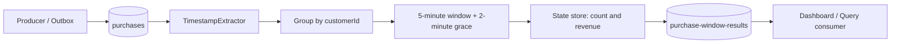

# Ứng dụng Streams tổng hợp theo cửa sổ với dữ liệu đến trễ

Trong một hệ thống bán hàng, nhóm phân tích có thể cần biết mỗi khách hàng thực hiện bao nhiêu giao dịch và tạo ra bao nhiêu doanh thu trong từng khoảng thời gian năm phút. Sự kiện mua hàng thường không đến Kafka đúng thứ tự thời gian nghiệp vụ: một giao dịch xảy ra lúc 10:03 có thể được gửi sau giao dịch lúc 10:06 vì mạng chậm, retry hoặc publisher xử lý outbox song song.

Nếu ứng dụng chỉ dùng thời điểm nhận bản ghi, giao dịch đến trễ sẽ bị tính vào cửa sổ sai. Kafka Streams hỗ trợ xử lý theo event time, gom bản ghi vào cửa sổ và chấp nhận dữ liệu đến trễ trong một khoảng grace được cấu hình. Khi hết grace, cửa sổ được xem là đóng theo stream-time và bản ghi quá trễ không còn được cập nhật kết quả cửa sổ đó.

Bài thực hành này xây dựng một topology Java/Spring Kafka Streams để tính số giao dịch và tổng doanh thu theo khách hàng trong cửa sổ tumbling năm phút. Người học sẽ tạo dữ liệu có thứ tự thời gian khác thứ tự đến, quan sát sự kiện đến trễ trong grace period, rồi thử gửi một sự kiện sau khi cửa sổ đã đóng.

Sau bài học, người học có thể:

- Phân biệt event time, processing time, record timestamp và stream-time.
- Cấu hình `TimestampExtractor` để Kafka Streams dùng thời điểm nghiệp vụ trong payload.
- Tạo windowed aggregation với `TimeWindows.ofSizeAndGrace`.
- Giải thích grace period, window retention và hành vi của sự kiện quá trễ.
- Xây dựng topology Spring Kafka Streams có state store và topic kết quả.
- Kiểm thử dữ liệu đến đúng giờ, đến sai thứ tự, đến trong grace và đến sau grace.

## 1. Kịch bản và kiến trúc bài lab

Ứng dụng nhận sự kiện `PurchaseEvent` từ topic `purchases`. Mỗi sự kiện có mã sự kiện, khách hàng, thời điểm nghiệp vụ và số tiền tính bằng đồng xu (đơn vị nhỏ nhất của tiền tệ). Topology nhóm theo `customerId`, gom sự kiện vào các cửa sổ năm phút và tính:

- `purchaseCount`: số giao dịch trong cửa sổ.
- `revenueCents`: tổng giá trị giao dịch trong cửa sổ.

Kết quả được ghi vào topic `purchase-window-results`. Khóa kết quả chứa khách hàng cùng thời điểm bắt đầu và kết thúc cửa sổ, nhờ vậy các lần cập nhật cùng một cửa sổ có cùng key.



Trong bài lab, topic có một số partition và replication factor 1 để chạy trên broker đơn. Môi trường production cần replication factor, `min.insync.replicas`, ACL, quota và cấu hình state store phù hợp với cụm thực tế.

## 2. Phân biệt các loại thời gian

Thiết kế window chính xác bắt đầu từ việc xác định timestamp nào đại diện cho sự kiện.

| Khái niệm | Ý nghĩa | Ví dụ |
|---|---|---|
| Event time | Thời điểm nghiệp vụ thực sự xảy ra, do nguồn phát ghi trong event. | Khách thanh toán lúc 10:03. |
| Processing time | Thời điểm ứng dụng xử lý bản ghi. | Consumer xử lý lúc 10:06. |
| Kafka record timestamp | Timestamp gắn với record trong Kafka, thường do producer (`CreateTime`) hoặc broker (`LogAppendTime`) cung cấp. | Broker nhận record lúc 10:06. |
| Stream-time | Mốc thời gian tiến triển theo các record mà một Kafka Streams task đã xử lý; về cơ bản là timestamp lớn nhất quan sát được trong task. | Task đã xử lý record có event time 10:06. |

Nếu cửa sổ được tính theo processing time, sự kiện xảy ra lúc 10:03 nhưng đến lúc 10:06 sẽ bị tính vào khoảng 10:05–10:10. Với event time, nó vẫn thuộc cửa sổ 10:00–10:05, miễn là cửa sổ chưa hết grace.

Kafka Streams dùng timestamp extractor để lấy timestamp cho record. Trong bài này, timestamp nằm trong trường `occurredAtEpochMs` của payload. Cách này giúp kết quả không phụ thuộc vào độ trễ mạng hoặc thời điểm broker ghi record.

**Stream-time không phải đồng hồ thực.** Một task tiến stream-time khi xử lý record có timestamp lớn hơn các record trước đó. Cửa sổ có thể được xem là đóng khi stream-time vượt qua thời điểm kết thúc cửa sổ cộng grace. Vì stream-time được tiến bởi dữ liệu, một task ít dữ liệu có thể chưa đóng cửa sổ dù đã qua nhiều phút theo đồng hồ máy. Ngược lại, một record timestamp tương lai bất thường có thể đẩy stream-time tiến quá xa và khiến các record cũ tiếp theo bị xem là quá trễ.

## 3. Chuẩn bị project và event contract

Tạo một ứng dụng Spring Boot có dependency Spring for Apache Kafka và Kafka Streams. Bật Kafka Streams bằng `@EnableKafkaStreams`. Chọn phiên bản Spring Kafka/Kafka Streams tương thích với phiên bản Spring Boot của project; không trộn trực tiếp các phiên bản Kafka client không tương thích.

Mô hình dữ liệu đầu vào:

```java
public record PurchaseEvent(
    String eventId,
    String customerId,
    long occurredAtEpochMs,
    long amountCents
) {}
```

`eventId` giúp truy vết và có thể dùng để chống trùng ở một bước xử lý riêng. `occurredAtEpochMs` là Unix epoch milliseconds theo UTC. `amountCents` là số nguyên để tránh sai số số thực khi cộng tiền; với tiền tệ không có hai chữ số thập phân, hãy định nghĩa đơn vị nhỏ nhất tương ứng trong contract.

Kiểu kết quả của một cửa sổ:

```java
public record WindowTotals(long purchaseCount, long revenueCents) {
    public static WindowTotals empty() {
        return new WindowTotals(0L, 0L);
    }

    public WindowTotals add(PurchaseEvent event) {
        return new WindowTotals(
            Math.addExact(purchaseCount, 1L),
            Math.addExact(revenueCents, event.amountCents())
        );
    }
}
```

`Math.addExact` làm ứng dụng báo lỗi khi số đếm hoặc tổng tiền vượt giới hạn `long`, thay vì âm thầm tràn số. Với hệ thống có giá trị tích lũy lớn, hãy chọn kiểu số và giới hạn nghiệp vụ phù hợp.

## 4. Cấu hình timestamp extractor

Tạo extractor lấy timestamp từ `PurchaseEvent`:

```java
import org.apache.kafka.clients.consumer.ConsumerRecord;
import org.apache.kafka.streams.processor.TimestampExtractor;

public class PurchaseTimestampExtractor implements TimestampExtractor {
    @Override
    public long extract(ConsumerRecord<Object, Object> record,
                        long partitionTime) {
        Object value = record.value();
        if (!(value instanceof PurchaseEvent event)) {
            return -1L;
        }

        long timestamp = event.occurredAtEpochMs();
        return timestamp > 0L ? timestamp : -1L;
    }
}
```

Timestamp âm báo cho Kafka Streams bỏ qua record vì không có timestamp hợp lệ. Trong ứng dụng thật, cần ghi log có cấu trúc hoặc metric cho dữ liệu bị bỏ qua; không âm thầm thay timestamp lỗi bằng `System.currentTimeMillis()` vì điều đó trộn event time với processing time và làm sai kết quả phân tích.

Cấu hình Spring Kafka Streams:

```java
import java.nio.file.Paths;
import java.util.HashMap;
import java.util.Map;

import org.apache.kafka.common.serialization.Serdes;
import org.apache.kafka.streams.StreamsConfig;
import org.springframework.context.annotation.Bean;
import org.springframework.context.annotation.Configuration;
import org.springframework.kafka.annotation.EnableKafkaStreams;
import org.springframework.kafka.config.KafkaStreamsConfiguration;
import org.springframework.kafka.config.KafkaStreamsDefaultConfiguration;

@Configuration
@EnableKafkaStreams
public class PurchaseStreamsConfig {
    @Bean(name = KafkaStreamsDefaultConfiguration.DEFAULT_STREAMS_CONFIG_BEAN_NAME)
    KafkaStreamsConfiguration kafkaStreamsConfiguration() {
        Map<String, Object> props = new HashMap<>();
        props.put(StreamsConfig.APPLICATION_ID_CONFIG,
                  "purchase-window-aggregation-v1");
        props.put(StreamsConfig.BOOTSTRAP_SERVERS_CONFIG,
                  "localhost:9092");
        props.put(StreamsConfig.DEFAULT_KEY_SERDE_CLASS_CONFIG,
                  Serdes.String().getClass());
        props.put(StreamsConfig.DEFAULT_VALUE_SERDE_CLASS_CONFIG,
                  Serdes.String().getClass());
        props.put(StreamsConfig.DEFAULT_TIMESTAMP_EXTRACTOR_CLASS_CONFIG,
                  PurchaseTimestampExtractor.class);
        props.put(StreamsConfig.STATE_DIR_CONFIG,
                  Paths.get(System.getProperty("java.io.tmpdir"),
                      "kafka-streams", "purchase-window-aggregation-v1")
                      .toString());
        return new KafkaStreamsConfiguration(props);
    }
}
```

`application.id` xác định Kafka Streams application, consumer group và tên các internal topic. Mỗi topology độc lập cần ID riêng; các instance chạy cùng một topology phải dùng cùng ID để chia task. `state.dir` là thư mục state local của instance, nên production cần đặt trên volume có dung lượng và quyền truy cập phù hợp. Kafka Streams có thể khôi phục state store từ changelog topic sau khi instance khởi động lại.

Trong topology bên dưới, serde được khai báo tường minh cho từng nguồn, nhóm và state store. `JsonSerde` của Spring Kafka cần được cấu hình tương thích với JSON producer; nếu producer dùng định dạng khác hoặc type header khác, hãy cấu hình deserializer tương ứng.

## 5. Xây dựng topology tổng hợp theo cửa sổ

Topology nhóm sự kiện theo khách hàng, tạo cửa sổ tumbling năm phút và chấp nhận sự kiện đến trễ thêm hai phút:

```java
import java.time.Duration;

import org.apache.kafka.common.serialization.Serdes;
import org.apache.kafka.common.utils.Bytes;
import org.apache.kafka.streams.KeyValue;
import org.apache.kafka.streams.kstream.Consumed;
import org.apache.kafka.streams.kstream.Grouped;
import org.apache.kafka.streams.kstream.KStream;
import org.apache.kafka.streams.kstream.KTable;
import org.apache.kafka.streams.kstream.Materialized;
import org.apache.kafka.streams.kstream.Produced;
import org.apache.kafka.streams.kstream.TimeWindows;
import org.apache.kafka.streams.kstream.Windowed;
import org.apache.kafka.streams.state.WindowStore;
import org.springframework.context.annotation.Bean;
import org.springframework.context.annotation.Configuration;
import org.springframework.kafka.support.serializer.JsonSerde;
import org.apache.kafka.streams.StreamsBuilder;

@Configuration
public class PurchaseWindowTopology {
    @Bean
    KTable<Windowed<String>, WindowTotals> purchaseWindowTotals(
            StreamsBuilder builder) {
        JsonSerde<PurchaseEvent> eventSerde =
            new JsonSerde<>(PurchaseEvent.class);
        JsonSerde<WindowTotals> totalsSerde =
            new JsonSerde<>(WindowTotals.class);

        KStream<String, PurchaseEvent> purchases = builder.stream(
            "purchases",
            Consumed.with(Serdes.String(), eventSerde)
        );

        KTable<Windowed<String>, WindowTotals> totals = purchases
            .filter((key, event) -> event != null
                && event.customerId() != null
                && !event.customerId().isBlank()
                && event.amountCents() >= 0L)
            .selectKey((key, event) -> event.customerId())
            .groupByKey(Grouped.with(Serdes.String(), eventSerde))
            .windowedBy(TimeWindows.ofSizeAndGrace(
                Duration.ofMinutes(5),
                Duration.ofMinutes(2)
            ))
            .aggregate(
                WindowTotals::empty,
                (customerId, event, current) -> current.add(event),
                Materialized.<String, WindowTotals,
                    WindowStore<Bytes, byte[]>>as("purchase-window-store")
                    .withKeySerde(Serdes.String())
                    .withValueSerde(totalsSerde)
                    .withRetention(Duration.ofMinutes(15))
            );

        totals.toStream()
            .map((windowedCustomer, value) -> KeyValue.pair(
                windowedCustomer.key() + "|"
                    + windowedCustomer.window().start() + "|"
                    + windowedCustomer.window().end(),
                value
            ))
            .to("purchase-window-results",
                Produced.with(Serdes.String(), totalsSerde));

        return totals;
    }
}
```

Điểm cần chú ý:

- `selectKey` đặt `customerId` làm key để các giao dịch của cùng khách hàng được nhóm với nhau.
- `TimeWindows.ofSizeAndGrace(size, grace)` tạo cửa sổ thời gian cố định. Cửa sổ năm phút bắt đầu tại các mốc căn theo epoch, ví dụ 10:00–10:05 và 10:05–10:10 UTC.
- `aggregate` khởi tạo `WindowTotals.empty()` rồi cộng số giao dịch và số tiền cho mỗi event được chấp nhận.
- `Materialized` đặt tên state store và khai báo serde. Retention 15 phút lớn hơn kích thước cửa sổ cộng grace (5 + 2 phút); store phải giữ dữ liệu ít nhất đủ thời gian theo yêu cầu window và grace.
- `toStream()` phát các lần cập nhật của KTable. Key được chuyển thành chuỗi `customerId|windowStart|windowEnd` để topic kết quả không cần windowed-key serde.

Topic kết quả nhận một bản ghi cập nhật mỗi khi tổng hợp thay đổi. Một cửa sổ có thể xuất hiện nhiều lần với cùng key và giá trị mới hơn. Consumer downstream muốn giữ trạng thái mới nhất có thể lưu theo key; nếu cần chỉ phát kết quả cuối cùng khi cửa sổ đóng, xem phần Suppression bên dưới.

## 6. Grace period và dữ liệu đến trễ

Với cửa sổ `[10:00, 10:05)` và grace hai phút, Kafka Streams tiếp tục chấp nhận sự kiện thuộc cửa sổ đó trong khi stream-time chưa vượt qua giới hạn đóng cửa sổ xấp xỉ 10:07. Khi stream-time đã tiến qua thời điểm kết thúc cộng grace, sự kiện có timestamp thuộc cửa sổ cũ bị xem là quá trễ và không còn cập nhật aggregation.

Grace period không phải là thời gian ứng dụng ngủ hoặc trì hoãn xử lý mọi sự kiện. Các sự kiện đúng giờ vẫn được xử lý ngay; grace chỉ xác định khoảng chấp nhận out-of-order sau thời điểm kết thúc cửa sổ. Nó cũng không phải watermark theo đồng hồ tường. Stream-time tiến theo timestamp record mà task quan sát được.

Một ví dụ:

| Thứ tự nhận | Event time | Giao dịch | Kết quả |
|---:|---|---|---|
| 1 | 10:01 | `p-001`, khách `customer-7`, 120.000 | Thuộc cửa sổ 10:00–10:05. |
| 2 | 10:04 | `p-002`, khách `customer-7`, 80.000 | Thuộc cửa sổ 10:00–10:05. |
| 3 | 10:06 | `p-003`, khách `customer-7`, 250.000 | Tiến stream-time lên 10:06; thuộc cửa sổ 10:05–10:10. |
| 4 | 10:03 | `p-004`, khách `customer-7`, 50.000 | Đến sau event 10:06 nhưng vẫn trong grace của cửa sổ 10:00–10:05; được chấp nhận. |
| 5 | 10:08 | `p-005`, khách `customer-7`, 40.000 | Tiến stream-time qua grace của cửa sổ đầu; thuộc cửa sổ 10:05–10:10. |
| 6 | 10:02 | `p-006`, khách `customer-7`, 70.000 | Đến sau khi cửa sổ 10:00–10:05 đã đóng; bị bỏ qua cho cửa sổ đó. |

Kết quả mong đợi sau khi xử lý hết dữ liệu:

| Khách hàng | Cửa sổ UTC | Số giao dịch | Tổng doanh thu |
|---|---|---:|---:|
| `customer-7` | 10:00–10:05 | 3 | 250.000 |
| `customer-7` | 10:05–10:10 | 2 | 290.000 |

Sự kiện 10:03 được chấp nhận dù đến sau sự kiện 10:06 vì vẫn nằm trong grace. Sự kiện 10:02 cuối cùng không được cộng vì stream-time đã vượt thời điểm đóng cửa sổ đầu tiên. Mốc chính xác ở ranh giới phụ thuộc điều kiện thời gian của window; khi viết test, nên dùng timestamp cách ranh giới một khoảng rõ ràng thay vì dựa vào đúng mili giây biên.

**Lưu ý về stream-time của task:** nếu các record có key khác nhau nằm trên những partition khác nhau, chúng có thể được xử lý bởi các task khác nhau và tiến stream-time độc lập. Trong bài lab, hãy gửi cùng key `customer-7` để các record được phân vào cùng partition và kết quả thử nghiệm dễ lặp lại. Một record timestamp tương lai của key khác nhưng cùng task cũng có thể làm stream-time tiến và khiến dữ liệu cũ bị loại.

## 7. Chuẩn bị Kafka topic và chạy thử

Với một broker local, tạo topic đầu vào và đầu ra:

```bash
kafka-topics.sh --bootstrap-server localhost:9092 \
  --create --topic purchases --partitions 3 --replication-factor 1

kafka-topics.sh --bootstrap-server localhost:9092 \
  --create --topic purchase-window-results \
  --partitions 3 --replication-factor 1
```

Trên Windows, dùng script `.bat` tương ứng trong thư mục `bin\windows` của bản Kafka. Nếu topic đã tồn tại, kiểm tra partition count và cấu hình thay vì tạo lại.

Khởi động Spring Boot Streams application. Mở một terminal khác để đọc kết quả:

```bash
kafka-console-consumer.sh --bootstrap-server localhost:9092 \
  --topic purchase-window-results --from-beginning \
  --property print.key=true --property key.separator=" : "
```

Mở producer với key là `customerId`. Cách gửi key rõ ràng bảo đảm các sự kiện của cùng khách hàng được ghi vào cùng partition trong lab:

```bash
kafka-console-producer.sh --bootstrap-server localhost:9092 \
  --topic purchases \
  --property parse.key=true --property key.separator=:
```

Nhập lần lượt các dòng sau. Giá trị `occurredAtEpochMs` là epoch milliseconds UTC:

```text
customer-7:{"eventId":"p-001","customerId":"customer-7","occurredAtEpochMs":1795168860000,"amountCents":120000}
customer-7:{"eventId":"p-002","customerId":"customer-7","occurredAtEpochMs":1795169040000,"amountCents":80000}
customer-7:{"eventId":"p-003","customerId":"customer-7","occurredAtEpochMs":1795169160000,"amountCents":250000}
customer-7:{"eventId":"p-004","customerId":"customer-7","occurredAtEpochMs":1795168980000,"amountCents":50000}
customer-7:{"eventId":"p-005","customerId":"customer-7","occurredAtEpochMs":1795169280000,"amountCents":40000}
customer-7:{"eventId":"p-006","customerId":"customer-7","occurredAtEpochMs":1795168920000,"amountCents":70000}
```

Các mốc này tương ứng 10:01, 10:04, 10:06, 10:03, 10:08 và 10:02 UTC trong cùng ngày ví dụ. Theo dõi topic kết quả và đối chiếu với bảng kết quả mong đợi ở phần trước. Vì topology hiện phát update sau mỗi sự kiện được chấp nhận, console consumer có thể hiển thị nhiều phiên bản của cùng key; hãy lấy giá trị mới nhất cho từng key khi đối chiếu trạng thái cuối.

## 8. Chỉ phát kết quả cuối cùng khi cửa sổ đóng

Trong dashboard realtime, các lần cập nhật trung gian thường hữu ích. Với báo cáo chỉ cần một kết quả cuối cùng, có thể dùng `suppress` để giữ thay đổi của KTable cho đến khi window đóng:

```java
KTable<Windowed<String>, WindowTotals> finalTotals = totals.suppress(
    Suppressed.untilWindowCloses(
        Suppressed.BufferConfig.maxBytes(50_000_000L).shutDownWhenFull()
    )
);

finalTotals.toStream()
    .map((windowedCustomer, value) -> KeyValue.pair(
        windowedCustomer.key() + "|"
            + windowedCustomer.window().start() + "|"
            + windowedCustomer.window().end(),
        value
    ))
    .to("purchase-window-final-results",
        Produced.with(Serdes.String(), totalsSerde));
```

`untilWindowCloses` phát kết quả sau khi grace period kết thúc theo stream-time. Buffer giới hạn 50 MB trong ví dụ và chọn `shutDownWhenFull()` để không phát sớm một kết quả vẫn có thể thay đổi; nếu buffer đầy, Streams application sẽ dừng thay vì tiếp tục tăng bộ nhớ. Chọn dung lượng theo cardinality, kích thước state và tải thực tế, đồng thời giám sát tình trạng buffer. `unbounded()` chỉ phù hợp thử nghiệm nhỏ vì có thể làm cạn heap. `emitEarlyWhenFull()` giúp tránh dừng ứng dụng nhưng có thể phát kết quả trước khi cửa sổ đóng, do đó downstream phải chấp nhận cập nhật sớm.

Suppression làm tăng độ trễ kết quả cuối cùng. Nếu stream-time không tiến, cửa sổ có thể chưa đóng và kết quả cuối không được phát dù đồng hồ tường đã qua thời gian kết thúc. Đây là đánh đổi cần cân nhắc khi thiết kế SLA cho dashboard và báo cáo.

## 9. Window retention và state store

Grace period và retention liên quan nhưng không giống nhau:

- **Grace period** xác định muộn đến mức nào thì record vẫn được chấp nhận cho một cửa sổ.
- **Retention** xác định state store giữ dữ liệu cửa sổ trong bao lâu để phục vụ cập nhật, truy vấn và khôi phục.

Với window năm phút và grace hai phút, retention phải ít nhất đủ bảy phút. Bài lab đặt 15 phút để có khoảng đệm. Nếu cần truy vấn lịch sử lâu hơn qua Interactive Queries hoặc cần giữ state lâu hơn cho vận hành, chọn retention lớn hơn theo yêu cầu. Retention dài làm tăng dung lượng local state và changelog.

Kafka Streams lưu state store local và thường duy trì changelog topic để khôi phục trạng thái. Các internal topic được tạo dựa trên `application.id`; không xóa hoặc sửa thủ công khi ứng dụng đang chạy nếu chưa có kế hoạch phục hồi. Trong cụm nhiều broker, cấu hình replication factor cho internal topic phù hợp với mức sẵn sàng mong muốn. Khi đổi logic topology theo cách không tương thích state cũ, cần quản lý `application.id`, store name và quy trình reset/rebuild có kiểm soát.

Không dùng `kafka-streams-application-reset` như thao tác dọn dẹp tùy tiện trên production. Reset có thể xóa hoặc đưa offset về đầu, dẫn đến phát lại dữ liệu và tái tạo state; phải xác định rõ topic đầu vào, output topic, internal topic và hậu quả đối với downstream trước khi thực hiện.

## 10. Chống dữ liệu trùng và dữ liệu không hợp lệ

Window aggregation cộng mọi record hợp lệ mà topology nhận. Nếu producer phát lại cùng một giao dịch với cùng `eventId`, count và revenue sẽ bị cộng hai lần. Grace period xử lý dữ liệu đến trễ; nó không tự chống duplicate.

Các hướng xử lý phổ biến:

- Đảm bảo producer/outbox phát một event ID ổn định và thiết kế publisher idempotent.
- Thêm bước deduplication theo `eventId` trước phép group/window, dùng state store có thời hạn giữ khóa phù hợp với thời gian replay và late arrival.
- Với yêu cầu tài chính, đối soát tổng hợp với nguồn giao dịch chuẩn và có quy trình điều chỉnh khi phát hiện duplicate hoặc thiếu sự kiện.

Nếu dùng state store để deduplicate, phải xác định TTL. TTL quá ngắn có thể cho phép một bản replay cũ được cộng lại; TTL quá dài làm state store lớn. Cần kiểm tra cả duplicate đến trong grace lẫn duplicate được phát lại sau khi ứng dụng phục hồi. Kafka Streams exactly-once v2 có thể bảo vệ tính nhất quán giữa input offsets, state store changelog và output topic trong phạm vi Kafka transaction, nhưng không tự loại bỏ hai event khác nhau có cùng ý nghĩa nghiệp vụ hoặc hai bản phát hành trùng `eventId`.

Payload thiếu customer, timestamp không hợp lệ, amount âm hoặc sai schema cần được xử lý theo chính sách rõ ràng: reject, route sang DLT hoặc lưu quarantine topic. Không nên để một record lỗi làm sập toàn bộ topology mà không có cảnh báo, cũng không nên bỏ qua âm thầm các giao dịch có giá trị nghiệp vụ.

## 11. Kiểm thử với TopologyTestDriver

`TopologyTestDriver` cho phép kiểm tra topology mà không cần broker thật. Hãy kiểm thử các trường hợp sau:

1. Ba sự kiện có timestamp tăng dần trong cùng cửa sổ tạo count 3 và tổng tiền đúng.
2. Một sự kiện có timestamp nhỏ hơn record vừa xử lý nhưng vẫn trong grace được cộng vào cửa sổ cũ.
3. Một record có timestamp lớn làm stream-time vượt qua end + grace; sự kiện cũ tiếp theo không làm thay đổi kết quả cửa sổ đã đóng.
4. Timestamp âm hoặc payload không đúng kiểu bị loại theo chính sách.
5. Cùng `eventId` được gửi hai lần: nếu topology có dedup state store, chỉ một lần được cộng.
6. Restart và restore state không làm mất aggregate đã ghi vào changelog.

Khung test có thể tạo input/output topic như sau (các import và cấu hình serde được lược bớt để tập trung vào luồng kiểm thử):

```java
try (TopologyTestDriver driver = new TopologyTestDriver(topology, props)) {
    TestInputTopic<String, PurchaseEvent> input =
        driver.createInputTopic(
            "purchases",
            Serdes.String().serializer(),
            eventSerde.serializer()
        );

    TestOutputTopic<String, WindowTotals> output =
        driver.createOutputTopic(
            "purchase-window-results",
            Serdes.String().deserializer(),
            totalsSerde.deserializer()
        );

    input.pipeInput("customer-7", eventAt("p-001", "customer-7",
        1795168860000L, 120000L));
    input.pipeInput("customer-7", eventAt("p-002", "customer-7",
        1795169040000L, 80000L));
    input.pipeInput("customer-7", eventAt("p-003", "customer-7",
        1795169160000L, 250000L));
    input.pipeInput("customer-7", eventAt("p-004", "customer-7",
        1795168980000L, 50000L));

    // Đọc output và xác minh cửa sổ đầu có count 3, revenue 250000.
}
```

Trong test thực tế, hãy build đúng `Topology` có timestamp extractor đã cấu hình, tạo output topic đúng với topology đang thử và đọc tất cả update để lấy giá trị cuối theo key. Khi dùng suppression, chỉ đọc kết quả sau khi test đã đẩy stream-time vượt end + grace; không thể chỉ chờ đồng hồ máy tiến lên rồi giả định window tự đóng.

## 12. Quan sát và xử lý sự cố

Theo dõi các chỉ số và tín hiệu sau:

- Input records và output updates mỗi giây.
- Consumer lag của source topic và thời gian phục hồi sau khi tăng tải.
- Số record bị bỏ do timestamp không hợp lệ hoặc đến sau grace.
- Độ trễ giữa event time và thời điểm xử lý, phân vị p95/p99.
- Kích thước state store, tốc độ changelog, dung lượng disk và thời gian restore.
- Số window đang mở, số key duy nhất, kích thước suppression buffer và trạng thái shutdown nếu buffer đầy.
- Tỷ lệ lỗi serde, record bị quarantine/DLT và lỗi ghi output.

Một số triệu chứng thường gặp:

| Triệu chứng | Nguyên nhân cần kiểm tra | Hướng xử lý |
|---|---|---|
| Sự kiện 10:03 vào cửa sổ 10:05–10:10 | Dùng processing/record time thay event time hoặc extractor chưa được cấu hình. | Kiểm tra timestamp extractor và timestamp trong payload. |
| Sự kiện đến trễ không cập nhật | Stream-time đã vượt end + grace hoặc timestamp bất thường. | Kiểm tra event time, stream-time và grace. |
| Cửa sổ không phát final result | Stream-time chưa tiến qua end + grace hoặc suppression đang giữ kết quả. | Kiểm tra timestamp đầu vào và buffer suppression. |
| Tổng doanh thu cao bất thường | Duplicate event, producer retry tạo event ID mới hoặc đơn vị tiền tệ không thống nhất. | Đối chiếu event ID và contract tiền tệ; thêm dedup/đối soát. |
| Ứng dụng restart nhưng state khôi phục chậm | Changelog lớn, disk chậm hoặc internal topic có vấn đề. | Kiểm tra broker, changelog lag, disk và cấu hình restore. |
| Task loại bỏ nhiều record | Timestamp tương lai hoặc dữ liệu cũ vượt grace. | Điều tra nguồn timestamp và chính sách late arrival. |

Không tăng grace chỉ để che lỗi timestamp. Grace lớn hơn có thể giữ window state lâu hơn, tăng bộ nhớ và làm kết quả cuối cùng phát muộn hơn. Hãy đo phân phối độ trễ thực tế của nguồn dữ liệu rồi chọn grace theo SLA.

## 13. Bài tập mở rộng

Sau khi hoàn thành topology cơ bản, thực hiện các bài tập sau:

1. **Thay đổi grace:** chạy với grace 0, 2 và 10 phút; gửi cùng một tập sự kiện và so sánh số giao dịch được chấp nhận.
2. **Hopping window:** đổi sang cửa sổ năm phút trượt mỗi phút bằng cấu hình advance phù hợp; giải thích vì sao một event có thể thuộc nhiều cửa sổ.
3. **Session window:** nhóm hoạt động của khách hàng theo khoảng im lặng; thử sự kiện đến trễ có thể làm hai session nhập thành một.
4. **Suppression:** bật `untilWindowCloses`, so sánh số bản ghi output với chế độ phát update liên tục.
5. **Deduplication:** phát lại một `eventId`; bổ sung state store để chỉ cộng một lần.
6. **Timestamp sai:** gửi timestamp tương lai và timestamp quá cũ; quan sát ảnh hưởng lên stream-time và late record.
7. **Khôi phục:** dừng ứng dụng, tiếp tục gửi dữ liệu, rồi khởi động lại; kiểm tra state store được restore từ changelog.

Với hopping window, tổng số cửa sổ và lượng state có thể tăng nhanh khi bước trượt nhỏ. Với session window, một sự kiện đến trễ có thể làm thay đổi ranh giới hoặc hợp nhất session; cần kiểm thử grace và retention riêng cho loại window đó.

## 14. Tiêu chí hoàn thành

Bài lab được xem là hoàn thành khi người học có thể chứng minh:

- Topology đọc topic `purchases` bằng serde phù hợp và dùng event time trong payload.
- Các giao dịch được nhóm đúng theo `customerId` và cửa sổ năm phút.
- Sự kiện đến trễ trong grace cập nhật đúng cửa sổ cũ.
- Sự kiện đến sau grace không làm thay đổi kết quả cửa sổ đã đóng.
- Count và tổng doanh thu khớp với dữ liệu đầu vào, có xét duplicate và record bị loại.
- State store có retention phù hợp và có thể restore khi Streams application khởi động lại.
- Người học giải thích được sự khác nhau giữa grace, retention, stream-time và suppression.
- Có log/metric đủ để điều tra record timestamp lỗi, late record và state restore.

Khi tổng hợp theo cửa sổ, chất lượng kết quả phụ thuộc vào event time, chính sách chấp nhận dữ liệu đến trễ và khả năng khôi phục state. Kafka Streams cung cấp các cơ chế window, grace và state store; ứng dụng vẫn phải xác định timestamp đáng tin cậy, kiểm soát dữ liệu trùng và giám sát độ trễ để kết quả có ý nghĩa nghiệp vụ.
