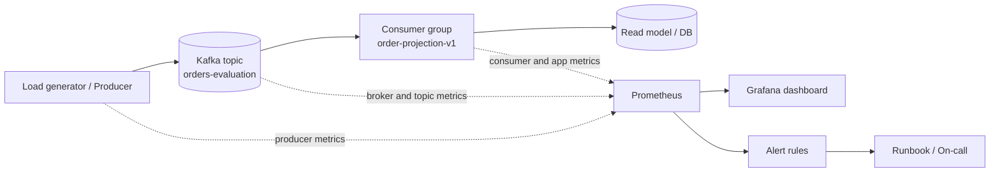

# Đánh giá giải pháp bằng kiểm thử, dashboard và runbook

Một hệ thống Kafka chỉ được xem là sẵn sàng khi vừa xử lý đúng dữ liệu, vừa đáp ứng mục tiêu hiệu năng và có thể vận hành khi xảy ra sự cố. Bài thực hành này hướng dẫn đánh giá một luồng event streaming từ producer đến consumer bằng bộ kiểm thử có thể lặp lại, dashboard quan sát broker và ứng dụng, cùng runbook xử lý các tình huống thường gặp.

Người học sẽ xây dựng một bộ tiêu chí đo lường, chạy tải chuẩn, kiểm tra tính đúng đắn và khả năng phục hồi, đọc các chỉ số trên dashboard, sau đó diễn tập một số cảnh báo. Các ngưỡng trong bài là ví dụ để tổ chức thí nghiệm; khi triển khai thực tế, nhóm phải xác định ngưỡng theo SLO, tải dự kiến, cấu hình cụm và mức độ quan trọng của nghiệp vụ.

## 1. Mục tiêu và kiến trúc đánh giá

Sau bài thực hành, người học có thể:

- Viết test plan có đầu vào, điều kiện chạy, phép đo và tiêu chí đạt rõ ràng.
- Đo throughput, latency, consumer lag, tỷ lệ lỗi và tính đúng đắn của dữ liệu.
- Phân biệt chỉ số của producer, broker, consumer và ứng dụng nghiệp vụ.
- Tạo dashboard theo dõi sức khỏe cụm, tiến độ xử lý và chất lượng dịch vụ.
- Định nghĩa cảnh báo có hành động tiếp theo và viết runbook cho từng tình huống.
- Đánh giá kết quả trước/sau khi thay đổi partition, batch, compression hoặc concurrency.

Luồng mẫu dùng topic `orders-evaluation`, producer phát sự kiện đơn hàng, consumer group `order-projection-v1` cập nhật read model và hệ thống giám sát thu thập metric từ Kafka cùng ứng dụng.



Các lớp cần đánh giá:

| Lớp | Câu hỏi cần trả lời | Ví dụ phép đo |
| --- | --- | --- |
| Producer | Có gửi đủ sự kiện, đúng tốc độ và đúng độ tin cậy không? | Records/s, request latency, retry, error rate |
| Broker/topic | Cụm có nhận và lưu dữ liệu ổn định không? | Bytes in/out, request handler idle, under-replicated partitions |
| Consumer | Group có theo kịp luồng sự kiện không? | Records consumed/s, lag, rebalance, commit latency |
| Ứng dụng đích | Sự kiện có được xử lý đúng và kịp thời không? | End-to-end latency, lỗi nghiệp vụ, thời gian ghi DB |
| Vận hành | Có phát hiện và phục hồi sự cố trong mục tiêu không? | Alert duration, thời gian nhận biết, thời gian khôi phục |

## 2. Chuẩn bị môi trường và dữ liệu thử

Sử dụng một Kafka cluster dành riêng cho thực hành. Có thể dùng môi trường local một broker để chạy kiểm thử chức năng và tải cơ bản. Các bài thử replication/failover cần cụm nhiều broker; không thể kết luận khả năng chịu lỗi replication từ một broker duy nhất.

Tạo topic với sáu partition:

```bash
bin/kafka-topics.sh \
  --bootstrap-server localhost:9092 \
  --create --if-not-exists \
  --topic orders-evaluation \
  --partitions 6 \
  --replication-factor 1
```

Với cụm ba broker, có thể tạo topic kiểm thử replication riêng với replication factor `3`. Nếu cấu hình `min.insync.replicas=2`, producer dùng `acks=all` chỉ nhận ghi thành công khi đủ số replica trong ISR theo điều kiện của broker. Hãy xác nhận cấu hình thực tế bằng `kafka-configs --describe` và `kafka-topics --describe`; không áp dụng cấu hình chịu lỗi của cụm nhiều broker vào local một broker.

Chọn một group ID cố định cho toàn bộ lần đo, ví dụ `order-projection-v1`. Ghi lại phiên bản Kafka broker/client, số broker, số partition, replication factor, `min.insync.replicas`, cấu hình producer/consumer, kích thước message, số lượng key, cấu hình máy và trạng thái hệ thống đích. Nếu các lần chạy dùng môi trường hoặc cấu hình khác nhau, kết quả sẽ khó so sánh.

Nên tạo dữ liệu thử có ID duy nhất và phân bố key đại diện cho thực tế. Nếu mọi bản ghi dùng cùng một key, tất cả bản ghi có thể tập trung vào một partition và làm sai lệch kết quả song song. Nếu nghiệp vụ cần ordering theo đơn hàng, dùng `orderId` làm key và xác minh thứ tự trong từng key.

## 3. Xây dựng test plan và tiêu chí đạt

Trước khi chạy tải, ghi rõ giả thuyết cần kiểm tra. Ví dụ: với sáu partition và ba consumer instance, hệ thống xử lý được ít nhất mức tải mục tiêu trong khi p95 end-to-end latency, lag và tỷ lệ lỗi vẫn nằm trong SLO.

Mỗi lần thử cần có các thông tin sau:

1. **Mục tiêu:** kiểm tra throughput, latency, độ tin cậy, scale-out hay phục hồi.
2. **Điều kiện:** phiên bản, cấu hình, dữ liệu, thời gian warm-up và thời gian đo.
3. **Tải:** số message, kích thước message, tốc độ phát, phân bố key và thời gian chạy.
4. **Quan sát:** metric producer, broker, consumer, ứng dụng và hệ thống đích.
5. **Kết quả:** số lượng gửi/nhận, p50/p95/p99, lag, lỗi, rebalance và tài nguyên.
6. **Kết luận:** đạt/không đạt, nguyên nhân, giới hạn và thay đổi tiếp theo.

Ví dụ bảng tiêu chí. Thay các con số minh họa bằng SLO của dịch vụ trước khi dùng cho production.

| Chỉ tiêu | Mục tiêu minh họa | Cách xác minh |
| --- | --- | --- |
| Tính đầy đủ | Số event duy nhất được xử lý bằng số event hợp lệ đã phát | Đối chiếu ID nguồn với read model hoặc kết quả audit |
| Tính lặp | Không tạo tác động nghiệp vụ trùng khi chạy lại event | Kiểm tra unique key/idempotency và bản ghi trùng |
| Ordering | Event cùng key giữ thứ tự yêu cầu | So sánh sequence number theo key |
| Throughput | Đạt tải mục tiêu liên tục trong thời gian đo | Producer/consumer records per second |
| End-to-end latency | p95 và p99 dưới ngưỡng SLO | Timestamp phát và timestamp hoàn tất xử lý |
| Consumer lag | Không tăng liên tục; trở về mức bình thường sau đợt tải | Lag theo partition và tốc độ giảm lag |
| Độ tin cậy | Không có lỗi ghi/đọc ngoài mức cho phép | Producer errors, consumer exceptions, DLT |
| Sức khỏe cụm | Không có offline partition; ISR ổn định | Broker/replica metrics và mô tả topic |

Không lấy một lần chạy làm kết luận. Chạy warm-up, đo ít nhất ba lượt với cùng cấu hình và so sánh median cùng độ phân tán. Ghi nhận cả kết quả xấu nhất nếu nó có ý nghĩa đối với SLO.

## 4. Kiểm thử throughput và latency của producer

Kafka cung cấp `kafka-producer-perf-test.sh` để tạo tải và in các thống kê hiệu năng. Ví dụ sau gửi 100.000 record, mỗi record 512 byte. Điều chỉnh số lượng, kích thước và tốc độ cho phù hợp với môi trường thử.

```bash
bin/kafka-producer-perf-test.sh \
  --topic orders-evaluation \
  --num-records 100000 \
  --record-size 512 \
  --throughput -1 \
  --producer-props \
    bootstrap.servers=localhost:9092 \
    acks=all \
    linger.ms=5 \
    batch.size=32768 \
    compression.type=lz4 \
  --print-metrics
```

Ghi lại records/sec, MB/sec và các percentile latency mà công cụ báo cáo. Lặp lại với `compression.type=none`, `gzip`, `snappy` hoặc `zstd` nếu client/broker hỗ trợ. Không đổi nhiều tham số cùng lúc; mỗi lần chỉ thay một yếu tố để hiểu nguyên nhân của thay đổi.

Để kiểm tra tải có giới hạn, đặt `--throughput` thành số record mỗi giây thay vì `-1`. Tăng dần tốc độ cho đến khi thấy latency, lỗi hoặc tài nguyên vượt ngưỡng. Tải tối đa trong một lần chạy ngắn không phải throughput bền vững; cần đo trong khoảng thời gian đủ dài để phát hiện queue tích tụ, GC và tác động của hệ thống đích.

Các yếu tố nên thử riêng:

- `acks=all` và cấu hình replication phù hợp để đánh giá độ tin cậy khi ghi.
- `linger.ms` và `batch.size` để xem batching ảnh hưởng throughput và latency thế nào.
- Compression để so sánh băng thông, CPU và kích thước dữ liệu lưu trữ.
- Phân bố key để xác định có partition nóng hay không.
- Kích thước record và số lượng record trong batch gần với dữ liệu thực tế.

Perf test của producer đo đường gửi đến Kafka. Nó không chứng minh consumer đã xử lý xong dữ liệu hoặc ứng dụng đích đã ghi thành công. Cần kết hợp với consumer test và kiểm tra kết quả nghiệp vụ ở các bước sau.

## 5. Kiểm thử consumer và tính đúng đắn của dữ liệu

Có thể dùng `kafka-consumer-perf-test.sh` để đo tốc độ đọc:

```bash
bin/kafka-consumer-perf-test.sh \
  --bootstrap-server localhost:9092 \
  --topic orders-evaluation \
  --messages 100000 \
  --group order-projection-perf
```

Nếu phiên bản Kafka có các tùy chọn báo cáo chi tiết, dùng `--show-detailed-stats` và đặt reporting interval để thu thập tốc độ theo từng khoảng. Consumer perf test giúp đo khả năng đọc của client, nhưng không mô phỏng đầy đủ logic deserialize, gọi database, retry hay transaction của ứng dụng.

Với kiểm thử end-to-end, consumer nghiệp vụ cần ghi nhận tối thiểu `eventId`, key, partition, offset, thời điểm phát và thời điểm hoàn tất xử lý. Sau mỗi lượt thử, đối chiếu:

- Tổng event hợp lệ đã phát với tổng event đã xử lý thành công.
- Số `eventId` duy nhất với số bản ghi nghiệp vụ duy nhất ở hệ thống đích.
- Số event lỗi, retry và dead-letter với danh sách lỗi dự kiến.
- Sequence theo key để xác minh ordering ở phạm vi yêu cầu.
- Thời gian từ lúc phát đến khi nghiệp vụ hoàn tất, không chỉ thời gian consumer poll được record.

Nếu consumer xử lý at-least-once, event có thể được đọc lại khi process lỗi sau khi ghi DB nhưng trước khi commit offset. Bài test phải xác minh idempotency của handler hoặc transaction boundary phù hợp. Không kết luận mất dữ liệu chỉ từ việc số lần delivery lớn hơn số event duy nhất; cần phân biệt retry hợp lệ với duplicate side effect.

Kiểm tra lag trong khi chạy:

```bash
bin/kafka-consumer-groups.sh \
  --bootstrap-server localhost:9092 \
  --describe \
  --group order-projection-v1
```

Đọc lag theo từng partition. Lag tăng trong một đợt tải ngắn có thể chấp nhận nếu consumer bắt kịp sau đó; lag tăng liên tục hoặc không giảm khi producer ngừng là dấu hiệu consumer không theo kịp hoặc đang gặp lỗi.

## 6. Kiểm thử rebalance và khả năng phục hồi

Thực hiện các tình huống sau trong môi trường riêng:

| Tình huống | Thao tác | Kết quả cần quan sát |
| --- | --- | --- |
| Consumer scale-out | Tăng số instance trong cùng group | Assignment mới, thời gian rebalance và lag trong lúc chuyển giao |
| Consumer scale-in | Dừng một instance có kiểm soát | Partition được giao lại, không mất committed progress |
| Consumer crash | Dừng process đột ngột | Broker phát hiện member mất kết nối; consumer khác nhận partition sau timeout/rebalance |
| Downstream chậm | Tạo độ trễ có kiểm soát ở bước ghi DB | Lag tăng, thời gian xử lý tăng; sau khi phục hồi, lag giảm |
| Broker restart | Khởi động lại một broker trong cụm thử nghiệm | Producer/consumer retry, leader/replica phục hồi và ISR ổn định |
| Replica unavailable | Trong cụm RF=3, dừng một broker theo kịch bản | Với `acks=all` và `min.insync.replicas=2`, ghi có thể tiếp tục nếu ISR vẫn đủ |
| ISR không đủ | Trong môi trường thử nghiệm, làm số replica trong ISR thấp hơn min ISR | Producer nhận lỗi ghi thay vì xác nhận một bản ghi không đạt điều kiện durability đã đặt |

Không dừng broker production để thử nghiệm. Với cụm một broker, restart broker chỉ kiểm tra quy trình reconnect; nó không chứng minh khả năng failover. Khi diễn tập lỗi, ghi thời điểm bắt đầu/kết thúc, số event phát, số event xử lý, thời gian gián đoạn, số lần retry và thời gian phục hồi.

Sau mỗi tình huống, xác minh group state, partition leader, ISR, under-replicated partitions, producer error rate, consumer lag và kết quả dữ liệu. Chỉ đánh dấu phục hồi khi các chỉ số trở về trạng thái ổn định và đối chiếu dữ liệu không phát hiện thiếu hoặc sai nghiệp vụ.

## 7. Thu thập metric cho dashboard

Kafka broker cung cấp metric qua JMX. Có thể dùng JMX Exporter để chuyển metric thành Prometheus format; ứng dụng Java/Spring có thể xuất metric qua Micrometer/Actuator. Consumer lag có thể lấy qua exporter chuyên dụng hoặc hệ thống giám sát group mà tổ chức đang sử dụng.

Tên metric sau khi export phụ thuộc JMX Exporter rules, phiên bản client và cách chuẩn hóa tên. Hãy mở endpoint `/metrics` của exporter để xác nhận tên metric và label thực tế trước khi viết PromQL. Các tên JMX gốc dưới đây là nhóm metric cần tìm, không phải cam kết về tên Prometheus sau chuyển đổi.

| Thành phần | Metric cần theo dõi | Ý nghĩa vận hành |
| --- | --- | --- |
| Broker | `MessagesInPerSec`, `BytesInPerSec`, `BytesOutPerSec` | Tốc độ nhận và truyền dữ liệu |
| Broker/replica | `UnderReplicatedPartitions`, `OfflinePartitionsCount` | Replica chưa theo kịp hoặc partition không khả dụng |
| Broker/request | `RequestHandlerAvgIdlePercent`, `NetworkProcessorAvgIdlePercent` | Mức nhàn rỗi của thread xử lý request và network |
| Producer | `record-send-rate`, `record-error-rate`, `request-latency-avg`, `batch-size-avg`, `buffer-available-bytes` | Tốc độ gửi, lỗi, độ trễ request và tình trạng buffer |
| Consumer | `records-consumed-rate`, `records-lag-max`, `fetch-latency-avg`, `commit-latency-avg`, `heartbeat-response-time-max` | Tốc độ đọc, lag, fetch, commit và heartbeat |
| JVM | Heap used/max, GC pause/count, thread count | Áp lực bộ nhớ và garbage collection |
| Ứng dụng | Event processing duration, error count, retry, DLT count | Chất lượng xử lý nghiệp vụ end-to-end |
| Consumer group | Lag theo group/topic/partition, số member, trạng thái group | Khả năng theo kịp và ổn định membership |

Không chỉ theo dõi tổng lag. Một partition nóng có thể bị che khuất bởi tổng lag thấp. Dashboard cần hiển thị max lag, lag theo partition và xu hướng lag theo thời gian. Nếu có thể, bổ sung tuổi của event chưa xử lý lâu nhất vì số offset lag không phản ánh chính xác thời gian chờ khi tốc độ phát thay đổi.

## 8. Thiết kế dashboard Grafana

Tạo dashboard có biến chọn `cluster`, `topic` và `consumer group`. Chia thành các hàng để người trực ca có thể đi từ tình trạng tổng quan đến nguyên nhân.

**Hàng 1 — Service overview**

- Producer records/s và consumer records/s.
- End-to-end p50, p95, p99 latency.
- Tổng lag và max lag theo partition.
- Tỷ lệ xử lý thành công, lỗi, retry và DLT.

**Hàng 2 — Broker health**

- Bytes in/out và messages in theo broker.
- Offline partition và under-replicated partition.
- Request handler/network processor idle percent.
- CPU, heap, GC, disk usage, disk I/O và network.
- Leader/ISR distribution để phát hiện broker hoặc partition mất cân bằng.

**Hàng 3 — Producer and consumer**

- Producer request latency, error rate, retry rate, batch size và buffer available.
- Consumer records consumed rate, max lag, fetch latency và commit latency.
- Số lần rebalance, số member, poll interval và lỗi deserialize.
- Thời gian ghi hệ thống đích và số lượng connection/pool đang sử dụng.

**Hàng 4 — Data correctness and operations**

- Event phát so với event xử lý thành công.
- Duplicate event ID và lỗi idempotency.
- Retry topic/DLT rate.
- Lịch sử alert, deployment và thay đổi cấu hình gần thời điểm có sự cố.

Ví dụ PromQL cho exporter `kafka_exporter` có metric `kafka_consumergroup_lag` và label `consumergroup`, `topic`. Kiểm tra label thực tế ở Prometheus trước khi sử dụng:

```promql
sum by (consumergroup, topic) (
  kafka_consumergroup_lag{consumergroup="order-projection-v1"}
)
```

Lag lớn nhất theo partition:

```promql
max by (consumergroup, topic) (
  kafka_consumergroup_lag{consumergroup="order-projection-v1"}
)
```

Tốc độ tăng lag trong 10 phút, nếu exporter cung cấp gauge được scrape ổn định:

```promql
delta(kafka_consumergroup_lag{consumergroup="order-projection-v1"}[10m])
```

`delta()` biểu diễn chênh lệch gauge trong khoảng thời gian, không phải tốc độ event/giây. Dùng `deriv()` hoặc tính slope phù hợp khi cần xu hướng; luôn diễn giải cùng tốc độ producer và consumer. Nếu metric hoặc label khác với ví dụ, thay biểu thức theo schema exporter thực tế.

Dashboard phải có đơn vị rõ ràng, legend chứa broker/topic/partition hoặc group cần thiết, khoảng thời gian mặc định hợp lý và link đến runbook. Tránh đặt mọi panel ở chế độ tổng hợp khiến người trực ca không thể xác định broker hoặc partition gây vấn đề.

## 9. Thiết kế cảnh báo có thể hành động

Cảnh báo cần chỉ ra triệu chứng, mức độ, đối tượng bị ảnh hưởng và bước điều tra đầu tiên. Tránh cảnh báo chỉ vì một giá trị tức thời vượt ngưỡng trong vài giây nếu hệ thống có dao động bình thường.

Ví dụ ma trận cảnh báo:

| Alert | Điều kiện minh họa | Mức độ | Hành động đầu tiên |
| --- | --- | --- | --- |
| Offline partition | `OfflinePartitionsCount > 0` | Critical | Kiểm tra broker, controller, leader election và khả năng đọc/ghi topic |
| Under-replicated partition | Giá trị lớn hơn 0 kéo dài 5 phút | Warning/Critical theo phạm vi | Kiểm tra broker mất kết nối, disk, network và ISR |
| Consumer lag tăng | Lag vượt ngưỡng SLO và tăng liên tục 10 phút | Warning | So sánh producer rate, consumer rate, partition nóng và lỗi downstream |
| Consumer không tiến triển | Lag cao và offset không tăng trong cửa sổ giám sát | Critical nếu dịch vụ bị đình trệ | Kiểm tra member, poll, exception, rebalance và dependency |
| Producer error rate | Tỷ lệ lỗi vượt SLO trong cửa sổ liên tục | Critical theo nghiệp vụ | Kiểm tra broker availability, authorization, timeout, quota và ISR |
| End-to-end latency | p99 vượt SLO trong thời gian quy định | Warning/Critical | Xác định độ trễ nằm ở Kafka hay xử lý downstream |
| DLT/retry tăng | Tỷ lệ lỗi nghiệp vụ vượt ngưỡng | Warning | Phân loại exception, schema, poison message và dependency |
| Disk capacity | Dung lượng dự báo chạm ngưỡng an toàn | Warning | Kiểm tra retention, log segment, volume và kế hoạch mở rộng |

Ví dụ Prometheus alert rule cho metric exporter đã được ánh xạ thành `kafka_server_replicamanager_underreplicatedpartitions`. Tên metric thực tế phải xác nhận từ endpoint Prometheus/JMX Exporter:

```yaml
groups:
  - name: kafka-cluster
    rules:
      - alert: KafkaUnderReplicatedPartitions
        expr: kafka_server_replicamanager_underreplicatedpartitions > 0
        for: 5m
        labels:
          severity: warning
        annotations:
          summary: Kafka có partition chưa đồng bộ đủ replica
          description: Kiểm tra broker, ISR, disk và network; xem runbook Kafka replication.
```

Đây là mẫu cấu trúc rule. Nếu exporter dùng tên khác, sửa `expr` theo metric thực tế. Với `OfflinePartitionsCount`, nên đặt mức critical và thời gian giữ ngắn phù hợp với khả năng chịu gián đoạn của dịch vụ. Cảnh báo lag nên kết hợp điều kiện lag cao với tốc độ lag tăng hoặc event age vượt SLO; lag cao nhưng đang giảm sau một đợt tải không nhất thiết cần page ngay.

## 10. Viết runbook xử lý sự cố

Runbook là hướng dẫn cho người trực ca thực hiện nhất quán. Mỗi mục cần nêu triệu chứng, tác động, bước kiểm tra, biện pháp an toàn, điều kiện phục hồi và khi nào cần chuyển cấp.

### 10.1 Consumer lag tăng liên tục

**Triệu chứng:** lag hoặc tuổi event chưa xử lý tăng, end-to-end latency vượt SLO.

**Kiểm tra:**

1. Xác nhận đúng cluster, topic và group; kiểm tra group state, member và assignment bằng `kafka-consumer-groups --describe --group ... --members --verbose` nếu phiên bản hỗ trợ.
2. So sánh producer records/s với consumer records/s; xem lag theo partition để tìm partition nóng.
3. Kiểm tra log consumer, retry, DLT, lỗi deserialize, thời gian xử lý handler và độ trễ database/API downstream.
4. Kiểm tra rebalance thường xuyên, `max.poll.interval.ms`, heartbeat, GC pause và tài nguyên CPU/memory.

**Xử lý:** khắc phục dependency chậm hoặc exception trước; scale consumer chỉ khi có partition đủ để phân phối và hệ thống đích còn năng lực. Nếu partition là nút thắt, đánh giá tăng partition như một thay đổi kiến trúc có kế hoạch vì nó ảnh hưởng key ordering và phân phối dữ liệu. Không reset offset để làm lag hiển thị thấp hơn.

**Xác nhận phục hồi:** consumer rate lớn hơn producer rate trong giai đoạn bắt kịp, lag giảm đều, event age trở lại SLO và số event xử lý thành công khớp với audit.

### 10.2 Under-replicated hoặc offline partition

**Triệu chứng:** `UnderReplicatedPartitions` lớn hơn 0 hoặc `OfflinePartitionsCount` lớn hơn 0; có thể kèm producer timeout và lỗi metadata.

**Kiểm tra:**

1. Dùng `kafka-topics --describe --topic ...` để xem leader, replicas và ISR.
2. Xác định broker mất kết nối hoặc broker có disk/network bất thường; kiểm tra log broker, dung lượng đĩa và controller health.
3. Xem liệu replica có đang bắt kịp hay ISR liên tục co lại; đối chiếu thời điểm deploy hoặc thay đổi hạ tầng.

**Xử lý:** khôi phục broker hoặc hạ tầng theo quy trình của đội nền tảng; giữ đủ replica và tránh thao tác reassignment thủ công khi chưa đánh giá tác động. Nếu producer dùng `acks=all`, kiểm tra `min.insync.replicas` và thông báo rõ khi cụm không đủ điều kiện ghi. Không hạ min ISR trong production chỉ để làm producer hết lỗi nếu chưa đánh giá rủi ro mất dữ liệu.

**Xác nhận phục hồi:** partition có leader hợp lệ, ISR đạt yêu cầu, offline partition bằng 0, under-replicated partition trở về 0 và producer error rate bình thường.

### 10.3 Producer lỗi hoặc latency tăng

**Kiểm tra:** phân biệt lỗi timeout, not leader, authorization, quota, serialization và lỗi do ISR không đủ. Kiểm tra request latency, retry rate, buffer available, batch size, broker request queue và network.

**Xử lý:** xác minh broker và quyền trước khi thay timeout; kiểm tra schema/serializer nếu lỗi chỉ xảy ra với một loại payload. Khi buffer đầy, kiểm tra broker có chậm nhận request hay callback xử lý quá lâu. Không tăng retry vô hạn vì có thể kéo dài sự cố và làm tích tụ bộ nhớ.

**Xác nhận phục hồi:** error rate và request latency trở về mục tiêu, số event được xác nhận gửi phù hợp với audit, không có backlog bất thường ở producer.

### 10.4 Consumer rebalance liên tục

**Kiểm tra:** xem log revoked/assigned, group state, member count, heartbeat, `session.timeout.ms`, `max.poll.interval.ms`, GC pause và thời gian xử lý giữa hai lần poll.

**Xử lý:** giảm thời gian xử lý mỗi poll hoặc điều chỉnh `max.poll.records` nếu batch quá lớn; đưa tác vụ chậm sang worker pool có kiểm soát nhưng phải giữ cơ chế commit/ordering đúng. Kiểm tra network và deployment restart loop. Chỉ đổi assignor khi đã kiểm tra tương thích client/broker và kế hoạch rollout.

**Xác nhận phục hồi:** rebalance rate trở lại bình thường, assignment ổn định, lag giảm và không có duplicate side effect ngoài chính sách của ứng dụng.

### 10.5 Retry hoặc dead-letter tăng

**Kiểm tra:** phân nhóm lỗi theo exception, topic, schema version và dependency. Xác định lỗi tạm thời hay poison message không thể xử lý.

**Xử lý:** sửa lỗi gốc trước khi replay; giữ lại event gốc, key, headers, exception và correlation ID. Replay theo batch có giới hạn và theo dõi duplicate/idempotency. Không xóa DLT hoặc bỏ qua message chỉ để dashboard trở về màu xanh.

**Xác nhận phục hồi:** tỷ lệ lỗi giảm, DLT được xử lý theo quyết định nghiệp vụ, số event thành công được đối chiếu và không phát sinh side effect trùng.

## 11. Diễn tập runbook và đo thời gian phục hồi

Chọn ít nhất hai tình huống trong môi trường thực hành: consumer crash và downstream chậm. Một người tạo sự cố theo kịch bản, một người trực dashboard và làm theo runbook. Ghi lại:

- `T_detect`: thời điểm cảnh báo được kích hoạt.
- `T_ack`: thời điểm người trực xác nhận cảnh báo.
- `T_mitigate`: thời điểm tác động đến dịch vụ được chặn hoặc giảm.
- `T_recover`: thời điểm các chỉ số và kiểm tra nghiệp vụ trở lại bình thường.

Từ đó tính thời gian nhận biết (MTTD), thời gian khôi phục (MTTR) theo định nghĩa của nhóm. Không chỉ đo thời gian dashboard hết cảnh báo; cần xác nhận luồng event và dữ liệu đích đã đúng. Sau diễn tập, ghi lại bước runbook còn thiếu, cảnh báo nhiễu, metric chưa có và quyền truy cập cần bổ sung.

## 12. So sánh cấu hình và đưa ra quyết định

Tạo một bảng so sánh baseline với từng phương án thay đổi. Ví dụ:

| Lần chạy | Thay đổi duy nhất | Throughput | p95 latency | Max lag | Error rate | CPU/heap |
| --- | --- | ---: | ---: | ---: | ---: | --- |
| Baseline | Cấu hình hiện tại | Ghi kết quả | Ghi kết quả | Ghi kết quả | Ghi kết quả | Ghi kết quả |
| A | Tăng `linger.ms` | Ghi kết quả | Ghi kết quả | Ghi kết quả | Ghi kết quả | Ghi kết quả |
| B | Bật compression | Ghi kết quả | Ghi kết quả | Ghi kết quả | Ghi kết quả | Ghi kết quả |
| C | Tăng consumer concurrency | Ghi kết quả | Ghi kết quả | Ghi kết quả | Ghi kết quả | Ghi kết quả |
| D | Thay đổi số partition trong môi trường thử | Ghi kết quả | Ghi kết quả | Ghi kết quả | Ghi kết quả | Ghi kết quả |

Đánh giá trade-off thay vì chỉ chọn cấu hình có throughput cao nhất. Ví dụ, compression có thể giảm network/disk nhưng tăng CPU; batching có thể tăng throughput nhưng làm tăng latency khi tải thấp; tăng concurrency có thể không giúp nếu số partition ít hoặc database đã bão hòa. Mọi thay đổi cần qua kiểm thử correctness và failure scenario tương ứng.

## 13. Checklist và kết quả cần nộp

- [ ] Có test plan ghi rõ mục tiêu, tải, cấu hình, thời gian warm-up, thời gian đo và tiêu chí đạt.
- [ ] Đã chạy producer perf test ít nhất ba lượt và lưu throughput/latency.
- [ ] Đã chạy consumer perf test và đo consumer lag theo partition.
- [ ] Đã đối chiếu số event duy nhất, duplicate, ordering và kết quả ở hệ thống đích.
- [ ] Đã kiểm thử ít nhất một tình huống scale/rebalance và một tình huống lỗi/phục hồi.
- [ ] Dashboard có producer, broker, consumer, application, JVM và consumer group metrics.
- [ ] Có cảnh báo cho offline partition, under-replicated partition, lag tăng và lỗi ứng dụng.
- [ ] Runbook nêu rõ bước kiểm tra, hành động an toàn và điều kiện xác nhận phục hồi.
- [ ] Đã diễn tập runbook, ghi MTTD/MTTR và cập nhật các bước còn thiếu.
- [ ] Đã so sánh baseline với các thay đổi cấu hình bằng cùng điều kiện đo.

Bộ bàn giao gồm test plan, log/kết quả đo, ảnh dashboard, cấu hình alert, runbook và bảng quyết định cấu hình. Kết luận phải chỉ ra hệ thống đạt SLO nào, còn giới hạn ở đâu, điều kiện nào đã được kiểm thử và tình huống nào chưa được diễn tập. Một giải pháp Kafka chỉ có thể được đánh giá đáng tin cậy khi số liệu hiệu năng đi cùng bằng chứng dữ liệu đúng và quy trình phục hồi đã được thực hành.
