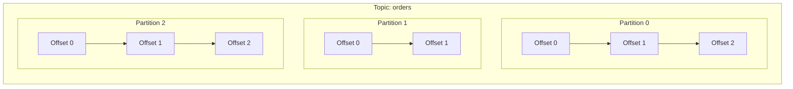
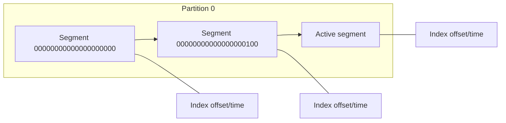
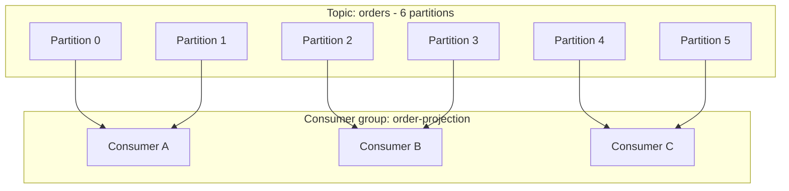
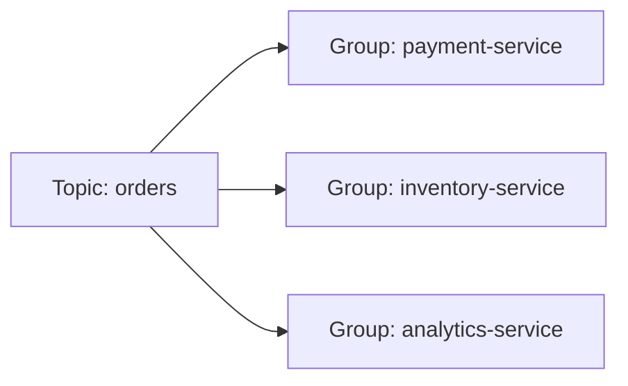
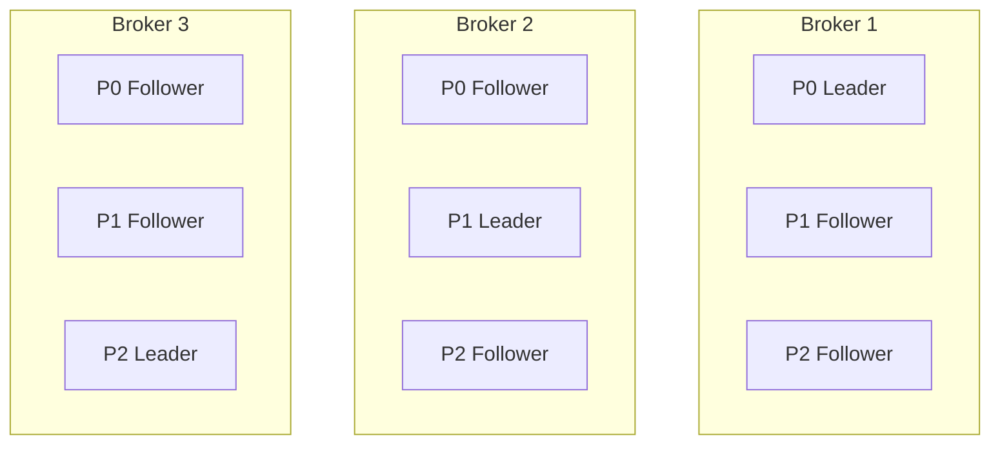

# Topic, partition và nhật ký chỉ ghi nối tiếp

## Mục tiêu bài học

Trong Kafka, topic là nơi đặt tên cho một luồng sự kiện, còn partition là đơn vị lưu trữ và xử lý song song của luồng đó. Mỗi partition hoạt động như một nhật ký chỉ ghi nối tiếp (append-only log): bản ghi mới được thêm vào cuối log và được gán một offset trong partition. Cách tổ chức này giúp Kafka mở rộng thông lượng, giữ thứ tự trong phạm vi cần thiết và cho phép nhiều ứng dụng đọc lại dữ liệu theo tiến độ riêng.

Bài học đặt topic và partition vào bức tranh event streaming của Apache Kafka. Người học sẽ đi từ cấu trúc bản ghi, offset và segment đến cách producer chọn partition, consumer group chia tải, replication bảo vệ dữ liệu và retention quản lý vòng đời log. Cuối bài có các lệnh Kafka CLI và ví dụ Spring Kafka để quan sát trực tiếp.

Sau bài học, người học có thể:

- Phân biệt topic, partition, record, offset và log segment.
- Giải thích mô hình append-only log và phạm vi bảo đảm thứ tự của Kafka.
- Chọn partition bằng key và hiểu ảnh hưởng của số partition đến ordering.
- Mô tả cách consumer group phân chia partition và lưu offset đã xử lý.
- Phân biệt partitioning với replication, hiểu leader, follower và ISR.
- Cấu hình retention hoặc log compaction phù hợp với loại dữ liệu.
- Tạo topic, kiểm tra partition và quan sát record bằng Kafka CLI/Spring Kafka.

## 1. Từ event stream đến topic

Một hệ thống nghiệp vụ thường phát sinh các sự kiện như `OrderCreated`, `PaymentAuthorized`, `InventoryReserved` hoặc `ShipmentDispatched`. Kafka tiếp nhận các sự kiện này từ producer, lưu chúng trong topic và cho phép một hoặc nhiều ứng dụng consumer đọc độc lập.

Ví dụ, khi dịch vụ đơn hàng phát sự kiện `OrderCreated`, nhiều hệ thống có thể quan tâm cùng một sự kiện:

- Dịch vụ thanh toán bắt đầu quy trình thu tiền.
- Dịch vụ kho giữ hàng.
- Dịch vụ phân tích cập nhật số liệu.
- Dịch vụ thông báo gửi email hoặc push notification.

Các consumer group này đọc cùng topic nhưng duy trì tiến độ riêng. Consumer của nhóm thanh toán không làm mất bản ghi mà nhóm phân tích cần đọc. Đây là một khác biệt quan trọng giữa event log và mô hình hàng đợi trong đó một thông điệp thường được một consumer trong nhóm nhận xử lý.

### 1.1. Topic là gì?

Topic là tên logic đại diện cho một luồng record cùng loại hoặc cùng mục đích. Ví dụ:

| Topic | Record điển hình | Consumer quan tâm |
|---|---|---|
| `orders` | Đơn hàng được tạo, cập nhật hoặc hủy | Thanh toán, kho, phân tích |
| `payments` | Thanh toán được yêu cầu, chấp nhận hoặc từ chối | Đơn hàng, đối soát |
| `inventory-events` | Hàng được giữ, xuất hoặc nhập kho | Catalog, vận chuyển |
| `user-activity` | Người dùng đăng nhập, xem sản phẩm | Phân tích, đề xuất |

Topic tạo ranh giới logic cho việc phân quyền, cấu hình lưu trữ, retention và quản trị. Tuy nhiên, topic không phải một file duy nhất. Một topic được chia thành một hoặc nhiều partition để Kafka có thể phân phối dữ liệu và tải xử lý.

### 1.2. Record gồm những gì?

Một record Kafka có thể chứa các thành phần sau:

| Thành phần | Vai trò |
|---|---|
| Key | Dùng để định tuyến record đến partition và hỗ trợ compaction theo key |
| Value | Payload chính, thường là JSON, Avro, Protobuf hoặc dữ liệu nhị phân |
| Headers | Metadata dạng key-value như correlation ID, trace ID hoặc loại sự kiện |
| Timestamp | Thời điểm gắn với record theo cấu hình timestamp của producer hoặc broker |
| Partition | Partition lưu record |
| Offset | Vị trí của record trong partition đó |

Key và value có thể là `null` tùy trường hợp. Ví dụ, tombstone trong compacted topic sử dụng key có value `null` để biểu thị việc xóa logic một khóa.

## 2. Partition và append-only log

### 2.1. Partition là một nhật ký có thứ tự

Mỗi partition là một chuỗi record được Kafka nối thêm vào cuối log. Khi broker nhận record mới cho partition, record được ghi vào vị trí tiếp theo và có offset tương ứng. Kafka không cập nhật record cũ tại chỗ theo cách một bảng cơ sở dữ liệu quan hệ thường làm.



Trong ví dụ, topic `orders` có ba partition. Mỗi partition có dãy offset riêng bắt đầu từ vùng offset của partition đó. Offset `2` ở Partition 0 không có quan hệ thứ tự với offset `2` ở Partition 2. Kafka không cung cấp một offset toàn cục để sắp xếp mọi record trong topic.

Append-only có nghĩa là thao tác ghi thông thường thêm record mới vào cuối log. Cách ghi này giúp broker ghi dữ liệu tuần tự hiệu quả và consumer có thể đọc theo offset. Nó không có nghĩa mọi record đều được giữ vĩnh viễn: retention có thể xóa segment cũ và log compaction có thể loại bỏ phiên bản cũ của một key theo chính sách topic.

### 2.2. Offset là vị trí trong một partition

Offset là số định danh vị trí của record trong partition. Khi consumer đọc partition, nó dùng offset để biết vị trí tiếp theo cần lấy. Offset có các đặc điểm:

- Chỉ duy nhất trong phạm vi một partition, không duy nhất trên toàn topic.
- Không phải số thứ tự toàn cục giữa các partition.
- Không nhất thiết bằng số lượng record hiện đang còn trong log, vì record cũ có thể đã bị retention hoặc compaction loại bỏ.
- Là vị trí đọc, không phải bằng chứng rằng nghiệp vụ đã xử lý thành công record.

Ví dụ một topic có hai partition:

| Partition | Offset | Key | Value |
|---|---:|---|---|
| 0 | 0 | `customer-7` | `OrderCreated(1001)` |
| 0 | 1 | `customer-7` | `OrderPaid(1001)` |
| 0 | 2 | `customer-8` | `OrderCreated(1002)` |
| 1 | 0 | `customer-9` | `OrderCreated(1003)` |
| 1 | 1 | `customer-9` | `OrderCancelled(1003)` |

Có thể kết luận `OrderCreated(1001)` đứng trước `OrderPaid(1001)` trong Partition 0. Không thể dùng offset `2` của Partition 0 để kết luận record đó xảy ra trước hoặc sau offset `0` của Partition 1 nếu không có timestamp hoặc thông tin nghiệp vụ bổ sung.

Kafka cũng có các khái niệm vị trí liên quan:

- **Log end offset (LEO):** vị trí cuối log mà replica đã ghi nhận; đây là mốc tiếp theo mà record mới có thể được gán.
- **High watermark:** ranh giới các record đã được replicate đủ điều kiện để consumer đọc theo cơ chế thông thường. Nó giúp tránh đọc dữ liệu chưa được xác nhận bền vững theo trạng thái replication.
- **Consumer position:** vị trí tiếp theo mà consumer dự định đọc trong phiên hiện tại.
- **Committed offset:** vị trí consumer group đã lưu để có thể tiếp tục sau khi consumer khởi động lại hoặc rebalance.

Consumer position có thể đi trước committed offset. Nếu ứng dụng dừng trước khi commit, record có thể được đọc lại sau đó. Vì vậy offset cần được quản lý cùng với thời điểm hoàn tất xử lý nghiệp vụ.

### 2.3. Log segment và index

Một partition không nhất thiết nằm trong một file khổng lồ. Kafka chia log thành các segment. Broker nối record vào segment đang hoạt động; khi đạt ngưỡng kích thước hoặc thời gian, segment được đóng và một segment mới được tạo.



Các file index giúp broker định vị record nhanh hơn khi consumer yêu cầu một offset. Segment cũng là đơn vị quan trọng cho retention: khi một segment đủ cũ hoặc vượt chính sách dung lượng, Kafka có thể xóa toàn bộ segment đủ điều kiện thay vì sửa từng record bên trong.

Việc chia segment giúp Kafka quản lý log lớn, phục hồi và dọn dữ liệu hiệu quả. Các ngưỡng như `segment.bytes`, `segment.ms`, `retention.ms` và `retention.bytes` ảnh hưởng đến cách log được chia và lưu giữ.

## 3. Producer chọn partition như thế nào?

Producer gửi record đến topic. Nếu ứng dụng chỉ chỉ định topic, producer cần chọn partition đích. Cách chọn partition ảnh hưởng trực tiếp đến thứ tự, khả năng phân phối tải và locality của dữ liệu.

### 3.1. Định tuyến theo key

Khi record có key, partitioner mặc định thường băm key để chọn partition. Các record có cùng key sẽ đi đến cùng partition trong cùng cấu hình partitioner và số partition ổn định.

Ví dụ với key là mã khách hàng:

```text
key=customer-7, value=OrderCreated(1001)  -> Partition 0
key=customer-7, value=OrderPaid(1001)     -> Partition 0
key=customer-7, value=OrderShipped(1001)  -> Partition 0

key=customer-9, value=OrderCreated(1003)  -> Partition 1
key=customer-9, value=OrderCancelled(1003) -> Partition 1
```

Khi tất cả sự kiện của một khách hàng vào cùng partition, consumer có thể xử lý chúng theo thứ tự ghi trong partition đó. Đây là cách phổ biến để giữ ordering theo aggregate, tài khoản, đơn hàng hoặc thiết bị.

Chọn key cần dựa vào ranh giới thứ tự của nghiệp vụ. Nếu cần xử lý đúng thứ tự cho từng đơn hàng, `orderId` có thể phù hợp hơn `customerId`. Nếu cần cập nhật trạng thái theo từng tài khoản, `accountId` có thể là key tốt. Key có cardinality thấp hoặc một key phát sinh quá nhiều sự kiện có thể tạo partition nóng (hot partition).

### 3.2. Record không có key

Nếu không có key, producer có thể phân phối record qua các partition để cân bằng tải. Các phiên bản Kafka client hiện đại thường sử dụng cơ chế sticky partitioning cho record không có key nhằm gom record theo batch trước khi chuyển sang partition khác, giúp tăng hiệu quả batching.

Khi không có key ổn định, ứng dụng không nên giả định các record liên quan sẽ luôn vào cùng partition. Nếu cần thứ tự theo một thực thể nghiệp vụ, hãy chọn key thể hiện đúng thực thể đó.

### 3.3. Chỉ định partition trực tiếp

Producer API cũng cho phép chỉ định partition trong record. Cách này hữu ích cho một số luồng được phân vùng trước, nhưng làm ứng dụng phụ thuộc vào cấu trúc partition. Chỉ nên dùng khi có lý do rõ ràng và có cơ chế quản lý phân phối dữ liệu.

### 3.4. Thay đổi số partition ảnh hưởng đến key

Tăng số partition có thể tăng khả năng xử lý song song, nhưng cũng có thể làm thay đổi kết quả ánh xạ key sang partition. Các record mới của cùng key có thể được định tuyến sang partition khác với record cũ. Khi đó, hai partition không chia sẻ thứ tự với nhau.

Ví dụ, trước khi mở rộng topic, `order-42` được ghi vào Partition 1. Sau khi tăng số partition, phép băm và số partition mới có thể đưa `order-42` sang Partition 4. Consumer đọc Partition 4 không có bảo đảm rằng nó sẽ xử lý sau mọi record cũ của `order-42` còn ở Partition 1.

Vì vậy, tăng partition cần được xem là thay đổi thiết kế ordering, không chỉ là thao tác tăng hiệu năng. Nếu thứ tự theo key là yêu cầu cứng, hãy lập kế hoạch di chuyển hoặc dùng chiến lược partitioning ổn định phù hợp với vòng đời dữ liệu.

## 4. Ordering: Kafka bảo đảm thứ tự ở đâu?

Kafka bảo đảm thứ tự record trong một partition theo thứ tự log. Kafka không cung cấp thứ tự tổng thể giữa nhiều partition của cùng topic.

| Phạm vi | Bảo đảm |
|---|---|
| Một partition | Record được đọc theo thứ tự offset tăng dần |
| Nhiều partition trong một topic | Không có thứ tự tổng thể giữa các partition |
| Cùng key, số partition và partitioner ổn định | Record thường được đưa về cùng partition, do đó có thể giữ thứ tự trong partition đó |
| Cùng key sau khi thay đổi số partition | Không mặc định giữ cùng partition giữa dữ liệu cũ và mới |
| Nhiều consumer group | Mỗi group có tiến độ riêng; tốc độ xử lý giữa các group có thể khác nhau |

Ordering ở tầng Kafka cũng không tự động bảo đảm thứ tự hoàn tất nghiệp vụ. Nếu ứng dụng xử lý bất đồng bộ nhiều record trong cùng partition, tác vụ hoàn tất có thể đảo thứ tự. Nếu yêu cầu xử lý tuần tự, cần cấu hình listener và logic ứng dụng phù hợp, tránh đưa các record cùng key vào nhiều luồng xử lý song song không có điều phối.

Một số cách giữ ordering:

- Chọn key đại diện cho thực thể cần giữ thứ tự.
- Đảm bảo các sự kiện của thực thể đó được ghi vào cùng partition.
- Trong consumer, xử lý tuần tự theo partition hoặc theo key bằng cơ chế điều phối có kiểm soát.
- Khi retry, tránh để sự kiện sau vượt qua sự kiện trước nếu nghiệp vụ không cho phép.
- Đánh version hoặc sequence nghiệp vụ trong payload nếu cần phát hiện sự kiện đến sai thứ tự.

## 5. Consumer group và khả năng xử lý song song

Consumer group là tập hợp consumer cùng phối hợp đọc topic và chia partition. Trong một consumer group, tại một thời điểm, một partition chỉ được gán cho tối đa một consumer. Một consumer có thể được gán nhiều partition.



Với sáu partition và ba consumer trong một group, mỗi consumer có thể nhận hai partition. Nếu group có tám consumer, ít nhất hai consumer sẽ không được gán partition và không có record để xử lý từ topic đó. Vì vậy số partition đặt giới hạn trên cho mức song song đọc của một consumer group đối với topic.

Một topic có thể được đọc bởi nhiều consumer group độc lập:



Mỗi group có offset riêng. Consumer của `payment-service` có thể đã đọc đến offset 900 trong khi `analytics-service` mới đọc đến offset 650. Một group đọc record không làm record biến mất khỏi group khác.

### 5.1. Rebalance

Khi consumer tham gia, rời khỏi group, mất heartbeat hoặc partition thay đổi, Kafka có thể thực hiện rebalance để phân phối lại partition. Trong quá trình rebalance, việc đọc hoặc xử lý có thể tạm gián đoạn tùy giao thức và cấu hình consumer.

Rebalance thường xảy ra khi:

- Một instance consumer được triển khai thêm hoặc dừng.
- Consumer bị lỗi hoặc không gửi heartbeat đúng hạn.
- Topic được tăng số partition.
- Subscription của group thay đổi.

Ứng dụng cần xử lý việc partition bị thu hồi và được gán lại. Không nên giữ tài nguyên gắn với partition mà không giải phóng khi consumer bị revoke. Với các consumer có xử lý lâu, hãy thiết kế poll loop, heartbeat, timeout và batch size phù hợp để tránh rebalance ngoài ý muốn.

### 5.2. Consumer offset và commit

Consumer group lưu committed offset cho từng topic-partition. Offset này giúp group tiếp tục đọc sau khi restart hoặc rebalance.

Giả sử consumer đã đọc offset `100`, `101`, `102`:

- Nếu xử lý cả ba record thành công rồi commit vị trí tiếp theo là `103`, lần đọc sau có thể bắt đầu từ `103`.
- Nếu commit `103` trước khi xử lý xong rồi ứng dụng bị dừng, record có thể bị bỏ qua khi khởi động lại.
- Nếu xử lý xong nhưng chưa commit rồi ứng dụng bị dừng, record có thể được đọc lại.

Vì thế, commit offset là một phần của thiết kế delivery semantics. Commit sau xử lý thường hỗ trợ at-least-once nhưng có thể tạo xử lý lặp; commit trước xử lý có nguy cơ mất xử lý. Muốn tránh tác động lặp, nghiệp vụ cần idempotency hoặc phối hợp transaction/outbox phù hợp.

## 6. Partition và replication: hai mục đích khác nhau

Partitioning chia dữ liệu thành các log để tăng khả năng mở rộng và xử lý song song. Replication tạo bản sao của mỗi partition trên nhiều broker để tăng khả năng chịu lỗi. Hai cơ chế bổ sung cho nhau nhưng không thay thế nhau.

Ví dụ topic có ba partition và replication factor bằng ba:



Mỗi partition có một leader xử lý request đọc/ghi thông thường và các follower sao chép dữ liệu từ leader. Các bản sao được phân bố trên broker khác nhau để giảm rủi ro khi một broker gặp sự cố. Kafka quản lý tập replica đồng bộ gọi là ISR (in-sync replicas).

Một số khái niệm quan trọng:

- **Replication factor:** số replica của mỗi partition. RF=3 nghĩa là mỗi partition có ba bản sao, thường đặt trên ba broker khác nhau.
- **Leader:** replica đang nhận request ghi và điều phối việc đọc theo cấu hình.
- **Follower:** replica sao chép log từ leader.
- **ISR:** tập replica đang theo kịp leader theo tiêu chí đồng bộ của Kafka.
- **`acks`:** mức xác nhận mà producer yêu cầu trước khi coi việc gửi thành công.
- **`min.insync.replicas`:** số replica đồng bộ tối thiểu phải có để broker chấp nhận ghi khi producer dùng `acks=all`.

Ví dụ RF=3, `min.insync.replicas=2` và producer đặt `acks=all`: ghi chỉ được chấp nhận khi có đủ số ISR theo yêu cầu. Nếu ISR giảm xuống dưới hai, broker từ chối ghi để tránh xác nhận dữ liệu với mức replication thấp hơn chính sách. Điều này đánh đổi khả năng ghi liên tục khi lỗi lấy mức bảo vệ dữ liệu tốt hơn.

Tăng replication factor không làm tăng số partition hay mức song song consumer. Ngược lại, tăng partition không tự tạo thêm bản sao dữ liệu. Khi thiết kế topic, hãy chọn số partition theo thông lượng và concurrency, chọn replication factor theo yêu cầu chịu lỗi.

## 7. Retention và log compaction

Append-only log là mô hình ghi, còn retention và compaction quyết định dữ liệu cũ được giữ lại như thế nào. Kafka hỗ trợ các chính sách dọn log phổ biến:

### 7.1. Delete retention

Với `cleanup.policy=delete`, Kafka giữ record theo thời gian hoặc dung lượng được cấu hình. Khi segment đủ điều kiện hết hạn, broker có thể xóa segment đó.

Ví dụ:

```properties
cleanup.policy=delete
retention.ms=604800000
retention.bytes=-1
```

`604800000` mili giây tương đương bảy ngày. `retention.bytes=-1` nghĩa là không đặt giới hạn dung lượng theo cấu hình này. Thời điểm xóa thực tế còn phụ thuộc ranh giới segment và chu kỳ dọn log, nên không nên xem `retention.ms` là bộ hẹn giờ xóa chính xác từng record.

### 7.2. Log compaction

Với `cleanup.policy=compact`, Kafka giữ lại phiên bản mới nhất theo key trong log đã compact. Cách này hữu ích cho topic lưu trạng thái hiện tại như cấu hình thiết bị, hồ sơ khách hàng hoặc trạng thái tài khoản.

Ví dụ các record:

| Offset | Key | Value |
|---:|---|---|
| 0 | `account-1` | `balance=100` |
| 1 | `account-2` | `balance=50` |
| 2 | `account-1` | `balance=130` |
| 3 | `account-1` | `balance=120` |

Sau compaction, Kafka có thể loại bỏ các phiên bản cũ của `account-1` và giữ phiên bản mới nhất `balance=120`, cùng record mới nhất của `account-2`. Compaction diễn ra nền và không nhất thiết xóa record cũ ngay khi record mới được ghi.

Record có key và value `null` trong compacted topic được gọi là tombstone. Tombstone biểu thị việc xóa logic key đó; nó được giữ trong một khoảng thời gian cấu hình để consumer có cơ hội quan sát việc xóa, sau đó có thể bị loại bỏ bởi compaction.

### 7.3. Kết hợp delete và compact

Topic có thể cấu hình `cleanup.policy=compact,delete` để vừa compact theo key vừa giới hạn tuổi của dữ liệu. Lựa chọn chính sách phụ thuộc mục đích:

| Nhu cầu | Chính sách thường phù hợp |
|---|---|
| Lưu lịch sử sự kiện trong một khoảng thời gian | `delete` |
| Duy trì trạng thái mới nhất theo key | `compact` |
| Duy trì trạng thái mới nhất nhưng vẫn giới hạn thời gian lưu | `compact,delete` |

Không dùng compacted topic nếu nghiệp vụ cần giữ mọi phiên bản sự kiện như một audit log đầy đủ. Compaction có thể loại bỏ phiên bản cũ theo key.

## 8. Thực hành với Kafka CLI

Các ví dụ dưới đây giả định Kafka đang chạy và bootstrap endpoint là `localhost:9092`. Hãy thay bằng địa chỉ phù hợp với môi trường thực tế. Lệnh tạo topic với replication factor bằng ba yêu cầu cụm có ít nhất ba broker; nếu chỉ có một broker cho lab cục bộ, hãy đổi replication factor thành một.

### 8.1. Tạo và mô tả topic

```bash
kafka-topics.sh --bootstrap-server localhost:9092 \
  --create --topic orders \
  --partitions 3 --replication-factor 3
```

Xem cấu trúc topic:

```bash
kafka-topics.sh --bootstrap-server localhost:9092 \
  --describe --topic orders
```

Kết quả mô tả cho biết số partition, leader, replica và ISR của từng partition. Hãy quan sát partition được phân bố trên các broker như thế nào.

### 8.2. Gửi record có key

```bash
kafka-console-producer.sh --bootstrap-server localhost:9092 \
  --topic orders \
  --property parse.key=true \
  --property key.separator=:
```

Nhập các dòng sau, mỗi dòng là một record:

```text
order-1001:OrderCreated
order-1002:OrderCreated
order-1001:PaymentAuthorized
order-1001:OrderPacked
order-1002:OrderCancelled
```

Producer tách phần trước dấu `:` làm key và phần sau làm value. Các record có key `order-1001` sẽ được định tuyến về cùng partition trong cấu hình partitioner và số partition không đổi.

### 8.3. Đọc record cùng partition và offset

```bash
kafka-console-consumer.sh --bootstrap-server localhost:9092 \
  --topic orders --from-beginning \
  --property print.key=true \
  --property print.partition=true \
  --property print.offset=true
```

Quan sát key, partition và offset được in ra. Các record của cùng key nên xuất hiện trong cùng partition. Thứ tự hiển thị khi consumer đọc đồng thời nhiều partition không phải thứ tự toàn cục của topic.

Lưu ý `--from-beginning` thường chỉ có tác dụng khi group chưa có committed offset phù hợp. Nếu dùng lại một group đã commit, consumer sẽ tiếp tục theo offset đã lưu thay vì tự động quay về đầu log.

### 8.4. Kiểm tra consumer group

Chạy consumer với group có tên rõ ràng, sau đó mở terminal khác:

```bash
kafka-console-consumer.sh --bootstrap-server localhost:9092 \
  --topic orders --group order-projection \
  --from-beginning \
  --property print.partition=true \
  --property print.offset=true
```

```bash
kafka-consumer-groups.sh --bootstrap-server localhost:9092 \
  --describe --group order-projection
```

Lệnh hiển thị partition, current offset, log end offset và lag của group. Lag là chênh lệch giữa vị trí cuối log có thể đọc và tiến độ đã commit; đây là chỉ số hữu ích để theo dõi khả năng bắt kịp dữ liệu.

### 8.5. Xem và thay đổi cấu hình topic

```bash
kafka-configs.sh --bootstrap-server localhost:9092 \
  --entity-type topics --entity-name orders --describe
```

Ví dụ đặt retention bảy ngày:

```bash
kafka-configs.sh --bootstrap-server localhost:9092 \
  --entity-type topics --entity-name orders \
  --alter --add-config retention.ms=604800000
```

Ví dụ bật compaction cho một topic trạng thái riêng:

```bash
kafka-topics.sh --bootstrap-server localhost:9092 \
  --create --topic account-state \
  --partitions 3 --replication-factor 3 \
  --config cleanup.policy=compact
```

Không nên bật compaction cho `orders` nếu yêu cầu là giữ mọi phiên bản sự kiện trong thời gian retention.

## 9. Tích hợp Spring Kafka

Spring Kafka cung cấp `KafkaTemplate` cho producer và `@KafkaListener` cho consumer. Key trong record cần được chọn nhất quán với yêu cầu ordering của nghiệp vụ.

### 9.1. Cấu hình ứng dụng

Ví dụ cấu hình chuỗi đơn giản trong `application.yml`:

```yaml
spring:
  kafka:
    bootstrap-servers: localhost:9092
    producer:
      key-serializer: org.apache.kafka.common.serialization.StringSerializer
      value-serializer: org.apache.kafka.common.serialization.StringSerializer
    consumer:
      group-id: order-projection
      auto-offset-reset: earliest
      key-deserializer: org.apache.kafka.common.serialization.StringDeserializer
      value-deserializer: org.apache.kafka.common.serialization.StringDeserializer
```

`auto-offset-reset=earliest` được dùng khi group chưa có committed offset hợp lệ. Nó không buộc consumer đã có offset phải quay về đầu topic.

### 9.2. Gửi record với key là order ID

```java
@Service
public class OrderEventPublisher {
    private final KafkaTemplate<String, String> kafkaTemplate;

    public OrderEventPublisher(KafkaTemplate<String, String> kafkaTemplate) {
        this.kafkaTemplate = kafkaTemplate;
    }

    public void publish(String orderId, String eventPayload) {
        kafkaTemplate.send("orders", orderId, eventPayload);
    }
}
```

Tham số thứ hai của `send` là key. Những sự kiện cùng `orderId` được định tuyến về cùng partition khi số partition và partitioner ổn định. Nếu dùng một key chung cho mọi đơn hàng, toàn bộ tải có thể dồn vào một partition; vì vậy hãy chọn key có độ phân tán phù hợp.

### 9.3. Đọc partition và offset trong consumer

```java
@Component
public class OrderEventConsumer {

    @KafkaListener(topics = "orders", groupId = "order-projection")
    public void consume(ConsumerRecord<String, String> record) {
        System.out.printf(
            "partition=%d offset=%d key=%s value=%s%n",
            record.partition(),
            record.offset(),
            record.key(),
            record.value()
        );
        // Thực hiện xử lý nghiệp vụ tại đây.
    }
}
```

`ConsumerRecord` cung cấp partition, offset, key và value để ứng dụng ghi log, theo dõi hoặc áp dụng logic nghiệp vụ. Trong ứng dụng thực tế, cần quyết định thời điểm commit offset dựa trên kết quả xử lý và chính sách retry; không nên xem việc callback được gọi là bằng chứng record đã hoàn tất nghiệp vụ.

## 10. Cách chọn số partition

Số partition tác động đến khả năng xử lý song song, phân phối dữ liệu, tài nguyên broker và mức độ phức tạp khi vận hành. Không có một con số phù hợp cho mọi topic.

Khi ước lượng, hãy xem xét:

1. **Thông lượng producer:** số record/giây và kích thước trung bình mỗi record.
2. **Thông lượng consumer:** một consumer xử lý được bao nhiêu record/giây với logic thực tế.
3. **Mức song song mong muốn:** số consumer cần hoạt động đồng thời trong một group.
4. **Ordering:** số lượng key và phạm vi thứ tự nghiệp vụ cần giữ.
5. **Replication và dung lượng:** số bản sao nhân dung lượng lưu trữ và lưu lượng mạng.
6. **Vận hành:** nhiều partition làm tăng metadata, file log, chi phí leader election và rebalance.

Ví dụ, nếu một consumer xử lý trung bình 500 record/giây và hệ thống cần đạt 2.000 record/giây cho một group, ước lượng ban đầu có thể cần ít nhất bốn partition nếu tải phân bố đều. Sau đó cần benchmark với kích thước record, batching, I/O, xử lý nghiệp vụ và replication thực tế.

Phép ước lượng này chỉ là điểm khởi đầu. Nếu key phân bố lệch, một partition nóng có thể trở thành nút thắt dù tổng số partition đủ lớn. Hãy đo throughput và lag theo từng partition trước khi quyết định mở rộng.

## 11. Lỗi thiết kế thường gặp

| Vấn đề | Hệ quả | Cách xử lý |
|---|---|---|
| Nghĩ offset là số thứ tự toàn topic | Sắp xếp sai sự kiện giữa partition | So sánh offset chỉ trong cùng topic-partition; dùng timestamp hoặc sequence nghiệp vụ nếu cần đối chiếu rộng hơn |
| Dùng key không phù hợp | Sự kiện liên quan bị tách partition hoặc tạo hot partition | Chọn key theo aggregate cần ordering và kiểm tra phân bố key |
| Tăng partition mà không đánh giá ordering | Record mới của key có thể sang partition khác | Lập kế hoạch thay đổi partitioning và kiểm thử luồng sự kiện |
| Tạo nhiều consumer hơn partition | Consumer dư không có partition để đọc | Chọn số consumer phù hợp với số partition và tải thực tế |
| Nhầm partition với replica | Kỳ vọng tăng partition sẽ tăng khả năng chịu lỗi | Chọn partition cho concurrency; chọn replication factor cho fault tolerance |
| Commit offset trước khi xử lý thành công | Có thể bỏ qua record khi ứng dụng lỗi | Commit sau xử lý hoặc dùng transaction/idempotency phù hợp |
| Bật compaction cho event history | Phiên bản cũ có thể bị loại bỏ | Dùng `delete` cho lịch sử sự kiện cần giữ đầy đủ; dùng `compact` cho trạng thái theo key |
| Chọn quá nhiều partition | Tăng chi phí tài nguyên và quản trị | Ước lượng theo thông lượng, consumer concurrency và benchmark |

## 12. Bài tập thực hành và câu hỏi tự kiểm tra

### Bài tập 1: Quan sát partition và offset

1. Tạo topic `orders-lab` có ba partition.
2. Gửi ít nhất mười record, trong đó nhiều record dùng cùng key `order-1`.
3. Đọc lại từ đầu và in key, partition, offset.
4. Xác định các record của `order-1` nằm ở partition nào.
5. Giải thích vì sao offset `5` ở Partition 0 không thể so sánh trực tiếp với offset `2` ở Partition 1.

### Bài tập 2: Consumer group và song song

1. Tạo topic có sáu partition.
2. Khởi chạy ba consumer cùng group `lab-workers`.
3. Kiểm tra assignment bằng log ứng dụng hoặc lệnh `kafka-consumer-groups.sh --describe`.
4. Khởi chạy thêm consumer thứ tư rồi quan sát rebalance.
5. Khởi chạy tổng cộng bảy consumer và xác định consumer nào không có partition.

### Bài tập 3: Retention và compaction

1. Tạo topic `account-state` với `cleanup.policy=compact`.
2. Gửi nhiều record có cùng key nhưng value khác nhau.
3. Quan sát log trước và sau khi compaction có thời gian chạy.
4. Gửi tombstone cho một key và tìm hiểu thời gian lưu tombstone.
5. So sánh với topic `orders-lab` dùng `cleanup.policy=delete`.

### Câu hỏi tự kiểm tra

1. Topic khác partition ở điểm nào?
2. Vì sao offset không thể dùng làm thứ tự toàn cục của một topic có nhiều partition?
3. Khi nào nên dùng `orderId` làm key? Khi nào `customerId` phù hợp hơn?
4. Tại sao tăng số partition có thể ảnh hưởng ordering của một key?
5. Một consumer group có thể có bao nhiêu consumer hoạt động đồng thời trên topic có sáu partition?
6. Partitioning và replication giải quyết hai vấn đề nào khác nhau?
7. Khi nào nên chọn `delete`, `compact` hoặc `compact,delete`?
8. Vì sao committed offset không đồng nghĩa với nghiệp vụ đã xử lý thành công nếu ứng dụng commit sai thời điểm?

Khi hiểu topic là luồng logic, partition là log có thứ tự và offset là vị trí trong từng log, người học có thể thiết kế key, mức song song, consumer group và chính sách lưu trữ phù hợp với yêu cầu của hệ thống event streaming.
