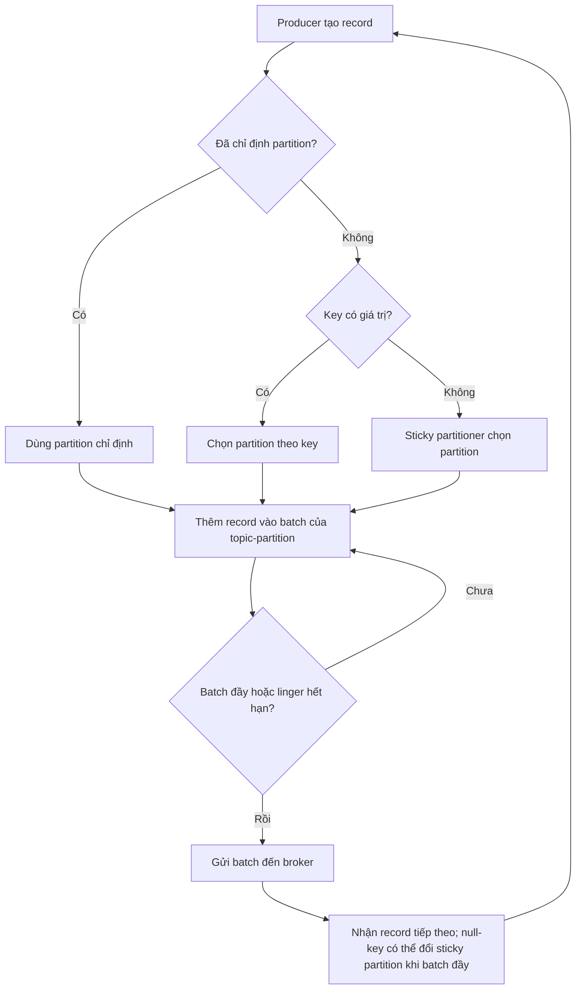
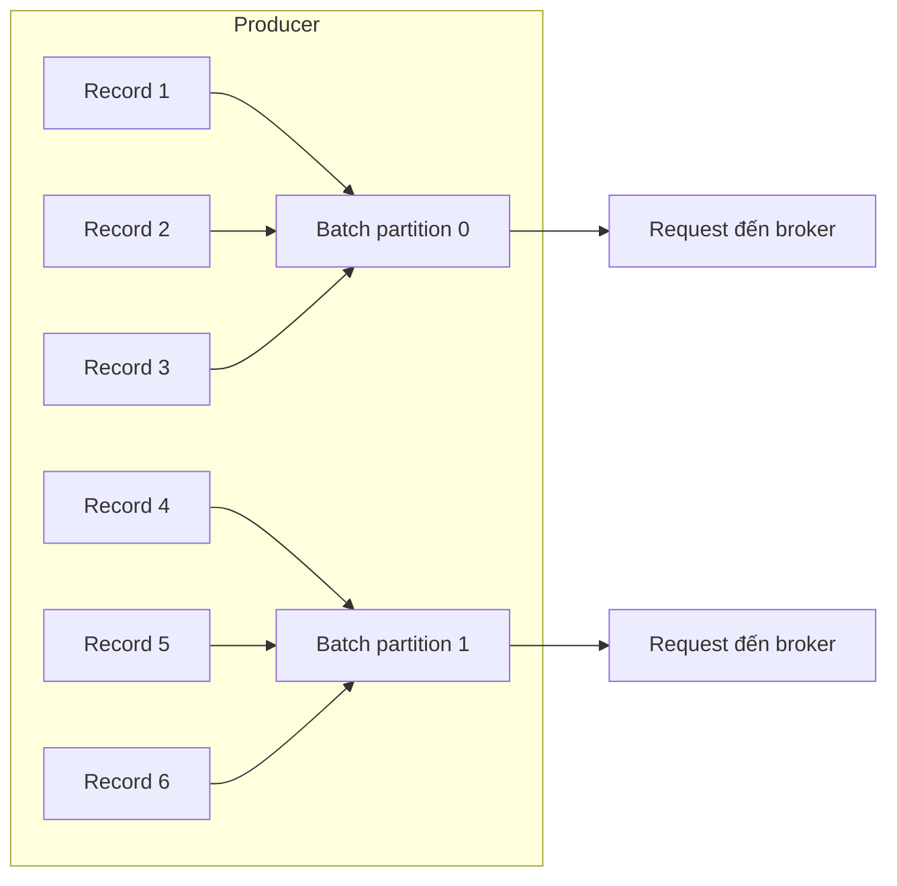

# Phân phối bản ghi không có key và cơ chế gom lô

Producer Kafka có thể gửi record mà không đặt key. Khi producer không chỉ định partition, Kafka client sẽ chọn partition đích. Với partitioner mặc định ở các phiên bản Kafka hiện đại, record không có key được phân phối theo cơ chế *sticky partitioning*: producer tạm thời tập trung record vào một partition để gom được batch lớn hơn, sau đó chuyển sang partition khác. Cách làm này giảm số request nhỏ và cải thiện hiệu quả gửi dữ liệu.

Batching là cơ chế gom nhiều record thành một batch trước khi gửi request đến broker. Producer gom record theo từng partition, vì vậy mỗi partition có batch riêng. `batch.size` đặt kích thước mục tiêu của batch, `linger.ms` cho producer thêm thời gian chờ record đến để batch đầy hơn, `buffer.memory` giới hạn bộ nhớ đệm tổng thể, còn `compression.type` chọn cách nén batch khi gửi.

Bài này tập trung vào luồng dữ liệu không có key và mối liên hệ giữa sticky partitioning với batching trong hệ thống KAFKA. Người học sẽ quan sát partition được chọn, điều chỉnh cấu hình gom lô và đánh giá ảnh hưởng đến throughput, độ trễ, bộ nhớ và phân bố dữ liệu. Các kiến thức này hỗ trợ thiết kế producer Java/Spring Kafka cho những luồng telemetry, log hoặc sự kiện mà thứ tự theo một thực thể nghiệp vụ không phải yêu cầu chính.

## 1. Record không có key là gì?

Một Kafka record có thể gồm topic, partition, key, value, timestamp và headers. Key là tùy chọn. Khi producer gửi record với key bằng `null` và không chỉ định partition, producer phải chọn một partition đích bằng partitioner.

Ví dụ một hệ thống thu thập nhiệt độ gửi các phép đo từ nhiều thiết bị vào topic `sensor.readings`. Nếu không cần bảo đảm mọi phép đo của cùng thiết bị nằm trong một partition, ứng dụng có thể gửi record không có key:

```java
kafkaTemplate.send("sensor.readings", reading);
```

Trong lời gọi này, `reading` là value, key không được cung cấp. Kafka client chọn partition dựa trên partitioner đang cấu hình. Việc bỏ key không có nghĩa record được lưu ở một vị trí ngẫu nhiên mỗi lần hoặc broker tự quyết định partition; lựa chọn này được thực hiện ở producer client trước khi gửi request.

Một record có key thường được định tuyến dựa trên key để các record cùng key đi đến cùng partition. Record không có key không có căn cứ định tuyến theo thực thể, nên partitioner có thể phân phối tải giữa các partition. Hai trường hợp phục vụ mục đích khác nhau:

| Đặc điểm | Có key | Không có key |
|---|---|---|
| Chọn partition | Thường dựa trên key và partitioner | Dựa trên chiến lược phân phối của partitioner |
| Ordering theo thực thể | Có thể giữ thứ tự của cùng key trong một partition | Không có bảo đảm cùng thực thể nằm trong một partition |
| Khả năng chia tải | Các key có thể phân bố không đều | Có thể phân phối tải rộng hơn giữa các partition |
| Ví dụ phù hợp | Sự kiện đơn hàng theo `orderId`, số dư theo `accountId` | Telemetry độc lập, log, metric hoặc sự kiện không cần ordering theo key |

Nếu nghiệp vụ cần thứ tự của các sự kiện theo thiết bị, tài khoản hoặc đơn hàng, không nên bỏ key chỉ để tăng throughput. Việc phân phối tải phải đáp ứng ngữ nghĩa của dữ liệu trước khi tối ưu hiệu năng.

## 2. Partitioner xử lý record không có key

Producer chọn partition theo thứ tự ưu tiên khái quát sau:

1. Nếu ứng dụng chỉ định partition rõ ràng trong `ProducerRecord`, producer sử dụng partition đó sau khi kiểm tra tính hợp lệ.
2. Nếu không chỉ định partition và có key, partitioner áp dụng chiến lược định tuyến theo key.
3. Nếu không chỉ định partition và key là `null`, partitioner mặc định sử dụng cơ chế sticky partitioning trong các phiên bản Kafka hiện đại.

Sticky partitioning tạm thời chọn một partition rồi tiếp tục đưa record không có key vào partition đó để producer có cơ hội gom một batch hiệu quả. Khi batch của partition đạt điều kiện chuyển, partitioner đổi sang partition khác. Nhờ vậy, record vẫn được phân phối giữa các partition theo thời gian, nhưng producer tránh phải luân phiên partition sau từng record.



Sticky partitioning không cam kết mỗi partition luôn có số record bằng nhau ở mọi thời điểm. Nó cải thiện phân phối tải theo thời gian đồng thời giảm số batch nhỏ. Khi lưu lượng thấp, dữ liệu mới có thể tạm thời tập trung ở một partition lâu hơn; khi lưu lượng tăng, các batch được lấp đầy và partitioner có nhiều cơ hội chuyển partition hơn.

Hành vi cụ thể còn phụ thuộc phiên bản Kafka client, partitioner được cấu hình và việc ứng dụng có chỉ định partition hay không. Nếu dùng custom partitioner, cần đọc và kiểm thử quy tắc của partitioner đó thay vì giả định hành vi sticky mặc định.

## 3. Vì sao sticky partitioning cải thiện batching?

Batching là gom nhiều record vào một đơn vị gửi. Một request có thể mang nhiều record thay vì tạo một request riêng cho từng record. Điều này giúp giảm overhead mạng, syscall, xử lý request ở broker và chi phí nén.

Batch được gom theo `topic-partition`. Nếu producer luân phiên gửi từng record sang nhiều partition, mỗi batch nhận dữ liệu chậm hơn và có thể bị gửi đi khi mới chứa một vài record. Khi producer tạm thời tập trung record không có key vào một partition, batch của partition đó đầy nhanh hơn. Sau khi batch đạt điều kiện chuyển, sticky partitioner chọn partition khác và tiếp tục gom lô.



Hình minh họa thể hiện hai batch độc lập, mỗi batch thuộc một partition. Kafka không gộp record của nhiều partition vào cùng một record batch chỉ vì chúng được gửi trong cùng một khoảng thời gian. Một request produce có thể chứa dữ liệu cho nhiều partition, nhưng batch record vẫn được tổ chức riêng theo partition.

Nếu topic có nhiều partition nhưng lưu lượng producer thấp, mỗi partition nhận record thưa hơn. Vì batch được gom riêng cho từng partition, số partition lớn có thể khiến nhiều batch nhỏ được gửi đi. Đây là một lý do cần chọn số partition theo throughput và mức song song thực tế, thay vì tăng partition mà không cân nhắc lưu lượng.

## 4. Các tham số batching của producer

Các tham số chính thường được điều chỉnh cùng nhau:

| Tham số | Vai trò | Khi tăng giá trị |
|---|---|---|
| `batch.size` | Kích thước mục tiêu tối đa của batch cho một partition, tính bằng byte | Có cơ hội tạo batch lớn và nén hiệu quả hơn; cần nhiều bộ nhớ hơn khi có nhiều partition hoạt động |
| `linger.ms` | Thời gian tối đa producer chờ thêm record trước khi gửi batch chưa đầy | Có cơ hội gom nhiều record hơn; tăng độ trễ chờ tối đa trong điều kiện lưu lượng thấp |
| `buffer.memory` | Dung lượng bộ nhớ đệm producer dành cho record đang chờ gửi | Chịu được nhiều dữ liệu đang chờ hơn; dùng nhiều heap/bộ nhớ hơn |
| `compression.type` | Thuật toán nén batch, ví dụ `none`, `gzip`, `snappy`, `lz4`, `zstd` tùy client | Giảm byte truyền và lưu trữ; đổi lại có chi phí CPU và độ trễ nén/giải nén |
| `max.request.size` | Giới hạn kích thước request produce mà client có thể gửi | Cho phép request lớn hơn; cần tương thích với giới hạn message/batch phía broker và topic |
| `max.block.ms` | Thời gian tối đa một số thao tác gửi chờ metadata hoặc bộ đệm có chỗ trống | Cho phép chờ lâu hơn khi broker chậm hoặc buffer đầy; ứng dụng có thể bị chặn lâu hơn |

`batch.size` là kích thước mục tiêu, không phải cam kết mỗi batch đều đầy đúng bằng giá trị đó. Batch có thể được gửi sớm khi hết `linger.ms`, khi producer cần giải phóng buffer hoặc khi có điều kiện gửi khác. Record lớn hơn kích thước batch mục tiêu vẫn cần được xử lý theo giới hạn record/request tương ứng.

`linger.ms` cũng không phải khoảng nghỉ bắt buộc trước mọi lần gửi. Nếu batch đã đầy, producer có thể gửi ngay mà không cần đợi hết thời gian linger. Nếu lưu lượng thưa, linger cho thêm một khoảng thời gian để record tiếp theo có thể tham gia batch.

`buffer.memory` là bộ đệm tổng của producer, được chia sẻ giữa các partition và batch đang chờ. Nếu producer tạo dữ liệu nhanh hơn tốc độ broker xác nhận, buffer có thể đầy. Khi đó `send()` có thể bị chặn trong giới hạn cấu hình hoặc phát sinh lỗi timeout nếu không giải phóng được bộ nhớ kịp thời.

## 5. Cấu hình batching trong Java và Spring Kafka

Ví dụ cấu hình trong `application.yml` cho một producer gửi telemetry không có key:

```yaml
spring:
  kafka:
    bootstrap-servers: localhost:9092
    producer:
      acks: all
      key-serializer: org.apache.kafka.common.serialization.StringSerializer
      value-serializer: org.springframework.kafka.support.serializer.JsonSerializer
      batch-size: 32768
      linger-ms: 5
      buffer-memory: 33554432
      compression-type: gzip
```

Trong ví dụ này, batch mục tiêu là 32 KiB, linger là 5 ms, buffer producer là 32 MiB và batch được nén bằng gzip. Đây là điểm bắt đầu để thực hành, không phải cấu hình tối ưu cho mọi workload. Gzip thường giảm dung lượng tốt nhưng có thể tiêu tốn CPU hơn các lựa chọn như LZ4; hãy đo trên dữ liệu thực tế trước khi chọn.

Mô hình dữ liệu mẫu:

```java
package com.example.kafkalab.event;

import java.time.Instant;

public record SensorReading(
        String sensorId,
        double temperature,
        Instant measuredAt
) {
}
```

Producer gửi record mà không cung cấp key:

```java
package com.example.kafkalab.producer;

import com.example.kafkalab.event.SensorReading;
import org.springframework.kafka.core.KafkaTemplate;
import org.springframework.kafka.support.SendResult;
import org.springframework.stereotype.Service;

import java.util.concurrent.CompletableFuture;

@Service
public class SensorReadingPublisher {
    private static final String TOPIC = "sensor.readings";

    private final KafkaTemplate<String, SensorReading> kafkaTemplate;

    public SensorReadingPublisher(
            KafkaTemplate<String, SensorReading> kafkaTemplate) {
        this.kafkaTemplate = kafkaTemplate;
    }

    public CompletableFuture<SendResult<String, SensorReading>> publish(
            SensorReading reading) {
        // Overload này gửi value và để key ở trạng thái null.
        return kafkaTemplate.send(TOPIC, reading);
    }
}
```

Nếu muốn biểu diễn rõ key `null`, có thể tạo `ProducerRecord`:

```java
ProducerRecord<String, SensorReading> record =
        new ProducerRecord<>("sensor.readings", null, reading);

CompletableFuture<SendResult<String, SensorReading>> result =
        kafkaTemplate.send(record);
```

Không truyền partition trong `ProducerRecord`, vì vậy partitioner của producer được quyền chọn partition. Nếu constructor nhận cả partition và key được dùng, partition chỉ định sẽ quyết định đích gửi; khi đó sticky partitioning không chọn partition thay ứng dụng.

Để xác nhận partition đã được chọn, đọc metadata trong kết quả gửi:

```java
publisher.publish(reading).thenAccept(result -> {
    var metadata = result.getRecordMetadata();
    log.info("topic={}, partition={}, offset={}, timestamp={}",
            metadata.topic(),
            metadata.partition(),
            metadata.offset(),
            metadata.timestamp());
});
```

`send()` có tính bất đồng bộ và trả về future. Không nên gọi `.get()` hoặc `.join()` cho từng record trong vòng lặp tải cao vì cách đó biến luồng gửi thành tuần tự và làm giảm khả năng batching. Trong ứng dụng thật, cần xử lý callback/future, lỗi gửi, giới hạn số tác vụ đang chờ và shutdown/flush producer đúng cách.

## 6. Quan sát record không có key bằng Kafka CLI

Tạo topic thực hành có ba partition:

```bash
kafka-topics.sh \
  --bootstrap-server localhost:9092 \
  --create --if-not-exists \
  --topic sensor.readings \
  --partitions 3 \
  --replication-factor 1
```

Mở console consumer và in key, partition, offset:

```bash
kafka-console-consumer.sh \
  --bootstrap-server localhost:9092 \
  --topic sensor.readings \
  --from-beginning \
  --property print.key=true \
  --property print.partition=true \
  --property print.offset=true
```

Mở terminal thứ hai và chạy console producer:

```bash
kafka-console-producer.sh \
  --bootstrap-server localhost:9092 \
  --topic sensor.readings
```

Nhập một số JSON record, mỗi record một dòng:

```json
{"sensorId":"S-01","temperature":25.4,"measuredAt":"2026-11-20T09:00:00Z"}
{"sensorId":"S-02","temperature":26.1,"measuredAt":"2026-11-20T09:00:01Z"}
{"sensorId":"S-03","temperature":24.8,"measuredAt":"2026-11-20T09:00:02Z"}
{"sensorId":"S-01","temperature":25.6,"measuredAt":"2026-11-20T09:00:03Z"}
```

Console producer mặc định gửi từng dòng như value và không tạo key. Console consumer có thể hiển thị key rỗng/null cùng partition và offset. Các record có thể nằm ở những partition khác nhau; kết quả cụ thể phụ thuộc client, partitioner và trạng thái topic. Bốn record là lượng dữ liệu quá nhỏ để kết luận partition nào được phân phối tốt hơn hoặc batch đã đầy.

Kiểm tra metadata của topic:

```bash
kafka-topics.sh \
  --bootstrap-server localhost:9092 \
  --describe \
  --topic sensor.readings
```

Kết quả cho biết partition, leader và replica. Nó không cho biết trực tiếp batch producer đã gom được bao nhiêu record; muốn đánh giá batching cần quan sát producer metrics hoặc đo throughput/latency trong một lần chạy tải có kiểm soát.

## 7. Thực nghiệm ảnh hưởng của batch.size và linger.ms

Để so sánh có ý nghĩa, hãy giữ nguyên topic, số partition, dữ liệu, số producer và thời gian chạy. Mỗi lần chỉ thay một nhóm tham số, chạy đủ lâu để giảm ảnh hưởng của giai đoạn khởi động và ghi lại throughput cùng độ trễ.

Thực hiện ba cấu hình thử nghiệm:

| Lần chạy | `batch.size` | `linger.ms` | Mục tiêu quan sát |
|---|---:|---:|---|
| A | 16 KiB | 0 ms | Mốc cơ sở, ít thời gian chờ gom lô |
| B | 32 KiB | 5 ms | Tăng cơ hội tạo batch lớn hơn |
| C | 64 KiB | 10 ms | Tăng thêm dung lượng và thời gian gom lô |

Các giá trị trên chỉ là cấu hình thử nghiệm. Chúng không bảo đảm B hoặc C luôn nhanh hơn A. Với lưu lượng thấp, linger lớn có thể tăng latency mà batch vẫn nhỏ. Với record lớn hoặc nhiều partition, batch lớn có thể tăng mức sử dụng bộ nhớ đáng kể.

Một bài thử đơn giản có thể tạo nhiều record độc lập bằng một vòng lặp trong ứng dụng. Đợi các future hoàn tất ở cuối đợt thử để biết producer đã nhận xác nhận gửi; tránh chờ từng future ngay sau mỗi lần gửi:

```java
import java.util.ArrayList;
import java.util.List;
import java.util.concurrent.CompletableFuture;

import com.example.kafkalab.event.SensorReading;
import org.springframework.kafka.support.SendResult;

List<CompletableFuture<SendResult<String, SensorReading>>> sends =
        new ArrayList<>();

for (int i = 0; i < 100_000; i++) {
    SensorReading reading = createReading(i);
    sends.add(kafkaTemplate.send("sensor.readings", reading));
}

CompletableFuture.allOf(sends.toArray(CompletableFuture[]::new)).join();
```

Đo thời gian từ trước vòng lặp đến khi tất cả future hoàn tất. Với thử nghiệm lớn hơn, không nên giữ vô hạn một future cho mỗi record trong danh sách vì chính danh sách có thể tiêu tốn nhiều heap; hãy dùng producer load generator, chia thành các cửa sổ gửi có giới hạn hoặc thu thập kết quả theo nhóm.

Ghi lại các số liệu sau cho mỗi lần chạy:

- Số record gửi thành công và tổng thời gian, từ đó tính records/second.
- Tổng byte gửi và throughput theo byte/second nếu có metric phù hợp.
- Độ trễ gửi trung vị, p95 và p99, thay vì chỉ xem giá trị trung bình.
- Tỷ lệ lỗi, retry và thời gian chờ do buffer đầy.
- CPU của producer/broker và mức sử dụng bộ nhớ producer.
- Số partition thực sự nhận record và mức chênh lệch giữa các partition.

Khi so sánh, dùng cùng mức xác nhận `acks`, cùng compression, cùng kích thước record và cùng số partition. Nếu thay nhiều tham số cùng lúc, khó xác định yếu tố nào tạo ra khác biệt.

## 8. Compression và hiệu quả truyền dữ liệu

Kafka nén ở cấp batch. Khi batch có nhiều record tương tự nhau, thuật toán nén thường có nhiều dữ liệu lặp để khai thác và đạt tỷ lệ nén tốt hơn. Batching vì vậy không chỉ giảm số request mà còn có thể cải thiện hiệu quả nén.

Các lựa chọn phổ biến:

| Codec | Đặc điểm khái quát | Khi cân nhắc |
|---|---|---|
| `none` | Không nén, ít chi phí CPU nén/giải nén | Mạng nội bộ nhanh, payload nhỏ hoặc CPU là nút thắt |
| `gzip` | Tỷ lệ nén thường tốt nhưng tốn CPU hơn | Cần giảm byte truyền và có đủ CPU |
| `snappy` | Ưu tiên tốc độ, tỷ lệ nén vừa phải | Workload throughput cao, muốn cân bằng CPU và băng thông |
| `lz4` | Nén/giải nén nhanh, thường phù hợp luồng dữ liệu lớn | Cần giảm overhead truyền với độ trễ thấp |
| `zstd` | Có thể đạt tỷ lệ nén tốt và hỗ trợ nhiều mức nén | Cần tinh chỉnh theo CPU, tỷ lệ nén và phiên bản client |

Khả năng sử dụng codec phụ thuộc Kafka client và dependency có mặt trong ứng dụng. Hãy xác nhận codec được hỗ trợ ở phiên bản đang triển khai. Nén có thể giảm network I/O nhưng tăng CPU; lựa chọn tốt nhất phải dựa trên payload và tải thực tế.

## 9. Tác động đến ordering và consumer group

Record không có key có thể được gửi đến nhiều partition. Kafka giữ thứ tự trong từng partition, nhưng không có thứ tự tổng thể giữa các partition. Vì vậy, hai phép đo của cùng `sensorId` có thể được đọc từ hai partition khác nhau và xử lý song song; consumer không thể suy ra thứ tự toàn cục chỉ từ offset.

Trong cùng consumer group, mỗi partition được gán cho tối đa một consumer tại một thời điểm. Khi topic có ba partition, một group có thể xử lý tối đa ba partition song song; thêm consumer vượt số partition không tự tăng mức song song. Nếu dữ liệu không có key phân tán trên nhiều partition, tải có thể chia đều hơn, nhưng mỗi consumer vẫn chỉ đảm bảo thứ tự trong partition được giao.

Nếu nghiệp vụ cần thứ tự theo thiết bị, có thể dùng `sensorId` làm key. Khi đó mọi record cùng thiết bị thường đi cùng partition và giữ thứ tự trong partition, đổi lại một số partition có thể nóng nếu một thiết bị phát dữ liệu nhiều hơn hẳn các thiết bị khác. Cần chọn giữa ordering theo thực thể và khả năng chia tải dựa trên yêu cầu nghiệp vụ.

Batching không làm thay đổi thứ tự record trong một partition. Producer append record vào batch theo thứ tự gửi ở partition đó; broker lưu batch trong log partition. Nhưng khi ứng dụng gửi các record cùng một thực thể đến nhiều partition, batching không thể tạo ra ordering toàn cục giữa chúng.

## 10. Những vấn đề thường gặp

| Hiện tượng | Nguyên nhân có thể có | Hướng kiểm tra |
|---|---|---|
| Batch thường nhỏ dù `batch.size` lớn | Lưu lượng thấp, `linger.ms` ngắn hoặc quá nhiều partition | Kiểm tra record rate theo partition và thử tăng linger có kiểm soát |
| Độ trễ tăng sau khi tăng `linger.ms` | Producer chờ thêm thời gian để gom record | Theo dõi p95/p99; giảm linger nếu SLA latency bị ảnh hưởng |
| Producer dùng nhiều bộ nhớ | Batch lớn trên nhiều partition hoặc buffer chứa nhiều record chờ xác nhận | Kiểm tra số partition, `batch.size`, `buffer.memory` và tốc độ broker ack |
| Buffer đầy và send bị chặn/lỗi | Producer phát nhanh hơn khả năng gửi/ack của broker | Kiểm tra broker, network, retry, buffer và tốc độ phát |
| Throughput tăng nhưng CPU cao | Nén tốn CPU hoặc producer serialize quá nhiều dữ liệu | So sánh codec, đo CPU và kiểm tra kích thước payload |
| Một partition nhận nhiều record hơn | Lưu lượng thử quá nhỏ, sticky partition đang tập trung hoặc custom partitioner | Tăng thời gian và số record thử; kiểm tra partitioner và metric từng partition |
| Không thấy key trong console consumer | Record được gửi không có key | Xác nhận producer không dùng overload có key hoặc không tạo key trong `ProducerRecord` |
| Các event cùng thiết bị bị đọc sai thứ tự | Không có key nên có thể nằm ở nhiều partition | Dùng key theo `sensorId` nếu ordering theo thiết bị là yêu cầu |

Không nên đánh giá sticky partitioning bằng vài record gửi thủ công. Cần một tải đủ lớn, ổn định và nhiều lần chạy để quan sát phân bố partition cũng như hiệu quả batching. Cũng không nên tăng `batch.size`, `linger.ms` và `buffer.memory` đồng thời mà không theo dõi latency và heap.

## 11. Nguyên tắc tinh chỉnh producer

Một quy trình điều chỉnh thực tế có thể tiến hành như sau:

1. Xác định SLA: throughput cần đạt, độ trễ p95/p99, mức sử dụng CPU và giới hạn bộ nhớ.
2. Chọn số partition dựa trên mức song song cần thiết và số consumer dự kiến; tránh tạo partition dư thừa làm batch bị phân tán khi lưu lượng thấp.
3. Bắt đầu với cấu hình batching vừa phải, giữ nguyên `acks` và compression trong suốt lần đo cơ sở.
4. Tăng `batch.size` hoặc `linger.ms` từng bước, quan sát batch/record rate, throughput và latency.
5. Chọn compression sau khi đã hiểu kích thước payload và chi phí CPU; so sánh cả byte truyền lẫn CPU.
6. Theo dõi buffer, thời gian block, retry và lỗi gửi để biết producer có đang bị broker hoặc network làm nghẽn hay không.
7. Lặp lại phép đo với dữ liệu đại diện cho production, sau đó kiểm thử khi broker chậm hoặc mất kết nối.

Các metric hữu ích gồm record gửi mỗi giây, byte gửi mỗi giây, batch size trung bình, số request, request latency, record queue time, buffer available bytes, buffer pool wait time và retry/error rate. Tên metric cụ thể có thể thay đổi theo phiên bản Kafka client và cách xuất metric của ứng dụng.

## 12. Ghi nhớ

| Khái niệm | Ý nghĩa |
|---|---|
| Null key | Record không có khóa để định tuyến theo thực thể |
| Partitioner | Thành phần producer chọn partition cho record |
| Sticky partitioning | Tạm thời tập trung record null key vào một partition để batch đầy hiệu quả hơn |
| Batch | Nhóm record thuộc cùng topic-partition được gửi cùng nhau |
| `batch.size` | Kích thước mục tiêu của batch |
| `linger.ms` | Thời gian tối đa chờ thêm record để gom batch |
| `buffer.memory` | Bộ nhớ đệm tổng thể của producer |
| `compression.type` | Codec nén batch khi gửi |

Record không có key phù hợp với dữ liệu độc lập, không cần ordering theo thực thể. Sticky partitioning giúp producer gom record vào batch hiệu quả hơn và phân phối tải giữa các partition theo thời gian. Muốn tối ưu đúng, cần cân bằng throughput, latency, CPU, bộ nhớ và số partition bằng phép đo tải thực tế.
