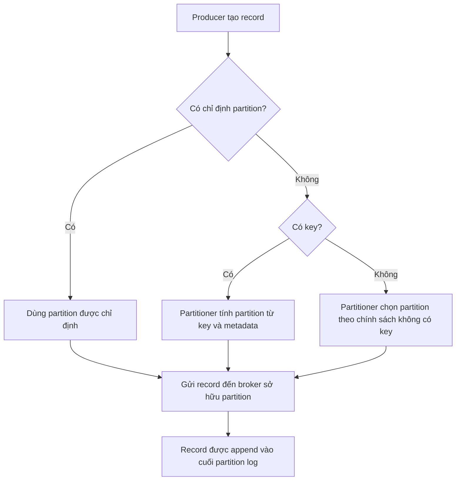

# Phân vùng tùy chỉnh và sự nhất quán giữa các producer

Kafka lưu mỗi record vào một partition cụ thể của topic. Producer quyết định partition đích dựa trên partition được chỉ định trực tiếp, partitioner và metadata về số partition hiện có. Khi nhiều producer cùng ghi vào một topic, chúng cần tuân theo cùng một quy tắc định tuyến nếu muốn các record có cùng khóa luôn đi vào cùng partition.

Phân vùng nhất quán giúp Kafka giữ thứ tự theo một khóa nghiệp vụ, chẳng hạn `orderId`, `accountId` hoặc `tenantId`. Nếu mỗi producer tự tính partition theo một cách khác nhau, record của cùng một thực thể có thể nằm ở nhiều partition; consumer khi đó không thể dựa vào thứ tự trong một partition để xử lý đúng chuỗi thay đổi.

Bài này giải thích cách Kafka chọn partition, khi nào cần custom partitioner, cách triển khai partitioner Java, và những điều kiện cần đồng nhất giữa các producer. Phần cuối làm rõ giới hạn ordering, ảnh hưởng của việc tăng số partition và cách kiểm chứng định tuyến.

## 1. Producer chọn partition như thế nào?

Khi gửi một record, producer có thể cung cấp:

- Topic: nơi lưu record.
- Key: khóa định danh hoặc khóa định tuyến của record.
- Value: nội dung record.
- Partition tùy chọn: partition cụ thể mà ứng dụng muốn ghi.

Nếu record đã chỉ định partition, producer gửi vào partition đó. Nếu không, producer dùng partitioner để chọn partition dựa trên key, value, metadata của topic và cấu hình liên quan.

Luồng tổng quát:



Với producer Java dùng partitioner mặc định, key được serialize thành byte rồi băm để chọn partition. Các record có cùng key bytes và cùng số partition thường được đưa vào cùng partition. Khi key là `null`, producer có thể dùng cơ chế phân phối theo lô (sticky partitioning) để tận dụng batching; không nên giả định record không có key sẽ được phân phối theo round-robin từng record.

Điều quan trọng là **partitioner chạy ở phía producer**. Broker nhận partition ID trong yêu cầu ghi và lưu record vào partition đó; broker không chạy lại logic partitioner để kiểm tra key. Vì vậy, hai producer khác nhau có thể gửi cùng key vào hai partition khác nhau nếu chúng dùng thuật toán, serializer, cấu hình hoặc metadata khác nhau.

## 2. Chọn key theo phạm vi cần giữ thứ tự

Trước khi viết partitioner, hãy xác định thực thể nào cần có thứ tự độc lập. Key nên đại diện cho phạm vi nghiệp vụ cần xử lý tuần tự.

| Nhu cầu | Key gợi ý | Ý nghĩa |
|---|---|---|
| Các thay đổi của cùng một đơn hàng phải theo thứ tự | `orderId` | Mọi event của một đơn hàng vào cùng partition |
| Các giao dịch của một tài khoản phải theo thứ tự | `accountId` | Mọi event của tài khoản vào cùng partition |
| Mọi sự kiện của một khách hàng thuê bao phải cùng luồng | `tenantId` | Cùng tenant được xử lý tuần tự |
| Các sự kiện của một thiết bị IoT phải đúng thứ tự | `deviceId` | Mỗi thiết bị có một chuỗi event |
| Phân tích clickstream, không cần thứ tự theo người dùng | Có thể dùng key phù hợp với nhu cầu cân bằng tải | Cần đánh giá mức độ phân phối và khả năng xử lý song song |

Ví dụ, nếu một đơn hàng có các event:

```text
OrderCreated
PaymentAuthorized
OrderPacked
OrderShipped
```

dùng `orderId` làm key sẽ đưa các event của đơn hàng đó vào cùng partition. Consumer trong cùng group đọc partition theo thứ tự log, nhờ đó có thể quan sát chuỗi event theo thứ tự broker đã ghi.

Nếu dùng `tenantId` làm key, mọi đơn hàng của cùng tenant cũng vào một partition. Điều này có thể hữu ích khi cần thứ tự trên toàn tenant, nhưng tenant có lưu lượng lớn có thể tạo ra partition nóng. Hãy chọn key ở phạm vi nhỏ nhất vẫn đáp ứng yêu cầu ordering.

Một key tốt thường có các đặc điểm:

- Ổn định trong suốt vòng đời thực thể.
- Được tạo theo một quy tắc chuẩn hóa thống nhất.
- Có phân bố đủ đều để tránh một vài partition nhận phần lớn lưu lượng.
- Phản ánh đúng phạm vi cần giữ thứ tự.
- Không chứa dữ liệu nhạy cảm nếu không cần thiết.

Không nên dùng timestamp hiện tại làm key nếu mục tiêu là giữ thứ tự theo thực thể. Timestamp thay đổi giữa các event nên chúng có thể đi vào các partition khác nhau.

## 3. Khi nào nên dùng partitioner mặc định?

Với phần lớn ứng dụng, key-based partitioning mặc định của Kafka đã đủ. Nếu tất cả producer dùng cùng Kafka client và serializer, chỉ cần gửi cùng một key là các record tương ứng thường được định tuyến nhất quán.

Ví dụ với Java:

```java
ProducerRecord<String, String> record =
    new ProducerRecord<>(
        "orders",
        "order-123",
        "{\"eventType\":\"OrderConfirmed\"}"
    );

producer.send(record);
```

Trong ví dụ, `order-123` là key. Producer mặc định serialize key thành bytes, áp dụng thuật toán partitioning của client và chọn partition từ số partition của topic.

Ưu tiên partitioner mặc định khi:

- Chỉ cần các record cùng key vào cùng partition.
- Các producer sử dụng cùng Kafka client hoặc đã xác nhận tương thích thuật toán.
- Không có quy tắc định tuyến theo tenant, vùng, loại dữ liệu hoặc shard nghiệp vụ.
- Không cần duy trì một thuật toán băm riêng để tương thích với hệ thống khác.

Không nên viết custom partitioner chỉ để thay đổi một vài dòng cấu hình nếu partitioner mặc định đã đáp ứng yêu cầu. Mã định tuyến tùy chỉnh trở thành một phần của hợp đồng dữ liệu; thay đổi nó có thể làm các event của cùng thực thể bị phân tán qua nhiều partition.

## 4. Custom partitioner giải quyết vấn đề gì?

Custom partitioner hữu ích khi cách định tuyến cần phản ánh quy tắc nghiệp vụ hoặc phải tương thích giữa nhiều nền tảng producer.

Một số trường hợp:

- Dùng một thuật toán băm được định nghĩa chung để Java, Python và các client khác định tuyến cùng key giống nhau.
- Định tuyến theo tenant hoặc vùng địa lý với quy tắc được kiểm soát.
- Ánh xạ key vào một nhóm partition đã định trước.
- Tách một loại record đặc biệt sang partition được dành riêng, nếu thiết kế topic cho phép.
- Duy trì tương thích với hệ thống cũ có thuật toán partitioning đã được công bố.

Custom partitioner cần tránh các quyết định không ổn định như chọn partition ngẫu nhiên, dựa trên thời gian hiện tại, số thứ tự cục bộ của process hoặc trạng thái chỉ tồn tại trong bộ nhớ của một producer. Nếu hai producer không có cùng trạng thái, cùng key có thể bị định tuyến khác nhau.

### 4.1. Ví dụ: dùng CRC32 để định tuyến nhất quán theo key

Giả sử topic `tenant-events` có nhiều producer Java và Python. Yêu cầu là mọi event của cùng `tenantId` phải vào cùng partition. Các producer thống nhất hợp đồng:

1. Key là `tenantId` đã chuẩn hóa.
2. Key được mã hóa UTF-8.
3. Tính CRC32 trên đúng dãy byte đó.
4. Chọn partition bằng phần dư của CRC32 chia cho số partition hiện tại.

CRC32 ở đây chỉ dùng làm hàm băm định tuyến, không dùng để bảo vệ tính toàn vẹn bảo mật hoặc xác thực dữ liệu.

### 4.2. Triển khai Partitioner trong Java

Kafka Java client cung cấp interface `org.apache.kafka.clients.producer.Partitioner`. Ví dụ sau dùng CRC32 trên serialized key bytes:

```java
package example.kafka;

import java.util.Map;
import java.util.zip.CRC32;

import org.apache.kafka.clients.producer.Partitioner;
import org.apache.kafka.common.Cluster;

public class TenantCrc32Partitioner implements Partitioner {

    @Override
    public void configure(Map<String, ?> configs) {
        // Không cần cấu hình riêng trong ví dụ này.
    }

    @Override
    public int partition(
            String topic,
            Object key,
            byte[] keyBytes,
            Object value,
            byte[] valueBytes,
            Cluster cluster) {

        if (keyBytes == null || keyBytes.length == 0) {
            throw new IllegalArgumentException(
                "tenant-events requires a non-empty tenantId key"
            );
        }

        Integer partitionCount = cluster.partitionCountForTopic(topic);
        if (partitionCount == null || partitionCount <= 0) {
            throw new IllegalStateException(
                "No partition metadata available for topic: " + topic
            );
        }

        CRC32 crc32 = new CRC32();
        crc32.update(keyBytes);

        return (int) (crc32.getValue() % partitionCount);
    }

    @Override
    public void close() {
        // Không giữ tài nguyên cần đóng.
    }
}
```

Một số điểm trong ví dụ:

- Thuật toán dùng `keyBytes`, tức dữ liệu sau serialization. Đây là điều cần thiết để các producer khác ngôn ngữ có thể triển khai cùng một hợp đồng.
- Producer phải dùng cùng quy tắc mã hóa key. Với `StringSerializer`, thống nhất UTF-8 và quy tắc chuẩn hóa chuỗi.
- Nếu key rỗng hoặc null, ví dụ chủ động từ chối gửi. Với topic cần hỗ trợ record không có key, hãy thiết kế một chính sách riêng và triển khai giống nhau ở mọi producer.
- Số partition được lấy từ metadata của topic. Partitioner không được giả định topic luôn có một số partition cố định.
- CRC32 có thể xảy ra va chạm; điều đó chỉ khiến hai key khác nhau vào cùng partition, không làm mất tính nhất quán cho cùng key.

Khai báo partitioner khi tạo producer:

```java
Properties props = new Properties();

props.put(
    ProducerConfig.BOOTSTRAP_SERVERS_CONFIG,
    "localhost:9092"
);
props.put(
    ProducerConfig.KEY_SERIALIZER_CLASS_CONFIG,
    StringSerializer.class.getName()
);
props.put(
    ProducerConfig.VALUE_SERIALIZER_CLASS_CONFIG,
    StringSerializer.class.getName()
);
props.put(
    ProducerConfig.PARTITIONER_CLASS_CONFIG,
    TenantCrc32Partitioner.class.getName()
);

KafkaProducer<String, String> producer =
    new KafkaProducer<>(props);
```

Gửi event với tenant ID làm key:

```java
String tenantId = "tenant-42";
String eventJson = """
    {
      "eventId": "evt-1001",
      "eventType": "TenantOrderCreated",
      "orderId": "order-123"
    }
    """;

ProducerRecord<String, String> record =
    new ProducerRecord<>("tenant-events", tenantId, eventJson);

producer.send(record);
```

Với thiết kế này, các event có key `tenant-42` được gửi bởi các producer tuân thủ cùng hợp đồng sẽ chọn cùng partition khi số partition và metadata nhất quán.

### 4.3. Vì sao cần thống nhất serialized key bytes?

Hai chuỗi có thể trông giống nhau nhưng tạo ra byte khác nhau nếu cách chuẩn hóa hoặc encoding khác nhau. Ví dụ:

- `Tenant-42` và `tenant-42` khác nhau về chữ hoa/thường.
- `tenant-42` và `tenant-42 ` khác nhau vì khoảng trắng cuối.
- Một client dùng UTF-8, client khác dùng encoding khác.
- Một client serialize key thành JSON có dấu ngoặc kép, client khác gửi raw string.
- Một client dùng composite key `tenantId|orderId`, client khác chỉ dùng `tenantId`.

Vì partitioner băm bytes, các trường hợp trên có thể chọn partition khác nhau. Nên định nghĩa một hàm chuẩn hóa key trong hợp đồng producer, chẳng hạn:

```text
tenantId = trim(input).toLowerCase(Locale.ROOT)
keyBytes = UTF8(tenantId)
partition = CRC32(keyBytes) % partitionCount
```

Quy tắc chuẩn hóa phải phù hợp với định danh thực tế. Không tự ý chuyển chữ hoa thành chữ thường nếu hệ thống coi hai định danh đó là khác nhau. Với ID nhị phân hoặc UUID, cần thống nhất biểu diễn byte, byte order và cách serialize.

## 5. Điều kiện để nhiều producer chọn cùng partition

Một thuật toán partitioner giống nhau là chưa đủ. Các producer cần thống nhất toàn bộ các yếu tố ảnh hưởng đến kết quả.

| Yếu tố | Cần thống nhất như thế nào? | Rủi ro khi khác nhau |
|---|---|---|
| Topic | Gửi vào cùng topic logic trên cùng cluster | Mỗi topic có số partition và dữ liệu riêng |
| Key | Cùng giá trị định danh, cùng quy tắc chuẩn hóa | Cùng thực thể có thể được xem là các key khác |
| Key serializer | Cùng byte representation, encoding và schema | Hash khác dù key nhìn giống nhau |
| Partitioner | Cùng thuật toán, version và cấu hình | Một key có thể vào các partition khác nhau |
| Partition count | Cùng nhìn thấy metadata của topic hiện tại | Cùng hash nhưng phép modulo khác |
| Partition override | Không ghi đè tùy tiện; nếu có phải theo cùng quy tắc | Producer có thể bỏ qua custom partitioner |
| Topic routing | Cùng quy tắc chọn topic | Sự kiện cùng thực thể bị chia sang nhiều topic |

Đối với nhiều ngôn ngữ lập trình, đừng giả định các Kafka client đều dùng cùng thuật toán mặc định. Ví dụ, một client Java và một client khác ngôn ngữ có thể có cách băm hoặc xử lý key null khác nhau. Nếu cần tương thích xuyên ngôn ngữ, hãy chọn một thuật toán được mô tả rõ, kiểm thử bằng bộ test vector chung và triển khai nó ở mọi producer.

Một hợp đồng partitioning nên được quản lý như một phần của schema/hợp đồng event. Hợp đồng cần ghi rõ:

- Tên topic và số partition được hỗ trợ.
- Kiểu dữ liệu và quy tắc chuẩn hóa của key.
- Serializer, encoding và cách tạo key bytes.
- Thuật toán băm, phiên bản thuật toán và cách tính modulo.
- Hành vi khi key null hoặc rỗng.
- Quy tắc xử lý khi topic được tăng partition.
- Cách triển khai và kiểm thử tương thích ở từng ngôn ngữ.

## 6. Tác động của việc tăng số partition

Với thuật toán đơn giản:

`partition = hash(key) % partitionCount`

thay đổi số partition có thể làm cùng key được ánh xạ sang partition mới.

Ví dụ:

| Key | Hash minh họa | 4 partition | 6 partition |
|---|---:|---:|---:|
| `tenant-A` | 17 | 1 | 5 |
| `tenant-B` | 22 | 2 | 4 |
| `tenant-C` | 9 | 1 | 3 |

Các con số hash chỉ nhằm minh họa phép modulo. Khi topic tăng từ 4 lên 6 partition, record cũ vẫn nằm trong partition cũ, còn record mới của cùng key có thể vào partition khác. Khi đó, một consumer group có thể đọc hai partition độc lập và không còn một thứ tự duy nhất cho key đó.

Đây là rủi ro lớn nếu nghiệp vụ phụ thuộc vào thứ tự của từng thực thể. Tăng partition không di chuyển record cũ sang partition mới và không tự sắp xếp lại lịch sử.

Trước khi tăng partition, hãy xác định:

1. Topic có yêu cầu giữ thứ tự theo key trong toàn bộ vòng đời dữ liệu không?
2. Consumer có dựa vào một partition duy nhất để xử lý tuần tự không?
3. Có thể chấp nhận một giai đoạn key cũ và key mới nằm ở hai partition không?
4. Có thể tạo topic mới và chuyển đổi theo một mốc nghiệp vụ rõ ràng không?
5. Các producer đã được triển khai đồng bộ với cấu hình partition count mới chưa?

Các hướng xử lý thường dùng:

- **Không tăng partition của topic có yêu cầu ordering nghiêm ngặt:** dự trù partition ngay từ đầu và mở rộng tài nguyên broker/consumer trong giới hạn thiết kế.
- **Chuyển sang topic phiên bản mới:** tạo topic mới với partition count và hợp đồng routing mới, sau đó chuyển producer/consumer theo một quy trình có kiểm soát.
- **Dùng virtual shard:** băm key vào một số lượng shard logic cố định, rồi ánh xạ shard sang partition vật lý qua một bảng cấu hình được quản lý chung. Khi thay đổi ánh xạ, vẫn cần kế hoạch chuyển shard và đồng bộ để tránh hai partition cùng nhận event của một key trong thời gian chuyển đổi.
- **Chấp nhận thay đổi thứ tự có kiểm soát:** chỉ phù hợp khi nghiệp vụ có sequence number, version hoặc cơ chế phát hiện event đến sai thứ tự.

Không có cách tăng partition đơn giản nào vừa phân phối lại mọi key tùy ý, vừa tự động giữ nguyên thứ tự lịch sử giữa partition cũ và partition mới.

## 7. Ordering khi có nhiều producer

Kafka bảo đảm thứ tự record trong một partition theo thứ tự broker append chúng vào log. Điều đó không đồng nghĩa Kafka biết thứ tự nghiệp vụ hoặc thứ tự thời gian mà các producer tạo event.

Giả sử Producer A tạo event `OrderPaid` lúc 10:00:00 và Producer B tạo event `OrderCancelled` lúc 10:00:01 cho cùng một đơn hàng. Nếu hai producer gửi đồng thời, mạng và lịch thực thi có thể khiến broker nhận `OrderCancelled` trước. Kafka sẽ lưu theo thứ tự nhận/append tại partition, không tự sắp xếp lại dựa trên `occurredAt`.

Nếu nhiều producer cùng ghi một key, cần xác định ai có quyền phát event và thứ tự nào là có thẩm quyền. Một số cách thiết kế:

- Chỉ một service sở hữu việc phát event cho một aggregate.
- Đặt sequence number tăng dần theo aggregate và để consumer phát hiện khoảng trống hoặc event đến sai thứ tự.
- Dùng version/optimistic locking ở database để ngăn hai luồng nghiệp vụ cùng phát các thay đổi xung đột.
- Nếu cần chuyển quyền sở hữu producer, dùng một cơ chế leader/lease hoặc fencing phù hợp để tránh writer cũ tiếp tục ghi.

Idempotence của producer giúp xử lý retry trong một producer session; nó không sắp xếp các event đến từ nhiều producer độc lập.

### 7.1. Bật idempotence và cấu hình acknowledgement

Với ứng dụng Java, có thể cấu hình rõ các thuộc tính sau:

```java
props.put(ProducerConfig.ENABLE_IDEMPOTENCE_CONFIG, "true");
props.put(ProducerConfig.ACKS_CONFIG, "all");
```

Idempotent producer giúp tránh duplicate do retry trong phạm vi producer session và bảo toàn thứ tự theo các điều kiện cấu hình mà Kafka hỗ trợ. Với các phiên bản client hiện đại, idempotence thường được bật mặc định khi cấu hình tương thích; khai báo tường minh giúp hợp đồng vận hành dễ đọc và dễ kiểm tra hơn.

Để tăng khả năng chịu lỗi của topic, cần phối hợp với replication:

- Replication factor xác định số bản sao partition.
- `acks=all` yêu cầu broker leader chờ các replica hiện thuộc ISR xác nhận ghi.
- `min.insync.replicas` quy định số replica tối thiểu phải có trong ISR để chấp nhận ghi với `acks=all`.

Ví dụ topic có replication factor 3 và `min.insync.replicas=2`. Khi ISR giảm xuống dưới 2, producer có thể nhận lỗi thay vì ghi vào một replica đơn lẻ. Ứng dụng phải xử lý lỗi và retry theo chính sách phù hợp.

Không nên coi `acks=all` là đồng nghĩa với mọi replica đã ghi xong trong mọi tình huống; nó làm việc cùng ISR và `min.insync.replicas`.

### 7.2. Retry và thứ tự trong một producer

Khi retry, cấu hình producer phải tương thích với idempotence để tránh việc request gửi lại làm đảo thứ tự. Kafka idempotent producer hiện đại cho phép tối đa 5 request chưa được xác nhận trên một connection khi idempotence bật; hãy tránh đặt `max.in.flight.requests.per.connection` vượt giới hạn client hỗ trợ. Nếu tắt idempotence hoặc dùng cấu hình retry không phù hợp, các request retry có thể gây duplicate hoặc thay đổi thứ tự quan sát được.

Đối với lỗi nghiệp vụ không thể retry vô hạn, cần giới hạn số lần thử, thời gian chờ và cơ chế đưa event lỗi sang luồng xử lý riêng. Retry producer không thay thế xử lý idempotent ở consumer.

### 7.3. Transaction không tạo thứ tự toàn cục giữa producer

Kafka transaction có thể ghi nhiều record vào nhiều partition một cách nguyên tử trong phạm vi transaction của một producer, và có thể kết hợp offset của consumer trong mô hình consume-transform-produce. Transaction không thiết lập một thứ tự toàn cục giữa các producer khác nhau.

Nếu dùng `transactional.id`, mỗi logical producer cần một định danh ổn định và duy nhất theo thiết kế triển khai. Kafka dùng transactional ID để nhận diện và fencing producer instance cũ khi một instance mới tiếp quản cùng logical producer. Không để hai producer độc lập cùng dùng một transactional ID nếu chúng không phải là hai phiên bản thay thế của cùng một logical writer.

## 8. Partition nóng và cân bằng tải

Chọn key để giữ thứ tự luôn có trade-off. Tất cả event cùng key phải vào cùng partition, nên key có lưu lượng quá lớn có thể làm partition đó nóng.

Ví dụ, nếu dùng `tenantId` và một tenant chiếm 60% tổng lưu lượng, partition nhận tenant đó có thể trở thành bottleneck dù các partition khác còn nhàn rỗi. Tăng số consumer không giúp xử lý song song một partition đơn lẻ trong cùng consumer group.

Có thể cân nhắc:

- Chọn key có cardinality cao hơn, chẳng hạn `orderId` thay vì `tenantId`, nếu chỉ cần thứ tự theo đơn hàng.
- Tách tenant lớn thành các shard logic khi nghiệp vụ cho phép mất thứ tự toàn tenant.
- Tách topic theo nhóm dữ liệu hoặc mức tải nếu hợp đồng tiêu thụ cho phép.
- Theo dõi bytes in/out, record rate, consumer lag và phân bố record theo partition.
- Chạy thử với dữ liệu có phân bố gần thực tế, không chỉ key ngẫu nhiên đồng đều.

Không nên thêm hậu tố ngẫu nhiên vào key chỉ để cân bằng tải nếu yêu cầu giữ thứ tự của thực thể vẫn còn. Việc đó sẽ chia event của cùng thực thể qua nhiều partition.

## 9. Kiểm thử sự nhất quán giữa producer

Không nên chỉ kiểm tra một producer gửi thành công. Cần kiểm tra nhiều producer độc lập, đặc biệt khi chúng dùng ngôn ngữ, phiên bản client hoặc cấu hình khác nhau.

Một bộ kiểm thử tối thiểu có thể gồm:

1. Tạo topic có số partition cố định cho bài test.
2. Gửi cùng một tập key từ ít nhất hai producer độc lập.
3. Với mỗi key, ghi nhận partition mà producer dự kiến chọn.
4. Đọc record bằng consumer và kiểm tra metadata partition thực tế.
5. Gửi nhiều event liên tiếp cho cùng key từ cùng producer và xác minh thứ tự trong partition.
6. Lặp lại với key có chữ hoa/thường, khoảng trắng, ký tự Unicode và key biên.
7. Thử key null/rỗng để xác nhận chính sách đã thống nhất.
8. Chạy test tương thích giữa các ngôn ngữ bằng cùng một bộ test vector.

Có thể kiểm tra record thuộc partition nào bằng console consumer:

```bash
kafka-console-consumer.sh \
  --bootstrap-server localhost:9092 \
  --topic tenant-events \
  --from-beginning \
  --property print.key=true \
  --property print.partition=true \
  --property print.offset=true
```

Nếu cần kiểm thử trực tiếp thuật toán, hãy xây dựng bộ test vector gồm key bytes và số partition. Ví dụ:

| Key UTF-8 | Số partition | Kết quả mong đợi |
|---|---:|---:|
| `tenant-a` | 4 | Được tính bằng CRC32(keyBytes) modulo 4 |
| `tenant-b` | 4 | Được tính bằng CRC32(keyBytes) modulo 4 |
| `tenant-a` | 8 | Có thể khác kết quả khi dùng 4 partition |

Các test vector thực tế nên lưu giá trị CRC32 và partition kỳ vọng cụ thể trong source code hoặc tài liệu hợp đồng để mọi ngôn ngữ chạy cùng một bộ kiểm thử. Không để mỗi nhóm tự tạo test theo cách riêng.

Cần phân biệt partition dự kiến do partitioner tính với partition cuối cùng trong record. Nếu ứng dụng chỉ định partition trực tiếp trong `ProducerRecord`, custom partitioner sẽ không quyết định partition cho record đó. Vì vậy, code review nên kiểm tra cả những nơi tạo record có tham số partition tường minh.

## 10. Checklist thiết kế partitioning cho nhiều producer

Trước khi đưa topic vào sử dụng, hãy xác nhận:

- [ ] Đã xác định thực thể nào cần giữ thứ tự và chọn key theo đúng phạm vi đó.
- [ ] Tất cả producer dùng cùng topic và cluster.
- [ ] Key có quy tắc chuẩn hóa và serialization rõ ràng.
- [ ] Các producer dùng cùng partitioner hoặc cùng hợp đồng thuật toán.
- [ ] Hành vi với key null/rỗng đã được định nghĩa.
- [ ] Số partition và tác động khi tăng partition đã được đánh giá.
- [ ] Không có producer tùy tiện chỉ định partition khác với hợp đồng.
- [ ] Producer reliability đã được cấu hình phù hợp, gồm idempotence, acknowledgements và retry.
- [ ] Đã xác định nguồn có thẩm quyền về thứ tự khi nhiều producer cùng phát event cho một key.
- [ ] Đã kiểm thử tương thích giữa các producer bằng cùng test vector.
- [ ] Đã giám sát phân bố tải và consumer lag theo partition.

Có thể dùng quy tắc định hướng sau:

- Dùng partitioner mặc định nếu key-based partitioning đã đáp ứng yêu cầu.
- Dùng custom partitioner khi cần một hợp đồng định tuyến nghiệp vụ hoặc tương thích xuyên ngôn ngữ được mô tả và kiểm thử rõ ràng.
- Giữ số partition ổn định nếu thứ tự theo key phải liên tục qua toàn bộ vòng đời dữ liệu.
- Chọn key theo aggregate nhỏ nhất cần ordering để hạn chế partition nóng.
- Dùng idempotence, sequence number và cơ chế sở hữu writer khi cần kiểm soát retry và thứ tự nghiệp vụ giữa nhiều producer.

Kafka chỉ bảo đảm thứ tự trong từng partition. Muốn nhiều producer cùng duy trì một chuỗi sự kiện nhất quán, hệ thống phải thống nhất key, byte serialization, thuật toán partitioning, số partition và quyền phát event. Những quy tắc đó cần được xem như hợp đồng kỹ thuật chung, được kiểm thử và thay đổi có kế hoạch.
