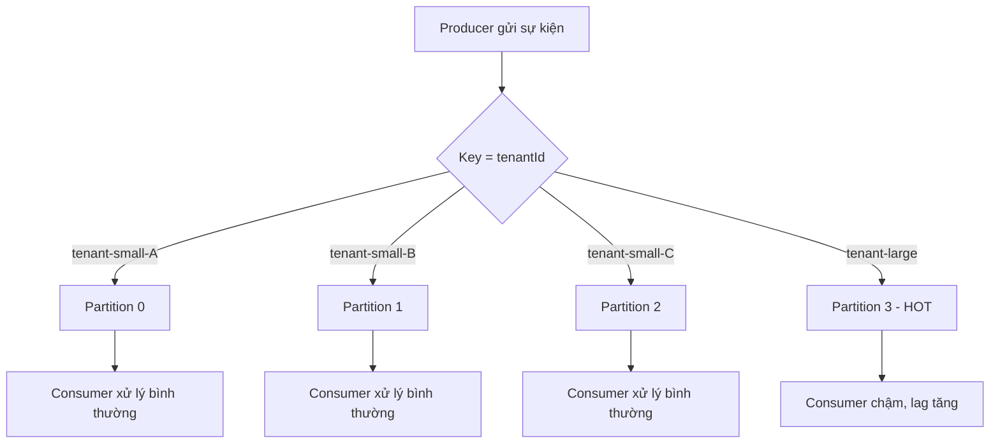

# Hot partition, key lệch và cách phân tán tải

Trong Kafka, topic được chia thành các partition để producer có thể ghi song song và consumer group có thể xử lý song song. Nhưng việc tạo nhiều partition không tự động làm tải phân bố đều. Nếu phần lớn sự kiện mang cùng một key, partitioner sẽ thường định tuyến chúng về cùng một partition. Partition đó có thể trở thành **hot partition**: tốc độ ghi, dung lượng dữ liệu hoặc lượng công việc xử lý cao hơn đáng kể so với các partition còn lại.

Hiện tượng này thường xuất hiện khi một tenant lớn, một tài khoản phổ biến, một sản phẩm bán chạy hoặc một thiết bị gửi dữ liệu với tần suất vượt xa phần còn lại. Muốn xử lý đúng, cần phân biệt nguyên nhân lệch tải, hiểu yêu cầu ordering của nghiệp vụ và chọn cách phân vùng phù hợp. Trong hệ thống event streaming với Apache Kafka và Java/Spring Kafka, thiết kế key là quyết định kiến trúc ảnh hưởng trực tiếp đến thông lượng, độ trễ và khả năng mở rộng.

## 1. Hot partition là gì?

Một partition được xem là nóng khi nó nhận hoặc phục vụ tải cao hơn đáng kể so với các partition khác trong cùng topic. Tải có thể được đo theo nhiều cách:

- Số record ghi vào mỗi giây.
- Số byte ghi vào mỗi giây.
- Dung lượng log tăng theo thời gian.
- Tốc độ fetch và lượng dữ liệu consumer phải xử lý.
- Consumer lag và thời gian xử lý record.

Không nên chỉ đếm record. Một partition nhận 1.000 record/giây với payload 1 KB có thể nhẹ hơn partition nhận 500 record/giây với payload 100 KB. Hãy theo dõi cả record rate và byte rate.

Ví dụ topic `orders` có 4 partition. Một tenant lớn chiếm 70% tổng sự kiện và producer dùng `tenantId` làm key. Tất cả sự kiện của tenant đó được gửi đến cùng một partition. Ba partition còn lại có thể tương đối nhàn rỗi trong khi partition chứa tenant lớn tăng lag liên tục.



Hot partition không nhất thiết có nghĩa broker bị lỗi. Nó là dấu hiệu tải không cân bằng. Nếu kéo dài, partition nóng có thể làm tăng độ trễ producer, consumer lag, thời gian phục hồi và áp lực đĩa/mạng trên broker đang làm leader.

## 2. Phân biệt key skew, partition skew và broker skew

Ba khái niệm liên quan nhưng không đồng nghĩa:

| Hiện tượng | Biểu hiện | Nguyên nhân thường gặp |
| --- | --- | --- |
| Key skew | Một vài key có tần suất xuất hiện vượt xa các key khác. | Một tenant, account, device hoặc product tạo nhiều sự kiện. |
| Partition skew | Một hoặc vài partition có record rate/byte rate cao hơn phần còn lại. | Key skew, chỉ định partition trực tiếp, partitioner tùy chỉnh hoặc dữ liệu phân phối không đều. |
| Broker skew | Một broker chịu nhiều traffic, request hoặc dung lượng hơn các broker khác. | Leader của nhiều partition nóng nằm trên cùng broker, replica phân bố lệch hoặc tài nguyên broker không đồng đều. |

Một key có lưu lượng cao thường làm nóng partition mà key đó ánh xạ tới. Nhưng broker skew cũng có thể xảy ra khi nhiều partition có tải vừa phải cùng có leader trên một broker. Ngược lại, một partition nóng vẫn có thể làm broker leader của nó quá tải dù các broker khác còn dư tài nguyên.

Ngoài ra, consumer chậm không phải lúc nào cũng do partition nóng. Một partition có thể nhận tải bình thường nhưng consumer xử lý chậm vì gọi API ngoài, truy vấn cơ sở dữ liệu, lock contention hoặc logic nghiệp vụ tốn CPU. Cần xác định bottleneck nằm ở producer, broker, network hay consumer trước khi đổi cách partition.

## 3. Vì sao key có thể làm lệch tải?

Producer thường chọn partition theo key. Với partitioner mặc định của Java producer, key sau khi serialize được băm để xác định partition. Các record có cùng key thường đi đến cùng partition khi số partition và cấu hình định tuyến không đổi.

Cách này rất hữu ích để bảo toàn thứ tự theo thực thể. Ví dụ, tất cả sự kiện của một đơn hàng dùng `orderId` làm key sẽ nằm cùng partition. Nhưng nếu dùng `tenantId` làm key, toàn bộ sự kiện của tenant đó có thể tập trung vào một partition, dù tenant có hàng nghìn đơn hàng hoặc thiết bị.

Một số nguyên nhân phổ biến:

1. **Key có tần suất không đồng đều.** Một tenant lớn phát sinh hàng triệu sự kiện, trong khi nhiều tenant khác chỉ phát sinh vài trăm.
2. **Key có cardinality thấp.** Ứng dụng chỉ dùng một số ít giá trị như `status`, `country` hoặc `eventType`; nhiều record dồn vào một nhóm key.
3. **Chọn key quá rộng.** Dùng `tenantId` khi nghiệp vụ chỉ cần giữ thứ tự theo `orderId` khiến các đơn hàng không liên quan bị gom vào một partition.
4. **Chỉ định partition cố định.** Ứng dụng truyền cùng một partition cho nhiều record hoặc custom partitioner có logic lệch.
5. **Payload có kích thước không đồng đều.** Record rate có thể khá đều nhưng một partition nhận payload lớn khiến byte rate và chi phí xử lý tăng.
6. **Phân phối leader/replica chưa cân bằng.** Lưu lượng có thể tập trung trên broker do vị trí leader, ngay cả khi số partition trên mỗi broker tương tự nhau.

### Ví dụ chọn key chưa phù hợp

Giả sử topic lưu sự kiện đơn hàng của nhiều tenant:

| Tenant | Số sự kiện/giây |
| --- | ---: |
| tenant-A | 100 |
| tenant-B | 120 |
| tenant-C | 80 |
| tenant-MEGA | 8.000 |

Nếu dùng `tenantId` làm key, mọi sự kiện của `tenant-MEGA` cùng về một partition. Việc tăng topic từ 4 lên 16 partition không tự chia một key thành 16 luồng. Cùng một key vẫn ánh xạ đến một partition tại một thời điểm.

Nếu nghiệp vụ cần thứ tự theo đơn hàng, `orderId` thường là key tốt hơn `tenantId`: các đơn hàng khác nhau có thể được phân phối qua nhiều partition, trong khi các cập nhật của cùng đơn hàng vẫn được giữ cùng partition.

## 4. Nhận diện partition nóng bằng số liệu

Đừng kết luận một partition nóng chỉ từ số lượng record trong một lần quan sát. Hãy so sánh theo khoảng thời gian và theo nhiều chỉ số.

### Các chỉ số nên theo dõi

| Chỉ số | Ý nghĩa khi điều tra |
| --- | --- |
| Record rate theo partition | Partition nào nhận nhiều sự kiện nhất. |
| Byte rate theo partition | Partition nào nhận nhiều dữ liệu nhất; hữu ích khi kích thước payload khác nhau. |
| Log size theo partition | Partition nào tăng dung lượng nhanh hoặc đang chiếm nhiều đĩa. |
| Consumer lag theo partition | Partition nào có lượng record chưa xử lý tăng liên tục. |
| Produce/fetch request latency | Producer hoặc consumer có đang chịu độ trễ cao không. |
| Leader và ISR | Partition nóng đang có leader ở broker nào; replica có theo kịp không. |
| CPU, disk I/O, network theo broker | Xác định broker hay tài nguyên nào là nút thắt. |

Một số metric Kafka mặc định là cấp client, topic hoặc broker, không phải metric lưu lượng chi tiết cho từng partition. Có thể cần kết hợp JMX/metrics exporter, công cụ quan sát của nền tảng, số liệu consumer group và instrumentation trong ứng dụng để thu thập record/byte rate theo partition. Lệnh mô tả consumer group hữu ích để xem lag theo partition:

```bash
kafka-consumer-groups.sh \
  --bootstrap-server localhost:9092 \
  --describe \
  --group order-projection
```

Lệnh này cho biết offset hiện tại, log end offset và lag theo partition đối với group; nó không trực tiếp đo record rate hay byte rate. Để kiểm tra vị trí leader, replica và ISR của topic:

```bash
kafka-topics.sh \
  --bootstrap-server localhost:9092 \
  --describe \
  --topic orders
```

### Định lượng mức lệch

Gọi `R_i` là record rate hoặc byte rate của partition thứ `i`, có `N` partition:

```text
average = (R_1 + R_2 + ... + R_N) / N
skew_ratio = max(R_i) / average
```

Ví dụ bốn partition có byte rate lần lượt là 10, 12, 9 và 49 MB/s:

- Trung bình là 20 MB/s.
- Partition lớn nhất là 49 MB/s.
- Skew ratio là 49 / 20 = 2,45.

Partition lớn nhất đang nhận khoảng 2,45 lần mức trung bình. Đây là tín hiệu cần điều tra, không phải ngưỡng cảnh báo áp dụng cho mọi hệ thống. Hãy đặt ngưỡng dựa trên tải nền, năng lực broker, SLA và xu hướng lag.

Cũng cần kiểm tra theo thời gian. Một partition có thể nóng trong vài phút do chiến dịch bán hàng, sau đó trở lại bình thường. Nếu chỉ nhìn tổng dung lượng log hoặc một snapshot, có thể nhầm tải tích lũy với tốc độ hiện tại.

## 5. Chọn key theo phạm vi ordering cần bảo toàn

Cách khắc phục bền vững thường bắt đầu từ việc chọn lại key theo đúng bất biến nghiệp vụ.

| Nhu cầu ordering | Key thường phù hợp | Hệ quả |
| --- | --- | --- |
| Giữ thứ tự cập nhật của một đơn hàng | `orderId` | Các đơn hàng khác nhau có thể chạy song song. |
| Giữ thứ tự giao dịch của một tài khoản | `accountId` | Một tài khoản có lưu lượng rất lớn vẫn có thể thành hot key. |
| Giữ thứ tự của một thiết bị | `deviceId` | Nhiều thiết bị có thể phân phối qua nhiều partition. |
| Giữ thứ tự của từng kho trong một tenant | `tenantId + warehouseId` | Các kho của tenant có thể chạy song song; không còn thứ tự toàn tenant. |
| Không cần ordering theo thực thể | Key null hoặc khóa phân phối phù hợp | Tăng khả năng phân tán, nhưng ứng dụng không có ordering theo key. |

Không nên chọn key chỉ để đạt số partition phân bố đẹp. Key phải phản ánh phạm vi mà nghiệp vụ cần xử lý tuần tự. Nếu thay key từ `tenantId` sang `orderId`, hãy xác nhận consumer không dựa vào thứ tự tổng thể của tenant.

Một key có nhiều giá trị khác nhau cũng chưa chắc phân phối đều. Nếu một key chiếm 80% lưu lượng và hàng triệu key còn lại chia nhau 20%, tổng số key rất lớn vẫn có thể tồn tại một partition nóng. Cần xem tần suất theo key (heavy hitters), không chỉ đếm số lượng key duy nhất.

## 6. Các chiến lược phân tán tải

### 6.1. Dùng key chi tiết hơn

Nếu nghiệp vụ cần ordering theo đơn hàng, hãy dùng `orderId` thay vì `tenantId`. Đây thường là cách đơn giản nhất để chia tải theo các thực thể độc lập.

Ví dụ:

- Trước: `key = tenantId`
- Sau: `key = tenantId + "#" + orderId`

Nếu `orderId` đã duy nhất toàn hệ thống, chỉ dùng `orderId` cũng có thể đủ. Dùng composite key khi cần namespace hoặc phân biệt cùng một ID giữa các tenant.

Cách này không phân tán được một thực thể đơn lẻ có lưu lượng quá lớn. Nếu mọi record vẫn có cùng `orderId`, chúng vẫn vào cùng partition.

### 6.2. Shard một key nóng bằng khóa con ổn định

Khi một tenant có rất nhiều đơn hàng và yêu cầu chỉ cần giữ thứ tự theo từng đơn hàng, có thể chia tenant thành nhiều shard dựa trên `orderId`. Các sự kiện của cùng đơn hàng luôn dùng cùng shard; các đơn hàng khác nhau có thể phân phối qua nhiều shard.

Ví dụ với 16 shard:

```java
int shardCount = 16;
int shard = Math.floorMod(orderId.hashCode(), shardCount);
String key = tenantId + "#" + shard;
```

Các record của một đơn hàng có cùng `orderId` sẽ tạo ra cùng shard. Tuy nhiên, các đơn hàng khác nhau có thể chung shard và không có thứ tự tổng thể giữa chúng. Partitioner tiếp tục hash composite key để chọn partition; cần kiểm tra phân bố thực tế vì nhiều shard có thể vẫn hash vào cùng partition nếu số partition hoặc cách chọn shard không phù hợp.

Đây là một thay đổi hợp đồng dữ liệu. Consumer cần biết shard được tính thế nào nếu phải tái tạo key hoặc tổng hợp dữ liệu. Số shard nên được cấu hình rõ ràng, ổn định và thay đổi có kế hoạch; đổi số shard có thể làm sự kiện mới của cùng một thực thể chuyển sang partition khác.

### 6.3. Dùng key null khi không cần ordering theo key

Nếu record không cần thứ tự theo một thực thể, có thể không đặt key để producer phân phối record bằng chiến lược dành cho record không key. Java producer mặc định có cơ chế sticky partitioning cho record null key nhằm gom batch hiệu quả, sau đó chuyển partition theo chiến lược của client.

Cách này có thể cải thiện phân phối khi key đang gây lệch, nhưng consumer không thể dựa vào ordering theo key. Chỉ sử dụng khi nghiệp vụ cho phép xử lý các sự kiện độc lập hoặc có cơ chế sắp xếp/đồng bộ khác.

### 6.4. Tách luồng của tenant hoặc workload đặc biệt

Nếu một tenant hoặc nhóm sự kiện có lưu lượng lớn và đặc tính vận hành khác hẳn phần còn lại, có thể tách sang topic riêng. Topic riêng cho phép cấu hình partition, retention, quota, ACL và consumer độc lập.

Ví dụ:

- `orders-standard`: phần lớn tenant có lưu lượng vừa phải.
- `orders-large-tenant`: tenant có lưu lượng rất lớn và cần consumer pool riêng.

Tách topic giúp cô lập noisy neighbor và quản lý tải độc lập. Tuy nhiên, số topic, partition, ACL, dashboard và quy trình vận hành sẽ tăng. Cần có tiêu chí chuyển tenant vào/ra luồng riêng, tránh tạo topic cho từng khách hàng nếu số lượng quá lớn.

### 6.5. Tăng số partition khi có đủ key độc lập

Tăng số partition có thể tăng khả năng song song của consumer group và tạo thêm đích phân phối cho nhiều key khác nhau. Nhưng tăng partition không tự giải quyết hot key: một key vẫn được ánh xạ tới một partition tại một thời điểm.

Ngoài ra, khi số partition thay đổi, phép hash-to-partition có thể cho kết quả khác. Record cũ vẫn ở partition cũ, record mới có thể sang partition khác. Nếu hệ thống dựa vào ordering theo key trong suốt vòng đời dữ liệu, phải đánh giá kỹ việc mở rộng partition.

### 6.6. Cân bằng leader và replica giữa các broker

Nếu vấn đề chính là broker skew, có thể xem xét reassignment partition hoặc cân bằng leader để phân phối tải broker. Việc này giúp broker ít nóng hơn khi nhiều partition leader đang tập trung ở một nơi.

Tuy nhiên, di chuyển một partition nóng sang broker khác chỉ chuyển vị trí chịu tải. Nó không chia nhỏ lưu lượng của chính partition đó. Nếu bottleneck là một hot key trong một partition, cần xử lý ở thiết kế key hoặc kiến trúc luồng dữ liệu.

## 7. Đánh đổi quan trọng: phân tán tải và thứ tự

Kafka bảo đảm thứ tự trong một partition. Khi chia một key nóng thành nhiều shard, các record của cùng shard vẫn có thứ tự, nhưng thứ tự giữa các shard không được bảo đảm.

Ví dụ tenant có 16 shard:

- Đơn hàng A thuộc shard 3.
- Đơn hàng B thuộc shard 11.
- Sự kiện của A và B có thể được xử lý song song.
- Không thể kết luận sự kiện của A luôn được xử lý trước B chỉ vì timestamp của A nhỏ hơn.

Nếu nghiệp vụ yêu cầu thứ tự toàn tenant, việc phân tán toàn bộ tenant thành nhiều partition sẽ làm mất bảo đảm đó. Cần xác định liệu thật sự cần ordering toàn tenant hay chỉ cần ordering theo đơn hàng, tài khoản hoặc thực thể nhỏ hơn.

Khi bắt buộc phải có thứ tự toàn cục, các lựa chọn thường là chấp nhận một luồng tuần tự có giới hạn throughput, dùng một bộ điều phối/sequencer cấp phát thứ tự, hoặc thiết kế lại nghiệp vụ thành các luồng độc lập rồi tổng hợp kết quả. Không có cấu hình partitioner nào vừa chia một chuỗi phụ thuộc tuần tự sang nhiều partition vừa giữ được thứ tự tổng thể tự động.

### Tổng hợp lại sau khi fan-out

Một kiến trúc phổ biến là chia luồng đầu vào theo shard để xử lý song song, rồi dùng Kafka Streams hoặc consumer tổng hợp kết quả. Nhưng nếu bước cuối phải cập nhật một trạng thái duy nhất theo cùng key nóng, bước tổng hợp có thể lại trở thành hot partition.

Để tránh dồn nút thắt về cuối, hãy xem xét:

- Dùng windowed aggregation nếu nghiệp vụ cho phép tổng hợp theo cửa sổ thời gian.
- Duy trì trạng thái riêng theo shard và chỉ hợp nhất khi cần truy vấn.
- Tạo snapshot hoặc kết quả tổng hợp theo lịch thay vì đồng bộ mọi sự kiện.
- Dùng một bước merge tuần tự có kiểm soát nếu kết quả cuối bắt buộc có thứ tự.

## 8. Ví dụ triển khai với Java/Spring Kafka

Giả sử một tenant lớn có hàng nghìn đơn hàng. Yêu cầu là giữ thứ tự sự kiện trong từng đơn hàng, nhưng không cần thứ tự toàn tenant. Ta dùng `tenantId` kết hợp shard tính từ `orderId`.

```java
public record OrderEvent(
        String tenantId,
        String orderId,
        String eventType,
        Instant occurredAt
) {}
```

Producer:

```java
@Service
public class OrderEventPublisher {
    private static final int SHARD_COUNT = 16;

    private final KafkaTemplate<String, OrderEvent> kafkaTemplate;

    public OrderEventPublisher(
            KafkaTemplate<String, OrderEvent> kafkaTemplate) {
        this.kafkaTemplate = kafkaTemplate;
    }

    public CompletableFuture<SendResult<String, OrderEvent>> publish(
            OrderEvent event) {

        int shard = Math.floorMod(
            event.orderId().hashCode(),
            SHARD_COUNT
        );

        String key = event.tenantId() + "#" + shard;

        return kafkaTemplate.send("orders", key, event);
    }
}
```

Các sự kiện của cùng `orderId` luôn tính ra cùng shard và cùng key. Nhiều đơn hàng trong cùng tenant có thể được phân phối qua các shard. Partitioner mặc định hash key để chọn partition.

Ví dụ này chỉ phù hợp khi ordering theo từng đơn hàng. Nếu yêu cầu ordering theo tenant, cách chia shard sẽ không đáp ứng. Trong production, nên đưa shard count vào cấu hình có quản lý phiên bản, ghi nhận shard vào log/metric để debug và kiểm tra phân bố thực tế trước khi chuyển traffic.

### Giữ key và dùng một trường sharding riêng

Một lựa chọn khác là lưu `orderId` trong value nhưng dùng composite key để partition:

```text
Kafka key: tenantId#shard
Value:
{
  "tenantId": "tenant-MEGA",
  "orderId": "ORD-1001",
  "eventType": "OrderPaid"
}
```

Consumer cần dùng `orderId` trong payload để cập nhật trạng thái đúng đơn hàng. Không được giả định Kafka key luôn bằng ID nghiệp vụ chính sau khi đã áp dụng sharding.

## 9. Những biện pháp không giải quyết được hot key

| Biện pháp | Vì sao chưa đủ |
| --- | --- |
| Chỉ tăng partition count | Cùng một key vẫn ánh xạ về một partition tại một thời điểm. |
| Chỉ tăng số consumer | Trong cùng consumer group, một partition chỉ được gán cho tối đa một consumer tại một thời điểm; consumer mới không tự chia một partition thành nhiều luồng. |
| Chỉ tăng `batch.size` hoặc `linger.ms` | Có thể cải thiện hiệu quả request nhưng không phân tán tải ghi của key nóng. |
| Chỉ bật compression | Giảm byte truyền/lưu trong một số workload, nhưng không chia tải xử lý; còn có thể tăng CPU. |
| Chỉ di chuyển leader sang broker khác | Chuyển broker chịu tải, không chia nhỏ partition nóng. |
| Đổi key ngẫu nhiên tùy tiện | Có thể phân tán tải nhưng làm mất ordering theo thực thể và gây khó khăn khi retry/tổng hợp. |

Những biện pháp trên vẫn có ích cho các vấn đề khác. Ví dụ tăng consumer có ích khi có nhiều partition chưa được khai thác; compression có ích khi network hoặc disk là nút thắt. Nhưng phải xác định đúng nguyên nhân trước khi chọn biện pháp.

## 10. Quy trình xử lý hot partition trong production

Có thể áp dụng quy trình sau để giảm rủi ro khi thay đổi hệ thống đang chạy:

1. **Xác định phạm vi:** ghi nhận topic, partition, broker leader, consumer group và thời gian bắt đầu có dấu hiệu nóng.
2. **Đo tải:** so sánh record rate, byte rate, log growth và lag theo partition; xác định metric nào đang lệch.
3. **Tìm heavy hitter:** thống kê tần suất key ở ứng dụng hoặc pipeline quan sát. Tránh log toàn bộ payload nếu dữ liệu nhạy cảm; chỉ cần key đã được che/mã hóa phù hợp và số đếm.
4. **Xác nhận ordering:** hỏi rõ nghiệp vụ cần thứ tự theo tenant, account, order, device hay chỉ cần từng record độc lập.
5. **Chọn chiến lược:** re-key, composite key, shard ổn định, tách topic, tăng partition hoặc cân bằng broker tùy nguyên nhân.
6. **Đánh giá migration:** xác định consumer cũ/new key, khả năng record của cùng thực thể nằm ở partition khác nhau, cách xử lý replay và duplicate.
7. **Thử nghiệm:** chạy tải đại diện với phân bố key giống production; đo p95/p99 latency, byte rate, lag, CPU, disk và network.
8. **Triển khai có kiểm soát:** chuyển một phần traffic, theo dõi skew ratio và lag, sau đó mới mở rộng.
9. **Xác minh sau thay đổi:** kiểm tra thứ tự theo phạm vi đã cam kết, số lượng record, duplicate, lỗi deserialize và khả năng replay.

Nếu chỉ cần giảm áp lực tức thời, có thể áp dụng rate limiting ở producer, backpressure ở tầng nhận sự kiện hoặc cô lập tenant gây tải lớn. Đây là biện pháp giảm sốc trong khi thiết kế lại key/luồng dữ liệu; cần theo dõi hàng đợi và thời gian trễ để tránh đẩy backlog sang hệ thống khác.

## 11. Bài thực hành: mô phỏng key skew và so sánh sharding

Thực hiện trên cluster thử nghiệm với topic `orders-skew-lab` có 12 partition. Tạo producer phát sự kiện với phân bố:

- 90% record thuộc tenant `tenant-MEGA`.
- 10% record còn lại chia đều cho nhiều tenant nhỏ.
- Mỗi tenant có nhiều `orderId`.
- Dùng payload có kích thước tương đương để so sánh record rate và byte rate.

### Lượt A: key theo tenant

Gửi record với key:

```text
key = tenantId
```

Quan sát partition nhận dữ liệu của tenant-MEGA, record rate và consumer lag. Ghi lại skew ratio.

### Lượt B: key theo đơn hàng

Gửi cùng tập sự kiện với key:

```text
key = tenantId + "#" + orderId
```

Kiểm tra sự kiện cùng đơn hàng có còn nằm cùng partition không, và tải của tenant-MEGA đã phân phối qua bao nhiêu partition.

### Lượt C: key theo shard

Dùng 16 shard ổn định được tính từ `orderId`:

```text
shard = floorMod(hash(orderId), 16)
key = tenantId + "#" + shard
```

So sánh tải partition và xác minh thứ tự theo đơn hàng. Lưu ý 16 shard không đảm bảo mỗi shard tương ứng một partition riêng; partitioner còn hash key và số partition của topic quyết định kết quả cuối.

### Bảng ghi kết quả

| Cách chọn key | Partition nóng nhất (record/s) | Partition trung bình (record/s) | Skew ratio | Ordering được bảo toàn |
| --- | ---: | ---: | ---: | --- |
| `tenantId` | — | — | — | Theo tenant |
| `tenantId#orderId` | — | — | — | Theo đơn hàng |
| `tenantId#shard` | — | — | — | Theo shard; cùng đơn hàng cùng shard |

Điền số liệu từ lần chạy thực tế. Ngoài skew ratio, hãy so sánh p99 producer latency, consumer lag, CPU broker/consumer và thời gian xử lý. Một cách phân vùng chỉ được xem là phù hợp khi tải được phân phối tốt hơn mà vẫn đáp ứng đúng yêu cầu ordering và khả năng truy vấn của ứng dụng.

## 12. Những điểm cần nhớ

- Hot partition là partition nhận hoặc phục vụ tải cao hơn đáng kể so với các partition còn lại; cần đo cả record rate, byte rate, log growth và consumer lag.
- Key skew xảy ra khi một số key có tần suất vượt trội. Hash partitioner không cân bằng theo trọng số traffic của key.
- Tăng partition count không tự chia một hot key; cùng key vẫn đi về một partition tại một thời điểm.
- Chọn key theo phạm vi ordering thực sự cần bảo toàn. Nếu chỉ cần thứ tự theo đơn hàng, dùng `orderId` thường phù hợp hơn `tenantId`.
- Sharding một key nóng có thể tăng song song nhưng làm mất thứ tự giữa các shard. Chỉ áp dụng khi nghiệp vụ cho phép.
- Cân bằng leader giúp xử lý broker skew, nhưng không chia nhỏ tải của một partition nóng.
- Đo tải, xác định heavy hitter, kiểm tra ordering và thử nghiệm với phân bố dữ liệu thực tế trước khi thay đổi production.

Phân tán tải trong Kafka là bài toán cân bằng giữa khả năng song song và thứ tự sự kiện. Một thiết kế tốt bắt đầu từ câu hỏi nghiệp vụ cần giữ thứ tự ở cấp nào, sau đó mới chọn key, số shard và số partition. Khi key phản ánh đúng đơn vị xử lý độc lập, Kafka có thể khai thác nhiều partition hiệu quả mà không làm sai ngữ nghĩa của luồng sự kiện.

