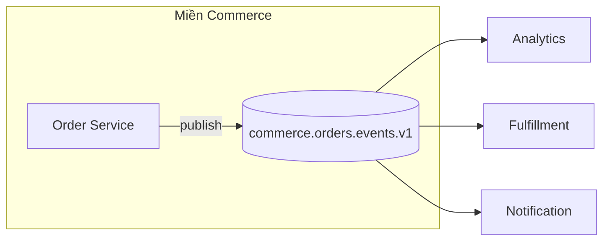

# Quy ước đặt tên topic, chủ sở hữu và phân chia miền nghiệp vụ

## Mục tiêu

Topic là ranh giới lưu trữ và phân phối record trong Kafka. Khi số lượng producer, consumer và miền nghiệp vụ tăng lên, một tên topic thiếu quy ước hoặc một topic không có chủ sở hữu rõ ràng sẽ làm hệ thống khó vận hành: nhóm phát triển không biết ai chịu trách nhiệm về dữ liệu, consumer không hiểu hợp đồng, quyền truy cập khó kiểm soát và topic cũ không được dọn dẹp đúng lúc.

Bài học này hướng dẫn thiết kế tên topic, xác định owner, chia topic theo bounded context và quản lý vòng đời. Sau bài học, bạn có thể:

- Đặt tên topic ngắn gọn, ổn định, thể hiện miền nghiệp vụ và mục đích của stream.
- Chọn ranh giới topic theo ownership, event contract, partition key, retention và quyền truy cập.
- Phân biệt owner của dữ liệu, producer, consumer và Kafka platform team.
- Lập metadata catalog cho topic, cấu hình ACL và quản lý deprecation.
- Nhận biết các anti-pattern như topic dùng chung không có owner, topic theo từng consumer hoặc topic chứa dữ liệu nhiều miền không liên quan.

## 1. Topic là ranh giới của một stream dữ liệu

Một topic là log gồm các partition. Producer ghi record vào topic; consumer đọc record theo offset. Topic thường đại diện cho một luồng dữ liệu có ý nghĩa ổn định, ví dụ vòng đời đơn hàng hoặc giao dịch thanh toán.

Topic không nên được xem đơn thuần là tên của một bảng database, một service hay một consumer. Nó là hợp đồng phân phối dữ liệu giữa miền phát sinh sự kiện và các hệ thống cần sử dụng sự kiện đó.



Trong ví dụ, Order Service là producer chính và miền Commerce chịu trách nhiệm về ý nghĩa của các sự kiện đơn hàng. Analytics, Fulfillment và Notification là các consumer độc lập. Việc có ba consumer không có nghĩa phải tạo ba topic giống nhau; mỗi consumer có thể dùng consumer group riêng để đọc cùng stream theo mục đích của nó.

Một topic nên có ranh giới đủ rõ để trả lời được các câu hỏi: dữ liệu thuộc miền nào, ai định nghĩa semantics, record được phân vùng theo key nào, giữ trong bao lâu, ai được phép đọc/ghi và khi contract thay đổi thì ai điều phối.

## 2. Quy tắc đặt tên topic

Kafka topic name có giới hạn về độ dài và ký tự. Theo quy tắc tên topic của Kafka, tên không được rỗng, không vượt quá 249 ký tự, không được là `.` hoặc `..`; các ký tự dùng trong tên topic là chữ ASCII, chữ số, dấu chấm (`.`), gạch dưới (`_`) và gạch ngang (`-`). Tên phân biệt chữ hoa/chữ thường về mặt kỹ thuật, nhưng nên thống nhất chữ thường để dễ đọc và tránh nhầm lẫn.

Kafka cũng cảnh báo việc dùng lẫn dấu chấm và gạch dưới trong tên topic có thể gây va chạm tên metric JMX vì một số metric biểu diễn dấu chấm và gạch dưới theo cách không phân biệt được. Chọn một kiểu phân cách và dùng nhất quán; quy ước trong bài này dùng dấu chấm.

### 2.1. Mẫu tên đề xuất

Một mẫu dễ áp dụng là:

```text
[<environment>.]<domain>.<entity>.<stream-kind>[.v<major>]
```

Trong đó:

- `environment`: chỉ thêm khi nhiều môi trường dùng chung một Kafka cluster. Nếu dev, staging và production có cluster riêng thì không cần lặp môi trường trong tên.
- `domain`: miền nghiệp vụ sở hữu ý nghĩa dữ liệu, ví dụ `commerce`, `payments`, `inventory`, `shipping`.
- `entity`: aggregate hoặc đối tượng nghiệp vụ chính, ví dụ `orders`, `payments`, `shipments`.
- `stream-kind`: mục đích của luồng, ví dụ `events`, `commands`, `cdc`, `snapshots` hoặc `compacted` nếu đây là quy ước nội bộ đã được thống nhất.
- `v<major>`: phiên bản contract/topic khi có thay đổi không tương thích ở cấp stream.

Ví dụ:

| Topic | Ý nghĩa |
|---|---|
| `commerce.orders.events.v1` | Các sự kiện vòng đời đơn hàng thuộc Commerce |
| `payments.transactions.events.v1` | Các sự kiện giao dịch thanh toán |
| `inventory.stock.events.v1` | Thay đổi tồn kho |
| `shipping.shipments.events.v1` | Sự kiện vận chuyển và giao hàng |
| `integration.erp.orders.cdc.v1` | Dữ liệu CDC đơn hàng lấy từ hệ thống ERP |
| `analytics.orders.daily.v1` | Dữ liệu tổng hợp theo ngày do miền Analytics công bố |
| `prod.commerce.orders.events.v1` | Biến thể có prefix môi trường khi nhiều môi trường dùng chung cluster |

Tên topic nên thể hiện ý nghĩa ổn định, không mô tả chi tiết triển khai dễ thay đổi. Ví dụ `commerce.orders.events.v1` ổn định hơn `order-service-db-orders-table-stream`, vì service hoặc tên bảng có thể được refactor mà semantics của stream vẫn giữ nguyên.

### 2.2. Những thông tin không nên đưa vào tên

- Tên consumer hoặc consumer group: topic là stream dùng chung, không thuộc riêng một consumer.
- Tên pod, hostname, IP, region triển khai hoặc ngày tạo: đây là thông tin vận hành có thể thay đổi và nên được quản lý trong cấu hình/catalog.
- Tên cá nhân, email, dữ liệu khách hàng, mã đơn hàng hoặc thông tin nhạy cảm.
- Tên sprint, ticket hoặc phiên bản release của service.
- Tên bảng database nếu nó không phải một phần của contract công khai.

Tránh tên quá chung như `events`, `data`, `messages`, `topic1`; tránh nhét toàn bộ mô tả vào tên khiến tên khó đọc và dễ vượt giới hạn. Cũng không nên tạo tên topic riêng chỉ vì có thêm một consumer.

## 3. Chọn ranh giới topic theo miền nghiệp vụ

Bounded context là ranh giới trong đó thuật ngữ, quy tắc và mô hình nghiệp vụ có ý nghĩa nhất quán. Topic nên thuộc về một bounded context rõ ràng, để producer và consumer hiểu cùng một contract.

Ví dụ, `OrderCreated`, `OrderPaid` và `OrderCancelled` có thể cùng nằm trong `commerce.orders.events.v1` nếu chúng cùng thuộc vòng đời đơn hàng, có cùng key `orderId`, chính sách retention, quyền truy cập và nhịp tiến hóa contract phù hợp. Consumer phân biệt loại sự kiện qua trường `eventType` trong envelope.

Ngược lại, không nên đưa `PaymentCaptured` và `StockReserved` vào topic đơn hàng chỉ vì chúng xảy ra trong cùng một quy trình checkout. Hai sự kiện thuộc miền Payments và Inventory, có owner, quyền truy cập và quy tắc nghiệp vụ riêng. Order Service có thể tiêu thụ các sự kiện đó rồi phát `OrderPaid` hoặc `OrderConfirmed` như một sự kiện thuộc miền Commerce khi trạng thái đơn hàng thực sự thay đổi.

### 3.1. Khi nào nên dùng chung một topic?

Các record có thể nằm chung một topic khi phần lớn điều kiện sau cùng đúng:

- Cùng miền nghiệp vụ và có một owner chịu trách nhiệm cho semantics.
- Có cùng partition key hoặc cùng quy tắc phân phối record.
- Có cùng yêu cầu ordering và throughput ở mức có thể đáp ứng bằng cùng số partition.
- Có chính sách retention/compaction tương tự.
- Có cùng phân loại dữ liệu và chính sách truy cập.
- Contract có thể tiến hóa theo cùng một quy tắc tương thích.
- Consumer cần đọc các record như một stream liên quan.

Ví dụ, các event `OrderCreated`, `OrderAddressChanged` và `OrderCancelled` có thể cùng topic `commerce.orders.events.v1` nếu tất cả dùng `orderId` làm key và consumer cần theo dõi thứ tự thay đổi của từng đơn hàng.

### 3.2. Khi nào nên tách topic?

Nên tách khi có khác biệt quan trọng về:

- **Owner hoặc bounded context:** một miền khác chịu trách nhiệm về semantics và chất lượng dữ liệu.
- **Partition key/ordering:** các loại record cần key khác nhau hoặc có yêu cầu ordering không thể cùng đáp ứng.
- **Retention:** event giao dịch cần giữ lâu hơn log debug hoặc dữ liệu trạng thái tạm thời.
- **Cleanup policy:** stream sự kiện append-only dùng `delete` có thể cần chính sách khác với topic lưu trạng thái mới nhất theo key dùng `compact`.
- **Security:** một nhóm consumer được đọc thông tin thanh toán nhưng không được đọc dữ liệu định danh khách hàng.
- **Throughput và SLA:** luồng telemetry lớn không nên làm ảnh hưởng stream đơn hàng có yêu cầu latency khác.
- **Contract:** schema hoặc semantics thay đổi độc lập và không thể áp dụng cùng chính sách tương thích.

Không áp dụng máy móc quy tắc một event type bằng một topic. Quá nhiều topic nhỏ làm tăng chi phí quản trị partition, ACL, monitoring và retention. Ngược lại, một topic khổng lồ chứa nhiều miền không liên quan tạo coupling và làm khó kiểm soát quyền truy cập. Hãy chọn ranh giới dựa trên contract và yêu cầu vận hành.

## 4. Phân biệt event, command, CDC và dữ liệu trạng thái

Tên stream nên cho biết record thuộc loại nào, vì semantics và cách consumer sử dụng chúng khác nhau.

| Loại stream | Ý nghĩa | Ví dụ tên |
|---|---|---|
| Domain events | Sự kiện đã xảy ra trong miền nghiệp vụ | `commerce.orders.events.v1` |
| Commands | Yêu cầu một thành phần thực hiện hành động | `commerce.orders.commands.v1` |
| CDC | Thay đổi được capture từ database/log nguồn | `integration.erp.orders.cdc.v1` |
| Snapshot/state | Trạng thái mới nhất theo key hoặc bản chụp dữ liệu | `inventory.stock.snapshot.v1` |
| Derived/analytics | Dữ liệu được tính toán từ một hay nhiều stream nguồn | `analytics.orders.daily.v1` |

Domain event mô tả điều đã xảy ra (`OrderPaid`); command mô tả điều muốn được thực hiện (`CancelOrder`). Không dùng lẫn hai loại vì command có thể bị từ chối hoặc thất bại, trong khi event là sự kiện đã được xác nhận. CDC record thường phản ánh thay đổi ở tầng dữ liệu và có thể chứa tên bảng, operation, before/after; không mặc nhiên tương đương domain event có ý nghĩa nghiệp vụ.

Topic compacted lưu giá trị mới nhất theo key và phù hợp với state/changelog hoặc bảng tra cứu. Topic event append-only thường giữ lịch sử record theo retention. Việc chọn `cleanup.policy` là quyết định semantics và vòng đời dữ liệu, không chỉ là tùy chọn kỹ thuật.

## 5. Xác định owner và trách nhiệm

Mỗi topic cần đúng một owner chịu trách nhiệm cuối cùng về contract và vòng đời dữ liệu. Có thể có nhiều nhóm cùng vận hành hoặc đóng góp, nhưng phải xác định rõ một đầu mối chịu trách nhiệm khi schema sai, dữ liệu không đến, consumer cần thay đổi hoặc topic cần deprecate.

| Vai trò | Trách nhiệm |
|---|---|
| Domain/data owner | Định nghĩa ý nghĩa event, chất lượng dữ liệu, contract, phân loại dữ liệu và chính sách retention nghiệp vụ |
| Producer owner | Phát record đúng schema, key, timestamp và semantics; xử lý lỗi publish; thông báo thay đổi contract |
| Consumer owner | Đăng ký mục đích sử dụng, quản lý consumer group/offset, xử lý lỗi và bảo đảm không gây tải bất thường |
| Kafka platform team | Cung cấp cluster, quota, replication, capacity, monitoring, backup/recovery và chuẩn vận hành |
| Security/data governance | Phê duyệt quyền truy cập, phân loại dữ liệu, yêu cầu tuân thủ và audit |

Trong nhóm nhỏ, một team có thể kiêm nhiều vai trò. Dù vậy, metadata catalog vẫn nên ghi rõ ai là owner chính và cách liên hệ. Kafka ACL xác định principal nào được phép thao tác; ACL không tự động cho biết ai là chủ sở hữu về mặt nghiệp vụ.

### 5.1. Metadata catalog cho topic

Kafka không có một thuộc tính `owner` chuẩn dùng chung cho mọi cluster/topic. Vì vậy, lưu ownership và mô tả contract trong hệ thống catalog, repository IaC hoặc file metadata được quản lý cùng mã nguồn. Ví dụ:

```yaml
topic: commerce.orders.events.v1
domain: commerce
owner: team-commerce
producer:
  service: order-service
  contact: commerce-oncall
purpose: Các sự kiện mô tả những thay đổi đã được xác nhận trong vòng đời đơn hàng
key: orderId
eventTypes:
  - OrderCreated
  - OrderAddressChanged
  - OrderPaid
  - OrderCancelled
dataClassification: internal
retention: 7d
cleanupPolicy: delete
schemaSubject: commerce.orders.events.v1-value
consumers:
  - team-fulfillment
  - team-analytics
  - team-notification
lifecycle: active
```

Đây là metadata catalog minh họa, không phải YAML cấu hình mà Kafka tự đọc. Các trường `owner`, `purpose`, `contact`, `dataClassification` và danh sách consumer cần được lưu ở catalog/repository; các thuộc tính như retention và cleanup policy phải được đồng bộ với cấu hình topic thực tế.

Tối thiểu, catalog nên có topic name, domain, owner, producer, mục đích, key/partitioning, schema/contract, classification, retention, cleanup policy, consumer đã đăng ký, SLA và trạng thái lifecycle. Có thể bổ sung ngày tạo, thời điểm review gần nhất và kế hoạch deprecation.

## 6. Key, partition và hợp đồng dữ liệu

Tên topic mô tả stream; key quyết định record được phân phối vào partition nào. Khi các event của cùng một đơn hàng cần được đọc theo thứ tự, producer nên dùng `orderId` làm key nhất quán cho mọi event thuộc đơn hàng đó.

Ví dụ envelope:

```json
{
  "eventId": "evt-2001",
  "eventType": "OrderPaid",
  "eventVersion": 1,
  "occurredAt": "2026-11-20T10:15:30Z",
  "aggregateId": "O-2001",
  "data": {
    "orderId": "O-2001",
    "paymentId": "P-9001",
    "amount": 1250000,
    "currency": "VND"
  }
}
```

Record trên được gửi với key `O-2001`. Consumer có thể đọc `eventType` để chọn handler. Không nên đưa toàn bộ payload hoặc PII vào key; key cần ổn định, nhỏ và phù hợp với partitioning.

Khi tăng số partition, cách hash key có thể đưa key vào partition khác so với trước, tùy partitioner và số partition. Do đó, tăng partition không phải thay đổi hoàn toàn vô hại nếu ứng dụng phụ thuộc vào ordering theo key. Owner phải đánh giá tác động, đặc biệt với stream có state hoặc yêu cầu thứ tự chặt.

Schema version và topic version là hai khái niệm khác nhau. Có thể thêm field tùy chọn tương thích vào schema mà không cần tạo topic mới. Chỉ cân nhắc topic `v2` khi thay đổi semantics hoặc contract không tương thích và cần thời gian migration độc lập. Chính sách compatibility của Schema Registry (nếu sử dụng) vẫn cần được quản lý riêng.

## 7. Quản lý quyền truy cập theo ownership

Topic ownership cần đi cùng quyền producer/consumer tối thiểu. Thông thường:

- Producer service được `Write` vào topic do domain owner quản lý.
- Consumer service được `Read` topic khi có mục đích sử dụng được đăng ký.
- Consumer group được cấp quyền tương ứng để consumer commit/đọc offset theo group.
- Chỉ platform/operator hoặc automation được ủy quyền mới có quyền tạo, xóa và thay đổi cấu hình topic.

Ví dụ ACL minh họa cho producer và consumer:

```bash
# Cho phép order-service ghi vào topic đơn hàng
kafka-acls.sh --bootstrap-server localhost:9092 \
  --add --allow-principal User:order-service \
  --operation Write --topic commerce.orders.events.v1

# Cho phép fulfillment đọc topic và dùng consumer group riêng
kafka-acls.sh --bootstrap-server localhost:9092 \
  --add --allow-principal User:fulfillment-service \
  --operation Read --topic commerce.orders.events.v1

kafka-acls.sh --bootstrap-server localhost:9092 \
  --add --allow-principal User:fulfillment-service \
  --operation Read --group fulfillment-orders
```

ACL syntax và cơ chế xác thực principal phụ thuộc cấu hình bảo mật của cluster. Chạy lệnh với tài khoản có quyền quản trị phù hợp và kiểm tra ACL sau khi áp dụng. Không cấp `All` cho mọi service chỉ để giải quyết nhanh lỗi authorization.

Kafka ACL thường áp dụng ở cấp topic/group, không lọc record theo từng `tenantId` trong payload. Nếu các tenant cần cô lập dữ liệu nghiêm ngặt, cần đánh giá topic/cluster riêng hoặc lớp authorization ở ứng dụng; không giả định rằng việc dùng tenant ID làm key đã tạo ra ranh giới bảo mật.

## 8. Tạo và kiểm tra topic bằng CLI

Ví dụ tạo topic event đơn hàng trong cluster lab:

```bash
kafka-topics.sh --bootstrap-server localhost:9092 \
  --create \
  --topic commerce.orders.events.v1 \
  --partitions 6 \
  --replication-factor 3 \
  --config cleanup.policy=delete \
  --config retention.ms=604800000
```

Trong ví dụ này, retention là bảy ngày. Số partition và replication factor chỉ là giá trị minh họa; hãy chọn theo throughput, số consumer song song, dung lượng, topology broker và yêu cầu durability. Cluster một broker trong lab không thể tạo topic với replication factor 3; khi thực hành trên cluster một node, dùng `--replication-factor 1`.

Kiểm tra topic và partition:

```bash
kafka-topics.sh --bootstrap-server localhost:9092 \
  --describe --topic commerce.orders.events.v1
```

Kiểm tra cấu hình topic:

```bash
kafka-configs.sh --bootstrap-server localhost:9092 \
  --entity-type topics \
  --entity-name commerce.orders.events.v1 \
  --describe
```

Để đổi retention, ví dụ tăng lên 14 ngày:

```bash
kafka-configs.sh --bootstrap-server localhost:9092 \
  --entity-type topics \
  --entity-name commerce.orders.events.v1 \
  --alter --add-config retention.ms=1209600000
```

Sau khi thay đổi, đọc lại cấu hình và cập nhật metadata catalog/IaC tương ứng. Không chỉ thay catalog mà quên cấu hình thật trên cluster, hoặc sửa cluster thủ công mà không cập nhật nguồn cấu hình chuẩn.

## 9. Quy trình vòng đời topic

Một topic mới nên đi qua quy trình có thể review và audit:

1. **Đề xuất:** producer owner mô tả use case, bounded context, event types, key, partitioning, throughput và consumer dự kiến.
2. **Xác định owner:** domain/data owner chấp nhận trách nhiệm về semantics, contract, chất lượng và lifecycle.
3. **Thiết kế contract:** thống nhất envelope, schema, compatibility, timestamp, key và cách xử lý event không hợp lệ.
4. **Phê duyệt vận hành:** xác định retention/cleanup, replication, số partition, quota, classification và ACL.
5. **Provision:** tạo topic bằng IaC/automation theo chuẩn platform; tránh để mỗi developer tạo topic production thủ công.
6. **Đăng ký catalog:** lưu owner, producer, mục đích, contract, consumers, SLA và ngày review.
7. **Theo dõi:** giám sát traffic, partition skew, consumer lag, dung lượng, lỗi publish, quyền truy cập và owner contact.
8. **Review định kỳ:** xác nhận owner và consumer còn hoạt động, retention phù hợp, dữ liệu vẫn có mục đích sử dụng.
9. **Deprecate và xóa:** thông báo, đo usage, cho consumer thời gian migrate, xác minh không còn phụ thuộc rồi mới xóa topic theo quy trình change management.

Không xóa topic chỉ vì consumer lag bằng 0 hoặc không thấy traffic trong một khoảng ngắn. Một topic có thể được dùng theo mùa, cho backfill hoặc bởi consumer chạy không thường xuyên. Owner cần xác minh với các nhóm đã đăng ký và kiểm tra telemetry đủ dài trước khi deprecate.

## 10. Versioning và deprecation

Không tăng topic version cho mọi lần thêm field. Nếu schema evolution tương thích ngược theo chính sách đã chọn, producer có thể thêm field tùy chọn và consumer cũ tiếp tục hoạt động. Topic `v2` thường cần thiết khi thay đổi không tương thích như:

- Đổi ý nghĩa event hoặc đơn vị đo của một field.
- Đổi partition key hoặc cách phân vùng làm ảnh hưởng ordering.
- Thay đổi envelope/serialization theo cách consumer cũ không đọc được.
- Thay đổi semantics của stream khiến consumer phải xử lý khác.

Khi cần `v2`, nên có kế hoạch migration:

- Công bố contract và thời điểm ngừng `v1`.
- Tạo topic mới, cấu hình retention/partition/ACL và đăng ký owner.
- Chuyển producer sang dual-publish có kiểm soát hoặc dùng bridge/republisher phù hợp.
- Cho consumer migrate và kiểm tra kết quả, tránh xử lý trùng gây side effect.
- Theo dõi usage của `v1`, thông báo deprecation và xóa sau khi owner xác nhận hoàn tất.

Dual-publish có thể tạo record trùng ở downstream; consumer cần idempotency theo `eventId` hoặc cơ chế dedup phù hợp. Không duy trì song song vô thời hạn hai topic nếu chưa xác định owner và tiêu chí kết thúc migration.

## 11. Anti-pattern thường gặp

| Anti-pattern | Hệ quả | Cách xử lý |
|---|---|---|
| Một topic tên `events` cho mọi domain | Không rõ semantics, ACL rộng, schema và retention xung đột | Chia theo bounded context và contract |
| Mỗi consumer có một bản sao topic riêng | Tăng chi phí vận hành, duplicate dữ liệu và khó đồng bộ | Dùng một stream có owner và consumer group riêng; chỉ tách khi có yêu cầu retention/security/throughput khác |
| Topic không có owner | Không ai xử lý schema lỗi, incident hoặc deprecation | Bắt buộc khai báo owner/contact trong catalog trước production |
| Đặt topic theo tên bảng/service nội bộ | Refactor database/service gây đổi tên stream và coupling | Đặt tên theo domain và semantics công khai |
| Một topic chứa event của nhiều domain | Owner, key, ACL, retention và contract không thống nhất | Để mỗi domain phát event của mình; domain khác tiêu thụ rồi phát kết quả thuộc domain đó |
| Dùng tên topic để nhúng PII/tenant/customer | Lộ thông tin qua log, metric, dashboard và ACL | Giữ dữ liệu nhạy cảm trong payload có kiểm soát; cân nhắc chiến lược phân tách tenant ở tầng bảo mật |
| Tăng partition tùy tiện | Có thể thay đổi mapping key-partition và ảnh hưởng ordering | Đánh giá partitioning và migration trước khi tăng |
| Xóa topic ngay khi ít traffic | Mất dữ liệu cần cho replay/audit hoặc consumer chạy theo mùa | Xác minh usage, retention, owner và consumer trước deprecation |

## 12. Checklist thiết kế trước khi tạo topic

Trước khi đưa topic vào production, hãy chắc chắn đã trả lời được các câu hỏi sau:

- Tên topic có tuân theo grammar và không chứa thông tin nhạy cảm không?
- Topic thuộc bounded context nào? Ai là owner chịu trách nhiệm cuối cùng?
- Producer nào được phép ghi? Những consumer nào có use case hợp lệ?
- Các event types có cùng key, ordering, retention, cleanup và classification không?
- Key có ổn định và hỗ trợ ordering theo aggregate cần thiết không?
- Schema compatibility và chiến lược versioning đã rõ chưa?
- Số partition, replication factor, `min.insync.replicas`, throughput và quota đã được sizing chưa?
- Retention hoặc compaction có phù hợp với replay, audit và dung lượng không?
- ACL đã giới hạn đúng producer, consumer và consumer group chưa?
- Catalog có purpose, contact, SLA, consumers và lifecycle status chưa?
- Có dashboard/alert cho traffic, consumer lag, partition skew và dung lượng không?
- Có kế hoạch deprecation và người có quyền phê duyệt xóa topic không?

## 13. Bài thực hành và tự kiểm tra

### Thực hành A — Thiết kế topic cho hệ thống thương mại điện tử

Một hệ thống có các service Order, Payment, Inventory, Shipping và Analytics. Hãy đề xuất topic cho các sự kiện sau:

- Đơn hàng được tạo, cập nhật địa chỉ và hủy.
- Thanh toán được xác nhận hoặc hoàn tiền.
- Tồn kho được giữ chỗ hoặc giải phóng.
- Đơn hàng được đóng gói và giao thành công.
- Báo cáo doanh thu theo ngày.

Với mỗi topic, ghi domain, owner, producer, key, event types, retention, cleanup policy và các consumer dự kiến. Giải thích vì sao một số event có thể cùng topic và một số event cần tách.

### Thực hành B — Tạo catalog và ACL

1. Chọn một topic trong thiết kế, ví dụ `commerce.orders.events.v1`.
2. Tạo metadata catalog theo mẫu ở mục 5.1.
3. Tạo topic trên Kafka lab với replication factor phù hợp số broker.
4. Đọc lại cấu hình topic bằng `kafka-configs.sh --describe`.
5. Cấp quyền Write cho producer và Read cho một consumer group.
6. Kiểm tra principal không được cấp quyền có bị từ chối khi truy cập hay không.
7. Đối chiếu catalog với cấu hình thực tế và ghi nhận owner chịu trách nhiệm thay đổi.

### Câu hỏi tự kiểm tra

1. Vì sao topic nên đại diện cho một stream có semantics ổn định thay vì một consumer cụ thể?
2. Khi nào `OrderCreated`, `OrderPaid` và `OrderCancelled` có thể cùng một topic?
3. Vì sao `PaymentCaptured` thường thuộc topic do Payments sở hữu thay vì topic đơn hàng?
4. Kafka ACL có thể thay thế metadata owner trong catalog không? Giải thích.
5. Tại sao schema version và topic version không nên được xem là một?
6. Những rủi ro nào xuất hiện khi tăng số partition của topic đang có ordering theo key?
7. Vì sao một topic ít traffic chưa đủ điều kiện để xóa?

## Kết luận

Tên topic tốt giúp nhận diện miền nghiệp vụ và mục đích của stream. Ranh giới topic cần phản ánh owner, contract, key/ordering, retention và security. Mỗi topic production cần một owner rõ ràng, catalog có thể kiểm tra, ACL tối thiểu và lifecycle có quy trình. Khi các nguyên tắc này được áp dụng nhất quán, nhiều domain và consumer có thể chia sẻ Kafka mà vẫn giữ được trách nhiệm dữ liệu và khả năng thay đổi độc lập.
