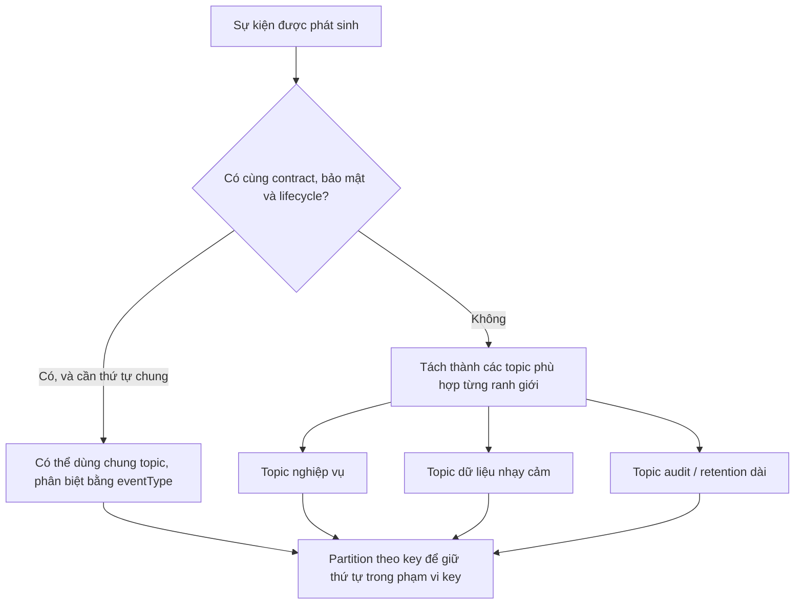
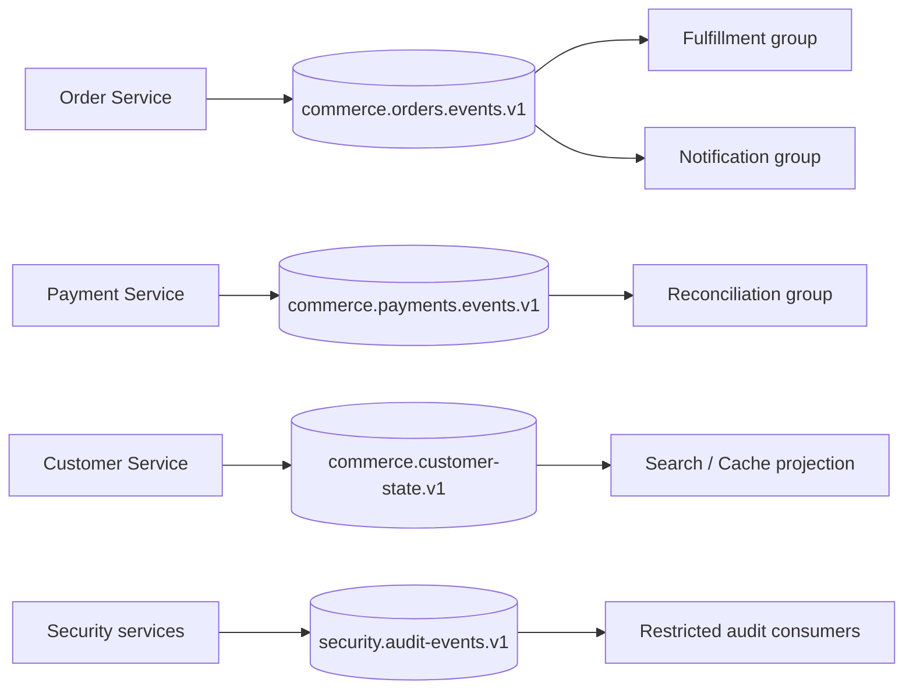

# Tách topic theo loại sự kiện, mức bảo mật và vòng đời dữ liệu

Trong Kafka, topic là ranh giới lưu trữ và phân phối record. Việc chọn một topic cho nhiều loại sự kiện hay tách thành nhiều topic ảnh hưởng trực tiếp đến consumer, thứ tự, phân quyền, retention, compaction và cách vận hành cluster. Một thiết kế tốt cần xem xét đồng thời ba câu hỏi: **đây là loại dữ liệu nào, ai được phép đọc/ghi và dữ liệu cần tồn tại trong bao lâu?**

Không có quy tắc rằng mỗi event luôn phải có một topic riêng. Các sự kiện có thể dùng chung topic khi chúng có cùng ranh giới bảo mật, vòng đời lưu trữ và yêu cầu vận hành, đồng thời cần giữ thứ tự theo cùng key. Nên tách topic khi một trong các ranh giới đó khác nhau đáng kể hoặc khi các nhóm producer/consumer cần triển khai, mở rộng và quản trị độc lập.

## 1. Topic là ranh giới thiết kế của luồng sự kiện

Một topic xác định một luồng record có tên, được chia thành các partition. Mỗi partition là một log có thứ tự riêng và được replication theo cấu hình của topic. Consumer group đọc các partition để xử lý dữ liệu. Tên topic thường được dùng trong ACL, cấu hình retention, replication, quota, monitoring và quy trình triển khai.

Vì vậy, topic không chỉ là một thư mục để đặt message. Khi hai loại dữ liệu được đưa vào cùng topic, chúng thường chia sẻ:

- Cùng chính sách lưu trữ và cleanup ở cấp topic.
- Cùng tập quyền truy cập topic; ACL thông thường không tự lọc record theo event type hoặc field bên trong payload.
- Cùng số partition và cấu hình replication của topic.
- Cùng không gian offset theo từng partition, cách consumer subscribe và các yêu cầu vận hành liên quan.

Ngược lại, hai topic khác nhau có thể có ACL, retention, cleanup policy, số partition và nhóm consumer riêng. Đổi lại, nếu hai sự kiện liên quan bị tách sang hai topic, Kafka không cung cấp thứ tự tổng thể giữa chúng.



Điểm xuất phát là ranh giới dữ liệu và quyền truy cập, sau đó mới chọn tên topic, số partition và cấu hình lưu trữ.

## 2. Tách theo loại sự kiện và event contract

### Nhóm sự kiện theo domain và mục đích

Nên tổ chức topic theo domain hoặc luồng nghiệp vụ có ý nghĩa ổn định. Ví dụ trong hệ thống thương mại điện tử:

| Topic ví dụ | Loại dữ liệu | Producer điển hình | Consumer điển hình |
|---|---|---|---|
| `commerce.orders.events.v1` | Các sự kiện vòng đời đơn hàng | Order Service | Fulfillment, notification, analytics |
| `commerce.payments.events.v1` | Sự kiện thanh toán | Payment Service | Order Service, reconciliation |
| `commerce.inventory.events.v1` | Thay đổi tồn kho | Inventory Service | Catalog, reservation |
| `commerce.customer-state.v1` | Trạng thái khách hàng mới nhất | Customer Service / CDC | Search index, cache, projection |

Tên topic nên cho người vận hành biết domain, dữ liệu và phiên bản contract ở mức cần thiết. Ví dụ một quy ước có thể là:

```text
<organization>.<domain>.<data-purpose>.v<major>

commerce.orders.events.v1
commerce.customer-state.v1
security.audit-events.v1
```

Đây là quy ước do tổ chức lựa chọn, không phải cú pháp bắt buộc của Kafka. Hãy thống nhất chữ thường, dấu phân cách, cách biểu diễn môi trường và version trong toàn hệ thống. Nếu mỗi môi trường dùng cluster riêng, tên topic có thể không cần lặp tên môi trường; nếu nhiều môi trường dùng chung cluster, cần thêm namespace như `dev`, `staging` hoặc `prod` để tránh ghi nhầm dữ liệu.

### Một topic cho nhiều event type hay một topic cho từng type?

Có thể dùng chung một topic cho nhiều event type khi các loại record:

- Thuộc cùng domain và có cùng nhóm producer/consumer được phép truy cập.
- Có cùng yêu cầu retention, cleanup, replication và phân loại dữ liệu.
- Cần giữ thứ tự giữa các loại sự kiện theo cùng key.
- Có thể được consumer phân biệt an toàn qua envelope hoặc schema.

Ví dụ `commerce.orders.events.v1` có thể chứa `OrderCreated`, `OrderConfirmed`, `OrderCancelled` và `OrderShipped`. Mỗi record có `eventType`, `eventId`, `aggregateId`, `occurredAt` và `schemaVersion`. Consumer có thể lọc theo `eventType` trong ứng dụng.

Nên tách topic riêng khi một event type có quyền truy cập khác, payload nhạy cảm hơn, retention khác, tốc độ phát sinh rất khác hoặc cần vận hành độc lập. Ví dụ `PaymentCardAuthorized` chứa thông tin nhạy cảm không nên bị trộn vào một topic mà mọi consumer của đơn hàng đều được đọc nếu các consumer đó không có quyền xử lý dữ liệu thanh toán.

| Tiêu chí | Chung topic | Tách topic |
|---|---|---|
| Thứ tự theo cùng key giữa event type | Có thể giữ trong cùng partition nếu key/partitioner nhất quán | Không có thứ tự tổng thể giữa các topic |
| ACL | Các consumer được cấp quyền topic có thể đọc mọi event type trong topic | Có thể cấp quyền theo từng luồng |
| Retention/cleanup | Dùng chung cấu hình topic | Có thể cấu hình độc lập |
| Consumer | Có thể cần lọc event type | Subscribe đúng loại dữ liệu cần thiết |
| Vận hành | Ít topic và tài nguyên metadata hơn | Tăng số topic, partition và cấu hình cần quản lý |

Không nên tạo topic chỉ vì có một consumer mới. Consumer độc lập nên thường có consumer group riêng trên cùng topic; mỗi group có thể đọc luồng dữ liệu độc lập. Tạo một topic cho mỗi consumer làm tăng chi phí vận hành và tạo nhiều bản sao dữ liệu không cần thiết, trừ khi cần một luồng đã biến đổi với contract hoặc lifecycle riêng.

### Thiết kế event envelope và schema

Khi nhiều event type dùng chung topic, consumer cần một cách phân biệt rõ ràng. Một envelope JSON có thể trông như sau:

```json
{
  "eventId": "evt-01JQ8M4Z",
  "eventType": "OrderConfirmed",
  "schemaVersion": 1,
  "aggregateType": "Order",
  "aggregateId": "order-7842",
  "occurredAt": "2026-11-20T10:15:30Z",
  "data": {
    "orderId": "order-7842",
    "customerId": "customer-42",
    "total": 1250000
  }
}
```

Envelope chỉ là ví dụ minh họa; cần xác định serializer, schema và quy tắc tương thích cho hệ thống thực tế. Không nên suy ra event type từ tên topic nếu topic chứa nhiều loại sự kiện. Nếu dùng Schema Registry, cần chọn subject naming strategy và compatibility policy phù hợp với cách chia topic; Kafka broker tự thân không xác thực schema của payload.

Thay đổi cấu trúc payload nên theo quy tắc tương thích đã thống nhất, ví dụ thêm field optional với default phù hợp. Version trong tên topic hữu ích khi có thay đổi contract lớn hoặc cần chạy song song hai luồng trong giai đoạn migration; không nên tạo topic version mới cho mọi thay đổi nhỏ có thể tương thích ngược.

## 3. Tách theo mức bảo mật và quyền truy cập

### Topic là ranh giới ACL

Kafka ACL có thể cấp quyền cho principal trên topic và consumer group. Ví dụ, Order Service có quyền ghi vào topic đơn hàng; Fulfillment có quyền đọc topic đó bằng group riêng. Payment Service có quyền ghi và một số dịch vụ thanh toán được quyền đọc topic thanh toán. Các consumer không được cấp quyền không thể đọc topic tương ứng khi cluster bật authorization và cấu hình xác thực phù hợp.

Ví dụ phân quyền ở mức khái niệm:

| Principal | Resource | Quyền điển hình | Lý do |
|---|---|---|---|
| `User:order-service` | `commerce.orders.events.v1` | Write, Describe | Phát sự kiện đơn hàng |
| `User:fulfillment-service` | `commerce.orders.events.v1` | Read, Describe | Đọc và xử lý đơn hàng |
| `User:payment-service` | `commerce.payments.events.v1` | Write, Describe | Phát sự kiện thanh toán |
| `User:reconciliation-service` | `commerce.payments.events.v1` | Read, Describe | Đối soát thanh toán |
| `User:analytics-service` | Các topic đã phê duyệt | Read, Describe | Phân tích theo phạm vi được cấp |

Consumer cũng cần quyền trên consumer group theo cấu hình authorizer. Quyền `Read` trên topic không đồng nghĩa tự động có quyền sử dụng mọi group. Hãy cấp đúng topic và group cần thiết, tránh cấp quyền rộng như `*` cho service account nếu không có lý do vận hành rõ ràng.

Một số lệnh ACL minh họa với `kafka-acls.sh` (cú pháp và authorizer cần khớp phiên bản/cluster đang triển khai):

```bash
# Cho order-service ghi vào topic đơn hàng.
kafka-acls.sh --bootstrap-server broker:9092 \
  --add --allow-principal 'User:order-service' \
  --operation Write --operation Describe \
  --topic commerce.orders.events.v1

# Cho fulfillment-service đọc topic bằng consumer group xác định.
kafka-acls.sh --bootstrap-server broker:9092 \
  --add --allow-principal 'User:fulfillment-service' \
  --operation Read --operation Describe \
  --topic commerce.orders.events.v1

kafka-acls.sh --bootstrap-server broker:9092 \
  --add --allow-principal 'User:fulfillment-service' \
  --operation Read --group fulfillment-v1
```

Đây là ví dụ minh họa, cần cấu hình TLS/SASL, principal mapping và authorizer phù hợp trước khi áp dụng. Trong môi trường thật, quản lý ACL như cấu hình có kiểm soát, review thay đổi và kiểm tra quyền bằng đúng service account.

### Phân loại dữ liệu nhạy cảm

ACL của topic áp dụng ở cấp resource, không tự kiểm tra từng field trong payload. Nếu một topic có cả dữ liệu công khai nội bộ và dữ liệu cá nhân nhạy cảm, mọi principal có quyền đọc topic có thể đọc cả hai loại record. Vì vậy, hãy tách topic theo boundary bảo mật khi các nhóm consumer có quyền khác nhau.

Một số nguyên tắc:

- Chỉ phát những field cần thiết cho mục đích xử lý; tránh đưa số thẻ, token, mật khẩu, secret hoặc dữ liệu định danh nhạy cảm vào event nếu không cần.
- Tokenize hoặc mã hóa field nhạy cảm ở tầng ứng dụng khi yêu cầu bảo vệ field-level vượt quá khả năng ACL topic.
- Dùng TLS cho kết nối client-broker và replication; bảo vệ dữ liệu lưu trữ bằng cơ chế mã hóa disk/storage phù hợp với nền tảng triển khai.
- Phân tách principal theo service, môi trường và vai trò; luân chuyển credential và thu hồi quyền khi service ngừng hoạt động.
- Kiểm soát quyền `Create`, `Alter`, `Describe`, `Read` và `Write` theo đúng nhu cầu. Không cho mọi producer quyền tự tạo topic tùy ý.
- Tránh ghi payload nhạy cảm vào log ứng dụng, dead-letter topic hoặc tracing khi chưa áp dụng chính sách che dữ liệu.

Nếu dùng multi-tenant topic, cần quyết định tenant được cách ly ở mức nào. Trường `tenantId` trong key hoặc payload giúp định tuyến và lọc ở ứng dụng nhưng **không phải cơ chế bảo mật**. Nếu tenant có yêu cầu cách ly dữ liệu nghiêm ngặt, hãy cân nhắc topic, principal, cluster hoặc storage boundary riêng. Tách một topic cho mỗi tenant có thể tăng mạnh số partition và chi phí metadata, nên phải tính toán khả năng vận hành trước.

## 4. Tách theo vòng đời và chính sách lưu trữ

Không phải mọi dữ liệu đều cần tồn tại trong cùng một khoảng thời gian. Sự kiện giao dịch có thể chỉ cần giữ một số tuần; dữ liệu audit cần thời gian lưu dài hơn; topic trạng thái cần giữ phiên bản mới nhất theo key; dữ liệu tạm thời có thể có retention ngắn. Những yêu cầu khác nhau này là lý do quan trọng để tách topic.

### Retention theo thời gian hoặc dung lượng

Với `cleanup.policy=delete`, Kafka xóa các segment cũ theo chính sách retention. Các cấu hình thường dùng:

| Cấu hình | Ý nghĩa |
|---|---|
| `cleanup.policy=delete` | Dùng retention để xóa segment cũ |
| `retention.ms` | Ngưỡng tuổi dữ liệu theo thời gian |
| `retention.bytes` | Giới hạn dung lượng log trên mỗi partition theo chính sách delete |
| `segment.ms` / `segment.bytes` | Ảnh hưởng việc đóng segment và thời điểm segment đủ điều kiện cleanup |

Retention là giới hạn lưu trữ theo log segment, không phải bộ hẹn giờ xóa chính xác từng record tại đúng mili giây. Record có thể tồn tại lâu hơn ngưỡng cấu hình cho đến khi segment được đóng và cleanup xử lý. `retention.bytes` được áp dụng theo partition; tổng dung lượng topic phụ thuộc số partition và tốc độ dữ liệu.

### Compaction cho trạng thái mới nhất

Với `cleanup.policy=compact`, Kafka giữ bản ghi mới nhất theo key trong phạm vi log được compact. Đây phù hợp cho topic trạng thái, changelog hoặc bảng đồng bộ. Tombstone (key có giá trị, value null) biểu diễn thao tác xóa; `delete.retention.ms` quy định thời gian giữ marker xóa trước khi nó đủ điều kiện bị cleaner loại bỏ.

Compaction không phải audit log. Sau khi cleaner chạy, các phiên bản trung gian của cùng key có thể biến mất. Nếu cần cả trạng thái mới nhất lẫn lịch sử đầy đủ, hãy duy trì hai luồng có mục đích riêng: topic compacted cho state và topic append-only có retention/archival phù hợp cho audit hoặc lịch sử nghiệp vụ.

### Ma trận vòng đời ví dụ

| Topic | Dạng dữ liệu | Cleanup/retention minh họa | Lý do |
|---|---|---|---|
| `commerce.orders.events.v1` | Sự kiện đơn hàng | `delete`, 30 ngày | Consumer xử lý nghiệp vụ và replay trong khoảng hỗ trợ |
| `commerce.customer-state.v1` | Trạng thái mới nhất theo key | `compact` | Khôi phục projection/cache theo trạng thái hiện tại |
| `security.audit-events.v1` | Sự kiện audit | `delete`, 365 ngày hoặc archival theo chính sách | Điều tra và tuân thủ yêu cầu lưu trữ |
| `commerce.metrics.ephemeral.v1` | Dữ liệu đo lường tạm thời | `delete`, 3 ngày | Giới hạn dung lượng và chi phí |

Các khoảng thời gian trong bảng chỉ là ví dụ. Retention thực tế phải xuất phát từ yêu cầu pháp lý, nghiệp vụ, replay, dung lượng, chi phí và khả năng archive. Không đặt thời hạn lưu trữ cho dữ liệu nhạy cảm chỉ dựa vào giá trị mặc định của Kafka.

### Tạo topic với cấu hình lifecycle khác nhau

Có thể dùng Admin API để khai báo các topic cùng một lần nhưng có cấu hình riêng:

```java
Properties props = new Properties();
props.put(AdminClientConfig.BOOTSTRAP_SERVERS_CONFIG, "localhost:9092");

NewTopic orderEvents = new NewTopic("commerce.orders.events.v1", 12, (short) 3)
        .configs(Map.of(
                TopicConfig.CLEANUP_POLICY_CONFIG, "delete",
                TopicConfig.RETENTION_MS_CONFIG, "2592000000",
                TopicConfig.MIN_IN_SYNC_REPLICAS_CONFIG, "2"));

NewTopic customerState = new NewTopic("commerce.customer-state.v1", 6, (short) 3)
        .configs(Map.of(
                TopicConfig.CLEANUP_POLICY_CONFIG, "compact",
                TopicConfig.DELETE_RETENTION_MS_CONFIG, "86400000",
                TopicConfig.MIN_IN_SYNC_REPLICAS_CONFIG, "2"));

try (AdminClient admin = AdminClient.create(props)) {
    admin.createTopics(List.of(orderEvents, customerState)).all().get();
}
```

Ví dụ dùng replication factor 3 và `min.insync.replicas=2` để minh họa cấu hình durability. Cluster phải có đủ broker và producer cần đặt `acks=all` nếu muốn yêu cầu xác nhận từ ISR theo chính sách đó. Các giá trị retention trong ví dụ lần lượt tương đương 30 ngày và 24 giờ; hãy thay bằng yêu cầu thực tế. Mã cần các import Kafka Admin/TopicConfig và Java collection tương ứng.

Nếu topic đã tồn tại, `createTopics` có thể trả lỗi `TopicExistsException`; cập nhật cấu hình hiện hữu là một thao tác riêng qua `alterConfigs` hoặc API cấu hình tương ứng của phiên bản Kafka. Không giả định gọi create lần nữa sẽ tự sửa cấu hình topic cũ.

## 5. Partition, key và thứ tự khi đã tách topic

Partition là đơn vị song song và thứ tự của Kafka. Trong một partition, record được đọc theo offset tăng dần. Kafka không đảm bảo thứ tự tổng thể giữa các partition hoặc giữa các topic.

Khi nhiều event type dùng chung topic, chọn key theo aggregate hoặc thực thể cần giữ thứ tự, ví dụ `orderId`. Các sự kiện `OrderCreated`, `OrderConfirmed` và `OrderCancelled` của cùng đơn hàng sẽ được định tuyến vào cùng partition nếu key serialization và partitioner ổn định. Consumer có thể quan sát chuỗi sự kiện theo thứ tự append trong partition đó.

Nếu tách mỗi event type thành topic riêng, ví dụ `orders.created.v1` và `orders.cancelled.v1`, cùng một `orderId` vẫn có thể rơi vào partition khác nhau ở mỗi topic. Một consumer subscribe cả hai topic không nhận được cam kết thứ tự chung. Nếu nghiệp vụ cần phát hiện sự kiện đến sai thứ tự, có thể:

- Giữ các event type cần thứ tự chung trong cùng topic và dùng cùng key.
- Đưa `aggregateVersion` hoặc sequence number vào event để consumer phát hiện gap và reorder theo quy tắc nghiệp vụ.
- Dùng timestamp/occurredAt như thông tin nghiệp vụ, nhưng không xem timestamp là bằng chứng thứ tự tuyệt đối do clock lệch và sự kiện có thể đến trễ.
- Thiết kế state machine để từ chối hoặc cách ly chuyển trạng thái không hợp lệ.

Số partition cần dựa trên throughput, số consumer song song, kích thước record, thời gian xử lý và giới hạn broker. Tách topic đồng nghĩa có thêm tập partition và replication cần cấp phát. Không tăng partition chỉ vì số event type tăng; hãy đo tải và tính năng lực thực tế. Thay đổi partition count có thể làm key mới được ánh xạ sang partition khác, vì vậy cần cân nhắc tác động tới ordering và stateful consumer.

## 6. Một kiến trúc tham khảo kết hợp cả ba chiều

Giả sử nền tảng thương mại điện tử có các yêu cầu sau:

1. Dịch vụ đơn hàng và fulfillment cần cùng đọc các sự kiện vòng đời đơn hàng.
2. Dữ liệu thanh toán chỉ được truy cập bởi payment và reconciliation.
3. Dữ liệu trạng thái khách hàng cần phục hồi nhanh theo key.
4. Audit bảo mật cần được lưu lâu và giới hạn quyền đọc.

Có thể thiết kế các luồng như sau:



Trong mô hình này:

- Topic đơn hàng dùng chung cho các event type có cùng quyền truy cập và lifecycle; các consumer group đọc độc lập.
- Topic thanh toán được tách vì payload và quyền truy cập khác.
- Topic customer-state dùng compaction để giữ trạng thái mới nhất theo key; tombstone thể hiện xóa.
- Topic audit có retention dài và principal riêng; nếu cần lưu lâu hơn retention Kafka, có thể archive sang storage phù hợp theo chính sách tổ chức.

Một số consumer có thể cần đọc nhiều topic. Khi đó, ứng dụng phải xử lý việc không có thứ tự tổng thể giữa các topic và áp dụng schema, retry, idempotency phù hợp. Tách topic là quyết định về ranh giới quản trị; nó không tự tạo ra transaction xuyên topic hoặc đảm bảo thứ tự xuyên topic.

## 7. Anti-pattern khi chia topic

**Một topic cho mọi dữ liệu.** Cách này làm đơn giản hóa lúc bắt đầu nhưng nhanh chóng tạo vấn đề về ACL, retention, schema, consumer filtering và dung lượng. Một consumer có quyền đọc có thể thấy cả loại dữ liệu không thuộc phạm vi của nó.

**Một topic cho mỗi consumer.** Cách này nhân bản dữ liệu và cấu hình trong khi consumer group vốn đã hỗ trợ nhiều ứng dụng đọc độc lập. Chỉ tạo topic downstream khi cần contract, dữ liệu đã biến đổi, bảo mật hoặc lifecycle riêng.

**Một topic cho mỗi event type dù không có ranh giới khác biệt.** Tách quá nhỏ làm tăng số topic/partition, ACL, dashboard, alert và quy trình deploy. Nó còn khiến consumer cần kết hợp nhiều luồng mà không có thứ tự chung. Gom các event type liên quan khi contract, security và lifecycle tương thích.

**Dùng tên topic làm cơ chế bảo mật duy nhất.** Tên `private` hoặc `internal` không ngăn được ai đọc. Cần authentication, authorization, ACL, TLS và kiểm soát secret thực sự.

**Đưa tenantId vào payload rồi coi như đã cách ly tenant.** Consumer có quyền đọc topic vẫn có thể đọc payload của mọi tenant. Nếu cần isolation, phải có ranh giới quyền truy cập phù hợp.

**Dùng compaction cho dữ liệu audit.** Compaction loại các phiên bản cũ của key và tombstone có thể bị dọn. Lưu lịch sử đầy đủ trong luồng hoặc kho audit có chính sách retention/archival riêng.

**Chọn retention chỉ theo mặc định.** Dữ liệu có thể bị xóa trước khi consumer phục hồi, hoặc tồn tại lâu hơn yêu cầu bảo vệ dữ liệu. Cần tính replay window, lag, legal hold, dung lượng và archive.

## 8. Quy trình thiết kế topic trước khi triển khai

Với mỗi luồng dữ liệu mới, hãy ghi lại các quyết định sau:

1. **Mục đích và contract:** domain nào sở hữu event, event type nào nằm trong luồng, ai là producer và consumer, schema/version được quản lý ra sao?
2. **Ordering và key:** aggregate nào cần giữ thứ tự, key được serialize thế nào, partitioner có nhất quán giữa producer không?
3. **Bảo mật:** dữ liệu có nhạy cảm không, principal nào được ghi/đọc, group nào được dùng, có cần topic/cluster boundary riêng không?
4. **Lifecycle:** dữ liệu cần replay trong bao lâu, dùng delete hay compact, tombstone được giữ bao lâu, có archive hoặc yêu cầu xóa theo chính sách nào?
5. **Năng lực:** throughput dự kiến, số partition, replication factor, `min.insync.replicas`, dung lượng và số consumer song song?
6. **Vận hành:** ai sở hữu topic, ai được tạo/sửa ACL, theo dõi lag và disk ra sao, xử lý schema evolution và migration thế nào?

### Checklist trước khi đưa topic vào production

- [ ] Tên topic phản ánh domain, mục đích dữ liệu và version contract theo quy ước chung.
- [ ] Các event type được gom/tách dựa trên contract, ordering, security và lifecycle.
- [ ] Key ổn định và đáp ứng yêu cầu thứ tự theo aggregate; consumer không giả định có thứ tự xuyên topic.
- [ ] ACL cấp đúng principal, topic và consumer group; authentication/authorization đã bật.
- [ ] Payload chỉ chứa dữ liệu cần thiết; dữ liệu nhạy cảm được giảm thiểu hoặc bảo vệ ở tầng phù hợp.
- [ ] `cleanup.policy`, `retention.ms`, `retention.bytes` hoặc `delete.retention.ms` phù hợp với mục đích lưu trữ.
- [ ] Replication factor, `min.insync.replicas` và producer `acks` phù hợp với yêu cầu durability.
- [ ] Số partition dựa trên tải và khả năng xử lý, không tăng tùy tiện theo số event type.
- [ ] Có schema compatibility, quy trình migration, retry/DLQ và consumer idempotency phù hợp.
- [ ] Có owner, dashboard, alert, runbook và quy trình archive/xóa dữ liệu.

Tách topic đúng cách giúp Kafka phản ánh được ranh giới domain, quyền truy cập và vòng đời dữ liệu. Hãy gom những event có contract, bảo mật và retention tương thích, đặc biệt khi chúng cần thứ tự theo cùng key; hãy tách khi quyền đọc, thời gian lưu hoặc cách vận hành khác nhau. Sau đó mới chốt partition, replication, ACL và schema để topic trở thành một contract có thể vận hành lâu dài.
