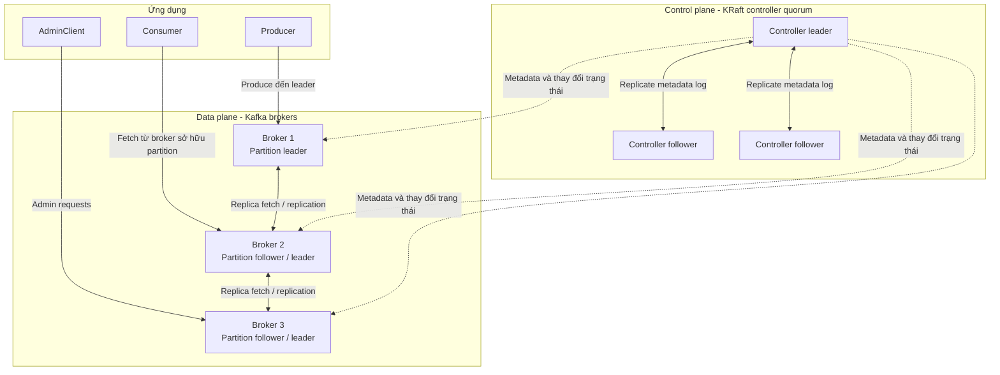
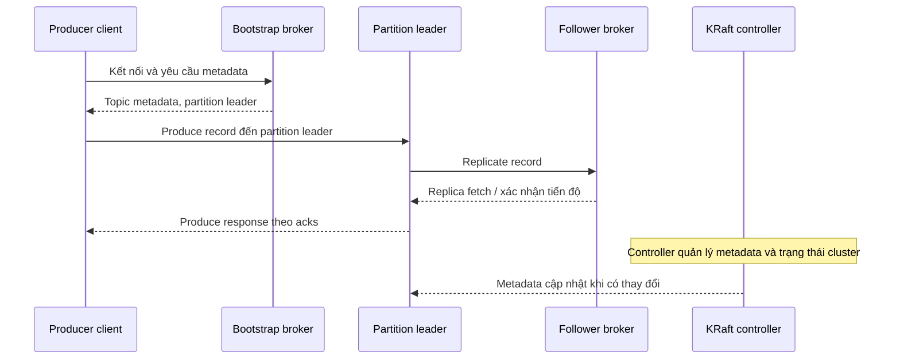
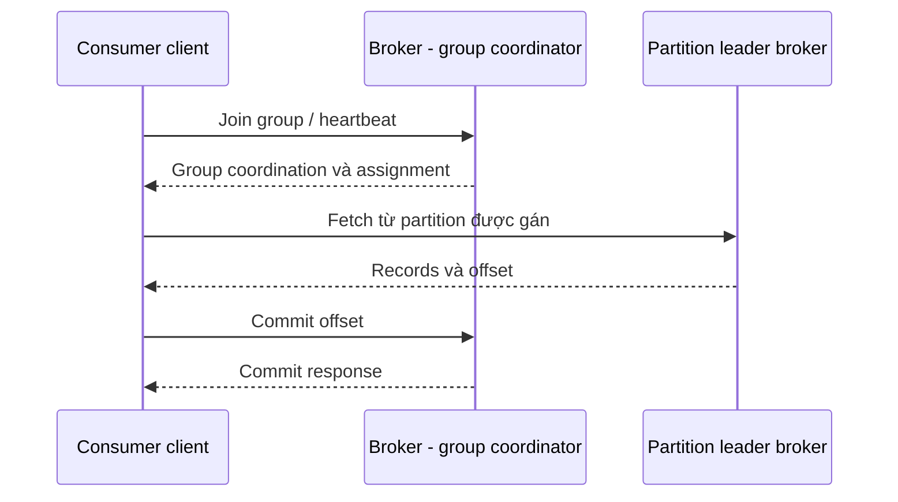

# Trách nhiệm của broker, controller và client

Một Kafka cluster gồm các tiến trình broker, một quorum controller theo kiến trúc KRaft và các ứng dụng client. Ba thành phần phối hợp để lưu trữ sự kiện, quản lý metadata và cung cấp giao diện gửi/đọc dữ liệu. Hiểu ranh giới trách nhiệm giúp xác định đúng nơi cần kiểm tra khi producer gửi lỗi, consumer mất partition hoặc cluster không ổn định.

Có thể hình dung Kafka thành hai mặt phẳng hoạt động:

- **Data plane:** broker nhận, lưu, sao chép và phục vụ các bản ghi trong topic partition.
- **Control plane:** controller quản lý metadata của cluster, trạng thái broker, replica và lãnh đạo partition.
- **Client:** ứng dụng producer, consumer hoặc AdminClient sử dụng metadata để gửi yêu cầu trực tiếp đến broker phù hợp.

Trong Kafka hiện đại dùng KRaft, controller quorum quản lý metadata ngay trong Kafka bằng cơ chế consensus dựa trên Raft. ZooKeeper không còn là thành phần điều phối bắt buộc của kiến trúc này.

## 1. Nhìn tổng thể kiến trúc

Một cluster thường có nhiều broker để lưu trữ partition và có một quorum controller để duy trì metadata. Ứng dụng kết nối đến cluster thông qua Kafka client library.



Sơ đồ mang tính khái niệm: một broker có thể đồng thời là leader của partition này và follower của partition khác. Controller leader điều phối metadata; controller không đứng giữa để chuyển tiếp từng bản ghi producer gửi hoặc consumer đọc.

## 2. Broker: lưu trữ và phục vụ dữ liệu

Broker là một Kafka server tham gia cluster. Mỗi broker có định danh node riêng, lưu dữ liệu partition được phân công và phục vụ các request từ client hoặc broker khác.

### 2.1. Quản lý partition và log

Topic được chia thành các partition. Một partition là log chỉ ghi nối tiếp, trong đó mỗi bản ghi có offset theo thứ tự trong partition đó. Broker có thể lưu nhiều partition của nhiều topic trên ổ đĩa.

Với mỗi partition replica:

- **Leader replica** nhận các request ghi từ producer và thường phục vụ các request đọc.
- **Follower replica** lấy dữ liệu từ leader để duy trì bản sao.
- **ISR (In-Sync Replicas)** là tập replica đang theo kịp leader theo tiêu chí Kafka sử dụng tại thời điểm đó.

Ví dụ, topic `orders` có partition 0 với replication factor bằng 3. Ba replica có thể nằm trên ba broker khác nhau. Nếu broker 1 giữ leader, producer gửi bản ghi của partition 0 đến broker 1; các follower trên broker khác sao chép dữ liệu từ leader.

Broker leader gán offset cho bản ghi trong partition. Offset không phải số thứ tự toàn topic và không được dùng để so sánh thứ tự giữa hai partition khác nhau.

### 2.2. Nhận ghi và phục vụ đọc

Khi nhận Produce request, broker leader kiểm tra request, append bản ghi vào log và xử lý yêu cầu xác nhận theo cấu hình producer cùng trạng thái replication. Với `acks=all`, phản hồi được gửi sau khi các điều kiện xác nhận theo ISR và `min.insync.replicas` được đáp ứng. Cấu hình này giúp kiểm soát độ bền dữ liệu nhưng có thể làm request thất bại khi số ISR thấp hơn ngưỡng yêu cầu.

Khi nhận Fetch request, broker phục vụ dữ liệu từ partition mà client cần đọc. Consumer thường fetch từ broker đang là leader của partition; tùy phiên bản và cấu hình, Kafka cũng hỗ trợ các cơ chế đọc từ replica phù hợp.

Broker còn chịu trách nhiệm:

- Ghi và đọc các segment log, index và metadata cục bộ của partition.
- Áp dụng retention hoặc log compaction theo cấu hình topic.
- Theo dõi replica và trao đổi dữ liệu replication với broker khác.
- Áp dụng xác thực, phân quyền, quota và giới hạn request theo cấu hình.
- Thực hiện một số vai trò điều phối gắn với partition, chẳng hạn group coordinator hoặc transaction coordinator.

### 2.3. Broker leader không phải controller

Hai khái niệm leader này có phạm vi khác nhau:

| Khái niệm | Phạm vi | Trách nhiệm |
|---|---|---|
| Controller leader | Toàn cluster metadata quorum | Điều phối metadata, broker và trạng thái partition |
| Partition leader | Một partition cụ thể | Nhận ghi và phục vụ dữ liệu cho partition đó |

Một cluster có một controller leader tại một thời điểm trong quorum KRaft, nhưng có nhiều partition leader cùng lúc. Partition leader có thể nằm trên các broker khác nhau để phân tán tải.

Khi một broker gặp sự cố, controller xử lý thay đổi metadata và quá trình chọn leader mới theo trạng thái replica. Broker được chọn làm partition leader sau đó tiếp tục phục vụ request dữ liệu. Controller không tự trở thành nơi lưu trữ hoặc xử lý toàn bộ dữ liệu của partition.

## 3. Controller: quản lý metadata và trạng thái cluster

Controller đảm nhiệm control plane. Trong kiến trúc KRaft, các node có vai trò controller tạo thành một quorum và duy trì metadata log bằng cơ chế Raft.

### 3.1. Metadata gồm những gì?

Metadata mô tả cấu trúc và trạng thái của cluster, ví dụ:

- Broker nào đang tham gia cluster và thông tin định danh của chúng.
- Topic nào tồn tại và topic có những partition nào.
- Replica của từng partition được đặt trên broker nào.
- Broker nào hiện là leader của mỗi partition và replica nào thuộc ISR.
- Cấu hình topic, cấu hình cluster và các metadata quản trị liên quan.

Metadata khác với dữ liệu sự kiện. Một bản ghi `OrderCreated` thuộc log của partition trên broker; thông tin partition 0 thuộc topic `orders` và replica của nó nằm trên broker nào là metadata do controller quản lý.

### 3.2. KRaft controller quorum

Trong KRaft, các controller duy trì một bản ghi metadata có thứ tự. Một controller được bầu làm leader của quorum; các controller còn lại theo dõi và sao chép metadata log. Thay đổi metadata được ghi nhận theo cơ chế quorum trước khi được xem là đã cam kết.

Quorum cần đa số node để tiếp tục chấp nhận thay đổi metadata. Ví dụ:

| Số controller voter | Số phiếu tối thiểu để có đa số | Số node có thể mất mà vẫn còn đa số |
|---:|---:|---:|
| 1 | 1 | 0 |
| 3 | 2 | 1 |
| 5 | 3 | 2 |

Bảng trên giả định các voter hoạt động độc lập và không có vấn đề mạng phân vùng phức tạp. Mất đa số controller có thể làm cluster không thể cam kết thay đổi metadata mới, dù các broker vẫn đang chạy và một phần dữ liệu đã lưu vẫn có thể được phục vụ. Khả năng phục vụ cụ thể còn phụ thuộc trạng thái cluster, broker, partition và request.

Số controller voter không phải replication factor của topic. Controller quorum bảo vệ metadata; replication factor bảo vệ các bản sao dữ liệu của từng partition. Hai cơ chế có mục tiêu và cách vận hành riêng.

### 3.3. Các công việc chính của controller

Controller phối hợp những thay đổi ở cấp cluster, bao gồm:

1. Tiếp nhận và quản lý thông tin đăng ký, trạng thái của broker.
2. Quản lý metadata topic, partition, replica assignment và cấu hình.
3. Theo dõi trạng thái partition, cập nhật leader và ISR theo thông tin broker báo về.
4. Điều phối chuyển đổi partition leader khi broker dừng, phục hồi hoặc cần reassignment.
5. Phân phối thay đổi metadata để broker và client có thể cập nhật cách định tuyến request.

Khi một broker mất kết nối, controller phát hiện trạng thái broker thay đổi theo cơ chế heartbeat và timeout của cluster. Tùy replica còn sẵn sàng và chính sách cấu hình, controller điều phối leader election hoặc cập nhật trạng thái partition. Broker mới làm leader sẽ tiếp tục nhận ghi cho partition sau khi metadata được cập nhật.

Controller không đọc từng sự kiện để quyết định nghiệp vụ, không chạy logic xử lý đơn hàng và không làm thay consumer.

## 4. Client: ứng dụng sử dụng Kafka

Client là thành phần nằm ngoài Kafka server, thường dùng Kafka client library để giao tiếp với cluster. Ba nhóm phổ biến là producer, consumer và AdminClient.

### 4.1. Producer client

Producer chịu trách nhiệm chuyển dữ liệu ứng dụng thành Kafka record và gửi đến topic. Các việc chính gồm:

- Serialize key và value thành byte.
- Chọn partition theo partitioner, key hoặc chỉ định của ứng dụng.
- Gom bản ghi thành batch và có thể nén trước khi gửi.
- Kết nối đến broker leader của partition đích.
- Xử lý retry, timeout, metadata refresh và phản hồi lỗi.
- Quản lý idempotence hoặc transaction nếu ứng dụng bật các cơ chế tương ứng.

Producer không gửi mọi record đến controller để controller chọn broker. Client lấy metadata của topic, xác định partition đích rồi gửi request trực tiếp đến broker đang là leader của partition đó.

Ví dụ Java producer:

```java
Properties props = new Properties();
props.put(ProducerConfig.BOOTSTRAP_SERVERS_CONFIG, "localhost:9092");
props.put(ProducerConfig.KEY_SERIALIZER_CLASS_CONFIG,
        StringSerializer.class.getName());
props.put(ProducerConfig.VALUE_SERIALIZER_CLASS_CONFIG,
        StringSerializer.class.getName());
props.put(ProducerConfig.ACKS_CONFIG, "all");
props.put(ProducerConfig.ENABLE_IDEMPOTENCE_CONFIG, true);

try (KafkaProducer<String, String> producer =
        new KafkaProducer<>(props)) {
    ProducerRecord<String, String> record =
            new ProducerRecord<>("orders", "order-1001", "OrderCreated");
    producer.send(record, (metadata, exception) -> {
        if (exception != null) {
            exception.printStackTrace();
            return;
        }
        System.out.printf(
                "topic=%s partition=%d offset=%d%n",
                metadata.topic(),
                metadata.partition(),
                metadata.offset()
        );
    });
}
```

Đoạn mã minh họa cách producer gửi record có key đến topic và nhận metadata kết quả. Trong ứng dụng thực tế, cần quản lý lỗi, timeout, callback và vòng đời producer phù hợp với framework đang dùng.

### 4.2. Consumer client

Consumer đọc bản ghi từ partition và chuyển dữ liệu thành đối tượng ứng dụng. Consumer chịu trách nhiệm:

- Lấy metadata và gửi Fetch request đến broker phù hợp.
- Gọi `poll()` để nhận record.
- Deserialize key và value.
- Theo dõi vị trí đọc hiện tại và commit offset theo chính sách.
- Tham gia consumer group, gửi heartbeat và xử lý rebalance.
- Thực hiện logic nghiệp vụ của ứng dụng.

Trong consumer group, partition được phân phối cho các consumer thành viên theo assignment protocol. Consumer xử lý dữ liệu của partition được giao và commit offset vào Kafka khi phù hợp. Group coordinator chạy trên một broker quản lý trạng thái thành viên và offset của group; đây là vai trò ở cấp broker, không phải controller leader của KRaft.

Ví dụ Java consumer rút gọn:

```java
Properties props = new Properties();
props.put(ConsumerConfig.BOOTSTRAP_SERVERS_CONFIG, "localhost:9092");
props.put(ConsumerConfig.GROUP_ID_CONFIG, "orders-service");
props.put(ConsumerConfig.KEY_DESERIALIZER_CLASS_CONFIG,
        StringDeserializer.class.getName());
props.put(ConsumerConfig.VALUE_DESERIALIZER_CLASS_CONFIG,
        StringDeserializer.class.getName());
props.put(ConsumerConfig.ENABLE_AUTO_COMMIT_CONFIG, false);
props.put(ConsumerConfig.AUTO_OFFSET_RESET_CONFIG, "earliest");

try (KafkaConsumer<String, String> consumer =
        new KafkaConsumer<>(props)) {
    consumer.subscribe(List.of("orders"));

    while (true) {
        ConsumerRecords<String, String> records =
                consumer.poll(Duration.ofMillis(500));

        for (ConsumerRecord<String, String> record : records) {
            processOrder(record.value());
        }

        consumer.commitSync();
    }
}
```

Đây là ví dụ minh họa luồng đọc và commit đồng bộ. Nếu `processOrder()` thất bại, ứng dụng cần xác định rõ cách xử lý lỗi trước khi commit. Trong production, cần cân nhắc retry, dead-letter topic, idempotency và thời gian xử lý giữa các lần poll.

### 4.3. AdminClient

AdminClient thực hiện thao tác quản trị thông qua Kafka protocol, ví dụ:

- Tạo, xóa hoặc mô tả topic.
- Đọc cấu hình topic và cluster.
- Kiểm tra consumer group và offset.
- Yêu cầu thay đổi partition hoặc replica assignment khi được hỗ trợ.
- Thực hiện các thao tác quản trị khác theo phiên bản broker và quyền được cấp.

AdminClient là client library trong ứng dụng hoặc công cụ quản trị. Nó gửi request đến broker; broker xử lý hoặc chuyển tiếp yêu cầu điều khiển phù hợp đến controller. AdminClient không phải một node controller và không tự duy trì metadata quorum.

## 5. Client kết nối đến broker như thế nào?

### 5.1. Bootstrap chỉ là điểm vào ban đầu

Cấu hình `bootstrap.servers` cung cấp một hoặc nhiều địa chỉ broker để client bắt đầu kết nối. Client không cần biết trước toàn bộ broker và leader của từng partition.

Luồng kết nối phổ biến:

1. Client kết nối đến một broker có trong `bootstrap.servers`.
2. Client yêu cầu metadata về cluster, topic và partition cần dùng.
3. Broker trả metadata cần thiết, gồm thông tin leader và địa chỉ broker được quảng bá.
4. Producer hoặc consumer kết nối trực tiếp đến broker phục vụ partition tương ứng.
5. Khi metadata thay đổi, client cập nhật metadata và định tuyến lại request.

Vì vậy, broker được dùng để bootstrap không nhất thiết là broker nhận tất cả Produce hoặc Fetch request. Nếu broker bootstrap ngừng hoạt động sau khi client đã lấy metadata, client có thể tiếp tục làm việc với các broker khác; khi cần refresh metadata, client dùng các địa chỉ còn truy cập được.

### 5.2. Listener và địa chỉ quảng bá

Broker có thể mở nhiều listener cho các mạng hoặc mục đích khác nhau. `advertised.listeners` xác định địa chỉ mà broker công bố cho client sau khi client lấy metadata. Địa chỉ này phải có thể truy cập từ mạng của client tương ứng.

Một lỗi thường gặp là client kết nối được đến bootstrap broker nhưng sau đó không kết nối được leader broker vì metadata trả về hostname hoặc port không thể định tuyến từ môi trường client. Khi gặp lỗi kiểu này, kiểm tra:

- Địa chỉ và port trong `bootstrap.servers`.
- Listener mà broker đang mở.
- Địa chỉ `advertised.listeners` được trả về.
- DNS, firewall, NAT, container network và TLS hostname verification.
- Client đang sử dụng listener nội bộ hay listener bên ngoài.

Trong KRaft, listener dành cho controller quorum là kênh điều phối giữa các controller và broker theo cấu hình cluster. Ứng dụng producer/consumer thông thường kết nối qua listener dành cho client hoặc inter-broker theo thiết kế mạng; không dùng controller listener làm bootstrap endpoint cho ứng dụng.

## 6. Luồng phối hợp khi producer gửi một bản ghi

Giả sử producer gửi một sự kiện `OrderCreated` đến topic `orders` với key `order-1001`:



Trình tự thực tế của replication và phản hồi phụ thuộc `acks`, ISR, `min.insync.replicas`, phiên bản và trạng thái cluster. Sơ đồ nhấn mạnh vai trò: producer chọn đích dựa trên metadata, broker leader xử lý record, follower sao chép, còn controller duy trì trạng thái cluster.

## 7. Luồng phối hợp khi consumer đọc dữ liệu

Với consumer group, consumer đầu tiên kết nối đến broker để lấy metadata và tham gia group. Group coordinator quản lý thành viên và quá trình rebalance. Sau khi nhận partition assignment, consumer fetch record từ broker sở hữu partition tương ứng.



Group coordinator và controller có trách nhiệm khác nhau:

- Group coordinator là vai trò do một broker đảm nhiệm cho một consumer group; nó theo dõi thành viên, điều phối rebalance và lưu offset group.
- KRaft controller quản lý metadata ở cấp cluster, gồm trạng thái broker, topic và partition.
- Consumer client thực hiện xử lý nghiệp vụ, poll record và quyết định thời điểm commit theo cấu hình ứng dụng.

Không nên đồng nhất group coordinator với controller leader chỉ vì cả hai đều có chữ “coordinator” hoặc “controller” trong tên vai trò.

## 8. Broker và controller được triển khai trên node ra sao?

KRaft cho phép node chạy vai trò broker, controller hoặc kết hợp cả hai. Việc chọn mô hình phụ thuộc quy mô cluster, yêu cầu sẵn sàng và cách vận hành.

| Mô hình | Đặc điểm | Phù hợp |
|---|---|---|
| Combined broker/controller | Một node vừa phục vụ dữ liệu vừa tham gia controller quorum | Local development, thử nghiệm hoặc môi trường nhỏ |
| Dedicated broker | Node tập trung lưu trữ partition và phục vụ client | Cluster cần mở rộng năng lực data plane độc lập |
| Dedicated controller | Node tập trung duy trì metadata quorum | Môi trường production cần cô lập tải điều phối và dữ liệu |

Trong production, thường nên bố trí một nhóm controller riêng, thường là 3 hoặc 5 voter, và các broker riêng. Cách này giúp tải đọc/ghi dữ liệu không cạnh tranh trực tiếp tài nguyên với controller quorum. Tuy nhiên, thiết kế thực tế còn phụ thuộc yêu cầu độ sẵn sàng, vùng lỗi, tài nguyên và khuyến nghị của phiên bản Kafka.

Với mô hình kết hợp, một node vừa lưu partition vừa tham gia quorum. Nó thuận tiện cho máy cá nhân và lab, nhưng khi node bị quá tải hoặc dừng, cả data plane và control plane đều có thể chịu ảnh hưởng.

Khi cấu hình KRaft, mỗi node cần định danh duy nhất và khai báo role phù hợp với mô hình triển khai. Các node controller phải thống nhất cấu hình quorum và thông tin kết nối theo phiên bản Kafka. Không trộn cấu hình ZooKeeper mode với cấu hình KRaft trong cùng một cluster.

## 9. Điều gì xảy ra khi một thành phần gặp sự cố?

| Sự cố | Thành phần chịu trách nhiệm chính | Ảnh hưởng có thể thấy |
|---|---|---|
| Một broker dừng | Controller theo dõi trạng thái và điều phối metadata; broker khác tiếp tục phục vụ replica còn lại | Partition leader có thể được bầu lại; client refresh metadata và retry |
| Partition leader dừng | Controller điều phối leader election; follower được chọn có thể tiếp quản | Produce/Fetch tạm gián đoạn trong thời gian chuyển đổi |
| Một follower không theo kịp | Broker replication và controller metadata phối hợp cập nhật trạng thái ISR | ISR giảm; request yêu cầu `acks=all` có thể bị từ chối nếu không đạt `min.insync.replicas` |
| Controller leader dừng nhưng quorum còn đa số | Controller quorum bầu leader mới | Control plane có thể gián đoạn ngắn trong lúc bầu; broker đang chạy có thể tiếp tục một số hoạt động dữ liệu |
| Mất đa số controller voter | KRaft quorum không thể cam kết metadata mới | Thao tác metadata và một số hoạt động cluster bị hạn chế; cần khôi phục quorum |
| Producer mất kết nối broker | Producer client và broker | Client retry, refresh metadata hoặc trả lỗi sau timeout |
| Consumer rời group | Group coordinator và consumer group | Rebalance và partition assignment thay đổi |

Cần phân biệt khả năng phục vụ dữ liệu với khả năng thay đổi metadata. Một broker vẫn có thể đang chạy và lưu dữ liệu khi controller quorum gặp sự cố, nhưng cluster không thể thực hiện đầy đủ mọi thao tác quản trị hoặc phản ứng với thay đổi trạng thái mới.

Khả năng đọc/ghi trong từng tình huống phụ thuộc trạng thái partition leader, ISR, cấu hình acknowledgment, phiên bản Kafka và thời điểm xảy ra sự cố. Không nên suy ra rằng mất controller quorum đồng nghĩa mọi request dữ liệu lập tức dừng, hoặc broker còn chạy đồng nghĩa cluster vẫn có thể phục hồi mọi partition.

## 10. Ma trận phân công trách nhiệm

| Công việc | Broker | Controller | Client |
|---|---|---|---|
| Lưu log partition | Chính | Không lưu user record như broker | Không |
| Nhận Produce/Fetch request | Chính | Không đứng trong data path thông thường | Gửi request |
| Sao chép partition replica | Leader/follower thực hiện | Quản lý metadata và trạng thái liên quan | Không |
| Quản lý metadata cluster | Nhận và áp dụng metadata | Chính | Đọc metadata để định tuyến |
| Quản lý partition leader | Phục vụ khi đang giữ leader | Điều phối trạng thái và thay đổi leader | Cập nhật định tuyến |
| Consumer group | Broker có thể đảm nhiệm group coordinator | Không phải group coordinator | Tham gia group và xử lý record |
| Serialize/deserialize record | Lưu và chuyển byte | Không | Chính |
| Logic nghiệp vụ | Không | Không | Chính |
| Tạo topic hoặc xem cấu hình | Xử lý Admin request | Thực hiện thay đổi metadata phù hợp | AdminClient gửi yêu cầu |

## 11. Những nhầm lẫn cần tránh

**Nhầm controller leader với partition leader.** Controller leader điều phối metadata cho toàn cluster; partition leader phục vụ dữ liệu của một partition. Một cluster có một controller leader nhưng nhiều partition leader.

**Cho rằng client luôn gửi record đến bootstrap broker.** Bootstrap broker chỉ là điểm vào để lấy metadata. Producer gửi record đến broker leader của partition đích.

**Cho rằng controller xử lý từng bản ghi.** Controller xử lý metadata và trạng thái cluster. Broker mới là nơi nhận, lưu, sao chép và phục vụ record.

**Cho rằng group coordinator là KRaft controller.** Group coordinator là vai trò ở cấp broker cho consumer group; KRaft controller quản lý metadata quorum.

**Cho rằng replication factor và số controller voter là một.** Replication factor xác định số replica của partition; controller voter xác định quy mô quorum metadata.

**Cho rằng client không cần refresh metadata.** Khi broker hoặc partition leader thay đổi, metadata cũ có thể không còn đúng. Client cần refresh và định tuyến lại request, thường kết hợp retry theo chính sách của client library.

## 12. Kết luận

Khi phân tích một Kafka cluster, hãy xác định thành phần nào đang chịu trách nhiệm cho vấn đề:

- Lỗi ghi/đọc record, disk, replica hoặc request latency: bắt đầu từ broker và partition liên quan.
- Thay đổi topic, broker membership, leader election hoặc metadata quorum: xem controller và KRaft.
- Lỗi serialize, partitioning, retry, poll, commit hoặc xử lý nghiệp vụ: kiểm tra producer/consumer client.
- Lỗi tham gia group, rebalance hoặc commit offset: xem cả consumer client và broker đang đảm nhiệm group coordinator.

Broker cung cấp data plane, controller duy trì control plane và client kết nối hai phần đó với ứng dụng. Ranh giới này là nền tảng để triển khai, giám sát và xử lý sự cố Kafka một cách có hệ thống.

