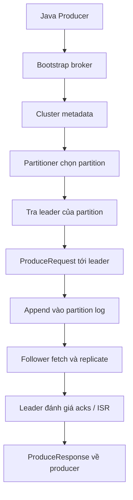
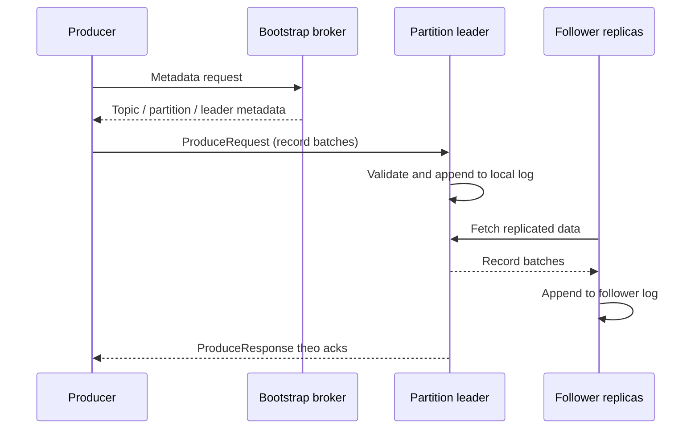

# Luồng ghi từ producer đến leader của partition

Khi một ứng dụng Java gửi record vào Apache Kafka, producer không gửi dữ liệu tới một broker bất kỳ rồi yêu cầu cụm tự tìm nơi lưu. Producer cần xác định partition đích, tìm broker đang giữ vai trò leader của partition đó, sau đó gửi một ProduceRequest tới leader. Leader kiểm tra request và ghi record vào log cục bộ; các follower sao chép dữ liệu từ leader theo cơ chế replication. Producer nhận kết quả dựa trên cấu hình xác nhận `acks`.

Luồng này là nền tảng để hiểu kiến trúc cụm Kafka: metadata cho biết partition nằm ở đâu, leader chịu trách nhiệm nhận ghi, follower duy trì replica, còn producer kiểm soát mức chờ xác nhận và cách xử lý lỗi. Bài học thuộc chương **Kiến trúc cụm** của module **KAFKA**, trong đó người học xây dựng hệ thống event streaming với topic, partition, producer, consumer group, replication và KRaft; phần này tập trung vào đường đi của một record từ ứng dụng đến leader.

Sau bài này, bạn có thể:

- Mô tả vai trò của bootstrap server và metadata trong việc tìm leader.
- Giải thích cách producer chọn partition và gom record thành batch.
- Theo dõi request ghi từ producer đến broker leader.
- Phân biệt `acks=0`, `acks=1` và `acks=all`.
- Giải thích cách ISR, replication và idempotent producer ảnh hưởng tới độ tin cậy của lần ghi.
- Chẩn đoán các lỗi phổ biến như metadata cũ, leader đổi, replica thiếu và timeout.

## 1. Các thành phần tham gia vào một lần ghi

Một lần ghi thông thường có các thành phần sau:

| Thành phần | Trách nhiệm trong luồng ghi |
|---|---|
| Producer application | Tạo record, chọn topic/key, gửi record và xử lý kết quả hoặc lỗi |
| Bootstrap broker | Broker đầu tiên producer kết nối để lấy metadata; không nhất thiết là broker sẽ nhận record |
| Cluster metadata | Mô tả broker, topic, partition và broker leader hiện tại của từng partition |
| Partitioner | Xác định record thuộc partition nào trong topic |
| Broker leader | Nhận ProduceRequest và append record vào log của partition đang lãnh đạo |
| Follower replicas | Sao chép dữ liệu từ leader để duy trì các bản replica |
| ISR (in-sync replicas) | Tập replica đang theo kịp leader theo tiêu chí của Kafka và được tính trong cơ chế xác nhận |

Một topic có nhiều partition, và mỗi partition tại một thời điểm có một leader. Các partition khác nhau có thể có leader trên các broker khác nhau. Vì thế, producer có thể gửi các batch tới nhiều broker trong cùng một khoảng thời gian, tùy partition đích của record.



## 2. Bước 1: Producer kết nối bootstrap broker và lấy metadata

### 2.1. Bootstrap server chỉ là điểm vào cụm

Producer được cấu hình một hoặc nhiều địa chỉ trong `bootstrap.servers`, ví dụ:

```properties
bootstrap.servers=broker-1:9092,broker-2:9092,broker-3:9092
```

Các địa chỉ này giúp producer thiết lập kết nối ban đầu. Sau khi kết nối, producer gửi request metadata để biết các broker và partition leader trong cụm. Producer không bị ràng buộc phải gửi tất cả record tới broker đầu tiên trong danh sách.

Nên cấu hình nhiều bootstrap address để ứng dụng còn cơ hội lấy metadata khi một broker ban đầu không khả dụng. Danh sách bootstrap không phải danh sách leader cố định; leader có thể thay đổi do rebalance partition, broker dừng hoặc quá trình phục hồi cụm.

### 2.2. Metadata cho biết leader hiện tại

Metadata của topic cung cấp thông tin như:

- Tên topic và các partition thuộc topic.
- ID broker đang là leader của từng partition.
- Các replica được phân công cho partition.
- Các replica đang nằm trong ISR.
- Thông tin broker cần thiết để client thiết lập kết nối.

Ví dụ một topic `orders` có ba partition:

| Partition | Leader | Replicas | ISR |
|---|---:|---|---|
| 0 | broker 1 | 1, 2, 3 | 1, 2, 3 |
| 1 | broker 2 | 2, 3, 1 | 2, 3, 1 |
| 2 | broker 3 | 3, 1, 2 | 3, 1, 2 |

Producer dùng metadata để gửi batch của partition 0 tới broker 1, partition 1 tới broker 2 và partition 2 tới broker 3. Nếu producer có metadata cũ, nó có thể gửi nhầm tới broker đã không còn là leader. Broker trả về lỗi như `NOT_LEADER_OR_FOLLOWER`; client sẽ làm mới metadata và thử lại nếu lỗi có thể phục hồi.

### 2.3. Metadata được cache và làm mới

Producer không cần hỏi metadata cho mỗi record. Kafka client lưu cache metadata và làm mới khi cần, chẳng hạn khi phát hiện topic/partition mới, broker không còn là leader hoặc metadata đã quá hạn theo cấu hình. Điều này giảm request điều khiển và giúp producer gửi dữ liệu nhanh hơn.

Nếu topic chưa tồn tại, hành vi phụ thuộc cấu hình broker và client. Một số môi trường cho phép auto topic creation, nhưng production thường nên quản lý topic chủ động để kiểm soát partition count, replication factor và cấu hình retention. Không nên dựa vào việc producer gửi record để tự tạo topic ngoài ý muốn.

## 3. Bước 2: Producer chọn partition đích

Sau khi biết topic, producer cần quyết định record thuộc partition nào. Việc này được thực hiện ở phía client bằng partitioner, trừ khi ứng dụng chỉ định partition rõ ràng trong record.

### 3.1. Record có key

Nếu record có key, partitioner mặc định thường dùng phép băm key để định tuyến ổn định tới một partition trong cùng cấu hình topic/partitioner. Ví dụ, dùng `orderId` làm key giúp các sự kiện của cùng một đơn hàng thường đi vào cùng partition:

```java
ProducerRecord<String, String> record = new ProducerRecord<>(
    "orders",
    "order-9001",
    "{\"eventType\":\"OrderCreated\",\"orderId\":\"order-9001\"}"
);
```

Điều này hữu ích khi cần ordering theo thực thể nghiệp vụ. Tuy nhiên, key không tạo ra thứ tự toàn cục cho topic. Nó chỉ giúp các record cùng key được định tuyến về cùng partition theo partitioning strategy đang dùng. Nếu số partition hoặc thuật toán partitioner thay đổi, cần đánh giá ảnh hưởng tới mapping key-partition.

### 3.2. Record không có key

Nếu không có key và không chỉ định partition, producer dùng chiến lược phân phối không-key của partitioner. Các Kafka client hiện đại sử dụng cơ chế sticky partitioning để gom record vào một partition trong một khoảng thời gian nhằm tạo batch hiệu quả, sau đó chuyển sang partition khác. Cấu hình và chi tiết có thể khác theo phiên bản client.

Không nên giả định record không key sẽ luân phiên đều từng record giữa mọi partition. Nếu cần phân phối theo một quy tắc nghiệp vụ, hãy cung cấp key hoặc triển khai partitioner tùy chỉnh và kiểm thử phân phối tải.

### 3.3. Chọn partition ảnh hưởng ordering và throughput

Mỗi partition là một log có thứ tự riêng. Nếu hai record cần được xử lý theo thứ tự, chúng phải đi cùng partition và producer phải gửi chúng theo thứ tự mong muốn. Ngược lại, nhiều partition cho phép broker và consumer xử lý song song.

Một key có tần suất rất cao có thể làm partition tương ứng nóng (hot partition), trong khi partition khác ít dữ liệu. Chọn key vì vậy cần cân bằng giữa ordering theo nghiệp vụ và phân phối tải. Nếu một khách hàng hoặc một tài khoản tạo phần lớn lưu lượng, dùng trực tiếp ID đó làm key có thể khiến một partition trở thành nút thắt.

## 4. Bước 3: Gom record thành batch và gửi ProduceRequest

### 4.1. Record được gom theo partition

Producer thường không gửi một request riêng cho từng record. Client lưu record trong bộ đệm, gom các record cùng partition thành batch rồi gửi tới broker leader tương ứng. Việc gom batch giảm số request mạng, giảm overhead và giúp tận dụng compression.

Một số cấu hình ảnh hưởng tới batching:

| Cấu hình | Tác động |
|---|---|
| `batch.size` | Giới hạn kích thước batch mục tiêu theo partition; batch không nhất thiết phải đầy mới được gửi |
| `linger.ms` | Thời gian producer có thể chờ thêm record để batch lớn hơn trước khi gửi |
| `buffer.memory` | Dung lượng bộ đệm producer dùng để giữ record đang chờ gửi |
| `compression.type` | Chọn codec nén batch, ví dụ `gzip`, `snappy`, `lz4` hoặc `zstd` tùy client/broker hỗ trợ |
| `max.request.size` | Giới hạn kích thước request mà producer có thể gửi; cần đối chiếu giới hạn broker/topic |

Batch lớn có thể tăng throughput và hiệu quả nén, nhưng chờ gom batch cũng có thể tăng latency. Cấu hình cần dựa trên mục tiêu throughput, độ trễ và kích thước payload thực tế.

### 4.2. Producer gửi tới leader, không gửi trực tiếp tới mọi replica

Sau khi partitioner xác định partition và metadata chỉ ra leader, producer gửi ProduceRequest tới broker leader. Request có thể chứa nhiều batch cho các partition mà broker đó đang lãnh đạo. Follower không nhận bản ghi trực tiếp từ producer trong luồng ghi thông thường; follower sao chép dữ liệu bằng cách fetch từ leader.



Sơ đồ cho thấy follower chủ động fetch từ leader. Vì thế, tốc độ follower bắt kịp leader và trạng thái ISR ảnh hưởng trực tiếp tới thời điểm leader có thể hoàn tất xác nhận theo `acks=all`.

## 5. Bước 4: Leader xác thực và append record

Khi nhận ProduceRequest, broker leader kiểm tra request trước khi ghi. Các kiểm tra có thể bao gồm:

- Topic và partition tồn tại, broker hiện tại vẫn là leader.
- Client được phép ghi vào topic theo authorization/ACL.
- Request và record batch đáp ứng giới hạn kích thước, định dạng và cấu hình liên quan.
- Trạng thái partition và replica cho phép chấp nhận ghi theo yêu cầu xác nhận.

Nếu broker nhận request cho partition mà nó không còn lãnh đạo, broker trả lỗi để producer làm mới metadata. Nếu topic không tồn tại, client thiếu quyền hoặc record vượt giới hạn, broker trả lỗi tương ứng; không phải mọi lỗi đều có thể giải quyết bằng retry.

Khi hợp lệ, leader append record batch vào log cục bộ của partition. Kafka gán offset cho các record trong log. Offset có ý nghĩa trong phạm vi partition, không phải số thứ tự toàn cụm. Append vào log là bước ghi chính của leader; sau đó replication theo dõi để các follower cập nhật bản sao.

Việc append không đồng nghĩa record đã được ghi vật lý xuống thiết bị lưu trữ theo cách đồng bộ cho từng request. Kafka dựa trên cơ chế log, page cache, flush và replication; mức bảo vệ dữ liệu thực tế còn phụ thuộc cấu hình broker, hệ điều hành, phần cứng và chính sách xác nhận. Khi thiết kế độ bền, không nên đồng nhất một phản hồi producer thành công với cam kết rằng mọi bản sao đã được flush vật lý xuống đĩa.

## 6. Bước 5: Follower sao chép dữ liệu và leader theo dõi ISR

### 6.1. Follower fetch từ leader

Mỗi partition có thể có nhiều replica. Một replica làm leader; các replica còn lại làm follower. Follower gửi FetchRequest tới leader để lấy các record mới, sau đó append các batch vào log cục bộ của mình.

Mỗi replica theo dõi vị trí log riêng, thường được biểu diễn bằng Log End Offset (LEO). LEO là vị trí tiếp theo sau record cuối cùng đã được append trong log replica đó. Do follower có thể chậm hơn leader, LEO của các replica không nhất thiết bằng nhau ở mọi thời điểm.

### 6.2. ISR là tập replica đang theo kịp

ISR (in-sync replicas) là tập replica đủ điều kiện được xem là đang theo kịp leader theo cơ chế Kafka. Nếu follower tụt lại quá xa hoặc mất kết nối vượt ngưỡng cấu hình, nó có thể bị loại khỏi ISR. Khi bắt kịp, follower có thể được đưa trở lại ISR.

Leader theo dõi tiến độ replication và cập nhật High Watermark (HW), tức ranh giới của các record đã được replicate đầy đủ theo quy tắc ISR. Consumer thông thường chỉ đọc tới vùng dữ liệu đã được commit theo HW; cấu hình isolation level và transaction còn ảnh hưởng record nào được hiển thị cho consumer.

ISR thay đổi theo tình trạng cụm. Vì vậy, replication factor bằng 3 không có nghĩa tại mọi thời điểm cả ba replica đều đang nằm trong ISR. Khi broker lỗi hoặc follower chậm, số ISR có thể giảm.

### 6.3. `min.insync.replicas` đặt ngưỡng tối thiểu cho ghi

`min.insync.replicas` là cấu hình broker/topic quy định số replica tối thiểu phải có trong ISR để broker chấp nhận request ghi yêu cầu `acks=all`. Nếu số ISR thấp hơn ngưỡng, leader từ chối ghi thay vì âm thầm chấp nhận mức bảo vệ thấp hơn.

Ví dụ cụm có replication factor 3 và cấu hình `min.insync.replicas=2`:

| Trạng thái replica | Số ISR | Kết quả ghi với `acks=all` |
|---|---:|---|
| Leader và hai follower đều theo kịp | 3 | Có thể chấp nhận ghi nếu các điều kiện khác hợp lệ |
| Leader và một follower theo kịp, follower còn lại bị loại khỏi ISR | 2 | Có thể chấp nhận ghi; leader chờ các ISR hiện hành xác nhận |
| Chỉ leader còn trong ISR | 1 | Từ chối ghi do thấp hơn `min.insync.replicas=2` |

Ngưỡng cao hơn giúp giảm nguy cơ mất dữ liệu khi broker lỗi nhưng cũng làm hệ thống từ chối ghi trong một số tình huống suy giảm. Đây là lựa chọn giữa availability và mức bảo vệ dữ liệu; cần chọn theo yêu cầu nghiệp vụ và topology thực tế.

## 7. Bước 6: Producer chờ xác nhận theo `acks`

`acks` quyết định producer chờ mức xác nhận nào từ broker. Ba lựa chọn phổ biến:

| Giá trị | Khi nào producer coi request hoàn tất | Đánh đổi |
|---|---|---|
| `0` | Không chờ broker gửi response | Latency thấp nhưng producer không biết broker đã nhận hay ghi record thành công chưa |
| `1` | Chờ leader xác nhận sau khi append vào log cục bộ | Nếu leader lỗi trước khi follower sao chép, record có thể mất khi leader mới được bầu |
| `all` hoặc `-1` | Chờ các replica trong ISR xác nhận theo cơ chế replication | Mức bảo vệ cao hơn; latency và khả năng ghi phụ thuộc tình trạng ISR và `min.insync.replicas` |

`acks=all` không có nghĩa là chờ mọi replica từng được cấu hình trong replication factor bất kể trạng thái. Nó áp dụng cho tập ISR hiện hành. Do đó, muốn đặt ngưỡng tối thiểu về số bản sao đủ điều kiện, cần cấu hình `min.insync.replicas` cùng với `acks=all`.

Ví dụ cấu hình producer ưu tiên độ bền:

```properties
acks=all
enable.idempotence=true
retries=2147483647
max.in.flight.requests.per.connection=5
delivery.timeout.ms=120000
request.timeout.ms=30000
```

Đây là cấu hình minh họa cần được đối chiếu với phiên bản Java client và SLO của hệ thống. Khi bật idempotence, Kafka client áp dụng các ràng buộc tương thích giữa `acks`, `retries` và số request đang bay để giữ đúng ngữ nghĩa; nên để client quản lý các giá trị tương thích hoặc kiểm tra startup validation thay vì override tùy tiện.

## 8. Retry, metadata cũ và idempotent producer

### 8.1. Lỗi có thể retry

Một lần ghi có thể thất bại tạm thời do:

- Producer mất kết nối tới leader.
- Broker đang chuyển leader hoặc đang khởi động lại.
- Metadata trong producer chưa phản ánh leader mới.
- Request timeout dù broker có thể đã append record.
- Follower chậm khiến ISR thay đổi và request phải chờ lâu hơn.

Với lỗi có thể phục hồi, producer có thể retry trong thời hạn giao record. Nếu nhận `NOT_LEADER_OR_FOLLOWER`, client thường làm mới metadata để tìm leader mới. Nếu timeout xảy ra sau khi leader đã append nhưng response bị mất, producer không thể chỉ dựa vào timeout để biết chắc record chưa được ghi.

### 8.2. Retry có thể tạo duplicate

Giả sử producer gửi record, leader append thành công, nhưng response bị mất trên đường về. Producer thấy timeout và gửi lại. Nếu lần gửi lại được xử lý như một record mới, topic có thể chứa hai record cùng nội dung. Đây là lý do retry đơn thuần không tự bảo đảm exactly-once.

Idempotent producer giải quyết trường hợp retry này trong phạm vi Kafka protocol. Broker cấp Producer ID (PID), producer dùng sequence number theo từng partition, và broker nhận diện batch retry trùng để không append lại như một bản ghi mới. Producer idempotent giúp tránh duplicate do retry của một producer session theo cơ chế được Kafka hỗ trợ.

Idempotence không tự khử các event trùng do ứng dụng chủ động gọi `send()` hai lần, hai instance cùng phát một sự kiện nghiệp vụ, hoặc một quy trình outbox phát lại cùng event sau khi khởi động. Ứng dụng vẫn nên có event ID và consumer idempotency khi cần bảo vệ nghiệp vụ.

### 8.3. Phân biệt idempotence và transaction

Idempotent producer bảo vệ việc retry batch ghi của producer. Kafka transaction mở rộng phạm vi để ghi nguyên tử nhiều partition và/hoặc phối hợp việc commit offset trong luồng consume-transform-produce. Tuy nhiên, transaction Kafka không tự bao trùm một database, email server hay API thanh toán bên ngoài. Tác động ngoài Kafka vẫn cần thiết kế transaction hoặc idempotency riêng.

## 9. Ví dụ Java producer

Đoạn mã sau minh họa producer gửi event với key, bật idempotence và chờ kết quả bất đồng bộ:

```java
import org.apache.kafka.clients.producer.KafkaProducer;
import org.apache.kafka.clients.producer.ProducerConfig;
import org.apache.kafka.clients.producer.ProducerRecord;
import org.apache.kafka.clients.producer.RecordMetadata;
import org.apache.kafka.common.serialization.StringSerializer;

import java.util.Properties;
import java.util.concurrent.Future;

public class OrderEventPublisher {
    public static void main(String[] args) throws Exception {
        Properties props = new Properties();
        props.put(ProducerConfig.BOOTSTRAP_SERVERS_CONFIG,
                "localhost:9092");
        props.put(ProducerConfig.KEY_SERIALIZER_CLASS_CONFIG,
                StringSerializer.class.getName());
        props.put(ProducerConfig.VALUE_SERIALIZER_CLASS_CONFIG,
                StringSerializer.class.getName());
        props.put(ProducerConfig.ACKS_CONFIG, "all");
        props.put(ProducerConfig.ENABLE_IDEMPOTENCE_CONFIG, true);
        props.put(ProducerConfig.COMPRESSION_TYPE_CONFIG, "lz4");

        try (KafkaProducer<String, String> producer =
                     new KafkaProducer<>(props)) {
            ProducerRecord<String, String> record =
                    new ProducerRecord<>(
                            "orders",
                            "order-9001",
                            "{\"eventType\":\"OrderCreated\","
                                    + "\"orderId\":\"order-9001\"}"
                    );

            Future<RecordMetadata> result = producer.send(record);
            RecordMetadata metadata = result.get();

            System.out.printf(
                    "topic=%s partition=%d offset=%d%n",
                    metadata.topic(),
                    metadata.partition(),
                    metadata.offset()
            );
        }
    }
}
```

`send()` thường trả về ngay một `Future`; producer gửi batch ở nền. Gọi `get()` trong ví dụ khiến luồng chính chờ kết quả để minh họa cách đọc metadata sau khi broker xác nhận. Trong service có throughput cao, có thể dùng callback hoặc pipeline bất đồng bộ để tránh chặn luồng nghiệp vụ cho từng record.

Kết quả `RecordMetadata` cho biết topic, partition và offset của record. Các thông tin này hữu ích khi debug, trace và đối chiếu với log broker. Không nên ghi payload nhạy cảm vào log ứng dụng chỉ để quan sát producer.

## 10. Kiểm tra leader và trạng thái replica trong cụm

### 10.1. Xem leader, replicas và ISR

Dùng CLI của Kafka để xem phân công partition:

```bash
kafka-topics.sh \
  --bootstrap-server localhost:9092 \
  --describe \
  --topic orders
```

Output thường hiển thị `Partition`, `Leader`, `Replicas` và `Isr`. Đối chiếu các trường này với metadata producer dùng. Nếu leader là `-1`, partition không có leader khả dụng tại thời điểm kiểm tra và producer không thể ghi bình thường vào partition đó.

### 10.2. Quan sát luồng ghi

Khi kiểm tra producer, theo dõi các chỉ số và log sau:

- Record send rate, record error rate và retry rate.
- Request latency, request size và batch size.
- Thời gian chờ buffer và tình trạng buffer exhaustion.
- Produce request queue time và request handler time ở broker.
- Under-replicated partitions, ISR shrink/expand và offline partitions.
- Throttle time nếu broker áp dụng quota.
- Lỗi `NOT_LEADER_OR_FOLLOWER`, `NOT_ENOUGH_REPLICAS`, timeout và authorization.

Consumer lag là chỉ số quan trọng của luồng đọc, nhưng không đủ để kết luận đường ghi khỏe mạnh. Producer có thể gửi chậm hoặc lỗi trong khi consumer lag vẫn thấp do topic ít dữ liệu; vì vậy cần quan sát cả producer và broker.

### 10.3. Phân biệt lỗi phía client và phía cụm

| Dấu hiệu | Nguyên nhân có thể | Hướng kiểm tra |
|---|---|---|
| `NOT_LEADER_OR_FOLLOWER` | Producer dùng metadata cũ hoặc leader vừa thay đổi | Kiểm tra leader hiện tại, broker log và quá trình metadata refresh |
| `NOT_ENOUGH_REPLICAS` | ISR thấp hơn `min.insync.replicas` | Kiểm tra ISR, broker lỗi, mạng replication và cấu hình min ISR |
| `NOT_ENOUGH_REPLICAS_AFTER_APPEND` | ISR suy giảm trong lúc xử lý request ghi | Kiểm tra follower lag, broker restart và trạng thái partition |
| `TimeoutException` | Broker phản hồi chậm, mạng lỗi, batch chờ lâu hoặc response bị mất | Kiểm tra request latency, network, retry và delivery timeout; xác định khả năng record đã được append |
| `RecordTooLargeException` hoặc lỗi kích thước | Record/batch vượt giới hạn producer, broker hoặc topic | Kiểm tra `max.request.size`, `message.max.bytes`, `max.message.bytes` và kích thước payload |
| `TopicAuthorizationException` | Principal thiếu quyền ghi topic | Kiểm tra ACL và danh tính client |
| `BufferExhaustedException` | Producer buffer không giải phóng kịp do broker chậm hoặc tốc độ gửi quá cao | Kiểm tra buffer wait, throughput, latency và backpressure |

Không nên tăng timeout hoặc retry vô hạn để che giấu tình trạng cụm không khỏe. Hãy xác định nguyên nhân ở leader, follower, mạng, quota hoặc tải producer trước khi thay đổi cấu hình.

## 11. Các điểm cần nhớ khi thiết kế đường ghi

1. Producer bootstrap vào cụm để lấy metadata; bootstrap broker không nhất thiết là leader nhận record.
2. Partitioner quyết định partition theo key, partition chỉ định hoặc chiến lược không-key.
3. Producer gom record theo partition thành batch và gửi ProduceRequest tới leader.
4. Leader xác thực request, append record vào log và gán offset trong partition.
5. Follower chủ động fetch dữ liệu từ leader; ISR thể hiện tập replica đang theo kịp.
6. `acks` xác định mức producer chờ; `min.insync.replicas` đặt ngưỡng ISR tối thiểu cho ghi `acks=all`.
7. Retry có thể gặp tình huống kết quả không rõ ràng; idempotent producer giúp chống duplicate do retry trong phạm vi Kafka hỗ trợ.
8. Ordering chỉ được bảo đảm trong một partition; key phải phản ánh thực thể cần giữ thứ tự.
9. Replication và ACK không thay thế thiết kế backup, phục hồi, giám sát và xử lý lỗi nghiệp vụ.

## 12. Câu hỏi tự kiểm tra

1. Vì sao producer cần metadata trước khi gửi ProduceRequest?
2. Bootstrap broker có phải luôn là broker leader của partition đích không? Giải thích.
3. Khi record có key, key ảnh hưởng thế nào tới lựa chọn partition và ordering?
4. Vì sao producer gom record thành batch? `linger.ms` và `batch.size` ảnh hưởng latency/throughput ra sao?
5. Trong luồng ghi thông thường, follower lấy record từ đâu?
6. Phân biệt `acks=1` với `acks=all`. `min.insync.replicas` bổ sung điều gì?
7. Nếu leader append thành công nhưng response bị mất, producer có thể gặp tình huống gì khi retry?
8. Idempotent producer giải quyết duplicate nào và không giải quyết duplicate nào?
9. Khi gặp `NOT_LEADER_OR_FOLLOWER`, producer và broker thường cần làm gì?
10. Vì sao cần quan sát đồng thời producer request latency và trạng thái ISR?

## 13. Tài liệu tham khảo

- Apache Kafka documentation — Producer Configs: <https://kafka.apache.org/documentation/#producerconfigs> — cấu hình producer như `acks`, batching, retries, idempotence và compression.
- Apache Kafka design: <https://kafka.apache.org/documentation/#design> — kiến trúc log, replication, leader và consumer.
- Apache Kafka protocol: <https://kafka.apache.org/protocol> — Metadata API, Produce API và các mã lỗi protocol.
- Apache Kafka operations: <https://kafka.apache.org/documentation/#operations> — quản lý topic, partition, replica và vận hành broker.

Hãy đối chiếu tài liệu của đúng Kafka broker và Java client release khi triển khai. Các mặc định, cấu hình producer và chi tiết protocol có thể thay đổi theo phiên bản; ví dụ trong bài nhằm minh họa luồng kiến trúc và cần được kiểm thử trong môi trường mục tiêu.
