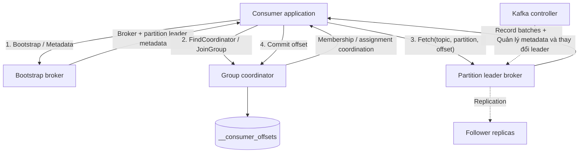
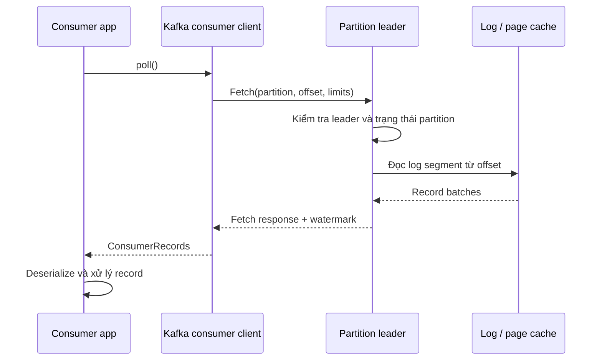

# Luồng đọc từ consumer đến broker

Trong Kafka, consumer không nhận message bằng cách kết nối vào một hàng đợi trung tâm rồi chờ broker đẩy từng message đến. Consumer chủ động gửi yêu cầu đọc dữ liệu (fetch) đến broker đang giữ vai trò leader của từng partition mà nó được giao. Trước khi fetch, client cần biết địa chỉ broker và leader thông qua metadata; nếu tham gia consumer group, nó còn phải phối hợp với group coordinator để nhận assignment và lưu offset.

Hiểu đúng luồng này giúp giải thích vì sao consumer cần bootstrap server, tại sao broker leader thay đổi thì client phải cập nhật metadata, vì sao offset được commit đến coordinator, và vì sao một consumer group có thể rebalance khi thành viên thay đổi.

## 1. Các thành phần tham gia vào luồng đọc

Một luồng đọc Kafka có một số vai trò riêng:

- **Consumer application:** ứng dụng gọi `poll()`, xử lý record và quyết định thời điểm commit offset.
- **Bootstrap broker:** broker đầu tiên mà client kết nối để lấy metadata. Đây không nhất thiết là broker sẽ phục vụ mọi lần fetch.
- **Partition leader:** broker đang giữ vai trò leader của partition; consumer thông thường gửi Fetch request đến broker này.
- **Group coordinator:** broker chịu trách nhiệm quản lý membership, generation và offset của một consumer group.
- **Controller:** thành phần quản lý metadata và các thay đổi trạng thái cụm, như thay đổi leader. Controller không phải điểm nhận mọi Fetch request của consumer.
- **Replica/follower:** broker giữ bản sao partition để tăng khả năng chịu lỗi và có thể tiếp quản khi leader thay đổi.

Sơ đồ khái quát:



Group coordinator và partition leader là hai vai trò logic khác nhau. Một broker có thể đồng thời giữ cả hai vai trò cho các tài nguyên khác nhau, nhưng consumer vẫn phải thực hiện hai loại giao tiếp với mục đích riêng: coordinator quản lý group/offset; leader phục vụ dữ liệu partition.

## 2. Bước 1 — Bootstrap và lấy metadata

Ứng dụng cấu hình `bootstrap.servers` bằng một hoặc nhiều địa chỉ broker:

```properties
bootstrap.servers=broker-1:9092,broker-2:9092,broker-3:9092
```

Đây là danh sách điểm khởi đầu để client kết nối vào cluster. Client không cần biết trước leader của từng partition. Khi kết nối được một broker, nó có thể yêu cầu metadata để biết:

- Danh sách broker và địa chỉ kết nối được quảng bá.
- Topic và partition liên quan.
- Broker nào đang là leader của từng partition.
- Replica và trạng thái ISR của partition.
- Số partition hiện có của topic.

Ví dụ topic `orders` có ba partition:

| Partition | Leader hiện tại | Replicas minh họa |
|---|---|---|
| `orders-0` | Broker 1 | Broker 1, 2, 3 |
| `orders-1` | Broker 2 | Broker 2, 3, 1 |
| `orders-2` | Broker 3 | Broker 3, 1, 2 |

Consumer cần đọc `orders-0` sẽ gửi Fetch request đến Broker 1. Khi đọc `orders-1`, nó gửi request đến Broker 2. Một consumer có thể fetch nhiều partition từ nhiều broker trong cùng một chu kỳ.

**Bootstrap broker không phải proxy cho toàn bộ dữ liệu.** Sau khi nhận metadata, client thường kết nối trực tiếp đến các broker leader cần thiết. Nếu leader thay đổi, client nhận lỗi phù hợp hoặc phát hiện metadata đã cũ, sau đó refresh metadata và gửi fetch đến leader mới.

### 2.1. Vì sao advertised.listeners quan trọng?

Broker quảng bá địa chỉ để client dùng sau khi nhận metadata. Giá trị `advertised.listeners` phải có thể truy cập từ mạng của consumer.

Ví dụ, một ứng dụng chạy trong Docker network có thể truy cập `kafka:9092`, nhưng ứng dụng chạy trên máy host lại cần một listener quảng bá `localhost:29092`. Nếu broker trả metadata chứa hostname chỉ phân giải được bên trong container cho client bên ngoài, client có thể bootstrap thành công nhưng fetch thất bại.

Khi debug, hãy kiểm tra cả:

- Địa chỉ trong `bootstrap.servers`.
- Listener mà client kết nối.
- Địa chỉ broker được trả về trong metadata.
- DNS, port, firewall và route từ đúng môi trường chạy consumer.

### 2.2. Metadata được làm mới khi nào?

Client giữ metadata trong bộ nhớ để tránh phải hỏi cluster cho từng record. Metadata được cập nhật định kỳ hoặc khi gặp các lỗi cho thấy thông tin hiện tại không còn đúng, chẳng hạn leader đã chuyển sang broker khác hoặc topic vừa được thay đổi.

Không nên hard-code partition leader trong ứng dụng. Vai trò leader có thể thay đổi khi broker dừng, partition được phục hồi hoặc cluster thực hiện reassignment.

## 3. Bước 2 — Consumer tham gia consumer group

Nếu ứng dụng dùng `subscribe()` với `group.id`, nó tham gia một consumer group. Các instance có cùng `group.id` cùng chia nhau đọc các partition của topic đã subscribe theo assignment của group.

Ví dụ:

```properties
group.id=order-projection
```

Một topic có sáu partition và group có ba consumer có thể nhận assignment như sau:

| Consumer | Partition được giao |
|---|---|
| Consumer A | 0, 1 |
| Consumer B | 2, 3 |
| Consumer C | 4, 5 |

Trong cùng một group, tại một thời điểm, một partition chỉ được giao cho tối đa một consumer đang hoạt động. Nếu có tám consumer nhưng topic chỉ có sáu partition, ít nhất hai consumer có thể không được giao partition nào. Một group khác vẫn có thể đọc toàn bộ sáu partition độc lập.

### 3.1. Group coordinator làm gì?

Consumer cần tìm broker đang làm group coordinator. Client gửi yêu cầu tìm coordinator dựa trên `group.id`, sau đó kết nối đến broker đó để tham gia group.

Ở giao thức consumer group truyền thống, các bước thường được mô tả bằng:

1. `FindCoordinator`: tìm broker quản lý group.
2. `JoinGroup`: đăng ký thành viên, metadata subscription và protocol hỗ trợ.
3. `SyncGroup`: đồng bộ assignment được chọn.
4. `Heartbeat`: duy trì trạng thái thành viên.
5. `OffsetCommit` và `OffsetFetch`: lưu hoặc đọc vị trí tiêu thụ.

Các phiên bản Kafka mới có consumer group protocol mới với cách phân phối assignment và heartbeat khác. Vì vậy, tên API và chi tiết trình tự có thể thay đổi theo phiên bản client, broker và cấu hình group protocol; các bước trên mô tả các trách nhiệm logic chính.

Coordinator quản lý membership, generation và offset. Nó không phải broker mà consumer phải gửi mọi Fetch request đến.

### 3.2. Partition assignment được quyết định như thế nào?

Partition assignor quyết định partition nào thuộc về consumer nào. Các chiến lược phổ biến trong Java client gồm:

- **RangeAssignor:** chia các partition liên tiếp cho từng consumer theo từng topic.
- **RoundRobinAssignor:** phân phối lần lượt partition cho các consumer đủ điều kiện.
- **StickyAssignor:** cố gắng giữ assignment ổn định qua các lần rebalance trong khi vẫn cân bằng tải.
- **CooperativeStickyAssignor:** hỗ trợ chuyển assignment theo từng phần để giảm việc thu hồi toàn bộ partition trong một lần rebalance.

Chiến lược phù hợp phụ thuộc vào phiên bản client, protocol và cách subscribe. Không nên giả định thứ tự partition luôn chia đều tuyệt đối giữa các consumer, đặc biệt khi một group subscribe nhiều topic có số partition khác nhau.

### 3.3. Rebalance xảy ra khi nào?

Group có thể cần phân phối lại partition khi:

- Một consumer mới tham gia.
- Một consumer rời group hoặc bị xem là không còn hoạt động.
- Consumer không heartbeat đúng hạn.
- Topic được tăng số partition.
- Subscription của các consumer thay đổi.
- Một số thay đổi cấu hình hoặc protocol khiến assignment cần được tính lại.

Trong rebalance, consumer có thể phải dừng xử lý partition đang sở hữu, hoàn tất hoặc hủy các công việc còn dang dở, rồi nhận assignment mới. Tùy protocol và assignor, mức độ gián đoạn khác nhau.

Các cấu hình thường liên quan:

| Cấu hình | Vai trò |
|---|---|
| `session.timeout.ms` | Thời gian coordinator chờ heartbeat trước khi xem consumer không còn hoạt động |
| `heartbeat.interval.ms` | Khoảng thời gian gửi heartbeat trong các protocol hỗ trợ cấu hình này |
| `max.poll.interval.ms` | Giới hạn thời gian giữa các lần `poll()` để phát hiện consumer không tiến triển xử lý |
| `group.instance.id` | Định danh thành viên tĩnh, giúp giảm rebalance khi instance khởi động lại với cùng identity |

Không nên tăng timeout chỉ để che giấu việc xử lý bị treo. Hãy đo thời gian xử lý batch, thiết kế giới hạn công việc mỗi lần poll và bảo đảm consumer tiếp tục gọi `poll()` theo đúng yêu cầu của client.

## 4. Bước 3 — Consumer gửi Fetch request đến partition leader

Sau khi nhận assignment, consumer xác định offset cần đọc cho từng partition. Client gửi Fetch request đến broker đang giữ leader của partition đó.

Ví dụ consumer đang được giao:

- `orders-0`, bắt đầu từ offset 120.
- `orders-1`, bắt đầu từ offset 85.

Nó có thể gửi yêu cầu đọc tương ứng đến broker leader của từng partition. Fetch request về bản chất gồm thông tin partition, offset bắt đầu, giới hạn dữ liệu và các tham số đọc khác.

Trong luồng thông thường, consumer fetch từ partition leader. Một số cấu hình rack-aware có thể cho phép đọc từ replica phù hợp, nhưng cần thiết kế và xác minh riêng. Broker phục vụ fetch kiểm tra yêu cầu, đọc các record batch phù hợp từ log và trả kết quả cho consumer. Broker có thể lấy dữ liệu từ page cache của hệ điều hành hoặc thực hiện I/O đĩa khi cần. Kafka tận dụng log tuần tự và batching để đọc hiệu quả.

### 4.1. Luồng fetch chi tiết



Consumer thường fetch theo batch thay vì yêu cầu từng record một. Điều này giảm số lần round trip và tận dụng truyền dữ liệu tuần tự.

Nếu chưa đủ dữ liệu để trả về, broker có thể giữ request trong thời gian chờ theo các tham số fetch như `fetch.min.bytes` và `fetch.max.wait.ms`. Cơ chế long polling giúp cân bằng giữa độ trễ và hiệu quả batching.

### 4.2. Các giới hạn kích thước fetch

Một số cấu hình quan trọng:

| Cấu hình | Ý nghĩa |
|---|---|
| `fetch.min.bytes` | Lượng dữ liệu tối thiểu broker cố gắng tích lũy trước khi trả response |
| `fetch.max.wait.ms` | Thời gian tối đa broker chờ để đáp ứng điều kiện fetch tối thiểu |
| `max.partition.fetch.bytes` | Giới hạn dữ liệu fetch cho mỗi partition trong một response |
| `fetch.max.bytes` | Giới hạn tổng dữ liệu fetch trong một request |
| `max.poll.records` | Số record tối đa trả về cho ứng dụng trong một lần `poll()` |

Các giới hạn fetch và giới hạn số record trả cho ứng dụng là những khái niệm khác nhau. Client có thể nhận các batch dữ liệu qua mạng rồi chỉ trả một số record giới hạn cho lần `poll()` hiện tại.

Cấu hình quá nhỏ có thể làm giảm throughput hoặc khiến consumer cần nhiều vòng fetch. Cấu hình quá lớn có thể tăng bộ nhớ và thời gian xử lý batch. Ngoài ra, một record batch có thể lớn hơn giới hạn fetch thông thường trong một số trường hợp để consumer vẫn có thể tiến triển khi gặp batch lớn; vì vậy cần cấu hình kích thước message và fetch tương thích với nhau.

### 4.3. Broker trả những thông tin gì?

Fetch response chứa record batches và thông tin trạng thái của partition. Các thông tin quan trọng gồm:

- **High watermark (HW):** offset ranh giới (exclusive) đến đó dữ liệu đã được replication xác nhận theo định nghĩa Kafka; record có offset nhỏ hơn HW có thể được consumer thông thường đọc.
- **Last stable offset (LSO):** offset ranh giới (exclusive) cho consumer `read_committed`; consumer không đọc vượt qua LSO để tránh thấy kết quả của transaction chưa kết thúc.
- **Log start offset:** offset đầu tiên còn được giữ trong log, có thể tăng khi retention xóa dữ liệu cũ.
- **Errors/leader state:** mã lỗi để client cập nhật metadata hoặc thử lại theo loại lỗi.

Offset là vị trí trong từng partition, không phải một số thứ tự toàn cục cho cả topic. `orders-0:120` và `orders-1:120` là hai vị trí độc lập.

## 5. Bước 4 — Deserialize và xử lý record trong ứng dụng

Khi client nhận record batches, Kafka client giải mã framing/protocol và gọi deserializer để chuyển key/value thành kiểu dữ liệu ứng dụng. API `poll()` trả về tập `ConsumerRecords`, có thể chứa record từ nhiều partition được giao.

Ví dụ cấu hình Java:

```java
Properties props = new Properties();

props.put(
    ConsumerConfig.BOOTSTRAP_SERVERS_CONFIG,
    "localhost:9092"
);
props.put(
    ConsumerConfig.GROUP_ID_CONFIG,
    "order-projection"
);
props.put(
    ConsumerConfig.KEY_DESERIALIZER_CLASS_CONFIG,
    StringDeserializer.class.getName()
);
props.put(
    ConsumerConfig.VALUE_DESERIALIZER_CLASS_CONFIG,
    StringDeserializer.class.getName()
);
props.put(
    ConsumerConfig.ENABLE_AUTO_COMMIT_CONFIG,
    "false"
);
props.put(
    ConsumerConfig.AUTO_OFFSET_RESET_CONFIG,
    "earliest"
);

KafkaConsumer<String, String> consumer =
    new KafkaConsumer<>(props);
```

Đăng ký topic và đọc dữ liệu:

```java
consumer.subscribe(List.of("orders"));

try {
    while (true) {
        ConsumerRecords<String, String> records =
            consumer.poll(Duration.ofMillis(500));

        for (ConsumerRecord<String, String> record : records) {
            System.out.printf(
                "topic=%s partition=%d offset=%d key=%s value=%s%n",
                record.topic(),
                record.partition(),
                record.offset(),
                record.key(),
                record.value()
            );

            processOrderEvent(record.value());
        }

        // Commit sau khi batch đã được xử lý thành công.
        consumer.commitSync();
    }
} finally {
    consumer.close();
}
```

Đây là ví dụ minh họa cho consumer một luồng xử lý tuần tự. Trong ứng dụng thực tế, cần bổ sung xử lý exception, shutdown signal, retry, dead-letter flow và quản lý thời gian xử lý. Nếu một record trong batch lỗi, không nên commit offset vượt qua record đó trừ khi chính sách nghiệp vụ đã quyết định cách xử lý lỗi.

KafkaConsumer không an toàn khi nhiều thread cùng gọi các API của cùng một instance. Nếu muốn xử lý song song, hãy thiết kế rõ việc pause/resume partition, quản lý offset theo partition và bảo đảm không commit vượt qua công việc chưa hoàn tất.

### 5.1. Offset bắt đầu từ đâu?

Nếu group đã có committed offset hợp lệ cho partition, consumer tiếp tục từ vị trí đó. Nếu chưa có offset, hoặc offset không còn nằm trong vùng dữ liệu có thể đọc, `auto.offset.reset` quyết định hành vi:

- `earliest`: bắt đầu từ offset sớm nhất còn được giữ.
- `latest`: bắt đầu từ cuối log hiện tại.
- `none`: ném lỗi nếu không có offset hợp lệ.

`auto.offset.reset` không ghi đè committed offset đang hợp lệ. Nó là chính sách khi client không có vị trí bắt đầu hợp lệ.

### 5.2. Offset là vị trí tiếp theo cần đọc

Khi consumer đọc record offset 120, vị trí commit thường là 121, tức offset tiếp theo cần đọc. Offset commit được lưu theo bộ ba:

`(group.id, topic, partition)`

Mỗi partition có vị trí riêng. Vì vậy, một consumer group có thể đã đọc đến offset 500 của partition 0 nhưng mới đến offset 90 của partition 1.

## 6. Bước 5 — Commit offset về group coordinator

Sau khi xử lý record, consumer cần lưu tiến độ để lần sau có thể tiếp tục. Client gửi OffsetCommit request đến group coordinator. Coordinator lưu offset theo group, topic và partition trong topic nội bộ `__consumer_offsets`.

Có hai cách commit phổ biến:

- **Auto commit:** client tự commit theo chu kỳ cấu hình.
- **Manual commit:** ứng dụng gọi `commitSync()` hoặc `commitAsync()` khi đã đạt mốc xử lý phù hợp.

Với xử lý nghiệp vụ cần kiểm soát, manual commit sau khi xử lý thành công thường dễ reasoning hơn. Tuy nhiên, nếu ứng dụng đã ghi database thành công nhưng chết trước khi commit offset, record có thể được đọc lại. Đây là lý do consumer nên idempotent hoặc có cơ chế chống trùng.

### 6.1. Commit sớm và commit muộn

| Thời điểm commit | Hệ quả khi consumer gặp sự cố |
|---|---|
| Commit trước khi xử lý | Có thể mất xử lý: offset đã tiến lên nhưng nghiệp vụ chưa hoàn tất |
| Commit sau khi xử lý thành công | Có thể xử lý lặp nếu chết trước commit; thường là at-least-once |
| Commit cùng output trong Kafka transaction | Có thể đạt exactly-once semantics trong phạm vi luồng Kafka được cấu hình đúng |
| Ghi database rồi commit Kafka offset | Hai thao tác không tự động nằm trong cùng transaction; cần idempotency/outbox hoặc cơ chế phối hợp |

Commit offset không phải acknowledgement cho từng message theo kiểu queue truyền thống. Nó là checkpoint tiến độ đọc của group.

### 6.2. Consumer group và offset storage

Mỗi group có offset độc lập. Ví dụ:

| Group | Topic/partition | Committed offset |
|---|---|---:|
| `billing` | `orders-0` | 120 |
| `inventory` | `orders-0` | 95 |
| `analytics` | `orders-0` | 400 |

Cả ba group đọc cùng partition nhưng có thể ở những vị trí khác nhau. Điều này cho phép một ứng dụng xử lý nghiệp vụ gần thời gian thực, trong khi pipeline analytics có thể đọc chậm hơn hoặc phát lại dữ liệu.

Topic `__consumer_offsets` là topic nội bộ Kafka. Không nên xóa hoặc chỉnh sửa trực tiếp topic này để reset một group. Dùng công cụ quản trị consumer group hoặc API phù hợp để xem và thay đổi offset.

## 7. Read isolation: đọc dữ liệu đã replication hay transaction đã commit?

Với producer không dùng transaction, consumer thường đọc dữ liệu theo chính sách mặc định `read_uncommitted`. Nếu producer dùng transaction, consumer có thể chọn:

- **read_uncommitted:** có thể nhìn thấy record transactional trước khi transaction hoàn tất và có thể thấy record thuộc transaction bị abort.
- **read_committed:** chỉ trả record thuộc transaction đã commit, đồng thời bỏ qua record thuộc transaction bị abort.

Với `read_committed`, consumer không đọc vượt qua last stable offset. Nếu có transaction đang mở trên partition, dữ liệu phía sau transaction đó có thể phải chờ kết quả commit/abort trước khi được trả về.

Ví dụ:

```properties
isolation.level=read_committed
```

Chọn `read_committed` khi ứng dụng cần chỉ xử lý kết quả transaction đã commit, đặc biệt trong pipeline consume-transform-produce dùng Kafka transactions. Cần hiểu rằng chế độ này có thể làm dữ liệu mới hơn tạm thời chưa hiển thị khi có transaction mở lâu.

## 8. Consumer lag và khả năng đọc theo kịp producer

Consumer lag phản ánh khoảng cách giữa vị trí dữ liệu mới nhất của partition và tiến độ consumer đã xử lý/commit. Cách tính cụ thể phụ thuộc metric và công cụ giám sát; cần phân biệt log end offset, high watermark, committed offset và vị trí hiện tại của consumer.

Lag tăng kéo dài có thể do:

- Producer tăng tốc độ ghi.
- Consumer xử lý record chậm.
- Downstream database hoặc API bị nghẽn.
- Consumer thường xuyên rebalance.
- Fetch batch quá nhỏ hoặc network có độ trễ cao.
- Một partition nóng khiến một consumer phải xử lý quá nhiều dữ liệu.
- Consumer bị lỗi và retry cùng một record liên tục.

Một số hướng kiểm tra:

1. So sánh record rate và byte rate ở producer với consumer.
2. Xem lag theo từng partition để phát hiện partition nóng.
3. Kiểm tra thời gian xử lý record và thời gian gọi downstream.
4. Kiểm tra log rebalance, heartbeat và lỗi fetch.
5. Xem số partition so với số consumer trong group.
6. Kiểm tra disk, network và trạng thái broker leader.

Tăng số consumer chỉ tăng khả năng song song khi group còn partition chưa được giao. Một partition không thể được chia cho nhiều consumer cùng group để cùng đọc song song theo cách thông thường.

## 9. Luồng đọc trong Spring Kafka

Spring Kafka bọc KafkaConsumer trong listener container. Ứng dụng thường khai báo listener bằng `@KafkaListener`, còn container quản lý vòng lặp poll, thread consumer, assignment và lifecycle.

Ví dụ:

```java
@Component
public class OrderListener {

    @KafkaListener(
        topics = "orders",
        groupId = "order-projection",
        concurrency = "3"
    )
    public void onMessage(
            ConsumerRecord<String, String> record) {

        processOrderEvent(record.value());
    }
}
```

`concurrency = "3"` yêu cầu listener container tạo ba consumer thread cho endpoint này. Số consumer thực tế được giao partition còn phụ thuộc số partition và các consumer khác trong cùng group.

Spring Kafka cung cấp các chế độ acknowledgement và quản lý offset. Với listener thông thường, container có thể commit theo ack mode đã cấu hình. Nếu listener dùng manual acknowledgement, ứng dụng cần gọi `Acknowledgment.acknowledge()` sau khi xử lý đạt điều kiện thành công.

Ví dụ manual acknowledgement:

```java
@KafkaListener(
    topics = "orders",
    groupId = "order-projection"
)
public void onMessage(
        ConsumerRecord<String, String> record,
        Acknowledgment acknowledgment) {

    processOrderEvent(record.value());
    acknowledgment.acknowledge();
}
```

Cách cấu hình container factory, `AckMode`, error handler và retry topic cần thống nhất với phiên bản Spring Kafka đang sử dụng. Với ví dụ manual acknowledgement, hãy cấu hình container factory dùng `AckMode.MANUAL` hoặc `AckMode.MANUAL_IMMEDIATE` theo semantics mong muốn để `Acknowledgment` được xử lý đúng. Không nên đồng thời tự commit bằng KafkaConsumer bên trong listener do Spring quản lý nếu không hiểu rõ quyền sở hữu consumer và offset.

## 10. Những lỗi thường gặp trong luồng đọc

### 10.1. Bootstrap thành công nhưng fetch timeout

Nguyên nhân thường gặp là broker quảng bá địa chỉ trong metadata mà consumer không truy cập được. Kiểm tra `advertised.listeners`, DNS, port mapping và network từ đúng môi trường chạy ứng dụng.

### 10.2. Consumer không nhận record dù topic có dữ liệu

Kiểm tra:

- Consumer có subscribe đúng topic không?
- Group có partition được assign không?
- `auto.offset.reset` có khiến consumer bắt đầu ở cuối log không?
- Group đã có committed offset cũ không?
- Record có bị lọc bởi `read_committed` vì transaction chưa hoàn tất không?
- Consumer có đang đọc nhầm cluster hoặc listener không?

Có thể dùng `kafka-consumer-groups.sh --describe` để xem member, assignment, current offset, log end offset và lag.

### 10.3. Consumer đọc lại record sau khi khởi động lại

Nếu ứng dụng xử lý xong nhưng chưa commit offset, record có thể được phát lại. Đây là hành vi bình thường của at-least-once. Hãy kiểm tra thời điểm commit, auto commit và thiết kế idempotency của nghiệp vụ.

### 10.4. Consumer bỏ qua một số record

Có thể ứng dụng đã commit offset trước khi xử lý xong, hoặc exception handler/logic nghiệp vụ đã chủ động bỏ qua record. Kiểm tra committed offset theo từng partition và log xử lý. Không chỉnh offset ngay trước khi xác định record bị bỏ qua do đâu.

### 10.5. Consumer liên tục rebalance

Kiểm tra thời gian xử lý giữa các lần `poll()`, heartbeat, network, session timeout, max poll interval và lỗi trong listener. Nếu xử lý một batch quá lâu, có thể giảm `max.poll.records`, tách công việc nặng khỏi thread poll theo mô hình có kiểm soát, hoặc điều chỉnh timeout sau khi đo đạc.

### 10.6. Consumer lag tăng dù đã tăng concurrency

Nếu số consumer lớn hơn số partition, consumer bổ sung sẽ không nhận thêm partition. Nếu lag tập trung vào một partition, hãy xem lại key và phân bố tải. Nếu consumer đã fetch nhanh nhưng xử lý chậm, bottleneck có thể ở database, API hoặc logic ứng dụng.

## 11. Quy trình kiểm tra từ consumer đến broker

Khi cần chẩn đoán một consumer, đi theo thứ tự:

1. **Bootstrap:** xác minh `bootstrap.servers` và khả năng kết nối ít nhất một broker.
2. **Metadata:** xác minh client nhận được danh sách broker và partition leader có địa chỉ truy cập được.
3. **Group:** xác minh `group.id`, coordinator, membership và trạng thái rebalance.
4. **Assignment:** xác minh consumer được giao đúng partition cần đọc.
5. **Fetch:** xác minh request đến broker leader, offset bắt đầu và lỗi fetch.
6. **Deserialize:** xác minh key/value deserializer và schema tương thích.
7. **Process:** đo thời gian xử lý và cách xử lý exception.
8. **Commit:** xác minh offset được commit sau đúng mốc nghiệp vụ.
9. **Lag:** so sánh committed/current offset với log end hoặc high watermark theo metric đang dùng.

Lệnh xem trạng thái group:

```bash
kafka-consumer-groups.sh \
  --bootstrap-server localhost:9092 \
  --describe \
  --group order-projection
```

Lệnh này giúp kiểm tra partition assignment, current offset, log end offset và lag theo từng partition. Tên script hoặc vị trí binary có thể khác theo cách cài Kafka.

## 12. Checklist thiết kế consumer

- [ ] Bootstrap broker và advertised listener truy cập được từ môi trường chạy consumer.
- [ ] Consumer dùng đúng `group.id` và subscribe đúng topic.
- [ ] Đã hiểu vai trò group coordinator và partition leader.
- [ ] Assignment phù hợp với số partition và số consumer.
- [ ] Offset reset được cấu hình rõ cho group mới hoặc offset không còn hợp lệ.
- [ ] Commit offset sau khi xử lý đạt điều kiện thành công.
- [ ] Xử lý record có tính idempotent hoặc có cơ chế chống trùng.
- [ ] Thời gian xử lý phù hợp với `max.poll.interval.ms` và heartbeat.
- [ ] Fetch size, poll batch và memory được điều chỉnh theo kích thước record.
- [ ] Isolation level phù hợp với việc sử dụng Kafka transaction.
- [ ] Theo dõi lag, rebalance, fetch errors và thời gian xử lý.
- [ ] Có quy trình shutdown để dừng consumer và đóng tài nguyên đúng cách.

Luồng đọc Kafka là sự phối hợp giữa metadata của cluster, điều phối consumer group, fetch từ partition leader và checkpoint offset tại group coordinator. Consumer không đọc dữ liệu qua controller hay qua một broker trung tâm duy nhất. Nắm được từng chặng sẽ giúp xác định đúng nơi cần kiểm tra khi gặp lỗi kết nối, rebalance, fetch, xử lý record hoặc commit offset.
