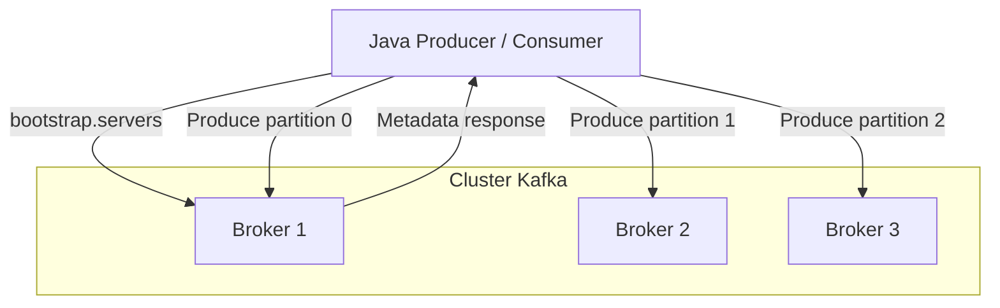
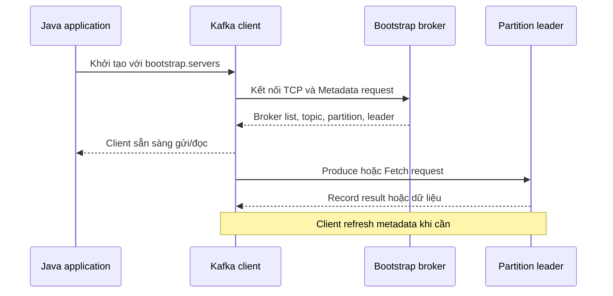

# Metadata discovery và vai trò của bootstrap.servers

Một Kafka client không cần biết trước toàn bộ topology của cluster để bắt đầu làm việc. Ứng dụng chỉ cấu hình một danh sách địa chỉ khởi đầu trong `bootstrap.servers`. Client kết nối đến một broker trong danh sách đó, gửi yêu cầu metadata và nhận thông tin về các broker, topic, partition, leader cùng những endpoint mà cluster công bố cho client. Từ metadata này, producer và consumer biết broker nào cần kết nối để gửi hoặc đọc record.

`bootstrap.servers` vì vậy là điểm bắt đầu khám phá cluster, không phải địa chỉ proxy trung chuyển mọi record. Sau khi nhận metadata, Kafka client kết nối trực tiếp đến broker phù hợp, chẳng hạn partition leader hoặc group coordinator. Danh sách bootstrap có thể chỉ chứa một vài broker; nên khai báo nhiều địa chỉ để client còn điểm khởi đầu khi một broker tạm thời không truy cập được.

Bài này giải thích quá trình bootstrap và metadata discovery trong hệ thống KAFKA, phân biệt `bootstrap.servers`, `listeners` và `advertised.listeners`, rồi hướng dẫn cấu hình Java/Spring Kafka và chẩn đoán lỗi mạng thường gặp. Đây là nền tảng để triển khai ứng dụng event streaming có thể kết nối đúng cluster, theo dõi thay đổi leader và tiếp tục hoạt động khi topology thay đổi.

## 1. Vì sao Kafka client cần metadata?

Một cluster Kafka có thể gồm nhiều broker. Mỗi topic được chia thành partition và mỗi partition có một broker làm leader tại một thời điểm. Producer gửi record đến leader của partition đích; consumer fetch dữ liệu từ broker đang giữ leader của partition được gán. Nếu client chỉ biết một địa chỉ duy nhất mà không biết vị trí partition leader, nó không thể tự chọn đúng broker cho từng thao tác.

Metadata cung cấp thông tin định tuyến cần thiết, thường bao gồm:

- Danh sách broker và node ID tương ứng.
- Topic mà client yêu cầu metadata.
- Danh sách partition của từng topic.
- Leader hiện tại của mỗi partition.
- Các replica và tập hợp replica đang đồng bộ (ISR) của partition.
- Các thông tin cluster liên quan mà client cần để định tuyến và làm mới trạng thái.

Ví dụ topic `orders` có ba partition nằm trên ba broker khác nhau:



Trong sơ đồ, client dùng Broker 1 để lấy metadata. Metadata cho biết partition 1 có leader ở Broker 2 và partition 2 có leader ở Broker 3, nên client kết nối đến hai broker đó khi cần gửi record tương ứng. Broker bootstrap không phải xử lý mọi request thay cho các broker còn lại.

Metadata cũng giúp client phát hiện topology thay đổi. Khi một broker ngừng hoạt động và partition được bầu leader mới, client có thể làm mới metadata rồi gửi request đến leader mới. Nếu client tiếp tục dùng thông tin cũ, request có thể nhận lỗi như `NOT_LEADER_OR_FOLLOWER`; Kafka client sẽ xử lý lỗi và cập nhật metadata theo cơ chế retry/refresh của nó.

## 2. Quá trình bootstrap và metadata discovery

Quá trình kết nối thường diễn ra theo các bước:

1. Ứng dụng khởi tạo Kafka client với một hoặc nhiều địa chỉ `host:port` trong `bootstrap.servers`.
2. Client thử kết nối đến một địa chỉ bootstrap có thể truy cập được.
3. Client gửi yêu cầu metadata đến broker đó. Yêu cầu có thể hỏi metadata cho các topic cụ thể hoặc lấy thông tin cluster cần thiết.
4. Broker trả về metadata gồm broker ID, địa chỉ broker được quảng bá và thông tin partition/leader liên quan.
5. Client lưu metadata trong bộ nhớ và mở kết nối đến broker cần thiết cho các thao tác produce, fetch, group coordination hoặc transaction.
6. Khi metadata hết hạn theo chính sách refresh, topic mới xuất hiện, leader thay đổi hoặc request gặp lỗi định tuyến, client có thể yêu cầu metadata mới.

Giá trị thường có dạng `kafka-1:9092,kafka-2:9092`; mỗi mục là hostname/IP kèm cổng, không thêm tiền tố `PLAINTEXT://` hay `SASL_SSL://`. Security protocol và cơ chế xác thực được khai báo bằng các thuộc tính bảo mật riêng của client.



`bootstrap.servers` chỉ cần cung cấp đủ địa chỉ để client tìm được ít nhất một broker hoạt động. Nếu một địa chỉ không phản hồi, client có thể thử địa chỉ khác trong danh sách. Sau khi có metadata, client sử dụng địa chỉ broker do cluster quảng bá; nó không bắt buộc tiếp tục dùng seed broker cho mọi request.

Danh sách bootstrap không nhất thiết chứa tất cả broker. Ví dụ cluster có 12 broker, ứng dụng có thể cấu hình 3 broker làm điểm khởi đầu. Tuy nhiên, các địa chỉ này phải thuộc cluster mong muốn và phải truy cập được từ môi trường chạy ứng dụng. Khai báo nhiều seed giúp tăng khả năng khởi tạo kết nối khi một broker đang bảo trì hoặc gặp sự cố.

## 3. Phân biệt bootstrap.servers, listeners và advertised.listeners

Ba khái niệm này liên quan đến kết nối nhưng có trách nhiệm khác nhau:

| Cấu hình | Nơi khai báo | Vai trò |
|---|---|---|
| `bootstrap.servers` | Kafka client/ứng dụng | Danh sách broker seed để bắt đầu kết nối và lấy metadata |
| `listeners` | Kafka broker | Địa chỉ và cổng mà broker bind để nhận kết nối mạng |
| `advertised.listeners` | Kafka broker | Địa chỉ broker công bố trong metadata để client sử dụng sau bootstrap |

Ví dụ broker có thể lắng nghe trên mọi interface của container ở cổng `9092`, nhưng công bố địa chỉ `kafka-1.internal:9092` cho các ứng dụng trong mạng nội bộ:

```properties
listeners=PLAINTEXT://0.0.0.0:9092
advertised.listeners=PLAINTEXT://kafka-1.internal:9092
```

`0.0.0.0` phù hợp làm địa chỉ bind để lắng nghe trên các interface; đây không phải địa chỉ để client dùng trong `bootstrap.servers` hoặc địa chỉ quảng bá. Client cần một hostname hoặc IP thực sự định tuyến được.

Một lỗi thường gặp là bootstrap thành công nhưng produce/fetch thất bại. Ví dụ ứng dụng chạy trên máy host kết nối được `localhost:9092`, nhưng broker quảng bá `kafka:9092`, hostname chỉ phân giải được bên trong Docker network. Sau khi nhận metadata, client cố kết nối đến `kafka:9092` từ máy host và thất bại. Trong trường hợp này, cần sửa địa chỉ quảng bá dành cho listener mà client đang sử dụng, không chỉ sửa `bootstrap.servers`.

`advertised.listeners` cần được cấu hình phù hợp với từng mạng client. Một broker có thể khai báo nhiều listener, ví dụ listener dành cho ứng dụng trên host và listener dành cho container nội bộ. Broker sẽ công bố endpoint tương ứng với listener mà kết nối client đang sử dụng. Trong cluster nhiều broker, mỗi broker phải công bố endpoint riêng có thể truy cập từ client; không thể quảng bá cùng một địa chỉ `localhost` cho tất cả broker rồi mong client phân biệt được các node.

## 4. Ví dụ địa chỉ cho máy host và Docker network

Giả sử một môi trường lab có broker tên `kafka`, ứng dụng Spring Boot có thể chạy theo hai cách:

| Nơi chạy ứng dụng | Địa chỉ bootstrap ví dụ | Lý do |
|---|---|---|
| Trực tiếp trên máy host | `localhost:9092` | Cổng broker được publish ra host |
| Trong container cùng Docker network | `kafka:29092` | Container phân giải service name `kafka` trong network |

Ví dụ cấu hình broker một node với listener dành cho hai loại client:

```yaml
services:
  kafka:
    image: apache/kafka:3.9.1
    ports:
      - "9092:9092"
    environment:
      KAFKA_NODE_ID: 1
      KAFKA_PROCESS_ROLES: broker,controller
      KAFKA_LISTENERS: HOST://:9092,DOCKER://:29092,CONTROLLER://:9093
      KAFKA_ADVERTISED_LISTENERS: HOST://localhost:9092,DOCKER://kafka:29092
      KAFKA_LISTENER_SECURITY_PROTOCOL_MAP: HOST:PLAINTEXT,DOCKER:PLAINTEXT,CONTROLLER:PLAINTEXT
      KAFKA_CONTROLLER_LISTENER_NAMES: CONTROLLER
      KAFKA_CONTROLLER_QUORUM_VOTERS: 1@localhost:9093
      KAFKA_INTER_BROKER_LISTENER_NAME: HOST
```

Đây là cấu hình minh họa cho môi trường local một node. Ứng dụng trên host dùng `localhost:9092`; container trong cùng network dùng `kafka:29092`. Nếu thay đổi tên service, cổng hoặc network, phải cập nhật đồng bộ listener, advertised listener và bootstrap address. Cấu hình KRaft còn cần các thiết lập storage/cluster ID phù hợp với image và quy trình khởi tạo mà môi trường sử dụng.

Không dùng `localhost` làm advertised address cho broker trong cluster nhiều máy. Từ góc nhìn mỗi client, `localhost` luôn trỏ về chính máy/container của client. Nếu broker quảng bá địa chỉ đó, client có thể kết nối nhầm vào máy của nó thay vì broker Kafka.

## 5. Cấu hình bootstrap.servers trong Java và Spring Kafka

Trong Java Kafka client, có thể khai báo nhiều broker seed, phân tách bằng dấu phẩy:

```java
import java.util.Properties;

import org.apache.kafka.clients.producer.KafkaProducer;
import org.apache.kafka.clients.producer.ProducerConfig;
import org.apache.kafka.clients.producer.ProducerRecord;
import org.apache.kafka.common.serialization.StringSerializer;

Properties properties = new Properties();
properties.put(ProducerConfig.BOOTSTRAP_SERVERS_CONFIG,
        "kafka-1.internal:9092,kafka-2.internal:9092,kafka-3.internal:9092");
properties.put(ProducerConfig.KEY_SERIALIZER_CLASS_CONFIG,
        StringSerializer.class.getName());
properties.put(ProducerConfig.VALUE_SERIALIZER_CLASS_CONFIG,
        StringSerializer.class.getName());
properties.put(ProducerConfig.ACKS_CONFIG, "all");

try (KafkaProducer<String, String> producer =
        new KafkaProducer<>(properties)) {
    producer.send(new ProducerRecord<>("orders", "ORD-1001", "created"));
}
```

Trong ứng dụng Spring Boot, cấu hình tương ứng trong `application.yml`:

```yaml
spring:
  kafka:
    bootstrap-servers: kafka-1.internal:9092,kafka-2.internal:9092,kafka-3.internal:9092
    producer:
      key-serializer: org.apache.kafka.common.serialization.StringSerializer
      value-serializer: org.apache.kafka.common.serialization.StringSerializer
      acks: all
    consumer:
      group-id: order-service
      key-deserializer: org.apache.kafka.common.serialization.StringDeserializer
      value-deserializer: org.apache.kafka.common.serialization.StringDeserializer
```

Nên đưa địa chỉ theo môi trường vào biến cấu hình thay vì hard-code trong source code:

```yaml
spring:
  kafka:
    bootstrap-servers: ${KAFKA_BOOTSTRAP_SERVERS:kafka-1.internal:9092,kafka-2.internal:9092}
```

Trong môi trường triển khai, đặt `KAFKA_BOOTSTRAP_SERVERS` theo DNS và network thực tế. Cùng một image ứng dụng có thể chạy ở local, staging và production với danh sách seed khác nhau mà không cần sửa mã nguồn.

Bootstrap chỉ giải quyết bước tìm broker. Với cluster bật TLS hoặc SASL, client vẫn phải cấu hình truststore/certificate, security protocol, cơ chế SASL và thông tin xác thực đúng với listener. Kết nối TCP thành công không đồng nghĩa xác thực và phân quyền Kafka đã thành công.

## 6. Quan sát metadata bằng AdminClient

Kafka Java AdminClient cung cấp API để truy vấn thông tin cluster. Ví dụ dưới đây liệt kê broker và controller mà AdminClient nhìn thấy từ cluster:

```java
import org.apache.kafka.clients.admin.Admin;
import org.apache.kafka.clients.admin.AdminClientConfig;
import org.apache.kafka.common.Node;

import java.util.Properties;

public class ClusterMetadataExample {
    public static void main(String[] args) throws Exception {
        Properties properties = new Properties();
        properties.put(AdminClientConfig.BOOTSTRAP_SERVERS_CONFIG,
                "localhost:9092");

        try (Admin admin = Admin.create(properties)) {
            var description = admin.describeCluster();

            System.out.println("Cluster ID: " + description.clusterId().get());
            System.out.println("Controller: " + description.controller().get());

            for (Node node : description.nodes().get()) {
                System.out.printf("Broker id=%d host=%s port=%d rack=%s%n",
                        node.id(), node.host(), node.port(), node.rack());
            }
        }
    }
}
```

Để xem leader và replica của một topic, dùng AdminClient `describeTopics`:

```java
import org.apache.kafka.clients.admin.Admin;
import org.apache.kafka.clients.admin.AdminClientConfig;

import java.util.List;
import java.util.Properties;

Properties properties = new Properties();
properties.put(AdminClientConfig.BOOTSTRAP_SERVERS_CONFIG, "localhost:9092");

try (Admin admin = Admin.create(properties)) {
    var result = admin.describeTopics(List.of("orders"));
    var topic = result.topicNameValues().get("orders").get();

    topic.partitions().forEach(partition -> {
        System.out.printf("partition=%d leader=%s replicas=%s isr=%s%n",
                partition.partition(),
                partition.leader(),
                partition.replicas(),
                partition.isr());
    });
}
```

Kết quả giúp xác nhận client nhìn thấy những broker nào, leader của từng partition là ai và replica nào đang thuộc ISR. Địa chỉ host/port trong kết quả phản ánh endpoint broker mà client nhận được qua metadata; nếu địa chỉ này không truy cập được từ môi trường ứng dụng, cần kiểm tra listener và DNS.

## 7. Metadata discovery cho producer, consumer và coordinator

Producer và consumer sử dụng metadata theo những cách khác nhau:

- Producer dùng metadata để xác định partition đích và broker leader của partition đó. Sau khi partitioner chọn partition, producer gửi produce request đến leader.
- Consumer dùng metadata để biết partition thuộc topic và broker leader để fetch dữ liệu. Việc partition được gán cho consumer là bước phối hợp riêng của consumer group.
- Consumer group gửi các yêu cầu điều phối như join, heartbeat và offset commit đến group coordinator của group đó. Client cần khám phá coordinator và có thể tìm lại coordinator khi group chuyển trạng thái.
- Transactional producer làm việc với transaction coordinator để bắt đầu, ghi nhận và hoàn tất giao dịch.

Vì vậy, không phải mọi request sau bootstrap đều đi đến partition leader. Metadata và các API coordinator giúp client tìm đúng broker cho loại thao tác tương ứng. Đây cũng là lý do cấu hình network phải cho phép client truy cập các broker mà cluster quảng bá, chứ không chỉ một seed broker.

## 8. Metadata được làm mới khi nào?

Kafka client giữ metadata trong bộ nhớ để tránh hỏi cluster trước mỗi record. Client làm mới metadata theo chu kỳ cấu hình và khi có dấu hiệu metadata hiện tại không còn đúng, chẳng hạn:

- Ứng dụng bắt đầu sử dụng một topic mà client chưa có metadata.
- Topic hoặc partition được tạo/thay đổi.
- Leader partition thay đổi do broker lỗi, phục hồi hoặc reassignment.
- Request trả lỗi cho biết broker không còn là leader hoặc metadata đã lỗi thời.
- Khoảng thời gian refresh metadata đã đến hạn.

Một số client có thuộc tính `metadata.max.age.ms` để điều khiển khoảng thời gian tối đa trước khi chủ động làm mới metadata. Giá trị mặc định có thể khác theo phiên bản Kafka client; chỉ điều chỉnh khi có lý do vận hành và đã hiểu tác động. Đặt quá thấp làm tăng metadata request; đặt quá cao có thể kéo dài thời gian client nhận biết thay đổi topology trong những trường hợp không kích hoạt refresh sớm.

Khi leader thay đổi, client có thể tạm thời gặp lỗi retriable trong lúc cập nhật metadata. Ứng dụng nên dùng retry có giới hạn và xử lý lỗi gửi cuối cùng thay vì giả định mọi lần gửi đều thành công ngay lập tức. Retry của producer cũng cần cân nhắc idempotence và thứ tự record theo cấu hình producer.

## 9. Chẩn đoán lỗi bootstrap và metadata

| Hiện tượng | Nguyên nhân có thể có | Hướng kiểm tra |
|---|---|---|
| `Connection to node ... could not be established` ngay khi khởi động | Sai host/port, broker chưa chạy, firewall hoặc DNS lỗi | Kiểm tra địa chỉ seed, cổng, DNS, log broker và network route |
| Bootstrap kết nối được nhưng produce/fetch timeout | `advertised.listeners` trả địa chỉ client không truy cập được | Xem metadata broker host/port; thử phân giải DNS và kết nối đến từng endpoint |
| `UnknownHostException` | Hostname quảng bá không phân giải trong môi trường client | Sửa DNS hoặc advertised listener theo network client |
| `NOT_LEADER_OR_FOLLOWER` | Metadata cũ hoặc leader partition vừa thay đổi | Kiểm tra trạng thái partition; để client refresh metadata và retry |
| `TopicAuthorizationException` | Client xác thực được nhưng principal không có quyền topic | Kiểm tra ACL/RBAC và principal đang dùng |
| `SaslAuthenticationException` hoặc lỗi SSL handshake | Cấu hình SASL/TLS không khớp listener hoặc credential/certificate sai | Kiểm tra security protocol, truststore, certificate và cơ chế SASL |
| Consumer group không hoạt động dù metadata topic có | Client chưa tìm được group coordinator hoặc group bị lỗi cấu hình/quyền | Kiểm tra coordinator, group ID, ACL và log consumer |
| Chỉ một số client kết nối được | Khác biệt DNS, route, container network hoặc listener được chọn | Kiểm tra từ đúng máy/container chạy từng client |

Một quy trình kiểm tra hữu ích:

1. Xác nhận broker process đang chạy và cổng listener đang lắng nghe.
2. Từ đúng môi trường ứng dụng, kiểm tra DNS và kết nối TCP đến bootstrap endpoint.
3. Dùng Kafka CLI với cùng bootstrap address để truy vấn broker và topic metadata.
4. Xem host/port broker trong metadata, rồi kiểm tra từng địa chỉ có thể truy cập từ ứng dụng hay không.
5. Nếu TCP và metadata đều ổn, kiểm tra TLS/SASL, ACL, topic và group ID.
6. Khi nghi ngờ leader vừa thay đổi, kiểm tra partition description và quan sát retry/metadata refresh trong log client.

Ví dụ kiểm tra broker và topic:

```bash
kafka-broker-api-versions.sh --bootstrap-server kafka-1.internal:9092

kafka-topics.sh \
  --bootstrap-server kafka-1.internal:9092 \
  --describe \
  --topic orders
```

Lệnh CLI cũng là Kafka client nên nó gặp cùng nguyên tắc bootstrap và advertised listener. Chạy lệnh từ laptop không chứng minh ứng dụng bên trong container hoặc mạng production có thể truy cập cùng endpoint; hãy kiểm tra từ đúng network namespace.

## 10. Các nguyên tắc cấu hình trong môi trường thực tế

- Khai báo nhiều broker seed đang hoạt động để giảm rủi ro không thể bootstrap khi một broker gặp sự cố.
- Dùng DNS ổn định hoặc địa chỉ có thể định tuyến từ mọi node ứng dụng cần truy cập; tránh phụ thuộc vào IP container tạm thời.
- Cấu hình `advertised.listeners` theo từng loại mạng client và bảo đảm mọi broker công bố endpoint có thể truy cập được.
- Không dùng controller listener của KRaft làm bootstrap endpoint cho ứng dụng. Kafka client thông thường kết nối broker listener để gửi/đọc dữ liệu và thực hiện API client.
- Quản lý TLS/SASL và ACL cùng với listener; không xem bootstrap thành công là bằng chứng client đã được cấp quyền truy cập topic.
- Theo dõi lỗi kết nối, request timeout, metadata refresh, leader change và coordinator discovery.
- Không đặt một load balancer TCP thông thường trước toàn bộ broker rồi giả định nó thay thế được endpoint riêng của từng broker. Sau bootstrap, Kafka client cần kết nối đúng broker được metadata chỉ ra; chỉ dùng giải pháp proxy/load balancer nếu nó hiểu và hỗ trợ định tuyến Kafka phù hợp.
- Khi đổi hostname, port, listener hoặc DNS, kiểm thử từ tất cả loại client và môi trường triển khai trước khi rollout.

## 11. Ghi nhớ

| Khái niệm | Vai trò |
|---|---|
| `bootstrap.servers` | Các địa chỉ khởi đầu để Kafka client tìm cluster |
| Metadata | Thông tin broker, topic, partition, leader và replica phục vụ định tuyến |
| `listeners` | Địa chỉ broker bind để nhận kết nối |
| `advertised.listeners` | Địa chỉ broker công bố cho client trong metadata |
| Partition leader | Broker nhận produce/fetch request cho partition |
| Group coordinator | Broker điều phối hoạt động của một consumer group |
| Metadata refresh | Cập nhật thông tin khi topology hoặc trạng thái cluster thay đổi |

Hãy nhớ rằng bootstrap chỉ mở đầu quá trình discovery. Sau đó Kafka client dựa vào metadata và các coordinator để kết nối trực tiếp đến broker phù hợp. Một cấu hình tốt phải bảo đảm cả seed address lẫn toàn bộ endpoint được quảng bá đều có thể truy cập từ môi trường chạy ứng dụng.
