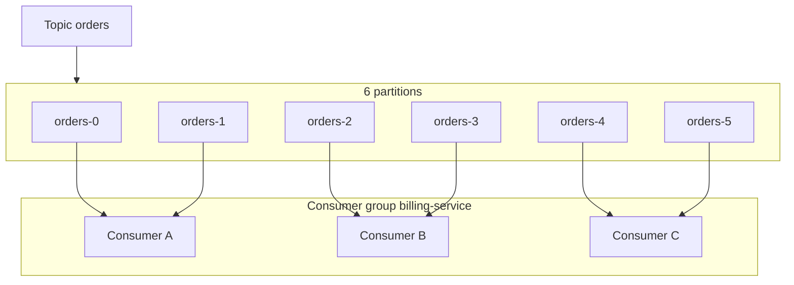
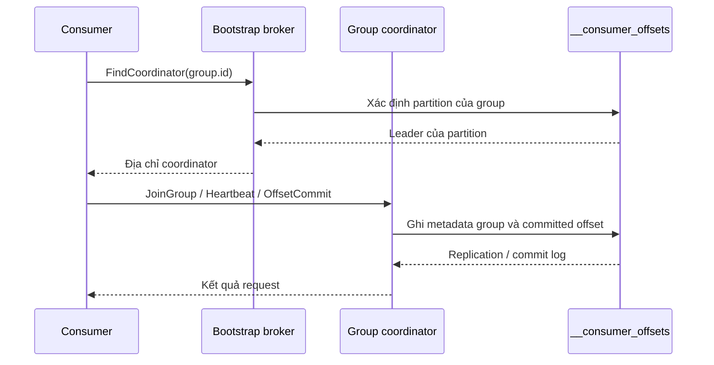

# Group coordinator và các topic nội bộ

## Mục tiêu

Kafka consumer group cho phép nhiều consumer cùng chia sẻ việc đọc một topic. Để quản lý thành viên, phân phối partition và lưu vị trí đã đọc, Kafka cần một broker điều phối nhóm và một số topic nội bộ lưu trạng thái vận hành. Những thành phần này hoạt động phía sau API consumer, nhưng ảnh hưởng trực tiếp đến rebalance, offset commit, khả năng phục hồi và độ trễ của ứng dụng.

Sau bài học này, bạn có thể:

- Giải thích vai trò của group coordinator và phân biệt nó với group leader, partition leader và transaction coordinator.
- Mô tả cách Kafka ánh xạ `group.id` tới partition của `__consumer_offsets` và tìm broker điều phối.
- Giải thích vòng đời join group, heartbeat, rebalance, offset commit và offset fetch.
- Nhận biết dữ liệu được lưu trong `__consumer_offsets` và `__transaction_state`.
- Quan sát consumer group, committed offset, lag, thành viên và trạng thái nhóm bằng Kafka CLI.
- Nhận diện các topic nội bộ do Kafka Streams và Kafka Connect tạo ra, cùng các yêu cầu cấu hình của chúng.
- Chẩn đoán lỗi coordinator, rebalance kéo dài, offset hết hạn và replication của topic nội bộ.

## 1. Consumer group cần một bộ điều phối

Một consumer group là tập hợp các consumer cùng dùng một `group.id` để đọc topic. Kafka phân các partition được subscribe cho các thành viên trong group. Trong cùng một group, một partition tại một thời điểm chỉ được giao cho tối đa một consumer member đang hoạt động. Nếu có nhiều consumer hơn số partition, một số consumer sẽ không được giao partition.

Ví dụ topic `orders` có sáu partition và group `billing-service` có ba consumer. Mỗi consumer có thể nhận hai partition. Nếu một consumer dừng, group thực hiện rebalance để các thành viên còn lại nhận lại partition của thành viên đã rời nhóm.



Consumer cần phối hợp để biết ai đang tham gia, partition nào được giao cho ai và offset nào đã được commit. Kafka giao trách nhiệm phối hợp này cho một broker được gọi là **group coordinator**. Coordinator quản lý một group cụ thể; nhiều group khác nhau có thể được điều phối bởi các broker khác nhau.

### Phân biệt bốn vai trò dễ nhầm

| Vai trò | Là ai? | Trách nhiệm |
|---|---|---|
| Group coordinator | Một broker được chọn cho một `group.id` | Quản lý thành viên, heartbeat, rebalance, offset commit và offset fetch của group |
| Group leader (classic protocol) | Một consumer member do coordinator chọn | Tính toán assignment rồi gửi kết quả cho coordinator phân phối |
| Partition leader | Một broker dẫn đầu replica của một partition dữ liệu | Nhận request đọc/ghi của partition đó và phối hợp replication |
| Transaction coordinator | Một broker phụ trách một `transactional.id` | Quản lý trạng thái transaction của producer và commit/abort transaction |

Group coordinator là broker; group leader trong classic consumer group protocol là một consumer process. Hai vai trò này không phải cùng một thành phần. Với classic protocol, coordinator chọn một member làm group leader để member đó tính assignment. Consumer protocol mới có thể dùng server-side assignor nên cơ chế assignment khác đi, nhưng group vẫn có coordinator chịu trách nhiệm quản lý vòng đời và trạng thái của nó.

Group coordinator cũng không nhất thiết là partition leader của topic `orders`. Coordinator được xác định từ partition tương ứng của topic nội bộ `__consumer_offsets`; partition leader của `orders-0` được xác định độc lập theo replica assignment của `orders`.

## 2. Kafka tìm group coordinator như thế nào?

Kafka dùng `group.id` để xác định một partition trong topic nội bộ `__consumer_offsets`. Broker đang làm leader của partition đó sẽ là group coordinator cho group tương ứng. Vì thế, nhiều group có thể dùng chung một coordinator nếu các group ID ánh xạ tới cùng partition.

Quy trình khái quát:

1. Consumer kết nối tới một broker bất kỳ trong `bootstrap.servers`.
2. Consumer gửi yêu cầu `FindCoordinator` với `group.id`.
3. Broker tra cứu partition tương ứng của `__consumer_offsets` và xác định broker leader của partition đó.
4. Broker trả địa chỉ coordinator cho consumer.
5. Consumer gửi các request quản lý group và commit/fetch offset tới coordinator này.
6. Nếu coordinator thay đổi do broker dừng hoặc partition chuyển leader, consumer phát hiện lỗi coordinator, tìm lại coordinator và tiếp tục theo giao thức.



Phép ánh xạ được phân tán theo số partition của `__consumer_offsets`; client không tự chọn broker coordinator và không nên hard-code địa chỉ broker này. Việc bootstrap qua một broker chỉ là bước tìm cluster metadata và coordinator. Sau đó client gửi request quản lý group đến đúng broker được trả về.

Nếu broker coordinator ngừng hoạt động, cluster sẽ bầu leader mới cho partition `__consumer_offsets` tương ứng nếu còn replica đủ điều kiện. Consumer có thể tạm nhận lỗi như `NOT_COORDINATOR` hoặc `COORDINATOR_NOT_AVAILABLE`, sau đó tìm lại coordinator. Trong khoảng chuyển tiếp, join group và commit offset có thể thất bại hoặc retry; ứng dụng cần có chính sách retry phù hợp.

## 3. Vòng đời của một consumer group

### 3.1. Gia nhập group

Khi consumer khởi động, nó đăng ký subscription và gửi yêu cầu tham gia group. Coordinator kiểm tra thành viên, protocol, subscription và trạng thái group. Khi cần thay đổi assignment, group bước vào quá trình rebalance.

Với classic protocol, quy trình thường gồm:

1. `FindCoordinator`: tìm broker điều phối.
2. `JoinGroup`: consumer đăng ký tham gia group và khai báo metadata subscription/assignor.
3. Coordinator xác định thành viên và chọn group leader.
4. Group leader tính toán partition assignment theo assignor đã thương lượng rồi gửi assignment.
5. `SyncGroup`: coordinator phân phối assignment cho các member.
6. Các consumer bắt đầu đọc partition được giao.

Tên request và chi tiết trao đổi có thể khác khi dùng consumer group protocol mới, nhưng mục tiêu vẫn là xác lập thành viên và assignment nhất quán.

### 3.2. Heartbeat và phát hiện thành viên rời nhóm

Consumer gửi heartbeat định kỳ tới coordinator để xác nhận còn hoạt động. Nếu heartbeat không đến trong khoảng thời gian được cấu hình hoặc consumer chủ động rời nhóm, coordinator có thể loại member và khởi tạo rebalance. Thời gian phát hiện lỗi phụ thuộc cấu hình timeout, trạng thái mạng và protocol đang sử dụng.

Không nên đặt timeout quá thấp chỉ để phát hiện lỗi nhanh. Consumer đang xử lý record lâu, JVM pause, CPU quá tải hoặc network chập chờn có thể khiến heartbeat trễ và gây rebalance liên tục. Hãy phân biệt thời gian xử lý record với thời gian giữ nhịp của consumer; Spring Kafka có cơ chế listener/container riêng để phối hợp polling và heartbeat.

### 3.3. Rebalance

Rebalance là quá trình phân phối lại partition giữa các member. Nó xảy ra khi member gia nhập/rời nhóm, subscription thay đổi, partition được thêm hoặc khi coordinator cần khôi phục group sau sự cố.

| Kiểu rebalance | Đặc điểm | Tác động |
|---|---|---|
| Eager | Thu hồi assignment hiện tại trước khi cấp assignment mới | Có thể làm toàn bộ group tạm ngừng xử lý trong thời gian rebalance |
| Cooperative/incremental | Chỉ thu hồi những partition cần chuyển giao theo từng bước | Giảm số partition phải dừng xử lý, nhưng cần assignor và client hỗ trợ |

Trong thời gian rebalance, consumer có thể tạm ngừng nhận record. Nếu rebalance xảy ra liên tục, throughput giảm và lag tăng. Những nguyên nhân thường gặp gồm consumer khởi động/dừng liên tục, xử lý một batch quá lâu, timeout không phù hợp, thay đổi subscription hoặc broker/network không ổn định.

### 3.4. Commit và fetch offset

Sau khi xử lý record, consumer commit offset để Kafka biết vị trí sẽ tiếp tục đọc khi consumer khởi động lại hoặc partition được giao cho member khác. Offset commit được group coordinator quản lý và lưu trong `__consumer_offsets`.

Committed offset thường là vị trí của record kế tiếp cần đọc. Nếu consumer xử lý thành công record offset `41`, nó thường commit `42`. Vì vậy khi xem trạng thái group, `CURRENT-OFFSET` là vị trí tiếp tục đọc, không phải số thứ tự của record cuối cùng đã xử lý.

Consumer có thể commit tự động hoặc commit tường minh:

- `enable.auto.commit=true`: client commit offset định kỳ theo cấu hình. Cách này đơn giản nhưng ứng dụng cần cân nhắc khoảng cách giữa thời điểm xử lý record và thời điểm commit.
- `enable.auto.commit=false`: ứng dụng chủ động commit sau khi xử lý thành công, thường phù hợp hơn khi cần kiểm soát rõ ràng thời điểm xác nhận.

Nếu commit trước khi xử lý xong rồi ứng dụng bị dừng, record có thể bị bỏ qua khi đọc lại vì offset đã tiến lên. Nếu xử lý xong nhưng commit chưa thành công, record có thể được đọc lại sau restart/rebalance. Đây là lý do consumer thường phải hỗ trợ idempotency và phối hợp cập nhật dữ liệu với offset commit khi cần bảo đảm nghiệp vụ.

## 4. Topic nội bộ `__consumer_offsets`

`__consumer_offsets` là topic nội bộ Kafka dùng để lưu thông tin consumer group và committed offset. Kafka tự quản lý topic này; ứng dụng không tạo topic thay thế hoặc ghi record trực tiếp vào đây.

Về mặt khái niệm, topic chứa hai nhóm dữ liệu quan trọng:

| Dữ liệu | Nội dung điển hình | Mục đích |
|---|---|---|
| Group metadata | Group ID, thành viên, generation/protocol metadata, subscription và assignment liên quan | Khôi phục trạng thái group và phối hợp các member |
| Offset commit | Group ID, topic, partition, committed offset, metadata và thời điểm commit | Khôi phục vị trí đọc của consumer |

Kafka partition hóa dữ liệu theo group để các thao tác của một group được điều phối nhất quán qua một partition và một coordinator. Đây là cơ sở để coordinator được tìm thấy từ `group.id`.

### 4.1. Log compaction và retention

`__consumer_offsets` sử dụng log compaction để giữ trạng thái mới nhất theo key thay vì phải giữ mọi lần commit offset như một lịch sử bất tận. Khi consumer commit offset mới cho cùng group/topic/partition, record mới thay thế trạng thái cũ trong quá trình compaction. Tombstone có thể đánh dấu key cần xóa.

Ngoài compaction, Kafka có chính sách retention cho offset của group không còn hoạt động. Nếu group không commit offset trong thời gian đủ dài, offset có thể hết hạn theo `offsets.retention.minutes`. Khi group quay lại, consumer có thể không còn committed offset và hành vi khởi đầu phụ thuộc `auto.offset.reset`.

`auto.offset.reset` chỉ được dùng khi không có offset hợp lệ (ví dụ group mới, offset hết hạn hoặc offset không còn nằm trong log). Các giá trị thường gặp:

| Giá trị | Hành vi |
|---|---|
| `earliest` | Bắt đầu từ offset sớm nhất còn được giữ trong partition |
| `latest` | Bắt đầu từ record mới được ghi sau thời điểm consumer thiết lập vị trí đọc |
| `none` | Báo lỗi nếu không có committed offset hợp lệ |

Không nhầm `auto.offset.reset` với thao tác reset offset của một group đã có offset. Khi group đã có committed offset hợp lệ, Kafka tiếp tục từ offset đó; thay đổi `auto.offset.reset` không tự tua group về đầu topic.

### 4.2. Cấu hình broker liên quan

| Cấu hình | Ý nghĩa |
|---|---|
| `offsets.topic.num.partitions` | Số partition của topic lưu consumer offsets; ảnh hưởng phân tán coordinator giữa các broker |
| `offsets.topic.replication.factor` | Replication factor của `__consumer_offsets` |
| `offsets.retention.minutes` | Thời gian giữ offset của group không hoạt động theo quy tắc retention |
| `offsets.topic.segment.bytes` | Kích thước segment của topic offsets |
| `group.initial.rebalance.delay.ms` | Khoảng trì hoãn ban đầu để consumer có thời gian gia nhập trước lần rebalance đầu |

Các giá trị này là cấu hình broker và một số được áp dụng khi topic nội bộ được tạo lần đầu. Không tùy tiện thay đổi số partition của `__consumer_offsets` trên cluster đang hoạt động: việc thay đổi có thể làm thay đổi ánh xạ group tới coordinator và cần thực hiện theo hướng dẫn vận hành của đúng phiên bản Kafka.

Replication factor của topic nội bộ phải phù hợp với số broker. Trong cluster production có nhiều broker, thường cần replication để chịu lỗi. Trong lab một broker, nếu để replication factor lớn hơn số broker, Kafka có thể không tạo được topic nội bộ; môi trường phát triển một broker cần đặt `offsets.topic.replication.factor=1` trước khi group được sử dụng. Không dùng cấu hình một replica cho môi trường production chỉ để tránh lỗi khởi động.

## 5. Topic nội bộ `__transaction_state`

Kafka transaction cho phép producer ghi dữ liệu lên nhiều partition và phối hợp commit/abort theo transaction. Transaction coordinator quản lý một `transactional.id`; nó là vai trò riêng với group coordinator.

`__transaction_state` là topic nội bộ lưu trạng thái transaction và metadata liên quan tới transactional producer. Broker transaction coordinator sử dụng topic này để phục hồi trạng thái transaction sau sự cố. Khi producer gửi dữ liệu trong transaction, Kafka ghi transaction marker vào các partition liên quan sau khi commit hoặc abort. Consumer dùng `isolation.level=read_committed` chỉ đọc các record thuộc transaction đã commit và bỏ qua record thuộc transaction bị abort.

| Cấu hình | Ý nghĩa |
|---|---|
| `transaction.state.log.num.partitions` | Số partition của topic trạng thái transaction |
| `transaction.state.log.replication.factor` | Replication factor của topic trạng thái transaction |
| `transaction.state.log.min.isr` | ISR tối thiểu để ghi vào topic trạng thái transaction |

Trong cluster nhiều broker, replication và min ISR cần được cấu hình để transaction coordinator có thể phục hồi trạng thái khi broker gặp sự cố. Với cluster lab một broker, cần đặt replication factor và min ISR phù hợp với số broker trước khi khởi tạo transaction; các giá trị giảm xuống một chỉ phục vụ local development.

**Không nhầm hai coordinator:** group coordinator quản lý thành viên và offset của consumer group; transaction coordinator quản lý transaction theo `transactional.id`. Một consumer có thể vừa tham gia consumer group vừa đọc dữ liệu ở chế độ `read_committed`, nhưng hai cơ chế điều phối vẫn có mục đích và metadata riêng.

## 6. Topic nội bộ của Kafka Streams và Kafka Connect

Ngoài các topic nội bộ do broker tự quản lý, thư viện và nền tảng Kafka có thể tạo topic nội bộ phục vụ trạng thái ứng dụng. Những topic này thường mang tên theo application ID hoặc tên connector và được quản lý bởi cấu hình của ứng dụng.

### 6.1. Kafka Streams

Kafka Streams tạo các topic nội bộ khi topology cần lưu trạng thái hoặc phân phối lại dữ liệu:

| Loại topic | Ví dụ tên | Mục đích |
|---|---|---|
| Changelog | `orders-enricher-customer-store-changelog` | Ghi lại thay đổi state store để phục hồi trạng thái sau restart hoặc chuyển task |
| Repartition | `orders-enricher-repartition` | Phân phối lại record theo key mới để thực hiện phép join/groupBy/aggregation |

Tên thực tế phụ thuộc `application.id`, tên store và topology. Replication factor cho topic nội bộ của Streams được điều khiển bằng cấu hình `replication.factor`; cấu hình này cần phù hợp với số broker và yêu cầu chịu lỗi. Các topic này là một phần của trạng thái ứng dụng Streams, nên xóa chúng có thể làm mất khả năng phục hồi state hoặc buộc ứng dụng tái xử lý dữ liệu đầu vào.

### 6.2. Kafka Connect

Kafka Connect distributed mode dùng ba topic nội bộ để chia sẻ cấu hình, offset của connector/task và trạng thái worker:

| Cấu hình Connect | Nội dung lưu |
|---|---|
| `config.storage.topic` | Cấu hình connector và task |
| `offset.storage.topic` | Offset mà source connector đã đọc từ hệ thống nguồn |
| `status.storage.topic` | Trạng thái connector và task |

Các topic này phải có replication và cleanup policy phù hợp. Trong distributed mode, chúng thường được cấu hình compacted để giữ trạng thái mới nhất theo key. Không dùng chung một topic nội bộ cho các Connect cluster độc lập nếu không muốn chúng chia sẻ metadata và trạng thái. Với các connector quan trọng, xóa `offset.storage.topic` có thể khiến source connector đọc lại dữ liệu hoặc thay đổi vị trí tiếp tục, tùy connector.

### 6.3. Phân biệt topic nội bộ theo chủ sở hữu

| Topic | Chủ sở hữu | Không nên làm |
|---|---|---|
| `__consumer_offsets` | Kafka broker / group coordinator | Ghi tay, xóa hoặc đổi cleanup policy tùy tiện |
| `__transaction_state` | Kafka broker / transaction coordinator | Xóa để “reset” transaction khi cluster đang hoạt động |
| Streams changelog/repartition | Kafka Streams application | Xóa khi chưa hiểu tác động tới state và topology |
| Connect config/offset/status | Kafka Connect cluster | Đổi tên hoặc xóa khi connector còn phụ thuộc vào metadata đó |

KRaft metadata log cũng là dữ liệu nội bộ quan trọng của cluster, nhưng nó thuộc controller quorum và được quản lý theo cơ chế metadata log riêng. Không coi metadata log KRaft là một topic ứng dụng để thao tác bằng `kafka-topics.sh`.

## 7. Thực hành quan sát group coordinator và internal topics

Phần lab dùng cluster Kafka KRaft đã khởi động và có ít nhất một broker. Các lệnh chạy từ broker container trong Docker Compose; nếu dùng môi trường khác, thay `broker-1:19092` bằng bootstrap address phù hợp.

### 7.1. Tạo topic và gửi dữ liệu thử nghiệm

Tạo topic `orders` với ba partition:

```bash
docker compose exec broker-1 /opt/kafka/bin/kafka-topics.sh --bootstrap-server broker-1:19092 --create --if-not-exists --topic orders --partitions 3 --replication-factor 1
```

Trong lab một broker, replication factor bằng một là phù hợp. Trong cluster nhiều broker, hãy dùng replication factor theo mục tiêu chịu lỗi.

Mở producer:

```bash
docker compose exec broker-1 /opt/kafka/bin/kafka-console-producer.sh --bootstrap-server broker-1:19092 --topic orders --property parse.key=true --property key.separator=:
```

Nhập các dòng sau, mỗi dòng là một record có key:

```text
order-1001:created
order-1002:created
order-1001:paid
order-1003:created
```

Nhấn `Ctrl+C` để đóng producer.

### 7.2. Tạo group và đọc record

Mở console consumer với group ID `billing-service`:

```bash
docker compose exec broker-1 /opt/kafka/bin/kafka-console-consumer.sh --bootstrap-server broker-1:19092 --topic orders --group billing-service --from-beginning --property print.key=true --property key.separator=:
```

Consumer sẽ đọc các record và tham gia group `billing-service`. Để quan sát offset được commit, hãy để consumer chạy đủ lâu cho chu kỳ auto commit, sau đó nhấn `Ctrl+C`. Console consumer có thể dùng auto commit theo cấu hình mặc định của nó; trong ứng dụng thật, cần cấu hình rõ thời điểm commit theo cách xử lý record.

### 7.3. Liệt kê và mô tả group

Liệt kê các group đã biết:

```bash
docker compose exec broker-1 /opt/kafka/bin/kafka-consumer-groups.sh --bootstrap-server broker-1:19092 --list
```

Xem committed offset, log end offset và lag:

```bash
docker compose exec broker-1 /opt/kafka/bin/kafka-consumer-groups.sh --bootstrap-server broker-1:19092 --describe --group billing-service
```

Các cột thường gặp:

| Cột | Ý nghĩa |
|---|---|
| `GROUP` | Consumer group |
| `TOPIC`, `PARTITION` | Partition mà group theo dõi |
| `CURRENT-OFFSET` | Offset đã commit, tức vị trí dự kiến đọc tiếp |
| `LOG-END-OFFSET` | Vị trí cuối log mà broker báo cho partition tại thời điểm truy vấn |
| `LAG` | Khoảng cách giữa log end offset và committed offset |
| `CONSUMER-ID`, `HOST`, `CLIENT-ID` | Thông tin member đang được giao partition nếu group đang hoạt động |

Lag bằng không không luôn có nghĩa nghiệp vụ đã hoàn tất mọi tác vụ bên ngoài Kafka; nó chỉ phản ánh khoảng cách giữa log end offset và committed offset mà Kafka quan sát được. Nếu consumer commit trước khi hoàn tất ghi database hoặc gọi dịch vụ khác, lag vẫn có thể bằng không trong khi tác vụ nghiệp vụ chưa hoàn thành.

### 7.4. Quan sát member và trạng thái group

Khi consumer đang chạy, dùng:

```bash
docker compose exec broker-1 /opt/kafka/bin/kafka-consumer-groups.sh --bootstrap-server broker-1:19092 --describe --group billing-service --members --verbose
```

Xem trạng thái group:

```bash
docker compose exec broker-1 /opt/kafka/bin/kafka-consumer-groups.sh --bootstrap-server broker-1:19092 --describe --group billing-service --state
```

Một group có thể ở trạng thái `Stable`, `PreparingRebalance`, `CompletingRebalance`, `Empty` hoặc trạng thái khác tùy thời điểm và phiên bản. Nếu muốn thấy member, hãy chạy lệnh khi consumer còn đang hoạt động; khi tất cả member dừng, group có thể ở trạng thái `Empty` nhưng vẫn còn committed offset.

### 7.5. Xem topic nội bộ

Liệt kê topic và mô tả topic offsets:

```bash
docker compose exec broker-1 /opt/kafka/bin/kafka-topics.sh --bootstrap-server broker-1:19092 --list
docker compose exec broker-1 /opt/kafka/bin/kafka-topics.sh --bootstrap-server broker-1:19092 --describe --topic __consumer_offsets
```

Trong cluster đã dùng consumer group, bạn có thể thấy `__consumer_offsets`. Một số CLI hoặc cấu hình quyền có thể ẩn hoặc hạn chế thao tác với internal topic; đây là hành vi cần thiết để bảo vệ metadata của Kafka. Có thể xem cấu hình topic bằng:

```bash
docker compose exec broker-1 /opt/kafka/bin/kafka-configs.sh --bootstrap-server broker-1:19092 --entity-type topics --entity-name __consumer_offsets --describe
```

Không dùng console producer để ghi vào `__consumer_offsets`, không xóa topic này và không thay cleanup policy của nó bằng lệnh quản trị topic thông thường. Hãy để coordinator quản lý cấu trúc record và vòng đời dữ liệu.

### 7.6. Reset offset trong môi trường thử nghiệm

Chỉ reset offset khi tất cả consumer thuộc group đã dừng. Trước hết chạy dry run để xem offset sẽ thay đổi:

```bash
docker compose exec broker-1 /opt/kafka/bin/kafka-consumer-groups.sh --bootstrap-server broker-1:19092 --group billing-service --topic orders --reset-offsets --to-earliest --dry-run
```

Nếu kết quả đúng với mục tiêu lab, thực hiện:

```bash
docker compose exec broker-1 /opt/kafka/bin/kafka-consumer-groups.sh --bootstrap-server broker-1:19092 --group billing-service --topic orders --reset-offsets --to-earliest --execute
```

Sau đó khởi động lại consumer group và quan sát record được đọc lại. Reset offset có thể khiến ứng dụng áp dụng lại tác động nghiệp vụ; chỉ thực hiện trong lab hoặc khi đã có kế hoạch replay và idempotency phù hợp.

## 8. Quan sát sự cố coordinator

Trong cluster nhiều broker có replication cho `__consumer_offsets`, có thể mô phỏng broker đang làm leader của partition offsets dừng. Trước khi thử, hãy xác định broker leader của partition nội bộ và bảo đảm replication/ISR đủ để partition bầu leader mới.

Kịch bản quan sát:

1. Ghi lại output `kafka-consumer-groups.sh --describe --group billing-service` và danh sách broker đang chạy.
2. Dừng broker đang làm coordinator của group (broker đang dẫn đầu partition `__consumer_offsets` tương ứng).
3. Quan sát consumer nhận lỗi coordinator hoặc retry request; group có thể rebalance tùy thời điểm và protocol.
4. Khi partition `__consumer_offsets` có leader mới, consumer tìm coordinator mới và tiếp tục commit/fetch offset.
5. Chạy lại `--describe` để xác nhận committed offset và lag.

Không thể suy ra broker coordinator chỉ từ broker leader của partition `orders`. Cần kiểm tra leader của partition `__consumer_offsets` mà group ID ánh xạ tới. Trong lab, nếu CLI không hiển thị được internal topic, hãy dùng log broker và metadata/quản trị phù hợp; không đoán coordinator theo tên broker.

Nếu `__consumer_offsets` không có replica còn sống trong ISR hoặc cluster mất quorum cần thiết, group có thể không commit/fetch offset cho đến khi metadata và partition phục hồi. Broker leader mới không thể tự tái tạo offset đã mất nếu toàn bộ bản sao chứa dữ liệu đó đều mất.

## 9. Cấu hình Spring Kafka liên quan đến group và offset

Ví dụ cấu hình consumer Spring Boot:

```yaml
spring:
  kafka:
    bootstrap-servers: localhost:29092,localhost:39092,localhost:49092
    consumer:
      group-id: billing-service
      enable-auto-commit: false
      auto-offset-reset: earliest
      key-deserializer: org.apache.kafka.common.serialization.StringDeserializer
      value-deserializer: org.apache.kafka.common.serialization.StringDeserializer
    listener:
      ack-mode: record
```

`group-id` xác định group coordinator được tìm thấy. `enable-auto-commit: false` cho phép Spring Kafka container quản lý thời điểm commit dựa trên acknowledgment mode. `ack-mode: record` yêu cầu commit sau khi listener xử lý từng record thành công, với điều kiện container và transaction được cấu hình tương ứng. Nếu listener ném exception, xử lý retry/recovery được quyết định bởi error handler và cấu hình container.

Ví dụ listener:

```java
@KafkaListener(topics = "orders", groupId = "billing-service")
public void handle(ConsumerRecord<String, String> record) {
    // Thực hiện xử lý nghiệp vụ có idempotency.
    // Container sẽ quản lý acknowledgment/commit theo cấu hình.
    System.out.printf(
            "topic=%s partition=%d offset=%d key=%s value=%s%n",
            record.topic(),
            record.partition(),
            record.offset(),
            record.key(),
            record.value()
    );
}
```

Nếu dùng `@KafkaListener` với `groupId` riêng, hãy bảo đảm nó khớp với mục đích subscription. Mỗi service cần nhận độc lập toàn bộ event stream thường dùng group ID riêng; các instance của cùng service chia sẻ một group ID để chia partition.

## 10. Lỗi thường gặp và hướng chẩn đoán

| Hiện tượng | Nguyên nhân có thể | Hướng kiểm tra |
|---|---|---|
| `NOT_COORDINATOR` hoặc `COORDINATOR_NOT_AVAILABLE` | Coordinator vừa đổi, client đang dùng địa chỉ cũ hoặc broker chưa sẵn sàng | Kiểm tra broker log, partition leader của `__consumer_offsets`; để client refresh coordinator và retry |
| Group liên tục rebalance | Consumer restart, heartbeat trễ, xử lý quá lâu hoặc subscription thay đổi | Kiểm tra member, group state, log client và cấu hình timeout/poll |
| `CURRENT-OFFSET` không tiến | Listener lỗi, consumer không poll/commit hoặc offset commit thất bại | Kiểm tra exception, acknowledgment mode, coordinator và log broker |
| Lag tăng dù consumer còn chạy | Throughput xử lý thấp hơn tốc độ ghi, partition phân bố không đều hoặc downstream chậm | So sánh lag theo partition, thời gian xử lý, số consumer và số partition |
| Group trở lại nhưng đọc từ đầu hoặc cuối | Không còn committed offset hợp lệ hoặc group ID thay đổi | Kiểm tra group ID, offset retention và `auto.offset.reset` |
| Không tạo được `__consumer_offsets` | Replication factor lớn hơn số broker khả dụng hoặc cluster chưa sẵn sàng | Kiểm tra cấu hình `offsets.topic.replication.factor`, broker log và ISR |
| Consumer nhận record lặp | Xử lý xong nhưng commit chưa hoàn tất, rebalance hoặc retry | Dùng event ID/idempotency và commit sau khi xử lý thành công |
| Topic nội bộ Connect/Streams mất dữ liệu | Topic bị xóa, replication yếu hoặc cleanup policy sai | Khôi phục từ backup/nguồn phù hợp; kiểm tra config, offsets và changelog trước khi restart |

## 11. Checklist vận hành

- [ ] Mỗi ứng dụng có `group.id` ổn định và có chủ đích; tránh thay group ID ngoài kế hoạch replay.
- [ ] Số partition, số consumer và chiến lược assignor phù hợp với throughput.
- [ ] Heartbeat, session/poll timeout và thời gian xử lý được cân đối để tránh rebalance liên tục.
- [ ] Commit offset sau khi xử lý thành công; consumer có idempotency cho tình huống nhận lại.
- [ ] `__consumer_offsets` có replication factor và ISR phù hợp với cluster.
- [ ] Theo dõi group state, committed offset, lag, rebalance và lỗi coordinator.
- [ ] Có kế hoạch cho offset retention, replay và reset offset.
- [ ] Topic nội bộ Streams/Connect được bảo vệ, backup và cấu hình cleanup policy đúng mục đích.
- [ ] Không ghi tay, xóa hoặc thay đổi tùy tiện các topic nội bộ của Kafka.

## 12. Câu hỏi tự kiểm tra

1. Vì sao consumer group cần group coordinator? Tại sao client không tự chọn một broker cố định để điều phối?
2. Kafka xác định broker coordinator từ `group.id` và `__consumer_offsets` như thế nào?
3. Group coordinator khác group leader trong classic protocol ở vai trò nào?
4. Vì sao group coordinator có thể khác broker đang làm leader của partition dữ liệu mà consumer đọc?
5. `CURRENT-OFFSET` thường chỉ record cuối cùng đã xử lý hay record tiếp theo cần đọc?
6. Điều gì xảy ra nếu commit offset trước khi cập nhật database hoàn tất?
7. `__consumer_offsets` lưu những loại metadata nào và vì sao cần log compaction?
8. `auto.offset.reset` có tự tua một group đang có committed offset hợp lệ về đầu topic không?
9. Transaction coordinator khác group coordinator ở mục đích và khóa định danh nào?
10. Kafka Streams changelog/repartition topic và Kafka Connect config/offset/status topic phục vụ những nhu cầu nào?

## Tài liệu tham khảo

- [Apache Kafka — Consumer configurations](https://kafka.apache.org/documentation/#consumerconfigs): cấu hình group ID, auto commit, reset offset và consumer protocol.
- [Apache Kafka — Broker configurations](https://kafka.apache.org/documentation/#brokerconfigs): cấu hình topic offsets, retention, group và transaction state log.
- [Apache Kafka — Design: Consumer Position](https://kafka.apache.org/documentation/#design_consumerposition): vị trí đọc, committed offset và cách consumer tiếp tục sau restart.
- [Apache Kafka — Kafka Streams configuration](https://kafka.apache.org/documentation/#streamsconfigs): cấu hình topic và replication cho state store/changelog.
- [Apache Kafka — Kafka Connect configuration](https://kafka.apache.org/documentation/#connectconfigs): cấu hình các topic nội bộ của Connect distributed mode.
- [Spring for Apache Kafka — Reference](https://docs.spring.io/spring-kafka/reference/): listener container, acknowledgment, commit và xử lý lỗi.

> Bài học tập trung vào cơ chế điều phối consumer group và các topic nội bộ. Trong production, hãy kiểm soát ACL, replication, backup, retention và quy trình thay đổi cấu hình theo đúng phiên bản Kafka đang vận hành.
