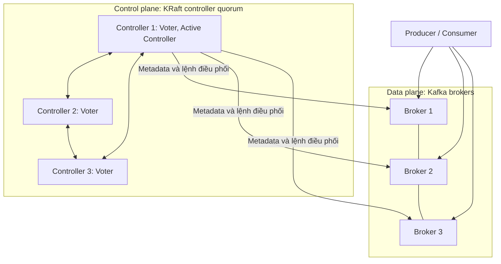
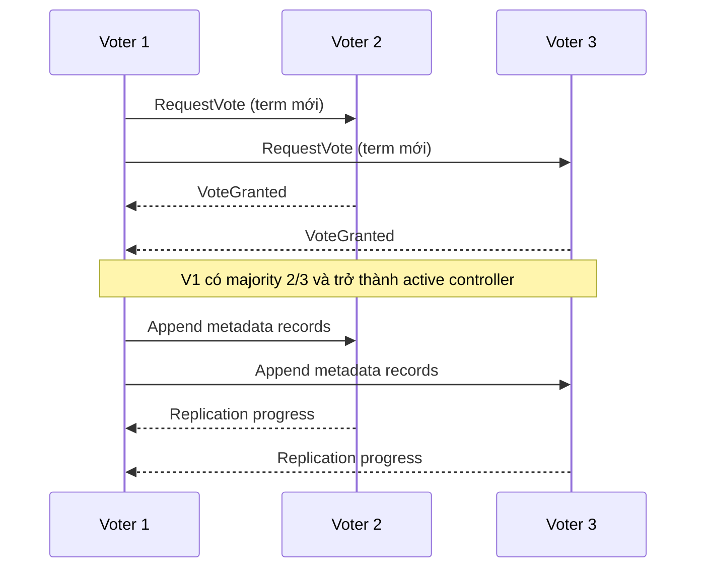
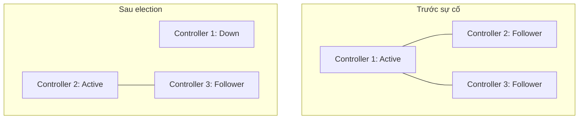

# Vai trò controller quorum, active controller và voter

## KRaft cần một cơ chế thống nhất metadata của cụm

Một Kafka cluster không chỉ lưu record trong topic. Cụm còn phải thống nhất những thông tin điều khiển như broker nào đang tham gia, topic nào tồn tại, topic có bao nhiêu partition, replica được đặt ở broker nào, partition leader là ai và cấu hình nào đang có hiệu lực. Những thông tin này là metadata của cluster.

Trong kiến trúc KRaft, Kafka dùng một nhóm controller và giao thức đồng thuận kiểu Raft để lưu, sao chép và quyết định metadata. Nhóm này được gọi là **controller quorum**. Một thành viên được bầu làm **active controller** (leader của metadata quorum); các thành viên có quyền bỏ phiếu được gọi là **voter**. Active controller điều phối các thay đổi metadata, còn quorum bảo đảm những thay đổi được commit theo một lịch sử thống nhất.

Đây là phần control plane của Kafka. Producer và consumer vẫn trao đổi record với broker; controller không đứng trên đường truyền từng record của ứng dụng. Tuy vậy, nếu controller quorum mất khả năng đạt đồng thuận, các thao tác quản trị và thay đổi trạng thái cụm có thể bị đình trệ, ảnh hưởng dần đến khả năng phục hồi và điều phối partition.

Trong module KAFKA, cần hiểu controller quorum cùng topic, partition, offset, producer, consumer group, replication và KRaft để triển khai event streaming bằng Java/Spring Kafka, xử lý retry, ordering và giao dịch, tích hợp Kafka Connect/Streams, rồi giám sát và phục hồi cụm.

## 1. Controller quản lý phần nào của Kafka?

### 1.1 Metadata và control plane

Controller chịu trách nhiệm điều phối trạng thái ở cấp cluster. Những công việc tiêu biểu gồm:

- Quản lý đăng ký và trạng thái hoạt động của broker.
- Quản lý metadata topic, partition, replica assignment và cấu hình liên quan.
- Theo dõi trạng thái broker/replica và điều phối thay đổi leader của partition khi cần.
- Xử lý các thay đổi metadata như tạo hoặc xóa topic, thay đổi cấu hình và cập nhật assignment.
- Phân phối metadata mới để broker cập nhật trạng thái mà chúng dùng khi phục vụ client.

Controller không lưu thay toàn bộ dữ liệu nghiệp vụ của topic. Record như `OrderCreated` hay `PaymentCompleted` được lưu trong partition trên broker. Metadata log của KRaft ghi lại các thay đổi về cấu trúc và trạng thái cluster, ví dụ topic được tạo, partition được gán replica nào hoặc cấu hình topic thay đổi.

### 1.2 Controller và broker có thể chạy trên cùng hoặc khác node

Kafka hỗ trợ hai cách triển khai phổ biến:

- **Dedicated controller:** node có vai trò controller tập trung vào metadata quorum; broker node tập trung phục vụ dữ liệu. Đây là cách thường được ưu tiên cho cluster production cần mở rộng và cô lập tài nguyên.
- **Combined broker/controller:** cùng một node đảm nhiệm cả vai trò broker và controller. Cách này thuận tiện cho môi trường phát triển hoặc cluster nhỏ, nhưng tài nguyên và sự cố của node ảnh hưởng đồng thời đến control plane và data plane.

Một node có thể có `process.roles=controller`, `process.roles=broker` hoặc cả hai vai trò tùy cấu hình triển khai. Trong mô hình dedicated controller, số broker không đồng nghĩa với số voter; chỉ các node tham gia controller quorum mới bỏ phiếu cho metadata log.



Sơ đồ minh họa controller và broker là hai nhóm vai trò. Trong mô hình combined, một node có thể xuất hiện ở cả hai mặt logic.

## 2. Controller quorum là gì?

Controller quorum là tập các controller voter phối hợp theo Raft để duy trì một metadata log đã được thống nhất. Các voter giữ bản sao metadata log; một voter được bầu làm leader. Trong Kafka, leader này chính là active controller.

Quorum dùng nguyên tắc đa số (majority). Một thay đổi metadata chỉ được xem là committed khi được ghi nhận theo điều kiện đồng thuận của đa số voter. Nhờ vậy, một voter đơn lẻ hoặc một nhóm thiểu số bị tách mạng không thể tự quyết định một lịch sử metadata khác với phần còn lại của cluster.

Nếu quorum có \(N\) voter, số phiếu tối thiểu cần để đạt đa số là:

\[
QuorumSize = \left\lfloor \frac{N}{2} \right\rfloor + 1
\]

Số voter có thể mất mà vẫn còn đa số là:

\[
FailuresTolerated = N - QuorumSize
\]

### 2.1 Ví dụ với 3 và 5 voter

| Số voter | Số phiếu cần (majority) | Số voter có thể mất mà vẫn còn quorum |
|---:|---:|---:|
| 1 | 1 | 0 |
| 2 | 2 | 0 |
| 3 | 2 | 1 |
| 4 | 3 | 1 |
| 5 | 3 | 2 |

Với 3 voter, quorum cần 2 phiếu. Nếu một controller dừng hoặc mất kết nối, hai voter còn lại vẫn có thể bầu leader và commit metadata. Với 5 voter, cần 3 phiếu và có thể chịu mất 2 voter.

Số voter lẻ thường hiệu quả hơn khi xét khả năng chịu lỗi. Bốn voter vẫn cần 3 phiếu, giống cấu hình 3 voter, nên thêm voter thứ tư không tăng số lỗi có thể chịu. Nhiều voter hơn cũng làm tăng lượng trao đổi, lưu trữ và vận hành; không nên tăng số lượng chỉ để có con số lớn.

### 2.2 Quorum không phải yêu cầu mọi voter đều sống

Raft được thiết kế để tiếp tục hoạt động khi một phần thành viên không sẵn sàng, miễn là đa số còn liên lạc và có thể thống nhất. Voter bị lỗi có thể khởi động lại, bắt kịp metadata log và tham gia lại quorum.

Ngược lại, nếu số voter còn liên lạc thấp hơn majority, quorum không thể commit metadata mới. Một nhóm thiểu số không được tự ý tiếp tục như thể nó là toàn bộ cluster, vì điều đó có thể tạo hai lịch sử metadata xung đột.

### 2.3 Đặt voter ở các miền lỗi độc lập

Với 3 voter, nên phân bố chúng trên các máy chủ, rack hoặc availability zone độc lập nếu hạ tầng hỗ trợ. Nếu cả 3 controller cùng nằm trên một host vật lý hoặc cùng một miền lỗi, một sự cố chung có thể làm mất toàn bộ quorum dù cấu hình có ba voter.

Khi thiết kế vị trí controller, cần cân nhắc:

- Không đặt đa số voter trong cùng một miền lỗi có thể mất đồng thời.
- Đường mạng giữa controller phải ổn định, độ trễ phù hợp và được bảo vệ.
- Disk chứa metadata log phải bền vững, có dung lượng và IOPS phù hợp.
- Có quy trình khôi phục node để voter quay lại và bắt kịp log.

Không nên phân tán voter qua các vùng mạng có độ trễ cao hoặc kết nối thiếu ổn định chỉ để đạt mục tiêu địa lý. Raft cần trao đổi heartbeat, vote và dữ liệu log; mạng chậm có thể gây election thường xuyên hoặc kéo dài thời gian commit.

## 3. Active controller là gì?

Active controller là voter đang giữ vai trò leader của controller quorum. Tại một thời điểm, một metadata quorum khỏe mạnh chỉ có một leader hợp lệ. Active controller nhận và điều phối các thay đổi metadata, ghi chúng vào metadata log và sao chép log đến các voter khác theo giao thức Raft.

Các controller voter còn lại là follower khi có leader. Chúng duy trì bản sao log, theo dõi trạng thái leader và tham gia bỏ phiếu khi cần bầu leader mới. Follower không tự nhận quyền commit một thay đổi metadata độc lập.

### 3.1 Active controller không phải partition leader

Hai khái niệm leader này giải quyết hai phạm vi khác nhau:

| Vai trò | Phạm vi | Nhiệm vụ |
|---|---|---|
| Active controller | Toàn cluster metadata quorum | Điều phối metadata và trạng thái cluster |
| Partition leader | Một partition cụ thể | Nhận thao tác produce/fetch theo cơ chế của partition |

Một cluster chỉ có một active controller tại một thời điểm, nhưng có thể có hàng trăm hoặc hàng nghìn partition leader phân bố trên nhiều broker. Active controller có thể quyết định hoặc điều phối việc chuyển partition leader, nhưng không trực tiếp xử lý từng record mà producer gửi vào partition.

### 3.2 Active controller được bầu như thế nào?

KRaft sử dụng cơ chế bầu leader của Raft. Khi controller quorum khởi động hoặc leader hiện tại không còn được xem là hoạt động, các voter theo dõi heartbeat và timeout để xác định cần bầu leader mới.

Ở mức khái niệm, quá trình diễn ra như sau:

1. Voter không nhận heartbeat hợp lệ từ leader trong khoảng thời gian phù hợp sẽ chuyển sang trạng thái có thể tranh cử.
2. Một voter tăng election term/epoch và gửi yêu cầu xin phiếu.
3. Các voter bỏ phiếu theo quy tắc Raft, trong đó tính đến term và mức cập nhật của log ứng viên.
4. Ứng viên nhận đa số phiếu trở thành leader mới.
5. Leader mới tiếp tục đồng bộ và commit metadata log theo quorum.



Sơ đồ là mô tả khái niệm. Giao thức thực tế còn có các điều kiện về term, log offset, commit state, heartbeat và xử lý tình huống nhiều ứng viên cùng tranh cử.

### 3.3 Term và epoch ngăn leader cũ tiếp tục điều khiển

Raft dùng term (thời kỳ bầu cử) để phân biệt các thế hệ leader. Khi một leader mới được bầu, term tăng. Thông điệp hoặc quyết định thuộc term cũ không thể được xem như quyết định mới nhất nếu quorum đã chuyển sang term cao hơn.

Kafka cũng dùng epoch và metadata offset để theo dõi tiến độ và phát hiện trạng thái cũ. Các cơ chế này giúp broker và controller phân biệt metadata đã được commit với thay đổi chưa được xác nhận, đồng thời tránh để một controller cũ tiếp tục hành xử như leader sau khi mất quyền.

## 4. Voter, follower và observer

### 4.1 Voter

Voter là thành viên có quyền bỏ phiếu trong controller quorum. Một voter:

- Tham gia bầu active controller.
- Lưu và sao chép metadata log.
- Xác nhận tiến độ log theo giao thức Raft.
- Được tính vào tổng số thành viên khi xác định majority.

Active controller cũng là một voter; leader không phải một vai trò nằm ngoài quorum. Khi active controller thay đổi, một voter khác có thể được bầu làm leader.

### 4.2 Follower voter

Follower voter là voter không giữ vai trò leader hiện tại. Nó nhận metadata log từ leader, lưu bản sao và bỏ phiếu trong election. Nếu leader bị lỗi, follower có log đủ mới và nhận được majority có thể trở thành leader.

Follower vẫn quan trọng với khả năng sẵn sàng của quorum. Trong cluster 3 voter, nếu leader mất và chỉ còn một follower hoạt động, voter đó không thể tự đạt majority. Cần ít nhất hai voter liên lạc được để bầu leader và commit thay đổi metadata.

### 4.3 Observer

Một số phiên bản/cấu hình KRaft hỗ trợ controller observer. Observer có thể theo dõi và sao chép metadata log, nhưng không bỏ phiếu và không được tính vào majority. Observer hữu ích khi cần một node theo kịp metadata mà không làm thay đổi mẫu số quorum hoặc số phiếu cần thiết.

Ví dụ, quorum có 3 voter và thêm 1 observer. Majority vẫn là 2 trên 3 voter; observer không biến quorum thành 4 voter và không làm tăng số lỗi voter có thể chịu. Nếu cần thay đổi membership, hãy thực hiện theo quy trình và tính năng membership được hỗ trợ bởi phiên bản Kafka đang dùng.

Không nên gọi mọi controller follower là observer. Follower voter vẫn có quyền bỏ phiếu; observer thì không. Đây là khác biệt quan trọng khi tính quorum và lập kế hoạch sự cố.

## 5. Metadata log được commit như thế nào?

KRaft lưu các thay đổi metadata thành một chuỗi record trong metadata log. Active controller nhận thay đổi hợp lệ, append record vào log và sao chép đến các voter. Khi đủ điều kiện majority theo Raft, record được xem là committed. Các controller và broker sau đó áp dụng metadata đã commit theo tiến trình đồng bộ của mình.

Ví dụ, khi tạo topic `payments` với 6 partition:

1. Yêu cầu tạo topic được xử lý ở control plane.
2. Active controller xác định metadata cần thay đổi, bao gồm topic và partition assignment.
3. Thay đổi được ghi vào metadata log và sao chép trong controller quorum.
4. Sau khi metadata record được commit, trạng thái mới được áp dụng và phân phối tới broker.
5. Broker cập nhật metadata cục bộ để phục vụ producer/consumer và quản lý replica tương ứng.

Metadata log không phải topic nghiệp vụ thông thường mà ứng dụng tạo để gửi event. Nó là log nội bộ dùng cho trạng thái cluster. KRaft có thể tạo snapshot metadata để giảm lượng log cần replay khi controller khởi động hoặc phục hồi; snapshot là ảnh chụp trạng thái metadata tại một offset, còn log tiếp tục chứa các thay đổi sau snapshot.

### 5.1 Commit khác với chỉ append

Một record có thể đã được ghi trên leader nhưng chưa được quorum xác nhận. Nếu leader lỗi trước khi record được commit, leader mới sẽ tuân theo trạng thái log hợp lệ được quorum thống nhất; không nên coi mọi record vừa append là metadata đã có hiệu lực.

Đối với thao tác quản trị, ứng dụng nên chờ kết quả từ Kafka Admin API và xử lý timeout theo cách an toàn. Timeout không nhất thiết chứng minh thay đổi thất bại; client có thể không nhận được phản hồi dù thay đổi đã được commit. Khi retry, cần kiểm tra trạng thái hiện tại hoặc dùng thao tác idempotent phù hợp.

### 5.2 Snapshot và phục hồi

Khi metadata log dài, controller có thể tạo snapshot để khôi phục trạng thái mà không phải replay toàn bộ lịch sử từ đầu. Snapshot không thay thế quorum; nó là cơ chế tối ưu phục hồi và đồng bộ metadata. Voter mới hoặc voter bị tụt hậu có thể cần lấy snapshot và các record tiếp theo để bắt kịp leader.

## 6. Điều gì xảy ra khi controller gặp sự cố?

### 6.1 Active controller bị dừng nhưng vẫn còn majority

Giả sử cluster có 3 voter. Voter 1 đang là active controller và bị dừng. Hai voter còn lại vẫn liên lạc được, có thể bầu leader mới. Trong khoảng thời gian election và đồng bộ, các thao tác metadata có thể tạm chậm hoặc timeout. Khi leader mới ổn định, quorum tiếp tục xử lý thay đổi metadata.



### 6.2 Mất majority

Nếu 2 trong 3 voter bị dừng hoặc bị cô lập mạng, voter còn lại không thể tự tạo quorum. Metadata log không thể commit thay đổi mới và cluster không thể bầu một active controller hợp lệ mới từ nhóm thiểu số.

Các broker có thể vẫn còn metadata đã nhận trước đó và một số partition leader hiện hữu có thể tiếp tục phục vụ một phần traffic data plane trong thời gian nhất định. Tuy nhiên, các thao tác cần controller, đăng ký/heartbeat broker, thay đổi metadata và điều phối leader mới sẽ bị ảnh hưởng. Không nên coi việc producer/consumer hiện tại còn hoạt động là bằng chứng controller quorum vẫn khỏe mạnh.

### 6.3 Broker lỗi không đồng nghĩa controller voter lỗi

Trong mô hình dedicated controller, broker có thể bị lỗi trong khi controller quorum vẫn khỏe mạnh. Active controller tiếp nhận trạng thái broker thay đổi và có thể điều phối replica/partition theo metadata và chính sách cluster. Ngược lại, controller có thể lỗi trong khi các broker vẫn đang phục vụ partition hiện tại.

Trong mô hình combined, một node lỗi đồng thời làm mất vai trò broker và controller voter trên node đó. Vì vậy, cùng một sự cố có thể ảnh hưởng cả data plane lẫn control plane.

## 7. Phân biệt controller quorum với replication của partition

Đây là hai cơ chế khác nhau và không nên gộp làm một:

| Khía cạnh | Controller quorum (KRaft) | Partition replication |
|---|---|---|
| Mục tiêu | Đồng thuận metadata của cluster | Sao chép record của một partition |
| Thành viên | Controller voter | Broker giữ replica của partition |
| Leader | Active controller | Partition leader |
| Cơ chế | Raft majority trên voter | Leader/follower replication và ISR |
| Dữ liệu | Metadata log và snapshot | Record trong topic partition |
| Điều kiện xác nhận | Majority voter theo Raft | Theo `acks`, ISR và cấu hình replication liên quan |

Ví dụ, controller quorum có 3 voter và partition `orders-0` có replication factor 3. Đây là hai tập thành viên khác nhau, dù trong mô hình combined một node có thể vừa là voter vừa giữ replica broker. Controller quorum cần 2/3 voter để commit metadata; partition write với `acks=all` dựa trên ISR của partition và `min.insync.replicas`, không dựa vào phiếu của controller voter.

Nếu một partition có replication factor 3 và `min.insync.replicas=2`, việc producer có thể ghi khi một replica bị lỗi phụ thuộc trạng thái ISR và `acks`. Điều đó không nói lên controller quorum đang có bao nhiêu voter. Ngược lại, controller quorum có thể mất majority trong khi một số partition vẫn có đủ ISR để phục vụ traffic hiện tại.

## 8. Cấu hình controller quorum ở mức khái niệm

Trong triển khai static quorum ở các phiên bản Kafka hỗ trợ cấu hình này, controller node thường có các thuộc tính tương tự:

```properties
process.roles=controller
node.id=1
listeners=CONTROLLER://controller-1:9093
controller.listener.names=CONTROLLER
controller.quorum.voters=1@controller-1:9093,2@controller-2:9093,3@controller-3:9093
metadata.log.dir=/var/lib/kafka/metadata
```

Các node controller khác dùng `node.id` riêng và cùng khai báo membership phù hợp. Broker-only node dùng vai trò `broker` và cấu hình endpoint để kết nối controller quorum. Trong mô hình combined, `process.roles` có thể gồm cả `broker,controller`.

Kafka có các cơ chế cấu hình quorum khác nhau theo phiên bản, bao gồm static membership và dynamic quorum. Một số bản phát hành mới sử dụng cấu hình bootstrap server cho controller quorum và quy trình quản lý membership động; không nên sao chép nguyên thuộc tính `controller.quorum.voters` từ một hướng dẫn cũ sang phiên bản mới mà chưa kiểm tra tài liệu đúng phiên bản. Cũng cần phân biệt địa chỉ bootstrap dùng để tìm quorum với danh sách voter membership thực tế.

Các điểm cấu hình cần thống nhất:

- `node.id` duy nhất cho từng node Kafka.
- Vai trò `process.roles` phù hợp với topology.
- Controller listener và địa chỉ advertised/reachable đúng giữa các controller.
- Bảo mật listener, xác thực và ACL phù hợp với môi trường.
- Thư mục metadata log nằm trên storage bền vững và được giám sát.
- Membership voter được quản lý nhất quán theo chế độ quorum của phiên bản.

Không tự ý xóa metadata log hoặc thay node ID để xử lý một controller không khởi động được. Metadata log chứa trạng thái quorum; thao tác xóa hoặc thay membership sai có thể làm mất khả năng khôi phục hoặc tạo cluster identity không nhất quán.

## 9. Giám sát sức khỏe controller quorum

Controller quorum cần được giám sát như một dịch vụ trọng yếu. Không chỉ kiểm tra tiến trình Java còn chạy; cần xác nhận leader, voter reachability, metadata log replication và thời gian election.

Các dấu hiệu nên theo dõi gồm:

| Nhóm | Điều cần quan sát | Dấu hiệu bất thường |
|---|---|---|
| Leader | Active controller hiện tại, leader changes | Election lặp lại hoặc không có leader ổn định |
| Quorum | Số voter reachable và majority | Số voter khả dụng tiến sát hoặc thấp hơn majority |
| Metadata log | Log end offset, committed offset, follower lag | Voter theo không kịp leader hoặc commit bị chậm |
| Election | Election rate, heartbeat timeout, thời gian bầu leader | Nhiều election trong thời gian ngắn |
| Hạ tầng | Network latency/loss, disk latency, CPU, GC | Heartbeat trễ, I/O nghẽn hoặc controller bị pause |
| Broker registration | Broker heartbeat và trạng thái đăng ký | Broker bị xem là mất kết nối dù tiến trình còn chạy |

Tên metric và công cụ truy vấn cụ thể có thể khác theo phiên bản Kafka và hệ thống giám sát. Khi triển khai, hãy xác nhận metric qua JMX/metrics endpoint của đúng bản Kafka, sau đó đặt cảnh báo theo baseline và SLO thay vì dùng một ngưỡng tùy tiện.

### 9.1 Checklist khi controller quorum có vấn đề

1. Xác định node nào đang là active controller và node nào là voter.
2. Kiểm tra có bao nhiêu voter đang hoạt động và liên lạc được; đối chiếu với majority.
3. Kiểm tra log controller để tìm election timeout, request vote, lỗi network hoặc lỗi metadata log.
4. Kiểm tra disk metadata log, quyền truy cập, dung lượng và I/O latency.
5. Kiểm tra listener, DNS, firewall, TLS/SASL và cấu hình node ID.
6. Khôi phục node bị lỗi theo đúng membership hiện tại; theo dõi quá trình bắt kịp log.
7. Xác nhận có active controller ổn định, metadata commit tiếp tục và broker registration trở lại bình thường.
8. Kiểm tra partition leader/ISR riêng để xác nhận data plane đã ổn định.

Không cố ép một voter thiểu số thành leader bằng cách sửa membership hoặc xóa dữ liệu khi chưa xác định được trạng thái quorum. Trước các thao tác phục hồi đặc biệt, cần bảo toàn bản sao dữ liệu và tuân theo quy trình khôi phục cho phiên bản Kafka đang chạy.

## 10. Ví dụ vận hành: tạo topic khi controller leader thay đổi

Giả sử cluster có ba controller voter `C1`, `C2`, `C3`; `C1` là active controller. Một quản trị viên gửi yêu cầu tạo topic `payments`.

1. Yêu cầu được gửi qua Kafka Admin API đến broker phù hợp.
2. Yêu cầu được chuyển đến control plane để active controller xử lý.
3. `C1` tạo các metadata record cho topic và partition assignment.
4. Metadata record được sao chép đến các voter.
5. Khi majority xác nhận theo Raft, thay đổi được commit.
6. Broker nhận metadata mới và cập nhật trạng thái topic.

Nếu `C1` dừng sau khi gửi record nhưng trước khi client nhận response, hai tình huống có thể xảy ra: thay đổi chưa được commit, hoặc đã commit nhưng response không đến được client. Vì vậy, client nhận timeout không nên kết luận ngay topic chắc chắn chưa tồn tại. Có thể truy vấn metadata hoặc gọi thao tác kiểm tra trạng thái trước khi retry tạo topic.

Nếu `C1` dừng trước khi metadata được commit, `C2` và `C3` có thể bầu active controller mới và tiếp tục theo log đã được quorum thống nhất. Nếu chỉ còn một voter hoạt động, không thể bầu leader mới hoặc commit metadata mới cho đến khi quorum được khôi phục.

## 11. Các hiểu lầm thường gặp

**“Mỗi broker là một voter.”** Không đúng trong mô hình dedicated controller. Chỉ node tham gia controller quorum với tư cách voter mới được tính vào majority. Broker-only node không tự động là voter.

**“Active controller là leader của mọi partition.”** Active controller là leader của metadata quorum. Mỗi partition có partition leader riêng do broker đảm nhiệm.

**“Có ba controller thì cả ba phải hoạt động mới ghi được metadata.”** Quorum 3 voter chỉ cần majority 2. Một voter có thể không sẵn sàng mà quorum vẫn hoạt động.

**“Observer cũng được tính vào majority.”** Observer không bỏ phiếu và không được tính là voter. Hãy phân biệt observer với follower voter.

**“Mất controller quorum đồng nghĩa mọi producer/consumer dừng ngay lập tức.”** Không nhất thiết. Một số partition hiện hữu có thể tiếp tục phục vụ dựa trên trạng thái broker và metadata đã biết, nhưng các thao tác control plane và khả năng điều phối/phục hồi bị ảnh hưởng.

**“Controller quorum và ISR là cùng một quorum.”** Controller quorum thống nhất metadata bằng Raft; ISR phản ánh replica đang đồng bộ của từng partition và tham gia quy tắc xác nhận ghi dữ liệu. Hai cơ chế có thành viên, dữ liệu và mục tiêu khác nhau.

## Kết luận

Controller quorum là nền tảng đồng thuận metadata của KRaft. Voter tham gia bầu leader và sao chép metadata log; active controller là voter đang giữ vai trò leader, điều phối các thay đổi trạng thái cluster. Majority giúp cluster tiếp tục khi một phần voter gặp sự cố, đồng thời ngăn nhóm thiểu số tự tạo lịch sử metadata riêng.

Khi vận hành KAFKA, hãy phân biệt active controller với partition leader, voter với observer, và controller quorum với partition ISR. Thiết kế số voter lẻ trên các miền lỗi độc lập, theo dõi quorum và metadata log, kiểm tra cấu hình theo đúng phiên bản Kafka, rồi diễn tập phục hồi leader và voter. Những nguyên tắc đó giúp control plane ổn định để broker tiếp tục phục vụ event streaming một cách có thể dự đoán.
