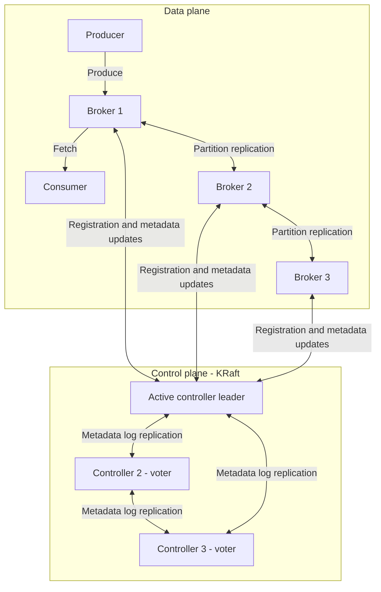
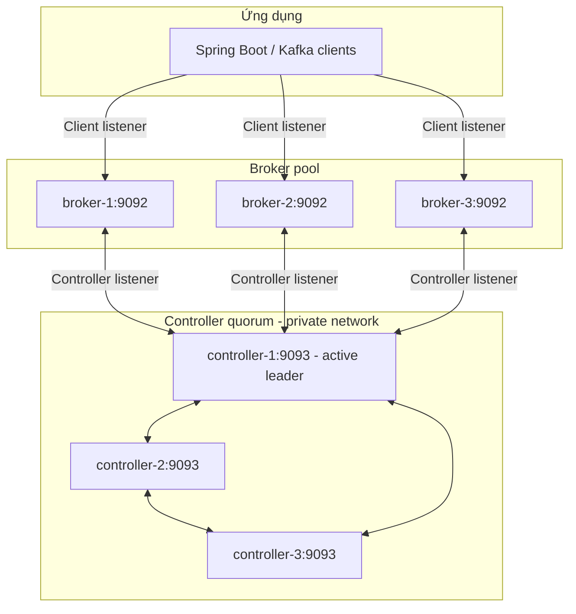

# Tách vai trò broker và controller trong môi trường vận hành

## Mục tiêu bài học

Kafka sử dụng KRaft để quản lý metadata cụm bằng một quorum controller. Trong môi trường nhỏ, một node có thể đồng thời đảm nhiệm vai trò broker và controller. Khi hệ thống cần mở rộng và vận hành ổn định hơn, có thể tách hai vai trò thành các node chuyên trách: controller quản lý metadata và trạng thái điều khiển của cụm, còn broker lưu trữ partition dữ liệu và phục vụ producer/consumer.

Bài học giải thích lý do tách vai trò, cách quorum controller phối hợp, cấu hình một cụm KRaft có controller chuyên trách, các ranh giới mạng cần bảo vệ và cách triển khai, giám sát, bảo trì khi có lỗi. Các ví dụ cấu hình dùng static controller quorum để thể hiện rõ danh sách voter; với Kafka được triển khai theo dynamic quorum, cần dùng cấu hình bootstrap và quy trình khởi tạo tương ứng với đúng phiên bản Kafka.

Sau bài học, người học có thể:

- Phân biệt vai trò broker, controller và node kết hợp broker/controller.
- Giải thích control plane, data plane và metadata log trong KRaft.
- Hiểu quorum, controller leader, voter và khả năng chịu lỗi.
- Cấu hình node controller chuyên trách và broker chuyên trách.
- Thiết kế listener, hostname, cổng và ranh giới bảo mật giữa broker với controller.
- Lập kế hoạch khởi động, rolling restart, mở rộng và phục hồi quorum.
- Theo dõi trạng thái metadata quorum và phân biệt lỗi controller với lỗi broker.

## 1. Vì sao cần tách broker và controller?

Kafka có hai nhóm công việc lớn. Nhóm thứ nhất là xử lý dữ liệu sự kiện: producer ghi record, consumer đọc record, broker lưu partition và sao chép dữ liệu. Nhóm thứ hai là quản lý trạng thái cụm: đăng ký broker, quản lý topic và partition, cấu hình, ACL, trạng thái replica, bầu chọn leader và phân phối metadata.

Trong KRaft, các công việc quản lý trạng thái cụm do controller đảm nhiệm thông qua một quorum controller. Broker nhận metadata từ controller và dùng metadata đó để phục vụ hoạt động dữ liệu.

Nếu node chạy cả hai vai trò (`broker,controller`), node vừa xử lý lưu lượng producer/consumer vừa tham gia quorum metadata. Mô hình này tiện cho môi trường phát triển, lab hoặc cụm nhỏ. Trong môi trường production có tải lớn, việc tách node có thể mang lại các lợi ích:

- **Cô lập tài nguyên:** tải ghi/đọc, page cache, I/O và lưu trữ của broker ít cạnh tranh với tiến trình quản lý metadata.
- **Ổn định quorum:** controller có tài nguyên và mạng riêng để duy trì heartbeat, bầu chọn leader và ghi metadata log.
- **Mở rộng độc lập:** có thể tăng số broker để tăng dung lượng và thông lượng mà không nhất thiết tăng số controller.
- **Ranh giới bảo mật rõ ràng:** chỉ các node trong cụm được phép truy cập controller listener; client nghiệp vụ chỉ truy cập broker listener.
- **Bảo trì có kiểm soát:** có thể lập kế hoạch nâng cấp broker và controller theo thứ tự riêng, miễn là giữ quorum hoạt động.

Tách vai trò cũng tạo thêm node, chi phí hạ tầng và yêu cầu vận hành. Controller không phải một broker dự phòng để nhận traffic producer/consumer. Cần dành tài nguyên, giám sát và quy trình phục hồi riêng cho controller quorum.

## 2. Vai trò của từng loại node trong KRaft

### 2.1. Broker

Broker là node phục vụ data plane. Nó chịu trách nhiệm:

- Lưu các partition log của topic trên đĩa.
- Nhận request produce và fetch từ client.
- Thực hiện replication giữa leader và follower của partition.
- Phục vụ request đọc/ghi theo metadata và vai trò partition được controller quản lý.
- Gửi thông tin đăng ký, heartbeat và trạng thái cần thiết tới controller.

Broker có thể là leader của một số partition và follower của các partition khác. Vai trò leader/follower của partition không đồng nghĩa với vai trò controller leader.

### 2.2. Controller

Controller là node tham gia control plane của Kafka. Trong KRaft, các controller duy trì một metadata log được replicate qua quorum. Controller leader điều phối các thay đổi metadata và các hoạt động quản lý cụm.

Metadata do KRaft quản lý gồm các thông tin như:

- Topic và cấu trúc partition.
- Phân công replica, trạng thái leader và ISR.
- Đăng ký và trạng thái broker.
- Cấu hình topic, cấu hình broker và các thay đổi quản trị.
- ACL và một số metadata/feature liên quan đến phiên bản cụm.

Controller không lưu các topic data partition để phục vụ producer/consumer như broker. Controller chuyên trách cũng không cần công bố endpoint cho ứng dụng nghiệp vụ.

### 2.3. Node kết hợp broker/controller

KRaft cho phép một node chạy đồng thời hai vai trò:

```properties
process.roles=broker,controller
```

Mô hình kết hợp giảm số node và phù hợp cho môi trường nhỏ. Tuy nhiên, khi tải data plane tăng mạnh, controller phải cạnh tranh CPU, bộ nhớ, I/O và tài nguyên mạng với broker. Đây là một lý do để chuyển sang controller chuyên trách khi cụm lớn hơn.

### 2.4. So sánh ba cách triển khai

| Mô hình | Cấu hình vai trò | Phù hợp với | Điểm cần lưu ý |
|---|---|---|---|
| Kết hợp | `broker,controller` | Local, lab, cụm nhỏ | Tài nguyên control plane và data plane dùng chung |
| Controller chuyên trách | Controller: `controller`; broker: `broker` | Production cần cô lập vai trò | Tốn thêm node và cần vận hành quorum riêng |
| Mở rộng broker độc lập | Một quorum controller riêng, nhiều broker | Cụm có tải dữ liệu tăng | Có thể tăng broker mà không tăng controller theo tỷ lệ 1:1 |

## 3. Control plane và data plane

Tách vai trò giúp nhìn rõ hai luồng hoạt động. Producer và consumer gửi request dữ liệu đến broker. Broker nhận metadata từ controller và trao đổi dữ liệu replica với các broker khác. Controller trao đổi metadata log với các voter trong quorum.



Sơ đồ mô tả hai lớp độc lập về vai trò. Trong thực tế, broker kết nối đến controller qua controller listener; controller gửi metadata update đến broker. Các broker vẫn trao đổi dữ liệu partition qua inter-broker listener.

Điều quan trọng là không trộn các endpoint này:

- **Client listener:** producer và consumer kết nối đến broker.
- **Inter-broker listener:** broker trao đổi dữ liệu replica với broker khác.
- **Controller listener:** broker và controller giao tiếp trong control plane; các controller dùng endpoint này để duy trì quorum.

Controller listener không phải cổng bootstrap cho ứng dụng Spring Kafka. Ứng dụng nghiệp vụ phải kết nối broker listener.

## 4. Quorum controller và khả năng chịu lỗi

### 4.1. Quorum cần đa số voter

Controller quorum sử dụng cơ chế đồng thuận để các voter thống nhất metadata log. Một thay đổi metadata chỉ được xem là commit khi đạt điều kiện quorum. Với `N` voter, quorum cần đa số:

\[
Q = \left\lfloor \frac{N}{2} \right\rfloor + 1
\]

Số voter và số lỗi có thể chịu được:

| Số controller voter | Cần tối thiểu | Có thể mất voter |
|---:|---:|---:|
| 1 | 1 | 0 |
| 3 | 2 | 1 |
| 5 | 3 | 2 |

Ba controller là lựa chọn phổ biến cho production quy mô vừa vì chịu được một controller lỗi mà quorum vẫn hoạt động. Năm controller có thể chịu được hai voter lỗi nhưng tăng số node, kết nối và chi phí điều phối. Bốn voter chỉ cần ba để đạt đa số nên không tăng số lỗi có thể chịu so với ba voter; vì vậy thường chọn số lẻ.

Các controller voter nên đặt trên các failure domain độc lập khi hạ tầng hỗ trợ, ví dụ khác host hoặc khác rack/zone. Nếu cả ba controller cùng phụ thuộc một máy vật lý, một nguồn điện hoặc một zone, khả năng chịu lỗi thực tế sẽ thấp hơn thiết kế logic.

### 4.2. Controller leader và follower

Trong quorum có một controller leader điều phối các thao tác metadata. Các controller còn lại theo kịp metadata log. Nếu leader lỗi, các voter còn lại có thể bầu leader mới khi vẫn đạt quorum.

Không nhầm hai cuộc bầu chọn:

- **Controller leader election:** chọn controller leader để điều phối metadata quorum.
- **Partition leader election:** chọn broker làm leader cho một partition dữ liệu.

Controller quản lý quá trình thay đổi metadata về partition leader; broker được chọn mới là node phục vụ request dữ liệu cho partition đó.

### 4.3. Điều gì xảy ra khi mất quorum?

Nếu một trong ba controller dừng, hai voter còn lại vẫn có thể duy trì quorum. Nếu hai controller cùng dừng, chỉ còn một voter và quorum bị mất.

Khi quorum mất, cụm không thể commit các thay đổi metadata mới hoặc thực hiện đầy đủ các hoạt động control plane cần quorum. Một số partition đang có leader trên broker có thể tiếp tục phục vụ traffic hiện tại trong một khoảng thời gian, tùy trạng thái cụm và phiên bản Kafka. Tuy nhiên, không nên xem đó là trạng thái khỏe mạnh: leader election mới, broker registration, thay đổi topic/config và các thao tác quản trị có thể bị ảnh hưởng. Hãy khôi phục quorum trước khi thực hiện thay đổi vận hành tiếp theo.

Mất quorum controller không đồng nghĩa dữ liệu partition trên broker bị xóa. Metadata log và dữ liệu partition được lưu riêng; khôi phục controller cần bảo toàn storage và cluster identity.

## 5. Thiết kế topology controller chuyên trách

Một topology ví dụ có ba controller và ba broker:

| Node | `node.id` | `process.roles` | Listener chính |
|---|---:|---|---|
| controller-1 | 1 | `controller` | `CONTROLLER://controller-1:9093` |
| controller-2 | 2 | `controller` | `CONTROLLER://controller-2:9093` |
| controller-3 | 3 | `controller` | `CONTROLLER://controller-3:9093` |
| broker-1 | 101 | `broker` | `INTERNAL://broker-1:9092` |
| broker-2 | 102 | `broker` | `INTERNAL://broker-2:9092` |
| broker-3 | 103 | `broker` | `INTERNAL://broker-3:9092` |

`node.id` phải duy nhất trong toàn cụm, kể cả giữa controller và broker. Không dùng cùng ID cho controller-1 và broker-1 chỉ vì chúng thuộc hai vai trò khác nhau.



Trong môi trường thật, broker cần có thể truy cập các controller voter, còn controller cần truy cập các voter còn lại và các broker theo yêu cầu giao thức. Client ứng dụng chỉ cần truy cập broker listener.

### 5.1. Phân bổ tài nguyên

Controller và broker có đặc tính tải khác nhau, vì vậy nên theo dõi và cấp tài nguyên theo vai trò:

| Thành phần | Ưu tiên tài nguyên | Lưu ý triển khai |
|---|---|---|
| Controller | CPU ổn định, đủ RAM cho metadata và cache, đĩa bền vững có độ trễ thấp, mạng có latency thấp | Tránh đặt nhiều controller trên cùng failure domain; không để job batch hoặc workload không liên quan chiếm tài nguyên quorum |
| Broker | Dung lượng và throughput đĩa, page cache/RAM, CPU cho request và compression, băng thông mạng | Phân bố partition/replica đều; giám sát disk utilization, request latency và replication traffic |

Không nên sizing controller chỉ dựa trên dung lượng topic data vì controller lưu metadata log, còn partition data nằm trên broker. Số topic, partition, broker, cấu hình và tần suất thay đổi metadata mới là các yếu tố cần đưa vào đánh giá tải control plane.

## 6. Cấu hình KRaft với controller chuyên trách

Các ví dụ sau minh họa static quorum. Tên host và cổng là ví dụ; hãy thay bằng DNS/IP nội bộ có thể định tuyến trong môi trường triển khai. Dùng cùng một cluster ID cho các node thuộc cùng cluster và `node.id` riêng cho từng node.

### 6.1. Cấu hình controller node

Ví dụ `server.properties` của `controller-1`:

```properties
process.roles=controller
node.id=1

listeners=CONTROLLER://0.0.0.0:9093
controller.listener.names=CONTROLLER
listener.security.protocol.map=CONTROLLER:PLAINTEXT

# Static quorum: cùng danh sách voter trên tất cả node trong cụm.
controller.quorum.voters=1@controller-1:9093,2@controller-2:9093,3@controller-3:9093

# Metadata log lưu trên volume bền vững của controller.
metadata.log.dir=/var/lib/kafka/metadata
```

Controller-2 và controller-3 dùng cùng cấu trúc, nhưng đổi `node.id` lần lượt thành `2` và `3`. Hostname và cổng trong danh sách voter phải trỏ đúng endpoint controller của từng node.

Controller chuyên trách chỉ bind controller listener. Không cấu hình client listener hoặc quảng bá controller endpoint cho producer/consumer. Trong production, thay `PLAINTEXT` bằng cấu hình TLS/SASL phù hợp và quản lý chứng thư/secret an toàn.

### 6.2. Cấu hình broker node

Ví dụ `server.properties` của `broker-1`:

```properties
process.roles=broker
node.id=101

# Client và inter-broker traffic.
listeners=INTERNAL://0.0.0.0:9092
advertised.listeners=INTERNAL://broker-1:9092
inter.broker.listener.name=INTERNAL

# Broker kết nối tới controller quorum qua listener riêng.
controller.listener.names=CONTROLLER
listener.security.protocol.map=INTERNAL:PLAINTEXT,CONTROLLER:PLAINTEXT
controller.quorum.voters=1@controller-1:9093,2@controller-2:9093,3@controller-3:9093

log.dirs=/var/lib/kafka/data
```

Broker-2 và broker-3 đổi `node.id`, `advertised.listeners` và storage path tương ứng. `controller.listener.names` chỉ ra listener mà broker dùng khi giao tiếp với controller. Broker không cần bind cổng `CONTROLLER` của controller quorum; nó chỉ cần biết giao thức và địa chỉ voter.

### 6.3. Không trộn cấu hình static và dynamic quorum

Ví dụ trên dùng `controller.quorum.voters` để khai báo danh sách voter cố định. Một số phiên bản Kafka hỗ trợ dynamic quorum, trong đó các node dùng `controller.quorum.bootstrap.servers` để tìm quorum và membership được quản lý động. Hai chế độ có quy trình khởi tạo, thêm và loại controller khác nhau.

Trước khi triển khai, hãy xác định chế độ quorum mà phiên bản Kafka đang dùng, sau đó làm theo tài liệu của đúng phiên bản cho `kafka-storage.sh format`, bootstrap và quản lý membership. Không đặt đồng thời các thuộc tính của hai chế độ hoặc sao chép cấu hình static sang một cụm dynamic mà không chuyển đổi theo quy trình được hỗ trợ.

### 6.4. Cluster ID và format storage

Các node trong cùng cluster phải được format với cùng cluster ID, trong khi mỗi node có `node.id` riêng. Với static quorum, cách khởi tạo và format storage phụ thuộc phiên bản Kafka và cách triển khai; thực hiện theo hướng dẫn chính thức của bản phân phối đang chạy.

Một số nguyên tắc cần giữ:

- Lưu cluster ID trong quy trình provisioning để tất cả node dùng cùng một giá trị.
- Không format lại volume đang chứa metadata hoặc partition data chỉ để khắc phục lỗi khởi động.
- Dùng volume bền vững cho metadata log của controller và data log của broker.
- Bảo đảm quyền truy cập thư mục, dung lượng đĩa và ownership phù hợp với user chạy Kafka.
- Sao lưu và diễn tập phục hồi theo chính sách của tổ chức; không tự sao chép metadata directory khi cluster đang chạy nếu chưa có quy trình nhất quán.

## 7. Listener và ranh giới mạng

Tách vai trò chỉ có hiệu quả khi endpoint được thiết kế rõ ràng. Các listener đại diện cho các đường giao tiếp khác nhau:

| Listener | Thành phần sử dụng | Mục đích | Có nên mở cho ứng dụng nghiệp vụ? |
|---|---|---|---|
| Client/INTERNAL | Producer, consumer, admin client | Gửi/đọc dữ liệu qua broker | Có, theo chính sách truy cập |
| Inter-broker | Broker với broker | Replication và request nội bộ | Không |
| Controller | Broker với controller, controller với controller | Metadata quorum và control plane | Không |

Các mục đích trên là các luồng giao tiếp logic. Một listener broker có thể đồng thời phục vụ client và inter-broker traffic nếu được chọn làm `inter.broker.listener.name`, như listener `INTERNAL` trong cấu hình mẫu bên dưới. Môi trường production cũng có thể tách riêng client listener và inter-broker listener để áp dụng chính sách mạng, xác thực và mã hóa khác nhau.

Không đưa địa chỉ controller vào `advertised.listeners`. Client Kafka nhận metadata broker để kết nối các broker phục vụ partition; controller endpoint không phải endpoint dữ liệu của client.

Các biện pháp bảo vệ mạng:

- Chỉ cho phép broker và controller truy cập controller listener trên cổng đã định nghĩa.
- Giới hạn inter-broker listener trong mạng nội bộ của cụm.
- Chỉ publish client listener đến các subnet hoặc gateway được phép.
- Dùng TLS để mã hóa đường truyền; dùng SASL hoặc cơ chế xác thực phù hợp cho broker, controller và client.
- Quản lý ACL, chứng thư, secret và vòng đời credential.
- Đặt controller trên subnet/private network phù hợp; không mở controller listener ra Internet.
- Đồng bộ DNS, NTP/time và firewall rule để tránh lỗi kết nối hoặc lỗi chứng thư.

Nếu dùng hostname, hostname phải phân giải đúng từ mọi node cần sử dụng endpoint đó. Không dùng `localhost` trong cấu hình cluster phân tán vì `localhost` của mỗi node trỏ về chính node đó.

## 8. Quy trình triển khai cụm mới

Một trình tự triển khai có kiểm soát giúp broker không khởi động với quorum chưa sẵn sàng:

1. **Chọn topology:** xác định số controller voter, broker, failure domain, địa chỉ DNS, port, storage và chính sách bảo mật.
2. **Chuẩn bị hạ tầng:** cấp máy/VM/container, volume bền vững, firewall, chứng thư và service account.
3. **Chọn quorum mode:** static hay dynamic theo phiên bản Kafka; thống nhất cấu hình trên các node.
4. **Tạo cluster ID và format storage:** dùng cùng cluster ID, node ID riêng, thực hiện đúng quy trình format của phiên bản.
5. **Khởi động controller quorum:** xác nhận có leader và đủ voter theo quorum.
6. **Khởi động broker:** broker kết nối đến controller, đăng ký và nhận metadata.
7. **Tạo topic thử nghiệm:** kiểm tra partition assignment, replication factor, leader và ISR.
8. **Kết nối client:** producer/consumer dùng client listener của broker; xác nhận metadata broker có endpoint truy cập được.
9. **Kiểm tra lỗi:** diễn tập dừng một controller hoặc một broker trong môi trường staging để xác nhận cơ chế phục hồi.

Không triển khai broker trước khi controller quorum có thể hoạt động ổn định. Broker cần controller để đăng ký và nhận metadata cần thiết cho hoạt động cụm.

## 9. Giám sát controller và broker

Tách vai trò cũng cần tách dashboard và cảnh báo. Chỉ số broker khỏe không đủ để kết luận metadata quorum khỏe, và controller khỏe không chứng minh data plane đang đáp ứng tải.

### 9.1. Theo dõi controller quorum

Các thông tin cần theo dõi:

- Có controller leader được bầu hay không.
- Số voter đang hoạt động và có thể tham gia quorum.
- Metadata log end offset, high watermark và độ trễ replicate giữa các voter.
- Thời gian bầu leader và số lần election bất thường.
- Lỗi kết nối, timeout, disk latency, CPU và heap của controller.
- Dung lượng metadata log/snapshot và tình trạng volume.

Có thể dùng công cụ Kafka metadata quorum để xem trạng thái qua broker bootstrap:

```bash
kafka-metadata-quorum.sh --bootstrap-server broker-1:9092 describe --status
```

Một số phiên bản/cấu hình cho phép bootstrap trực tiếp qua controller bằng tùy chọn tương ứng. Hãy dùng đúng cú pháp CLI đi kèm phiên bản Kafka của cụm.

### 9.2. Theo dõi broker data plane

Các thông tin nên giám sát:

- Request rate, request latency và network throughput.
- Disk throughput, disk latency và dung lượng `log.dirs`.
- Partition leader/follower distribution và số partition offline.
- ISR shrink/expand, under-replicated partition và replica lag.
- Consumer lag theo group và topic-partition.
- Số kết nối client, lỗi authentication và lỗi produce/fetch.

Kiểm tra partition:

```bash
kafka-topics.sh --bootstrap-server broker-1:9092 --describe --topic orders
```

Khi có cảnh báo, xác định trước lỗi nằm ở quorum metadata, broker process, network, storage hay client. Ví dụ controller quorum mất leader là sự cố control plane; partition leader unavailable hoặc broker disk đầy là vấn đề data plane/broker. Hai loại sự cố có thể liên quan nhưng cách xử lý khác nhau.

## 10. Bảo trì và mở rộng

### 10.1. Rolling restart controller

Với ba voter, chỉ dừng từng controller một. Sau mỗi lần restart, chờ node quay lại, bắt kịp metadata log và quorum trở lại trạng thái khỏe trước khi tiếp tục node tiếp theo.

Trình tự tổng quát:

1. Kiểm tra quorum có đủ ba voter khỏe trước khi bảo trì.
2. Chọn một controller follower để restart nếu có thể; tránh chủ động dừng nhiều voter cùng lúc.
3. Chờ node khởi động và đồng bộ metadata log.
4. Kiểm tra leader, voter availability và replication lag.
5. Tiếp tục controller tiếp theo sau khi quorum ổn định.
6. Nếu cần restart controller leader, chuẩn bị thời điểm bầu leader mới và theo dõi election.

Không restart đồng thời hai trong ba controller. Làm vậy sẽ khiến cụm mất đa số voter.

### 10.2. Rolling restart broker

Broker có thể được bảo trì độc lập với controller nhưng vẫn cần duy trì replication của partition. Trước khi dừng broker:

- Kiểm tra under-replicated partition và ISR.
- Xác nhận các partition quan trọng có replica khỏe trên broker khác.
- Theo dõi leader election và replication lag sau khi dừng node.
- Khởi động lại broker và chờ replica bắt kịp trước khi chuyển sang broker tiếp theo.

Không dừng nhiều broker hơn mức replication của topic có thể chịu được. Kế hoạch bảo trì phải xét cả `replication.factor`, `min.insync.replicas` và vị trí replica.

### 10.3. Thêm broker

Khi cần tăng dung lượng hoặc throughput, thêm broker mới vào cụm bằng `node.id` riêng, cấu hình kết nối controller quorum và storage. Sau khi broker đăng ký thành công, cần thực hiện reassignment partition nếu muốn phân phối replica sang broker mới. Chỉ thêm broker không tự động cân bằng lại mọi partition cũ.

### 10.4. Thêm hoặc loại controller

Quản lý controller membership phụ thuộc quorum mode:

- Với static quorum, danh sách voter được cấu hình trên các node; thay đổi membership cần quy trình cập nhật cấu hình và restart đồng bộ theo hướng dẫn phiên bản.
- Với dynamic quorum, membership được quản lý bằng quy trình và công cụ hỗ trợ của Kafka; thêm hoặc loại voter theo trạng thái quorum và điều kiện an toàn.

Không xóa volume controller hoặc thay danh sách voter tùy tiện. Trước khi thay đổi, xác nhận quorum hiện tại khỏe, hiểu rõ node nào là voter và chuẩn bị kế hoạch rollback.

## 11. Xử lý sự cố thường gặp

| Triệu chứng | Nguyên nhân có thể | Hướng xử lý |
|---|---|---|
| Broker không khởi động hoặc không đăng ký được | Không kết nối được controller listener, sai hostname/port, protocol map hoặc firewall | Kiểm tra DNS, route, port, TLS/SASL và `controller.quorum.voters`/bootstrap config |
| Controller không bầu được leader | Không đạt quorum, node ID trùng, voter endpoint sai hoặc metadata storage lỗi | Kiểm tra từng voter, log controller, cluster ID, node ID và trạng thái volume |
| Một controller dừng nhưng cụm vẫn hoạt động | Hai voter còn lại vẫn đạt quorum ba node | Khôi phục node lỗi và chờ bắt kịp metadata log |
| Hai controller trong cụm ba node dừng | Mất đa số voter | Khôi phục ít nhất một voter từ storage/host hợp lệ; không format volume để thử khởi động lại |
| Client producer/consumer không kết nối | Client đang dùng controller listener hoặc broker advertised listener sai | Dùng client listener của broker và kiểm tra metadata broker được quảng bá |
| Controller khỏe nhưng topic partition offline | Broker lỗi, replica không đủ hoặc partition leader không khả dụng | Kiểm tra broker, replica, ISR và log của partition |
| Metadata quorum lag tăng | Network, disk, CPU hoặc một voter không theo kịp | Kiểm tra tài nguyên controller và kết nối quorum; xác định voter chậm |
| Restart controller gây gián đoạn kéo dài | Restart nhiều voter, node không bắt kịp hoặc election lặp | Dừng rollout, khôi phục quorum ổn định và kiểm tra metadata log trước khi tiếp tục |

Nguyên tắc phục hồi quan trọng nhất là bảo toàn metadata storage và cluster identity. Không chạy lệnh format lên volume đang chứa metadata hiện hữu, không tạo cluster ID mới cho một node cần gia nhập cluster cũ và không xóa metadata directory để xử lý lỗi quorum.

## 12. Bài tập thực hành và câu hỏi tự kiểm tra

### Bài tập 1: Thiết kế cụm tách vai trò

1. Vẽ topology gồm ba controller voter và ba broker.
2. Gán `node.id` duy nhất cho cả sáu node.
3. Xác định controller listener, inter-broker listener và client listener.
4. Viết cấu hình mẫu cho một controller và một broker.
5. Liệt kê firewall rule cần thiết giữa client, broker và controller.

**Kết quả mong đợi:** client chỉ cần truy cập broker listener; broker có thể kết nối quorum controller; các controller giao tiếp qua controller listener và có thể đạt quorum khi một voter dừng.

### Bài tập 2: Diễn tập lỗi quorum

1. Dùng môi trường staging có ba controller.
2. Xác nhận trạng thái quorum khỏe và ghi lại leader, voter, metadata log offset.
3. Dừng một controller và quan sát quorum.
4. Khởi động lại controller, chờ bắt kịp.
5. Chỉ sau khi cụm ổn định, mới diễn tập dừng hai controller để quan sát mất quorum.
6. Khôi phục voter và xác nhận metadata quorum hoạt động trở lại.

**Kết quả mong đợi:** người học giải thích được vì sao một voter lỗi vẫn chịu được nhưng hai voter lỗi trong cụm ba node làm mất quorum. Không thực hiện bài diễn tập này trên cluster production.

### Bài tập 3: Phân loại sự cố

Với mỗi tình huống dưới đây, xác định sự cố thuộc control plane hay data plane và chỉ ra chỉ số cần kiểm tra:

- Producer gửi record bị timeout nhưng metadata quorum khỏe.
- Broker khởi động nhưng không đăng ký được với controller.
- Controller quorum không có leader sau khi hai node dừng.
- Một partition có ISR giảm và không có leader khả dụng.
- Client kết nối được bootstrap nhưng metadata trả về hostname broker không phân giải được.

### Câu hỏi tự kiểm tra

1. Controller quản lý những loại metadata nào trong KRaft?
2. Broker và controller khác nhau thế nào về nhiệm vụ và lưu trữ?
3. Vì sao controller quorum ba voter có thể chịu một node lỗi nhưng không chịu được hai node lỗi?
4. Controller leader election khác partition leader election ở đâu?
5. Vì sao không đưa controller listener vào `advertised.listeners` cho client nghiệp vụ?
6. Khi mất quorum, vì sao một số traffic dữ liệu hiện tại có thể vẫn chạy nhưng cụm không còn khỏe?
7. Khi rolling restart ba controller, vì sao phải restart từng node và chờ quorum ổn định?
8. Khi thêm broker mới, vì sao cần reassignment nếu muốn phân phối lại partition cũ?

Khi phân biệt được control plane và data plane, người vận hành có thể tách controller và broker hợp lý, bảo vệ quorum metadata và mở rộng Kafka mà không làm lẫn endpoint điều khiển với endpoint dữ liệu.
