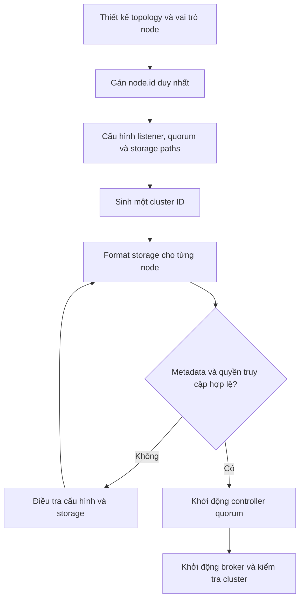

# Cluster ID, node ID và khởi tạo thư mục lưu trữ

Trong Kafka chạy ở chế độ KRaft, mỗi cluster cần một định danh chung, mỗi tiến trình Kafka cần một định danh node riêng và mỗi thư mục lưu trữ cần được khởi tạo với metadata phù hợp. Ba khái niệm này liên quan với nhau nhưng không thể thay thế cho nhau. Nếu cấu hình sai cluster ID, node ID hoặc định dạng storage, broker/controller có thể không khởi động, không tham gia đúng cluster hoặc từ chối sử dụng dữ liệu hiện có.

KRaft sử dụng một nhóm controller để quản lý metadata cluster và lưu metadata trong metadata log. Các broker lưu dữ liệu partition trong log directories. Trước khi khởi chạy node lần đầu, người vận hành phải chuẩn bị cấu hình, tạo hoặc lấy cluster ID, gán node ID đúng cho máy đó và format các thư mục lưu trữ bằng công cụ `kafka-storage` phù hợp với phiên bản Kafka đang triển khai.

## Mục tiêu bài học

Sau bài học, bạn có thể:

- Phân biệt cluster ID, node ID và directory ID trong KRaft.
- Chọn node ID ổn định và duy nhất cho broker, controller hoặc node kết hợp hai vai trò.
- Giải thích vai trò của `process.roles`, `node.id`, `log.dirs` và `metadata.log.dir`.
- Tạo cluster ID và format storage bằng `kafka-storage.sh` hoặc script Windows tương ứng.
- Chuẩn bị nhiều node trong cùng cluster bằng cluster ID chung và node ID riêng.
- Kiểm tra metadata đã format và xử lý các lỗi định danh, quyền truy cập thư mục một cách an toàn.

## 1. Ba loại định danh cần phân biệt

### 1.1. Cluster ID: định danh của toàn cluster

Cluster ID xác định một cụm Kafka. Mọi node tham gia cùng một KRaft cluster phải được format với cùng cluster ID. Cluster ID được ghi vào metadata lưu trữ của node, trong đó có file `meta.properties`, và được dùng để xác định dữ liệu trên đĩa thuộc cluster nào.

Cluster ID không phải địa chỉ mạng, tên topic hay node ID. Nó không thay đổi theo số lượng broker/controller. Khi thêm node mới vào một cluster đang hoạt động, node đó phải được khởi tạo với cluster ID của cluster đích, không tự tạo một cluster ID khác.

Kafka cung cấp lệnh `random-uuid` trong công cụ `kafka-storage` để sinh cluster ID cho một cluster mới. Hãy lưu lại giá trị được sinh và phân phối chính xác cho các node cần tham gia cluster. Không tự tạo chuỗi tùy ý hoặc sinh lại cluster ID riêng trên từng máy.

### 1.2. Node ID: định danh của một tiến trình Kafka

`node.id` là định danh số nguyên của một node trong KRaft cluster. Mỗi tiến trình Kafka cần một node ID ổn định và không trùng với node khác trong cùng cluster. Node có thể chạy vai trò broker, controller hoặc đồng thời cả hai tùy cấu hình `process.roles`.

Trong cấu hình KRaft, `node.id` xác định node hiện tại. Với node kết hợp `broker,controller`, cùng một node ID đại diện cho tiến trình đảm nhận cả hai vai trò. Với mô hình tách vai trò, controller và broker là các node riêng, mỗi node có node ID riêng.

Node ID phải nhất quán giữa cấu hình `server.properties` và metadata storage đã format. Nếu thay `node.id` sau khi format, Kafka có thể phát hiện metadata không khớp và từ chối khởi động. Không nên thay ID chỉ để xử lý lỗi startup; cần xác định node đang sở hữu dữ liệu nào và thực hiện quy trình thay thế hoặc phục hồi node có kiểm soát.

### 1.3. Directory ID: định danh của một thư mục lưu trữ

KRaft lưu metadata nhận diện từng storage directory. File `meta.properties` trong mỗi thư mục được format có thể chứa `directory.id` bên cạnh `cluster.id` và `node.id`. Directory ID được Kafka quản lý để phân biệt các thư mục lưu trữ, đặc biệt khi một broker sử dụng nhiều log directory.

Directory ID không phải cluster ID hay node ID:

| Định danh | Phạm vi | Quy tắc |
|---|---|---|
| `cluster.id` | Toàn cluster | Các node thuộc cùng cluster dùng chung một giá trị |
| `node.id` | Một node Kafka | Mỗi node trong cluster có giá trị riêng, ổn định qua lần khởi động |
| `directory.id` | Một storage directory | Kafka tạo và quản lý định danh của từng thư mục đã format |

Không sao chép nguyên file `meta.properties` từ node khác để khởi tạo node mới. Làm như vậy có thể khiến node mới mang node ID hoặc directory ID của storage cũ và gây xung đột nhận diện. Hãy để công cụ format tạo metadata cho đúng node và các thư mục của nó.

## 2. Vai trò node và cấu hình định danh

KRaft dùng `process.roles` để khai báo vai trò của một tiến trình Kafka:

| Giá trị | Vai trò |
|---|---|
| `broker` | Nhận và phục vụ request dữ liệu, lưu các partition replica |
| `controller` | Tham gia quorum controller và quản lý metadata cluster |
| `broker,controller` | Một tiến trình đảm nhận cả hai vai trò |

Mỗi node khai báo `node.id` riêng. Trong cấu hình quorum tĩnh, `controller.quorum.voters` liệt kê node ID và địa chỉ controller. Với các phiên bản hỗ trợ dynamic quorum, cấu hình bootstrap controller và cách khởi tạo ban đầu có thể khác. Cần dùng đúng mẫu cấu hình cho phiên bản Kafka đang chạy; không trộn các thuộc tính quorum của các thế hệ cấu hình khác nhau.

Ví dụ một node KRaft kết hợp dùng cho môi trường học tập hoặc phát triển đơn máy:

```properties
process.roles=broker,controller
node.id=1

listeners=PLAINTEXT://:9092,CONTROLLER://:9093
advertised.listeners=PLAINTEXT://localhost:9092
controller.listener.names=CONTROLLER
inter.broker.listener.name=PLAINTEXT
listener.security.protocol.map=CONTROLLER:PLAINTEXT,PLAINTEXT:PLAINTEXT

controller.quorum.voters=1@localhost:9093

log.dirs=/var/lib/kafka/data
metadata.log.dir=/var/lib/kafka/metadata
```

Đây là cấu hình minh họa cho mô hình quorum tĩnh có một controller. Cấu hình listener, địa chỉ quảng bá và quorum phải được điều chỉnh theo mạng, bảo mật và phiên bản Kafka thực tế. Môi trường production thường tách controller khỏi broker để giới hạn tác động khi broker chịu tải cao hoặc cần bảo trì.

### 2.1. Node ID trong quorum controller

Với cấu hình `controller.quorum.voters` tĩnh, mỗi phần tử có dạng `nodeId@host:port`. Node ID trong danh sách phải khớp `node.id` của controller tương ứng. Ví dụ:

```properties
# Trên node controller 1
process.roles=controller
node.id=1
controller.quorum.voters=1@controller-1:9093,2@controller-2:9093,3@controller-3:9093

# Trên node controller 2
process.roles=controller
node.id=2
controller.quorum.voters=1@controller-1:9093,2@controller-2:9093,3@controller-3:9093
```

Danh sách quorum mô tả cùng một tập controller trên các node liên quan; `node.id` thay đổi theo node. Với mô hình tách vai trò, broker-only node cũng cần cấu hình kết nối đến quorum controller theo hướng dẫn phiên bản Kafka tương ứng, dù bản thân nó không nằm trong danh sách voter.

Với dynamic quorum, danh sách controller ban đầu được thiết lập thông qua quy trình bootstrap/format của phiên bản đó. Không tự thêm hoặc xóa voter bằng cách chỉ sửa `node.id`; thay đổi membership quorum là thao tác quản trị riêng.

## 3. Các thư mục lưu trữ trong KRaft

### 3.1. `log.dirs`: nơi lưu dữ liệu partition

`log.dirs` khai báo một hoặc nhiều thư mục mà broker dùng để lưu log của các partition. Có thể cấu hình nhiều đường dẫn, phân tách bằng dấu phẩy:

```properties
log.dirs=/data/kafka-1,/data/kafka-2
```

Kafka phân bố các partition log trên những thư mục này theo cơ chế quản lý storage. Khi dùng nhiều ổ đĩa, cần theo dõi dung lượng, độ trễ I/O, quyền truy cập và khả năng phục hồi của từng đường dẫn.

Thư mục dữ liệu chứa các segment log, index và thông tin metadata liên quan đến partition. Không nên đặt thư mục này ở vị trí tạm thời nếu cần giữ dữ liệu qua lần restart. Trong production, hãy dùng volume/đĩa bền vững và cấu hình quyền sở hữu cho tài khoản chạy Kafka.

### 3.2. `metadata.log.dir`: nơi lưu metadata log

KRaft controller lưu metadata cluster trong metadata log. Thuộc tính `metadata.log.dir` chỉ định thư mục chứa log này. Nếu không cấu hình, Kafka sử dụng thư mục `log.dirs` đầu tiên làm vị trí metadata log theo quy tắc của phiên bản tương ứng.

Ví dụ tách metadata và dữ liệu partition:

```properties
metadata.log.dir=/data/kafka-metadata
log.dirs=/data/kafka-data-1,/data/kafka-data-2
```

Tách riêng metadata directory có thể giúp quản lý I/O và vòng đời lưu trữ rõ ràng hơn. Tuy nhiên, đây vẫn là dữ liệu quan trọng của cluster; phải backup/khôi phục theo quy trình Kafka, bảo vệ khỏi xóa nhầm và bảo đảm storage bền vững.

### 3.3. Cấu trúc metadata sau khi format

Sau khi chạy lệnh format thành công, các storage directory được khởi tạo và có file `meta.properties`. Nội dung thực tế có thể thay đổi theo phiên bản, nhưng thường có các trường tương tự:

```properties
version=1
cluster.id=AbCdEfGhIjKlMnOpQrStUv
node.id=1
directory.id=QxYz...
```

Đây là ví dụ minh họa, không phải giá trị để sao chép vào file. Kafka tự ghi các trường metadata phù hợp khi format. Không chỉnh sửa thủ công file `meta.properties`, không copy từ node khác và không tự đặt `directory.id`.

## 4. Quy trình khởi tạo storage cho cluster mới

Khởi tạo storage là bước chuẩn bị metadata trên đĩa trước khi start node. Quy trình tổng quát gồm:

1. Chốt topology: node nào là controller, broker hay node kết hợp.
2. Gán `node.id` ổn định và duy nhất cho từng node.
3. Khai báo `process.roles`, listener, cấu hình quorum và đường dẫn storage.
4. Sinh một cluster ID cho cluster mới và lưu lại giá trị đó.
5. Format storage trên từng node với cùng cluster ID và cấu hình node tương ứng.
6. Kiểm tra metadata, quyền truy cập và đường dẫn trước khi khởi động Kafka.
7. Khởi động controller quorum theo thứ tự và quy trình triển khai đã chọn, sau đó khởi động broker nếu topology tách vai trò.



### 4.1. Sinh cluster ID

Trên Linux hoặc macOS, chạy từ thư mục Kafka distribution:

```bash
KAFKA_CLUSTER_ID="$(bin/kafka-storage.sh random-uuid)"
printf '%s\n' "$KAFKA_CLUSTER_ID"
```

Lưu giá trị này trong hồ sơ triển khai hoặc secret/configuration phù hợp để dùng nhất quán trên các node. Lệnh sinh ID tạo giá trị mới; không chạy lại riêng trên mỗi node trong cùng một cluster.

Trên Windows PowerShell, script thường nằm trong `bin\windows`:

```powershell
$KAFKA_CLUSTER_ID = .\bin\windows\kafka-storage.bat random-uuid
$KAFKA_CLUSTER_ID
```

Tên script và vị trí cấu hình có thể khác theo gói phân phối. Hãy kiểm tra thư mục `bin` của bản Kafka đang cài.

### 4.2. Format một node KRaft độc lập

Ví dụ sau minh họa khởi tạo một node KRaft đơn lẻ dùng dynamic quorum và cấu hình `server.properties` đã chuẩn bị. File cấu hình này phải theo mẫu dynamic quorum của phiên bản Kafka tương ứng; không dùng đồng thời cấu hình static quorum `controller.quorum.voters` trong ví dụ ở phần trên:

```bash
bin/kafka-storage.sh format \
  --cluster-id "$KAFKA_CLUSTER_ID" \
  --config config/kraft/server.properties \
  --standalone
```

Với Windows PowerShell:

```powershell
.\bin\windows\kafka-storage.bat format `
  --cluster-id $KAFKA_CLUSTER_ID `
  --config .\config\kraft\server.properties `
  --standalone
```

`--standalone` phù hợp với quy trình bootstrap một controller độc lập được hỗ trợ ở các phiên bản Kafka có tùy chọn này. Đây là ví dụ cho local development/lab; không dùng tùy chọn standalone để khởi tạo nhầm một quorum production nhiều controller.

### 4.3. Format nhiều node trong cùng cluster

Với cluster nhiều node, mỗi node có file cấu hình riêng và `node.id` riêng. Người vận hành sinh cluster ID một lần, sau đó dùng đúng giá trị đó khi format từng node:

| Máy | Vai trò ví dụ | `node.id` | Cluster ID |
|---|---|---:|---|
| `controller-1` | controller | 1 | Dùng chung ID của cluster |
| `controller-2` | controller | 2 | Dùng chung ID của cluster |
| `controller-3` | controller | 3 | Dùng chung ID của cluster |
| `broker-1` | broker | 4 | Dùng chung ID của cluster |
| `broker-2` | broker | 5 | Dùng chung ID của cluster |

Với mỗi máy, chạy lệnh format theo đúng cấu hình và hướng dẫn quorum của phiên bản Kafka đó. Các phiên bản KRaft hỗ trợ dynamic quorum có quy trình bootstrap controller ban đầu, ví dụ tùy chọn `--initial-controllers`; các cấu hình static quorum có cách khai báo voter riêng. Cú pháp và yêu cầu tham số thay đổi theo phiên bản, vì vậy hãy xem `kafka-storage.sh format --help` và tài liệu đi kèm đúng bản phân phối trước khi thực hiện.

Điều cần giữ nhất quán là cluster ID của mọi node thuộc cùng cluster; node ID phải khớp cấu hình từng node và không trùng. Không dùng `--standalone` cho từng controller rồi kỳ vọng các node tự hợp thành một quorum production. Quorum phải được bootstrap theo một kế hoạch chung.

### 4.4. Format không phải là lệnh tạo thư mục thông thường

Lệnh format khởi tạo metadata storage để Kafka nhận biết cluster và node sở hữu dữ liệu. Nó có thể tạo hoặc cập nhật các metadata file trong các đường dẫn đã cấu hình. Vì vậy, trước khi chạy cần kiểm tra:

- Đường dẫn `log.dirs` và `metadata.log.dir` có đúng với node này không.
- Tài khoản chạy Kafka có quyền đọc/ghi và quyền tạo file cần thiết không.
- Thư mục có đang chứa dữ liệu của cluster hoặc node khác không.
- Cluster ID và node ID có đúng theo hồ sơ triển khai không.
- Đây là storage mới cần khởi tạo hay storage hiện có cần phục hồi.

Không format lại thư mục đang chứa dữ liệu chỉ vì broker không khởi động. Hãy đọc lỗi, xác minh cluster ID/node ID và quyền truy cập trước. Reformat hoặc xóa storage có thể làm mất dữ liệu và metadata cần thiết để node tham gia cluster.

## 5. Kiểm tra cấu hình trước khi khởi động

### 5.1. Kiểm tra các thuộc tính định danh và storage

Trước khi format, đối chiếu file cấu hình của từng node:

| Thuộc tính | Cần kiểm tra |
|---|---|
| `process.roles` | Vai trò đúng với topology đã thiết kế |
| `node.id` | Duy nhất trong cluster và khớp node được triển khai |
| `controller.listener.names` | Tên listener controller có tồn tại trong `listeners` |
| `controller.quorum.voters` hoặc cấu hình bootstrap quorum | Phù hợp với chế độ quorum và phiên bản Kafka |
| `log.dirs` | Đường dẫn dữ liệu partition đúng, bền vững và có quyền truy cập |
| `metadata.log.dir` | Đường dẫn metadata log đúng; nếu bỏ trống phải hiểu vị trí mặc định |
| `listeners` | Bind đúng interface và port dự kiến |
| `advertised.listeners` | Địa chỉ client/broker khác có thể truy cập, không dùng địa chỉ chỉ tồn tại trong localhost ở production |

### 5.2. Xem thông tin storage đã format

Các bản Kafka có lệnh `info` trong công cụ storage để hiển thị thông tin về các thư mục đã cấu hình. Ví dụ:

```bash
bin/kafka-storage.sh info --config config/kraft/server.properties
```

Tên lệnh và tùy chọn có thể khác theo phiên bản. Nếu bản phân phối không hỗ trợ cú pháp trên, xem `bin/kafka-storage.sh help` hoặc `bin/kafka-storage.sh info --help`. Có thể kiểm tra `meta.properties` để xác minh cluster ID, node ID và directory ID, nhưng chỉ đọc file; không sửa tay.

### 5.3. Kiểm tra quyền và dung lượng

Tiến trình Kafka cần quyền đọc/ghi vào các thư mục lưu trữ. Với Linux, thư mục thường được sở hữu bởi tài khoản dịch vụ Kafka. Ví dụ:

```bash
sudo install -d -o kafka -g kafka /data/kafka-data
sudo install -d -o kafka -g kafka /data/kafka-metadata
```

Điều chỉnh user/group và đường dẫn theo cách cài đặt thực tế. Với Windows, tài khoản chạy service cần quyền truy cập tương ứng vào các ổ đĩa và thư mục đã khai báo. Cũng cần kiểm tra dung lượng trống, mount point và chính sách backup/monitoring trước khi đưa node vào hoạt động.

## 6. Khởi động node sau khi format

Sau khi format thành công và xác minh metadata, khởi động node bằng cấu hình đã dùng để format. Ví dụ:

```bash
bin/kafka-server-start.sh config/kraft/server.properties
```

Trên Windows:

```powershell
.\bin\windows\kafka-server-start.bat .\config\kraft\server.properties
```

Kafka phải được khởi động với đúng file cấu hình và storage directory đã format. Nếu dùng nhiều controller, hãy làm theo thứ tự bootstrap quorum của phiên bản Kafka; sau khi controller quorum sẵn sàng, các broker mới có thể đăng ký và phục vụ dữ liệu theo topology.

Sau khi khởi động, kiểm tra log startup, trạng thái controller quorum, broker registration và khả năng truy cập client. Đừng kết luận cluster khỏe mạnh chỉ vì một tiến trình đã mở port; cần xác nhận node tham gia đúng cluster và metadata được đồng bộ.

## 7. Những lỗi định danh và storage thường gặp

| Triệu chứng | Nguyên nhân có thể | Hướng điều tra |
|---|---|---|
| `InconsistentClusterIdException` | Storage chứa cluster ID khác với cluster mà node đang tham gia | Đối chiếu cluster ID trong cấu hình triển khai và `meta.properties`; xác định nguồn gốc dữ liệu trước khi thay đổi |
| Node ID không khớp metadata | `node.id` đã đổi sau khi storage được format hoặc storage thuộc node khác | Kiểm tra `node.id` trong cấu hình và metadata từng thư mục |
| Node không tham gia controller quorum | Node ID/địa chỉ voter sai, listener không bind được hoặc cấu hình quorum không thống nhất | Đối chiếu voter ID, host/port, listener và log controller |
| Storage directory không thể mở | Đường dẫn sai, volume chưa mount hoặc thiếu quyền | Kiểm tra đường dẫn, mount, owner/group và quyền đọc/ghi |
| Lỗi format vì thư mục đã được format | Storage đã có metadata hoặc thuộc node/cluster trước đó | Xác minh nguồn gốc storage; không bỏ qua cảnh báo hoặc xóa dữ liệu theo phản xạ |
| Broker khởi động nhưng metadata log không ở vị trí dự kiến | `metadata.log.dir` chưa được đặt hoặc cấu hình khác file đã format | Kiểm tra file cấu hình thực sự được dùng và vị trí metadata mặc định |
| Hai node dùng cùng node ID | Sao chép cấu hình mà quên đổi ID | Gán node ID riêng cho từng tiến trình và format storage mới đúng node |

### 7.1. Không dùng `--ignore-formatted` để che lỗi

Một số phiên bản công cụ storage hỗ trợ `--ignore-formatted` để bỏ qua các thư mục đã được format khi thao tác với nhiều thư mục hoặc thực hiện một quy trình được tài liệu hướng dẫn. Tùy chọn này không sửa được cluster ID hoặc node ID sai và không phải cách an toàn để chạy lại format khi chưa hiểu trạng thái storage.

Chỉ dùng tùy chọn này khi quy trình vận hành yêu cầu rõ ràng, đã xác định thư mục nào được bỏ qua và biết chính xác metadata hiện có thuộc node nào. Nếu không chắc chắn, dừng thao tác và kiểm tra storage trước.

## 8. Phân biệt tạo cluster mới, thêm node và thay thế node

Ba thao tác này có quy tắc định danh khác nhau:

| Thao tác | Cluster ID | Node ID | Storage |
|---|---|---|---|
| Tạo cluster mới | Sinh một ID mới duy nhất cho cluster | Gán ID riêng cho từng node | Format storage mới cho các node theo quy trình bootstrap |
| Thêm node mới vào cluster hiện có | Dùng cluster ID hiện tại | Gán node ID chưa được sử dụng theo kế hoạch | Format storage mới bằng cluster ID hiện tại và cấu hình node mới |
| Thay thế node hỏng | Giữ cluster ID của cluster | Thực hiện theo kế hoạch thay thế và quyền sở hữu node ID | Khôi phục/format storage theo runbook; không tự xóa hoặc tái sử dụng storage cũ |

Khi thay thế node, cần biết dữ liệu replica còn ở đâu, node ID có được tái sử dụng không, metadata quorum có cần cập nhật không và liệu volume cũ có được gắn nhầm sang máy mới hay không. Việc thay node là một thao tác phục hồi cluster, không đơn giản là tạo ID ngẫu nhiên và chạy format.

## 9. Checklist trước khi format production

Trước khi chạy lệnh format trên bất kỳ node production nào, hãy xác nhận:

1. Cluster ID đã được cấp và lưu trong hồ sơ triển khai chính thức.
2. Node ID được phân bổ duy nhất, ổn định và đã đối chiếu với topology.
3. Vai trò `process.roles` và cấu hình quorum phù hợp với phiên bản Kafka.
4. `log.dirs` và `metadata.log.dir` trỏ đến volume đúng của node.
5. Storage là thư mục mới được phê duyệt hoặc đã có kế hoạch phục hồi cụ thể.
6. Quyền sở hữu, quyền truy cập, dung lượng và mount point đã được kiểm tra.
7. Lệnh format đã được kiểm tra theo `--help` của đúng phiên bản Kafka.
8. Cluster ID, node ID và các đường dẫn đã được rà soát chéo trước khi xác nhận.
9. Có kế hoạch khởi động controller quorum và broker sau format.
10. Có runbook phục hồi nếu node không khởi động hoặc metadata không khớp.

## 10. Bài tập tự kiểm tra

Một cluster KRaft có ba controller và hai broker-only node. Các node dùng ID từ 1 đến 5. Hãy trả lời:

1. Có bao nhiêu cluster ID cần tạo cho toàn bộ năm node?
2. Mỗi node có cần một node ID riêng không? Controller ID trong `controller.quorum.voters` phải khớp với thuộc tính nào?
3. Nếu `broker-1` dùng `node.id=4`, `broker-2` có thể cũng dùng `node.id=4` không?
4. `directory.id` trong `meta.properties` do ai tạo và có thể sao chép từ controller khác không?
5. Nếu `metadata.log.dir` không được cấu hình, cần kiểm tra vị trí nào theo quy tắc mặc định?
6. Một broker mới gia nhập cluster hiện có cần cluster ID mới hay dùng cluster ID hiện tại?
7. Vì sao không nên chạy lại lệnh format trên thư mục đang chứa dữ liệu chỉ để khắc phục lỗi startup?

Gợi ý: cluster ID thuộc về cả cluster; node ID nhận diện từng tiến trình; directory ID nhận diện từng storage directory. Tạo cluster mới, thêm node và thay thế node là ba quy trình khác nhau.

## Kết luận

Khởi tạo KRaft storage đòi hỏi ba lớp định danh đúng: cluster ID dùng chung cho toàn cluster, node ID duy nhất và ổn định cho từng node, cùng directory ID do Kafka quản lý cho từng thư mục lưu trữ. `log.dirs` chứa dữ liệu partition; `metadata.log.dir` chứa metadata log của KRaft. Khi cấu hình đúng vai trò, listener, quorum và đường dẫn, người vận hành có thể format storage cho node mới một cách nhất quán. Với storage đã có dữ liệu, hãy xác minh cluster ID, node ID và nguồn gốc thư mục trước mọi thao tác; format lại hoặc xóa thư mục có thể phá hủy khả năng phục hồi của node.
