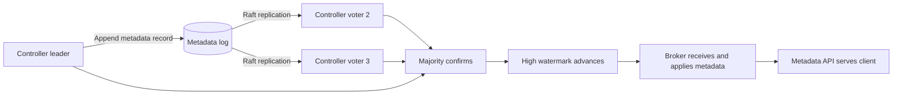

# Theo dõi trạng thái quorum và độ trễ metadata trong KRaft

Trong Kafka dùng KRaft, metadata của cụm được lưu trong một metadata log và sao chép giữa các controller bằng giao thức Raft. Nhóm controller tạo thành **controller quorum**; một controller giữ vai trò leader điều phối việc ghi metadata, còn các voter khác sao chép log và tham gia xác nhận bản ghi đã commit.

Theo dõi KRaft cần trả lời ba câu hỏi riêng: quorum có còn đủ thành viên để commit metadata không, metadata log có được sao chép và commit đúng hạn không, và các broker có nhận rồi áp dụng metadata kịp thời không. Độ trễ của API Metadata mà client gọi là một lớp quan sát khác. Gộp tất cả thành một chỉ số “metadata latency” dễ che khuất nguyên nhân sự cố.

## 1. Quorum KRaft hoạt động ra sao?

Controller quorum là nhóm các node được cấu hình làm voter trong Raft. Leader ghi các thay đổi metadata vào metadata log, sau đó các voter sao chép bản ghi. Một bản ghi chỉ được xem là đã commit khi đa số voter xác nhận theo quy tắc Raft; leader cũng được tính là một voter trong đa số đó.

Với `N` voter, số phiếu tối thiểu để có quorum là:

\[
\text{quorum} = \left\lfloor\frac{N}{2}\right\rfloor + 1
\]

| Số voter | Cần tối thiểu | Số voter có thể mất mà vẫn giữ quorum |
|---:|---:|---:|
| 1 | 1 | 0 |
| 3 | 2 | 1 |
| 5 | 3 | 2 |

Vì vậy, cụm production thường dùng ba hoặc năm controller voter đặt trên các máy và miền lỗi phù hợp. Thêm voter làm tăng chi phí sao chép và quản trị; không nên tăng số controller chỉ vì muốn có nhiều bản sao hơn mà chưa đánh giá độ trễ mạng, lưu trữ và quy trình vận hành.

Controller có thể chạy ở chế độ chuyên dụng hoặc kết hợp vai trò broker và controller tùy kiến trúc cụm. Dù triển khai theo cách nào, quorum được tính từ **voter của controller quorum**. Không cộng các broker thông thường hoặc observer vào số phiếu đa số. Một số phiên bản và cấu hình có thể hiển thị thêm observer; hãy phân biệt rõ observer với voter khi đánh giá khả năng chịu lỗi.

Khi leader append metadata record, `HighWatermark` biểu thị ranh giới metadata log đã commit. Các bản ghi ở phía sau high watermark có thể đã được append ở một số node nhưng chưa được commit. Khi quorum không còn đa số voter liên lạc được, controller không thể tiếp tục commit metadata mới. Các hoạt động data plane đang dùng metadata đã biết có thể vẫn tiếp tục trong một khoảng thời gian, nhưng các thao tác control plane như tạo topic, đổi cấu hình hoặc thay đổi phân vùng có thể bị gián đoạn.

## 2. Những lớp trạng thái cần quan sát

Một hệ thống giám sát nên tách các lớp sau để biết chậm ở đâu:

1. **Trạng thái bầu chọn:** có leader hợp lệ không, leader có ổn định không, epoch có liên tục tăng do bầu chọn lặp lại không.
2. **Sức khỏe voter:** có đủ voter hoạt động để tạo đa số không, từng follower có tiếp tục fetch metadata log không.
3. **Replication và commit:** log end offset của follower có theo kịp leader không, high watermark có tiến triển khi có metadata write không, commit latency có tăng không.
4. **Áp dụng metadata ở broker:** broker có theo kịp metadata đã commit không, có lỗi khi load hoặc apply metadata không.
5. **Đường phục vụ client:** yêu cầu Metadata API có phản hồi nhanh không, request queue và network có gây chậm không.

Sơ đồ khái quát:



Sơ đồ chỉ mô tả các mốc quan sát chính. Đường truyền metadata đến broker và cách client lấy metadata phụ thuộc phiên bản Kafka, vai trò node và cơ chế nội bộ tương ứng.

## 3. Kiểm tra quorum bằng công cụ dòng lệnh

Kafka cung cấp `kafka-metadata-quorum.sh` để xem trạng thái quorum và tiến độ sao chép metadata log. Có thể kết nối qua một broker đang hoạt động:

```bash
bin/kafka-metadata-quorum.sh \
  --bootstrap-server broker-1:9092 \
  --command-config admin.properties \
  describe --status
```

Lệnh này trả về thông tin trạng thái tổng thể. Các trường thường gặp gồm:

| Trường | Ý nghĩa |
|---|---|
| `ClusterId` | Định danh cụm Kafka |
| `LeaderId` | Node ID của controller quorum leader hiện tại |
| `LeaderEpoch` | Epoch của leader, thay đổi qua các lần bầu chọn |
| `HighWatermark` | Offset metadata log đã commit |
| `MaxFollowerLag` | Độ lệch offset lớn nhất của follower theo cách công cụ phiên bản đó báo cáo |
| `MaxFollowerLagTimeMs` | Thông tin thời gian liên quan đến follower lag; cần đọc cùng timestamp fetch/caught-up và tài liệu phiên bản |
| `CurrentVoters` | Danh sách node đang là voter |
| `CurrentObservers` | Danh sách observer nếu cấu hình/phiên bản có sử dụng |

Để xem chi tiết từng replica, chạy:

```bash
bin/kafka-metadata-quorum.sh \
  --bootstrap-server broker-1:9092 \
  --command-config admin.properties \
  describe --replication
```

Kết quả thường có các cột như `NodeId`, `LogEndOffset`, `Lag`, `LastFetchTimestamp`, `LastCaughtUpTimestamp` và `Status`. Tên cột hoặc cách hiển thị có thể khác theo bản Kafka.

- `LogEndOffset` cho biết vị trí cuối của log trên replica đó.
- `Lag` biểu thị khoảng cách offset so với leader theo phép tính của công cụ.
- `LastFetchTimestamp` giúp nhận biết follower còn liên lạc và fetch gần đây hay không.
- `LastCaughtUpTimestamp` cho biết lần gần nhất follower bắt kịp leader theo định nghĩa của công cụ.
- `Status` giúp nhận biết node đang là leader hay follower và trạng thái liên quan.

Nếu môi trường yêu cầu xác thực, dùng file cấu hình client tương ứng qua `--command-config`. Endpoint bootstrap và tùy chọn kết nối controller trực tiếp có thể thay đổi theo phiên bản Kafka; hãy xem `kafka-metadata-quorum.sh --help` của đúng bản binary đang chạy. Không lấy kết quả từ một bản CLI khác phiên bản làm căn cứ duy nhất cho quyết định vận hành.

### Ví dụ đọc kết quả

Giả sử quorum có ba voter với leader ở offset 18.420 và hai follower lần lượt ở 18.420 và 18.418. Follower thứ nhất đang theo kịp; follower thứ hai chậm hai offset. Nếu follower đó vẫn fetch đều và `LastCaughtUpTimestamp` mới, độ lệch nhỏ có thể chỉ là trễ sao chép nhất thời. Nếu lag tăng liên tục, timestamp fetch cũ hoặc node mất kết nối, cần điều tra mạng, CPU, GC và lưu trữ của controller đó.

Nếu hai trong ba voter không thể liên lạc, leader còn lại không đủ đa số để commit metadata mới. Nếu `LeaderId` không hợp lệ hoặc thay đổi liên tục, cần xem xét bầu chọn và kết nối giữa các voter thay vì chỉ nhìn lag offset.

## 4. Các metric KRaft quan trọng

Kafka xuất các metric Raft qua JMX. Nhóm metric thường nằm dưới object name:

```text
kafka.server:type=raft-metrics
```

Các metric thường hữu ích gồm:

| Metric | Cách đọc |
|---|---|
| `current-state` | Vai trò/trạng thái Raft hiện tại của node, ví dụ leader hoặc follower |
| `current-leader` | Node ID của leader mà node đang nhận biết |
| `current-epoch` | Epoch Raft hiện tại; tăng khi có epoch mới/bầu chọn mới |
| `high-watermark` | Tiến độ metadata log đã commit |
| `log-end-offset` | Offset cuối của metadata log cục bộ |
| `log-start-offset` | Offset đầu còn được giữ trong log cục bộ |
| `number-of-voters` | Số voter mà node nhận biết |
| `number-of-observers` | Số observer nếu có |
| `commit-latency-avg`, `commit-latency-max` | Thời gian commit metadata record qua quorum |
| `election-latency-avg`, `election-latency-max` | Thời gian hoàn thành bầu chọn leader |
| `fetch-latency-avg`, `fetch-latency-max` | Độ trễ của thao tác fetch Raft |
| `append-records-rate`, `fetch-records-rate` | Tốc độ append và fetch record |
| `poll-idle-ratio-avg` | Tỷ lệ thời gian poll thread ở trạng thái rảnh; cần diễn giải cùng tải và các metric khác |

Tên metric hiển thị trong JMX, Prometheus exporter hoặc hệ thống quan sát có thể được viết khác nhau (ví dụ camel case trong JMX attribute và dạng chuẩn hóa trong exporter). Danh sách chính xác phụ thuộc phiên bản Kafka. Hãy khám phá metric thực tế của cụm trước khi tạo dashboard hoặc alert.

### Metric áp dụng metadata ở broker

Quorum commit thành công chưa đảm bảo mọi broker đã áp dụng metadata ngay lập tức. Theo dõi thêm nhóm metric broker metadata, thường được xuất dưới object name:

```text
kafka.server:type=broker-metadata-metrics
```

Những metric thường có ích gồm:

- `last-applied-record-offset` và `last-applied-record-timestamp`: vị trí và thời điểm record metadata gần nhất được broker áp dụng.
- `metadata-apply-latency-avg` và `metadata-apply-latency-max`: độ trễ áp dụng metadata nếu phiên bản cung cấp.
- `metadata-apply-error-count` và `metadata-load-error-count`: lỗi khi áp dụng hoặc nạp metadata.

Hãy so sánh offset đã áp dụng ở broker với tiến độ metadata đã commit, đồng thời xem metric lỗi và timestamp. Nếu broker chậm hơn quorum trong thời gian dài, phạm vi điều tra chuyển sang đường truyền metadata, tải broker và quá trình apply. Các tên metric cụ thể cần xác nhận trên phiên bản đang triển khai.

### Độ trễ của Metadata API

Client Kafka cũng có thể chậm khi yêu cầu metadata về topic, partition và leader. Đây là độ trễ phục vụ request, không đồng nhất với Raft commit latency. Có thể theo dõi nhóm `RequestMetrics` cho request `Metadata`, đặc biệt `TotalTimeMs` và các thành phần thời gian queue/local/remote nếu hệ thống xuất chúng.

Nếu Raft commit latency và broker apply đều bình thường nhưng Metadata API vẫn chậm, hãy kiểm tra broker đang nhận request, request queue, CPU, network, xác thực và tải của các API khác. Ngược lại, Metadata API phản hồi nhanh không chứng minh metadata mới đã được commit và áp dụng đồng đều trên mọi node.

## 5. Phân biệt các loại độ trễ metadata

| Loại độ trễ | Điểm bắt đầu và kết thúc | Chỉ số/quan sát chính | Vấn đề thường gặp |
|---|---|---|---|
| Raft commit latency | Leader append metadata record đến khi record được quorum commit | `commit-latency-avg/max`, high watermark, replication status | Mạng giữa controller, follower chậm, disk I/O, leader quá tải |
| Replication lag | Log của follower so với log leader | `Lag`, `LogEndOffset`, fetch/caught-up timestamps | Follower không fetch kịp, network hoặc node bị treo |
| Broker metadata apply | Metadata đã commit đến lúc broker áp dụng | Applied offset/timestamp, apply latency và error count | Broker quá tải, lỗi apply, GC hoặc đường truyền metadata |
| Metadata API latency | Client gửi Metadata request đến khi broker phản hồi | `RequestMetrics` của request `Metadata`, client latency | Request queue, network, broker load hoặc client retry |

Một số lưu ý khi diễn giải:

- Lag theo offset không phải thời gian trễ. Hai offset có thể đại diện cho lượng công việc rất khác nhau tùy số record và tốc độ ghi.
- `HighWatermark` đứng yên không tự động là lỗi. Nếu không có thay đổi metadata, log có thể không có record mới để commit. Hãy đối chiếu với hoạt động control plane và tốc độ append.
- `LogEndOffset` lớn hơn `HighWatermark` cho thấy có phần log chưa commit; cần xem các voter có đang bắt kịp hay không.
- `commit-latency-avg` thấp không loại trừ một follower đơn lẻ bị tụt xa. Kết hợp metric trung bình với max, lag từng node và timestamp.
- Độ trễ apply ở broker có thể tăng sau khi quorum đã commit. Khi đó, vấn đề nằm sau bước commit chứ không nhất thiết ở Raft.

## 6. Thiết kế dashboard và cảnh báo

Dashboard nên có một hàng hoặc panel cho từng controller, cùng một góc nhìn tổng thể quorum. Các nhóm biểu đồ hữu ích:

1. **Vai trò và bầu chọn:** current state, current leader, current epoch, số lần leader/epoch thay đổi theo thời gian.
2. **Thành viên quorum:** danh sách voter, số voter đang liên lạc được, số voter cần để đạt đa số, observer nếu có.
3. **Tiến độ log:** high watermark, log end offset từng controller và lag từng follower.
4. **Độ trễ Raft:** commit latency, fetch latency, election latency và tốc độ append/fetch.
5. **Áp dụng tại broker:** last applied record offset/timestamp, apply latency và lỗi metadata load/apply.
6. **Metadata API:** request rate, total time và thời gian queue/local/remote khi có.
7. **Tài nguyên node:** CPU, heap, GC pause, disk space, disk latency, network throughput và packet loss.

Các cảnh báo nên gắn với điều kiện kéo dài và mục tiêu dịch vụ:

| Cảnh báo | Điều kiện gợi ý | Mức độ |
|---|---|---|
| Không có quorum | Số voter liên lạc được thấp hơn `floor(N/2)+1` hoặc không có leader hợp lệ | Critical |
| Leader churn | Leader ID/epoch thay đổi liên tục trong cửa sổ ngắn | Critical hoặc Warning tùy mức độ |
| Follower tụt hậu | Lag hoặc thời gian từ lần caught-up gần nhất vượt ngưỡng trong nhiều chu kỳ | Warning; Critical nếu làm mất đa số |
| Commit latency cao | p95/max hoặc trung bình vượt SLO trong một khoảng thời gian | Warning/Critical theo tác động |
| Metadata apply lỗi | Error count tăng hoặc broker applied offset bị bỏ xa high watermark | Warning/Critical tùy phạm vi broker |
| Metadata API chậm | p95/p99 của Metadata request vượt mục tiêu | Warning/Critical theo tác động client |

Không đặt ngưỡng cố định chỉ dựa trên một cụm khác. Đo baseline dưới tải bình thường, xác định thời gian chịu đựng của ứng dụng và đặt ngưỡng theo SLO. Với cảnh báo quorum, tính số phiếu từ danh sách voter hiện hành; không dùng số controller process đang chạy hoặc cộng observer để suy ra quorum.

## 7. Quy trình chẩn đoán khi quorum hoặc metadata chậm

### Bước 1: Xác định phạm vi ảnh hưởng

Kiểm tra xem sự cố chỉ ảnh hưởng thao tác quản trị/control plane, một số broker hay cả client đang truy cập topic. Ghi lại thời điểm bắt đầu, thao tác gần nhất (tạo topic, đổi cấu hình, thay đổi ACL, broker restart) và các cảnh báo liên quan. Phân biệt lỗi client Metadata API với lỗi quorum commit.

### Bước 2: Lấy trạng thái và replication snapshot

Chạy `describe --status` và `describe --replication` nhiều lần cách nhau một khoảng ngắn. Ghi lại `LeaderId`, `LeaderEpoch`, `HighWatermark`, voter list, `LogEndOffset`, `Lag` và các timestamp fetch/caught-up. Một snapshot đơn lẻ không cho biết lag đang tăng, giảm hay chỉ dao động nhất thời.

### Bước 3: Nếu không có leader hoặc epoch thay đổi liên tục

- Xác nhận controller voter nào đang hoạt động và liệu số node liên lạc được có đạt đa số không.
- Kiểm tra kết nối giữa các controller: DNS, route, firewall, TLS/SASL, certificate expiry và controller listener.
- Kiểm tra CPU saturation, JVM pause/GC, disk latency, disk full và lỗi I/O trên các controller.
- Đối chiếu thời điểm bầu chọn với restart, mất mạng hoặc thay đổi hạ tầng.
- Kiểm tra cấu hình/membership của quorum theo đúng chế độ static hay dynamic và đúng phiên bản Kafka.

Nếu quorum không có đa số, một leader đơn lẻ không thể tự commit metadata. Khôi phục khả năng liên lạc của voter là ưu tiên. Không xóa metadata log hoặc tự ý thay membership để cố ép bầu chọn.

### Bước 4: Nếu một follower bị lag

So sánh `LogEndOffset`, `Lag`, `LastFetchTimestamp` và `LastCaughtUpTimestamp` của follower với leader. Nếu fetch timestamp cũ, kiểm tra network, controller process, GC và disk I/O ở node đó. Nếu fetch vẫn đều nhưng lag tăng, xem tốc độ append của leader và khả năng ghi/đọc log của follower. Xác nhận quorum vẫn còn đủ đa số trước khi thực hiện bất kỳ thao tác bảo trì nào.

### Bước 5: Nếu commit latency cao

Đối chiếu `commit-latency-avg/max` với fetch latency, lag từng follower và tải leader. Kiểm tra độ trễ mạng giữa các voter, thời gian flush/fsync của thiết bị lưu trữ, CPU, GC và số lượng thay đổi metadata. Nếu một follower chậm nhưng không nằm trên đường đạt đa số hiện tại, commit vẫn có thể thành công nhưng dự phòng quorum đã giảm.

### Bước 6: Nếu broker áp dụng metadata chậm

So sánh applied offset/timestamp của broker với tiến độ commit, xem `metadata-apply-error-count` và `metadata-load-error-count`. Kiểm tra log broker, CPU, GC, network và các thành phần xử lý metadata. Xác định chậm trên một broker hay đồng loạt. Một broker chậm riêng lẻ có thể gây ảnh hưởng đến các client kết nối vào broker đó hoặc các thao tác phụ thuộc metadata mới.

### Bước 7: Nếu Metadata API chậm nhưng quorum khỏe

Kiểm tra request metrics cho `Metadata`, queue time, local processing time, network và broker nhận request. Đối chiếu với latency phía client và số lần retry/refresh metadata. Không thay đổi controller quorum chỉ để xử lý một vấn đề request queue hoặc network ở broker.

## 8. Ví dụ diễn giải một tình huống

Giả sử cụm có ba voter, leader có `LogEndOffset=9200`, follower A là 9200 và follower B là 9160. High watermark vẫn ở 9198. Follower B có `LastFetchTimestamp` cách đây 30 giây, trong khi follower A đang theo kịp.

Quorum hiện vẫn có thể commit vì leader và follower A tạo thành đa số hai trên ba. Tuy nhiên, follower B đang tụt hậu đáng kể; cụm chỉ còn một voter dự phòng trước khi mất khả năng tạo đa số. Cần điều tra node B và theo dõi lag có tiếp tục tăng không. Không nên kết luận rằng toàn bộ metadata đã bị mất commit chỉ vì một follower đang chậm.

Nếu follower A cũng mất kết nối, leader còn lại chỉ có một phiếu và không thể commit metadata mới. Khi follower A phục hồi, nó cần bắt kịp log và quorum phải khôi phục đa số trước khi các thay đổi metadata có thể tiếp tục commit ổn định.

Nếu trong khi đó các broker báo applied offset thấp hơn high watermark trong thời gian dài, hãy kiểm tra thêm metadata apply path. Đây là dấu hiệu của một giai đoạn chậm sau commit, có thể tồn tại ngay cả khi quorum replication đã bình thường trở lại.

## 9. Thực hành vận hành an toàn

- Duy trì số voter lẻ phù hợp với yêu cầu chịu lỗi và đặt chúng ở các miền lỗi độc lập.
- Bảo đảm controller có tài nguyên CPU, RAM, network và thiết bị lưu trữ ổn định; metadata log cần được bảo vệ như dữ liệu trạng thái cụm quan trọng.
- Theo dõi quorum và replication liên tục, không đợi đến khi thao tác tạo topic hoặc đổi cấu hình thất bại mới kiểm tra.
- Khi bảo trì, chỉ thao tác từng controller một và xác nhận quorum còn đủ đa số trước/sau mỗi bước.
- Thay đổi membership theo quy trình dành cho đúng loại quorum và phiên bản Kafka. Static quorum và dynamic quorum có cơ chế cấu hình/thay đổi khác nhau.
- Không xóa thư mục metadata log, không sửa offset hoặc chép log thủ công để xử lý lag. Các thao tác này có thể phá hỏng trạng thái đồng thuận và làm cụm không khởi động được.
- Lưu lại snapshot trạng thái quorum, replication và metric trước/sau các thay đổi hạ tầng hoặc nâng cấp.

## 10. Nguyên tắc đánh giá sức khỏe KRaft

Một quorum khỏe có leader hợp lệ, voter list đúng như thiết kế, đủ đa số có thể liên lạc, follower không bị lag kéo dài và high watermark tiến triển khi có metadata write. Commit/election latency ổn định là dấu hiệu tốt, nhưng vẫn cần kiểm tra broker đã áp dụng metadata và Metadata API phục vụ client trong mục tiêu thời gian.

Khi chẩn đoán, luôn nối các mốc **append → replicate → commit → broker apply → client metadata response**. Cách nhìn theo chuỗi này giúp xác định chính xác độ trễ phát sinh ở Raft quorum, ở broker hay trên đường phục vụ client, từ đó chọn biện pháp xử lý phù hợp mà vẫn giữ được đa số voter.
