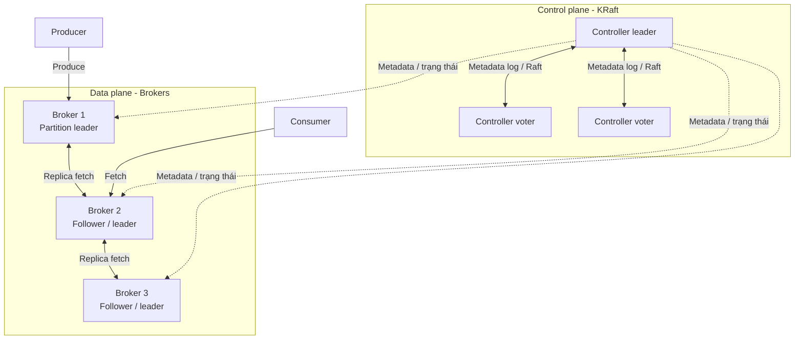
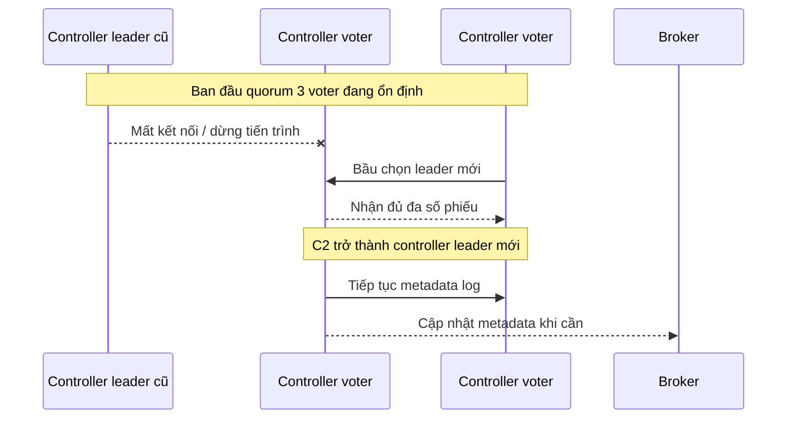
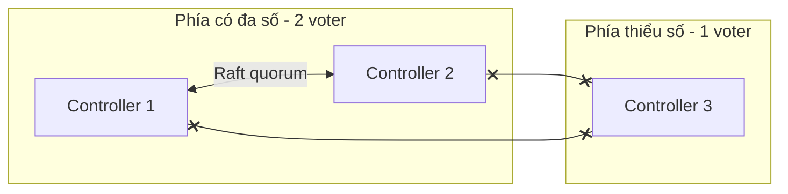

# Ảnh hưởng khi mất controller, mất quorum hoặc phân vùng mạng

Trong Kafka dùng KRaft, controller quorum quản lý metadata của cluster bằng cơ chế đồng thuận Raft. Broker lưu và phục vụ dữ liệu của các partition. Vì vậy, sự cố ở controller có tác động trực tiếp đến khả năng thay đổi metadata và điều phối cluster; sự cố ở broker ảnh hưởng đến replica và khả năng đọc/ghi partition. Hai loại sự cố có liên quan nhưng không đồng nghĩa.

Khi một controller leader dừng, các controller còn lại có thể bầu leader mới nếu vẫn còn đa số voter. Khi mất đa số controller voter, quorum không thể cam kết metadata mới. Trong thời gian đó, một số partition vẫn có thể tiếp tục đọc/ghi nếu broker leader và replica liên quan còn hoạt động, nhưng cluster không thể phục hồi đầy đủ các thay đổi cần controller. Mức độ sẵn sàng thực tế phụ thuộc trạng thái broker, partition, ISR, mạng và cấu hình producer/consumer.

Bài học này phân tích ba tình huống: mất một controller, mất quorum và phân vùng mạng; sau đó liên hệ chúng với replication, khả năng phục vụ dữ liệu và quy trình khôi phục.

## 1. Phân biệt control plane và data plane

KRaft tách vai trò điều phối metadata khỏi việc lưu trữ và phục vụ record:

- **Control plane:** controller voter duy trì metadata log, bầu controller leader và điều phối trạng thái broker, topic, partition, replica assignment và partition leadership.
- **Data plane:** broker nhận Produce/Fetch request, lưu log partition và sao chép replica.
- **Client:** producer, consumer và AdminClient kết nối đến broker, lấy metadata và gửi request theo vai trò của từng client.

Controller quorum không nằm trên đường truyền của từng record. Producer thông thường gửi record trực tiếp đến broker leader của partition; consumer fetch dữ liệu từ broker phù hợp. Controller cung cấp metadata để các thành phần biết broker nào đang giữ vai trò nào.



Sơ đồ chỉ mô tả vai trò. Trong một cluster, mỗi broker có thể là leader của một số partition và follower của các partition khác. Controller leader không chuyển tiếp từng bản ghi giữa producer và broker.

## 2. Controller quorum hoạt động như thế nào?

Các controller voter duy trì một metadata log có thứ tự. Một voter được bầu làm leader; leader phối hợp ghi các thay đổi metadata và các voter còn lại sao chép log. Một thay đổi chỉ được xem là committed khi được đa số voter xác nhận theo giao thức quorum.

Với quorum có `N` voter, số phiếu cần để có đa số là `Q = floor(N / 2) + 1`. Số voter có thể mất mà quorum vẫn còn là `F = N - Q`.

Ví dụ:

| Controller voter | Đa số cần có | Số voter có thể mất |
|---:|---:|---:|
| 1 | 1 | 0 |
| 3 | 2 | 1 |
| 5 | 3 | 2 |

Các con số này tính trên **voter** tham gia quorum. Controller observer (nếu cấu hình có dùng) không đóng góp phiếu bầu như voter. Hai controller voter không tạo ra khả năng chịu lỗi tương đương ba voter: quorum vẫn cần cả hai phiếu, nên mất một node là mất quorum.

Quorum controller và replication factor của topic là hai cơ chế riêng:

- Controller quorum bảo vệ metadata và quyết định lịch sử metadata nào được cam kết.
- Replication factor bảo vệ bản sao dữ liệu của từng partition.
- Một cluster có thể còn quorum controller nhưng mất leader của một partition; ngược lại, broker vẫn có thể đang chạy khi controller quorum đã mất đa số.

## 3. Khi controller leader dừng nhưng quorum vẫn còn

Đây là trường hợp một controller leader bị dừng hoặc mất kết nối, nhưng số voter còn liên lạc được vẫn đủ đa số. Ví dụ, cluster có ba voter và một voter gặp sự cố.

Quá trình thường diễn ra như sau:

1. Các controller còn lại phát hiện leader không còn hoạt động hoặc không còn liên lạc được.
2. Voter đủ điều kiện tham gia bầu chọn controller leader mới.
3. Một voter nhận đủ phiếu và trở thành leader.
4. Controller leader mới tiếp tục xử lý metadata log đã cam kết và nhận các thay đổi metadata mới.
5. Các broker và client cập nhật metadata khi nhận được thông tin mới.



Ảnh hưởng thường gặp:

- **Control plane gián đoạn ngắn:** trong thời gian phát hiện lỗi và bầu leader mới, các thao tác quản trị cần controller có thể chậm hoặc thất bại tạm thời.
- **Metadata đã commit được bảo toàn:** leader mới tiếp tục từ lịch sử metadata được quorum xác nhận.
- **Broker có thể tiếp tục data plane:** các partition đang có leader hợp lệ có thể tiếp tục phục vụ request trong khi controller election diễn ra.
- **Thay đổi cluster tiếp tục sau khi quorum ổn định:** tạo topic, thay đổi assignment hoặc xử lý broker mới có thể tiếp tục khi controller leader mới hoạt động.

Mất controller leader không tự động đồng nghĩa mất dữ liệu record. Nếu controller chạy trên node riêng, broker vẫn hoạt động thì partition log vẫn nằm trên broker. Nếu node kết hợp broker/controller bị dừng, node đó đồng thời mang theo các replica dữ liệu mà nó đang lưu; ảnh hưởng khi đó bao gồm cả control plane và data plane.

Với cluster chỉ có một controller voter, dừng node đó đồng nghĩa không còn quorum để bầu leader thay thế. Cấu hình một voter phù hợp cho môi trường học tập hoặc thử nghiệm, không cung cấp khả năng chịu lỗi controller.

## 4. Khi mất đa số controller voter

Nếu số voter còn liên lạc được nhỏ hơn `Q`, controller quorum không thể cam kết metadata mới. Ví dụ, cluster ba voter mất liên lạc với hai voter; voter còn lại không thể tự quyết định thay đổi metadata.

Các thao tác chịu ảnh hưởng có thể gồm:

- Bầu controller leader hợp lệ và duy trì vai trò leader.
- Cam kết thay đổi metadata của topic, partition và replica assignment.
- Đăng ký hoặc xử lý đầy đủ thay đổi trạng thái broker.
- Điều phối partition leader election sau khi broker gặp sự cố.
- Thực hiện các thao tác quản trị cần metadata quorum.

Cần phân biệt hai điều:

1. **Không thể cam kết metadata mới** là giới hạn của control plane khi quorum mất đa số.
2. **Dữ liệu partition đang có trên broker** không tự động biến mất khi quorum mất đa số.

Một broker có thể còn chạy với metadata đã nhận trước đó. Partition có leader đang hoạt động có thể tiếp tục phục vụ một số request đọc/ghi. Tuy nhiên, không thể xem đây là cam kết rằng toàn cluster vẫn hoạt động bình thường: nếu broker tiếp tục hỏng, replica thay đổi trạng thái hoặc cần bầu leader mới, thiếu controller quorum sẽ cản trở quá trình điều phối. Request cần metadata mới có thể thất bại hoặc timeout.

Không nên mô tả mất quorum như một công tắc lập tức tắt toàn bộ broker. Cũng không nên suy ra broker còn mở port nghĩa là cluster vẫn có khả năng tự phục hồi. Khả năng phục vụ data plane phụ thuộc vào partition leader hiện tại, replica còn sẵn sàng, đường mạng giữa broker và client, cũng như request cụ thể.

## 5. Ảnh hưởng đến partition và replication

Controller quorum và replication của partition liên hệ với nhau qua metadata và trạng thái broker, nhưng chúng có cơ chế chịu lỗi riêng.

### 5.1. Partition leader vẫn hoạt động

Nếu broker đang giữ partition leader vẫn chạy và có thể phục vụ client, các request đọc/ghi có thể tiếp tục theo metadata và trạng thái hiện tại. Follower vẫn có thể fetch dữ liệu từ leader nếu mạng broker-to-broker còn hoạt động.

Với producer dùng `acks=all`, broker leader chờ điều kiện xác nhận từ ISR theo cấu hình. `min.insync.replicas` đặt số replica tối thiểu cần có trong ISR để chấp nhận ghi theo chính sách đó. Ví dụ, replication factor bằng 3 và `min.insync.replicas=2` cho phép ghi khi có ít nhất hai replica trong ISR; nếu ISR giảm còn một, request ghi có thể bị từ chối với lỗi không đủ replica.

Điều này bảo vệ dữ liệu khi một replica tụt lại, nhưng không thay thế controller quorum. Nếu partition leader tiếp tục hoạt động trong lúc controller quorum mất, nó không làm cho metadata quorum tự khôi phục.

### 5.2. Partition leader bị mất

Nếu broker đang giữ partition leader dừng, cần có controller hoạt động để cập nhật metadata và điều phối leader election. Nếu controller quorum vẫn có đa số, controller có thể chọn replica đủ điều kiện, thường từ ISR, làm leader mới.

Nếu controller quorum mất đa số, việc điều phối thay đổi leadership có thể bị đình trệ. Partition có thể tạm thời không có leader được client sử dụng, dù một hoặc nhiều replica vẫn còn dữ liệu trên đĩa.

Nếu không có replica ISR sẵn sàng, partition có thể tiếp tục unavailable cho đến khi replica phù hợp phục hồi. Bật unclean leader election có thể cho phép chọn replica ngoài ISR trong một số tình huống, nhưng có nguy cơ mất các record chưa được replica đó nhận. Đây là đánh đổi availability và data loss cần được đánh giá riêng, không phải biện pháp khôi phục controller quorum.

### 5.3. Controller quorum không thay thế replication dữ liệu

Ví dụ một cluster có ba controller voter và topic có replication factor bằng ba:

- Mất một controller voter: metadata quorum vẫn còn đa số.
- Mất hai controller voter: metadata quorum không thể commit metadata mới.
- Mất một broker chứa partition leader: partition cần leader election nếu có replica phù hợp.
- Mất broker chứa một follower: ISR có thể giảm; khả năng ghi với `acks=all` phụ thuộc `min.insync.replicas`.

Một cluster có thể gặp đồng thời nhiều sự cố. Khi phân tích, hãy kiểm tra cả controller quorum lẫn trạng thái từng partition; không dùng trạng thái một phía để kết luận phía còn lại khỏe mạnh.

## 6. Khi xảy ra network partition

Network partition xảy ra khi các node vẫn chạy nhưng không thể trao đổi dữ liệu qua một phần mạng. Đây là tình huống khó chẩn đoán vì mỗi node có thể còn tài nguyên và log cục bộ, nhưng chúng nhìn thấy các phần khác nhau của cluster.

Ví dụ ba controller voter bị chia thành hai phía:



Trong ví dụ này:

- Phía có hai voter giữ được đa số nên có thể bầu hoặc duy trì controller leader và tiếp tục cam kết metadata.
- Phía chỉ có một voter không đủ phiếu để tự bầu leader mới hoặc cam kết metadata độc lập.
- Khi kết nối được khôi phục, voter bị cô lập đồng bộ lại metadata log từ quorum hợp lệ.

Raft bảo đảm một lịch sử metadata được cam kết duy nhất thông qua quorum; phía thiểu số không thể tự tạo một lịch sử metadata đã commit cạnh tranh với phía đa số. Điều này giúp tránh hai controller leader hợp lệ cùng cam kết các thay đổi metadata xung đột.

### 6.1. Phân vùng mạng giữa broker và controller

Một broker có thể mất đường kết nối đến controller quorum trong khi vẫn kết nối được với một số client hoặc broker khác. Khi đó:

- Broker có thể giữ metadata gần nhất mà nó đã nhận.
- Các thay đổi metadata mới từ controller không đến được broker đang bị cô lập.
- Controller quorum có thể ghi nhận broker không còn liên lạc và điều phối trạng thái cluster theo timeout.
- Broker hoặc client có metadata cũ có thể gửi request đến leader đã thay đổi; request có thể bị từ chối, timeout hoặc cần refresh metadata.
- Khi broker kết nối lại, nó phải đồng bộ trạng thái và tuân theo metadata/epoch mới trước khi phục vụ đúng vai trò.

Không nên giả định một broker bị cô lập có thể tiếp tục hoạt động vô thời hạn như thể không có sự cố. Hành vi cụ thể phụ thuộc phiên bản, trạng thái đăng ký/fencing, thời gian timeout và loại request.

### 6.2. Phân vùng mạng giữa các broker

Nếu broker không thể trao đổi replica fetch, follower có thể tụt khỏi ISR. Controller nhận thông tin trạng thái khi có thể liên lạc và cập nhật metadata tương ứng.

Hệ quả với producer:

- Producer có thể gặp lỗi khi leader không còn khả dụng hoặc metadata cũ.
- Với `acks=all`, số ISR thấp hơn `min.insync.replicas` có thể khiến broker từ chối ghi.
- Retry có thể thành công sau khi metadata được cập nhật và partition có leader/ISR phù hợp; retry không bảo đảm thành công nếu sự cố vẫn tồn tại.

Hệ quả với consumer:

- Consumer có thể fetch thất bại hoặc timeout nếu broker sở hữu partition không thể truy cập.
- Consumer group có thể rebalance nếu thành viên mất heartbeat hoặc rời group.
- Offset đã commit vẫn được lưu theo cơ chế Kafka; việc xử lý lại phụ thuộc vị trí commit và tác động của ứng dụng.

### 6.3. Fencing và epoch giúp ngăn node cũ làm leader hợp lệ

Kafka sử dụng các epoch và cơ chế fencing để nhận biết trạng thái lãnh đạo hoặc broker đã lỗi thời. Khi controller thay đổi partition leadership, metadata mới mang thông tin epoch tương ứng. Request từ một leader cũ hoặc trạng thái cũ có thể bị từ chối khi không còn hợp lệ.

Mục tiêu là tránh để hai broker cùng được xem là leader hợp lệ của một partition trong lịch sử metadata đã cam kết. Fencing không làm mạng tự hồi phục và cũng không đảm bảo mọi request của client trong vùng mạng bị chia cắt đều thành công. Client vẫn có thể thấy lỗi tạm thời cho đến khi metadata và kết nối được cập nhật.

## 7. Bảng tổng hợp tình huống và tác động

| Tình huống | Controller quorum | Partition/data plane | Tác động dễ thấy |
|---|---|---|---|
| Mất một controller leader, còn đa số voter | Bầu leader mới và tiếp tục hoạt động | Broker có thể tiếp tục phục vụ partition đang ổn định | Thao tác quản trị có thể gián đoạn ngắn |
| Mất một voter trong quorum ba node | Vẫn còn đa số | Thường không ảnh hưởng trực tiếp dữ liệu partition | Giảm khả năng chịu thêm một lỗi controller |
| Mất hai trong ba voter | Không thể commit metadata mới | Một số partition có leader vẫn có thể phục vụ; thay đổi leadership có thể bị kẹt | Admin request và phục hồi cluster bị hạn chế |
| Mất controller leader trong cluster một voter | Mất quorum | Broker kết hợp cũng dừng nếu cùng node; broker riêng có thể còn chạy | Control plane không thể bầu leader mới |
| Mất broker follower | Controller vẫn có thể hoạt động | ISR có thể giảm | Ghi `acks=all` phụ thuộc min ISR |
| Mất broker partition leader | Controller cần điều phối leader election | Partition có thể gián đoạn đến khi có leader mới | Producer/consumer retry hoặc timeout |
| Network partition chia 2-1 controller | Phía đa số giữ quorum; phía thiểu số không commit được | Data plane tùy broker và partition nằm ở mỗi phía | Metadata mới chỉ được cam kết ở phía đa số |
| Broker mất kết nối controller nhưng còn kết nối client | Controller có thể xem broker không còn hoạt động | Broker có thể giữ metadata cũ; request có thể lỗi hoặc bị fencing | Stale metadata, timeout, leader/epoch errors |
| Network partition giữa các broker | Controller có thể phát hiện trạng thái replica thay đổi | Follower tụt ISR; leader và replica không đồng đều | Lag tăng, ghi có thể bị từ chối |

## 8. Các cấu hình ảnh hưởng đến khả năng chịu lỗi

Không có một cấu hình duy nhất bảo đảm Kafka luôn đọc/ghi được khi controller hoặc mạng gặp sự cố. Cần phối hợp cấu hình quorum, replication và client.

| Cấu hình/khái niệm | Vai trò | Điều cần lưu ý |
|---|---|---|
| Số controller voter | Xác định quorum metadata | Dùng số lẻ như 3 hoặc 5 để có khả năng chịu lỗi rõ ràng |
| Controller quorum bootstrap/voter configuration | Xác định các node tham gia quorum | Phải nhất quán theo mô hình và phiên bản Kafka |
| Replication factor | Số replica của mỗi partition | Đặt replica trên các broker và miền lỗi phù hợp |
| `min.insync.replicas` | Số ISR tối thiểu cho ghi với `acks=all` | Tăng độ bền nhưng có thể giảm khả năng ghi khi ISR giảm |
| Producer `acks` | Mức xác nhận producer yêu cầu | `acks=all` chờ điều kiện ISR; không có nghĩa mọi replica được cấu hình đều phải phản hồi |
| Producer idempotence | Giảm duplicate do retry trong phạm vi bảo đảm của producer | Không thay thế idempotency của xử lý nghiệp vụ bên ngoài |
| Unclean leader election | Cho phép bầu replica ngoài ISR trong trường hợp nhất định | Có thể khôi phục availability nhưng có nguy cơ mất record |
| Broker/controller timeout và heartbeat | Phát hiện node mất liên lạc | Timeout quá thấp có thể gây phát hiện nhầm khi mạng chập chờn |
| Client retry/timeout | Điều khiển cách client phản ứng với lỗi tạm thời | Retry phải có giới hạn và quan sát được; không sửa được lỗi quorum kéo dài |

Với topic quan trọng, một cấu hình thường gặp là replication factor 3, `min.insync.replicas=2` và producer `acks=all`, đặt replica trên các broker ở các miền lỗi khác nhau. Đây là ví dụ thiết kế, không phải giá trị bắt buộc cho mọi workload. Cần kiểm tra số broker, topology, chi phí lưu trữ và yêu cầu latency trước khi áp dụng.

## 9. Quan sát tình trạng KRaft quorum

Kafka cung cấp công cụ `kafka-metadata-quorum` để xem trạng thái metadata quorum trên các phiên bản hỗ trợ công cụ này.

Xem trạng thái quorum:

```bash
bin/kafka-metadata-quorum.sh \
  --bootstrap-server localhost:9092 \
  describe --status
```

Thông tin thường hữu ích gồm:

- **LeaderId:** node đang giữ vai trò leader của metadata quorum.
- **LeaderEpoch:** epoch của controller leader.
- **HighWatermark:** vị trí metadata log đã được quorum commit.
- **CurrentVoters:** danh sách voter hiện tại.
- **CurrentObservers:** các observer hiện tại nếu cluster sử dụng.
- **MaxFollowerLag:** độ lệch lớn nhất của follower so với leader theo thông tin công cụ báo cáo.

Xem tiến độ replication của metadata quorum:

```bash
bin/kafka-metadata-quorum.sh \
  --bootstrap-server localhost:9092 \
  describe --replication
```

Tùy phiên bản Kafka, các cột có thể khác nhau. Có thể dùng `--command-config client.properties` nếu cluster yêu cầu xác thực hoặc TLS. Hãy kiểm tra `--help` của bộ Kafka đang triển khai nếu cú pháp hoặc trường hiển thị khác.

Khi điều tra, kết hợp các nguồn sau:

1. Trạng thái quorum và leader epoch từ công cụ metadata quorum.
2. Log controller để tìm bầu leader, mất kết nối voter, lỗi ghi metadata log hoặc timeout.
3. Log broker để tìm lỗi đăng ký, mất kết nối controller, fencing và lỗi replica.
4. Trạng thái partition, leader, ISR và under-replicated partition.
5. Metric producer/consumer như request latency, error rate, retry, consumer lag và rebalance.
6. Tình trạng mạng, DNS, firewall, disk I/O và đồng hồ hệ thống giữa các node.

Một lần truy vấn trạng thái chỉ phản ánh thời điểm lấy mẫu. Nếu cluster đang phục hồi, hãy quan sát nhiều lần để biết HighWatermark và độ trễ follower có tiến triển hay không.

## 10. Quy trình xử lý và phục hồi

Khi controller quorum mất đa số hoặc mạng bị chia cắt, ưu tiên đầu tiên là xác định node nào còn liên lạc được và khôi phục quorum metadata. Thực hiện theo thứ tự có kiểm soát:

### Bước 1: Xác định phạm vi sự cố

- Kiểm tra controller voter nào đang chạy, node ID và trạng thái kết nối.
- Xác định có phải tiến trình dừng, máy chủ hỏng, disk đầy hay lỗi mạng.
- Xác định các voter đang ở cùng phía mạng và phía nào còn đủ đa số.
- Kiểm tra broker nào còn hoạt động và partition nào đang có leader.

Không kết luận mất quorum chỉ từ việc một lệnh AdminClient timeout; cần đối chiếu trạng thái quorum, log và kết nối thực tế.

### Bước 2: Khôi phục đường kết nối và tài nguyên

- Khôi phục DNS, routing, firewall và các port controller/broker cần thiết.
- Kiểm tra latency, packet loss và tình trạng mạng giữa các voter.
- Kiểm tra dung lượng disk, quyền truy cập thư mục dữ liệu và lỗi filesystem.
- Khôi phục các node controller hiện hữu với đúng node ID, cluster ID và metadata directory của cluster.

Không tạo một cluster KRaft mới để thay cho quorum đang lỗi. Metadata directory chứa trạng thái quan trọng của cluster; format lại hoặc xóa tùy tiện có thể làm mất khả năng khôi phục lịch sử metadata.

### Bước 3: Chờ quorum bầu leader và đồng bộ metadata

Khi đủ voter liên lạc được, quorum có thể bầu leader mới hoặc tiếp tục với leader hiện tại. Kiểm tra:

- Có một LeaderId hợp lệ.
- HighWatermark tiến triển khi metadata mới được commit.
- Follower bắt kịp metadata log.
- Không còn lỗi bầu chọn lặp lại hoặc mất kết nối liên tục.

Nếu node phục hồi có metadata log cũ, để cơ chế quorum đồng bộ theo quy trình Kafka. Không tự sao chép hoặc chỉnh sửa file metadata log giữa các node.

### Bước 4: Kiểm tra broker và partition

Sau khi control plane ổn định:

- Xác nhận broker đăng ký và không còn bị fenced ngoài dự kiến.
- Kiểm tra partition có leader hợp lệ.
- Kiểm tra ISR, under-replicated partition và offline partition.
- Xác nhận follower bắt kịp leader.
- Kiểm tra producer error/retry và consumer lag/rebalance.

Không vội tăng unclean leader election để làm partition online nếu chưa đánh giá nguy cơ mất dữ liệu. Nếu partition không có replica ISR phù hợp, cần xác định rõ lựa chọn phục hồi dữ liệu và mức chấp nhận mất dữ liệu.

### Bước 5: Khôi phục lưu lượng và xác nhận ứng dụng

- Kiểm tra produce/consume trên topic thử nghiệm hoặc luồng đã được phê duyệt.
- Xác nhận commit offset, retry và idempotency của ứng dụng.
- Theo dõi request latency, error rate, consumer lag và trạng thái replication.
- Chỉ đưa lưu lượng về mức bình thường khi broker, quorum và partition ổn định.

## 11. Những thao tác cần tránh khi mất quorum

Một số thao tác có thể làm sự cố nặng hơn:

- **Không format lại metadata directory của controller đang tồn tại** chỉ vì node không khởi động được. Format là thao tác khởi tạo storage, không phải cách sửa lỗi quorum thông thường.
- **Không tạo cluster ID mới cho một cluster cần phục hồi.** Các node phải thuộc cùng cluster và giữ đúng danh tính.
- **Không xóa metadata log hoặc copy thư mục dữ liệu giữa các controller một cách thủ công.** Việc này có thể phá vỡ lịch sử và trạng thái quorum.
- **Không tự ý thay đổi voter membership khi quorum chưa ổn định.** Thay đổi membership phải theo quy trình được hỗ trợ của phiên bản Kafka và tình trạng quorum hiện tại.
- **Không bật unclean leader election một cách vội vàng.** Có thể chọn replica thiếu record và gây mất dữ liệu.
- **Không coi retry vô hạn là giải pháp.** Retry kéo dài có thể tạo tải bổ sung và che khuất lỗi gốc; cần backoff, giới hạn và metric.

Nếu phần lớn voter bị mất vĩnh viễn hoặc metadata storage hỏng, đây là tình huống phục hồi thảm họa cần theo tài liệu chính thức đúng phiên bản và kế hoạch backup/restore của tổ chức. Không áp dụng một quy trình khôi phục chung khi chưa xác định trạng thái các bản sao metadata còn lại.

## 12. Kịch bản thực hành trong môi trường thử nghiệm

Có thể kiểm chứng hành vi bằng một cluster KRaft không chứa dữ liệu quan trọng, có ba controller voter và các broker riêng. Không thử nghiệm bằng cách dừng node production hoặc chia cắt mạng thật.

### Kịch bản A: Mất một controller voter

1. Ghi lại trạng thái quorum ban đầu bằng `kafka-metadata-quorum describe --status`.
2. Dừng một controller voter trong môi trường lab.
3. Quan sát log controller và trạng thái quorum.
4. Xác nhận hai voter còn lại có thể duy trì đa số và một controller leader hợp lệ.
5. Kiểm tra producer/consumer trên partition đang ổn định.
6. Khởi động lại voter đã dừng và quan sát metadata replication bắt kịp.

Kết quả mong đợi: có thể có gián đoạn control plane trong thời gian phát hiện lỗi/bầu chọn, nhưng quorum ba node vẫn có thể hoạt động khi còn hai voter.

### Kịch bản B: Mất đa số controller voter

1. Dùng cluster lab có ba voter.
2. Dừng hai voter hoặc cô lập chúng khỏi voter còn lại.
3. Quan sát rằng voter đơn lẻ không thể duy trì quorum.
4. Kiểm tra thao tác metadata và các thao tác cần controller có thể thất bại hoặc timeout.
5. Nếu broker còn chạy, quan sát riêng trạng thái partition đang có leader và các request data plane.
6. Khôi phục kết nối hoặc hai voter đã dừng, rồi kiểm tra quorum bầu leader và đồng bộ lại.

Kết quả mong đợi: không có metadata commit mới khi thiếu đa số. Một số hoạt động dữ liệu hiện hữu có thể vẫn chạy, nhưng không được xem là cluster khỏe mạnh.

### Kịch bản C: Phân vùng mạng 2-1

1. Dùng network namespace, container network hoặc môi trường lab có thể kiểm soát kết nối.
2. Chia ba controller voter thành phía hai node và phía một node.
3. Quan sát phía đa số giữ được quorum; phía thiểu số không thể cam kết metadata.
4. Khôi phục kết nối mạng.
5. Xác nhận voter bị cô lập đồng bộ lại log metadata và quorum ổn định.

Không dùng quy trình này trên máy đang chạy workload thật. Khi tạo network partition, cần có cách khôi phục kết nối ngoài băng (out-of-band) để tránh tự khóa quyền truy cập vào lab.

## 13. Checklist đánh giá khả năng chịu lỗi

| Câu hỏi | Điều cần xác nhận |
|---|---|
| Có bao nhiêu controller voter? | Đủ số lượng để chịu lỗi theo mục tiêu availability |
| Các voter nằm ở những miền lỗi nào? | Không tập trung tất cả vào một host, rack hoặc zone duy nhất nếu cần HA |
| Có thể mất bao nhiêu voter? | Tính theo đa số quorum, không tính observer như voter |
| Broker có tách biệt với controller không? | Đánh giá tác động khi node kết hợp bị dừng |
| Topic quan trọng có replication factor phù hợp không? | Replica phân bố trên broker và miền lỗi khác nhau |
| `min.insync.replicas` có phù hợp không? | Cân bằng độ bền dữ liệu và khả năng ghi |
| Có giám sát metadata quorum không? | Theo dõi leader, HighWatermark, follower lag và lỗi election |
| Có giám sát partition không? | Theo dõi offline partition, ISR, under-replicated partition và leader |
| Có quy trình phục hồi không? | Biết cách khôi phục voter cũ, metadata storage và mạng |
| Có diễn tập trong lab không? | Đã kiểm chứng mất một voter, mất quorum và network partition |

## 14. Những điểm cần nhớ

- Mất controller leader không nhất thiết làm mất quorum. Nếu còn đa số voter, controller mới có thể được bầu và control plane tiếp tục.
- Mất đa số voter khiến KRaft không thể commit metadata mới; broker có thể còn phục vụ một phần data plane với trạng thái đã biết, nhưng cluster không thể tự điều phối đầy đủ khi có thay đổi.
- Network partition khiến phía đa số và phía thiểu số có khả năng khác nhau. Chỉ phía giữ quorum mới có thể cam kết metadata.
- Replication factor, ISR, `acks` và `min.insync.replicas` quyết định khả năng bảo vệ dữ liệu partition; controller quorum bảo vệ metadata.
- Fencing và epoch ngăn trạng thái leader cũ tiếp tục được xem là hợp lệ, nhưng client vẫn có thể gặp lỗi và timeout trong lúc metadata hội tụ.
- Phục hồi quorum cần giữ đúng cluster ID, node ID và metadata storage. Không format hoặc xóa metadata directory tùy tiện.

Khi vận hành Kafka, hãy chẩn đoán riêng tình trạng KRaft quorum, broker và từng partition. Chỉ khi ba góc nhìn này được đối chiếu, ta mới đánh giá đúng cluster còn có thể phục vụ dữ liệu nào, thao tác nào đang bị chặn và cần phục hồi thành phần nào trước.

