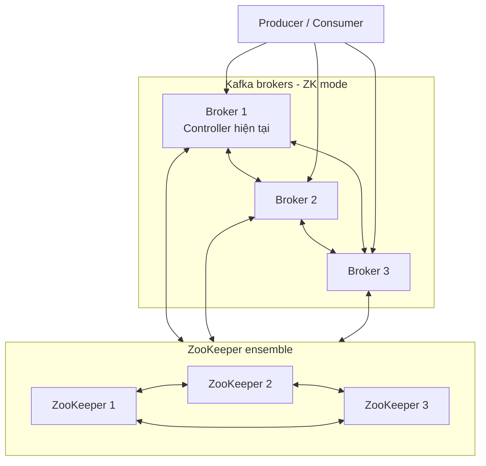
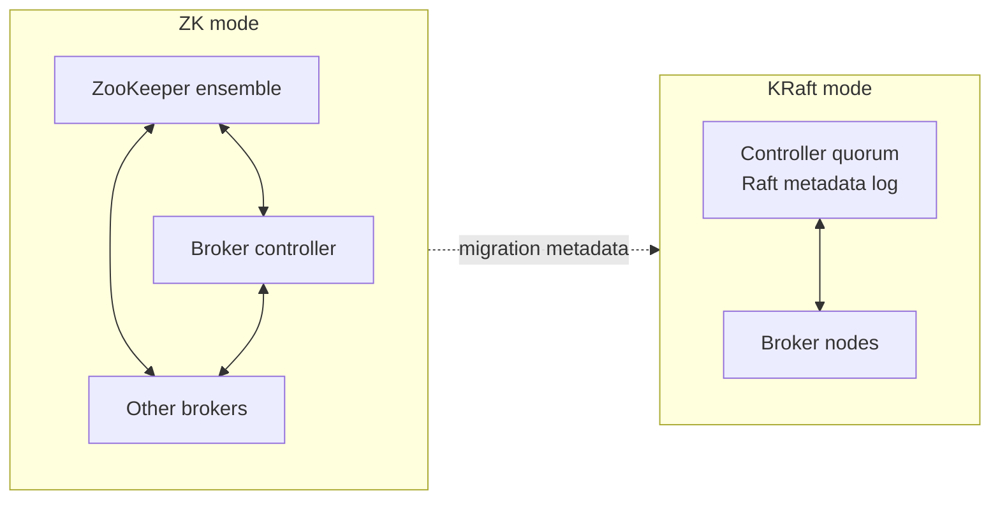
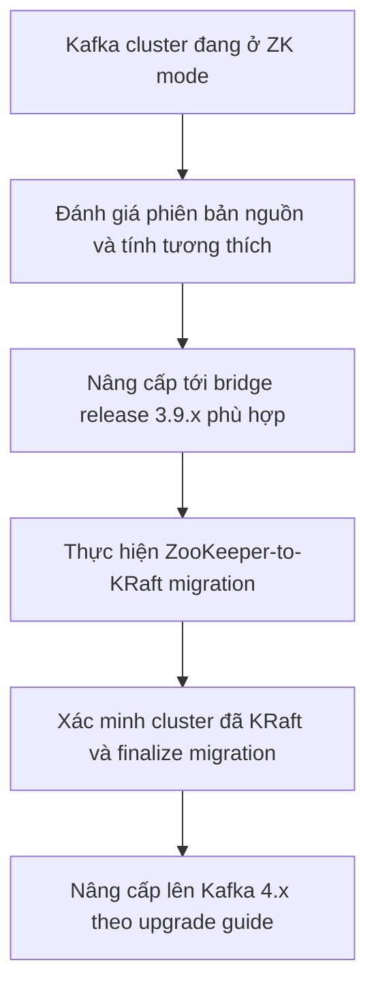
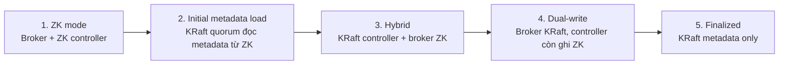

# ZooKeeper trong hệ thống cũ và ranh giới chuyển sang KRaft

## Mục tiêu

Các phiên bản Kafka cũ dùng Apache ZooKeeper để lưu metadata của cluster và hỗ trợ bầu controller. KRaft thay cơ chế đó bằng một controller quorum sử dụng Raft và metadata log của Kafka. Hiểu kiến trúc cũ giúp người vận hành nhận diện cấu hình, dữ liệu và phụ thuộc ZooKeeper còn tồn tại; hiểu ranh giới chuyển đổi giúp lập kế hoạch nâng cấp mà không nhầm migration metadata với việc di chuyển record nghiệp vụ.

Sau bài học này, bạn có thể:

- Giải thích ZooKeeper làm gì trong Kafka ở chế độ cũ và phân biệt metadata với dữ liệu record.
- Mô tả cách broker/controller phối hợp qua ZooKeeper trong kiến trúc legacy.
- So sánh control plane ZooKeeper với KRaft controller quorum.
- Phân biệt nâng cấp Kafka, migration ZooKeeper sang KRaft và di chuyển dữ liệu ứng dụng.
- Giải thích các giai đoạn migration: metadata load, hybrid, dual-write và finalize.
- Nhận biết vì sao Kafka 3.9 là bridge release cuối cùng cho ZooKeeper và Kafka 4.0+ yêu cầu KRaft.
- Lập checklist chuẩn bị, xác minh và quản trị rủi ro khi chuyển cluster hiện hữu.

## 1. ZooKeeper giữ vai trò gì trong Kafka legacy?

Trong kiến trúc Kafka dùng ZooKeeper (thường gọi là ZK mode), ZooKeeper là dịch vụ điều phối và lưu metadata cluster. Kafka broker vẫn lưu record nghiệp vụ trong các partition log trên đĩa của broker. ZooKeeper không phải nơi producer gửi record và cũng không phải kho dữ liệu message của Kafka.

ZooKeeper hỗ trợ các công việc điều khiển cluster như:

- Lưu thông tin nhận diện cluster và đăng ký broker đang hoạt động.
- Hỗ trợ bầu một broker làm controller thông qua cơ chế election dựa trên ZooKeeper.
- Lưu metadata về topic, partition, replica assignment và một số trạng thái liên quan đến cluster.
- Lưu cấu hình và metadata quản trị như ACL hoặc dynamic broker/topic configuration tùy phiên bản.
- Thông báo thay đổi cho các thành phần theo dõi thông qua cơ chế watch.

Controller được bầu trong các broker chịu trách nhiệm phối hợp thay đổi metadata và điều khiển trạng thái partition. Các broker khác nhận thông tin cập nhật để phục vụ request của client và replication. ZooKeeper giữ metadata điều phối; broker giữ dữ liệu record và replica.



### 1.1. Broker registration và controller election

Khi broker khởi động ở ZK mode, nó kết nối tới `zookeeper.connect`, đăng ký thông tin broker và tham gia cluster. Controller election truyền thống sử dụng một znode có tính ephemeral để biểu thị broker nào đang giữ vai trò controller. Khi broker controller mất kết nối hoặc dừng, znode bị xóa theo session và các broker còn lại có thể tiến hành bầu controller mới.

Controller đang hoạt động nhận các yêu cầu thay đổi metadata, cập nhật trạng thái partition và thông báo cho broker. Các broker không tự ý thay đổi metadata cluster độc lập; chúng phối hợp thông qua controller và ZooKeeper. Cơ chế này hoạt động ổn định trong nhiều năm, nhưng khiến Kafka phụ thuộc vào một hệ thống điều phối bên ngoài.

### 1.2. Metadata không phải dữ liệu record

Hãy phân biệt hai nhóm dữ liệu:

| Nhóm | Nơi lưu trong ZK mode | Ví dụ |
|---|---|---|
| Metadata cluster | ZooKeeper và cache metadata ở broker | Broker registration, topic/partition assignment, controller state, ACL/config metadata |
| Dữ liệu ứng dụng | Partition log trên storage của broker | Record key, value, headers, timestamp và offset |

Khi chuyển từ ZooKeeper sang KRaft, Kafka chuyển cơ chế quản lý metadata cluster sang metadata log của controller quorum. Các partition log vẫn nằm trên broker storage. Đây không phải quá trình sao chép từng record nghiệp vụ từ ZooKeeper sang KRaft.

## 2. Vì sao Kafka thay ZooKeeper bằng KRaft?

Khi cluster lớn lên, việc duy trì metadata ở một hệ thống riêng tạo thêm một lớp vận hành: phải cài đặt, giám sát, backup, mở rộng và xử lý sự cố cho cả Kafka lẫn ZooKeeper. Hai hệ thống có vòng đời, cơ chế quorum và cách phục hồi khác nhau. Metadata của Kafka cũng phải được đồng bộ từ ZooKeeper tới controller và broker, tạo thêm độ phức tạp trong luồng điều phối.

KRaft đưa metadata vào chính Kafka thông qua một quorum controller dùng thuật toán Raft. Controller leader ghi metadata record vào metadata log và replication tới các controller follower. Khi metadata được commit theo quorum, các controller có thể phục hồi trạng thái từ log và snapshot; broker nhận metadata image để xử lý hoạt động cluster.

Lợi ích kiến trúc chính:

- Giảm phụ thuộc vào hệ thống ZooKeeper bên ngoài.
- Có một cơ chế consensus và log metadata thống nhất cho control plane Kafka.
- Phân tách rõ vai trò controller và broker, hỗ trợ triển khai controller chuyên trách.
- Tạo nền tảng cho khả năng mở rộng metadata và các cải tiến vận hành trong các phiên bản Kafka mới.
- Đơn giản hóa kiến trúc triển khai sau khi cluster đã hoàn tất migration.

KRaft không loại bỏ mọi yêu cầu vận hành. Cluster vẫn cần controller quorum đủ số voter, network ổn định, storage bền vững, backup, monitoring và quy trình nâng cấp metadata version. Thay đổi nằm ở nơi và cách Kafka quản lý metadata.

## 3. So sánh ZK mode và KRaft mode

| Khía cạnh | Kafka dùng ZooKeeper | Kafka dùng KRaft |
|---|---|---|
| Nơi quản lý metadata cluster | ZooKeeper ensemble | KRaft controller quorum và metadata log |
| Bầu controller | Broker election dựa trên ZooKeeper | Raft election giữa các controller voter |
| Thành phần điều phối | ZooKeeper cùng broker controller | Controller leader và controller follower |
| Broker registration | Broker đăng ký với ZooKeeper | Broker đăng ký và đồng bộ metadata với controller quorum |
| Metadata persistence | Znodes trong ZooKeeper | Metadata log và snapshot trong KRaft storage |
| Cấu hình node | `broker.id`, `zookeeper.connect` | `process.roles`, `node.id`, controller quorum settings |
| Dịch vụ ngoài Kafka | Cần ZooKeeper | Không cần ZooKeeper cho metadata Kafka |
| Dữ liệu partition | Log trên broker storage | Vẫn là log trên broker storage |
| Điều phối cluster | Tách qua ZooKeeper | Tích hợp trong Kafka bằng Raft |



Một điểm quan trọng: ZooKeeper mode có broker giữ vai trò controller; KRaft mode có thể tách controller khỏi broker bằng `process.roles=controller` và `process.roles=broker`. Môi trường phát triển có thể dùng combined role, nhưng production quan trọng thường nên triển khai controller chuyên trách để cô lập tài nguyên và failure domain.

## 4. Ranh giới của ba loại thay đổi

Trước khi lập kế hoạch, cần xác định chính xác công việc đang thực hiện. Ba hoạt động sau có liên quan nhưng không đồng nghĩa.

| Hoạt động | Thay đổi gì? | Ví dụ |
|---|---|---|
| Nâng cấp Kafka software | Thay binary/runtime của broker, controller hoặc client lên phiên bản mới | Kafka 3.8 lên 3.9 |
| ZooKeeper-to-KRaft migration | Chuyển metadata cluster từ ZooKeeper sang KRaft quorum | ZK mode sang KRaft mode trong bridge release |
| Di chuyển dữ liệu ứng dụng | Sao chép record/topic từ cluster hoặc hệ thống nguồn sang đích | MirrorMaker 2, Kafka Connect, export/import hoặc ứng dụng replay |

Migration ZooKeeper-to-KRaft không phải là việc đổi địa chỉ `zookeeper.connect` thành một địa chỉ controller. Đây là quy trình chuyển giao quyền quản lý metadata có các giai đoạn tương thích giữa controller cũ, controller KRaft và broker. Nó cũng không phải quy trình chuyển dữ liệu record sang một cluster Kafka mới.

Nếu mục tiêu là triển khai một cluster mới, hãy tạo cluster KRaft mới và cấu hình broker/controller theo phiên bản đang dùng. Không cần dựng ZooKeeper chỉ để tạo một cluster Kafka mới.

## 5. Ranh giới phiên bản: Kafka 3.x và Kafka 4.x

ZooKeeper được đánh dấu deprecated từ Kafka 3.5. Kafka 3.9 là bản phát hành major cuối cùng trong dòng 3.x còn hỗ trợ ZK mode và là bridge release cuối cùng để thực hiện ZooKeeper-to-KRaft migration. Từ Kafka 4.0 trở đi, ZooKeeper mode đã bị loại bỏ; broker 4.x chỉ chạy KRaft.

| Phiên bản | Ý nghĩa đối với ZooKeeper/KRaft |
|---|---|
| Kafka trước 3.5 | ZooKeeper mode còn được hỗ trợ; KRaft đã phát triển qua nhiều giai đoạn nhưng cần kiểm tra mức độ sẵn sàng theo phiên bản |
| Kafka 3.5 | ZooKeeper được đánh dấu deprecated; migration ban đầu còn ở giai đoạn early access |
| Kafka 3.6–3.8 | KRaft tiếp tục hoàn thiện; migration có thay đổi về mức độ hỗ trợ qua từng bản phát hành |
| Kafka 3.9.x | Dòng 3.x cuối cùng hỗ trợ ZK mode; bridge release để chuyển metadata trước khi lên 4.x |
| Kafka 4.0 trở đi | Chỉ hỗ trợ KRaft; không thể nâng cấp trực tiếp một cluster còn ở ZK mode |

Vì vậy, với cluster hiện đang dùng ZooKeeper, kế hoạch tổng quát là:



Kafka 3.9 migration guide cụ thể yêu cầu broker được nâng lên 3.9.1 và `inter.broker.protocol.version=3.9` trước khi bắt đầu quy trình được mô tả trong tài liệu đó. Đây là yêu cầu theo bridge release và migration procedure tương ứng, không phải cấu hình chung cho mọi phiên bản Kafka. Với cluster rất cũ, phải kiểm tra từng bước nâng cấp trung gian và khả năng tương thích ZooKeeper; không giả định có thể nâng từ bất kỳ phiên bản nào thẳng lên 3.9.x.

## 6. Các giai đoạn ZooKeeper-to-KRaft migration

Migration được thiết kế để controller KRaft tiếp nhận metadata trong khi cluster vẫn duy trì khả năng tương thích với broker cũ. Tên gọi và chi tiết từng bước phụ thuộc phiên bản, nhưng migration guide Kafka 3.9 mô tả các giai đoạn chính sau.

### 6.1. Initial phase — cluster vẫn ở ZK mode

Ban đầu, tất cả broker vẫn dùng ZooKeeper và có một ZooKeeper-based controller. Dữ liệu partition tiếp tục được phục vụ bình thường. Người vận hành chuẩn bị bridge release, cấu hình và controller quorum KRaft.

### 6.2. Initial metadata load — nạp metadata vào KRaft

Một KRaft controller quorum được provision với cùng cluster ID của cluster hiện tại. Controller KRaft kết nối ZooKeeper và đọc metadata để nạp vào KRaft metadata log. Trong bước này, ZooKeeper vẫn là nguồn metadata của cluster legacy và các broker chưa chuyển sang KRaft.

### 6.3. Hybrid phase — controller KRaft điều phối broker ZK

KRaft controller đã nắm metadata nhưng một số hoặc toàn bộ broker vẫn đang ở ZK mode. Trong giai đoạn hybrid, controller KRaft tiếp tục gửi các controller RPC cần thiết tới broker ZK. Điều này cho phép chuyển broker theo từng bước mà không cần đổi toàn bộ cluster cùng lúc.

### 6.4. Dual-write phase — broker KRaft, metadata vẫn ghi về ZooKeeper

Sau khi các broker đã được chuyển sang KRaft mode, controller vẫn tiếp tục ghi metadata về ZooKeeper trong thời gian migration. Đây là giai đoạn dual-write: cluster đang tiến gần tới KRaft hoàn toàn nhưng ZooKeeper vẫn còn tham gia vào quá trình tương thích.

### 6.5. Finalized — KRaft là hệ thống metadata duy nhất

Khi toàn bộ broker đã chạy KRaft và quá trình xác minh đạt yêu cầu, người vận hành đưa controller ra khỏi migration mode. Sau khi finalize, Kafka không tiếp tục ghi metadata về ZooKeeper. Theo migration guide, không thể quay lại ZooKeeper mode sau bước này.



Các giai đoạn này giải thích vì sao migration không phải một lần restart duy nhất. KRaft controller được đưa vào trước để tiếp nhận metadata; broker chuyển đổi theo rolling restart; cuối cùng controller mới rời migration mode.

## 7. Chuẩn bị migration: kiểm kê và điều kiện đầu vào

Migration là thay đổi control plane của cluster. Trước khi thực hiện trên production, hãy thử quy trình trên môi trường staging có cấu trúc, phiên bản và cấu hình tương đương. Lập cửa sổ thay đổi, người chịu trách nhiệm, phương án dừng và tiêu chí xác nhận từng giai đoạn.

### 7.1. Kiểm kê phiên bản và tính năng

- Ghi lại phiên bản Kafka, ZooKeeper, Java runtime, client, Kafka Connect, Kafka Streams và các công cụ quản trị.
- Xác định upgrade path chính thức từ phiên bản nguồn đến bridge release. Với cluster cũ, có thể cần một hoặc nhiều bản nâng cấp trung gian.
- Kiểm tra các tính năng đang sử dụng có được hỗ trợ trong KRaft ở phiên bản đích hay không.
- Kiểm tra custom authorizer, ACL, delegation token, quota, dynamic configuration, listener và cơ chế bảo mật.
- Kiểm tra connector/plugin hoặc công cụ bên thứ ba có phụ thuộc trực tiếp vào ZooKeeper hay không.
- Xác nhận các broker có log directory khỏe mạnh; sửa lỗi storage trước khi migration.

Kafka 3.9 migration guide yêu cầu broker ở software version 3.9.1 và inter-broker protocol version 3.9 trước khi thực hiện quy trình được mô tả. Không thay đổi metadata version hoặc inter-broker protocol version trong khi migration đang diễn ra, vì điều này có thể làm cluster hỏng trạng thái chuyển đổi.

### 7.2. Sao lưu và chuẩn bị phục hồi

- Sao lưu cấu hình broker, controller, ZooKeeper, ACL và cấu hình động.
- Sao lưu ZooKeeper theo quy trình phù hợp với phiên bản và topology; kiểm tra khả năng đọc lại bản backup.
- Bảo đảm dữ liệu partition trên broker có bản sao khỏe mạnh và ISR phù hợp với chính sách chịu lỗi.
- Ghi lại cluster ID, broker ID, topic/partition assignment, replication factor, ACL và các cấu hình quan trọng.
- Ghi lại baseline metrics: offline partition, under-replicated partition, request latency, controller state, disk usage và consumer lag.
- Xác định ai được phép quyết định finalize; không finalize chỉ vì các broker đã khởi động thành công.

Backup ZooKeeper không thay thế backup dữ liệu partition của broker. Ngược lại, backup log directory của broker cũng không thay thế việc lưu lại metadata và cấu hình ZooKeeper. Hai nhóm dữ liệu có vai trò khác nhau.

### 7.3. Kiểm tra ID và cluster identity

KRaft dùng một namespace `node.id` chung cho broker và controller. Trong migration, node ID của controller mới phải khác các `broker.id` đang tồn tại. Khi một broker cũ được chuyển sang KRaft, giữ nguyên ID của broker đó làm `node.id` để metadata nhận diện cùng node.

Controller quorum mới phải dùng đúng cluster ID của cluster ZooKeeper hiện tại. Không tạo cluster ID mới cho controller migration, vì metadata của KRaft phải thuộc cùng cluster identity với broker data hiện hữu.

## 8. Các cấu hình quan trọng trong migration

Các ví dụ sau minh họa những thuộc tính chính theo migration guide Kafka 3.9.1. Đây không phải file cấu hình đầy đủ cho production. Listener, security protocol, TLS/SASL, advertised address, storage path, controller quorum size và các thuộc tính riêng của môi trường phải được kiểm tra trước khi áp dụng.

### 8.1. Controller KRaft trong migration mode

Controller KRaft cần cấu hình role, node ID, listener controller, quorum bootstrap, cùng thông tin kết nối ZooKeeper và cờ migration:

```properties
process.roles=controller
node.id=3000
controller.quorum.bootstrap.servers=controller-1:9093,controller-2:9093,controller-3:9093
controller.listener.names=CONTROLLER
listeners=CONTROLLER://:9093

# Migration mode: controller KRaft còn đồng bộ với ZooKeeper
zookeeper.metadata.migration.enable=true
zookeeper.connect=zk-1:2181,zk-2:2181,zk-3:2181

# Listener broker dùng cho controller RPC tới broker
inter.broker.listener.name=PLAINTEXT
```

Controller phải được format bằng cluster ID đã đọc từ cluster hiện tại. Quorum controller cần số voter và failure domain phù hợp với yêu cầu chịu lỗi. Ví dụ trên dùng dynamic quorum bootstrap address theo cấu hình của phiên bản bridge; không lấy nguyên cấu hình này để áp dụng cho Kafka 3.8 hoặc 4.x.

### 8.2. Broker ZK được đưa vào migration mode

Broker vẫn giữ `broker.id`, vẫn kết nối ZooKeeper và bổ sung cấu hình để giao tiếp với controller quorum KRaft:

```properties
broker.id=0
listeners=PLAINTEXT://:9092
advertised.listeners=PLAINTEXT://broker-1:9092
listener.security.protocol.map=PLAINTEXT:PLAINTEXT,CONTROLLER:PLAINTEXT

inter.broker.protocol.version=3.9
zookeeper.metadata.migration.enable=true
zookeeper.connect=zk-1:2181,zk-2:2181,zk-3:2181

controller.quorum.bootstrap.servers=controller-1:9093,controller-2:9093,controller-3:9093
controller.listener.names=CONTROLLER
```

Các broker được rolling restart theo quy trình để vào migration mode. Khi broker cuối cùng đã khởi động với cấu hình cần thiết, migration metadata có thể tự bắt đầu. Controller log có thông báo hoàn tất metadata migration; hãy đối chiếu với hướng dẫn phiên bản và các chỉ số cluster thay vì chỉ dựa vào một dòng log.

### 8.3. Broker sau khi chuyển sang KRaft

Khi metadata migration hoàn tất và tới bước chuyển broker, broker được cấu hình thành KRaft broker:

```properties
process.roles=broker
node.id=0
listeners=PLAINTEXT://:9092
advertised.listeners=PLAINTEXT://broker-1:9092
listener.security.protocol.map=PLAINTEXT:PLAINTEXT,CONTROLLER:PLAINTEXT

controller.quorum.bootstrap.servers=controller-1:9093,controller-2:9093,controller-3:9093
controller.listener.names=CONTROLLER
```

Trong ví dụ, `node.id=0` giữ nguyên ID của broker trước đó (`broker.id=0`). Broker đã chuyển sang KRaft không còn cấu hình `zookeeper.connect` hoặc cờ `zookeeper.metadata.migration.enable`. Với KRaft, metadata version được quản lý qua feature level; không tiếp tục đặt `inter.broker.protocol.version` như cách cấu hình ZK mode trong ví dụ migration.

Nếu cluster cũ dùng `kafka.security.authorizer.AclAuthorizer`, migration guide yêu cầu chuyển sang `org.apache.kafka.metadata.authorizer.StandardAuthorizer` tại thời điểm chuyển broker sang KRaft. Cần rà soát riêng ACL, principal mapping và security configuration để bảo đảm quyền truy cập giữ nguyên.

## 9. Quy trình migration ở mức vận hành

Thực hiện đúng thứ tự trong migration guide tương ứng với phiên bản bridge. Quy trình tổng quát gồm:

1. **Hoàn tất preflight:** nâng broker tới phiên bản bridge được yêu cầu, đặt protocol version theo hướng dẫn, kiểm tra feature compatibility, storage, backup và logging.
2. **Provision controller quorum:** tạo KRaft controller quorum với cùng cluster ID, node ID không trùng broker ID, cấu hình migration mode và ZooKeeper connection.
3. **Đưa broker vào migration mode:** bổ sung controller quorum bootstrap/listener và cờ migration; rolling restart broker theo hướng dẫn.
4. **Chờ metadata load:** theo dõi controller log, trạng thái quorum, metadata và lỗi migration cho tới khi controller xác nhận nạp metadata hoàn tất.
5. **Chuyển từng broker sang KRaft:** thay `broker.id` bằng `node.id` giữ nguyên giá trị, thêm `process.roles=broker`, giữ controller quorum settings, bỏ cấu hình ZooKeeper và migration flag trên broker; rolling restart từng broker.
6. **Xác minh toàn cluster:** xác nhận tất cả broker đã đăng ký với controller quorum, partition/replica ổn định, client hoạt động, ACL và các tính năng tích hợp đúng.
7. **Finalize controller migration:** bỏ `zookeeper.metadata.migration.enable` và `zookeeper.connect` trên controller; restart controller lần lượt theo migration guide.
8. **Deprovision ZooKeeper:** chỉ thực hiện sau khi migration đã finalized, các kiểm tra đạt và xác nhận ZooKeeper không còn phục vụ hệ thống khác.

Trong suốt quá trình, không tự ý đổi metadata version hoặc inter-broker protocol version. Không bỏ qua bước xác minh để rút ngắn thời gian. Với production, giữ ZooKeeper và bản backup cần thiết cho đến khi quyết định finalize được phê duyệt theo runbook vận hành.

## 10. Kiểm tra sau migration

Migration chỉ được xem là hoàn tất về vận hành khi control plane, broker data plane và các client đều hoạt động ổn định.

| Hạng mục | Điều cần xác nhận |
|---|---|
| Controller quorum | Có leader hợp lệ, voter tham gia đầy đủ và metadata log được replicate/commit |
| Broker registration | Tất cả broker đăng ký vào KRaft cluster với đúng node ID |
| Cluster identity | Cluster ID không đổi so với cluster nguồn |
| Topic metadata | Topic, partition count, replica assignment và cấu hình quan trọng được giữ đúng |
| Partition health | Không có offline partition; under-replicated partition trở về mức mong đợi |
| Producer/consumer | Client bootstrap, produce, consume, commit offset và transaction hoạt động |
| Security | ACL, authentication, authorization và principal mapping được xác minh |
| Connect/Streams | Connector, state store, changelog, repartition và internal topics phục hồi đúng |
| Monitoring | Alert, metrics và dashboard được cập nhật cho KRaft controller/broker |
| ZooKeeper dependency | Không còn broker/controller Kafka nào cần ZooKeeper sau finalize |

Có thể dùng các công cụ quản trị KRaft như `kafka-metadata-quorum.sh` để xem quorum status/replication và các CLI topic/group để đối chiếu trạng thái ứng dụng. Cú pháp lệnh phụ thuộc phiên bản; sử dụng đúng CLI đi kèm phiên bản bridge hoặc phiên bản đích.

Ví dụ các phép kiểm tra nên thực hiện:

```bash
# Xem metadata quorum (chọn cú pháp bootstrap phù hợp với phiên bản)
bin/kafka-metadata-quorum.sh --bootstrap-server broker-1:9092 describe --status

# Kiểm tra broker và partition của một topic đại diện
bin/kafka-topics.sh --bootstrap-server broker-1:9092 --describe --topic orders

# Kiểm tra consumer group và lag
bin/kafka-consumer-groups.sh --bootstrap-server broker-1:9092 --describe --group billing-service
```

Các lệnh trên là ví dụ kiểm tra sau chuyển đổi, không phải lệnh thực hiện migration. Hãy kiểm tra tên option của đúng phiên bản Kafka đang chạy trước khi đưa vào automation.

## 11. Rollback và ranh giới không thể quay lại

Trong các giai đoạn trước khi finalize, migration guide có quy trình revert về ZK mode tùy bước cuối cùng đã hoàn tất. Đây là quy trình có điều kiện: phải biết chính xác giai đoạn cluster đã đạt, xử lý controller epoch và migration state trong ZooKeeper, chỉnh lại cấu hình broker rồi restart theo đúng thứ tự. Không nên coi rollback là thao tác đơn giản bằng cách bật lại `zookeeper.connect`.

Sau khi migration đã finalized, Kafka không hỗ trợ quay lại ZooKeeper mode. Nếu sau finalize phát hiện lỗi nghiêm trọng, hướng xử lý phải dựa trên backup, khả năng phục hồi metadata/data và kế hoạch disaster recovery; không thể dùng quy trình revert trước finalize.

| Trạng thái | Khả năng quay lại ZK mode |
|---|---|
| Chỉ chuẩn bị, chưa bật migration | Chưa rời ZK mode; hủy chuẩn bị theo kế hoạch |
| Đã provision controller quorum | Có thể deprovision quorum theo hướng dẫn |
| Đã vào migration mode hoặc đã chuyển một phần broker | Có thể có quy trình revert nhưng phải xử lý đúng controller epoch và trạng thái migration |
| Đã chuyển tất cả broker nhưng chưa finalize | Chỉ revert theo đúng phần tương ứng của migration guide; cần đánh giá rủi ro kỹ |
| Đã finalize | Không hỗ trợ quay lại ZooKeeper mode |

Vì vậy, finalize là ranh giới quyết định. Hãy chỉ finalize sau khi đã xác minh metadata, partition, replica, security, client và hệ thống tích hợp trong khoảng thời gian đủ để phát hiện vấn đề.

## 12. Lỗi thường gặp và cách phòng tránh

| Hiện tượng | Nguyên nhân thường gặp | Cách xử lý/kiểm tra |
|---|---|---|
| KRaft controller không nạp được metadata | Cluster ID sai, controller quorum chưa ổn định, cấu hình ZooKeeper/listener sai | Đối chiếu cluster ID, node ID, quorum bootstrap, controller log và kết nối ZooKeeper |
| Controller node ID trùng broker ID | Không kiểm kê ID trước khi provision controller | Đảm bảo controller ID khác toàn bộ broker ID hiện hữu; KRaft dùng chung namespace node ID |
| Broker không kết nối được controller | Thiếu controller listener trong protocol map hoặc sai advertised/bootstrap address | Kiểm tra listener, DNS, firewall, TLS/SASL và controller quorum address |
| Migration bị dừng giữa các giai đoạn | Có feature chưa hỗ trợ, lỗi log directory hoặc trạng thái migration không nhất quán | Kiểm tra migration logs, feature compatibility và sửa storage trước khi tiếp tục |
| Partition offline hoặc ISR giảm | Broker restart sai thứ tự, replication chưa bắt kịp hoặc broker gặp lỗi storage/network | Kiểm tra partition state, replica log, broker health và phục hồi từng node |
| ACL không hoạt động sau khi chuyển broker | Authorizer hoặc principal mapping còn cấu hình kiểu ZK mode | Rà soát `StandardAuthorizer`, ACL, listener và authentication |
| Cố nâng thẳng cluster ZK lên Kafka 4.x | Bỏ qua bridge release và migration | Dừng kế hoạch nâng cấp; quay lại upgrade path chính thức qua Kafka 3.9 migration |
| Không thể rollback sau sự cố | Migration đã finalize | Dùng kế hoạch disaster recovery; không cố bật lại ZooKeeper config |

## 13. Checklist trước khi cho phép finalize

- [ ] Đã xác nhận bridge release và upgrade path phù hợp với phiên bản nguồn.
- [ ] Đã kiểm tra tất cả feature đang dùng có hỗ trợ trong KRaft.
- [ ] Đã sao lưu và kiểm tra khả năng phục hồi ZooKeeper metadata cùng broker data.
- [ ] Controller quorum dùng đúng cluster ID và node ID không trùng broker ID.
- [ ] Tất cả broker đã chuyển sang KRaft, giữ nguyên ID và đăng ký thành công.
- [ ] Controller quorum khỏe mạnh, metadata log replicate/commit bình thường.
- [ ] Topic, partition, replica, ISR và consumer offsets đã được kiểm tra.
- [ ] Producer, consumer, transaction, Connect, Streams và các client quan trọng đã được smoke test.
- [ ] ACL, authentication, authorization, quota và dynamic configs đã được xác minh.
- [ ] Monitoring, alert và runbook vận hành đã được cập nhật.
- [ ] Đã có người chịu trách nhiệm phê duyệt finalize và kế hoạch disaster recovery.

## 14. Câu hỏi tự kiểm tra

1. ZooKeeper lưu loại dữ liệu nào trong Kafka legacy? Vì sao nói ZooKeeper không lưu record nghiệp vụ?
2. Broker controller trong ZK mode được bầu theo cơ chế nào?
3. KRaft thay ZooKeeper bằng thành phần nào và metadata được lưu ra sao?
4. Vì sao migration metadata không đồng nghĩa với sao chép dữ liệu partition?
5. Phân biệt nâng cấp Kafka software, ZooKeeper-to-KRaft migration và data migration.
6. Kafka 3.9 và Kafka 4.0 khác nhau thế nào về hỗ trợ ZooKeeper?
7. Vì sao controller mới phải dùng cùng cluster ID nhưng node ID không trùng broker ID cũ?
8. Hybrid phase và dual-write phase khác nhau ở trạng thái broker như thế nào?
9. Vì sao không nên thay đổi metadata version hoặc inter-broker protocol version giữa migration?
10. Điều gì làm cho finalize trở thành ranh giới không thể rollback về ZooKeeper?

## Tài liệu tham khảo

- [Apache Kafka 3.9 — KRaft and ZooKeeper to KRaft Migration](https://kafka.apache.org/39/operations/kraft/): thuật ngữ, migration phases, prerequisites, controller quorum, broker migration, finalization và revert.
- [Apache Kafka 3.9.0 Release Announcement](https://kafka.apache.org/blog/2024/11/06/apache-kafka-3.9.0-release-announcement/): Kafka 3.9 là major release cuối cùng có ZooKeeper mode và bridge release trước Kafka 4.0.
- [Apache Kafka 4.0 — Upgrading](https://kafka.apache.org/40/getting-started/upgrade/): Kafka 4.0 chỉ hỗ trợ KRaft và yêu cầu cluster ZK phải migration trước khi nâng cấp.
- [Apache Kafka 4.4 — KRaft vs ZooKeeper](https://kafka.apache.org/44/getting-started/zk2kraft/): các khác biệt về cấu hình, metric và hành vi giữa hai chế độ.

> Migration procedure phụ thuộc phiên bản Kafka nguồn, bridge release và phiên bản đích. Các cấu hình trong bài chỉ minh họa ranh giới kỹ thuật; luôn đối chiếu migration guide chính thức của đúng phiên bản trước khi thao tác trên cluster thật.
