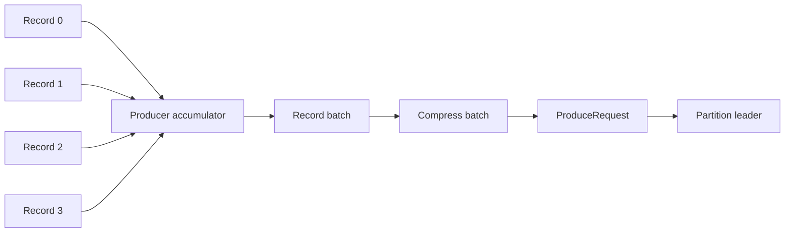
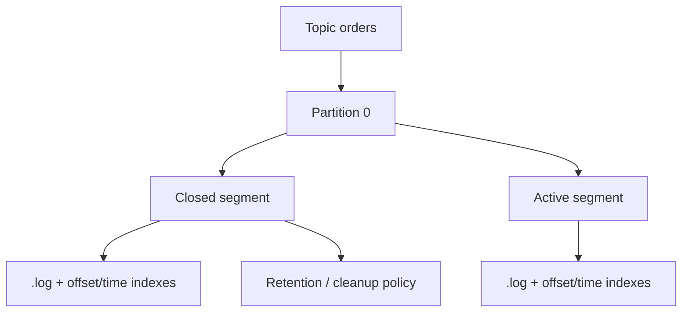
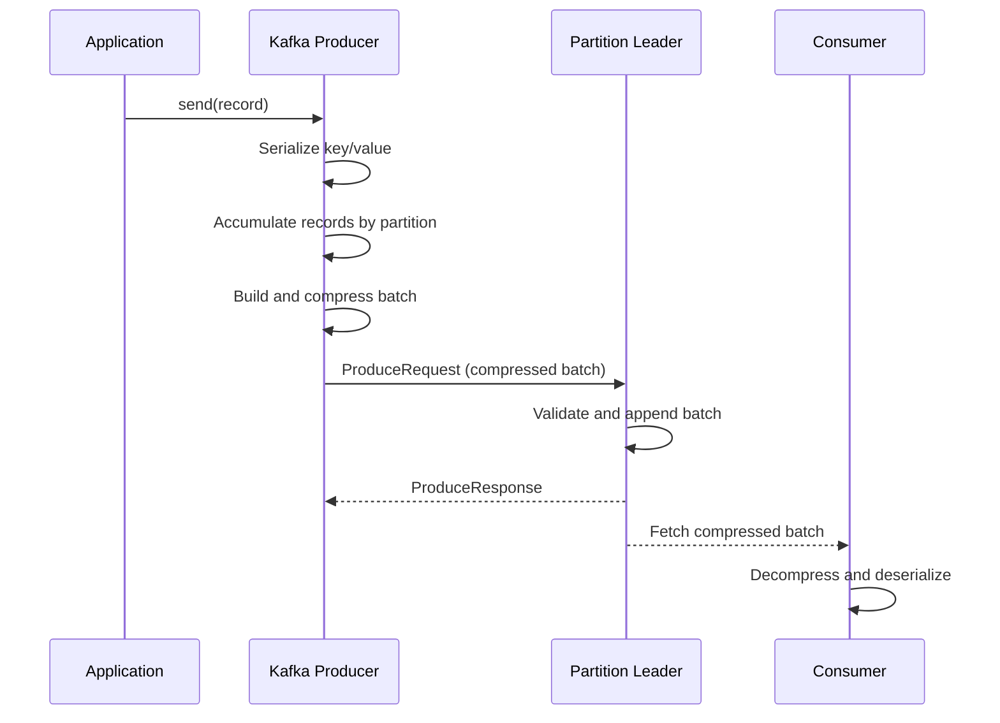

# Record batch, nén dữ liệu và kiểm tra tính toàn vẹn

Kafka không lưu mỗi message như một file riêng. Producer gom nhiều record của cùng partition thành một **record batch**, có thể nén batch rồi gửi tới broker leader. Leader append batch vào log segment; follower sao chép dữ liệu theo cơ chế replication. Trong quá trình lưu và truyền, Kafka dùng checksum để phát hiện một số dạng hỏng dữ liệu ngoài ý muốn.

Hiểu record batch giúp giải thích vì sao Kafka có thể đạt throughput cao, vì sao nén theo batch thường hiệu quả hơn nén từng record và cách broker phát hiện dữ liệu bị hỏng. Bài học thuộc chương **Lưu trữ** của module **KAFKA**, trong đó người học xây dựng event streaming với topic, partition, producer, consumer group, replication và KRaft. Nội dung tập trung vào định dạng record/batch, compression và các lớp kiểm tra tính toàn vẹn.

Sau bài này, bạn có thể:

- Phân biệt record, record batch và log segment.
- Nhận biết các trường metadata quan trọng trong RecordBatch.
- Giải thích cách producer nén batch và broker lưu codec.
- Chọn codec dựa trên throughput, latency, CPU và dung lượng.
- Phân biệt CRC của Kafka với cơ chế xác thực mật mã và backup.
- Kiểm tra cấu hình nén, đọc thông tin log segment và chẩn đoán lỗi checksum.

## 1. Từ record đến log segment

### 1.1. Record là đơn vị dữ liệu logic

Một record Kafka biểu diễn một sự kiện hoặc một phần dữ liệu mà producer muốn lưu vào topic. Record thường có các thành phần:

| Thành phần | Ý nghĩa |
|---|---|
| Key | Khóa tùy chọn để partitioner định tuyến record và gom các sự kiện cùng thực thể vào một partition |
| Value | Payload của sự kiện, ví dụ JSON, Avro, Protobuf hoặc dữ liệu nhị phân |
| Timestamp | Thời điểm gắn với record theo timestamp type và cấu hình producer/broker |
| Headers | Các cặp key-value bổ sung như trace ID, correlation ID hoặc schema version |
| Offset | Vị trí record trong partition, được broker xác định khi append vào log |

Producer có thể tạo record bằng Java API:

```java
ProducerRecord<String, String> record = new ProducerRecord<>(
    "orders",
    "order-9001",
    "{\"eventType\":\"OrderCreated\",\"orderId\":\"order-9001\"}"
);
```

Record này có topic `orders`, key `order-9001` và value là chuỗi JSON. Serializer chuyển key/value thành byte trước khi producer đóng gói dữ liệu theo định dạng Kafka.

### 1.2. Record batch gom nhiều record

Producer không cần tạo một request mạng cho mỗi record. Kafka client gom các record của cùng partition thành một **record batch**. Batch là đơn vị quan trọng cho:

- Gửi dữ liệu hiệu quả qua mạng bằng ít request hơn.
- Nén nhiều record cùng lúc để tận dụng sự lặp lại trong payload.
- Ghi log tuần tự và quản lý offset của nhiều record trong cùng một vùng dữ liệu.
- Áp dụng metadata của producer như producer ID, epoch và sequence khi dùng idempotence hoặc transaction.



Batch chỉ gom các record cùng partition. Nếu producer gửi dữ liệu tới nhiều partition, client duy trì batch riêng cho từng partition và gửi chúng tới broker đang làm leader tương ứng.

### 1.3. Log segment là đơn vị lưu trữ trên broker

Mỗi partition được lưu dưới dạng một log. Log được chia thành các **segment** để broker quản lý kích thước file, rolling, retention và index. Segment hiện tại nhận các batch mới; khi đạt điều kiện roll theo kích thước hoặc thời gian, broker đóng segment đó và tạo segment mới.

Một thư mục dữ liệu có thể chứa các file tương ứng với partition, ví dụ:

```text
orders-0/
  00000000000000000000.log
  00000000000000000000.index
  00000000000000000000.timeindex
  00000000000000001234.log
  00000000000000001234.index
  00000000000000001234.timeindex
```

Tên file segment thường bắt đầu bằng base offset của segment. File `.log` chứa các record batch; index giúp broker tìm vị trí dữ liệu theo offset hoặc timestamp hiệu quả hơn thay vì quét toàn bộ file. Tùy cấu hình và loại topic, còn có thể có các file index khác, ví dụ transaction index.



Record batch là cấu trúc dữ liệu bên trong log; log segment là file lưu nhiều batch nối tiếp. Hai khái niệm này liên quan nhưng không thể dùng thay thế cho nhau.

## 2. Cấu trúc RecordBatch

### 2.1. Các trường metadata của batch

Với định dạng RecordBatch phổ biến hiện nay (magic byte 2), batch có phần header mô tả vùng dữ liệu và các record bên trong. Những trường quan trọng gồm:

| Trường | Vai trò |
|---|---|
| `baseOffset` | Offset đầu tiên của batch trong partition |
| `batchLength` | Độ dài batch tính theo byte sau phần offset và length prefix |
| `partitionLeaderEpoch` | Epoch của leader gắn với batch để hỗ trợ quản lý lịch sử leader |
| `magic` | Phiên bản định dạng record batch; giá trị 2 dùng RecordBatch format hiện đại |
| `crc` | Checksum CRC32C bảo vệ phần nội dung batch được quy định trong format |
| `attributes` | Các bit metadata như compression codec, timestamp type, transactional/control flags |
| `lastOffsetDelta` | Độ lệch offset của record cuối so với base offset |
| `baseTimestamp` / `maxTimestamp` | Timestamp đầu và lớn nhất trong batch theo format |
| `producerId`, `producerEpoch`, `baseSequence` | Metadata phục vụ idempotent producer và transaction |
| `records` | Dãy record được mã hóa trong batch |

CRC32C của RecordBatch v2 được tính trên phần batch bắt đầu từ `attributes` tới cuối batch, bao gồm metadata và records ở phạm vi format quy định. Các trường đứng trước vùng CRC như base offset, batch length, leader epoch và magic không nằm trong vùng checksum đó. Chi tiết byte layout cần được đối chiếu với tài liệu protocol của release Kafka đang dùng.

### 2.2. Nội dung bên trong record

Mỗi record trong batch có thể mang length, attributes, timestamp delta, offset delta, key, value và headers. Dùng delta giúp giảm kích thước vì các record trong cùng batch thường có timestamp và offset gần nhau.

Ví dụ minh họa một batch có base offset 100:

```text
RecordBatch
  baseOffset = 100
  lastOffsetDelta = 2
  records:
    Record 0: offsetDelta=0 -> offset 100, key=order-1
    Record 1: offsetDelta=1 -> offset 101, key=order-2
    Record 2: offsetDelta=2 -> offset 102, key=order-3
```

Offset của record được suy ra từ `baseOffset + offsetDelta`. Đây là offset trong partition, không phải thứ tự toàn cục của topic.

### 2.3. Batch còn chứa metadata cho idempotence và transaction

Producer ID, producer epoch và sequence number giúp broker nhận biết batch do producer gửi, phát hiện một số lần retry trùng và duy trì thứ tự ghi của producer. Với transaction, các bit attributes và control batches cho biết record thuộc luồng transactional hoặc mang dấu mốc điều khiển.

Những trường này không có nghĩa mọi batch đều tham gia transaction. Với producer thông thường không bật idempotence/transaction, một số trường có thể mang giá trị mặc định hoặc giá trị sentinel theo định dạng protocol.

## 3. Nén dữ liệu diễn ra ở cấp batch

### 3.1. Vì sao nén theo batch hiệu quả?

Các sự kiện cùng topic thường có cấu trúc lặp lại: tên field JSON, tên event, schema marker, key prefix hoặc các chuỗi trạng thái giống nhau. Nếu nén từng record độc lập, codec không thể tận dụng sự lặp lại giữa các record. Khi gom nhiều record rồi nén cùng batch, codec có thể tìm ra mẫu lặp và giảm kích thước tốt hơn.

Ví dụ, một batch có 500 event JSON cùng schema thường lặp các chuỗi như `eventType`, `orderId`, `createdAt`. Nén toàn batch có thể tận dụng sự lặp lại này tốt hơn nén riêng từng JSON. Mức giảm thực tế phụ thuộc payload, codec, kích thước batch và dữ liệu có entropy cao hay thấp.

Compression có thể giảm:

- Byte truyền qua mạng giữa producer và broker.
- Dung lượng log cần ghi và lưu trên broker.
- Lượng dữ liệu follower cần fetch khi replication.
- I/O đọc/ghi cho cùng một lượng dữ liệu logic, trong một số workload.

Đổi lại, producer, broker hoặc consumer có thể phải dùng thêm CPU để nén/giải nén. Vì vậy, compression là một quyết định cân bằng tài nguyên chứ không phải lúc nào cũng giảm tổng chi phí.

### 3.2. Producer nén batch trước khi gửi

Producer tích lũy record, tạo batch rồi nén batch theo `compression.type`. Codec được ghi trong attributes của RecordBatch. Producer gửi batch đã nén tới broker leader.



Broker có thể giữ nguyên codec do producer sử dụng khi cấu hình topic/broker đặt compression type là `producer`. Nếu cấu hình broker/topic yêu cầu codec khác, broker có thể giải nén rồi nén lại batch theo codec được cấu hình. Việc nén lại tiêu tốn CPU và có thể làm tăng latency; cần hiểu rõ `compression.type` ở producer và `compression.type` ở topic/broker là hai điểm cấu hình trong cùng đường đi.

Consumer nhận batch theo giao thức Kafka và giải nén trước khi trả record cho ứng dụng. Ứng dụng thường thao tác với object key/value sau khi serializer/deserializer thực hiện công việc, không cần tự giải nén từng record.

## 4. Các codec nén thường dùng

Kafka hỗ trợ nhiều codec; mức hỗ trợ cụ thể phụ thuộc phiên bản broker/client và cấu hình triển khai.

| Codec | Đặc điểm tổng quát | Khi nên thử |
|---|---|---|
| `none` / `uncompressed` | Không nén; ít CPU cho compression nhưng truyền và lưu nhiều byte hơn | Payload vốn đã nén, dữ liệu nhỏ hoặc ưu tiên latency thấp và CPU đang hạn chế |
| `gzip` | Tỷ lệ nén thường tốt nhưng tiêu tốn CPU hơn các lựa chọn nhẹ | Dữ liệu lưu trữ lâu, cần giảm dung lượng và chấp nhận CPU/latency cao hơn |
| `snappy` | Tập trung vào tốc độ nén/giải nén, thường có tỷ lệ nén vừa phải | Workload throughput cao, cần codec nhanh |
| `lz4` | Nén/giải nén nhanh, thường cân bằng tốt giữa CPU và kích thước | Luồng sự kiện cần throughput cao và latency thấp |
| `zstd` | Có thể đạt tỷ lệ nén cao với nhiều mức compression level | Cần cân bằng linh hoạt giữa dung lượng và CPU; cần benchmark theo level và workload |

Không có codec tốt nhất cho mọi hệ thống. Payload JSON nhiều field lặp có thể nén tốt; ảnh JPEG, video, file ZIP hoặc payload đã nén thường giảm ít. Một benchmark có ý nghĩa cần dùng dữ liệu gần với production, đo cả CPU producer/broker/consumer, network throughput, disk usage và p95/p99 latency.

## 5. Cấu hình compression và batching

### 5.1. Cấu hình ở producer

Ví dụ cấu hình Java producer:

```properties
bootstrap.servers=localhost:9092
key.serializer=org.apache.kafka.common.serialization.StringSerializer
value.serializer=org.apache.kafka.common.serialization.StringSerializer

compression.type=lz4
batch.size=65536
linger.ms=10
buffer.memory=67108864
acks=all
enable.idempotence=true
```

Trong ví dụ:

- `compression.type=lz4` chọn codec nén batch ở producer.
- `batch.size=65536` đặt batch size mục tiêu 64 KiB cho mỗi partition accumulator; batch có thể được gửi trước khi đầy.
- `linger.ms=10` cho producer thêm tối đa một khoảng chờ để gom thêm record, tùy điều kiện gửi và giới hạn delivery.
- `buffer.memory` là tổng dung lượng bộ đệm producer dành cho các record đang chờ gửi.
- `acks=all` và `enable.idempotence=true` minh họa cấu hình producer quan tâm độ tin cậy; đây không phải cấu hình compression nhưng ảnh hưởng đường ghi.

Khi tăng `linger.ms` hoặc `batch.size`, batch có thể lớn hơn và nén hiệu quả hơn, nhưng record có thể chờ lâu hơn. Nếu producer gửi ít record hoặc có yêu cầu latency rất thấp, batch thường không đầy và lợi ích nén có thể thấp.

### 5.2. Cấu hình compression ở topic/broker

Topic có thể quy định codec mà broker dùng để lưu batch. Giá trị `producer` cho phép giữ codec do producer chọn; các giá trị codec cụ thể có thể khiến broker chuyển đổi batch sang codec đó. Hãy kiểm tra cấu hình thực tế trước khi benchmark.

Xem cấu hình topic:

```bash
kafka-configs.sh \
  --bootstrap-server localhost:9092 \
  --entity-type topics \
  --entity-name orders \
  --describe
```

Thay đổi cấu hình topic (chỉ thực hiện trong môi trường được phép thay đổi):

```bash
kafka-configs.sh \
  --bootstrap-server localhost:9092 \
  --entity-type topics \
  --entity-name orders \
  --alter \
  --add-config compression.type=producer
```

Ở production, thay đổi codec lưu trữ có thể ảnh hưởng CPU broker và dung lượng các segment mới. Đo đạc trước và sau thay đổi, đồng thời xác định cách xử lý dữ liệu cũ đã được lưu bằng codec khác. Không nên thay cấu hình trên cụm đang chịu tải cao mà không có kế hoạch rollout.

### 5.3. Kích thước record và giới hạn batch

Các giới hạn kích thước cần được xem xét cùng nhau:

- `max.request.size` ở producer giới hạn kích thước request gửi đi.
- `message.max.bytes` ở broker đặt giới hạn record batch broker chấp nhận theo cấu hình broker.
- `max.message.bytes` ở topic có thể override giới hạn batch cho topic.
- `fetch.max.bytes` và `max.partition.fetch.bytes` ảnh hưởng lượng dữ liệu consumer lấy về.

Tên cấu hình và cách áp dụng có thể khác theo phiên bản. Một batch sau nén nhỏ hơn không có nghĩa mọi giới hạn đều được tính trên payload đã nén; cần đối chiếu tài liệu protocol/config của release. Nếu có record lớn, hãy kiểm tra cả kích thước serialized, kích thước batch và giới hạn từng phía thay vì chỉ tăng một thông số.

## 6. Kiểm tra tính toàn vẹn bằng CRC

### 6.1. CRC phát hiện lỗi dữ liệu ngoài ý muốn

RecordBatch hiện đại có trường CRC32C. Khi batch được tạo, checksum được tính trên vùng byte được định nghĩa trong format. Khi batch được đọc hoặc kiểm tra, checksum có thể được tính lại để phát hiện thay đổi ngoài ý muốn do lỗi truyền, lỗi bộ nhớ hoặc hỏng dữ liệu trên lưu trữ.

Nếu dữ liệu byte thay đổi, checksum thường không còn khớp và Kafka có thể báo lỗi corruption thay vì âm thầm đưa payload sai cho ứng dụng. Điều này đặc biệt quan trọng khi broker đọc segment từ đĩa hoặc xử lý batch trong quá trình replication.

### 6.2. CRC không phải hash mật mã

CRC được thiết kế để phát hiện lỗi ngẫu nhiên, không phải để chống kẻ tấn công chủ động. Một người có thể sửa dữ liệu và tính lại CRC. Vì vậy, không được dùng CRC như chữ ký số, MAC hoặc cơ chế xác thực nguồn gửi.

Các lớp bảo vệ giải quyết các vấn đề khác nhau:

| Cơ chế | Mục đích | Không thay thế |
|---|---|---|
| CRC32C của record batch | Phát hiện hỏng byte ngoài ý muốn trong batch | TLS, chữ ký số hoặc kiểm soát quyền |
| TLS | Mã hóa và bảo vệ tính toàn vẹn của kết nối mạng; có thể xác thực peer bằng certificate | Kiểm tra tính đúng đắn nghiệp vụ hoặc backup |
| SASL/ACL | Xác thực client và kiểm soát quyền truy cập Kafka | Phát hiện mọi dạng hỏng dữ liệu trên đĩa |
| Replication | Duy trì bản sao partition trên nhiều broker | Backup độc lập hoặc chống xóa nhầm/ghi sai hợp lệ |
| Application checksum/signature | Kiểm tra payload ở ranh giới ứng dụng theo hợp đồng riêng | Cơ chế replication và quản lý log của Kafka |
| Backup/restore | Khôi phục dữ liệu sau lỗi nghiêm trọng hoặc thao tác xóa/sửa sai | Phát hiện corruption ngay trên từng batch |

Nếu nghiệp vụ cần xác minh payload xuyên suốt nhiều hệ thống, có thể đưa event ID và checksum/hash ở cấp ứng dụng vào hợp đồng dữ liệu. Khi đó producer và consumer phải thống nhất chính xác byte sequence được hash, cách canonicalize payload và phiên bản thuật toán.

### 6.3. Corruption có thể phát sinh ở đâu?

Một số nguồn lỗi cần xem xét:

- Thiết bị lưu trữ, controller hoặc filesystem trả dữ liệu không đúng.
- Lỗi RAM hoặc phần cứng làm thay đổi byte trong quá trình xử lý.
- Tiến trình bị dừng giữa lúc ghi, để lại vùng cuối file chưa hoàn chỉnh.
- Lỗi mạng hoặc lỗi phần mềm trong quá trình truyền/giải mã batch.
- Sao chép file log thủ công không nhất quán khi broker vẫn đang ghi.

Kafka có các cơ chế kiểm tra và phục hồi log theo trạng thái segment, nhưng không thể bảo đảm chống mọi lỗi phần cứng hay lỗi thao tác. Việc theo dõi log broker, tình trạng đĩa, filesystem và replication vẫn cần thiết.

## 7. Log recovery, segment và kiểm tra dữ liệu

### 7.1. Broker quản lý segment

Broker ghi các batch vào active segment. Khi segment được roll, nó trở thành segment đã đóng và các index tương ứng được duy trì. Retention hoặc compaction có thể xóa/viết lại segment theo chính sách topic. Vì thế, kích thước thư mục partition không chỉ phụ thuộc số record mà còn phụ thuộc compression, replication factor, retention, compaction và tốc độ ghi.

Khi broker khởi động lại, Kafka kiểm tra và phục hồi log theo metadata checkpoint và trạng thái segment. Các index có thể được kiểm tra hoặc xây dựng lại khi cần. Nếu segment có dữ liệu hỏng, log recovery có thể phát hiện vấn đề; cách xử lý cụ thể phụ thuộc vị trí lỗi và phiên bản Kafka. Không nên tự sửa file `.log` bằng editor hoặc xóa segment tùy tiện khi chưa có quy trình phục hồi.

### 7.2. Xem vị trí log directory và dung lượng

Có thể dùng công cụ quản trị để kiểm tra log directory trên broker:

```bash
kafka-log-dirs.sh \
  --bootstrap-server localhost:9092 \
  --describe \
  --broker-list 1
```

Thay broker ID theo cụm thực tế. Lệnh này cung cấp thông tin log directory và replica partition trên broker; nó hỗ trợ kiểm tra phân bố lưu trữ, dung lượng và trạng thái replica.

### 7.3. Đọc cấu trúc log bằng kafka-dump-log

Kafka cung cấp `kafka-dump-log.sh` để đọc thông tin record batch trong file segment. Ví dụ:

```bash
kafka-dump-log.sh \
  --files /var/lib/kafka/data/orders-0/00000000000000000000.log \
  --deep-iteration \
  --print-data-log
```

Đường dẫn file chỉ là ví dụ; hãy dùng đúng log directory trên broker và phiên bản tool tương thích với dữ liệu. Công cụ có thể hiển thị offset, batch metadata, codec và record để hỗ trợ điều tra. Chạy ở chế độ đọc, tránh thao tác trực tiếp lên file segment của broker đang hoạt động nếu chưa hiểu ảnh hưởng.

## 8. Chẩn đoán lỗi compression và integrity

| Biểu hiện | Nguyên nhân có thể | Hướng xử lý |
|---|---|---|
| CPU producer tăng sau khi bật compression | Codec hoặc compression level tốn CPU; batch nhỏ khiến overhead lớn | Benchmark codec khác, tăng batch hợp lý hoặc giảm mức nén nếu codec hỗ trợ |
| CPU broker tăng dù producer đã nén | Topic/broker đặt codec khác `producer`, broker phải giải nén và nén lại | Kiểm tra effective `compression.type` ở topic/broker và thống nhất codec |
| Dung lượng disk giảm ít | Payload vốn đã nén hoặc entropy cao; batch quá nhỏ | Kiểm tra dữ liệu thực, batch size, linger và tỷ lệ nén theo topic |
| Producer latency tăng sau khi tăng `linger.ms` | Record chờ gom batch lâu hơn | Đo p95/p99 và điều chỉnh linger theo SLO |
| `RecordTooLargeException` | Record/batch vượt giới hạn client, broker hoặc topic | Kiểm tra serialized size và giới hạn kích thước trên mọi phía |
| Lỗi checksum/invalid record batch | Batch bị hỏng, sai định dạng hoặc vấn đề tương thích/đọc log | Thu thập broker log, xác định partition/segment/offset, kiểm tra đĩa và dùng công cụ dump phù hợp |
| Replica tụt ISR khi throughput tăng | Broker/follower không theo kịp do CPU, disk hoặc network | Kiểm tra replication lag, disk I/O, network, request queue và tải nén |
| Consumer lỗi khi giải nén | Codec không được hỗ trợ/thiếu dependency tương ứng hoặc dữ liệu batch hỏng | Xác nhận phiên bản client, codec và log lỗi; kiểm tra batch bằng công cụ phù hợp |

Không nên kết luận mọi lỗi giải nén là corruption. Hãy phân biệt codec không được hỗ trợ, cấu hình broker/client không tương thích, record vượt giới hạn và checksum sai bằng exception cụ thể cùng log broker/client.

## 9. Thực hành benchmark codec

Để chọn codec, chuẩn bị một bộ dữ liệu đại diện cho production, gồm payload nhỏ/lớn, key có phân bố thực tế và tỷ lệ record theo topic. Chạy cùng số lượng record, cùng partition count và cùng cấu hình replication cho từng codec.

Ghi lại tối thiểu:

| Chỉ số | Ý nghĩa |
|---|---|
| Input bytes | Tổng byte payload trước nén |
| Stored bytes | Dung lượng segment thực tế tăng thêm trong khoảng đo |
| Compression ratio | `stored bytes / input bytes`; càng thấp thì tiết kiệm dung lượng càng nhiều |
| Producer CPU | Chi phí nén và xử lý phía producer |
| Broker CPU | Chi phí nhận, xử lý, có thể chuyển đổi codec và phục vụ replication |
| Consumer CPU | Chi phí giải nén và deserialize |
| Network throughput | Byte truyền qua mạng producer-broker và broker-broker |
| p95/p99 latency | Độ trễ ghi từ góc nhìn producer |
| Under-replicated partitions | Ảnh hưởng của tải tới khả năng follower bắt kịp |

Thực hiện warm-up, chạy đủ lâu để có nhiều segment và không so sánh hai lần chạy khi tải nền khác nhau. Nếu broker đang có dữ liệu cũ dùng codec khác, chỉ đo dung lượng thư mục ngay sau khi đổi cấu hình có thể không phản ánh codec mới; hãy cô lập topic thử nghiệm hoặc đo phần segment phát sinh trong khoảng benchmark.

## 10. Checklist vận hành

- [ ] Đã xác định kích thước và phân bố payload thực tế.
- [ ] Đã kiểm tra producer gom record theo partition thành batch.
- [ ] Đã chọn codec dựa trên benchmark CPU, disk, network và latency.
- [ ] Đã đối chiếu `compression.type` ở producer với cấu hình topic/broker.
- [ ] Đã kiểm tra giới hạn kích thước record/batch trên producer, broker và consumer.
- [ ] Đã theo dõi dung lượng log segment, retention và compaction.
- [ ] Đã hiểu CRC32C phát hiện corruption nhưng không phải cơ chế bảo mật mật mã.
- [ ] Đã có giám sát broker log, filesystem, disk health và ISR.
- [ ] Đã có quy trình điều tra segment lỗi và phục hồi dữ liệu.
- [ ] Đã xác định backup/restore độc lập với replication.

## 11. Câu hỏi tự kiểm tra

1. Record, record batch và log segment khác nhau ở điểm nào?
2. Vì sao Kafka nén theo batch thay vì nén từng record độc lập?
3. `batch.size` và `linger.ms` ảnh hưởng compression ratio và latency như thế nào?
4. Codec nào có thể phù hợp khi ưu tiên CPU thấp, và codec nào nên thử khi ưu tiên giảm dung lượng?
5. `compression.type=producer` ở topic/broker có ý nghĩa gì?
6. CRC32C của RecordBatch bảo vệ vùng dữ liệu nào và có giới hạn gì?
7. Vì sao CRC không thay thế TLS hoặc chữ ký số?
8. Replication có thể bảo vệ khỏi broker hỏng, nhưng vì sao không thay thế backup?
9. Khi gặp lỗi invalid record batch, cần kiểm tra những lớp nào trước khi kết luận file log bị hỏng?
10. Cần đo những chỉ số nào để chọn codec phù hợp cho production?

## 12. Tài liệu tham khảo

- Apache Kafka protocol — Message/Record formats: <https://kafka.apache.org/protocol> — cấu trúc record batch, metadata và checksum.
- Apache Kafka documentation — Producer Configs: <https://kafka.apache.org/documentation/#producerconfigs> — `compression.type`, `batch.size`, `linger.ms` và các cấu hình producer.
- Apache Kafka documentation — Topic Configs: <https://kafka.apache.org/documentation/#topicconfigs> — `compression.type`, giới hạn kích thước và chính sách log.
- Apache Kafka operations: <https://kafka.apache.org/documentation/#operations> — quản lý log directory, segment, retention và công cụ vận hành.

Định dạng record batch, codec và cấu hình có thể thay đổi theo phiên bản Kafka. Khi triển khai, đối chiếu tài liệu protocol/config của đúng release broker và Java client; benchmark trên dữ liệu gần production trước khi chốt cấu hình.
