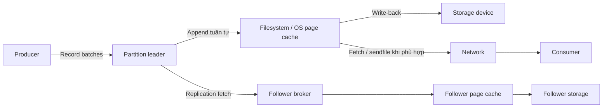
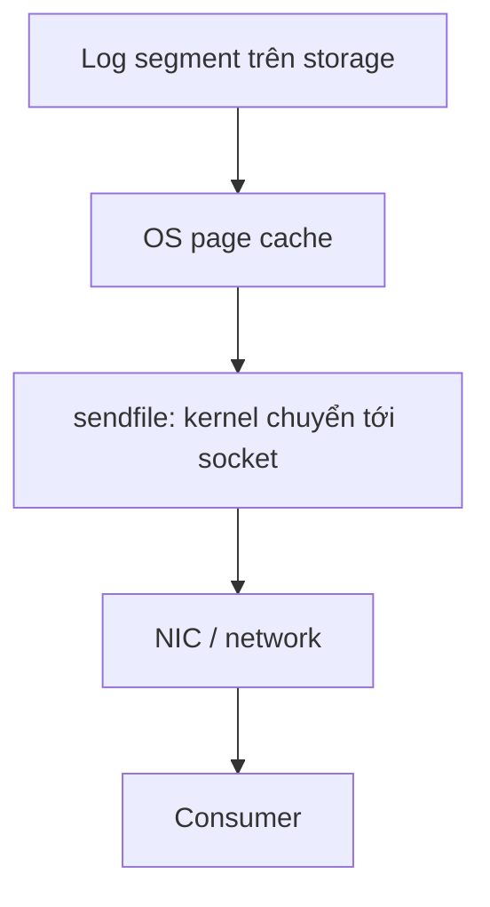

# Page cache, ghi tuần tự và truyền dữ liệu hiệu quả

Kafka đạt thông lượng cao nhờ tổ chức dữ liệu thành log append-only, tận dụng page cache của hệ điều hành, gom nhiều record thành batch và giảm số lần sao chép byte khi truyền dữ liệu. Vì vậy, hiệu năng Kafka không chỉ phụ thuộc vào tốc độ ổ đĩa. Bộ nhớ RAM dành cho page cache, kích thước batch, mức nén, network, replication và cách consumer đọc dữ liệu đều ảnh hưởng đến kết quả.

Bài học này tập trung vào đường đi của dữ liệu từ producer đến broker rồi đến consumer. Khi hiểu từng chặng, người vận hành có thể phân biệt được tình trạng cache lạnh, disk writeback bị nghẽn, batch quá nhỏ, CPU nén quá tải hay network trở thành giới hạn.

## 1. Tổng quan đường đi dữ liệu

Mỗi partition của Kafka là một log có thứ tự. Producer gửi record đến broker đang giữ vai trò leader của partition. Broker append record vào segment đang hoạt động; các follower fetch dữ liệu từ leader và append vào log replica của mình. Consumer fetch record theo offset. Dữ liệu không bị xóa chỉ vì một consumer đã đọc; segment được giữ theo retention hoặc compaction policy.



Ở đây có ba cơ chế cần phân biệt:

- **Page cache** giữ các trang dữ liệu file trong bộ nhớ do hệ điều hành quản lý, giúp đọc lại dữ liệu nóng mà không phải truy cập thiết bị lưu trữ.
- **Sequential append** ghi record nối tiếp vào cuối log segment, giúp hệ điều hành gom các thao tác nhỏ thành I/O lớn và tận dụng read-ahead/write-behind.
- **Batching và truyền dữ liệu tối ưu** giảm số request, số lần gọi hệ thống và lượng byte phải copy qua lại giữa user space và kernel space.

Kafka dùng filesystem làm nền tảng lưu trữ. File log trên đĩa dùng định dạng record batch mà producer và consumer cũng hiểu, nhờ đó broker có thể chuyển các đoạn log mà không cần tái tạo từng message theo một định dạng khác. [Apache Kafka Design — Persistence và Efficiency](https://kafka.apache.org/44/design/design/).

## 2. Page cache là gì?

Page cache là vùng bộ nhớ của hệ điều hành dùng để cache nội dung file. Khi tiến trình đọc file, kernel có thể trả dữ liệu từ RAM nếu các trang tương ứng còn trong cache. Khi tiến trình ghi file theo cơ chế buffered I/O, dữ liệu được ghi vào page cache trước; các trang vừa ghi thường được đánh dấu là dirty và được hệ điều hành ghi xuống thiết bị lưu trữ theo chính sách write-back.

Page cache khác Java heap của Kafka broker:

| Thành phần | Quản lý bởi | Công dụng |
| --- | --- | --- |
| Java heap | JVM | Object, metadata và cấu trúc dữ liệu mà tiến trình Java cần trong bộ nhớ. |
| Direct/native memory | JVM và thư viện native | Buffer I/O, network và các vùng nhớ ngoài heap. |
| OS page cache | Hệ điều hành | Cache nội dung file log/index để đọc lại nhanh và gom các lần ghi. |

Kafka dựa nhiều vào page cache thay vì giữ toàn bộ message trong các object trên Java heap. Cách này giúp tránh lưu trùng cùng một dữ liệu trong heap và page cache, giảm áp lực garbage collection, đồng thời để hệ điều hành tự quản lý cache theo lượng RAM đang rảnh. Page cache cũng có thể vẫn nóng sau khi tiến trình broker khởi động lại nếu máy chủ chưa reboot và kernel vẫn giữ các trang dữ liệu đó. [Kafka Design: Don't fear the filesystem](https://kafka.apache.org/44/design/design/).

### 2.1. Đọc dữ liệu từ page cache

Khi consumer fetch một vùng log:

1. Broker xác định segment và vị trí dữ liệu dựa trên offset/index.
2. Kernel kiểm tra các trang file cần đọc có trong page cache hay không.
3. Nếu cache hit, dữ liệu được lấy từ RAM.
4. Nếu cache miss, hệ điều hành đọc các block từ storage vào page cache rồi mới phục vụ yêu cầu.

Consumer thường đọc theo thứ tự offset tăng dần. Kiểu đọc tuần tự này giúp hệ điều hành dự đoán các block tiếp theo và thực hiện read-ahead, tức đọc trước một lượng dữ liệu lớn hơn để cache sẵn cho lần fetch kế tiếp. Nếu consumer liên tục đọc phần đuôi log vừa được ghi, dữ liệu thường còn nóng trong page cache.

Consumer đọc lại dữ liệu cũ, đọc nhiều partition rải rác hoặc quét một lượng dữ liệu lớn hơn nhiều so với cache có thể tạo nhiều cache miss. Khi đó, tốc độ bị giới hạn bởi độ trễ và thông lượng đọc của storage. Một cluster có thể xử lý tốt luồng đọc realtime nhưng chậm đáng kể khi nhiều consumer đồng thời replay lịch sử xa.

### 2.2. Ghi dữ liệu vào page cache

Broker append record vào file log. Ở mức hệ điều hành, thao tác ghi buffered thường cập nhật page cache và đánh dấu trang là dirty. Kernel gom nhiều lần ghi nhỏ thành các lần ghi vật lý lớn hơn, sau đó background writeback đẩy dữ liệu xuống thiết bị lưu trữ.

```text
Broker append vào log segment
          |
          v
     OS page cache
     (dirty pages)
          |
          | background writeback
          v
    SSD / NVMe / HDD
```

Nhờ vậy, ứng dụng không cần chờ một lần ghi vật lý riêng cho từng record. Hệ điều hành có thể gom các trang liền kề, sắp xếp lịch ghi và tận dụng khả năng ghi tuần tự của thiết bị.

**Page cache không phải nơi lưu trữ bền vững.** Dữ liệu dirty chưa được flush xuống thiết bị có thể mất khi máy chủ mất điện hoặc gặp sự cố phần cứng. Cache giúp tăng tốc I/O; replication và chính sách durability của Kafka mới là một phần quan trọng trong bảo vệ dữ liệu.

## 3. Vì sao ghi tuần tự hiệu quả?

Ổ đĩa, đặc biệt HDD, có độ trễ seek ngẫu nhiên cao hơn nhiều so với truy cập tuần tự. Ghi nhiều block liên tiếp giúp thiết bị giảm chuyển động đầu đọc trên HDD và tận dụng hàng đợi I/O, controller cache cùng khả năng ghi lớn của SSD/NVMe.

Kafka tổ chức mỗi partition thành các log segment. Broker chủ yếu append record vào cuối active segment thay vì tìm một vị trí ngẫu nhiên để cập nhật từng record. Khi segment đạt ngưỡng kích thước hoặc thời gian, Kafka roll sang segment mới. Các index hỗ trợ tìm offset và timestamp mà không phải quét toàn bộ log.

```text
orders-0/
  00000000000000000000.log       segment cũ
  00000000000000000000.index
  00000000000000000000.timeindex
  00000000000000100000.log       active segment
  00000000000000100000.index
  00000000000000100000.timeindex
```

Đây là sơ đồ minh họa tên file segment/index theo cách tổ chức log của Kafka. Một partition có thể có nhiều segment. Retention và log cleaning xử lý theo segment, do đó việc xóa dữ liệu không nhất thiết xảy ra ngay tại đúng mili giây một record hết hạn.

Trong Kafka 4.4, `log.segment.bytes` có mặc định 1 GiB. Topic config `segment.bytes` điều khiển kích thước segment; segment lớn hơn làm giảm số file nhưng retention và cleaning có độ hạt thô hơn vì xử lý theo file. `segment.ms` có thể roll segment theo thời gian ngay cả khi chưa đạt giới hạn byte. [Kafka 4.4 Topic Configs](https://kafka.apache.org/44/configuration/topic-configs/).

### 3.1. Read-ahead và write-behind

Read-ahead là cơ chế hệ điều hành đọc trước các block liền kề dựa trên mẫu truy cập tuần tự. Write-behind gom các lần ghi nhỏ vào cache rồi ghi xuống storage theo các đợt lớn. Hai cơ chế này phù hợp với cách Kafka đọc và append log.

Hiệu quả sẽ giảm nếu workload tạo quá nhiều truy cập ngẫu nhiên, cache liên tục bị đẩy ra hoặc thiết bị không theo kịp tốc độ dirty page phát sinh. Khi writeback không theo kịp, tiến trình ghi có thể bị throttle hoặc block, làm tăng latency của Produce.

### 3.2. Segment và retention

Kafka không xóa từng record theo retention time trong mọi lần ghi. Với `cleanup.policy=delete`, broker loại bỏ các segment cũ khi điều kiện retention theo thời gian hoặc dung lượng được thỏa mãn. Với `cleanup.policy=compact`, log cleaner giữ lại giá trị mới nhất theo key theo quy tắc compaction; cách quản lý segment vẫn ảnh hưởng đến thời điểm dữ liệu được xử lý.

| Cấu hình | Ý nghĩa | Lưu ý vận hành |
| --- | --- | --- |
| `log.dirs` | Các thư mục chứa log data của broker. | Dùng storage phù hợp và giám sát dung lượng từng mount. |
| `log.segment.bytes` | Kích thước tối đa của một log segment. | Segment lớn giảm số file nhưng làm retention/cleaning kém chi tiết hơn. |
| `log.roll.ms` / `segment.ms` | Roll segment theo thời gian. | Giúp segment không mở quá lâu khi lưu lượng thấp. |
| `log.retention.ms` / `retention.ms` | Thời gian giữ log với policy delete. | Phải đủ dài để consumer bị chậm vẫn có thể bắt kịp hoặc replay. |
| `log.retention.bytes` / `retention.bytes` | Giới hạn dung lượng log. | `retention.bytes` được áp dụng theo partition; nhân với số partition để ước lượng dung lượng topic. |

Retention không phải một giới hạn dung lượng tức thời tuyệt đối cho toàn bộ topic. Segment đang hoạt động và lịch chạy tác vụ cleanup có thể khiến dung lượng thực tế vượt ngưỡng trong một khoảng thời gian. Hãy chừa headroom cho replication, segment/index, compaction và tốc độ ingest trong lúc cleanup.

## 4. Producer batching biến ghi rời rạc thành ghi tuần tự

Nếu producer gửi từng record nhỏ bằng một request riêng, hệ thống phải xử lý nhiều request, nhiều lần chuyển context và nhiều overhead network. Kafka producer gom record theo partition vào record batch. Một request có thể mang nhiều batch, mỗi batch tương ứng với một partition có dữ liệu cần gửi.

Producer dùng hai cấu hình quan trọng:

- `batch.size`: giới hạn kích thước batch mặc định theo partition. Batch nhỏ có thể khiến producer gửi nhiều request; batch quá lớn có thể giữ buffer dư thừa trong bộ nhớ.
- `linger.ms`: thời gian tối đa producer chờ thêm record để lấp đầy batch trước khi gửi. Khi batch đạt `batch.size`, producer gửi ngay.

Trong Kafka 4.4, `batch.size` mặc định là 16 KiB và `linger.ms` mặc định là 5 ms. Mặc định `linger.ms` đã thay đổi từ 0 lên 5 ms từ Kafka 4.0. Đây là thông số theo phiên bản; hãy kiểm tra cấu hình của client thực tế đang dùng. [Kafka 4.4 Producer Configs](https://kafka.apache.org/44/configuration/producer-configs/).

Ví dụ cấu hình Java producer:

```java
Properties props = new Properties();
props.put(ProducerConfig.BOOTSTRAP_SERVERS_CONFIG, "localhost:9092");
props.put(ProducerConfig.KEY_SERIALIZER_CLASS_CONFIG,
    StringSerializer.class.getName());
props.put(ProducerConfig.VALUE_SERIALIZER_CLASS_CONFIG,
    StringSerializer.class.getName());

// Các giá trị minh họa để bắt đầu benchmark, không phải cấu hình tối ưu chung.
props.put(ProducerConfig.BATCH_SIZE_CONFIG, 65536);
props.put(ProducerConfig.LINGER_MS_CONFIG, 5);
props.put(ProducerConfig.COMPRESSION_TYPE_CONFIG, "zstd");
props.put(ProducerConfig.ACKS_CONFIG, "all");
props.put(ProducerConfig.ENABLE_IDEMPOTENCE_CONFIG, true);
```

Batching hiệu quả nhất khi producer gửi đủ record đến cùng partition trong khoảng thời gian ngắn. Nếu key phân phối dữ liệu quá lệch, một partition có thể nhận nhiều batch trong khi các partition khác ít dữ liệu; nếu lượng record mỗi partition quá thấp, batch có thể không đầy và producer gửi khi hết `linger.ms`.

Không nên tăng `batch.size` hoặc `linger.ms` theo cảm tính. Hãy đo throughput, p95/p99 producer latency, batch-size average, request rate, memory buffer và CPU. Mục tiêu là giảm overhead mà vẫn đáp ứng SLA latency.

## 5. Nén batch để tiết kiệm disk và network

Kafka hỗ trợ nén theo record batch. Khi nhiều record cùng loại dữ liệu nằm trong một batch, các trường lặp lại như tên field JSON, chuỗi trạng thái hoặc metadata có thể được nén hiệu quả hơn so với nén từng message độc lập.

Luồng tổng quát:

1. Producer gom record theo partition.
2. Producer nén batch bằng codec đã chọn.
3. Broker nhận batch và kiểm tra tính hợp lệ; broker có thể giải nén để xác thực nội dung.
4. Batch được lưu trong log ở dạng nén.
5. Consumer nhận batch và client giải nén để xử lý record.

Kafka hỗ trợ `gzip`, `snappy`, `lz4` và `zstd`; `none` tắt nén. Với cấu hình topic `compression.type=producer`, broker giữ codec mà producer sử dụng. Kafka Design mô tả việc batch được nén, xác thực ở broker rồi vẫn được lưu và truyền cho consumer ở dạng nén. [Kafka Design: End-to-end Batch Compression](https://kafka.apache.org/44/design/design/).

| Codec | Đặc điểm thường gặp | Khi cân nhắc |
| --- | --- | --- |
| `lz4` | Giải nén nhanh, chi phí CPU thường thấp. | Cần giảm network/disk overhead với latency thấp. |
| `zstd` | Tỷ lệ nén tốt, có thể điều chỉnh compression level. | Muốn tiết kiệm băng thông/dung lượng và có CPU dự phòng. |
| `snappy` | Tốc độ tốt, tỷ lệ nén ở mức vừa phải. | Hệ thống đã chuẩn hóa Snappy hoặc cần lựa chọn cân bằng. |
| `gzip` | Tỷ lệ nén tốt nhưng thường tốn CPU hơn. | Băng thông hoặc storage là nút thắt và CPU còn dư. |

Đây là xu hướng tương đối; hiệu quả thật phụ thuộc payload, kích thước batch, CPU, codec implementation và network. JSON nhiều field lặp lại có thể nén tốt hơn payload đã được nén hoặc dữ liệu nhị phân có entropy cao.

Ví dụ cấu hình topic để broker giữ nguyên codec do producer chọn:

```properties
compression.type=producer
```

Hoặc buộc topic dùng một codec cụ thể theo policy của hệ thống:

```properties
compression.type=zstd
```

Khi broker buộc codec khác với codec producer, broker có thể phải giải nén rồi nén lại. Việc này tăng CPU và có thể làm thay đổi chi phí của đường đi dữ liệu. Hãy thống nhất codec giữa producer và topic nếu mục tiêu là tránh chuyển đổi không cần thiết.

## 6. Truyền dữ liệu hiệu quả với sendfile và zero-copy

Khi consumer đọc dữ liệu đã lưu trên broker, cách truyền thông thường có thể cần:

1. Kernel đọc file vào page cache.
2. Ứng dụng copy dữ liệu từ kernel space sang user-space buffer.
3. Ứng dụng copy dữ liệu từ user space vào socket buffer.
4. Kernel chuyển dữ liệu đến buffer của card mạng.

Đường đi này tạo thêm copy và system call. Trên hệ điều hành Unix/Linux, Kafka có thể dùng `sendfile` để chuyển dữ liệu từ page cache đến socket qua đường đi tối ưu của kernel, giảm việc copy qua user space. Đây thường được gọi là zero-copy; thuật ngữ này mô tả việc loại bỏ các bản copy trung gian, không có nghĩa dữ liệu hoàn toàn không đi qua bất kỳ buffer phần cứng nào.



Page cache kết hợp với sendfile có lợi khi nhiều consumer đọc cùng một vùng log: dữ liệu có thể được cache một lần trong kernel rồi phục vụ cho nhiều lượt đọc. Nếu consumer theo sát log head, phần dữ liệu mới đọc thường còn trong cache nên broker có thể phục vụ mà không cần đọc storage cho mỗi fetch.

**Giới hạn quan trọng:** tài liệu thiết kế Kafka 4.4 ghi rõ `sendfile` không được dùng khi SSL/TLS được bật, do đường xử lý TLS nằm ở user space và Kafka không dùng `SSL_sendfile` trong đường đi này. Không nên tắt TLS chỉ để kích hoạt sendfile; bảo mật kết nối là yêu cầu riêng, còn hiệu năng cần được benchmark với cấu hình bảo mật thực tế. [Kafka Design: sendfile](https://kafka.apache.org/44/design/design/).

## 7. Replication, flush và độ bền dữ liệu

Page cache giúp ghi nhanh nhưng bản thân cache không bảo đảm dữ liệu đã nằm trên thiết bị vật lý. Kafka thường dựa vào replication giữa các broker để bảo vệ partition thay vì buộc mỗi record phải fsync đồng bộ ngay lập tức trên một broker.

Cần phân biệt ba khái niệm:

- **Append:** broker đã thêm record vào log và cập nhật trạng thái ghi theo cơ chế I/O của hệ điều hành.
- **Replication acknowledgement:** các replica trong ISR đã nhận/append dữ liệu theo điều kiện của producer và cluster.
- **Flush/fsync:** yêu cầu hệ điều hành đẩy dữ liệu cache xuống thiết bị lưu trữ theo semantics của filesystem và thiết bị.

`acks=all` không đồng nghĩa với fsync từng record trên mọi replica. Nó yêu cầu tất cả replica hiện có trong ISR xác nhận write. `min.insync.replicas` đặt ngưỡng ISR tối thiểu để write với `acks=all` được chấp nhận. Ví dụ, replication factor 3 và `min.insync.replicas=2`: khi ISR còn ít nhất hai replica, write có thể thành công nếu mọi replica trong ISR xác nhận; nếu ISR giảm xuống dưới hai, producer nhận lỗi thay vì chấp nhận write với mức replication thấp hơn.

Tạo topic với replication factor 3 và đặt ngưỡng ISR tối thiểu là 2:

```bash
bin/kafka-topics.sh --bootstrap-server localhost:9092 \
  --create --topic orders --partitions 12 --replication-factor 3 \
  --config min.insync.replicas=2
```

Producer dùng `acks=all` và bật idempotence:

```java
props.put(ProducerConfig.ACKS_CONFIG, "all");
props.put(ProducerConfig.ENABLE_IDEMPOTENCE_CONFIG, true);
```

Kafka 4.4 mô tả `min.insync.replicas` là số replica trong ISR tối thiểu, bao gồm leader, cần thiết để write với `acks=all` thành công. Đây là cách kết hợp thường dùng để tăng durability và vẫn cho phép một replica tạm thời không sẵn sàng. [Kafka 4.4 Broker Configs](https://kafka.apache.org/44/configuration/broker-configs/).

### 7.1. Vì sao không fsync sau từng record?

Ép fsync quá thường xuyên có thể làm tăng latency và ngăn hệ điều hành tự do gom/sắp xếp các lần ghi. Kafka ghi dữ liệu vào filesystem ngay, nhưng mặc định không ép ứng dụng fsync sau mỗi message. Tài liệu Hardware and OS của Kafka khuyến nghị giữ mặc định flush cho phần lớn trường hợp và dựa vào replication cùng writeback của hệ điều hành; fsync theo policy riêng chỉ nên bật khi yêu cầu durability cụ thể đòi hỏi và đã đo tác động hiệu năng.

Điều này không có nghĩa flush không quan trọng. Cần hiểu rủi ro mất điện, cache của storage controller, bảo vệ nguồn, replication placement và khả năng mất đồng thời nhiều replica. Replication bảo vệ lỗi node đơn lẻ tốt hơn việc chỉ fsync trên một ổ đĩa, nhưng không phải bản sao lưu chống mọi loại sự cố.

Các cấu hình broker liên quan gồm `log.flush.interval.messages` và `log.flush.interval.ms`. Không hạ các giá trị này xuống mức rất nhỏ chỉ để tạo cảm giác an toàn. Hãy đối chiếu yêu cầu dữ liệu, thử nghiệm failure scenario và benchmark trên filesystem/thiết bị thực tế. [Kafka 4.4 Broker Configs](https://kafka.apache.org/44/configuration/broker-configs/) và [Kafka Hardware and OS](https://kafka.apache.org/44/operations/hardware-and-os/).

## 8. Bố trí storage cho broker

Broker lưu log data trong các thư mục được khai báo bằng `log.dirs`. Có thể cấu hình nhiều thư mục để phân bổ partition lên nhiều ổ hoặc mount point. Kafka phân công partition vào các data directory; một partition nằm trọn trong một directory, không stripe nội dung một partition qua tất cả directory. Vì vậy, phân bố partition và throughput từng partition ảnh hưởng đến mức cân bằng tải giữa các ổ.

Ví dụ cấu hình:

```properties
log.dirs=/data/kafka-1,/data/kafka-2,/data/kafka-3
```

Khuyến nghị vận hành:

- Dùng ổ local có throughput ổn định và latency phù hợp; chọn SSD/NVMe hoặc HDD dựa trên workload và benchmark, không chỉ dựa vào tên loại ổ.
- Nếu có nhiều ổ, phân bổ log data qua nhiều data directory và theo dõi tải từng ổ.
- Tránh chia sẻ cùng thiết bị chứa Kafka log với application log, database hoặc workload I/O nặng khác nếu chúng gây tranh chấp latency.
- Chừa dung lượng trống cho retention, compaction, replica recovery, segment rolling và tăng trưởng đột biến.
- Theo dõi từng filesystem thay vì chỉ tổng dung lượng của máy.

Tài liệu Kafka 4.4 khuyến nghị dùng nhiều ổ để đạt throughput tốt và tránh dùng chung ổ chứa Kafka data với application log hoặc hoạt động filesystem khác. Tài liệu cũng lưu ý nếu cấu hình nhiều data directory, partition được gán round-robin và mỗi partition nằm trong một directory; tải lệch giữa các partition có thể dẫn đến tải lệch giữa các ổ. [Kafka Hardware and OS](https://kafka.apache.org/44/operations/hardware-and-os/).

### 8.1. Ước lượng dung lượng

Giả sử `R` là tổng ingest của toàn cluster trước replication (MiB/s), retention là `T` giây và replication factor là `RF`. Dung lượng log thô cần thiết ở cấp cluster có thể ước lượng ban đầu:

\[
Storage_{cluster} \approx R \times T \times RF
\]

Ví dụ: ingest 20 MiB/s, retention 24 giờ và replication factor 3:

\[
20 \times 86{,}400 \times 3 = 5{,}184{,}000\ MiB \approx 4.95\ TiB
\]

Đây là ước lượng sơ bộ. Dung lượng thực tế còn phụ thuộc compression ratio, record/index overhead, compaction, retention theo byte, phân bố partition, segment chưa thể xóa và headroom cho replica reassignment. Nếu đo `R` ở đầu vào trước nén, mức lưu trữ sau nén có thể thấp hơn; nếu replication factor tăng, tổng dung lượng các bản sao tăng theo.

### 8.2. Partition count và chi phí filesystem

Mỗi partition có log segment và các index đi kèm. Quá nhiều partition làm tăng số file, file descriptor, index mapping, tác vụ log cleaner, metadata và chi phí recovery. Việc chia nhỏ partition có thể tăng khả năng song song, nhưng không miễn phí cho page cache và filesystem.

Chọn số partition dựa trên thông lượng mục tiêu, consumer parallelism, số broker, kích thước dữ liệu và chi phí quản lý. Theo dõi file descriptor, số segment mở, số partition trên broker và giới hạn memory map của hệ điều hành khi mở rộng quy mô.

## 9. Quan sát page cache và I/O

Không nên kết luận broker thiếu RAM chỉ vì hệ điều hành hiển thị ít memory `free`. Trên Linux, RAM chưa dùng cho ứng dụng thường được tận dụng làm cache. Hãy xem đồng thời available memory, page cache, dirty/writeback pages, swap và latency I/O.

Các lệnh quan sát hữu ích:

```bash
# Tổng quan RAM, cache và memory khả dụng
free -h

# Các trường cache/dirty/writeback chi tiết
grep -E 'MemAvailable|Cached|Buffers|Dirty|Writeback' /proc/meminfo

# Throughput, IOPS, await và mức bận của từng thiết bị
iostat -xz 1

# CPU, run queue, swap và iowait theo thời gian
vmstat 1

# Dung lượng và phần trăm sử dụng của từng mount
df -h
```

Đọc các tín hiệu theo ngữ cảnh:

| Tín hiệu | Điều cần xem xét |
| --- | --- |
| `MemAvailable` thấp kéo dài, swap tăng | Broker hoặc tiến trình khác có thể đang gây áp lực RAM; page cache có thể bị co lại. |
| `Dirty` / `Writeback` tăng liên tục | Storage có thể không theo kịp tốc độ ghi hoặc writeback đang bị nghẽn. |
| `await` cao và `%util` duy trì cao | Thiết bị đang có latency/queue cao; cần xem workload và loại storage. |
| Throughput disk thấp nhưng producer latency cao | Có thể nghẽn CPU, request queue, replication, network hoặc lock; không phải lúc nào cũng là disk. |
| Disk read tăng mạnh khi consumer replay | Cache miss hoặc đọc lịch sử xa có thể đang làm tăng physical read. |
| Consumer lag tăng trong khi broker fetch latency cao | Kiểm tra cache hit, disk read latency, network và tốc độ xử lý consumer. |
| Under-replicated partitions hoặc replica lag | Kiểm tra network giữa broker, disk write latency và năng lực follower. |

Ở tầng Kafka, theo dõi BytesIn/BytesOut, Produce/Fetch request rate và latency, request queue time, local/remote time, replication lag, under-replicated partitions, log flush time và consumer lag. Kết hợp JMX/metrics của broker với metrics của hệ điều hành để xác định điểm nghẽn thay vì tối ưu một chỉ số riêng lẻ.

## 10. Các tình huống thường gặp

### Producer throughput thấp

Kiểm tra batch có đủ lớn không, producer có gửi nhiều request nhỏ không, partition key có phân bố đều không và CPU có bị giới hạn bởi serializer/compression không. Thử thay đổi `batch.size`, `linger.ms` hoặc codec từng bước; giữ nguyên các điều kiện khác để so sánh.

### Producer latency tăng theo từng đợt

Kiểm tra dirty page/writeback, disk `await`, broker request queue và replica fetch lag. Nếu storage không theo kịp, kernel có thể throttle tiến trình ghi. Nếu disk vẫn nhàn rỗi, xem network, CPU, GC và broker thread pool.

### Consumer đọc realtime nhanh nhưng replay chậm

Dữ liệu mới có thể đang nóng trong page cache; replay lịch sử xa có thể gây cache miss và random access giữa nhiều partition. Kiểm tra read throughput, disk latency, partition assignment, fetch size và số consumer chạy đồng thời. Replay cũng có thể cạnh tranh I/O với producer đang ghi.

### Disk bận dù message rate không tăng

Kiểm tra log cleaner trên compacted topic, retention cleanup, replica recovery/reassignment, consumer replay và workload khác dùng chung thiết bị. Disk utilization cao không nhất thiết do append từ producer.

### Network là nút thắt

Đo BytesIn/BytesOut, throughput NIC, retransmission và network latency. Batch lớn và compression có thể giảm số request và byte truyền. Nếu bật TLS, tính đến chi phí mã hóa và việc Kafka không dùng sendfile trong đường truyền SSL/TLS theo tài liệu thiết kế.

## 11. Quy trình benchmark có kiểm soát

1. Ghi lại broker count, partition count, replication factor, retention, loại ổ đĩa, filesystem và network.
2. Chọn một payload đại diện production, gồm kích thước record và mức độ lặp dữ liệu tương tự.
3. Đo baseline với batch/compression mặc định; ghi throughput, p95/p99 latency, CPU, memory, disk và network.
4. Thay đổi một yếu tố mỗi lần: batch size, linger, codec, số partition hoặc consumer count.
5. Chạy đủ lâu để quan sát cả page cache nóng, writeback ổn định, segment roll và replication.
6. Thử consumer realtime và consumer replay để thấy sự khác nhau giữa cache hit và cache miss.
7. Kiểm tra durability với replication/ISR thực tế; không giảm `acks` hoặc replication chỉ để đạt benchmark cao hơn.
8. Lặp lại bài đo khi bật TLS và authentication giống môi trường đích.

Benchmark chỉ có giá trị khi điều kiện thử gần với workload thật. Một bài đo chỉ chạy vài giây có thể chủ yếu đo page cache và chưa phản ánh tốc độ storage bền vững sau khi cache nóng hoặc writeback bắt đầu gây backpressure.

## 12. Những hiểu lầm cần tránh

| Hiểu lầm | Thực tế |
| --- | --- |
| Kafka giữ toàn bộ message trong Java heap. | Kafka dựa nhiều vào filesystem và OS page cache; heap chủ yếu phục vụ tiến trình và cấu trúc điều khiển. |
| Ghi vào page cache nghĩa là đã lưu bền vững. | Page cache là cache của hệ điều hành; dirty pages cần được writeback xuống storage. |
| Kafka luôn đọc vật lý từ disk mỗi khi consumer fetch. | Cache hit có thể phục vụ dữ liệu từ RAM; sendfile có thể chuyển dữ liệu từ page cache đến socket. |
| Zero-copy nghĩa là không có bất kỳ lần copy nào. | sendfile loại bỏ các bản copy trung gian qua user space; vẫn có đường truyền đến NIC và các giới hạn của kernel/thiết bị. |
| Tăng `batch.size` luôn làm hệ thống nhanh hơn. | Batch quá lớn có thể tăng bộ nhớ và latency; cần đo batch fullness và workload. |
| Bật compression luôn giảm CPU và latency. | Compression tiết kiệm byte nhưng tiêu tốn CPU; codec và payload quyết định kết quả. |
| `acks=all` đồng nghĩa fsync trên mọi replica. | `acks=all` là xác nhận theo ISR replication semantics; không phải yêu cầu fsync sau mỗi record. |
| Thêm nhiều `log.dirs` luôn cân bằng tải hoàn hảo. | Kafka phân công partition theo directory; partition nóng có thể khiến một ổ chịu tải lớn hơn. |

## 13. Ghi nhớ

- Kafka dùng log append-only theo partition để tạo mẫu ghi tuần tự và giảm truy cập ngẫu nhiên.
- OS page cache giúp phục vụ dữ liệu nóng từ RAM và gom các lần ghi nhỏ thành I/O lớn; Java heap không cần chứa toàn bộ message.
- Producer batching và batch compression làm giảm request overhead, network traffic và dung lượng log; cần cân bằng với CPU, memory và latency.
- sendfile có thể chuyển dữ liệu từ page cache đến socket mà không cần copy qua user space; Kafka không dùng đường này khi SSL/TLS được bật.
- Page cache không thay thế durability. Replication, `acks`, ISR và `min.insync.replicas` quyết định điều kiện chấp nhận write; fsync có chi phí riêng.
- Nhiều data directory, partition count, segment size và retention đều ảnh hưởng đến cân bằng I/O và chi phí filesystem.
- Chẩn đoán hiệu năng bằng metrics Kafka và OS cùng lúc; benchmark phải đủ lâu để phản ánh cả cache, writeback, replication và replay.

## Tài liệu tham khảo

- [Apache Kafka 4.4 Design](https://kafka.apache.org/44/design/design/) — filesystem, page cache, sequential I/O, sendfile và batch compression.
- [Apache Kafka 4.4 Hardware and OS](https://kafka.apache.org/44/operations/hardware-and-os/) — disk, filesystem, page cache, flush và bố trí data directory.
- [Apache Kafka 4.4 Producer Configs](https://kafka.apache.org/44/configuration/producer-configs/) — `batch.size`, `linger.ms`, `compression.type` và producer buffer.
- [Apache Kafka 4.4 Broker Configs](https://kafka.apache.org/44/configuration/broker-configs/) — `log.dirs`, flush policy, segment và `min.insync.replicas`.
- [Apache Kafka 4.4 Topic Configs](https://kafka.apache.org/44/configuration/topic-configs/) — retention, segment size, compression và cleanup policy.
