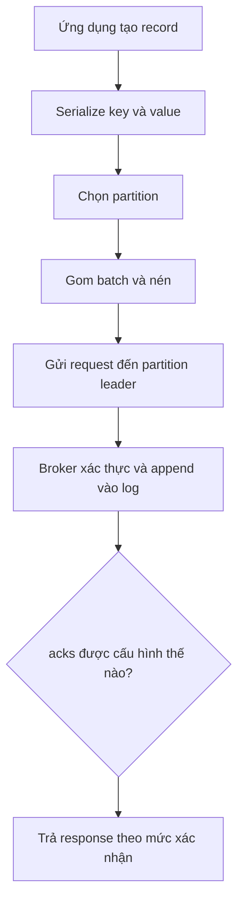
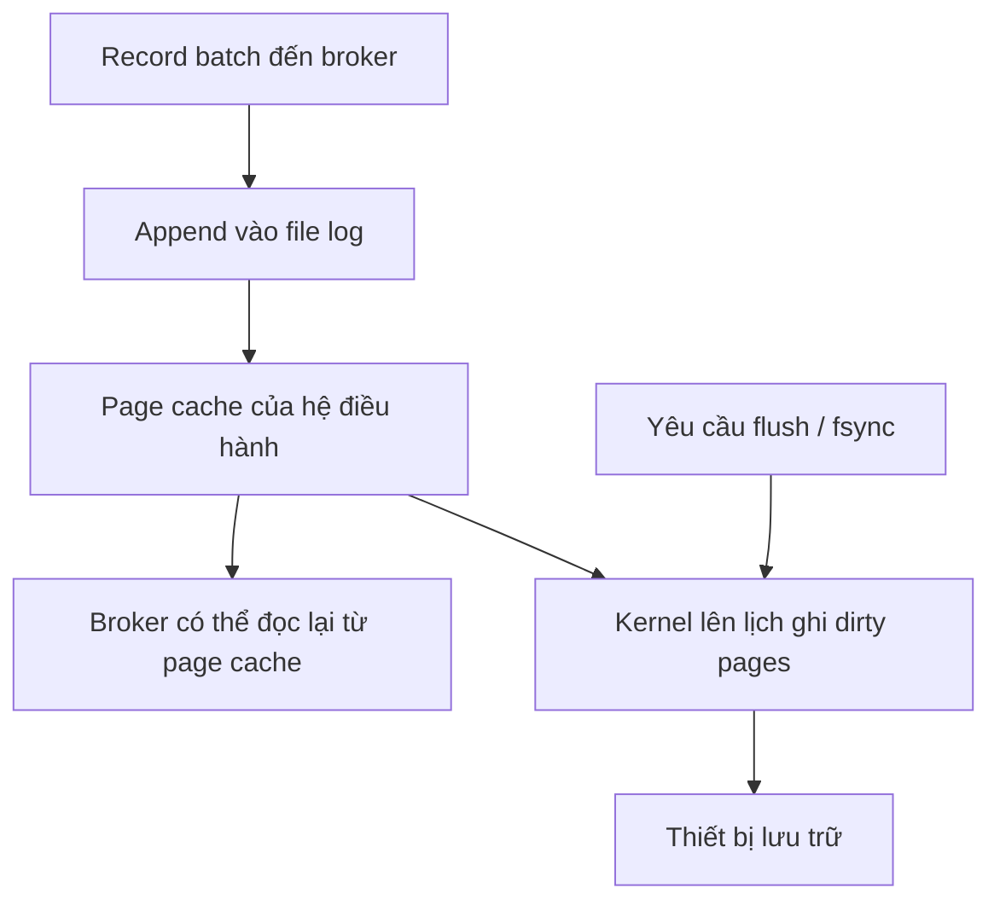
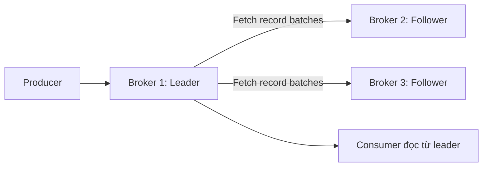

# Phân biệt ghi log, nhân bản và đồng bộ dữ liệu xuống đĩa

## Ba khái niệm khác nhau trong đường đi của một record

Khi producer gửi một record vào Kafka, dữ liệu phải đi qua nhiều bước trước khi được xem là an toàn theo mức bảo đảm mà ứng dụng yêu cầu. Broker nhận request, append record vào log của partition leader, có thể sao chép record sang follower replica, rồi hệ điều hành ghi các trang dữ liệu đang nằm trong bộ nhớ xuống thiết bị lưu trữ.

Ba hoạt động thường bị nhầm lẫn là:

- **Ghi log (append):** broker nối record vào cuối log của partition và cấp offset cho record.
- **Nhân bản (replication):** follower broker lấy dữ liệu từ leader và append bản sao vào log riêng của follower.
- **Đồng bộ xuống đĩa (flush):** dữ liệu đang được hệ điều hành giữ trong page cache được yêu cầu ghi xuống thiết bị lưu trữ bền vững.

Chúng liên quan với nhau nhưng không đồng nghĩa. Một record có thể đã được append trên leader mà chưa được follower sao chép. Record có thể đã được append trên nhiều replica nhưng chưa được fsync xuống thiết bị vật lý. Ngược lại, việc một broker đã flush dữ liệu của nó không chứng minh các replica khác đã nhận được record.

Hiểu đúng ba bước này giúp lựa chọn `acks`, replication factor, `min.insync.replicas`, chính sách flush và cách xử lý sự cố phù hợp. Đây là kiến thức nền tảng cho module KAFKA, nơi người học triển khai event streaming bằng Java/Spring Kafka, xử lý retry, ordering, giao dịch, rồi giám sát và phục hồi cụm.

## 1. Đường đi của record từ producer đến broker

### 1.1 Producer tạo và gửi record batch

Ứng dụng tạo record gồm topic, key, value, timestamp và headers. Producer serialize key/value thành byte, chọn partition, gom nhiều record thành batch và có thể nén batch trước khi gửi request đến broker leader của partition.

Producer có thể chờ phản hồi theo cấu hình `acks`. Cấu hình này quyết định producer cần nhận xác nhận ở mức nào trước khi xem request là thành công. Nó không thay đổi ý nghĩa của offset và cũng không tự động yêu cầu mọi bản sao phải fsync từng record xuống đĩa.



### 1.2 Leader append record vào log

Broker leader xác thực request, kiểm tra trạng thái partition và append record batch vào log của partition. Mỗi record được gắn offset theo vị trí trong partition. Log được chia thành các segment; segment hiện hành nhận record mới, còn segment cũ được giữ theo retention hoặc log compaction.

Kafka thiết kế log theo hướng append-only. Ghi nối tiếp ở cuối file thường hiệu quả hơn việc cập nhật các vị trí ngẫu nhiên liên tục. Broker cũng duy trì index để tìm record theo offset hoặc timestamp mà không phải quét toàn bộ log.

Khi nói “broker đã ghi record”, cần làm rõ đang nói đến append vào log của broker, replication đã hoàn tất hay dữ liệu đã được flush xuống thiết bị. Nếu không xác định ngữ cảnh, câu “đã ghi” có thể gây hiểu nhầm về mức độ bền vững.

## 2. Append vào log không đồng nghĩa với fsync xuống đĩa

### 2.1 Vai trò của page cache

Kafka tận dụng page cache của hệ điều hành. Khi broker ghi dữ liệu vào file log, dữ liệu thường được đưa vào vùng nhớ đệm do kernel quản lý. Kernel đánh dấu các trang nhớ đã thay đổi (dirty pages) và ghi chúng xuống thiết bị lưu trữ theo lịch của hệ điều hành hoặc khi có yêu cầu flush.

Điều này giúp Kafka tận dụng RAM để phục vụ đọc và ghi hiệu quả. Dữ liệu vừa ghi có thể được đọc lại từ page cache mà chưa cần đọc từ ổ đĩa. Ghi tuần tự, batching và page cache là các yếu tố quan trọng trong hiệu năng Kafka.



Append thành công thường có nghĩa dữ liệu đã được ghi qua đường I/O của hệ điều hành vào file và có thể đang nằm trong page cache. Nó không nhất thiết có nghĩa thiết bị lưu trữ đã xác nhận dữ liệu bền vững qua mất điện.

### 2.2 Flush và fsync làm gì?

Flush yêu cầu đẩy dữ liệu đang được buffer xuống tầng lưu trữ thấp hơn. Trong môi trường POSIX, `fsync()` yêu cầu hệ điều hành đồng bộ dữ liệu và metadata cần thiết của file xuống thiết bị lưu trữ. Chi tiết cuối cùng vẫn phụ thuộc filesystem, driver, bộ điều khiển lưu trữ và cách thiết bị xử lý cache ghi.

Nếu thiết bị có write cache dễ mất dữ liệu khi mất điện mà không có cơ chế bảo vệ hoặc không tuân thủ lệnh flush/barrier, một lần `fsync()` thành công ở tầng phần mềm chưa chắc đủ để bảo đảm dữ liệu sống sót trước mọi lỗi phần cứng. Hệ thống lưu trữ cần được cấu hình và kiểm chứng phù hợp với yêu cầu durability.

Kafka không mặc định gọi fsync cho từng record trước khi phản hồi producer. Việc ép flush quá thường xuyên có thể làm tăng độ trễ và giảm throughput đáng kể. Kafka thường dựa vào replication giữa broker kết hợp với page cache và cơ chế flush của hệ điều hành để cân bằng hiệu năng và độ bền dữ liệu.

### 2.3 Kafka flush theo lịch hoặc theo ngưỡng

Kafka có các cấu hình liên quan đến flush, chẳng hạn `log.flush.interval.ms` và `log.flush.interval.messages` ở cấp broker trong các phiên bản hỗ trợ. Các cấu hình này xác định khoảng thời gian hoặc số lượng message trước khi log được yêu cầu flush theo chính sách tương ứng. Cấu hình topic cũng có thể có các thuộc tính `flush.ms` và `flush.messages` tùy phiên bản.

Các giá trị mặc định thường để hệ điều hành quyết định thời điểm ghi dữ liệu xuống đĩa, thay vì bắt Kafka flush sau mỗi record. Không nên bật flush quá chặt chỉ vì muốn “an toàn hơn” mà chưa đo tác động và chưa xác định failure model cần bảo vệ.

Hãy phân biệt:

- **Append:** broker đã nối record vào log qua đường I/O của hệ điều hành.
- **Flush:** broker yêu cầu dữ liệu log được đồng bộ xuống storage theo chính sách flush.
- **Replication acknowledgement:** follower đã append dữ liệu và xác nhận tiến độ replication theo giao thức Kafka.

Ba mốc này có thể xảy ra ở thời điểm khác nhau.

## 3. Replication: follower sao chép log từ leader

### 3.1 Leader và follower replica

Mỗi partition có một replica leader và có thể có nhiều follower replica trên các broker khác. Producer gửi record đến leader. Follower chủ động fetch dữ liệu từ leader và append các batch nhận được vào log cục bộ của mình.



Replication factor 3 nghĩa là partition có ba replica được phân bố trên ba broker phù hợp. Đây là ba bản sao logic của partition. Nó không có nghĩa mọi record được ghi đồng thời vào ba ổ đĩa trong cùng một lệnh đồng bộ vật lý.

### 3.2 In-sync replicas (ISR)

ISR là tập các replica đang được xem là đồng bộ với leader theo quy tắc và ngưỡng thời gian của Kafka. ISR thường bao gồm leader và các follower theo kịp log đủ điều kiện. Follower chậm quá mức có thể bị loại khỏi ISR; khi bắt kịp, nó có thể được thêm lại.

ISR là cơ sở quan trọng cho `acks=all` và high watermark. Không phải mọi replica được gán cho partition đều luôn nằm trong ISR. Một follower có thể tồn tại nhưng đang offline hoặc tụt hậu, do đó không được tính là bản sao đồng bộ tại thời điểm ghi.

### 3.3 High watermark và record đã được commit

High watermark (HW) là offset ranh giới biểu thị phần log đã được các replica cần thiết xác nhận theo cơ chế replication của Kafka. Consumer thông thường chỉ đọc các record nằm dưới high watermark; điều này ngăn consumer quan sát record mới chỉ có trên leader nhưng chưa được replication đủ theo quy tắc.

Với giao dịch Kafka, consumer `read_committed` còn phải tôn trọng last stable offset (LSO), vì record thuộc giao dịch chưa kết thúc không được công bố như giao dịch đã commit. HW và LSO là các mốc liên quan đến khả năng đọc record; chúng không phải là xác nhận fsync xuống ổ đĩa vật lý.

### 3.4 Replication là sao chép dữ liệu, không phải flush đồng bộ

Follower nhận batch, append vào log cục bộ và cập nhật tiến độ replication. Xác nhận replication cho biết replica đã nhận/append dữ liệu theo giao thức Kafka. Điều đó không mặc nhiên yêu cầu follower gọi fsync cho từng batch trước khi xác nhận.

Vì vậy, nếu producer nhận `acks=all`, ta có thể kết luận record đã được append và xác nhận bởi các replica hiện thuộc ISR theo quy tắc Kafka, với điều kiện yêu cầu `min.insync.replicas` được đáp ứng. Không thể suy ra rằng mọi bản sao đã được flush vật lý xuống đĩa ngay tại thời điểm response được trả về.

## 4. `acks` xác định producer chờ xác nhận ở mức nào

### 4.1 `acks=0`

Producer không chờ broker xác nhận request. Client có thể gửi tiếp mà không biết broker đã nhận, append hay từ chối record. Độ trễ phía producer thấp, nhưng ứng dụng không có xác nhận đáng tin cậy về việc ghi thành công. Nếu request bị mất trên đường truyền hoặc broker lỗi, producer có thể không biết record đã thất bại.

Chỉ dùng khi ứng dụng chấp nhận khả năng mất dữ liệu và có cách bù đắp phù hợp. Không chọn `acks=0` cho sự kiện nghiệp vụ quan trọng chỉ để tăng throughput.

### 4.2 `acks=1`

Producer chờ partition leader xác nhận sau khi leader append record vào log cục bộ. Follower chưa nhất thiết đã sao chép record. Nếu leader lỗi ngay sau khi phản hồi nhưng trước khi follower nhận được record, một follower cũ có thể được bầu làm leader và record vừa ghi có thể bị mất.

`acks=1` có độ trễ thấp hơn `acks=all` trong một số workload, nhưng mức bảo vệ trước lỗi leader thấp hơn.

### 4.3 `acks=all` (hoặc `acks=-1`)

Producer chờ tất cả replica hiện nằm trong ISR xác nhận đã nhận/append record theo giao thức Kafka. Cấu hình `min.insync.replicas` đặt số replica đồng bộ tối thiểu mà broker phải có để chấp nhận ghi với `acks=all`.

Ví dụ topic có replication factor 3 và `min.insync.replicas=2`:

- Khi ISR có 3 replica, `acks=all` chờ cả 3 replica trong ISR xác nhận.
- Khi một follower offline và ISR còn 2 replica, ghi vẫn có thể được chấp nhận; leader và follower còn lại phải xác nhận.
- Khi ISR giảm còn 1, broker từ chối ghi `acks=all` vì không đạt `min.insync.replicas=2`.

Điều này tạo sự đánh đổi rõ ràng: cấu hình chặt hơn có thể từ chối ghi khi cụm mất quá nhiều replica, nhưng tránh chấp nhận ghi khi số bản sao đồng bộ thấp hơn mức ứng dụng yêu cầu.

### 4.4 Bảng so sánh

| Cấu hình | Điều kiện phản hồi | Mức bảo vệ tương đối | Đánh đổi |
|---|---|---|---|
| `acks=0` | Không chờ xác nhận từ broker | Thấp | Độ trễ producer thấp nhưng không biết kết quả ghi |
| `acks=1` | Leader append vào log cục bộ | Trung bình | Có thể mất record nếu leader lỗi trước replication |
| `acks=all` | Các replica hiện thuộc ISR xác nhận, với điều kiện min ISR | Cao hơn khi cấu hình đúng | Độ trễ phụ thuộc replication và có thể từ chối ghi khi ISR thiếu |

`acks=all` không có nghĩa chờ tất cả replica được cấu hình ban đầu bất kể trạng thái, cũng không có nghĩa fsync tất cả bản sao. Nó liên quan đến ISR và quy tắc replication của Kafka.

## 5. Kết hợp replication factor và `min.insync.replicas`

Replication factor (RF) quy định số replica được gán cho partition. `min.insync.replicas` quy định số replica tối thiểu phải có trong ISR để chấp nhận producer request dùng `acks=all`.

Một cấu hình thường gặp cho sự kiện cần độ bền cao là:

```properties
# Producer
acks=all
enable.idempotence=true
```

```properties
# Broker defaults / policy
default.replication.factor=3
unclean.leader.election.enable=false
```

```properties
# Topic configuration
min.insync.replicas=2
```

Các dòng trên minh họa những thuộc tính thuộc các phạm vi cấu hình khác nhau; không đặt tất cả chúng vào cùng một file producer. `acks` và `enable.idempotence` là cấu hình producer; `default.replication.factor` và `unclean.leader.election.enable` là cấu hình broker; `min.insync.replicas` có thể đặt ở cấp topic hoặc dùng chính sách mặc định của broker. Khi tạo topic tường minh, replication factor được chọn qua lệnh tạo topic hoặc Admin API, ví dụ:

```bash
kafka-topics.sh --bootstrap-server kafka-1:9092 --create --topic orders --partitions 12 --replication-factor 3
```

Với RF=3 và min ISR=2, hệ thống thường có thể tiếp tục ghi khi một replica bị lỗi, miễn là hai replica còn lại vẫn thuộc ISR. Nếu số ISR giảm xuống dưới 2, ghi `acks=all` bị từ chối cho đến khi đủ replica đồng bộ trở lại. Đây là cách ưu tiên tính nhất quán và durability hơn việc luôn chấp nhận ghi.

`unclean.leader.election.enable=false` ngăn replica ngoài ISR được bầu làm leader trong tình huống không còn replica ISR phù hợp. Điều này giảm nguy cơ mất dữ liệu đã được commit nhưng có thể làm partition offline nếu không còn replica ISR khả dụng. Bật unclean election có thể tăng availability trong một số tình huống nhưng chấp nhận rủi ro mất record chưa có trên replica được chọn.

## 6. Vì sao `acks=all` không đồng nghĩa với fsync?

Hãy xét một record được ghi vào partition có ba replica:

1. Leader append record vào log, dữ liệu có thể nằm trong page cache của broker leader.
2. Follower fetch batch và append vào log cục bộ; dữ liệu cũng có thể nằm trong page cache của follower.
3. Các replica trong ISR xác nhận tiến độ replication.
4. Khi đủ điều kiện, leader có thể trả response thành công cho producer dùng `acks=all`.
5. Kernel trên từng broker flush dirty pages xuống thiết bị lưu trữ theo lịch hoặc theo yêu cầu flush riêng.

Ở bước 4, record đã đạt điều kiện replication acknowledgement. Bước 5 có thể diễn ra sau đó. Nếu cả ba máy chủ cùng mất nguồn đột ngột trước khi dữ liệu page cache được ghi bền vững, replication trong RAM/page cache không tự bảo vệ được record. Vì vậy, replication và flush bổ sung cho nhau trong mô hình durability, nhưng không thể thay thế khái niệm cho nhau.

Kafka dựa vào nhiều lớp bảo vệ: replica trên các broker độc lập, ISR, high watermark, page cache, cơ chế flush của hệ điều hành và thiết bị lưu trữ phù hợp. Thiết kế durability cần xét failure domain: lỗi một tiến trình, lỗi một broker, lỗi một rack, mất điện một zone hay mất toàn bộ cụm.

## 7. Điều gì xảy ra trong các tình huống lỗi?

| Tình huống | Append | Replication | Flush xuống đĩa | Hệ quả có thể có |
|---|---|---|---|---|
| Producer mất kết nối trước khi gửi xong | Có thể chưa xảy ra | Không | Không | Producer không biết broker có nhận request hay chưa; cần retry và idempotence |
| Leader process bị dừng, follower đã nhận record | Record đã append trên leader | Follower có thể giữ bản sao | Có thể chưa flush | Leader mới trong ISR có thể tiếp tục với record đã được replication |
| Leader lỗi trước khi follower nhận record với `acks=1` | Có trên leader cũ | Chưa có | Có thể chưa flush | Record có thể mất nếu replica cũ được bầu làm leader |
| Một follower offline nhưng ISR còn đủ min ISR | Có | Các ISR còn lại tiếp tục replication | Theo lịch từng broker | Ghi `acks=all` có thể tiếp tục nếu đạt min ISR |
| Mất điện một broker sau khi replication đủ | Có trên nhiều broker | Có trên ISR | Tùy trạng thái flush từng broker | Các replica trên broker khác có thể giữ dữ liệu; phục hồi phụ thuộc phần cứng và ISR |
| Mất điện đồng thời mọi broker trước flush | Có thể đã append trong page cache | Có thể đã copy trong page cache | Chưa bền vững | Có nguy cơ mất dữ liệu nếu mọi cache dễ mất nguồn cùng bị mất |
| Không còn replica ISR khả dụng và bật unclean election | Có thể đã append | Không còn ISR phù hợp | Không quyết định duy nhất | Replica ngoài ISR có thể được chọn và làm mất record mới hơn |

Không có một cột đơn lẻ nào trả lời mọi câu hỏi durability. Cần xác định record đã append ở đâu, replica nào đã xác nhận, offset nào đã commit và dữ liệu đã flush đến tầng lưu trữ nào.

## 8. Retry, idempotence và giao dịch liên quan thế nào?

### 8.1 Producer retry có thể gửi lại một request

Nếu producer gửi record nhưng timeout trước khi nhận response, producer không thể biết chắc broker đã append record hay chưa. Khi retry, record có thể được gửi lần nữa. Nếu ứng dụng không kiểm soát, có thể xuất hiện bản ghi trùng.

Idempotent producer dùng producer ID và sequence number để broker nhận diện retry của batch và tránh append trùng trong phạm vi được Kafka hỗ trợ. Cấu hình `enable.idempotence=true` giúp tăng độ an toàn khi retry và duy trì ordering theo các điều kiện cấu hình tương thích.

Idempotence không thay thế replication hoặc flush. Nó giải quyết vấn đề duplicate do retry của producer, không làm dữ liệu được fsync ngay lập tức và không tự bảo đảm side effect trong database bên ngoài Kafka chỉ xảy ra một lần.

### 8.2 Transaction và read_committed

Kafka transaction cho phép producer ghi nhiều record vào nhiều partition và commit hoặc abort nhóm record như một đơn vị giao dịch Kafka. Consumer dùng `isolation.level=read_committed` chỉ đọc record thuộc giao dịch đã commit và tuân theo last stable offset.

Transaction marker và metadata giao dịch cũng được lưu qua cơ chế Kafka. Độ bền của record trong transaction vẫn phụ thuộc replication, ISR và cấu hình producer/broker liên quan. Transaction không đồng nghĩa mọi record đã được flush vật lý trên mọi replica trước khi consumer nhìn thấy.

### 8.3 Side effect ngoài Kafka cần cơ chế riêng

Nếu consumer đọc record rồi cập nhật database, Kafka không thể tự tạo một giao dịch nguyên tử bao trùm cả offset commit và database commit trong mọi hệ thống. Cần thiết kế idempotency, inbox/outbox, transaction phối hợp hoặc cơ chế bù để tránh mất hoặc xử lý trùng khi một bước thành công còn bước kia thất bại.

## 9. Cấu hình và kiểm tra trong Java/Spring Kafka

### 9.1 Producer properties

Ví dụ cấu hình producer Spring Boot:

```yaml
spring:
  kafka:
    producer:
      acks: all
      properties:
        enable.idempotence: true
        compression.type: zstd
        linger.ms: 5
```

Tên cấu hình và cách binding có thể khác theo phiên bản Spring Boot/Spring Kafka. Hãy kiểm tra cấu hình thực tế mà client nhận được khi khởi động. `acks=all` đặt mức xác nhận replication; idempotence xử lý retry trùng; compression và batching tác động throughput/CPU nhưng không phải cơ chế durability.

### 9.2 Quan sát ISR của topic

Có thể dùng lệnh quản trị Kafka để xem leader, replica và ISR của topic:

```bash
kafka-topics.sh --bootstrap-server kafka-1:9092 --describe --topic orders
```

Trong kết quả, `Replicas` thể hiện các replica được gán cho partition; `Isr` thể hiện tập replica đang đồng bộ tại thời điểm truy vấn; `Leader` là broker đang giữ vai trò leader. Nếu một partition có RF=3 nhưng ISR chỉ còn 2, hãy kiểm tra broker offline, replica lag, network và disk trước khi kết luận hệ thống vẫn có đủ mức dự phòng.

### 9.3 Giám sát flush và replication

Theo dõi các nhóm chỉ số:

| Nhóm | Chỉ số cần quan sát | Mục đích |
|---|---|---|
| Producer | Produce latency, retry, timeout, error rate | Phát hiện request chậm hoặc không được xác nhận |
| Replication | ISR size, ISR shrink/expand, under-replicated partitions, replica lag | Phát hiện follower không theo kịp leader |
| Partition | High watermark, log end offset, offline partitions | Đánh giá tiến độ log và khả năng phục vụ |
| Disk | Disk utilization, write latency, IOPS, flush latency | Phát hiện nghẽn hoặc rủi ro storage |
| Broker | CPU, page cache, network throughput, request queue | Tìm bottleneck trên đường ghi/đọc |
| Consumer | Consumer lag và fetch latency | Xác định tác động đến ứng dụng đọc |

Tên metric cụ thể có thể thay đổi theo phiên bản Kafka và hệ thống giám sát. Hãy lấy metric từ JMX/metrics endpoint của bản Kafka đang chạy và xây dựng cảnh báo theo baseline, SLO cùng failure model.

## 10. Thiết kế durability theo failure model

Trước khi chọn cấu hình, hãy trả lời hệ thống cần sống sót trước loại lỗi nào:

- **Lỗi ứng dụng hoặc producer:** cần retry có kiểm soát, idempotent producer và xử lý timeout không giả định request chắc chắn thất bại.
- **Lỗi một broker:** cần replication factor đủ lớn, ISR còn đủ min ISR và replica đặt trên broker khác.
- **Lỗi một rack hoặc zone:** replica cần được phân bố theo rack/zone awareness để tránh mọi bản sao cùng mất trong một sự cố chung.
- **Lỗi nguồn điện hoặc thiết bị:** cần storage có bảo vệ write cache, flush semantics đúng và hạ tầng có khả năng chịu lỗi tương ứng.
- **Lỗi nhiều broker hoặc mất toàn cụm:** cần backup, cluster replication hoặc quy trình khôi phục từ nguồn dữ liệu phù hợp; replication trong một cluster không thay thế disaster recovery.

Với một topic nghiệp vụ quan trọng, cấu hình thường được cân nhắc gồm RF=3, `acks=all`, `min.insync.replicas=2`, idempotent producer và clean leader election. Đây là điểm khởi đầu phổ biến, không phải công thức áp dụng cho mọi workload. Cần kiểm chứng latency, throughput, chi phí lưu trữ, failure domains và yêu cầu RPO/RTO.

Nếu ứng dụng yêu cầu dữ liệu đã được xác nhận phải sống sót trước mất điện đột ngột trên toàn bộ replica, cần đánh giá cả cơ chế flush, filesystem, thiết bị và nguồn điện. Chỉ tăng replication factor mà đặt tất cả replica trong cùng một failure domain không giải quyết được sự cố chung.

## 11. Các hiểu lầm thường gặp

**“Append thành công nghĩa là dữ liệu đã nằm trên đĩa vật lý.”** Append có thể chỉ đưa dữ liệu vào page cache. Flush/fsync là bước khác.

**“`acks=all` nghĩa là tất cả replica đã fsync.”** `acks=all` chờ các replica hiện thuộc ISR xác nhận replication theo Kafka; nó không buộc fsync từng record trên tất cả ổ đĩa.

**“Replication factor 3 luôn có ba bản sao đồng bộ.”** RF=3 là ba replica được gán. Số replica thực sự thuộc ISR có thể thấp hơn khi follower chậm hoặc offline.

**“Leader đã append thì follower chắc chắn có record.”** Follower cần fetch và append. Với `acks=1`, producer có thể nhận phản hồi trước khi follower nhận được record.

**“Flush mỗi record luôn an toàn và tốt hơn.”** Flush quá thường xuyên có thể làm giảm throughput và tăng latency; durability phải được thiết kế theo failure model và đo thực tế.

**“Idempotent producer thay thế replication.”** Idempotence chống duplicate do retry trong phạm vi Kafka; replication bảo vệ trước lỗi broker/replica.

**“Consumer đọc được record nghĩa là mọi replica đều đã flush.”** Consumer visibility phụ thuộc high watermark và isolation level, không chứng minh fsync vật lý trên mọi replica.

## Kết luận

Ghi log, replication và flush là ba mốc riêng trong vòng đời dữ liệu Kafka. Leader append record vào log và cấp offset; follower fetch rồi append bản sao; hệ điều hành flush dữ liệu từ page cache xuống thiết bị lưu trữ theo lịch hoặc yêu cầu đồng bộ. `acks` xác định producer chờ mức xác nhận nào, còn `min.insync.replicas` đặt ngưỡng ISR tối thiểu cho ghi `acks=all`.

Khi thiết kế lưu trữ cho KAFKA, hãy xác định failure model, chọn replication factor và ISR phù hợp, cấu hình producer idempotent khi cần, theo dõi replica lag và disk flush, đồng thời hiểu rõ giới hạn của page cache và thiết bị. Không nên đánh đồng replication acknowledgement với fsync: chỉ khi phân biệt đúng hai cơ chế, ta mới có thể mô tả trung thực mức durability mà hệ thống đang cung cấp.
