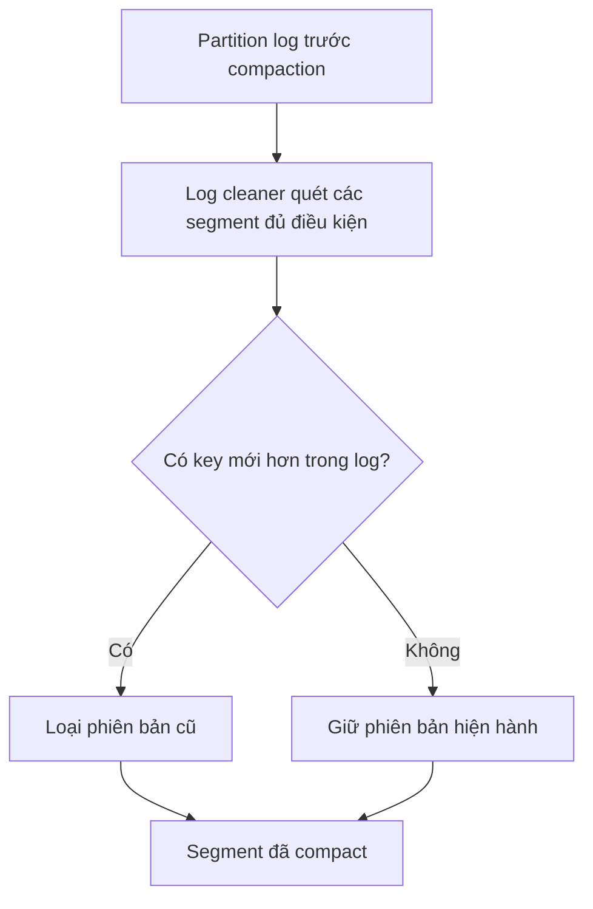
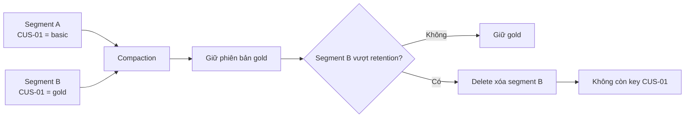

# Kết hợp cleanup.policy=compact,delete và các đánh đổi

Kafka hỗ trợ hai cách dọn dữ liệu chính cho topic: xóa các segment đã vượt giới hạn lưu giữ (`delete`) và nén log theo key (`compact`). Khi cấu hình `cleanup.policy=compact,delete`, broker áp dụng cả hai cơ chế: log cleaner loại bỏ các phiên bản cũ của cùng key, còn cơ chế retention có thể xóa các segment đã quá hạn hoặc vượt giới hạn dung lượng.

Cấu hình kết hợp phù hợp với luồng vừa cần giữ trạng thái mới nhất theo key, vừa cần giới hạn thời gian hoặc dung lượng lưu trữ. Ví dụ topic `customer-state` có thể giữ phiên bản hồ sơ mới nhất của mỗi khách hàng trong khoảng thời gian vận hành đã chọn. Tuy nhiên, đây không phải một bảng key-value tồn tại vĩnh viễn: `delete` vẫn có thể loại bỏ cả segment chứa phiên bản mới nhất nếu segment vượt retention. Người thiết kế cần cân nhắc thời gian replay, dung lượng, tombstone và khả năng phục hồi consumer trước khi chọn chính sách.

Bài này giải thích cách hai cơ chế tương tác trong KAFKA, cách cấu hình bằng Kafka CLI và Java/Spring Kafka, cách xử lý bản ghi xóa (tombstone), và cách chọn chính sách cho từng loại dữ liệu. Người học sẽ biết chính xác dữ liệu nào có thể còn lại, dữ liệu nào có thể bị loại bỏ, cũng như các giới hạn cần kiểm tra khi consumer đọc lại log.

## 1. Hai cơ chế cleanup của Kafka

Topic Kafka lưu record thành log được chia thành các segment trong từng partition. Chính sách cleanup quyết định broker có thể loại bỏ dữ liệu cũ bằng cách nào.

| Chính sách | Cách hoạt động | Mục đích thường gặp |
|---|---|---|
| `delete` | Xóa segment khi dữ liệu vượt giới hạn thời gian hoặc dung lượng | Event log, log ứng dụng, telemetry có thời hạn lưu |
| `compact` | Giữ lại phiên bản mới nhất theo key và loại bỏ phiên bản cũ khi log cleaner chạy | Topic biểu diễn trạng thái hiện tại theo key |
| `compact,delete` | Vừa compact theo key, vừa xóa segment theo retention | Topic trạng thái có thời hạn lưu hoặc giới hạn dung lượng |

`delete` và `compact` hoạt động ở cấp log của từng partition. Một topic có nhiều partition sẽ có log và quá trình cleanup riêng cho từng partition. Compaction không tạo một bảng duy nhất cho toàn topic, cũng không sắp xếp record giữa các partition.

Ví dụ topic `customer-state` nhận các thay đổi hồ sơ:

| Offset | Key | Value |
|---:|---|---|
| 0 | `CUS-01` | `{"name":"An","tier":"basic"}` |
| 1 | `CUS-02` | `{"name":"Binh","tier":"basic"}` |
| 2 | `CUS-01` | `{"name":"An","tier":"gold"}` |
| 3 | `CUS-03` | `{"name":"Chi","tier":"silver"}` |
| 4 | `CUS-02` | `{"name":"Binh","tier":"gold"}` |

Sau khi compaction hoàn tất trên các segment đủ điều kiện, bản ghi cũ của `CUS-01` và `CUS-02` có thể được loại bỏ; bản ghi mới nhất của mỗi key còn lại. Offset không được đánh số lại: việc loại bỏ record không làm thay đổi offset của các record khác và consumer có thể thấy khoảng trống offset.

## 2. Cách hoạt động của log compaction

Kafka dùng key để nhận biết những record biểu diễn cùng một thực thể. Trong một partition, record mới hơn theo offset có cùng key sẽ thay thế giá trị cũ về mặt trạng thái. Log cleaner chạy nền, đọc các segment đủ điều kiện và tạo lại segment đã compact bằng cách loại bỏ những phiên bản cũ không còn cần thiết.



Compaction là bất đồng bộ. Khi producer ghi một phiên bản mới, record cũ không biến mất ngay lập tức. Consumer có thể đọc nhiều phiên bản của cùng key trước khi cleaner xử lý xong. Ứng dụng tiêu thụ topic compact nên xử lý record theo kiểu cập nhật trạng thái: mỗi record mới ghi đè trạng thái trước đó của cùng key.

Compaction có một số đặc điểm quan trọng:

- So sánh key trong phạm vi từng partition. Các record cùng key cần được định tuyến vào cùng partition để compaction có thể nhận ra chúng là các phiên bản của cùng thực thể.
- Key `null` không có danh tính để compaction gom phiên bản; không nên dựa vào compact để dọn các record không có key.
- Cleaner chỉ xử lý các segment đủ điều kiện. Segment đang hoạt động (active segment) thường chưa được compact cho đến khi được đóng/roll.
- Offset được giữ nguyên, vì vậy log sau compact có thể có khoảng trống offset.
- Compaction không đảm bảo một record duy nhất cho mỗi key tại mọi thời điểm. Trước khi cleaner hoàn tất, consumer vẫn có thể đọc các phiên bản cũ và mới.

Nếu ứng dụng cần giữ thứ tự thay đổi của một khách hàng, hãy dùng `customerId` làm record key. Khi đó các thay đổi của khách hàng thường được ghi vào cùng partition và compaction có thể giữ phiên bản mới nhất của key đó. Nếu cùng một khách hàng bị gửi vào nhiều partition do thay đổi key/partitioner hoặc producer chỉ định partition khác nhau, compaction không thể hợp nhất các bản ghi giữa những partition.

## 3. Cách hoạt động của delete retention

Với `delete`, Kafka xóa segment đã vượt giới hạn retention. Hai cấu hình chính là:

| Cấu hình | Ý nghĩa |
|---|---|
| `retention.ms` | Thời gian lưu giữ log trước khi segment đủ điều kiện bị xóa |
| `retention.bytes` | Giới hạn dung lượng log theo từng partition; khi vượt ngưỡng, segment cũ có thể bị xóa |

Retention hoạt động theo segment, không phải đồng hồ TTL chính xác trên từng record. Một segment cần được roll trước khi có thể bị xóa; do đó thời điểm xóa thực tế có thể trễ so với mốc retention cấu hình. `segment.bytes` và `segment.ms` ảnh hưởng đến kích thước/thời điểm roll segment và vì thế ảnh hưởng đến độ hạt của retention.

`retention.bytes` được áp dụng cho từng partition, không phải một giới hạn tổng duy nhất cho toàn topic. Với topic có nhiều partition, tổng dung lượng thực tế có thể lớn hơn giá trị cấu hình nhân một partition. Nếu cần giới hạn tổng dung lượng cluster, cần tính đến số partition, replication factor và dung lượng bản sao trên các broker.

Ví dụ `retention.ms=604800000` tương đương bảy ngày. Với topic có `retention.bytes=1073741824`, mỗi partition có giới hạn retention dung lượng khoảng 1 GiB. Khi vượt giới hạn, Kafka có thể xóa các segment cũ để đưa log về mức phù hợp.

## 4. Kết hợp compact và delete: điều gì được giữ lại?

Khi `cleanup.policy=compact,delete`, log cleaner vẫn loại bỏ các phiên bản cũ theo key, đồng thời retention có quyền xóa segment quá cũ hoặc vượt giới hạn dung lượng. Hai cơ chế bổ sung cho nhau nhưng tạo ra một đánh đổi quan trọng: bản ghi mới nhất của một key cũng có thể bị xóa khi segment chứa nó vượt `retention.ms` hoặc `retention.bytes`.

Ví dụ:

1. Ngày 1, `CUS-01` được tạo và ghi vào segment A.
2. Ngày 2, hồ sơ được cập nhật; phiên bản mới được ghi vào segment B.
3. Log cleaner compact segment A và loại phiên bản cũ nếu phiên bản mới hơn đã được nhận biết.
4. Khi segment B đủ cũ hoặc log vượt giới hạn dung lượng, chính sách `delete` có thể xóa segment B.
5. Khi đó topic không còn phiên bản nào của `CUS-01`, dù trước đây đây là giá trị mới nhất.



Do đó, `compact,delete` phù hợp khi trạng thái mới nhất chỉ cần tồn tại trong một cửa sổ thời gian hoặc ngân sách dung lượng. Nếu yêu cầu nghiệp vụ là giữ trạng thái mới nhất của mọi key vô thời hạn, hãy đánh giá `compact` không kèm `delete`, hoặc dùng một kho snapshot/database được thiết kế cho yêu cầu lưu trữ đó.

Khi retention theo thời gian và theo dung lượng cùng được đặt, segment có thể bị xóa khi một trong các giới hạn áp dụng yêu cầu xóa. Không nên dựa vào một giá trị `retention.ms` dài để đảm bảo dữ liệu tồn tại nếu `retention.bytes` quá thấp so với tốc độ phát sinh dữ liệu.

## 5. Tombstone: biểu diễn thao tác xóa một key

Trong topic compact, producer biểu diễn việc xóa một thực thể bằng một record có key và value bằng `null`. Record này gọi là *tombstone*. Tombstone cho log cleaner biết rằng key tương ứng đã bị xóa; khi compaction xử lý, các giá trị cũ của key có thể được loại bỏ cùng tombstone sau thời gian lưu tombstone.

Ví dụ lịch sử của `CUS-01`:

| Offset | Key | Value | Ý nghĩa |
|---:|---|---|---|
| 10 | `CUS-01` | `{"tier":"gold"}` | Hồ sơ hiện tại |
| 15 | `CUS-01` | `{"tier":"platinum"}` | Cập nhật hồ sơ |
| 21 | `CUS-01` | `null` | Xóa hồ sơ |

Tombstone không có nghĩa xóa ngay toàn bộ dữ liệu trên broker. Nó là một marker trong log. Consumer đọc từ đầu topic cần nhìn thấy tombstone để xóa key khỏi state store của chính nó. Sau khi tombstone tồn tại đủ lâu và cleaner xử lý, Kafka có thể loại tombstone và các giá trị cũ của key khỏi log compacted.

`delete.retention.ms` điều khiển khoảng thời gian tombstone được giữ lại để consumer có thời gian đọc và nhận biết thao tác xóa. Nếu một consumer phục hồi từ offset quá cũ sau khi tombstone đã bị loại bỏ, nó có thể không nhìn thấy marker xóa đó. Vì vậy, cần bảo đảm thời gian consumer có thể bị offline và thời gian cần bootstrap state không vượt quá giới hạn tombstone, hoặc có quy trình snapshot/rebuild khác.

Tombstone chỉ có ý nghĩa cho record có key. Một record value `null` nhưng key cũng `null` không thể biểu diễn việc xóa một thực thể xác định trong topic compact.

## 6. Cấu hình cleanup.policy=compact,delete

Ví dụ tạo topic `customer-state` có sáu partition, replication factor ba, cleanup kết hợp và retention bảy ngày:

```bash
kafka-topics.sh \
  --bootstrap-server kafka-1:9092 \
  --create \
  --topic customer-state \
  --partitions 6 \
  --replication-factor 3 \
  --config cleanup.policy=compact,delete \
  --config retention.ms=604800000 \
  --config retention.bytes=-1 \
  --config delete.retention.ms=86400000 \
  --config min.compaction.lag.ms=60000
```

Trong ví dụ, dữ liệu có retention theo thời gian bảy ngày, không đặt giới hạn dung lượng theo partition, tombstone được giữ tối thiểu theo cấu hình một ngày và record mới cần tồn tại ít nhất một phút trước khi đủ điều kiện compact. Các giá trị là ví dụ học tập; cần điều chỉnh theo tốc độ ghi, thời gian phục hồi consumer và dung lượng cluster. Với cluster ít hơn ba broker, replication factor phải giảm xuống mức không vượt số broker.

Kiểm tra cấu hình topic:

```bash
kafka-configs.sh \
  --bootstrap-server kafka-1:9092 \
  --entity-type topics \
  --entity-name customer-state \
  --describe
```

Có thể thay đổi cấu hình topic đã tồn tại:

```bash
kafka-configs.sh \
  --bootstrap-server kafka-1:9092 \
  --entity-type topics \
  --entity-name customer-state \
  --alter \
  --add-config 'cleanup.policy=compact\,delete,retention.ms=604800000,delete.retention.ms=86400000'
```

Khi chạy CLI, hãy kiểm tra cú pháp của phiên bản Kafka đang dùng và xác nhận kết quả bằng lệnh `--describe`. Thay đổi cleanup policy ảnh hưởng đến dữ liệu đang lưu; chuyển từ `delete` sang `compact` không thể khôi phục các record đã bị retention xóa trước đó.

## 7. Cấu hình topic trong Java và Spring Kafka

Có thể khai báo topic bằng Spring Kafka `TopicBuilder`. Ví dụ dưới đây tạo topic `customer-state` với chính sách cleanup kết hợp:

```java
package com.example.kafkalab.config;

import org.apache.kafka.clients.admin.NewTopic;
import org.apache.kafka.common.config.TopicConfig;
import org.springframework.context.annotation.Bean;
import org.springframework.context.annotation.Configuration;
import org.springframework.kafka.config.TopicBuilder;

@Configuration
public class CustomerStateTopicConfig {

    @Bean
    public NewTopic customerStateTopic() {
        return TopicBuilder.name("customer-state")
                .partitions(6)
                .replicas(3)
                .config(TopicConfig.CLEANUP_POLICY_CONFIG, "compact,delete")
                .config(TopicConfig.RETENTION_MS_CONFIG, "604800000")
                .config(TopicConfig.DELETE_RETENTION_MS_CONFIG, "86400000")
                .config(TopicConfig.MIN_COMPACTION_LAG_MS_CONFIG, "60000")
                .build();
    }
}
```

Spring Kafka dùng Kafka Admin để tạo topic khi ứng dụng khởi động nếu topic chưa tồn tại. Nếu topic đã tồn tại, bean `NewTopic` không tự động thay thế toàn bộ cấu hình hiện có. Dùng công cụ quản trị để kiểm tra và cập nhật cấu hình topic theo quy trình vận hành.

Ví dụ cấu hình dùng sáu partition và ba replica cần cluster có ít nhất ba broker. Trong lab một broker, hãy giảm `replicas(3)` xuống `replicas(1)`; replication factor không thể lớn hơn số broker có thể lưu replica.

Ví dụ event biểu diễn trạng thái khách hàng:

```java
package com.example.kafkalab.event;

import java.time.Instant;

public record CustomerState(
        String customerId,
        String tier,
        Instant updatedAt
) {
}
```

Producer dùng `customerId` làm key để mọi phiên bản của cùng khách hàng đi vào cùng partition:

```java
package com.example.kafkalab.producer;

import com.example.kafkalab.event.CustomerState;
import org.springframework.kafka.core.KafkaTemplate;
import org.springframework.stereotype.Service;

import java.util.concurrent.CompletableFuture;

@Service
public class CustomerStatePublisher {
    private final KafkaTemplate<String, CustomerState> kafkaTemplate;

    public CustomerStatePublisher(
            KafkaTemplate<String, CustomerState> kafkaTemplate) {
        this.kafkaTemplate = kafkaTemplate;
    }

    public CompletableFuture<?> publish(CustomerState state) {
        return kafkaTemplate.send("customer-state", state.customerId(), state);
    }

    public CompletableFuture<?> delete(String customerId) {
        var tombstone = new org.apache.kafka.clients.producer.ProducerRecord<
                String, CustomerState>("customer-state", customerId, null);
        return kafkaTemplate.send(tombstone);
    }
}
```

Consumer phải coi value `null` là thao tác xóa state tương ứng:

```java
package com.example.kafkalab.consumer;

import com.example.kafkalab.event.CustomerState;
import org.apache.kafka.clients.consumer.ConsumerRecord;
import org.springframework.kafka.annotation.KafkaListener;
import org.springframework.stereotype.Component;

@Component
public class CustomerStateListener {

    @KafkaListener(topics = "customer-state", groupId = "customer-state-view")
    public void onMessage(ConsumerRecord<String, CustomerState> record) {
        String customerId = record.key();
        CustomerState state = record.value();

        if (state == null) {
            // Xóa customerId khỏi state store/database của consumer.
            return;
        }

        // Upsert trạng thái mới nhất của customerId.
    }
}
```

Ví dụ trên tập trung vào ý nghĩa key/value và tombstone. Ứng dụng thực tế cần cấu hình serializer/deserializer JSON phù hợp, bảo đảm consumer có thể deserialize record tombstone (value null), và xử lý cập nhật state theo hướng idempotent. Nếu consumer ghi sang database ngoài Kafka, cần cân nhắc transaction hoặc cơ chế inbox/outbox phù hợp để đồng bộ offset với tác động nghiệp vụ.

## 8. Các tham số compaction cần hiểu

| Tham số | Phạm vi | Ý nghĩa |
|---|---|---|
| `cleanup.policy` | Topic | Chọn `delete`, `compact` hoặc kết hợp |
| `min.compaction.lag.ms` | Topic | Thời gian tối thiểu record phải tồn tại trước khi có thể được compact |
| `max.compaction.lag.ms` | Topic | Giới hạn thời gian tối đa để record chưa compact trở nên đủ điều kiện; cần xem cùng hành vi cleaner và phiên bản |
| `min.cleanable.dirty.ratio` | Topic | Tỷ lệ phần log chưa compact so với tổng phần log được xét để cleaner chọn log cần compact |
| `delete.retention.ms` | Topic | Thời gian giữ tombstone để consumer có cơ hội nhìn thấy thao tác xóa |
| `segment.bytes` | Topic | Kích thước segment trước khi roll theo dung lượng |
| `segment.ms` | Topic | Thời gian tối đa trước khi roll segment theo tuổi |
| `log.cleaner.threads` | Broker | Số luồng cleaner xử lý compaction trên broker |
| `log.cleaner.dedupe.buffer.size` | Broker | Bộ nhớ cleaner dùng cho quá trình deduplication |

`min.compaction.lag.ms` hữu ích khi cần giữ lịch sử thay đổi trong một khoảng ngắn trước khi cleaner loại phiên bản cũ. `min.cleanable.dirty.ratio` ảnh hưởng đến thời điểm cleaner chọn log để xử lý: tỷ lệ thấp có thể làm cleaner chạy thường xuyên hơn, tiêu tốn I/O; tỷ lệ cao có thể tiết kiệm tài nguyên nhưng khiến dữ liệu cũ tồn tại lâu hơn.

Các cấu hình `log.cleaner.*` là cấu hình broker, không phải cấu hình riêng của một topic. Nếu cleaner bị tắt, thiếu thread hoặc thiếu bộ nhớ dedupe, compaction có thể chậm hoặc không diễn ra như mong đợi. Cần theo dõi cleaner backlog, I/O và disk throughput khi vận hành topic compact với lưu lượng lớn.

## 9. Đánh đổi về dung lượng, replay và phục hồi

Kết hợp `compact,delete` mang lại trạng thái gọn hơn theo key và giới hạn lưu trữ, nhưng phải cân bằng các yêu cầu:

| Yêu cầu | Lợi ích của compact | Rủi ro/đánh đổi khi thêm delete |
|---|---|---|
| Giữ trạng thái mới nhất | Loại phiên bản cũ của cùng key | Segment chứa giá trị mới nhất cũng có thể bị xóa theo retention |
| Replay để dựng state | Consumer có thể đọc log đã compact để tái tạo trạng thái trong phạm vi dữ liệu còn lại | Dữ liệu cũ hơn cửa sổ retention không còn để dựng lại |
| Tiết kiệm dung lượng | Loại bỏ các phiên bản bị thay thế | Xóa segment theo thời gian/dung lượng làm mất cả lịch sử và state cũ |
| Xử lý xóa key | Tombstone cho biết key đã bị xóa | Tombstone hết hạn có thể khiến consumer quá chậm bỏ lỡ thao tác xóa |
| Audit lịch sử | Có thể còn một số phiên bản gần đây trước khi cleaner chạy | Không phù hợp nếu cần lưu đầy đủ mọi thay đổi lâu dài |

Nếu cần cả state hiện tại và lịch sử đầy đủ, nên tách mục đích lưu trữ: một topic compacted hoặc compact-delete để phát trạng thái, một topic append-only với retention phù hợp hoặc một kho lưu trữ chuyên dụng để audit. Không nên dùng một topic `compact,delete` như nguồn lịch sử pháp lý nếu chính sách cleanup có thể loại bỏ phiên bản cũ.

Khi thiết kế thời gian replay, hãy tính cả thời gian consumer offline, thời gian khởi động lại, tốc độ đọc bù và `delete.retention.ms`. Nếu consumer phải dựng state từ đầu sau sự cố, retention phải đủ dài để chứa toàn bộ dữ liệu cần thiết; với topic compact, consumer vẫn phải xử lý tombstone và các bản ghi có thể xuất hiện lặp theo key.

## 10. Chọn chính sách theo loại dữ liệu

| Loại dữ liệu | Chính sách thường phù hợp | Lý do |
|---|---|---|
| Event log cần replay trong 14 ngày | `delete` | Giữ từng event trong cửa sổ thời gian |
| Trạng thái cấu hình mới nhất theo service ID, cần giữ lâu dài | `compact` | Giữ giá trị mới nhất theo key, kể cả khi key không phát sinh update thường xuyên |
| Trạng thái phiên hoặc cache có vòng đời tối đa 7 ngày | `compact,delete` | Giữ bản mới nhất trong cửa sổ cần thiết rồi cho phép xóa dữ liệu cũ |
| Audit trail cần mọi phiên bản | `delete` với retention được thiết kế phù hợp hoặc lưu trữ chuyên dụng | Compaction có thể loại bỏ lịch sử trung gian |
| Metric/telemetry không cần key | `delete` | Compaction không đem lại lợi ích đáng kể cho record không có key |

Trước khi chọn `compact,delete`, hãy trả lời ba câu hỏi: ứng dụng cần giữ state mới nhất trong bao lâu, consumer có thể offline tối đa bao lâu, và có cần dựng lại state từ đầu sau khi mất database hay không. Các câu trả lời này quyết định retention, tombstone retention, dung lượng và có cần snapshot ngoài Kafka hay không.

## 11. Kiểm tra và xử lý vấn đề thường gặp

| Hiện tượng | Nguyên nhân có thể có | Cách kiểm tra |
|---|---|---|
| Topic vẫn có nhiều phiên bản cùng key | Cleaner chưa chạy, segment còn active hoặc dirty ratio chưa đạt ngưỡng | Kiểm tra segment roll, cleaner metrics và `min.cleanable.dirty.ratio` |
| Key biến mất sau một thời gian | Segment chứa phiên bản mới nhất đã vượt retention delete | Kiểm tra `retention.ms`, `retention.bytes` và tuổi segment |
| Consumer phục hồi không thấy tombstone | Consumer bắt đầu đọc sau khi tombstone hết `delete.retention.ms` | Đối chiếu thời gian offline với tombstone retention; dựng lại state từ snapshot phù hợp |
| Dung lượng disk không giảm ngay sau compaction | Cleaner chạy nền và segment đủ điều kiện chưa được xử lý | Theo dõi cleaner backlog, active segment và disk usage theo thời gian |
| Consumer thấy offset bị nhảy | Compaction hoặc deletion đã loại record nhưng offset không được đánh số lại | Xử lý offset như vị trí log, không giả định liên tục |
| Compaction không gộp cùng một thực thể | Key khác nhau hoặc cùng key bị ghi vào nhiều partition | Kiểm tra producer key, partitioner và số partition |
| Cleaner tiêu tốn nhiều I/O | Quá nhiều log dirty, ratio thấp hoặc thiếu tài nguyên | Theo dõi I/O, cleaner thread và dedupe buffer; điều chỉnh có đo lường |
| Topic compact-delete giữ ít dữ liệu hơn dự kiến | `retention.bytes` giới hạn theo partition hoặc tốc độ ghi làm segment hết hạn sớm | Tính dung lượng theo partition, replication factor và throughput thực tế |

Các bước kiểm tra cơ bản:

1. Dùng `kafka-configs.sh --describe` để xác nhận cleanup policy và retention của topic.
2. Dùng `kafka-topics.sh --describe` để kiểm tra partition, replica và leader.
3. Kiểm tra `retention.ms`, `retention.bytes`, `delete.retention.ms`, `segment.ms`, `segment.bytes` và các tham số compaction.
4. Xem metric/log cleaner trên broker chứa replica của partition.
5. Kiểm tra key và partition của record ở producer; xác nhận consumer xử lý tombstone.
6. So sánh consumer lag và thời gian offline với cửa sổ retention trước khi thực hiện replay.

## 12. Thực hành kiểm chứng compact,delete

Trong cluster lab có thể tạo topic với một partition để dễ quan sát. Với replication factor một, lệnh sau dùng được trên broker lab một node:

```bash
kafka-topics.sh \
  --bootstrap-server localhost:9092 \
  --create \
  --topic customer-state-lab \
  --partitions 1 \
  --replication-factor 1 \
  --config cleanup.policy=compact,delete \
  --config retention.ms=86400000 \
  --config delete.retention.ms=60000 \
  --config segment.ms=60000 \
  --config min.cleanable.dirty.ratio=0.1
```

Gửi nhiều record có cùng key, sau đó gửi tombstone:

```bash
kafka-console-producer.sh \
  --bootstrap-server localhost:9092 \
  --topic customer-state-lab \
  --property parse.key=true \
  --property key.separator=:
```

Nhập các dòng sau, mỗi dòng là một record:

```text
CUS-01:{"tier":"basic"}
CUS-02:{"tier":"basic"}
CUS-01:{"tier":"gold"}
```

Console producer ở ví dụ này dùng để gửi các phiên bản value có key. Một dòng có value rỗng không nên được mặc định xem là tombstone: value rỗng và value `null` là hai trường hợp khác nhau. Để tạo tombstone chắc chắn, dùng Java producer và truyền `null` làm value:

```java
Properties properties = new Properties();
properties.put(ProducerConfig.BOOTSTRAP_SERVERS_CONFIG, "localhost:9092");
properties.put(ProducerConfig.KEY_SERIALIZER_CLASS_CONFIG,
        StringSerializer.class.getName());
properties.put(ProducerConfig.VALUE_SERIALIZER_CLASS_CONFIG,
        StringSerializer.class.getName());

try (KafkaProducer<String, String> producer = new KafkaProducer<>(properties)) {
    ProducerRecord<String, String> tombstone =
            new ProducerRecord<>("customer-state-lab", "CUS-01", null);
    producer.send(tombstone).get();
}
```

Đoạn mã trên yêu cầu các import `KafkaProducer`, `ProducerConfig`, `ProducerRecord`, `StringSerializer` và `Properties` từ Kafka Java client/JDK. Sau khi gửi tombstone, consumer sẽ nhận record có key `CUS-01` và value `null`.

Đọc log từ đầu:

```bash
kafka-console-consumer.sh \
  --bootstrap-server localhost:9092 \
  --topic customer-state-lab \
  --from-beginning \
  --property print.key=true \
  --property print.value=true \
  --property print.offset=true
```

Ngay sau khi gửi, có thể vẫn thấy nhiều phiên bản của `CUS-01` và tombstone vì compaction chạy nền. Chờ cleaner xử lý các segment đủ điều kiện rồi đọc lại để quan sát log compacted. Với lab có lưu lượng nhỏ, active segment có thể chưa được roll và compaction chưa diễn ra; có thể tạo thêm dữ liệu hoặc chờ `segment.ms` đủ điều kiện. Không dùng lệnh xóa dữ liệu để ép kết quả vì sẽ làm sai mục đích thực hành.

Kiểm tra cấu hình topic sau khi thử:

```bash
kafka-configs.sh \
  --bootstrap-server localhost:9092 \
  --entity-type topics \
  --entity-name customer-state-lab \
  --describe
```

Ghi nhận các quan sát: trước compaction có bao nhiêu phiên bản cho mỗi key, sau compaction còn lại record nào, tombstone được giữ bao lâu, offset có liên tục hay không và dữ liệu thay đổi thế nào khi retention được rút ngắn. Thực hành này giúp phân biệt cleanup theo key với xóa segment theo thời gian/dung lượng.

## 13. Ghi nhớ

| Khái niệm | Vai trò |
|---|---|
| `delete` | Xóa segment theo retention thời gian/dung lượng |
| `compact` | Giữ phiên bản mới nhất theo key trong từng partition |
| `compact,delete` | Kết hợp compact theo key với xóa segment theo retention |
| Tombstone | Record có key và value null, biểu diễn xóa key |
| `delete.retention.ms` | Thời gian giữ tombstone để consumer kịp nhận biết thao tác xóa |
| `min.compaction.lag.ms` | Thời gian tối thiểu record tồn tại trước khi có thể compact |
| `retention.ms` | Cửa sổ lưu giữ segment theo thời gian |
| `retention.bytes` | Giới hạn dung lượng theo từng partition |

`compact,delete` giúp topic vừa giữ trạng thái mới nhất theo key vừa giới hạn tuổi hoặc dung lượng log. Đổi lại, trạng thái mới nhất cũng có thể bị xóa khi segment hết retention; consumer có thể bỏ lỡ tombstone nếu phục hồi quá muộn. Hãy thiết kế retention, tombstone và quy trình snapshot/replay theo đúng thời gian phục hồi và yêu cầu lưu trữ của nghiệp vụ.
