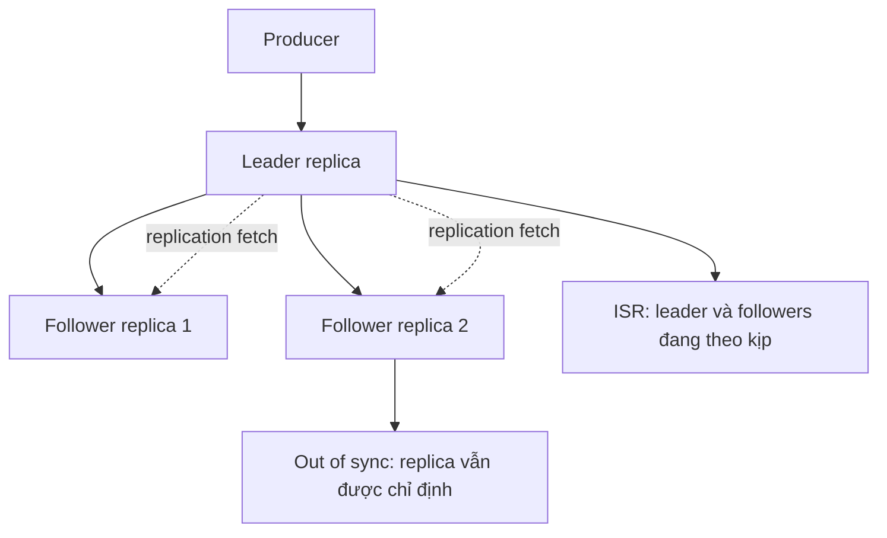
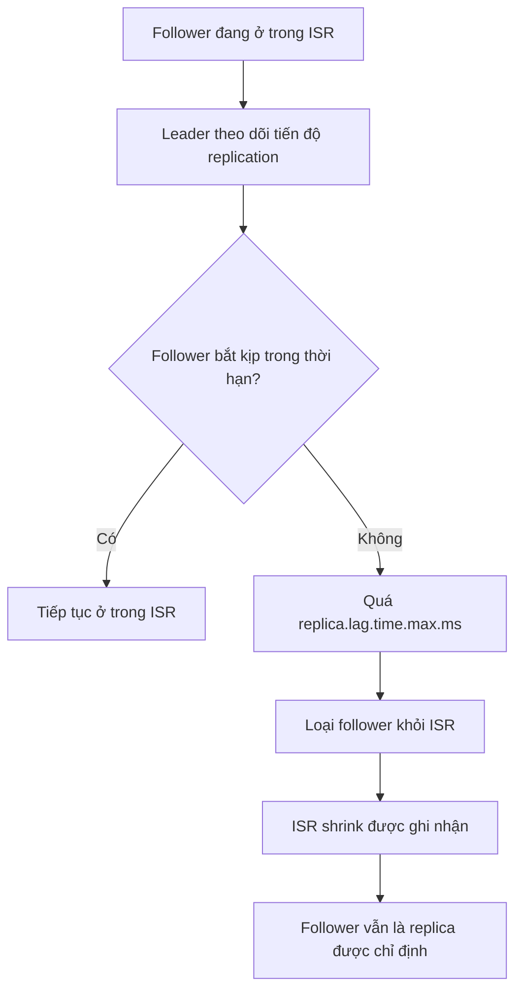
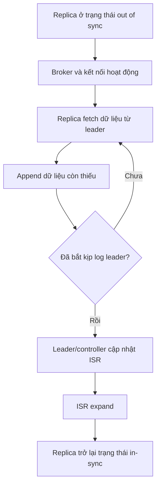

# In-sync replicas và điều kiện replica rời hoặc gia nhập ISR

Kafka lưu dữ liệu của mỗi partition trên nhiều replica để chịu được lỗi broker. Trong số các replica được cấu hình cho partition, chỉ những replica đang theo kịp leader mới thuộc tập **In-Sync Replicas (ISR)**. ISR là cơ sở để Kafka xác định bản ghi nào đã được nhân bản đủ mức, replica nào đủ điều kiện trở thành leader và một lần ghi với `acks=all` cần chờ những replica nào xác nhận.

Hiểu vòng đời ISR giúp người vận hành phân biệt replica bị chậm với replica bị mất, dự đoán khi nào producer bị từ chối ghi và xử lý đúng các sự cố mạng, đĩa hoặc broker. Trong hệ thống event streaming với Apache Kafka, ISR liên kết trực tiếp replication, high watermark, độ bền dữ liệu và tính sẵn sàng của partition.

## 1. Replica, leader, follower và ISR

Một topic được chia thành các partition. Mỗi partition có một danh sách replica được chỉ định (assigned replicas), thường được gọi là replication factor của partition. Tại một thời điểm bình thường:

- **Leader replica** nhận các request ghi từ producer và phục vụ các request đọc theo cơ chế của Kafka.
- **Follower replica** lấy dữ liệu từ leader bằng các fetch request dành cho replication, rồi append dữ liệu vào log cục bộ.
- **ISR** là tập các replica đang được xem là đồng bộ với leader. Leader thường là một thành viên của ISR; các follower chỉ ở trong ISR khi theo kịp leader theo tiêu chí Kafka.
- **Out-of-sync replica** vẫn thuộc danh sách replica được chỉ định, nhưng hiện không nằm trong ISR vì chưa theo kịp hoặc đã bị loại khỏi ISR.

Ví dụ topic `orders` có replication factor 3. Partition 0 có ba replica trên ba broker:

| Vai trò | Broker | Trạng thái |
| --- | --- | --- |
| Replica 0 | broker-1 | Leader, đang trong ISR |
| Replica 1 | broker-2 | Follower, đang trong ISR |
| Replica 2 | broker-3 | Follower, đang trong ISR |

Khi cả ba replica theo kịp leader, ISR là `[broker-1, broker-2, broker-3]`. Nếu broker-3 tạm thời không theo kịp và bị loại khỏi ISR, replication factor vẫn là 3, nhưng ISR chỉ còn broker-1 và broker-2. Replica trên broker-3 vẫn được chỉ định cho partition; nó có thể bắt kịp và gia nhập lại ISR sau đó.



Replication factor và ISR vì vậy là hai khái niệm khác nhau:

- Replication factor mô tả số replica được cấu hình cho partition.
- ISR mô tả những replica hiện đủ điều kiện được xem là đồng bộ.
- Số lượng ISR có thể thay đổi theo tình trạng broker, mạng, đĩa và tải hệ thống mà không làm thay đổi replication factor.

## 2. Follower theo kịp leader như thế nào?

Follower không nhận bản sao dữ liệu bằng cách producer gửi trực tiếp đến từng broker. Producer gửi record đến leader. Follower chủ động fetch dữ liệu từ leader, append vào log cục bộ và tiếp tục fetch phần dữ liệu mới.

Một luồng đơn giản:

1. Producer gửi record đến leader của partition.
2. Leader append record vào log và cập nhật log end offset (LEO).
3. Follower gửi fetch request, nhận dữ liệu mới và append vào log cục bộ.
4. Follower tiếp tục fetch để bắt kịp những record được ghi thêm trong lúc nó đang sao chép.
5. Leader theo dõi tiến độ của follower để xác định follower có còn đồng bộ hay không.

**Log end offset (LEO)** là vị trí cuối của log replica, biểu thị vị trí tiếp theo mà replica sẽ ghi. LEO của leader và follower có thể khác nhau trong lúc replication đang diễn ra. Khi follower chưa nhận hoặc chưa append một phần dữ liệu mới, LEO của nó thấp hơn LEO leader.

Kafka dùng tiến độ replication và thời gian để đánh giá follower. Không nên chỉ nhìn một snapshot offset gap rồi kết luận replica đã bị loại khỏi ISR: follower có thể đang fetch và bắt kịp. Ngược lại, follower có thể vẫn còn hoạt động nhưng không theo kịp leader đủ lâu để tiếp tục nằm trong ISR.

## 3. High watermark liên quan gì đến ISR?

**High watermark (HW)** là ranh giới của dữ liệu đã được replicate đủ theo trạng thái ISR hiện tại. Consumer thông thường chỉ đọc các record nằm trước ranh giới high watermark và không đọc vượt quá HW; nhờ vậy consumer không đọc một record mà Kafka vẫn có thể phải loại bỏ trong quá trình xử lý lỗi leader/follower.

Có thể hình dung:

- LEO cho biết log của một replica đã append đến đâu.
- HW cho biết ranh giới dữ liệu đã được xác nhận replicate theo ISR.
- Follower có thể có LEO thấp hơn leader khi đang sao chép.
- Khi follower bắt kịp và ISR thay đổi, cách Kafka tính tiến độ replication và HW tiếp tục được cập nhật.

Ví dụ leader đã append đến offset 120 nhưng một follower trong ISR mới append đến offset 115. Những offset mới nhất chưa được replicate đầy đủ sẽ chưa trở thành dữ liệu có thể đọc theo HW. Khi follower nhận và append phần còn thiếu, HW có thể tiến lên.

Offset trong các API và log thường được biểu diễn theo vị trí tiếp theo (exclusive boundary), vì vậy khi đối chiếu số offset cụ thể cần chú ý cách hiển thị của công cụ. Điều quan trọng là HW đại diện cho ranh giới replicate an toàn theo ISR, không đơn giản là LEO của leader.

## 4. Điều kiện replica rời khỏi ISR

Một follower có thể bị loại khỏi ISR khi không theo kịp leader trong khoảng thời gian được cấu hình. Tham số broker quan trọng là:

```properties
replica.lag.time.max.ms=30000
```

Giá trị ví dụ là 30 giây; giá trị thực tế phụ thuộc cấu hình và phiên bản triển khai. Tham số này quy định khoảng thời gian tối đa mà follower có thể không theo kịp leader trước khi leader xem nó là out of sync. Kafka đánh giá dựa trên tiến độ replication/catch-up theo thời gian, không chỉ dựa trên một ngưỡng offset gap tĩnh.

Một số tình huống có thể khiến follower không bắt kịp trong khoảng thời gian này:

- Broker follower bị dừng, restart hoặc mất kết nối.
- Mạng giữa leader và follower bị mất gói, nghẽn hoặc gián đoạn.
- Đĩa follower chậm, lỗi I/O hoặc không đủ dung lượng khiến append bị trễ.
- Broker follower chịu áp lực CPU, garbage collection hoặc thread scheduling.
- Replica fetcher không lấy dữ liệu đủ nhanh so với tốc độ producer ghi vào leader.
- Tải replication quá cao hoặc cấu hình fetch không phù hợp với kích thước batch và năng lực broker.

Khi leader xác định follower đã quá thời gian cho phép mà vẫn không bắt kịp, follower bị loại khỏi ISR. Việc loại khỏi ISR được ghi nhận qua cơ chế quản lý metadata/partition của Kafka và trạng thái mới được phổ biến đến các broker liên quan.



### Điều gì xảy ra sau khi follower rời ISR?

- Replication factor của partition không tự giảm.
- Replica bị loại không còn được tính là replica đồng bộ cho các quyết định ghi và bầu leader theo ISR.
- Nếu follower tiếp tục hoạt động, nó vẫn fetch dữ liệu để bắt kịp leader.
- Producer có thể tiếp tục ghi nếu ISR còn đáp ứng `min.insync.replicas` khi dùng `acks=all`.
- Nếu ISR giảm xuống dưới ngưỡng tối thiểu, Kafka từ chối các lần ghi yêu cầu `acks=all` để bảo vệ mức độ bền dữ liệu đã cấu hình.

ISR shrink không đồng nghĩa dữ liệu của follower đã bị xóa. Nó là thay đổi trạng thái đồng bộ. Khi follower bắt kịp, Kafka có thể đưa nó trở lại ISR.

## 5. Điều kiện replica gia nhập lại ISR

Một replica đã bị loại khỏi ISR có thể gia nhập lại khi nó hoạt động bình thường và bắt kịp log leader. Quá trình thường diễn ra như sau:

1. Broker follower khởi động hoặc khôi phục kết nối với leader.
2. Replica fetcher tiếp tục lấy dữ liệu từ vị trí log cục bộ của follower.
3. Follower append các record còn thiếu vào log của nó.
4. Follower bắt kịp ranh giới log của leader theo tiêu chí đồng bộ mà Kafka sử dụng.
5. Leader đề xuất thay đổi ISR; controller xác nhận/cập nhật trạng thái partition.
6. ISR mở rộng và các broker nhận trạng thái metadata mới.

Follower không được thêm lại chỉ vì broker đã khởi động hoặc socket kết nối đã mở. Nó phải bắt kịp dữ liệu. Nếu tốc độ ghi mới luôn cao hơn tốc độ follower có thể fetch và append, follower có thể không bao giờ bắt kịp để gia nhập lại.



Thời gian gia nhập lại phụ thuộc lượng dữ liệu còn thiếu, tốc độ replication, tốc độ ghi mới, năng lực đĩa/mạng và tải broker. Với follower bị chậm lâu, thời gian bắt kịp có thể dài hơn nhiều so với thời gian restart broker.

## 6. ISR shrink và expand ảnh hưởng thế nào đến producer?

Cấu hình producer `acks` xác định mức xác nhận mà producer chờ. Với `acks=all`, leader chờ các replica hiện thuộc ISR xác nhận ghi theo giao thức Kafka. Tuy nhiên, `acks=all` không có nghĩa mọi replica trong replication factor luôn phải hoạt động.

Cấu hình topic/broker `min.insync.replicas` đặt số ISR tối thiểu để chấp nhận ghi với `acks=all`.

Ví dụ topic có:

```properties
min.insync.replicas=2
```

Topic được tạo với replication factor 3; `min.insync.replicas=2` là cấu hình topic đặt ngưỡng ISR tối thiểu cho ghi `acks=all`.

| Trạng thái | ISR | Ghi với `acks=all` |
| --- | ---: | --- |
| Cả ba replica theo kịp | 3 | Được chấp nhận; leader chờ các replica hiện thuộc ISR. |
| Một follower rời ISR | 2 | Vẫn được chấp nhận vì ISR bằng ngưỡng tối thiểu. |
| Follower còn lại cũng rời ISR | 1 | Bị từ chối vì ISR thấp hơn `min.insync.replicas=2`. |
| Follower bắt kịp và gia nhập lại | 2 hoặc 3 | Ghi tiếp tục khi ISR đạt ngưỡng; khả năng chịu lỗi được cải thiện khi ISR mở rộng. |

Nếu số ISR thấp hơn `min.insync.replicas`, producer có thể nhận lỗi như `NotEnoughReplicas`. Nếu ISR thay đổi sau khi append nhưng trước khi đủ điều kiện xác nhận, producer cũng có thể gặp `NotEnoughReplicasAfterAppend`. Ứng dụng cần xử lý lỗi gửi và retry theo chính sách phù hợp; không nên giả định mọi lỗi này có nghĩa record chắc chắn chưa từng được append.

### Vì sao không luôn đặt min.insync.replicas bằng replication factor?

Nếu replication factor là 3 và `min.insync.replicas=3`, chỉ cần một follower tạm thời rời ISR là ghi `acks=all` bị từ chối. Mức bảo vệ cao hơn nhưng khả năng tiếp tục ghi khi một broker lỗi thấp hơn.

Với `min.insync.replicas=2`, hệ thống vẫn có thể ghi khi còn hai replica trong ISR, chấp nhận mất một replica khỏi ISR mà vẫn giữ ngưỡng đồng bộ tối thiểu. Nếu ISR còn một replica, ghi bị từ chối. Cấu hình nên dựa trên mục tiêu durability và availability của ứng dụng.

Điểm quan trọng: `min.insync.replicas` được áp dụng cho ghi với `acks=all`. Nếu producer dùng `acks=1`, producer chỉ chờ leader xác nhận và không nhận được cùng mức bảo vệ từ ngưỡng min ISR.

## 7. ISR và leader election

Khi leader broker gặp sự cố, Kafka cần chọn leader mới cho partition. Replica trong ISR là những ứng viên đủ điều kiện trong quá trình bầu leader thông thường, vì chúng được xem là đã theo kịp leader trước đó.

Nếu không còn replica nào trong ISR có thể làm leader, partition có thể chuyển sang trạng thái unavailable cho đến khi một replica hợp lệ hoạt động trở lại. Điều này ưu tiên tránh mất dữ liệu đã được xác nhận.

Cấu hình `unclean.leader.election.enable` cho phép Kafka cân nhắc replica ngoài ISR khi không có replica ISR khả dụng. Bật unclean leader election có thể tăng availability, nhưng replica được chọn có thể thiếu các record đã được leader cũ xác nhận; điều đó dẫn đến mất dữ liệu. Với dữ liệu quan trọng, cần hiểu rõ rủi ro và thường giữ unclean election tắt.

ISR không thay thế replication factor hoặc rack awareness. Để giảm rủi ro lỗi phần cứng hay rack, nên phân bố replica của cùng partition trên các broker và rack khác nhau nếu hạ tầng hỗ trợ. Khi leader/follower cùng nằm trên một failure domain, một sự cố vùng có thể làm nhiều replica cùng mất khả năng hoạt động.

## 8. ISR trong cụm KRaft

Ở các phiên bản Kafka dùng ZooKeeper, metadata ISR được quản lý thông qua ZooKeeper và controller cũ. Trong kiến trúc KRaft, controller quorum quản lý metadata cluster và ghi các thay đổi metadata vào metadata log.

Khi ISR của partition thay đổi, broker/controller phối hợp để cập nhật trạng thái partition. Metadata mới được lưu bền vững trong KRaft metadata log và phân phối đến các broker. Nhờ vậy, trạng thái ISR và leader assignment có thể được phục hồi, đồng bộ qua controller quorum mà không cần ZooKeeper.

Cần phân biệt hai luồng:

- Replica fetch là luồng dữ liệu giữa leader và follower, dùng để sao chép record.
- Cập nhật ISR là thay đổi metadata về những replica đang đồng bộ; controller quản lý và lưu trạng thái này.

KRaft không làm thay đổi ý nghĩa cốt lõi của ISR: follower vẫn phải bắt kịp leader mới đủ điều kiện gia nhập. KRaft thay đổi cách Kafka quản lý và lưu metadata cluster.

## 9. Quan sát ISR trong vận hành

Có thể xem leader, danh sách replica và ISR bằng lệnh:

```bash
kafka-topics.sh \
  --bootstrap-server localhost:9092 \
  --describe \
  --topic orders
```

Ví dụ kết quả minh họa:

```text
Topic: orders  Partition: 0  Leader: 1  Replicas: 1,2,3  Isr: 1,2
Topic: orders  Partition: 1  Leader: 2  Replicas: 2,3,1  Isr: 2,3,1
```

Partition 0 có replication factor 3 nhưng chỉ hai replica đang ở ISR. Partition 1 có đủ ba replica trong ISR. Kết quả này giúp xác định partition đang under-replicated và broker nào đang là leader.

Các metric thường hữu ích:

| Metric | Ý nghĩa |
| --- | --- |
| `UnderReplicatedPartitions` | Số partition có ISR nhỏ hơn replication factor. |
| `UnderMinIsrPartitionCount` | Số partition có ISR thấp hơn `min.insync.replicas`. |
| `IsrShrinksPerSec` | Tốc độ ISR bị thu hẹp. |
| `IsrExpandsPerSec` | Tốc độ ISR được mở rộng. |
| Replica fetcher metrics | Thông tin về fetch, byte/record replication và độ trễ sao chép. |
| Broker disk/network/CPU metrics | Giúp tìm nguyên nhân follower không theo kịp. |

Tên metric và cách export có thể khác giữa phiên bản Kafka hoặc hệ thống giám sát. Hãy đối chiếu với JMX metric của phiên bản đang chạy.

Một vài dấu hiệu cần điều tra:

- ISR shrink liên tục: follower thường xuyên không theo kịp, có thể do mạng, disk hoặc broker quá tải.
- ISR expand liên tục rồi shrink lại: follower đang dao động quanh ngưỡng catch-up; có thể cần xử lý bottleneck thay vì chỉ tăng timeout.
- Under-replicated partitions tăng: mức dự phòng dữ liệu đang giảm.
- Under-min-ISR partitions lớn hơn 0: producer dùng `acks=all` có thể bị từ chối ghi theo min ISR.
- Replica fetch lag kéo dài: follower không đủ năng lực sao chép so với tốc độ ghi hoặc gặp lỗi I/O.

## 10. Điều tra khi replica liên tục rời ISR

Thực hiện theo thứ tự để tránh thay đổi cấu hình không đúng nguyên nhân:

1. Xác định topic, partition, leader broker, follower broker và thời điểm ISR shrink.
2. Đọc log của cả leader và follower quanh thời điểm đó; tìm lỗi network, replica fetch, disk I/O, timeout, broker restart hoặc GC pause.
3. Kiểm tra tốc độ ghi vào partition và tốc độ replica fetch. Nếu leader nhận dữ liệu nhanh hơn follower có thể sao chép, follower có thể không bắt kịp.
4. Kiểm tra disk latency, dung lượng đĩa, network throughput, CPU và số thread replication.
5. Kiểm tra cấu hình `replica.lag.time.max.ms`, kích thước fetch và giới hạn request/message. Không tăng timeout chỉ để che giấu follower liên tục bị nghẽn.
6. Xác minh follower có bắt kịp sau khi nguyên nhân được khắc phục; theo dõi ISR expand và under-replicated partitions.
7. Kiểm tra producer errors, consumer lag và khả năng đọc dữ liệu sau khi ISR ổn định.

Nếu follower rời ISR do broker tạm dừng trong một khoảng ngắn, việc tăng `replica.lag.time.max.ms` có thể giảm các lần shrink/expand không cần thiết. Nhưng timeout lớn cũng khiến Kafka mất nhiều thời gian hơn để loại replica thực sự bị lỗi khỏi ISR. Chỉ điều chỉnh sau khi đo được thời gian gián đoạn và hiểu tác động đến failure detection.

Nếu follower luôn chậm do đĩa hoặc mạng, tăng timeout không làm tăng throughput replication. Cần sửa bottleneck, kiểm tra cấu hình fetcher và năng lực phần cứng. Khi replica phải bắt kịp lượng dữ liệu lớn, theo dõi disk/network để tránh việc recovery gây thêm áp lực cho cluster.

## 11. Ví dụ cấu hình độ bền dữ liệu với Spring Kafka

Ở phía producer, có thể cấu hình `acks=all` và idempotence để yêu cầu xác nhận từ ISR và giảm bản ghi trùng do retry theo cơ chế producer:

```yaml
spring:
  kafka:
    producer:
      acks: all
      properties:
        "enable.idempotence": true
        "delivery.timeout.ms": 120000
```

Ở phía topic, đặt `min.insync.replicas` theo yêu cầu durability. Ví dụ với replication factor 3 và min ISR 2:

```bash
kafka-configs.sh \
  --bootstrap-server localhost:9092 \
  --entity-type topics \
  --entity-name orders \
  --alter \
  --add-config min.insync.replicas=2
```

Đây là ví dụ thao tác trên topic thử nghiệm; khi áp dụng cho production, cần đánh giá replication factor, rack placement, chính sách leader election và khả năng chấp nhận lỗi ghi khi ISR giảm. Giá trị cấu hình topic có thể được quản lý qua IaC hoặc quy trình provisioning của tổ chức.

Idempotence và ISR giải quyết hai vấn đề khác nhau:

- ISR và `acks=all` giúp xác định số replica cần xác nhận cho một lần ghi.
- Producer idempotence giúp broker nhận diện retry của cùng producer để tránh ghi trùng trong phạm vi giao thức.
- Cả hai không thay thế idempotency nghiệp vụ ở consumer khi xử lý side effect ngoài Kafka.

Nếu producer nhận `NotEnoughReplicas`, ứng dụng cần ghi nhận lỗi, retry có backoff phù hợp và không bỏ qua sự kiện. Nếu điều kiện ISR chưa được khôi phục, retry liên tục với tần suất cao chỉ làm tăng tải; nên kết hợp retry có giới hạn, quan sát trạng thái cụm và xử lý lỗi cuối cùng theo chính sách nghiệp vụ.

## 12. Bài thực hành: quan sát ISR shrink và expand

Thực hiện trên cluster Kafka thử nghiệm có ít nhất ba broker. Tạo topic `replication-lab` với một partition, replication factor 3 và `min.insync.replicas=2`.

### Chuẩn bị

```bash
kafka-topics.sh \
  --bootstrap-server localhost:9092 \
  --create \
  --topic replication-lab \
  --partitions 1 \
  --replication-factor 3 \
  --config min.insync.replicas=2
```

Ghi nhận leader, replicas và ISR ban đầu:

```bash
kafka-topics.sh \
  --bootstrap-server localhost:9092 \
  --describe \
  --topic replication-lab
```

### Thử nghiệm follower rời ISR

1. Gửi một luồng record liên tục vào topic.
2. Quan sát ISR và metric `IsrShrinksPerSec`.
3. Trên môi trường lab, tạm dừng broker follower (không dừng leader) hoặc cô lập kết nối replication theo cách kiểm soát được.
4. Chờ vượt quá ngưỡng `replica.lag.time.max.ms`, rồi mô tả topic lại.
5. Xác nhận replication factor vẫn là 3 nhưng ISR đã giảm còn hai replica.
6. Tiếp tục ghi với producer `acks=all`; vì ISR vẫn bằng min ISR 2, ghi có thể tiếp tục.

### Thử nghiệm ISR thấp hơn min ISR

1. Khi ISR còn hai replica, tiếp tục làm một follower còn lại không theo kịp trong môi trường lab.
2. Xác nhận ISR giảm xuống một.
3. Gửi record với `acks=all`; quan sát lỗi `NotEnoughReplicas` hoặc lỗi liên quan đến ISR.
4. Khôi phục follower và theo dõi quá trình fetch/catch-up.
5. Xác nhận ISR expand trở lại khi follower bắt kịp.

Không thực hiện việc dừng broker hoặc cô lập mạng trên cluster production. Nếu thử nghiệm bằng cách dừng tiến trình, cần chắc chắn broker được khởi động lại sau khi hoàn thành và cluster đã ổn định.

### Bảng ghi nhận kết quả

| Thời điểm | Leader | Replicas | ISR | Producer `acks=all` | Ghi chú |
| --- | --- | --- | --- | --- | --- |
| Ban đầu | — | 3 | 3 | Thành công | Tất cả replica theo kịp |
| Một follower dừng | — | 3 | 2 | Thành công nếu min ISR = 2 | ISR shrink |
| Hai follower không đồng bộ | — | 3 | 1 | Bị từ chối với min ISR = 2 | Dưới ngưỡng |
| Follower bắt kịp | — | 3 | 2 hoặc 3 | Thành công khi đạt min ISR | ISR expand |

## 13. Những điểm cần nhớ

- ISR là tập replica đang theo kịp leader; replication factor là số replica được cấu hình cho partition.
- Follower rời ISR khi không bắt kịp leader trong khoảng thời gian cho phép, thường liên quan đến `replica.lag.time.max.ms`.
- Follower gia nhập lại ISR sau khi fetch và append đủ dữ liệu để bắt kịp leader; chỉ khởi động broker chưa đủ.
- ISR shrink làm giảm mức dự phòng và có thể khiến producer bị từ chối nếu ISR thấp hơn `min.insync.replicas` khi dùng `acks=all`.
- `acks=all` chờ các replica trong ISR hiện tại, không nhất thiết chờ mọi replica được chỉ định trong replication factor.
- High watermark phản ánh ranh giới dữ liệu đã replicate theo ISR; consumer thông thường không đọc vượt ranh giới này.
- Trong KRaft, controller quorum quản lý và lưu thay đổi ISR trong metadata log; replica fetch vẫn là luồng sao chép dữ liệu giữa broker.
- Theo dõi ISR shrink/expand, under-replicated partitions, under-min-ISR và replica fetch để phát hiện follower mất đồng bộ sớm.

ISR là cơ chế giúp Kafka cân bằng giữa độ bền dữ liệu và khả năng tiếp tục phục vụ khi một số replica gặp sự cố. Khi hiểu điều kiện rời và gia nhập ISR, người vận hành có thể giải thích chính xác vì sao một partition vẫn nhận ghi khi mất một follower, vì sao producer bị từ chối khi ISR xuống thấp và cần khôi phục replica như thế nào để cụm trở lại trạng thái an toàn.

