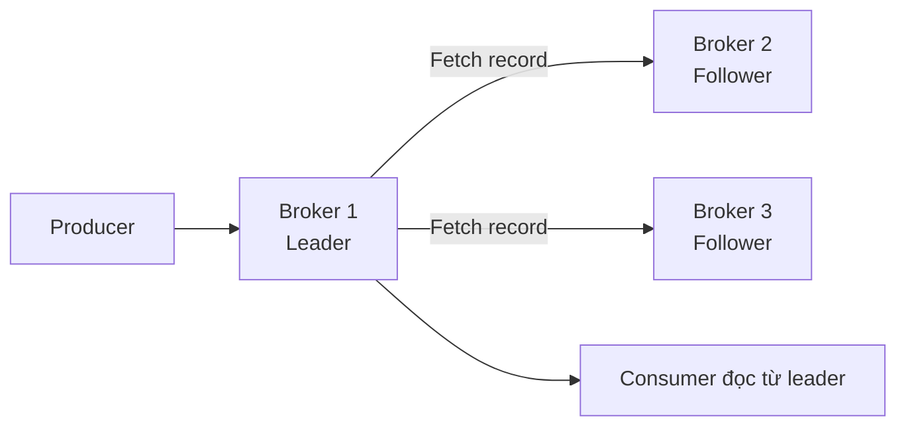

# Quan hệ giữa acks, min.insync.replicas và độ bền dữ liệu

## Mục tiêu

Kafka nhân bản partition để một broker gặp sự cố không nhất thiết làm mất dữ liệu hoặc dừng toàn bộ luồng xử lý. Tuy nhiên, replication factor lớn chưa đủ để xác định một record được xác nhận an toàn đến mức nào. Producer chọn `acks`, topic/broker đặt `min.insync.replicas`, còn trạng thái ISR cho biết những replica nào đang theo kịp leader. Ba yếu tố này phối hợp để quyết định một lần ghi có được chấp nhận hay không và cần bao nhiêu replica xác nhận.

Sau bài học này, bạn có thể:

- Phân biệt replication factor, replica leader, follower và ISR.
- Giải thích chính xác `acks=0`, `acks=1` và `acks=all`.
- Hiểu `min.insync.replicas` là ngưỡng tối thiểu của ISR đối với ghi `acks=all`.
- Dự đoán kết quả ghi khi ISR giảm hoặc leader thay đổi.
- Phân biệt xác nhận replication với việc flush dữ liệu xuống thiết bị lưu trữ.
- Cấu hình producer Java/Spring Kafka và topic để cân bằng durability với availability.
- Kiểm chứng hành vi bằng Kafka CLI và mô phỏng broker failure.

## 1. Replication và ISR

Một partition có thể có nhiều replica nằm trên các broker khác nhau. Một replica giữ vai trò leader; các replica còn lại là follower. Producer gửi record tới leader. Follower chủ động fetch dữ liệu từ leader và nối record vào log cục bộ của mình.

Ví dụ topic `orders` có replication factor bằng ba. Partition `orders-0` có ba replica trên broker 1, 2 và 3:



Replication factor (RF) là số replica được gán cho partition. RF bằng ba nghĩa là Kafka dự kiến duy trì ba bản sao theo assignment. Nó không có nghĩa cả ba replica luôn online hoặc luôn đồng bộ.

**ISR (in-sync replicas)** là tập replica đang được Kafka xem là theo kịp leader và đủ điều kiện tham gia bầu leader an toàn theo trạng thái replication hiện tại. ISR thường bao gồm leader và những follower đáp ứng điều kiện đồng bộ. Khi follower chậm quá ngưỡng cấu hình hoặc broker mất kết nối, follower có thể bị loại khỏi ISR. Khi follower bắt kịp lại, nó có thể được thêm trở lại ISR.

| Thuật ngữ | Ý nghĩa |
|---|---|
| Replication factor | Số replica được gán cho partition |
| Leader | Replica nhận request đọc/ghi của partition |
| Follower | Replica fetch record từ leader để duy trì bản sao |
| ISR | Các replica hiện được xem là đồng bộ với leader |
| LEO (Log End Offset) | Vị trí cuối log của một replica; LEO giữa leader và follower có thể khác nhau |
| High watermark (HW) | Ranh giới record đã được replicate tới các ISR cần thiết; consumer thông thường chỉ đọc record dưới HW |

Giả sử partition có RF=3. Khi mọi broker đồng bộ, `Replicas` và `Isr` có thể cùng gồm broker 1, 2, 3. Nếu broker 3 chậm và bị loại khỏi ISR, `Replicas` vẫn là 1, 2, 3 nhưng `Isr` chỉ còn 1, 2. Dữ liệu được gán cho broker 3 vẫn có thể còn trên đĩa; nó chỉ không còn được tính là replica đồng bộ cho quyết định ghi và bầu leader.

## 2. Producer `acks` quyết định điều gì?

`acks` là cấu hình producer chỉ định mức xác nhận mà producer chờ từ Kafka cho mỗi produce request. Ba giá trị thường gặp là `0`, `1` và `all` (tương đương `-1`).

| Giá trị | Broker xác nhận khi nào? | Đặc điểm |
|---|---|---|
| `acks=0` | Producer không chờ phản hồi xác nhận từ broker | Độ trễ thấp, nhưng producer không biết broker đã nhận hoặc ghi record hay chưa |
| `acks=1` | Leader đã append record vào log cục bộ | Không chờ follower xác nhận; record có thể mất nếu leader hỏng trước khi follower nhận được record |
| `acks=all` hoặc `acks=-1` | Tất cả replica hiện thuộc ISR đã xác nhận append record | Mức xác nhận replication mạnh nhất trong Kafka; kết hợp với `min.insync.replicas` để đặt ngưỡng ISR tối thiểu |

### 2.1. `acks=0`

Producer gửi request và tiếp tục mà không chờ broker trả kết quả. Producer không thể biết request bị từ chối, broker mất kết nối hay record đã được append. Cấu hình này chỉ phù hợp với dữ liệu mà ứng dụng chấp nhận mất và ưu tiên throughput/latency hơn độ tin cậy.

Không nên dùng `acks=0` cho đơn hàng, thanh toán, tồn kho, sự kiện nghiệp vụ quan trọng hoặc dữ liệu cần đối soát.

### 2.2. `acks=1`

Leader append record vào log cục bộ rồi gửi acknowledgement cho producer. Follower có thể fetch record sau đó. Nếu leader dừng ngay sau khi gửi acknowledgement nhưng trước khi follower nhận được record, leader mới được bầu có thể không chứa record vừa được xác nhận.

Vì vậy `acks=1` có độ bền tốt hơn `acks=0`, nhưng vẫn có cửa sổ mất dữ liệu khi leader gặp sự cố trước replication.

### 2.3. `acks=all`

Leader chỉ trả acknowledgement sau khi tất cả replica hiện thuộc ISR xác nhận append record. Đây là mức xác nhận replication mạnh nhất của producer Kafka. Tuy nhiên, `all` có nghĩa là tất cả replica trong ISR hiện tại, không phải tất cả replica được gán trong replication factor và cũng không có nghĩa phải chờ mọi broker trong cluster.

Ví dụ RF=3:

- ISR có broker 1, 2, 3: `acks=all` chờ cả ba replica trong ISR xác nhận.
- Broker 3 bị loại khỏi ISR, ISR còn broker 1, 2: `acks=all` chờ hai replica còn trong ISR.
- ISR chỉ còn broker 1: `acks=all` về mặt replication sẽ chỉ có leader trong ISR; `min.insync.replicas` quyết định có cho phép ghi ở trạng thái này hay không.

Điểm quan trọng: `acks=all` tự nó không quy định phải có ít nhất hai hoặc ba replica. Ngưỡng tối thiểu đó thuộc về `min.insync.replicas`.

## 3. `min.insync.replicas` là ngưỡng tối thiểu của ISR

`min.insync.replicas` (min ISR) quy định số replica tối thiểu phải có trong ISR để broker chấp nhận một produce request dùng `acks=all`. Giá trị này có thể được đặt ở cấu hình topic; nếu topic không override thì broker dùng giá trị mặc định `min.insync.replicas`.

Ví dụ:

```properties
# Cấu hình broker mặc định cho topic không có override
min.insync.replicas=2
```

Hoặc đặt riêng cho topic `orders`:

```text
min.insync.replicas=2
```

Khi producer dùng `acks=all`:

- Nếu `ISR size >= min.insync.replicas`, broker có thể nhận ghi và chờ tất cả ISR xác nhận.
- Nếu `ISR size < min.insync.replicas`, broker từ chối ghi vì không còn đủ replica đồng bộ theo chính sách.

Min ISR là ngưỡng admission, không phải số lượng replica mà leader chỉ cần chờ. Với RF=3, min ISR=2 và ISR hiện có ba replica, `acks=all` vẫn chờ cả ba. Nếu ISR giảm còn hai, nó chờ cả hai. Min ISR chỉ bảo đảm ISR không được nhỏ hơn hai tại thời điểm broker chấp nhận ghi.

`min.insync.replicas` chỉ áp dụng cho produce request có `acks=all` (`-1`). Producer dùng `acks=1` vẫn có thể được leader xác nhận ngay cả khi ISR nhỏ hơn min ISR. Vì vậy, đặt min ISR bằng hai nhưng để producer dùng `acks=1` không tạo ra chính sách durability mong muốn.

## 4. Kết hợp RF, ISR, acks và min ISR

Giả sử topic `orders` có RF=3 và `min.insync.replicas=2`.

| Trạng thái partition | ISR size | Producer `acks=all` | Producer `acks=1` |
|---|---:|---|---|
| Ba replica đều đồng bộ | 3 | Ghi được; chờ cả ba ISR xác nhận | Ghi được sau khi leader append |
| Một follower mất kết nối, leader và follower còn lại vẫn trong ISR | 2 | Ghi được; chờ hai ISR xác nhận | Ghi được sau khi leader append |
| Hai follower không còn trong ISR, leader là replica duy nhất | 1 | Bị từ chối vì ISR nhỏ hơn 2 | Có thể được leader xác nhận; rủi ro mất record cao |
| Leader dừng khi ISR trước sự cố là 3 | Sau bầu leader có thể còn 2 | Có thể ghi tiếp khi leader mới có đủ hai ISR | Có thể ghi khi leader mới sẵn sàng |
| Leader dừng sau khi ISR đã giảm còn 2 | Sau bầu leader có thể chỉ còn 1 | Tạm thời bị từ chối cho tới khi ISR trở lại ít nhất 2 | Có thể ghi nếu leader mới hoạt động |

Bảng này giả định follower còn lại đủ điều kiện được bầu làm leader và cluster không gặp thêm sự cố. Kết quả thực tế còn phụ thuộc ISR ngay trước thời điểm lỗi, replica assignment, controller/metadata state và chính sách leader election.

### 4.1. Min ISR bằng hai với RF bằng ba

Đây là cấu hình phổ biến khi muốn cân bằng durability và khả năng tiếp tục ghi:

- Khi cả ba replica đồng bộ, `acks=all` chờ cả ba.
- Khi một follower rời ISR nhưng leader và follower còn lại vẫn hoạt động, ghi tiếp tục với hai ISR.
- Khi ISR giảm xuống một, ghi `acks=all` bị từ chối. Kafka buộc producer chờ replica phục hồi thay vì xác nhận record chỉ tồn tại trên một replica.

Lưu ý tình huống leader failure: nếu ban đầu ISR có ba replica, sau khi leader dừng, hai follower còn lại có thể bầu một leader mới và vẫn có ISR size hai. Nhưng nếu trước đó một follower đã rời ISR, leader dừng tiếp thì có thể chỉ còn một replica trong ISR; ghi `acks=all` phải chờ replica thứ hai bắt kịp.

### 4.2. Min ISR bằng ba với RF bằng ba

Với min ISR bằng ba, mọi produce request dùng `acks=all` cần cả ba replica trong ISR. Khi một replica rời ISR, ghi bị từ chối dù hai replica còn lại vẫn có thể phục vụ đọc và bầu leader. Cấu hình này ưu tiên yêu cầu có ba bản sao đồng bộ trước khi xác nhận ghi, nhưng giảm khả năng ghi khi có sự cố đơn lẻ hoặc bảo trì broker.

### 4.3. Min ISR bằng một

Min ISR bằng một cho phép `acks=all` tiếp tục ghi khi chỉ còn leader trong ISR. Producer vẫn chờ tất cả replica hiện thuộc ISR, nhưng lúc đó ISR chỉ có một node. Record có thể chỉ tồn tại trên leader và dễ mất nếu broker đó hỏng trước khi follower phục hồi.

Đặt RF=3 không tự bảo đảm có ba bản sao cho mỗi record. Cần theo dõi ISR và chọn min ISR phù hợp với yêu cầu nghiệp vụ.

## 5. Độ bền dữ liệu và giới hạn của acknowledgement

`acks=all` cùng min ISR tạo ra một chính sách replication, nhưng không đồng nghĩa mỗi acknowledgement đều chờ thao tác `fsync` đồng bộ trên tất cả ổ đĩa.

Kafka ghi record vào partition log thông qua cơ chế I/O và page cache của hệ điều hành. Follower fetch và append record vào log của nó. Broker có thể flush dữ liệu xuống thiết bị lưu trữ theo lịch và cấu hình flush; Kafka dựa nhiều vào replication để bảo vệ dữ liệu thay vì ép flush đồng bộ từng record trước mỗi acknowledgement. Do đó:

- `acks=all` xác nhận replica trong ISR đã append record theo giao thức replication.
- Nó không phải cam kết rằng mọi bản sao đã được fsync xuống thiết bị vật lý trước khi response trả về.
- Hỏng đồng thời nhiều broker/ổ đĩa, mất điện diện rộng, lỗi storage hoặc lỗi vận hành có thể vượt quá mô hình chịu lỗi của RF/min ISR.
- Replication trên các broker cùng một rack hoặc cùng một failure domain không bảo vệ tốt trước sự cố toàn rack/zone.

Để tăng khả năng chịu lỗi, hãy phân bố replica qua các rack/failure domain bằng cấu hình rack-aware như `broker.rack`, theo dõi ISR, bảo đảm storage và network khỏe mạnh, và có backup/replication liên cluster khi yêu cầu nghiệp vụ cần thêm lớp bảo vệ.

### 5.1. Unclean leader election

Nếu không còn replica nào trong ISR có thể làm leader, Kafka phải lựa chọn giữa availability và durability. Khi cho phép unclean leader election, một replica ngoài ISR có thể được chọn làm leader để partition hoạt động trở lại, nhưng replica đó có thể thiếu các record đã được xác nhận trước đó. Việc bầu leader như vậy có thể làm mất dữ liệu hoặc làm log bị truncate theo trạng thái replica mới.

Nếu ưu tiên durability, cấu hình `unclean.leader.election.enable=false` để Kafka không bầu replica ngoài ISR làm leader. Partition có thể tạm thời unavailable cho tới khi một replica đủ điều kiện phục hồi. Nếu bật unclean election, availability có thể tăng nhưng chấp nhận nguy cơ mất record. Hãy chọn theo yêu cầu nghiệp vụ và phiên bản Kafka đang vận hành.

### 5.2. Producer timeout và kết quả ghi không xác định

Một producer có thể timeout khi leader đã append record nhưng chưa gửi được acknowledgement về client. Client không thể kết luận chắc chắn record chưa được ghi. Nếu retry, record có thể được gửi lại.

Với producer idempotent, Kafka dùng producer ID, epoch và sequence để nhận diện retry trong phạm vi producer session và tránh duplicate do retry protocol. Idempotence không thay thế event ID ở tầng nghiệp vụ và không tự chống việc ứng dụng tạo lại cùng một sự kiện ở hai lần xử lý khác nhau.

Nên bật idempotence khi cần độ tin cậy của producer:

```properties
acks=all
enable.idempotence=true
retries=2147483647
max.in.flight.requests.per.connection=5
```

Ở Kafka client hiện đại, idempotence thường được bật mặc định nếu không có cấu hình xung đột; khai báo tường minh trong cấu hình ứng dụng giúp ý định rõ ràng hơn. Các giá trị tương thích cần tuân theo phiên bản client đang dùng. Không giảm retry hoặc thay đổi max in-flight tùy tiện nếu chưa hiểu tác động tới thứ tự và idempotence.

## 6. Chọn cấu hình theo yêu cầu nghiệp vụ

Không có một cấu hình duy nhất phù hợp với mọi topic. Hãy xác định mức độ chấp nhận mất dữ liệu, thời gian gián đoạn có thể chấp nhận và khả năng chịu lỗi của cluster.

| Loại dữ liệu | RF gợi ý | `min.insync.replicas` gợi ý | Producer `acks` | Nhận xét |
|---|---:|---:|---|---|
| Log telemetry có thể mất một phần | 2 hoặc 3 | 1 hoặc 2 | 1 hoặc all | Ưu tiên throughput; chấp nhận rủi ro đã được định lượng |
| Sự kiện nghiệp vụ quan trọng | 3 | 2 | all | Tiếp tục ghi khi còn ít nhất hai ISR; không xác nhận khi chỉ còn một |
| Ledger/thanh toán cần chính sách chặt | 3 hoặc theo failure-domain design | 3 hoặc 2 tùy SLA | all | Min ISR cao tăng độ bền nhưng giảm khả năng ghi khi replica lỗi; cần thiết kế DR và idempotency |
| Local development một broker | 1 | 1 | all | Chỉ kiểm tra luồng ứng dụng, không đại diện durability production |

Các RF/min ISR trong bảng là điểm khởi đầu để thảo luận, không phải chuẩn bắt buộc. Với dữ liệu thanh toán, durability Kafka không thay thế transaction database, đối soát, outbox, idempotency ở consumer và kế hoạch disaster recovery.

### Một vài cấu hình cần tránh

- RF=3 nhưng producer dùng `acks=1`: producer không chờ replication; RF cao không phát huy đầy đủ lợi ích đối với acknowledgement.
- `acks=all` nhưng min ISR=1: vẫn có thể xác nhận khi chỉ còn một replica trong ISR.
- min ISR lớn hơn khả năng duy trì ISR bình thường: ghi sẽ bị từ chối thường xuyên, gây gián đoạn ngoài dự kiến.
- RF=1 cho dữ liệu production quan trọng: không có follower để tiếp quản khi broker chứa leader gặp sự cố.
- Bật unclean leader election mà không chấp nhận rõ rủi ro mất dữ liệu: có thể khôi phục availability bằng replica thiếu record.

## 7. Cấu hình topic và producer bằng Kafka CLI

Phần thực hành cần cluster có ít nhất ba broker đang hoạt động. Ví dụ sử dụng bootstrap server `localhost:9092`; thay bằng địa chỉ của cluster lab. Lệnh tạo topic với RF=3 và min ISR=2:

```bash
bin/kafka-topics.sh --bootstrap-server localhost:9092 \
  --create --if-not-exists \
  --topic orders \
  --partitions 6 \
  --replication-factor 3 \
  --config min.insync.replicas=2
```

Kiểm tra leader, replica và ISR:

```bash
bin/kafka-topics.sh --bootstrap-server localhost:9092 \
  --describe --topic orders
```

Ví dụ một dòng output:

```text
Topic: orders  Partition: 0  Leader: 1  Replicas: 1,2,3  Isr: 1,2,3
```

Trong ví dụ này, partition 0 có leader broker 1, ba replica được gán trên broker 1/2/3 và cả ba đang ở ISR.

Xem cấu hình topic:

```bash
bin/kafka-configs.sh --bootstrap-server localhost:9092 \
  --entity-type topics --entity-name orders --describe
```

Thay min ISR khi cần thử nghiệm:

```bash
bin/kafka-configs.sh --bootstrap-server localhost:9092 \
  --entity-type topics --entity-name orders --alter \
  --add-config min.insync.replicas=3
```

Sau khi kiểm tra, có thể đặt lại thành hai:

```bash
bin/kafka-configs.sh --bootstrap-server localhost:9092 \
  --entity-type topics --entity-name orders --alter \
  --add-config min.insync.replicas=2
```

Gửi record với `acks=all`:

```bash
bin/kafka-console-producer.sh --bootstrap-server localhost:9092 \
  --topic orders --producer-property acks=all \
  --producer-property enable.idempotence=true
```

Gõ một vài record, ví dụ `order-1001 created`, rồi nhấn `Ctrl+C` để đóng producer. Có thể thử `acks=1` trong một cửa sổ khác để so sánh hành vi khi ISR giảm:

```bash
bin/kafka-console-producer.sh --bootstrap-server localhost:9092 \
  --topic orders --producer-property acks=1
```

## 8. Mô phỏng ISR giảm và quan sát lỗi ghi

Thực hiện trong cluster lab có ba broker và topic `orders` RF=3, min ISR=2. Không chạy thử nghiệm này trên topic production.

### 8.1. Trạng thái bình thường

Chạy `kafka-topics.sh --describe --topic orders` và xác nhận mỗi partition có ISR đủ ba broker. Gửi record bằng producer `acks=all`; ghi nhận kết quả thành công.

### 8.2. Dừng một follower

Chọn một partition và xác định broker leader cùng các follower trong output `--describe`. Dừng một broker đang giữ follower của partition đó, không dừng leader. Ví dụ nếu broker 3 là follower:

```bash
docker compose stop broker-3
```

Chạy lại `--describe`. Khi follower bị loại khỏi ISR, partition có thể hiển thị `Replicas: 1,2,3` nhưng `Isr: 1,2`. Gửi record với `acks=all`: request vẫn được chấp nhận vì ISR size bằng min ISR là hai và producer chờ cả hai replica còn trong ISR.

Khởi động lại follower:

```bash
docker compose start broker-3
```

Chờ follower bắt kịp và trở lại ISR trước khi sang bước tiếp theo. Container running không đồng nghĩa replica đã đồng bộ.

### 8.3. Để ISR thấp hơn min ISR

Sau khi cluster đã ổn định, dừng hai follower của partition thử nghiệm trong khi giữ leader hoạt động. Khi ISR chỉ còn leader, thử ghi bằng producer `acks=all`. Broker sẽ từ chối request do ISR size nhỏ hơn hai. Producer có thể báo lỗi như `NotEnoughReplicasException`; nếu ISR giảm trong lúc record đã được append và đang chờ xác nhận, có thể gặp lỗi `NotEnoughReplicasAfterAppendException`.

Trong cùng trạng thái thử nghiệm, producer dùng `acks=1` có thể vẫn nhận acknowledgement từ leader. Đây là minh họa cho việc min ISR không bảo vệ request `acks=1`.

Khởi động lại các follower và đợi ISR trở về đủ ba:

```bash
docker compose start broker-2 broker-3
```

### 8.4. So sánh min ISR bằng ba

Khi cả ba replica đã đồng bộ, thay cấu hình topic thành `min.insync.replicas=3`. Dừng một follower trong khi leader vẫn hoạt động. Lúc này ISR size là hai, thấp hơn min ISR bằng ba nên ghi `acks=all` bị từ chối. Khởi động lại follower, chờ ISR đủ ba và kiểm tra ghi hoạt động trở lại.

### 8.5. Bài học từ thử nghiệm

Ghi lại kết quả theo bảng:

| RF | Min ISR | ISR hiện tại | `acks=all` | `acks=1` |
|---:|---:|---:|---|---|
| 3 | 2 | 3 | Thành công, chờ 3 ISR | Thành công sau leader append |
| 3 | 2 | 2 | Thành công, chờ 2 ISR | Thành công sau leader append |
| 3 | 2 | 1 | Bị từ chối | Có thể thành công nếu leader còn hoạt động |
| 3 | 3 | 2 | Bị từ chối | Có thể thành công nếu leader còn hoạt động |

Kết quả chỉ đúng khi partition leader còn hoạt động và broker failure đúng với trạng thái được mô tả. Nếu dừng leader, Kafka cần bầu leader mới; kết quả phụ thuộc số replica còn trong ISR và thời gian failover.

## 9. Cấu hình Java và Spring Kafka

Với Kafka Java client, có thể cấu hình producer như sau:

```java
Properties props = new Properties();
props.put(ProducerConfig.BOOTSTRAP_SERVERS_CONFIG,
        "localhost:9092,localhost:9093,localhost:9094");
props.put(ProducerConfig.KEY_SERIALIZER_CLASS_CONFIG,
        StringSerializer.class.getName());
props.put(ProducerConfig.VALUE_SERIALIZER_CLASS_CONFIG,
        StringSerializer.class.getName());

props.put(ProducerConfig.ACKS_CONFIG, "all");
props.put(ProducerConfig.ENABLE_IDEMPOTENCE_CONFIG, true);
props.put(ProducerConfig.RETRIES_CONFIG, Integer.MAX_VALUE);
props.put(ProducerConfig.MAX_IN_FLIGHT_REQUESTS_PER_CONNECTION, 5);
```

Producer idempotent giúp xử lý retry ở tầng Kafka protocol. Ứng dụng vẫn nên tạo event ID ổn định, ghi log correlation ID và xử lý kết quả timeout theo hướng có thể kiểm tra/deduplicate ở consumer.

Với Spring Boot, cấu hình tương đương có thể khai báo trong `application.yml`:

```yaml
spring:
  kafka:
    bootstrap-servers: localhost:9092,localhost:9093,localhost:9094
    producer:
      acks: all
      properties:
        enable.idempotence: true
        max.in.flight.requests.per.connection: 5
```

Topic cần có cấu hình min ISR riêng hoặc nhận giá trị mặc định từ broker. Spring producer config không tự đặt `min.insync.replicas` cho topic. Hãy quản lý cấu hình topic qua Admin API, provisioning script hoặc công cụ quản trị cluster.

## 10. Theo dõi durability trong vận hành

Theo dõi `acks` và min ISR trong cấu hình là chưa đủ. Cần quan sát trạng thái thực tế của replica và lỗi produce.

| Chỉ số/trạng thái | Ý nghĩa vận hành |
|---|---|
| ISR count theo partition | Số replica hiện đủ điều kiện đồng bộ |
| Under-replicated partitions | Partition có replica chưa theo kịp hoặc không sẵn sàng |
| Offline partitions | Partition không có leader hoạt động |
| Produce request latency | Độ trễ có thể tăng khi leader phải chờ follower chậm xác nhận `acks=all` |
| Produce error rate | Có thể tăng khi ISR nhỏ hơn min ISR hoặc broker không sẵn sàng |
| `NotEnoughReplicas` errors | Broker từ chối ghi vì ISR không đạt ngưỡng |
| `NotEnoughReplicasAfterAppend` errors | ISR không còn đủ trong lúc request đang chờ acknowledgement sau append |
| Leader election/unclean election | Cho biết thay đổi leader và nguy cơ chọn replica thiếu dữ liệu |

Khi thấy produce latency tăng, hãy kiểm tra follower lag, disk I/O, network giữa broker, request queue và trạng thái ISR. Tăng timeout producer không làm replica đồng bộ nhanh hơn; nó chỉ thay đổi thời gian client chờ trước khi kết luận request thất bại.

## 11. Các lỗi thiết kế thường gặp

| Sai lầm | Hậu quả | Cách khắc phục |
|---|---|---|
| Nghĩ RF=3 đồng nghĩa mọi lần ghi có ba bản sao | Follower có thể nằm ngoài ISR hoặc chưa bắt kịp | Theo dõi ISR và kết hợp min ISR với `acks=all` |
| Nghĩ `acks=all` luôn chờ đúng RF replica | `all` chỉ chờ các replica hiện thuộc ISR | Đặt min ISR để quy định ngưỡng tối thiểu |
| Đặt min ISR=2 nhưng producer dùng `acks=1` | Broker vẫn có thể xác nhận khi ISR chỉ còn một | Cấu hình producer `acks=all` cho dữ liệu quan trọng |
| Đặt min ISR=RF mà không tính bảo trì/sự cố | Chỉ cần một replica rời ISR là ghi bị từ chối | Chọn ngưỡng theo availability và durability SLA |
| Bật unclean leader election để partition luôn có leader | Có thể bầu replica thiếu record và mất dữ liệu đã xác nhận | Tắt unclean election khi ưu tiên durability |
| Xem acknowledgement là fsync trên mọi ổ đĩa | Đánh giá sai giới hạn bảo vệ của replication | Hiểu ack là xác nhận replication; thiết kế thêm storage/DR phù hợp |
| Retry nhưng tạo event ID mới mỗi lần | Consumer không nhận ra cùng một sự kiện nghiệp vụ | Giữ event ID ổn định và dùng producer idempotence |
| Chỉ theo dõi broker up/down | Không phát hiện follower lag hoặc ISR giảm | Theo dõi ISR, under-replicated partition, produce latency và errors |

## 12. Checklist cấu hình cho topic quan trọng

- [ ] Replication factor phù hợp số broker và failure domain.
- [ ] Producer dùng `acks=all`.
- [ ] `min.insync.replicas` phản ánh số bản sao tối thiểu mà nghiệp vụ chấp nhận.
- [ ] Producer idempotence được bật và các cấu hình tương thích.
- [ ] Unclean leader election được chọn theo yêu cầu durability/availability.
- [ ] Replica được phân bố qua rack/zone khi hạ tầng hỗ trợ.
- [ ] Consumer xử lý idempotent để chịu được retry và replay.
- [ ] Có cảnh báo khi ISR giảm, under-replicated/offline partition tăng hoặc produce errors xuất hiện.
- [ ] Có quy trình bảo trì broker và phục hồi replica trước khi tiếp tục thay đổi node khác.
- [ ] Có backup hoặc chiến lược disaster recovery cho sự cố vượt quá replication factor.

## 13. Câu hỏi tự kiểm tra

1. Replication factor bằng ba có đảm bảo ba replica luôn nằm trong ISR không? Giải thích.
2. `acks=1` có thể mất record trong tình huống leader failure nào?
3. `acks=all` chờ những replica nào xác nhận? Vì sao không phải lúc nào cũng chờ đúng RF replica?
4. `min.insync.replicas` là ngưỡng admission hay số replica mà leader chỉ cần chờ?
5. Với RF=3 và min ISR=2, điều gì xảy ra khi ISR giảm từ ba xuống hai? Điều gì xảy ra khi ISR chỉ còn một?
6. Vì sao min ISR không bảo vệ được một produce request dùng `acks=1`?
7. Khi leader dừng sau khi ISR đã giảm còn hai, vì sao leader mới có thể chỉ còn một ISR?
8. `acks=all` có đồng nghĩa tất cả replica đã fsync xuống thiết bị lưu trữ không?
9. Unclean leader election đánh đổi điều gì giữa availability và durability?
10. Producer idempotence giải quyết loại duplicate nào và vì sao vẫn cần event ID nghiệp vụ?

## Tài liệu tham khảo

- [Apache Kafka — Topic-level configuration](https://kafka.apache.org/documentation/#topicconfigs): `min.insync.replicas`, replication và các cấu hình liên quan đến topic.
- [Apache Kafka — Producer configuration](https://kafka.apache.org/documentation/#producerconfigs): `acks`, idempotence, retries và giới hạn in-flight request.
- [Apache Kafka — Design: Replication](https://kafka.apache.org/documentation/#replication): leader/follower, ISR, high watermark và replication protocol.
- [Apache Kafka — Broker configuration](https://kafka.apache.org/documentation/#brokerconfigs): `unclean.leader.election.enable` và các cấu hình broker liên quan.
- [Spring for Apache Kafka — Reference](https://docs.spring.io/spring-kafka/reference/): cấu hình producer và tích hợp Kafka client trong Spring.

> `acks=all` cùng `min.insync.replicas` là nền tảng quan trọng cho durability của Kafka, nhưng không thay thế idempotency nghiệp vụ, transaction với database, backup hoặc kế hoạch disaster recovery. Hãy kiểm tra cấu hình và hành vi trên đúng phiên bản Kafka trước khi áp dụng cho dữ liệu production.
