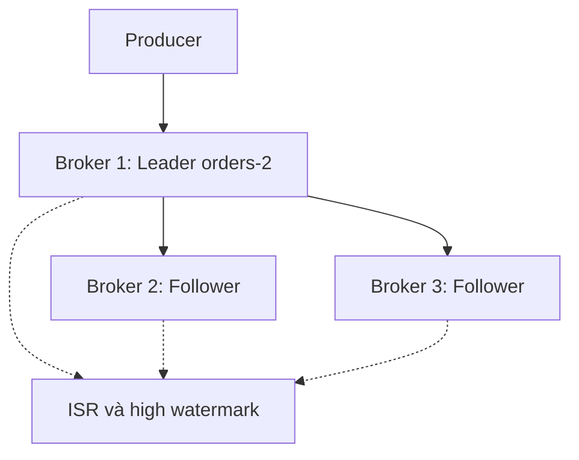
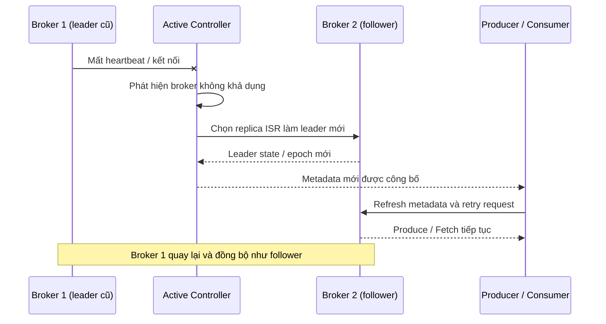

# Leader election khi broker lỗi và thời gian gián đoạn

Trong Kafka, mỗi partition có một replica giữ vai trò **leader** và có thể có nhiều **follower** trên các broker khác. Producer gửi dữ liệu đến leader; follower sao chép dữ liệu từ leader. Khi broker đang giữ leader của partition bị lỗi, Kafka cần phát hiện broker không còn hoạt động, chọn một replica đủ điều kiện làm leader mới, cập nhật metadata và để client kết nối lại.

Quá trình này được gọi là **leader election**. Nó giúp partition tiếp tục phục vụ khi còn replica phù hợp, nhưng không có nghĩa mọi lỗi broker đều được khôi phục tức thì hoặc không thể mất dữ liệu. Thời gian gián đoạn phụ thuộc vào phát hiện lỗi, điều kiện ISR, controller, cập nhật metadata, mạng và chính sách retry của client.

## 1. Leader, follower, ISR và high watermark

Một partition có replication factor (RF) bằng 3 thường có ba replica trên các broker khác nhau. Một replica là leader; hai replica còn lại là follower. Leader xử lý Produce và các yêu cầu đọc thông thường theo metadata của partition. Follower chủ động fetch dữ liệu từ leader để bắt kịp log.

**ISR (In-Sync Replicas)** là tập các replica đang được xem là đồng bộ với leader theo tiêu chí replication của Kafka. ISR thường gồm leader và những follower vẫn theo kịp tiến độ. Nếu follower không fetch hoặc không tiến triển trong khoảng thời gian cho phép, leader/controller có thể loại follower khỏi ISR; khi follower bắt kịp lại, nó có thể được thêm trở lại.

| Khái niệm | Ý nghĩa |
|---|---|
| Leader replica | Replica đang nhận ghi và phục vụ vai trò leader cho partition |
| Follower replica | Replica sao chép log từ leader |
| ISR | Các replica đang đồng bộ theo tiêu chí Kafka |
| LEO (Log End Offset) | Offset tiếp theo sau record cuối mà replica đã ghi vào log |
| High watermark (HW) | Ranh giới record đã được replication xác nhận theo semantics của partition; consumer chỉ đọc đến phần đã commit theo HW |
| Leader epoch | Số thế hệ leader, tăng khi leader thay đổi để nhận biết lịch sử leadership và xử lý log divergence |

Ví dụ partition `orders-2` có leader ở broker 1, follower ở broker 2 và broker 3. Khi cả ba replica đang ở ISR, record được ghi trên leader và replication tiến triển. High watermark chỉ tiến lên khi điều kiện replication tương ứng được đáp ứng. Điều này giúp replica được bầu từ ISR có đủ dữ liệu đã commit trước đó.



Điều quan trọng là **RF không đồng nghĩa với số replica luôn sẵn sàng**. Một partition RF=3 có thể chỉ còn một replica trong ISR sau khi hai follower tụt lại hoặc lỗi. Muốn hiểu khả năng failover, cần theo dõi ISR thực tế chứ không chỉ nhìn RF đã khai báo.

## 2. Điều gì xảy ra khi broker đang giữ leader bị lỗi?

Giả sử broker 1 giữ leader của partition `orders-2`, còn broker 2 và broker 3 là follower. Broker 1 mất điện hoặc bị cô lập khỏi cluster.

Quá trình khôi phục có thể mô tả theo các bước:

1. **Phát hiện broker không còn hoạt động.** Controller nhận biết broker mất liên lạc hoặc không còn đáp ứng heartbeat/session.
2. **Đánh dấu broker không khả dụng.** Metadata của cluster được cập nhật để các replica trên broker lỗi không còn được xem là leader đang phục vụ.
3. **Chọn leader mới.** Controller yêu cầu bầu một replica đủ điều kiện từ ISR của partition.
4. **Tăng leader epoch và cập nhật metadata.** Partition có leader mới; broker và client cần nhận metadata mới.
5. **Client refresh metadata và retry.** Producer/consumer gặp lỗi leader cũ, lấy metadata mới rồi kết nối tới broker leader mới.
6. **Replication phục hồi.** Broker lỗi khi quay lại sẽ đồng bộ log với leader hiện tại; replica chỉ trở lại ISR sau khi đáp ứng điều kiện đồng bộ.



Leader election của partition do controller điều phối. Đây là quá trình khác với việc bầu **active controller** của cluster. Active controller là thành phần quản lý metadata và điều phối thay đổi trạng thái; partition leader là replica phục vụ một partition cụ thể. Trong KRaft, controller quorum dùng Raft để bầu controller leader, còn controller leader thực hiện các thay đổi metadata và partition leadership.

## 3. Kafka phát hiện broker lỗi như thế nào?

Cơ chế phát hiện phụ thuộc metadata mode và phiên bản Kafka:

- **Kafka dùng ZooKeeper (kiến trúc cũ):** broker duy trì session với ZooKeeper. Khi session hết hạn hoặc broker bị đánh dấu không còn hoạt động, controller xử lý sự kiện và thực hiện các thay đổi leadership cần thiết.
- **Kafka dùng KRaft:** broker gửi heartbeat tới controller theo cơ chế quản lý broker registration. Nếu controller không nhận heartbeat trong thời gian session cho phép, broker có thể bị đánh dấu fenced/unavailable và các partition leader liên quan được xử lý.

Không nên nhầm heartbeat broker với heartbeat consumer group. Consumer gửi heartbeat đến group coordinator để duy trì tư cách thành viên trong group; broker heartbeat trong KRaft phục vụ quản lý trạng thái broker với controller. Hai luồng có mục đích và timeout riêng.

Các yếu tố ảnh hưởng đến thời gian phát hiện:

- Khoảng thời gian heartbeat và session timeout được cấu hình cho cơ chế cluster đang dùng.
- `replica.lag.time.max.ms` ảnh hưởng thời gian follower có thể không tiến triển trước khi bị xem là out of sync và bị loại khỏi ISR; đây là timeout về replication progress, không phải broker failure detection timeout.
- Tình trạng mạng giữa broker và controller, packet loss hoặc network partition.
- CPU, GC pause hoặc tải quá cao làm heartbeat bị trễ.
- Khả năng hoạt động của active controller và controller quorum.
- Thời gian controller xử lý sự kiện broker failure và cập nhật metadata.

Timeout quá ngắn có thể tạo false positive khi mạng hoặc GC tạm thời chậm, gây bầu leader không cần thiết. Timeout quá dài làm partition chờ lâu hơn khi broker thực sự chết. Cần chọn theo môi trường và kiểm chứng bằng thử nghiệm failure thực tế; không có một giá trị duy nhất phù hợp cho mọi cluster.

Không nên đồng nhất hai tình huống: broker heartbeat/session timeout quyết định khi nào controller xem broker là không hoạt động; `replica.lag.time.max.ms` quyết định khi nào follower không theo kịp bị loại khỏi ISR. Follower bị loại khỏi ISR vẫn có thể còn chạy và tiếp tục fetch để bắt kịp.

## 4. Chọn leader mới từ ISR

Khi leader lỗi, Kafka ưu tiên chọn replica thuộc ISR để đảm bảo replica mới có dữ liệu đã commit theo high watermark. Controller điều phối thay đổi leadership, cập nhật leader epoch và công bố metadata để các broker/client biết leader mới.

Ví dụ trước sự cố:

| Replica | Broker | Trạng thái | Log end offset (minh họa) |
|---|---:|---|---:|
| Leader | 1 | ISR | 1200 |
| Follower | 2 | ISR | 1200 |
| Follower | 3 | ISR | 1198 |

Giả sử high watermark đã là 1198. Broker 1 lỗi. Broker 2 hoặc broker 3 trong ISR có thể được chọn làm leader mới; replica được chọn phải có toàn bộ dữ liệu đã commit trước high watermark. Các record sau high watermark có thể chưa được xem là committed và có thể bị truncate/điều chỉnh theo log của leader mới khi replica đồng bộ.

Khi leader thay đổi, leader epoch tăng. Epoch giúp broker nhận biết request hoặc log state thuộc leadership cũ, ngăn replica cũ tiếp tục đóng vai trò leader hợp lệ sau khi đã bị fencing. Follower khi bắt kịp leader mới có thể cần kiểm tra epoch và điều chỉnh phần log chưa thống nhất.

Nếu một broker lỗi chỉ đang giữ follower, partition vẫn có thể tiếp tục ghi/đọc qua leader hiện tại. Tuy nhiên, ISR có thể giảm và mức chịu lỗi tiếp theo thấp hơn. Vì vậy, broker follower chết thường là sự cố durability/capacity trước khi trở thành sự cố availability.

## 5. Khi không còn replica nào trong ISR

Trường hợp khó hơn xảy ra khi tất cả replica trong ISR đều không khả dụng. Ví dụ RF=3 nhưng broker giữ leader và follower trong ISR đều lỗi; replica còn lại đã tụt khỏi ISR.

Kafka có hai hướng xử lý tùy cấu hình `unclean.leader.election.enable`:

| Cấu hình | Hành vi | Đánh đổi |
|---|---|---|
| `false` | Không bầu replica ngoài ISR làm leader; partition có thể offline cho đến khi replica ISR trở lại | Bảo vệ dữ liệu đã commit tốt hơn, nhưng thời gian unavailable dài hơn |
| `true` | Có thể bầu replica ngoài ISR khi không có replica ISR khả dụng | Tăng cơ hội phục vụ lại nhanh hơn, nhưng có thể mất record đã được xác nhận trước đó |

**Unclean leader election** là việc bầu một replica không thuộc ISR làm leader. Replica đó có thể thiếu những record đã có trên leader cũ. Khi nó trở thành leader và các replica khác đồng bộ theo log mới, dữ liệu không có trên replica được chọn có thể bị mất vĩnh viễn.

Ví dụ:

- Broker 1 là leader, broker 2 là follower trong ISR, broker 3 đã bị loại khỏi ISR vì tụt lag.
- Broker 1 và broker 2 cùng mất kết nối.
- Nếu unclean election tắt, partition chờ một replica ISR trở lại.
- Nếu unclean election bật, broker 3 có thể được bầu dù log của nó thiếu một số record.

Với dữ liệu đơn hàng, thanh toán hoặc ledger, mất record đã xác nhận thường nghiêm trọng hơn một khoảng gián đoạn. Vì vậy, production thường ưu tiên `unclean.leader.election.enable=false`, kết hợp replication factor, rack awareness, ISR monitoring và backup/reconciliation phù hợp. Chỉ cân nhắc unclean election khi yêu cầu availability vượt trội hơn durability và nghiệp vụ chấp nhận nguy cơ mất dữ liệu.

## 6. `acks`, `min.insync.replicas` và replication factor

Leader election chỉ an toàn khi replication policy được thiết kế phù hợp trước khi broker lỗi. Ba cấu hình cần xem cùng nhau:

- **Replication factor (RF):** số replica được phân bổ cho partition. RF=3 thường cho phép cluster chịu được một broker lỗi mà vẫn còn hai bản sao, nếu replica nằm trên broker/rack độc lập.
- **`min.insync.replicas`:** số replica tối thiểu phải có trong ISR để broker chấp nhận Produce request với `acks=all`.
- **Producer `acks`:** mức xác nhận mà producer yêu cầu trước khi coi send thành công.

Ví dụ cấu hình topic RF=3, `min.insync.replicas=2` và producer `acks=all`:

```java
// Cấu hình producer
props.put(ProducerConfig.ACKS_CONFIG, "all");
props.put(ProducerConfig.ENABLE_IDEMPOTENCE_CONFIG, "true");
```

```java
// Cấu hình topic khi tạo bằng Admin API
Map<String, String> configs = Map.of(
        TopicConfig.MIN_IN_SYNC_REPLICAS_CONFIG, "2",
        TopicConfig.UNCLEAN_LEADER_ELECTION_ENABLE_CONFIG, "false");

NewTopic orders = new NewTopic("orders", 12, (short) 3)
        .configs(configs);
```

Với ba replica và `min.insync.replicas=2`, nếu một follower chết và ISR còn hai replica, producer `acks=all` vẫn có thể ghi khi hai replica đó đáp ứng điều kiện xác nhận. Nếu ISR chỉ còn một replica, broker từ chối ghi với lỗi như `NOT_ENOUGH_REPLICAS` thay vì xác nhận một bản ghi không đạt chính sách tối thiểu. Nếu ISR giảm trong khi request đang xử lý, producer cũng có thể nhận lỗi liên quan đến việc không đủ replica sau append.

So sánh các lựa chọn:

| Producer setting | Hành vi xác nhận | Rủi ro/giới hạn |
|---|---|---|
| `acks=0` | Không chờ broker acknowledgement | Producer không biết chắc record đã được ghi hay chưa |
| `acks=1` | Chờ leader append | Nếu leader lỗi trước khi follower sao chép, record chưa replicate có thể mất khi leader mới được bầu |
| `acks=all` | Chờ các replica hiện thuộc ISR theo điều kiện replication | Cần ISR đủ `min.insync.replicas`; request có thể thất bại khi thiếu replica |

`acks=all` không có nghĩa phải chờ mọi replica từng được cấu hình trong RF nếu một số replica đã bị loại khỏi ISR. `min.insync.replicas` đặt ngưỡng tối thiểu cho số replica trong ISR khi ghi. Để đạt durability mong muốn, cần kết hợp cả hai và theo dõi ISR.

Replication factor cũng cần đặt theo số broker và rack. RF=3 trên ba broker cùng một rack không bảo vệ tốt trước sự cố mất cả rack. Dùng rack awareness để Kafka phân bổ replica qua các rack khác nhau khi cluster có cấu hình rack phù hợp.

## 7. Controlled shutdown và preferred leader election

### Controlled shutdown

Khi cần bảo trì broker, hãy shutdown có kiểm soát để Kafka có cơ hội chuyển leadership sang broker khác trước khi tiến trình dừng. Việc này giảm số partition phải trải qua failover bất ngờ và tránh tạo nhiều lỗi leader đồng thời.

Một quy trình bảo trì điển hình:

1. Kiểm tra ISR và tình trạng replica của broker sắp dừng.
2. Xác nhận cluster còn đủ broker và rack để giữ replication factor, `min.insync.replicas`.
3. Dùng cơ chế graceful/controlled shutdown phù hợp với cách vận hành cluster và phiên bản Kafka.
4. Chờ leadership được chuyển và partition không còn leader trên broker sắp dừng.
5. Thực hiện bảo trì, khởi động lại broker và chờ replica bắt kịp ISR.
6. Kiểm tra under-replicated partitions và leader distribution trước khi tiếp tục bảo trì broker khác.

Không dừng đồng thời nhiều broker nếu việc đó làm mất quorum replication của các partition. Tránh kill process cưỡng bức khi có thể shutdown bình thường; trường hợp mất điện hoặc process crash vẫn cần cơ chế leader election tự động.

### Preferred leader election

Replica đứng đầu danh sách replica assignment của partition thường là **preferred replica**. Sau failover, leader có thể chuyển sang follower khác. Khi broker ban đầu quay lại và replica bắt kịp, Kafka có thể chuyển leadership về preferred replica theo cơ chế auto leader rebalance hoặc thao tác preferred election.

Preferred leader election nhằm cân bằng leadership theo replica assignment; nó không phải cách xử lý broker failure ban đầu. Việc chuyển leader về preferred replica cần cân nhắc tải, ISR và thời điểm để tránh gây thêm biến động.

Ví dụ lệnh yêu cầu preferred election cho một partition:

```bash
kafka-leader-election.sh \
  --bootstrap-server broker-1:9092 \
  --election-type preferred \
  --topic orders \
  --partition 2
```

Cú pháp chi tiết và khả năng dùng lệnh có thể khác theo phiên bản Kafka. Trước khi thực hiện, kiểm tra replica assignment, ISR và tình trạng broker; preferred election không thể đưa partition về trạng thái khỏe nếu replica đích chưa sẵn sàng.

## 8. Thời gian gián đoạn được tạo bởi những thành phần nào?

Không có một con số cố định cho thời gian gián đoạn của leader election. Có thể mô hình hóa gần đúng:

\[
T_{outage} \approx T_{detect} + T_{elect} + T_{metadata} + T_{client}
\]

Trong đó:

| Thành phần | Điều quyết định |
|---|---|
| `T_detect` | Heartbeat/session timeout, network delay, GC pause và tải controller |
| `T_elect` | Số partition cần chuyển leader, ISR availability và thời gian controller xử lý |
| `T_metadata` | Metadata update được công bố và truyền tới broker/client |
| `T_client` | Client phát hiện lỗi, refresh metadata, backoff, retry và reconnect |

Đây là mô hình để phân tích chứ không phải phép cộng chính xác tuyệt đối. Một số bước có thể diễn ra song song; client khác nhau có thể phục hồi ở thời điểm khác nhau. Producer có thể tiếp tục gửi partition khỏe trong khi một partition đang bầu leader mới.

Các yếu tố thường làm outage dài hơn:

- Broker failure detection timeout quá dài hoặc network partition không rõ ràng.
- Active controller quá tải hoặc controller quorum KRaft không đạt quorum.
- Không còn replica ISR khả dụng và unclean election bị tắt.
- Metadata propagation chậm hoặc client kết nối sai `advertised.listeners`.
- Producer retry/backoff/timeout không phù hợp; ứng dụng có timeout tổng ngắn hơn thời gian failover.
- Nhiều partition cùng mất leader khiến controller và client phải xử lý nhiều thay đổi đồng thời.

Phân biệt hai trạng thái:

- **Partition unavailable:** chưa có leader hợp lệ nên Produce/Fetch không thể tiếp tục bình thường.
- **Partition available nhưng degraded:** leader mới đã hoạt động nhưng ISR nhỏ hơn RF, nên khả năng chịu lỗi tiếp theo giảm và ghi có thể bị từ chối nếu ISR thấp hơn `min.insync.replicas`.

Một broker có thể được phục hồi nhưng partition vẫn chưa trở lại trạng thái khỏe vì follower cần thời gian catch up. Vì vậy, đo thời gian leader election và thời gian phục hồi đầy đủ của ISR là hai chỉ số khác nhau.

## 9. Client xử lý lỗi leader và retry

Producer và consumer Kafka client có cơ chế metadata refresh và retry cho nhiều lỗi transient. Khi broker cũ không còn là leader, client có thể nhận các lỗi như:

- `NOT_LEADER_OR_FOLLOWER`: request gửi tới broker không còn giữ vai trò leader/follower phù hợp.
- `LEADER_NOT_AVAILABLE`: partition tạm thời chưa có leader được công bố.
- `NOT_ENOUGH_REPLICAS`: ISR không đạt ngưỡng tối thiểu cho Produce.
- `NOT_ENOUGH_REPLICAS_AFTER_APPEND`: điều kiện replication không còn đáp ứng sau khi append đã diễn ra.
- `REQUEST_TIMED_OUT`: request không hoàn tất trong thời gian client chờ.

Kafka client có thể tự refresh metadata và retry các lỗi được xem là retriable. Ứng dụng cần cấu hình timeout đủ dài cho failover dự kiến và không tự retry vô hạn ở nhiều tầng cùng lúc.

Ví dụ producer Java:

```java
props.put(ProducerConfig.ACKS_CONFIG, "all");
props.put(ProducerConfig.ENABLE_IDEMPOTENCE_CONFIG, "true");
props.put(ProducerConfig.RETRIES_CONFIG, Integer.MAX_VALUE);
props.put(ProducerConfig.REQUEST_TIMEOUT_MS_CONFIG, 30_000);
props.put(ProducerConfig.DELIVERY_TIMEOUT_MS_CONFIG, 120_000);
props.put(ProducerConfig.RETRY_BACKOFF_MS_CONFIG, 200);
```

Các giá trị trên chỉ minh họa cách đặt một khoảng chờ retry. `delivery.timeout.ms` giới hạn tổng thời gian producer cố gắng giao record, gồm batching và retry; nếu failover kéo dài hơn, send vẫn có thể thất bại. Cần chọn theo SLA và phiên bản client. Khi idempotence bật, giữ cấu hình retry và in-flight request tương thích với yêu cầu thứ tự; Kafka client hiện đại tự áp dụng một số ràng buộc cấu hình khi idempotence được bật.

Với consumer, khi leader đổi, client có thể refresh metadata và tiếp tục Fetch từ offset đã commit hoặc vị trí hiện tại theo semantics của consumer. Leader election của partition không nhất thiết đồng nghĩa consumer group rebalance; rebalance chủ yếu xảy ra khi thành viên group hoặc assignment thay đổi. Nếu ứng dụng xử lý record rồi mới commit offset, record có thể được xử lý lại sau lỗi; hãy làm side effect idempotent.

## 10. Theo dõi leader election và sức khỏe replication

Các metric thường dùng để phát hiện failover và suy giảm replication:

| Metric | Ý nghĩa |
|---|---|
| `OfflinePartitionsCount` | Số partition hiện không có leader khả dụng |
| `UnderReplicatedPartitions` | Số partition có replica chưa theo kịp replication |
| `UnderMinIsrPartitionCount` | Số partition có ISR thấp hơn ngưỡng `min.insync.replicas` (nếu metric được cung cấp ở phiên bản/exporter) |
| `IsrShrinksPerSec` | Tốc độ replica bị loại khỏi ISR |
| `IsrExpandsPerSec` | Tốc độ replica được thêm trở lại ISR |
| `LeaderElectionRateAndTimeMs` | Tần suất và thời gian xử lý leader election |
| `UncleanLeaderElectionsPerSec` | Số lần unclean election; cần cảnh báo nghiêm trọng nếu tăng |

Tên metric group và cách expose phụ thuộc phiên bản Kafka và exporter. Nên xác minh JMX metric thực tế trong cluster trước khi cấu hình alert.

Các lệnh kiểm tra thường dùng:

```bash
# Xem leader, replica và ISR của topic
kafka-topics.sh --bootstrap-server broker-1:9092 \
  --describe --topic orders

# Xem trạng thái controller quorum trong KRaft
kafka-metadata-quorum.sh --bootstrap-server broker-1:9092 describe --status
```

Khi điều tra một partition, đối chiếu leader, replicas, ISR, offline partitions, broker log và controller log theo cùng mốc thời gian. Nếu ISR co lại liên tục, hãy kiểm tra disk latency, network giữa broker, GC pause, replication fetch lag và phân bổ partition trước khi chỉ tăng timeout.

## 11. Runbook khi broker đang giữ leader bị lỗi

Khi cảnh báo broker down hoặc partition offline, có thể làm theo trình tự:

1. **Xác định phạm vi:** broker nào lỗi, partition nào mất leader, có bao nhiêu `OfflinePartitionsCount` và `UnderReplicatedPartitions`.
2. **Kiểm tra controller:** xác định active controller và trạng thái controller quorum KRaft; nếu quorum mất, xử lý control plane trước.
3. **Kiểm tra ISR:** với từng partition bị ảnh hưởng, xác định còn replica ISR nào đang hoạt động.
4. **Kiểm tra election policy:** xác nhận `unclean.leader.election.enable`; không bật unclean election tùy tiện để làm partition online.
5. **Theo dõi leader mới:** xác nhận leader/epoch/metadata đã cập nhật và client có thể refresh metadata.
6. **Kiểm tra producer/consumer:** theo dõi lỗi retriable, timeout, retry rate, consumer lag và side effect bị xử lý lặp.
7. **Khôi phục broker:** sửa nguyên nhân phần cứng/mạng/process, khởi động broker và chờ replica catch up vào ISR.
8. **Xác nhận cluster khỏe:** kiểm tra ISR trở lại, under-replicated/offline partition về mức mong muốn và leader distribution cân bằng.
9. **Đối soát dữ liệu:** nếu có unclean election hoặc acknowledgement yếu, đối chiếu dữ liệu nghiệp vụ với nguồn chuẩn để phát hiện record bị mất hoặc trạng thái lệch.

Không xóa log directory hoặc thay đổi replica assignment trong lúc điều tra nếu chưa xác định rõ hậu quả. Xóa log có thể làm mất bản sao dữ liệu cuối cùng của partition và biến sự cố có thể phục hồi thành mất dữ liệu.

## 12. Những hiểu nhầm thường gặp

- **“RF=3 nghĩa là luôn có ba bản sao sẵn sàng.”** RF là số replica được phân bổ; ISR thực tế có thể ít hơn.
- **“Leader lỗi thì follower bất kỳ cũng có thể lên leader an toàn.”** Kafka ưu tiên ISR; replica ngoài ISR có thể thiếu record đã commit.
- **“`acks=all` luôn chờ mọi replica đã khai báo trong RF.”** Nó chờ các replica trong ISR theo điều kiện cấu hình; `min.insync.replicas` đặt ngưỡng tối thiểu.
- **“Leader election và controller election là một.”** Controller leader điều phối metadata; partition leader phục vụ partition.
- **“Broker quay lại là partition lập tức đủ replication.”** Replica cần catch up trước khi trở lại ISR.
- **“Unclean election chỉ làm giảm độ bền một chút.”** Nó có thể làm mất record đã được xác nhận và gây log truncation ở replica khác.
- **“Consumer group luôn rebalance khi partition leader đổi.”** Leader đổi không tự động đồng nghĩa assignment của consumer group thay đổi.
- **“Thời gian election chính là thời gian ứng dụng gián đoạn.”** Client refresh metadata, retry, timeout và xử lý lại cũng ảnh hưởng thời gian phục hồi quan sát được.

## 13. Checklist thiết kế và vận hành

- [ ] RF đủ lớn và replica được phân bổ qua các broker/rack độc lập.
- [ ] `min.insync.replicas` và producer `acks=all` phù hợp với durability cần đạt.
- [ ] `unclean.leader.election.enable` được đặt theo ưu tiên durability/availability và có người chịu trách nhiệm phê duyệt thay đổi.
- [ ] Theo dõi ISR shrink/expand, offline partitions, under-replicated partitions và unclean election.
- [ ] Heartbeat/session timeout phù hợp với độ trễ mạng, GC và tải controller.
- [ ] `replica.lag.time.max.ms` phù hợp với replication latency và tốc độ ghi thực tế.
- [ ] Controller quorum KRaft được giám sát độc lập với broker data plane.
- [ ] Producer timeout/retry đủ cho failover dự kiến; consumer xử lý idempotent và commit offset đúng thời điểm.
- [ ] Có quy trình controlled shutdown, rolling maintenance và preferred leader election.
- [ ] Có runbook khôi phục broker, kiểm tra ISR, metadata và đối soát dữ liệu.
- [ ] Đã diễn tập broker crash, network partition và mất rack trong môi trường thử nghiệm.

Leader election giúp Kafka tiếp tục phục vụ partition sau khi broker lỗi nếu còn replica phù hợp. Khả năng phục hồi an toàn phụ thuộc ISR, high watermark, leader epoch, replication factor, `acks`, `min.insync.replicas` và controller. Muốn giảm thời gian gián đoạn mà vẫn giữ dữ liệu, cần thiết kế replication từ đầu, theo dõi trạng thái ISR và diễn tập cả tình huống broker lẫn controller gặp sự cố.
