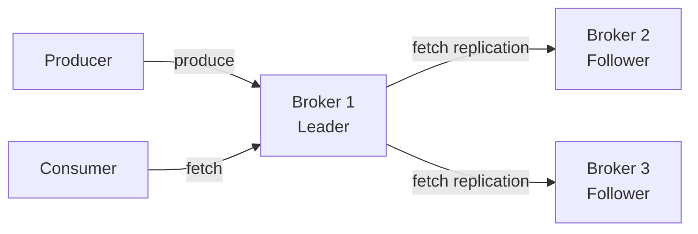
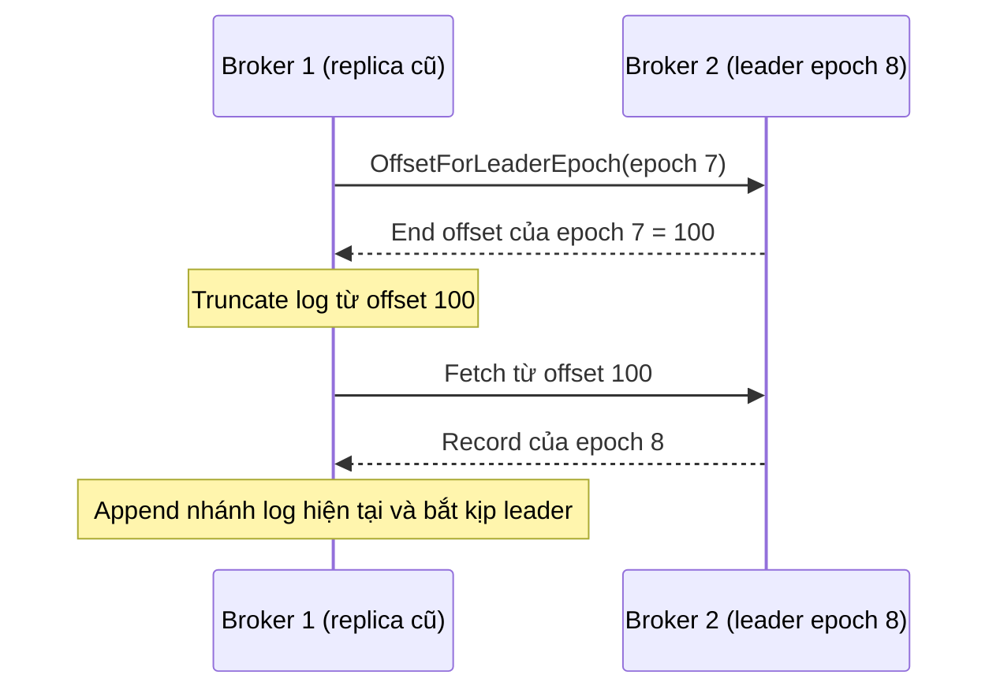

# Log truncation, leader epoch và phục hồi replica

## Mục tiêu

Kafka lưu mỗi partition dưới dạng một replicated log. Leader nhận ghi và follower sao chép log từ leader. Khi broker bị dừng, mất kết nối hoặc quay lại sau failover, các replica có thể không còn cùng phần đuôi log. Kafka cần xác định ranh giới dữ liệu nào còn hợp lệ, loại bỏ phần log phân kỳ và đồng bộ replica về đúng nhánh dữ liệu của leader hiện tại.

Bài học này giải thích log truncation, leader epoch và quá trình phục hồi replica từ lúc broker khởi động đến khi replica bắt kịp và có thể gia nhập ISR. Sau bài học, bạn có thể:

- Phân biệt Log End Offset (LEO), High Watermark (HW), Log Start Offset và recovery point.
- Giải thích vai trò của leader epoch và `OffsetForLeaderEpoch` khi replica phát hiện log divergence.
- Mô tả quá trình log recovery khi broker khởi động và replica catch-up sau khi kết nối lại leader.
- Phân tích vì sao phần đuôi chưa commit có thể bị truncate sau failover.
- Chẩn đoán replica lag, ISR shrink/expand, under-replicated partition và tình huống unclean leader election.
- Thực hiện runbook phục hồi replica an toàn mà không can thiệp trực tiếp vào log segment đang được broker sử dụng.

## 1. Replicated log của Kafka

Replication được thực hiện ở cấp topic partition. Mỗi partition có một replica leader và các follower replica. Producer ghi record vào leader; follower chủ động fetch record từ leader và append vào log cục bộ theo cùng thứ tự offset.



Ví dụ topic `orders` có partition 0 và replication factor 3:

| Broker | Vai trò | Trách nhiệm |
|---|---|---|
| Broker 1 | Leader | Nhận produce request, phục vụ fetch và điều phối replication |
| Broker 2 | Follower | Fetch record từ leader, append vào log cục bộ |
| Broker 3 | Follower | Fetch record từ leader, append vào log cục bộ |

Các replica bình thường có cùng record và offset theo cùng thứ tự. Tuy nhiên, tại một thời điểm, leader có thể đã append thêm record mà follower chưa fetch xong. Vì vậy, log cục bộ của các replica có thể có độ dài khác nhau.

Kafka duy trì tập replica đồng bộ gọi là ISR (In-Sync Replicas). Một replica phải có phiên hoạt động với controller và theo kịp leader trong giới hạn cấu hình để được xem là in-sync. Replica bị dừng hoặc tụt quá xa có thể bị loại khỏi ISR. Khi quay lại, nó phải bắt kịp log hiện tại trước khi được đưa lại vào ISR.

## 2. Các offset cần phân biệt khi phục hồi

Để hiểu truncation, cần phân biệt bốn mốc offset. Các offset trong phần này dùng quy ước end offset là vị trí kế tiếp sau record cuối cùng, tức là một ranh giới exclusive.

| Thuật ngữ | Ý nghĩa | Dùng để làm gì |
|---|---|---|
| Log End Offset (LEO) | Offset kế tiếp mà replica sẽ append; phản ánh cuối log cục bộ | Biết replica đã ghi đến đâu |
| High Watermark (HW) | Ranh giới exclusive của phần log đã commit | Xác định dữ liệu được xem là đã commit và có thể đọc theo semantics thông thường |
| Log Start Offset | Offset sớm nhất còn được giữ trong log | Phản ánh retention, compaction hoặc truncation đã loại bỏ phần đầu log |
| Recovery point | Ranh giới offset mà log đã được flush bền vững theo bookkeeping của broker | Giới hạn phần log cần kiểm tra/phục hồi sau crash |

Lưu ý: trong Kafka Streams và giao thức consumer, chữ viết tắt LSO thường chỉ *Last Stable Offset* trong xử lý transaction. Để tránh nhầm, bài này luôn viết đầy đủ `Log Start Offset` khi nói về offset bắt đầu của log.

### 2.1. Ví dụ LEO và HW

Giả sử leader có LEO bằng `120`, HW bằng `115`:

- Các offset từ `0` đến `114` nằm trước HW và đã commit.
- Các offset từ `115` đến `119` đã append trên leader nhưng chưa vượt qua ranh giới commit.
- LEO `120` là offset tiếp theo sẽ được append.

Nếu leader lỗi trước khi phần đuôi này được replicate và commit, các record sau HW có thể không tồn tại trên replica được chọn làm leader mới. Đây là lý do không thể đồng nhất “producer đã gửi” với “record chắc chắn đã commit”.

Khi producer dùng `acks=all`, leader chỉ trả thành công sau khi record được replicate tới các replica trong ISR và đáp ứng `min.insync.replicas`. Cấu hình này giúp tăng durability, nhưng vẫn cần ít nhất một replica in-sync còn tồn tại để bảo toàn dữ liệu đã commit.

### 2.2. Recovery point và log recovery

Kafka không bắt buộc phải `fsync` từng record trước khi xác nhận mọi thao tác ghi. Broker theo dõi recovery point để biết phần log nào đã được flush. Khi broker khởi động sau crash, nó kiểm tra phần log ở phía sau recovery point, xác thực record batch và phục hồi/truncate phần cuối chưa hoàn chỉnh hoặc bị hỏng theo cơ chế log recovery.

Đây là bước phục hồi file log cục bộ. Nó khác với việc follower đối chiếu leader epoch để đồng bộ với leader hiện tại. Một log có thể đọc được sau startup nhưng vẫn chứa phần đuôi khác với nhánh log của leader hiện tại; follower vẫn cần thực hiện epoch reconciliation trước khi tiếp tục replication.

## 3. Leader epoch và lịch sử log

Leader epoch là generation của leadership trên một partition. Mỗi lần partition có leadership generation mới, leader epoch tăng. Kafka lưu ánh xạ giữa epoch và offset bắt đầu tương ứng trong lịch sử log để replica có thể so sánh nhánh log cục bộ với leader.

Ví dụ:

| Leader epoch | Leader | Offset bắt đầu của epoch |
|---:|---|---:|
| 4 | Broker 1 | 0 |
| 5 | Broker 1 | 100 |
| 6 | Broker 2 | 120 |

Epoch trả lời câu hỏi “record này được ghi dưới generation lãnh đạo nào?”. Offset trả lời “record nằm ở vị trí nào?”. Hai replica có cùng LEO vẫn có thể chứa nội dung khác nhau nếu chúng đi theo hai nhánh log khác nhau sau một lần failover. Vì vậy, chỉ so sánh LEO không đủ để xác nhận hai replica có cùng lịch sử.

Kafka ghi leader epoch trong metadata của record batch và duy trì thông tin epoch-offset trong leader epoch cache/checkpoint. Thông tin này được dùng trong quá trình replica catch-up và xử lý log divergence.

## 4. Log divergence xảy ra như thế nào?

Giả sử partition `orders-0` có hai replica:

1. Broker 1 là leader ở epoch 7 và append record đến offset `109`.
2. Broker 2 mới fetch đến offset `99`; phần đuôi `100..109` chưa được replicate sang broker 2.
3. Broker 1 dừng trước khi phần đuôi được commit.
4. Broker 2 được bầu làm leader mới ở epoch 8. Log hợp lệ trên broker 2 kết thúc tại end offset `100`.
5. Broker 2 tiếp tục nhận ghi và append record mới bắt đầu tại offset `100` dưới epoch 8.
6. Broker 1 khởi động lại. Nó vẫn có thể chứa phần đuôi epoch 7 từ offset `100..109`.

Ở thời điểm này, hai broker có cùng partition nhưng phần log từ offset `100` trở đi khác nhau:

```text
Broker 1 (log cũ):  ... 97 98 99 | 100 101 102 ... 109
                                  epoch 7

Broker 2 (leader mới): ... 97 98 99 | 100 101 102 ...
                                      epoch 8
```

Nếu broker 1 giữ phần đuôi cũ và tiếp tục phục vụ như follower mà không sửa log, hai replica sẽ không còn cùng một replicated log. Kafka phải tìm điểm chung và loại bỏ phần đuôi không thuộc nhánh log hiện tại.

## 5. OffsetForLeaderEpoch và log truncation

`OffsetForLeaderEpoch` là API giao thức Kafka cho phép replica hỏi leader về end offset tương ứng với một leader epoch. Đây là cơ sở để tìm điểm mà log của replica còn khớp với lịch sử của leader hiện tại.

Trong ví dụ trên, broker 1 hỏi broker 2 về epoch 7. Leader mới trả về end offset của epoch 7 là `100`. Broker 1 biết rằng phần log cục bộ từ offset `100` trở đi không còn thuộc nhánh log được leader hiện tại giữ lại.

Quá trình tổng quát:



Các bước cụ thể:

1. Follower phát hiện leader generation thay đổi hoặc cần xác minh log local.
2. Follower gửi epoch đã biết trong request `OffsetForLeaderEpoch`.
3. Leader trả về end offset của epoch được hỏi mà nó biết.
4. Follower so sánh end offset với log cục bộ.
5. Nếu local log có phần đuôi vượt qua điểm chung, follower truncate phần divergent tail.
6. Follower fetch lại từ leader tại điểm offset hợp lệ, append record theo nhánh log hiện tại.
7. Khi follower bắt kịp và đáp ứng điều kiện ISR, nó có thể gia nhập lại ISR.

Trong ví dụ, end offset `100` là exclusive: record cuối của epoch 7 là offset `99`; truncation bắt đầu tại offset `100`. Không được nhầm end offset với offset của record cuối cùng.

### 5.1. Vì sao truncate phần đuôi thay vì sửa record?

Kafka lưu log append-only theo offset. Khi một replica đã có nội dung khác với leader tại cùng vùng offset, broker không thể chỉ sửa vài byte hoặc ghép hai nhánh lại để tạo ra một lịch sử nhất quán. Replica loại bỏ phần đuôi divergent từ điểm đầu tiên không còn khớp, sau đó fetch lại record từ leader.

Truncation là thao tác nội bộ của Kafka trên replica log. Ứng dụng không nên tự sửa file segment, đổi tên segment hoặc xóa file index để “đồng bộ” broker. Làm như vậy có thể phá vỡ offset index, time index, leader epoch checkpoint và trạng thái log recovery.

### 5.2. Khi leader epoch không khớp

Giao thức Kafka dùng `current_leader_epoch` để fencing request dựa trên metadata cũ. Nếu client gửi epoch cũ hơn epoch broker hiện tại biết, broker có thể trả `FENCED_LEADER_EPOCH`; nếu epoch client đưa ra lớn hơn epoch broker biết, có thể trả `UNKNOWN_LEADER_EPOCH`. Client/replica cần cập nhật trạng thái và retry theo quy trình phù hợp.

Không nên coi hai mã lỗi trên là dấu hiệu tự động của dữ liệu hỏng. Chúng thường cho biết request dựa trên generation không phù hợp. Cần xem log broker, leader state và quá trình fetch để biết replica có đang hội tụ hay không.

## 6. Quy trình phục hồi replica sau khi broker khởi động

Phục hồi replica gồm hai lớp: khôi phục log local trên broker và đồng bộ lại với leader của partition.

### 6.1. Khôi phục log cục bộ khi startup

Khi broker khởi động:

1. Broker đọc metadata và checkpoint cần thiết trong log directory.
2. Broker mở các partition log cục bộ và kiểm tra segment/index.
3. Phần log sau recovery point được kiểm tra để xử lý record batch chưa hoàn chỉnh hoặc dữ liệu không hợp lệ do crash.
4. Broker phục hồi trạng thái log có thể sử dụng và tham gia cluster.

Nếu broker dừng graceful, Kafka có thể sync log và chuyển leadership của partition sang replica khác trước khi dừng. Việc này giúp giảm thời gian phục hồi và tránh một phần công việc log recovery so với hard crash.

### 6.2. Đồng bộ lại với leader

Sau startup, broker không mặc nhiên trở thành leader. Với partition mà broker đang là follower:

1. Broker nhận metadata hiện tại và xác định leader của partition.
2. Replica fetcher kết nối đến leader và kiểm tra log generation/offset cần đồng bộ.
3. Nếu cần, replica dùng `OffsetForLeaderEpoch` để tìm điểm chung và truncate divergent tail.
4. Replica fetch record còn thiếu từ leader và append vào log local.
5. Khi replica hoạt động ổn định, bắt kịp leader và đáp ứng điều kiện đồng bộ, nó có thể được thêm lại vào ISR.

Kafka không giả định rằng broker crash luôn giữ lại mọi dữ liệu chưa flush. Một replica cần đồng bộ lại đầy đủ với leader trước khi được tin cậy như một thành viên in-sync. Điều này giúp bảo vệ tính nhất quán ngay cả khi broker bị mất một phần dữ liệu local do crash hoặc lỗi đĩa.

### 6.3. Từ follower lagging đến ISR

Replica quay lại có thể ở trạng thái lagging trong một khoảng thời gian. Trong thời gian này:

- Nó không được xem là thành viên ISR chỉ vì tiến trình broker đã online.
- Leader tiếp tục phục vụ ghi dựa trên ISR hiện tại.
- Replica fetcher kéo record còn thiếu từ leader.
- Khi follower bắt kịp và đáp ứng điều kiện session/replication, controller/leader cập nhật ISR.

Do đó, trạng thái broker `RUNNING` không đồng nghĩa mọi partition replica trên broker đã phục hồi hoàn tất. Cần kiểm tra ISR và replication lag theo từng partition.

## 7. Truncation, commit và nguy cơ mất dữ liệu

Điều quan trọng nhất khi phân tích log truncation là phân biệt record đã commit với phần đuôi chưa commit.

### 7.1. Record đã commit

Kafka dùng ISR để xác định tiến độ replication. Với cấu hình phù hợp, record chỉ được xem là committed khi tất cả replica hiện trong ISR đã nhận record và điều kiện `min.insync.replicas` được đáp ứng. Nếu ít nhất một replica in-sync còn tồn tại, committed record có thể được bảo toàn qua failover.

Producer thường dùng:

```properties
acks=all
enable.idempotence=true
```

Và topic được tạo với replication factor cùng các cấu hình như:

```bash
bin/kafka-topics.sh --bootstrap-server localhost:9092 \
  --create --topic orders --partitions 6 --replication-factor 3 \
  --config min.insync.replicas=2 \
  --config unclean.leader.election.enable=false
```

Đây là ví dụ thiết kế durability cho cluster có ít nhất ba broker. `replication.factor` là tham số tạo topic, không phải cấu hình producer hay topic config có thể alter như `min.insync.replicas`. `min.insync.replicas` và `unclean.leader.election.enable` có thể được cấu hình ở topic hoặc broker theo phạm vi hỗ trợ. Khi ISR giảm xuống dưới 2, producer dùng `acks=all` sẽ không được phép ghi thành công cho đến khi đủ ISR trở lại.

### 7.2. Phần đuôi chưa commit

Record đã append trên leader nhưng chưa được replicate đến toàn bộ ISR có thể bị loại bỏ sau failover nếu replica được bầu làm leader không có phần đuôi đó. Producer có thể nhận lỗi timeout hoặc mất kết nối trong giai đoạn này; nếu ứng dụng retry, nên dùng idempotent producer và xử lý kết quả gửi không xác định một cách phù hợp.

Không nên mô tả truncation là “Kafka xóa dữ liệu đã commit tùy ý”. Truncation bình thường nhằm loại bỏ phần log không thuộc nhánh leader hiện tại; durability của committed record phụ thuộc replication/ISR và cấu hình producer/topic.

### 7.3. Unclean leader election

Nếu không còn replica trong ISR khả dụng, Kafka mặc định ưu tiên chờ replica in-sync quay lại thay vì chọn một replica out-of-sync làm leader. Điều này có thể khiến partition tạm thời không khả dụng, nhưng giảm nguy cơ mất dữ liệu.

`unclean.leader.election.enable=true` cho phép bầu replica không thuộc ISR làm leader như một lựa chọn cuối cùng. Đây là trade-off availability và consistency: partition có thể hoạt động trở lại sớm hơn, nhưng log của replica được chọn có thể thiếu committed record.

Kafka 4.0 bổ sung Eligible Leader Replicas (ELR); tính năng này được bật mặc định trên cluster mới từ Kafka 4.1. ELR cho phép controller theo dõi một số replica ngoài ISR nhưng đủ điều kiện an toàn theo quy tắc min ISR. Khi bầu leader, Kafka ưu tiên ISR, sau đó đến ELR chưa bị fence, rồi mới xét last known leader theo quy tắc của phiên bản. ELR không có nghĩa mọi replica out-of-sync đều an toàn để làm leader; hãy kiểm tra feature state và tài liệu đúng phiên bản.

## 8. Chẩn đoán replica lag và log recovery

### 8.1. Xem leader, replicas và ISR

```bash
bin/kafka-topics.sh \
  --bootstrap-server localhost:9092 \
  --describe --topic orders
```

Ví dụ kết quả:

```text
Topic: orders  Partition: 0  Leader: 1  Replicas: 1,2,3  Isr: 1,2
```

Trong ví dụ, broker 3 là replica được chỉ định nhưng chưa nằm trong ISR. Kiểm tra log broker 3 và replication lag để tìm nguyên nhân. Đừng chỉ nhìn leader; cần đối chiếu cả `Replicas` và `Isr`.

### 8.2. Kiểm tra dung lượng và offset replica theo log directory

```bash
bin/kafka-log-dirs.sh \
  --bootstrap-server localhost:9092 \
  --describe \
  --broker-list 1,2,3 \
  --topic-list orders
```

Lệnh này trả về thông tin log directory và replica, gồm dung lượng log và lag theo khả năng của phiên bản. Dùng nó để phát hiện replica chưa có log, log directory lỗi hoặc dung lượng bất thường. Kết quả dung lượng không chứng minh nội dung log đã giống leader; cần kết hợp trạng thái ISR và broker logs.

### 8.3. Kiểm tra consumer group

```bash
bin/kafka-consumer-groups.sh \
  --bootstrap-server localhost:9092 \
  --describe --group order-processor
```

Lệnh này giúp phân biệt consumer lag với replica lag. Consumer lag là chênh lệch giữa vị trí consumer đã commit/đang đọc và log end offset; replica lag là follower chưa bắt kịp leader. Hai loại lag có thể xuất hiện cùng lúc nhưng cần xử lý khác nhau.

### 8.4. Kiểm tra broker logs và metrics

Tìm log có các từ khóa hoặc sự kiện:

- `LeaderAndIsr`, leader election và thay đổi ISR.
- `ReplicaFetcher`, fetch session và lỗi kết nối follower-leader.
- `OffsetForLeaderEpoch`, leader epoch và log truncation.
- `Log recovery`, recovery point, segment/index corruption.
- `FENCED_LEADER_EPOCH`, `UNKNOWN_LEADER_EPOCH`, `NOT_LEADER_OR_FOLLOWER`.

Theo dõi các metric quan trọng:

| Metric | Ý nghĩa vận hành |
|---|---|
| `UnderReplicatedPartitions` | Số partition có replica chưa đồng bộ đủ |
| `UnderMinIsrPartitionCount` | Số partition có ISR thấp hơn `min.insync.replicas` |
| `IsrShrinksPerSec` | Tốc độ replica bị loại khỏi ISR |
| `IsrExpandsPerSec` | Tốc độ replica được thêm lại vào ISR |
| `kafka.server:type=ReplicaFetcherManager,name=MaxLag,clientId=Replica` | Độ trễ lớn nhất theo message giữa follower và leader |

Nếu ISR liên tục shrink/expand, kiểm tra network, disk I/O, CPU, GC pause và thời gian fetch. Nếu lag không giảm, xác minh follower có kết nối đúng leader, có đủ dung lượng và không bị throttle quá thấp.

### 8.5. Đọc segment offline

Khi cần điều tra sâu, `kafka-dump-log.sh` có thể đọc segment để xem record batch, offset và leader epoch:

```bash
bin/kafka-dump-log.sh \
  --files /path/to/replica/orders-0/00000000000000000000.log \
  --deep-iteration
```

Đường dẫn segment phụ thuộc `log.dirs` và cấu trúc partition directory. Chỉ đọc bản sao segment hoặc thao tác theo quy trình vận hành được phê duyệt; không sửa, di chuyển hoặc xóa segment đang được broker sử dụng. Dùng công cụ này để điều tra, không dùng làm cách phục hồi thủ công.

## 9. Runbook phục hồi replica

Khi một broker quay lại sau sự cố, thực hiện theo trình tự sau:

1. **Xác nhận broker đã online:** kiểm tra service, network, disk và log startup; xác định broker đã đăng ký với cluster.
2. **Kiểm tra trạng thái partition:** chạy `kafka-topics.sh --describe` để xác định leader, replica assignment và ISR.
3. **Kiểm tra log recovery:** đọc broker log để xác nhận segment/index đã được phục hồi và không còn lỗi I/O hoặc corruption.
4. **Theo dõi replica fetcher:** xác nhận follower kết nối đúng leader và lag đang giảm.
5. **Xác minh epoch reconciliation:** tìm thông báo `OffsetForLeaderEpoch` hoặc truncation nếu replica có divergent tail.
6. **Chờ ISR phục hồi:** chỉ coi replica đã phục hồi khi nó xuất hiện lại trong ISR và trạng thái ổn định.
7. **Kiểm tra durability:** xác nhận ISR đạt `min.insync.replicas`, producer `acks=all` không còn gặp lỗi do thiếu ISR.
8. **Kiểm tra consumer:** xem consumer lag và ứng dụng downstream; không nhầm consumer backlog với replica lag.
9. **Ghi nhận nguyên nhân gốc:** network, disk, broker crash, throttling hay cấu hình replication; xử lý nguyên nhân để tránh tái diễn.

Không xóa log directory để ép follower đồng bộ nếu chưa có kế hoạch rõ ràng. Trong tình huống disk hỏng hoặc log không thể phục hồi, đánh giá việc tái tạo replica từ leader theo quy trình của phiên bản và topology đang chạy. Bảo đảm leader/replica nguồn còn dữ liệu hợp lệ trước khi decommission storage cũ.

## 10. Graceful shutdown và phục hồi sau hard crash

Khi bảo trì broker, ưu tiên dừng graceful bằng cơ chế service/orchestrator:

- Broker có cơ hội sync log để giảm phần log cần kiểm tra khi khởi động lại.
- Partition đang do broker làm leader có thể chuyển leadership sang replica khác trước khi broker dừng.
- Thời gian partition không khả dụng thường ngắn hơn so với hard kill.

Hard crash hoặc mất điện không cho broker cơ hội hoàn tất các bước này. Khi khởi động lại, broker phải thực hiện log recovery và replica catch-up. Cả hai trường hợp đều cần theo dõi ISR sau khi broker trở lại; graceful shutdown không đảm bảo mọi partition lập tức trở lại trạng thái cân bằng.

Nếu cần dừng nhiều broker, không dừng đồng thời quá số replica mà cluster có thể chịu được. Với replication factor 3 và min ISR 2, dừng hai broker chứa replica của cùng partition có thể khiến partition không còn đủ ISR để nhận ghi hoặc thậm chí mất leader khả dụng.

## 11. Những nhầm lẫn thường gặp

| Nhầm lẫn | Cách hiểu đúng |
|---|---|
| LEO là số record đã commit | LEO là end offset cục bộ; HW mới là ranh giới commit |
| Hai replica có cùng LEO thì log giống nhau | Cần đối chiếu leader epoch và nội dung/nhánh log; cùng độ dài không chứng minh cùng lịch sử |
| Broker restart là lập tức trở lại ISR | Replica phải log recover, fetch thiếu và bắt kịp leader trước khi vào ISR |
| Truncation luôn làm mất record đã commit | Truncation bình thường loại bỏ phần divergent/uncommitted; durability của committed data dựa vào ISR và cấu hình |
| Follower chỉ cần tải phần còn thiếu theo LEO | Nếu nhánh log phân kỳ, follower cần tìm điểm chung theo leader epoch và truncate trước khi fetch tiếp |
| Consumer lag và replica lag là một | Consumer lag đo tiến độ xử lý; replica lag đo tiến độ sao chép giữa broker |
| Có thể xóa log segment để follower tự đồng bộ | Không sửa log đang hoạt động; dùng replication/recovery của Kafka |
| `unclean.leader.election.enable=true` tăng độ bền | Nó ưu tiên availability và có thể gây mất dữ liệu khi chọn replica out-of-sync |

## 12. Bài thực hành và tự kiểm tra

### Thực hành A — Quan sát follower phục hồi

Thực hiện trên cluster lab có ít nhất ba broker và topic replication factor 3:

1. Tạo topic `replica-lab` với một partition, replication factor 3.
2. Gửi một số record và kiểm tra `Leader`, `Replicas`, `Isr` bằng `kafka-topics.sh --describe`.
3. Ghi lại trạng thái `kafka-log-dirs.sh --describe` cho các broker.
4. Dừng graceful broker đang giữ một follower replica bằng cơ chế quản lý container/service của lab.
5. Quan sát replica bị loại khỏi ISR và kiểm tra leader/ISR vẫn hoạt động.
6. Khởi động lại broker; theo dõi broker log và replica fetcher.
7. Chờ replica xuất hiện lại trong ISR; xác nhận lag đã về 0 hoặc trạng thái đồng bộ tương ứng.
8. So sánh thời gian phục hồi với lần hard crash được giảng viên hướng dẫn trong môi trường lab cô lập.

Không thực hiện thử nghiệm hard crash trên cluster dùng chung hoặc môi trường có dữ liệu quan trọng.

### Thực hành B — Phân tích log divergence

1. Vẽ timeline leader epoch 7 và epoch 8 cho partition có phần đuôi chưa replicate.
2. Ghi LEO và HW của leader cũ, follower và leader mới tại từng thời điểm.
3. Xác định end offset của epoch 7 trên leader mới.
4. Xác định offset bắt đầu truncation trên follower cũ.
5. Giải thích vì sao follower phải fetch lại từ leader mới sau khi truncate.

### Câu hỏi tự kiểm tra

1. LEO và HW khác nhau thế nào? Vì sao phần đuôi sau HW có thể bị truncate?
2. Recovery point được dùng ở giai đoạn nào khi broker khởi động?
3. Vì sao hai replica có cùng LEO vẫn có thể chứa log khác nhau?
4. `OffsetForLeaderEpoch` giúp follower tìm điểm chung ra sao?
5. Trong ví dụ epoch 7 kết thúc tại end offset 100, follower cũ cần truncate từ offset nào?
6. Điều kiện nào để follower được thêm lại vào ISR?
7. `acks=all` và `min.insync.replicas` phối hợp bảo vệ dữ liệu như thế nào?
8. Khi nào unclean leader election có thể gây mất dữ liệu?
9. Consumer lag khác replica lag ở điểm nào?
10. Vì sao không nên xóa log directory để xử lý replica lag?

## Kết luận

Phục hồi replica không chỉ là khởi động lại broker. Kafka trước hết phục hồi log cục bộ, sau đó follower đối chiếu leader epoch với leader hiện tại, truncate phần đuôi phân kỳ nếu có, fetch phần còn thiếu và chỉ gia nhập ISR khi bắt kịp. LEO, HW, recovery point và leader epoch giúp xác định phần dữ liệu nào đã ghi, phần nào đã commit và phần nào cần đồng bộ lại. Kết hợp `acks=all`, `min.insync.replicas`, ISR khỏe mạnh và unclean election được cân nhắc kỹ giúp hệ thống cân bằng durability với availability.

## Tài liệu tham khảo

- [Apache Kafka 4.1 — Design: Replication, ISR and durability](https://kafka.apache.org/41/design/design/#replication)
- [Apache Kafka 4.1 — Basic Kafka Operations: Graceful shutdown and replica management](https://kafka.apache.org/41/operations/basic-kafka-operations/)
- [Apache Kafka 4.1 — Monitoring: ISR and replica lag metrics](https://kafka.apache.org/41/operations/monitoring/)
- [Apache Kafka 4.1 — Broker configuration: unclean.leader.election.enable](https://kafka.apache.org/41/configuration/broker-configs/)
- [Apache Kafka 4.1 — Eligible Leader Replicas](https://kafka.apache.org/41/operations/eligible-leader-replicas/)
- [Apache Kafka Protocol — OffsetForLeaderEpoch API](https://kafka.apache.org/43/design/protocol/#The_Messages_OffsetForLeaderEpoch)
