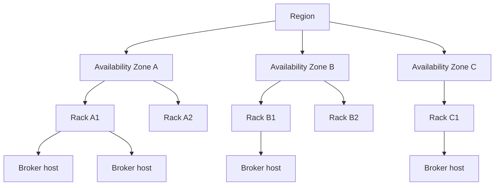
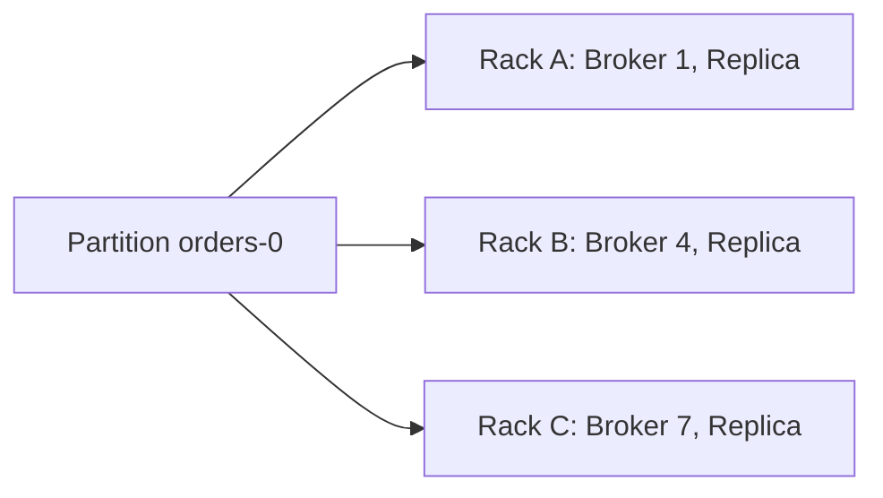
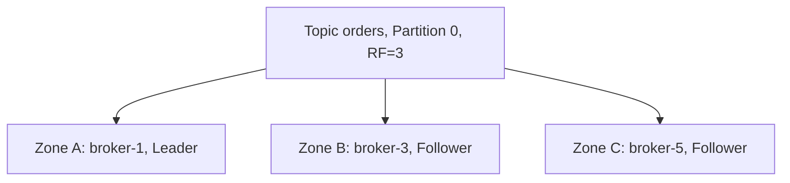

# Rack awareness và bố trí replica theo miền sự cố

## Vì sao vị trí replica quan trọng?

Replication factor cho biết một partition có bao nhiêu replica, nhưng chỉ đếm số bản sao là chưa đủ để đánh giá khả năng chịu lỗi. Nếu ba replica của một partition cùng nằm trong một rack, một sự cố nguồn điện hoặc switch của rack đó có thể làm mất cả ba replica cùng lúc. Cluster có thể cấu hình replication factor bằng 3 nhưng vẫn không chịu được một sự cố ở cấp rack.

Kafka hỗ trợ rack awareness để placement strategy có thể xét miền lỗi của broker khi phân phối replica. Mỗi broker được gán một định danh rack bằng cấu hình `broker.rack`. Khi tạo hoặc reassignment partition, thuật toán phân bổ replica có thể dùng thông tin này để đặt các replica của cùng partition lên các rack khác nhau, nếu topology và số broker cho phép.

Rack awareness giúp biến replication thành khả năng chịu lỗi theo hạ tầng thực tế. Tuy nhiên, nó không tự tạo thêm bản sao, không thay thế `acks` hoặc `min.insync.replicas`, và không bảo đảm cluster luôn không gián đoạn khi một rack gặp sự cố. Cần thiết kế đồng thời số replica, số failure domain, vị trí broker, chính sách ghi và quy trình kiểm chứng placement.

Trong module KAFKA, kiến thức này kết nối topic, partition, replication, producer, consumer group và KRaft với việc giám sát, tối ưu và phục hồi cụm event streaming bằng Java/Spring Kafka.

## 1. Miền sự cố là gì?

Miền sự cố (failure domain) là tập tài nguyên có thể cùng bị ảnh hưởng bởi một nguyên nhân chung. Trong hạ tầng Kafka, các cấp thường gặp gồm:

- **Process:** một tiến trình broker dừng hoặc crash.
- **Host:** máy chủ vật lý hoặc máy ảo gặp lỗi.
- **Rack:** nhiều host cùng dùng nguồn điện, switch hoặc hạ tầng mạng của một rack.
- **Availability zone (AZ):** một vùng hạ tầng độc lập trong một region, có thể chịu ảnh hưởng bởi sự cố điện, mạng hoặc vận hành ở cấp zone.
- **Region:** vùng địa lý lớn hơn; mất region thường là bài toán disaster recovery và cluster replication.



Mục tiêu của replica placement là tránh đặt nhiều bản sao của cùng partition vào chung một miền lỗi mà hệ thống muốn chịu được. Nếu muốn chịu lỗi một host, các replica phải nằm trên các host khác nhau. Nếu muốn chịu lỗi một rack hoặc AZ, replica cần được phân tán ở cấp rack hoặc AZ tương ứng.

Một cluster có thể chống lỗi một broker nhưng vẫn không chống được lỗi rack. Ví dụ, ba broker nằm trên ba máy vật lý khác nhau nhưng cùng kết nối vào một switch và một nguồn điện chung. Lỗi switch hoặc nguồn điện vẫn có thể làm cả ba broker mất kết nối.

## 2. Rack awareness trong Kafka hoạt động như thế nào?

### 2.1 Gán rack ID cho từng broker

Broker khai báo rack của mình bằng thuộc tính `broker.rack`. Ví dụ ba broker nằm ở ba rack khác nhau:

```properties
# Broker 1 (KRaft)
node.id=1
broker.rack=rack-a
```

```properties
# Broker 2 (KRaft)
node.id=2
broker.rack=rack-b
```

```properties
# Broker 3 (KRaft)
node.id=3
broker.rack=rack-c
```

Trong các phiên bản Kafka dùng `node.id`, hãy dùng định danh node theo cấu hình phiên bản đó; ví dụ trên tập trung vào thuộc tính rack. Các broker cùng nằm trong một rack vật lý phải khai báo cùng một giá trị `broker.rack`. Mỗi rack độc lập cần có giá trị khác nhau.

Giá trị rack là nhãn do người vận hành cung cấp. Kafka không tự dò ra máy chủ đang nối vào switch nào hoặc đang đặt trong AZ nào. Nếu gán sai nhãn, thuật toán có thể phân phối replica theo một topology tưởng tượng và tạo cảm giác an toàn giả.

### 2.2 Replica assignment xét rack

Khi phân bổ replica cho một partition, rack-aware assignment cố gắng đặt các replica lên những rack khác nhau khi số rack và số broker đủ đáp ứng. Ví dụ topic có replication factor 3 và cluster có ba rack, mỗi rack có ít nhất một broker đủ điều kiện:



Khi một rack bị mất, partition vẫn có thể còn replica ở các rack khác. Replica placement cũng cần tránh đặt hai replica của cùng partition lên cùng một broker; rack awareness mở rộng quyết định placement lên cấp miền lỗi cao hơn.

Thuật toán cụ thể và cách công cụ quản trị sử dụng rack metadata có thể thay đổi theo phiên bản Kafka. Không nên chỉ dựa vào việc đã khai báo `broker.rack` để kết luận mọi partition hiện hữu đã được di chuyển. Hãy kiểm tra assignment thực tế sau khi tạo topic hoặc reassignment.

### 2.3 Rack awareness không tự di chuyển replica cũ

Khai báo hoặc thay đổi `broker.rack` cung cấp metadata topology cho quá trình phân bổ. Các replica đã tồn tại không nhất thiết tự động được di chuyển sang rack mới. Nếu cluster trước đây phân bố replica sai, cần lập kế hoạch partition reassignment để đưa replica về đúng miền lỗi.

Reassignment phải được thực hiện có kiểm soát vì nó tạo traffic sao chép, dùng disk/network và có thể làm tăng tải broker. Khi thay đổi lớn, nên chia thành từng đợt, theo dõi ISR và under-replicated partitions, đồng thời giữ đủ headroom cho replication catch-up.

## 3. Chọn failure domain để đưa vào `broker.rack`

`broker.rack` là một giá trị đơn. Vì vậy, cần chọn cấp topology quan trọng nhất mà replica phải được phân tán để chống lại.

### 3.1 Dùng rack vật lý làm nhãn

Nếu yêu cầu là chịu được lỗi một rack trong cùng một AZ, có thể dùng mã rack vật lý như `dc1-az1-rack-a`, `dc1-az1-rack-b`. Replica của cùng partition sẽ được phân phối qua các rack khi có đủ broker.

### 3.2 Dùng AZ làm nhãn

Nếu yêu cầu ưu tiên là chịu được mất một AZ, có thể dùng tên AZ làm giá trị rack, ví dụ `region-a`, `region-b`, `region-c`. Khi đó, Kafka xem mỗi AZ là một rack độc lập ở cấp placement.

### 3.3 Một nhãn không biểu diễn đầy đủ topology phân cấp

Giả sử có ba AZ và mỗi AZ có nhiều rack vật lý. Nếu `broker.rack` là mã rack duy nhất trên toàn region, thuật toán có thể chọn ba rack khác nhau nhưng cả ba rack đó vẫn nằm trong cùng một AZ. Ngược lại, nếu dùng AZ làm rack ID, Kafka có thể phân tán replica qua các AZ nhưng không bảo đảm chúng ở các rack vật lý khác nhau bên trong mỗi AZ.

Vì vậy, cần xác định failure domain mục tiêu:

| Mục tiêu chịu lỗi | Giá trị `broker.rack` nên đại diện |
|---|---|
| Mất một host | Rack hoặc host domain, tùy cách host được quản lý |
| Mất một rack | Rack vật lý hoặc nhóm hạ tầng có chung nguồn điện/switch |
| Mất một AZ | Availability zone |
| Mất đồng thời nhiều cấp (rack và AZ) | Cần thiết kế topology/assignment nhiều cấp và kiểm tra placement; một nhãn đơn lẻ không diễn đạt đầy đủ mọi ràng buộc |

Nếu cần bảo vệ nhiều cấp, hãy xây dựng quy tắc placement và quy trình xác thực riêng, hoặc dùng công cụ quản lý cluster có hỗ trợ topology phân cấp. Không nên giả định Kafka sẽ tự hiểu cấu trúc AZ chứa rack chứa host từ một chuỗi `broker.rack`.

## 4. Chọn replication factor theo số rack

### 4.1 Khi số rack bằng hoặc lớn hơn replication factor

Nếu có ít nhất RF rack độc lập và đủ broker ở mỗi rack, có thể đặt một replica của partition trên mỗi rack. Với RF=3 và ba rack, mỗi partition có thể có một replica trên từng rack.

| Số rack độc lập | Replication factor | Placement mục tiêu |
|---:|---:|---|
| 3 | 3 | Một replica trên mỗi rack |
| 4 | 3 | Replica nằm trên 3 trong 4 rack |
| 5 | 3 | Replica nằm trên 3 trong 5 rack |
| 3 | 2 | Hai replica trên hai rack khác nhau |

Số rack cần tính là số failure domain thực sự độc lập theo nhãn đã khai báo, không phải số broker. Có 20 broker nhưng tất cả cùng `broker.rack=rack-a` vẫn chỉ là một rack theo góc nhìn của Kafka.

### 4.2 Khi số rack ít hơn replication factor

Nếu RF lớn hơn số rack, ít nhất một rack sẽ chứa nhiều hơn một replica của một số partition. Ví dụ RF=3 nhưng chỉ có hai rack, phân bố cân bằng nhất có thể là hai replica ở rack A và một replica ở rack B.

Với giả định các replica được phân bố đều nhất có thể trên \(D\) failure domain, số replica lớn nhất có thể nằm trong một domain ít nhất là:

\[
ReplicasInLargestDomain = \left\lceil \frac{RF}{D} \right\rceil
\]

Số replica còn lại sau khi mất domain chứa nhiều replica nhất xấp xỉ:

\[
SurvivingReplicas = RF - \left\lceil \frac{RF}{D} \right\rceil
\]

Đây là phép ước lượng theo phân bố đều; assignment thực tế cần được kiểm tra vì số broker khả dụng và topology có thể làm phân bố không đều.

Ví dụ:

| Rack độc lập (D) | RF | Phân bố lý tưởng | Replica còn lại khi mất rack có nhiều replica nhất |
|---:|---:|---|---:|
| 3 | 3 | 1 + 1 + 1 | 2 |
| 2 | 3 | 2 + 1 | 1 |
| 3 | 5 | 2 + 2 + 1 | 3 |
| 2 | 4 | 2 + 2 | 2 |

Nếu RF=3, D=2 và rack chứa hai replica bị mất, chỉ còn một replica. Với `min.insync.replicas=2`, producer dùng `acks=all` sẽ không thể tiếp tục ghi cho đến khi ISR đạt lại ngưỡng. Đây là lý do số rack độc lập cần được xem xét cùng RF và min ISR.

## 5. Kết hợp rack awareness với ISR và `acks`

Rack awareness quyết định replica được đặt ở đâu. ISR và `acks` quyết định điều kiện xác nhận ghi tại thời điểm producer gửi record. Hai phần bổ sung cho nhau.

Ví dụ một topic quan trọng có:

```properties
# Producer configuration
acks=all
enable.idempotence=true
```

```properties
# Topic configuration
min.insync.replicas=2
unclean.leader.election.enable=false
```

Replication factor được chọn khi tạo topic hoặc lập partition reassignment, ví dụ:

```bash
kafka-topics.sh --bootstrap-server kafka-1:9092 --create --topic orders --partitions 12 --replication-factor 3
```

Trong cluster có ba rack độc lập, placement mục tiêu là một replica ở mỗi rack. Nếu một rack bị mất, hai replica còn lại có thể vẫn thuộc ISR. Sau khi partition leader được bầu lại và ISR ổn định, ghi `acks=all` có thể tiếp tục vì ISR còn hai replica, đáp ứng `min.insync.replicas=2`.

Không nên hiểu rằng thao tác ghi sẽ không bị gián đoạn. Khi rack chứa leader gặp sự cố, partition cần chuyển leader; trong khoảng thời gian phát hiện lỗi, election và cập nhật metadata, producer có thể nhận lỗi hoặc timeout. Retry và idempotent producer giúp xử lý request an toàn hơn, nhưng ứng dụng vẫn cần quan sát và xử lý lỗi tạm thời.

Nếu hai replica cùng nằm trong rack bị mất, ISR có thể giảm xuống một. Khi min ISR là 2, Kafka từ chối ghi `acks=all`. Đây là hành vi bảo vệ dữ liệu: hệ thống từ chối chấp nhận thêm record khi số replica đồng bộ thấp hơn chính sách.

### 5.1 Clean leader election

Với `unclean.leader.election.enable=false`, Kafka không chọn một replica ngoài ISR làm leader chỉ để đưa partition trở lại trạng thái online. Điều này tránh nguy cơ chọn bản sao tụt hậu và làm mất record mới hơn đã được commit. Nếu toàn bộ ISR không khả dụng, partition có thể offline cho đến khi một replica hợp lệ trở lại.

Rack awareness giúp giảm khả năng tất cả replica cùng mất do một sự cố rack, nhưng không thay thế clean leader election. Hai cơ chế giải quyết hai phần khác nhau của bài toán durability và availability.

## 6. Ví dụ thiết kế ba rack và sáu broker

Giả sử một cluster có ba AZ, mỗi AZ có hai broker:

| Broker | Availability zone | `broker.rack` |
|---|---|---|
| broker-1 | zone-a | zone-a |
| broker-2 | zone-a | zone-a |
| broker-3 | zone-b | zone-b |
| broker-4 | zone-b | zone-b |
| broker-5 | zone-c | zone-c |
| broker-6 | zone-c | zone-c |

Topic `orders` có RF=3. Replica assignment mong muốn cho một partition:

| Replica | Broker | Zone |
|---|---|---|
| Leader | broker-1 | zone-a |
| Follower | broker-3 | zone-b |
| Follower | broker-5 | zone-c |

Một partition khác có thể chọn broker-2, broker-4 và broker-6 để phân bố tải. Việc phân bố leader trên các broker cần được kiểm tra riêng; rack-aware replica placement không đồng nghĩa leader load đã cân bằng hoàn toàn.



Nếu zone-a mất, hai replica ở zone-b và zone-c vẫn còn. Khi một replica trong ISR được chọn làm leader mới, partition có thể tiếp tục hoạt động sau thời gian failover. Nếu cả zone-a và zone-b cùng mất, chỉ còn một replica và khả năng ghi với min ISR=2 sẽ bị dừng.

## 7. Broker placement và replica placement là hai quyết định liên quan

Rack awareness chỉ có ý nghĩa nếu broker thực sự được đặt đúng hạ tầng. Người vận hành cần bảo đảm:

- Mỗi broker chạy ở host và failure domain đã dự kiến.
- Giá trị `broker.rack` phản ánh đúng rack hoặc AZ mục tiêu.
- Các broker cùng một rack không bị gán nhầm thành nhiều rack khác nhau.
- Các rack khác nhau không dùng chung một nhãn.
- Có đủ broker trong từng rack để placement và reassignment diễn ra khi cần.
- Storage, network và nguồn điện của các failure domain độc lập ở mức yêu cầu.

Nếu chạy Kafka trên Kubernetes, có thể dùng node label như `topology.kubernetes.io/zone` hoặc label rack do hạ tầng cung cấp để thiết lập rack ID. Cần bảo đảm broker pod được schedule theo node affinity/topology spread và `broker.rack` nhận đúng giá trị từ node đang chạy. Một StatefulSet có nhiều pod không tự bảo đảm các pod nằm ở các AZ khác nhau nếu scheduler không có ràng buộc topology.

## 8. Thay đổi topology và reassignment replica

### 8.1 Khi thêm rack mới

Thêm rack hoặc broker mới không nhất thiết tự di chuyển các replica cũ sang topology mới. Để tận dụng rack mới, cần xem xét reassignment partition. Việc này có thể phân phối lại replica để giảm tải và tăng khả năng chịu lỗi.

Trước khi reassignment:

1. Xác nhận broker mới đã khai báo đúng `broker.rack` và tham gia cluster ổn định.
2. Kiểm tra dung lượng disk, network và số replica hiện có trên broker đích.
3. Tạo kế hoạch reassignment cho các partition cần thay đổi.
4. Chạy theo từng đợt với tốc độ replication phù hợp.
5. Theo dõi ISR, under-replicated partitions, disk/network và consumer lag.
6. Xác nhận replica assignment cuối cùng thỏa yêu cầu failure domain.

### 8.2 Khi thay đổi rack ID

Thay đổi `broker.rack` có thể làm metadata topology khác với cách partition đã được phân bổ trước đây. Tùy phiên bản và cách quản lý cấu hình, thay đổi thuộc tính broker có thể cần cập nhật cấu hình và restart broker. Quan trọng hơn, replica cũ không tự động di chuyển chỉ vì nhãn rack thay đổi.

Không thay rack ID hàng loạt mà chưa có kế hoạch reassignment. Nếu hai rack vật lý bị gộp thành một nhãn hoặc một rack bị chia nhãn tùy tiện, thuật toán có thể đưa các replica của cùng partition vào cùng miền lỗi thật dù metadata báo chúng khác nhau.

### 8.3 Di chuyển replica có thể ảnh hưởng hiệu năng

Reassignment tạo thêm traffic giữa broker và có thể cạnh tranh với produce/fetch. Trong thời gian di chuyển, partition có thể tạm thời có replica đang sao chép và ISR chưa đạt trạng thái mong muốn. Hãy đặt giới hạn tốc độ reassignment phù hợp, tránh chạy đồng thời quá nhiều partition và lên lịch trong khoảng tải thấp nếu có thể.

## 9. Kiểm chứng rack awareness sau khi tạo topic

Không dừng ở việc kiểm tra cấu hình broker. Cần kiểm tra cả assignment thực tế.

### 9.1 Xem replica và ISR

Dùng lệnh sau để xem partition leader, replica được gán và ISR:

```bash
kafka-topics.sh --bootstrap-server kafka-1:9092 --describe --topic orders
```

Kết quả `Replicas` liệt kê broker ID giữ replica của partition; `Isr` liệt kê broker ID đang thuộc ISR; `Leader` cho biết broker leader. Lấy broker ID trong danh sách replica và đối chiếu với rack ID đã khai báo cho broker.

### 9.2 Kiểm tra placement theo rack

Với mỗi partition, hãy xác nhận:

1. Số broker replica bằng replication factor mong muốn.
2. Không có hai replica của cùng partition nằm trên cùng một broker.
3. Các replica nằm trên số rack độc lập theo mục tiêu thiết kế.
4. ISR có đủ replica khỏe mạnh để đáp ứng `min.insync.replicas`.
5. Leader và follower được phân bố hợp lý trên các broker, tránh một broker gánh quá nhiều leader hoặc traffic replication.

Có thể xây dựng báo cáo kiểm tra tự động bằng AdminClient để lấy metadata broker, partition và replica assignment, sau đó ánh xạ broker ID sang rack. Báo cáo nên cảnh báo partition có replica trùng rack, số ISR thấp, offline replica hoặc placement không đáp ứng yêu cầu zone.

### 9.3 Phân biệt replica assignment với rack-aware read

Rack-aware replica assignment là việc đặt bản sao partition lên các broker thuộc các rack khác nhau. Kafka cũng có cơ chế chọn replica gần client hơn cho một số kiểu fetch trong các phiên bản hỗ trợ, dựa trên thông tin rack của client và replica selector. Đây là bài toán đọc dữ liệu theo locality, khác với việc bố trí replica để chịu lỗi.

Đặt `broker.rack` đúng là một phần của topology broker, nhưng không có nghĩa consumer tự động đọc từ follower gần nhất. Cần cấu hình và xác minh riêng cơ chế rack-aware replica selection nếu muốn tối ưu network locality cho consumer.

## 10. Những lỗi thiết kế thường gặp

| Lỗi | Hậu quả | Cách khắc phục |
|---|---|---|
| Không cấu hình `broker.rack` | Assignment không có thông tin để phân tán theo rack | Gán rack ID chính xác cho từng broker |
| Mỗi broker trong cùng rack dùng một rack ID khác nhau | Kafka tưởng chúng thuộc các miền lỗi độc lập | Dùng cùng một nhãn cho cùng failure domain |
| Nhiều rack vật lý dùng chung một nhãn | Kafka không nhận ra sự độc lập thực tế | Chuẩn hóa rack ID theo topology hạ tầng |
| RF lớn hơn số rack nhưng không tính min ISR | Mất một rack có thể làm ISR thấp hơn ngưỡng ghi | Tính số replica còn lại trong tình huống rack mất |
| Chỉ kiểm tra RF, không kiểm tra assignment | Có đủ replica nhưng chúng có thể cùng rack | Đối chiếu broker ID với rack ID cho từng partition |
| Nghĩ đổi `broker.rack` sẽ tự di chuyển replica | Replica cũ vẫn có thể ở placement cũ | Lập kế hoạch reassignment và xác minh sau chuyển đổi |
| Reassignment quá nhiều cùng lúc | Tăng tải network/disk và replica lag | Chia đợt, giới hạn tốc độ và theo dõi ISR |
| Nhầm rack awareness với follower read | Kỳ vọng consumer tự động đọc local replica | Thiết kế replica placement và read selection riêng |
| Đặt voter KRaft và broker replica cùng một failure domain | Có thể mất cả control plane lẫn data plane khi một domain hỏng | Phân bố controller quorum và partition replica theo failure model riêng |

## 11. Checklist thiết kế cho production

Trước khi đưa topic quan trọng vào production, hãy xác nhận:

- Failure domain mục tiêu là host, rack hay AZ.
- Số rack độc lập đủ cho replication factor hay chưa.
- Mỗi broker có `broker.rack` đúng với vị trí thực tế.
- Replica assignment của từng partition đã phân tán theo rack như mong muốn.
- Replication factor, `min.insync.replicas`, `acks` và unclean leader election phù hợp với RPO/RTO.
- Broker và replica có đủ disk/network headroom khi một rack mất và traffic dồn sang các rack còn lại.
- Controller quorum KRaft được phân bố theo failure domain phù hợp, độc lập với kế hoạch replica partition.
- Quy trình reassignment và khôi phục broker/rack đã được diễn tập.
- Dashboard hiển thị ISR, under-replicated/offline partitions, leader distribution và replica placement theo rack.

Nên thử nghiệm sự cố trong môi trường staging: dừng một broker, sau đó mô phỏng mất cả rack hoặc zone theo quy trình an toàn. Quan sát thời gian phát hiện lỗi, leader election, ISR shrink/expand, producer retry, consumer lag và thời gian phục hồi. Một thiết kế chỉ được xem là đáp ứng yêu cầu khi kết quả thực nghiệm phù hợp với mục tiêu đã đặt ra.

## Kết luận

Rack awareness giúp Kafka phân phối replica theo miền sự cố thông qua nhãn `broker.rack`. Để một partition có thể chịu lỗi rack, các replica cần nằm trên những rack thực sự độc lập; replication factor phải được chọn cùng số rack, `min.insync.replicas` và `acks`. Nếu số rack ít hơn RF, một rack có thể chứa nhiều replica và việc mất rack đó có thể làm partition không đủ ISR để tiếp tục ghi.

Khi vận hành KAFKA, hãy mô hình hóa topology hạ tầng trước, gán rack ID nhất quán, kiểm tra assignment thực tế, và dùng reassignment có kiểm soát khi topology thay đổi. Đồng thời phân biệt replica placement với controller quorum KRaft và rack-aware read selection. Những bước này giúp replication bảo vệ được trước failure domain mà hệ thống thực sự muốn chịu, thay vì chỉ tăng số bản sao trên giấy.
