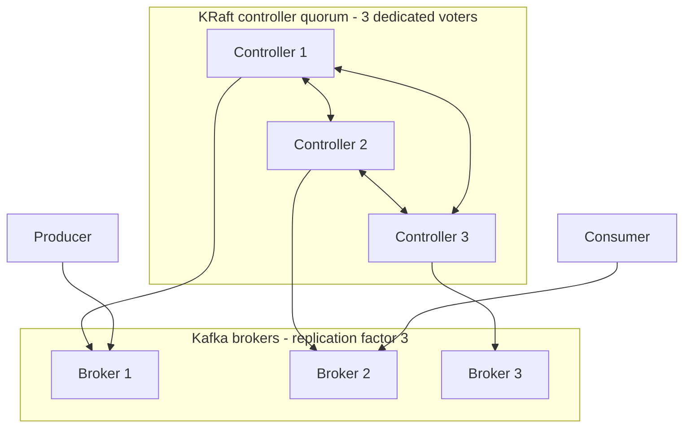

# Thử nghiệm broker lỗi để kiểm chứng tính sẵn sàng và độ bền

Replication giúp Kafka duy trì bản sao của partition trên nhiều broker. Khi một broker gặp sự cố, các replica còn đồng bộ (ISR) có thể tiếp tục phục vụ dữ liệu và một replica phù hợp có thể được bầu làm leader mới. Tuy nhiên, mức độ sẵn sàng và độ bền phụ thuộc vào replication factor, số replica đang nằm trong ISR, cấu hình producer `acks`, `min.insync.replicas` và chính sách bầu leader.

Bài thực hành này dựng một topic có replication factor ba, yêu cầu tối thiểu hai replica đồng bộ khi ghi, rồi lần lượt dừng broker follower và broker leader để quan sát hành vi của producer, consumer và controller. Người học kiểm tra ISR trước và sau sự cố, đo thời gian gián đoạn, xác minh dữ liệu sau khi broker phục hồi và phân tích trường hợp mất nhiều replica.

Mục tiêu là hiểu rõ điều gì được bảo vệ khi một broker lỗi, khi nào Kafka tiếp tục nhận ghi, khi nào ghi bị từ chối để bảo vệ durability, và vì sao một lần thử nghiệm phải phân biệt lỗi data plane của broker với lỗi metadata quorum của KRaft. Các thao tác dừng node chỉ được thực hiện trong cluster lab có dữ liệu thử nghiệm.

## 1. Mô hình thử nghiệm và điều kiện ban đầu

Sử dụng cluster Kafka có ít nhất ba broker. Mỗi partition của topic thử nghiệm sẽ có ba replica, mỗi replica đặt trên một broker khác nhau. Để kiểm tra riêng tác động của broker data-plane, nên dùng ba controller KRaft dedicated bên cạnh ba broker. Khi đó có thể dừng hai broker dữ liệu mà controller quorum vẫn giữ đủ majority.

Nếu lab dùng ba node combined (mỗi node vừa broker vừa controller), bài thử dừng một node vẫn có thể kiểm tra failover cơ bản: hai controller voter còn lại duy trì majority. Khi dừng hai node combined, controller quorum cũng mất majority; kết quả lúc này đồng thời phản ánh sự cố control plane và data plane, không thể quy toàn bộ hiện tượng cho replication broker. Hãy ghi rõ mô hình đang dùng trong biên bản thử nghiệm.



Chuẩn bị:

- Kafka cluster KRaft có ba broker đang hoạt động và ba controller voter (dedicated nếu muốn thử mất hai broker mà không mất controller quorum).
- Kafka CLI cùng phiên bản hoặc tương thích với cluster.
- Một ứng dụng producer và một consumer hoặc console tools.
- Quyền dừng/khởi động container hoặc service trong môi trường lab.
- Một topic riêng cho thử nghiệm, không dùng topic nghiệp vụ.

Xác nhận tất cả broker và partition hiện khỏe trước khi bắt đầu. Nếu lab chỉ có một broker, không thể kiểm chứng replication factor ba. Nếu chỉ có hai broker, không thể tạo ba replica độc lập.

## 2. Tạo topic với replication factor ba

Tạo topic `broker-failure-lab` có sáu partition, replication factor ba, `min.insync.replicas=2` và tắt unclean leader election cho topic:

```bash
kafka-topics.sh \
  --bootstrap-server broker-1:9092 \
  --create \
  --topic broker-failure-lab \
  --partitions 6 \
  --replication-factor 3 \
  --config min.insync.replicas=2 \
  --config unclean.leader.election.enable=false \
  --config cleanup.policy=delete \
  --config retention.ms=604800000
```

Sáu partition giúp quan sát nhiều leader và replica placement. Với ba broker, mỗi partition có một leader và hai follower; Kafka phân bố leader giữa các broker theo trạng thái assignment. `retention.ms` bảy ngày đủ cho bài lab ngắn và `cleanup.policy=delete` giữ nguyên lịch sử record trong thời gian thử nghiệm.

Kiểm tra leader, replica và ISR:

```bash
kafka-topics.sh \
  --bootstrap-server broker-1:9092 \
  --describe \
  --topic broker-failure-lab
```

Một dòng partition có dạng minh họa:

```text
Topic: broker-failure-lab  Partition: 0  Leader: 1  Replicas: 1,2,3  Isr: 1,2,3
```

Các ID chỉ là ví dụ. Ghi lại kết quả thực tế của tất cả partition, đặc biệt broker đang là leader của từng partition. Trạng thái ban đầu cần có ba replica trong ISR cho mỗi partition trước khi dừng node.

`min.insync.replicas=2` là ngưỡng tối thiểu của ISR để chấp nhận ghi với producer dùng `acks=all`. Cấu hình này không tự làm replication factor tăng lên ba; nó chỉ đặt ngưỡng an toàn cho thao tác ghi. Nếu chỉ có một replica đồng bộ, Kafka sẽ từ chối ghi với `acks=all` thay vì âm thầm chấp nhận mức durability thấp hơn.

## 3. Hiểu cấu hình producer và durability

Ba thiết lập cần được xem cùng nhau:

| Thiết lập | Giá trị trong lab | Ý nghĩa |
|---|---|---|
| `replication.factor` | `3` | Mỗi partition có tối đa ba bản sao được phân công trên ba broker |
| `min.insync.replicas` | `2` | Cần ít nhất hai replica thuộc ISR để chấp nhận ghi với `acks=all` |
| Producer `acks` | `all` | Leader chờ xác nhận từ các replica hiện có trong ISR trước khi báo ghi thành công |
| `unclean.leader.election.enable` | `false` | Không bầu replica ngoài ISR làm leader chỉ để khôi phục khả năng phục vụ |

`acks=all` không có nghĩa chờ mọi replica đã từng được cấu hình, kể cả replica đang offline hoặc đã rời ISR. Nó chờ các replica hiện nằm trong ISR. `min.insync.replicas` đặt ngưỡng tối thiểu trước khi leader chấp nhận ghi. Nếu ISR giảm dưới ngưỡng, producer có thể nhận `NotEnoughReplicas`; nếu ISR giảm trong khi chờ xác nhận, có thể nhận `NotEnoughReplicasAfterAppend`.

Để tránh retry tạo bản ghi trùng trong các tình huống request timeout và gửi lại, bật idempotence cho producer. Idempotence giúp Kafka loại bỏ duplicate do retry của cùng producer session theo các điều kiện cấu hình tương thích; nó không thay thế idempotency trong xử lý nghiệp vụ giữa nhiều hệ thống.

Ví dụ `application.yml` cho Spring Kafka:

```yaml
spring:
  kafka:
    bootstrap-servers: broker-1:9092,broker-2:9092,broker-3:9092
    producer:
      acks: all
      key-serializer: org.apache.kafka.common.serialization.StringSerializer
      value-serializer: org.springframework.kafka.support.serializer.JsonSerializer
      properties:
        enable.idempotence: true
        delivery.timeout.ms: 120000
        request.timeout.ms: 30000
    consumer:
      bootstrap-servers: broker-1:9092,broker-2:9092,broker-3:9092
      group-id: broker-failure-audit
      auto-offset-reset: earliest
      key-deserializer: org.apache.kafka.common.serialization.StringDeserializer
      value-deserializer: org.springframework.kafka.support.serializer.JsonDeserializer
      properties:
        spring.json.trusted.packages: com.example.kafkalab.event
        spring.json.value.default.type: com.example.kafkalab.event.ReplicationProbe
        spring.json.use.type.headers: false
```

Địa chỉ broker phải truy cập được từ môi trường chạy ứng dụng. Với môi trường Docker, dùng hostname service và listener nội bộ; với ứng dụng chạy trên host, dùng endpoint host đã quảng bá cho client. Nếu bootstrap thành công nhưng advertised listener không truy cập được, producer vẫn có thể thất bại khi kết nối leader partition.

## 4. Gửi dữ liệu có định danh để kiểm chứng

Mỗi record thử nghiệm cần có `eventId` hoặc `sequence` duy nhất để đối chiếu sau sự cố. Dùng key để phân phối dữ liệu qua partition; ví dụ nhiều `probeId` khác nhau:

```java
package com.example.kafkalab.event;

import java.time.Instant;

public record ReplicationProbe(
        String eventId,
        String probeId,
        long sequence,
        Instant sentAt
) {
}
```

Producer Spring Kafka gửi từng record và ghi lại metadata trả về từ broker:

```java
package com.example.kafkalab.producer;

import com.example.kafkalab.event.ReplicationProbe;
import org.slf4j.Logger;
import org.slf4j.LoggerFactory;
import org.springframework.kafka.core.KafkaTemplate;
import org.springframework.stereotype.Service;

import java.time.Instant;
import java.util.UUID;
import java.util.concurrent.TimeUnit;

@Service
public class ReplicationProbePublisher {
    private static final Logger log =
            LoggerFactory.getLogger(ReplicationProbePublisher.class);
    private static final String TOPIC = "broker-failure-lab";

    private final KafkaTemplate<String, ReplicationProbe> kafkaTemplate;

    public ReplicationProbePublisher(
            KafkaTemplate<String, ReplicationProbe> kafkaTemplate) {
        this.kafkaTemplate = kafkaTemplate;
    }

    public void publishRange(String runId, int first, int count) throws Exception {
        for (int i = first; i < first + count; i++) {
            String probeId = "probe-" + (i % 12);
            String eventId = runId + "-" + i + "-" + UUID.randomUUID();
            var event = new ReplicationProbe(eventId, probeId, i, Instant.now());

            var result = kafkaTemplate.send(TOPIC, probeId, event)
                    .get(120, TimeUnit.SECONDS);
            var metadata = result.getRecordMetadata();

            log.info("runId={} eventId={} partition={} offset={}",
                    runId, eventId, metadata.partition(), metadata.offset());
        }
    }
}
```

Gọi `publishRange` để gửi một đợt baseline trước khi gây lỗi, sau đó gọi lại trong lúc broker dừng và sau khi broker phục hồi. Trong bài lab, chờ từng future giúp xác định chính xác record nào thành công hoặc thất bại; khi đo throughput production, nên dùng tải bất đồng bộ có giới hạn và ghi latency phân vị để tránh phép đo bị chi phối bởi cách chờ tuần tự.

Ghi lại `eventId`, partition, offset và thời điểm gửi. Nếu producer nhận lỗi timeout, không tự kết luận record chắc chắn chưa được ghi: request có thể đã được append nhưng xác nhận bị mất trên đường về. Với idempotent producer, retry trong cùng producer session giúp hạn chế duplicate; khi kiểm tra kết quả, đối chiếu eventId và hiểu rõ semantics của từng lỗi.

## 5. Kiểm tra baseline trước khi dừng broker

Trước khi fault injection:

1. Chạy `kafka-topics.sh --describe` và xác nhận mỗi partition có leader, ba replica và ISR đủ ba broker.
2. Gửi một batch baseline, ví dụ 100 record có `eventId` duy nhất.
3. Xác nhận producer nhận thành công và ghi lại partition/offset.
4. Chạy consumer từ đầu topic hoặc dùng group kiểm thử mới để xác nhận các record baseline có thể đọc được.
5. Lưu thời gian gửi, số record thành công, lỗi, latency và consumer lag.

Kiểm tra consumer bằng CLI:

```bash
kafka-console-consumer.sh \
  --bootstrap-server broker-1:9092 \
  --topic broker-failure-lab \
  --from-beginning \
  --property print.key=true \
  --property print.partition=true \
  --property print.offset=true
```

Với topic thử nghiệm lớn, nên dùng một group kiểm tra riêng hoặc ứng dụng audit để tránh làm thay đổi offset của group nghiệp vụ. Console consumer ở trên có thể chạy ở terminal riêng; dừng bằng `Ctrl+C` sau khi đã quan sát đủ dữ liệu.

## 6. Thử nghiệm A: dừng một broker follower

Chọn một partition mục tiêu và broker xuất hiện trong cột `Replicas` nhưng không phải `Leader` của partition đó. Một broker có thể đồng thời là follower của partition này và leader của partition khác; vì vậy, khi dừng broker, hãy ghi nhận toàn bộ partition bị ảnh hưởng thay vì giả định chỉ có follower replica bị mất. Dừng broker đó bằng công cụ quản lý lab. Với Docker Compose:

```bash
docker compose stop kafka-2
```

Tên service `kafka-2` chỉ là ví dụ; thay bằng service thực tế. Lệnh `stop` yêu cầu tiến trình dừng có kiểm soát. Nếu muốn mô phỏng lỗi đột ngột, có thể dùng `docker kill kafka-2` trong lab và ghi rõ đây là hard failure.

Trong lúc broker follower dừng:

1. Tiếp tục gửi record bằng producer `acks=all` và quan sát kết quả.
2. Chạy lại `kafka-topics.sh --describe --topic broker-failure-lab` sau khi controller cập nhật ISR.
3. Xác nhận các partition có replica trên broker dừng còn hai replica trong ISR nếu hai broker còn lại vẫn đồng bộ.
4. Quan sát consumer tiếp tục fetch từ leader hiện tại.
5. Ghi lại số lần retry, lỗi gửi, latency và lag.

Với replication factor ba và `min.insync.replicas=2`, ghi thường có thể tiếp tục khi một follower rời ISR, vì hai replica còn lại vẫn đáp ứng ngưỡng. Tuy nhiên, không nên giả định kết quả tức thì: ISR cần thời gian cập nhật, broker leader có thể tạm báo lỗi retriable, và nếu replica còn lại đang lag hoặc không truy cập được thì producer vẫn có thể thất bại.

Khởi động lại follower:

```bash
docker compose start kafka-2
```

Chờ broker đăng ký lại, replica bắt kịp leader và xuất hiện lại trong ISR. Kiểm tra `--describe` cho đến khi các partition liên quan trở lại ISR đủ ba replica. Không bắt đầu fault injection tiếp theo khi broker còn đang phục hồi hoặc ISR chưa ổn định.

## 7. Thử nghiệm B: dừng broker đang là partition leader

Chọn một broker đang làm leader của ít nhất một partition. Ghi lại partition và leader trước khi dừng. Tiếp tục gửi record trong khi dừng broker:

```bash
docker compose stop kafka-1
```

Khi leader dừng, controller phát hiện broker mất kết nối và có thể bầu một replica khác trong ISR làm leader mới. Trong thời gian election, producer có thể gặp timeout hoặc lỗi retriable; consumer có thể tạm ngừng fetch partition đó. Khi leader mới được chọn và metadata được cập nhật, client thường kết nối lại và tiếp tục hoạt động.

Quan sát:

- Leader ID của partition có thay đổi không.
- Replica được chọn làm leader mới có thuộc ISR trước khi broker lỗi hay không.
- Producer tiếp tục gửi thành công sau khoảng gián đoạn bao lâu.
- Consumer fetch có bị tạm dừng và lag tăng bao nhiêu.
- Partition nào bị ảnh hưởng trực tiếp; các partition có leader trên broker khác có thể tiếp tục hoạt động bình thường.

Với hai replica còn trong ISR và `min.insync.replicas=2`, producer có thể tiếp tục ghi sau khi leader mới ổn định. Một khoảng gián đoạn ngắn trong lúc phát hiện lỗi, election và metadata refresh là bình thường. Ghi nhận thời gian từ lần gửi thành công cuối trước sự cố đến lần gửi thành công đầu tiên sau failover để ước lượng recovery time.

Khởi động lại broker cũ và đợi nó đồng bộ lại. Broker vừa trở lại có thể là follower thay vì lấy lại vai trò leader ngay. Kafka không bắt buộc tự động chuyển leader về broker cũ sau khi node hồi phục.

## 8. Thử nghiệm C: mất hai broker dữ liệu

Chỉ thực hiện thử nghiệm này khi controller quorum độc lập vẫn có đủ majority, ví dụ ba dedicated controller voter và ba broker dữ liệu. Nếu dùng ba node combined, dừng hai node sẽ làm mất cả hai broker và controller majority; hãy coi đó là một bài thử control-plane riêng, không dùng để kết luận riêng về `min.insync.replicas`.

Trước tiên xác nhận tất cả partition có đủ ba replica trong ISR. Sau đó dừng hai broker dữ liệu, để lại một broker:

```bash
docker compose stop kafka-2 kafka-3
```

Kết quả cần quan sát:

- ISR của các partition có thể chỉ còn một replica.
- Với `min.insync.replicas=2` và producer `acks=all`, các lần ghi vào partition chỉ còn một ISR bị từ chối để bảo vệ durability.
- Producer có thể nhận `NotEnoughReplicas` hoặc `NotEnoughReplicasAfterAppend`, tùy thời điểm lỗi và trạng thái append/ack.
- Consumer có thể đọc từ partition nếu broker còn lại đang giữ leader hợp lệ và endpoint truy cập được; partition cần bầu leader nhưng không còn replica đủ điều kiện có thể offline.
- Các thao tác metadata hoặc partition failover vẫn phụ thuộc controller quorum và trạng thái broker.

Không hạ `min.insync.replicas` xuống một chỉ để làm producer gửi thành công trong bài thử này. Mục tiêu là quan sát cách Kafka từ chối ghi khi không còn đủ bản sao đồng bộ. Nếu thay ngưỡng, phải coi đó là một thử nghiệm khác và ghi rõ durability đã giảm.

Khởi động lại từng broker:

```bash
docker compose start kafka-2
```

Chờ broker 2 bắt kịp và trở lại ISR. Sau đó mới khởi động broker 3:

```bash
docker compose start kafka-3
```

Khởi động từng node giúp quan sát quá trình replica catch-up và tránh đồng thời tạo tải phục hồi lớn. Kiểm tra ISR của từng partition cho đến khi trạng thái ổn định.

## 9. Thử nghiệm D: so sánh acks=1 với acks=all

Để hiểu đánh đổi giữa availability và durability, chạy lại một bài thử có kiểm soát với cùng topic và cùng lỗi broker nhưng thay `acks`:

| Cấu hình | Khi ISR còn hai replica với min ISR bằng hai | Khi ISR chỉ còn một replica |
|---|---|---|
| `acks=all` | Có thể ghi khi hai replica đáp ứng ngưỡng | Bị từ chối bởi `min.insync.replicas=2` |
| `acks=1` | Leader xác nhận sau khi append cục bộ; không chờ follower xác nhận | Có thể được leader còn sống chấp nhận dù ISR dưới ngưỡng dành cho `acks=all` |

`min.insync.replicas` là rào chắn cho ghi với `acks=all`; không nên xem nó là yêu cầu tối thiểu bắt buộc cho mọi chế độ `acks=1`. Với `acks=1`, producer có thể nhận xác nhận ngay khi leader ghi cục bộ, trước khi follower sao chép record. Nếu leader sau đó hỏng trước khi follower nhận record, dữ liệu đã được xác nhận có thể bị mất khi replica khác được bầu làm leader.

Đây là lý do `acks=all` kết hợp `min.insync.replicas` phù hợp với dữ liệu cần durability cao. `acks=1` có thể giảm latency nhưng chấp nhận rủi ro mất dữ liệu cao hơn khi leader lỗi. `acks=0` không chờ broker xác nhận và không phù hợp để kiểm chứng độ bền.

## 10. Unclean leader election và rủi ro mất dữ liệu

Khi tất cả replica trong ISR không thể làm leader, Kafka có thể để partition offline nếu `unclean.leader.election.enable=false`. Cấu hình này ưu tiên nhất quán và durability: broker không bầu một replica ngoài ISR chỉ để khôi phục khả năng đọc/ghi.

Nếu bật unclean leader election, Kafka có thể bầu replica không nằm trong ISR làm leader khi không còn ISR replica khả dụng. Replica này có thể thiếu những record đã được leader cũ xác nhận nhưng chưa kịp sao chép. Khi đó cluster có thể phục vụ trở lại nhanh hơn nhưng có nguy cơ mất dữ liệu hoặc tạo lịch sử log không đầy đủ.

| Chính sách | Ưu tiên | Đánh đổi |
|---|---|---|
| Unclean election tắt | Durability và tránh bầu replica đã tụt hậu | Partition có thể offline nếu không còn ISR replica khả dụng |
| Unclean election bật | Khôi phục availability trong một số tình huống | Có thể mất record chưa được replica ngoài ISR nhận |

Không thay đổi cấu hình unclean election giữa một lần thử mà không ghi nhận. Với bài lab độ bền, giữ `false` để quan sát việc Kafka chấp nhận partition offline thay vì bầu replica có nguy cơ thiếu dữ liệu.

## 11. Kiểm tra dữ liệu sau khi broker phục hồi

Sau khi tất cả broker hoạt động lại và ISR ổn định:

1. Dùng `kafka-topics.sh --describe` xác nhận leader và ISR của tất cả partition.
2. Dùng consumer group kiểm tra riêng để đọc dữ liệu từ đầu topic.
3. Thu thập tất cả `eventId` của các đợt baseline, broker-down và recovery.
4. So sánh danh sách eventId đã gửi thành công với danh sách consumer đọc được.
5. Kiểm tra duplicate, missing event và thứ tự trong từng partition.
6. Ghi lại những record producer nhận timeout nhưng có thể đã append; không coi timeout đồng nghĩa chắc chắn không có record.

Lệnh đọc lại bằng group audit mới:

```bash
kafka-console-consumer.sh \
  --bootstrap-server broker-1:9092 \
  --topic broker-failure-lab \
  --group broker-failure-audit-run-02 \
  --from-beginning \
  --property print.key=true \
  --property print.partition=true \
  --property print.offset=true
```

Thay group ID bằng một giá trị mới cho mỗi lần audit nếu cần đọc lại từ đầu. Với consumer group đã có committed offset, `--from-beginning` không tự đưa group về đầu; nó chỉ có tác dụng khi group chưa có offset hợp lệ. Khi cần so sánh chính xác, dùng công cụ đọc dữ liệu xuất eventId ra file hoặc database kiểm thử rồi đối chiếu tự động.

Độ bền của Kafka phải được đánh giá theo hợp đồng producer. Nếu producer nhận ack thành công với `acks=all`, `min.insync.replicas=2` và idempotence bật, record đã được xác nhận theo điều kiện replica hiện có. Nếu producer nhận timeout, trạng thái append có thể chưa rõ với ứng dụng; cần đối chiếu log và eventId thay vì gán ngay thành mất dữ liệu.

## 12. Đo tính sẵn sàng và độ bền

Ghi kết quả mỗi lần chạy theo một bảng thống nhất:

| Chỉ số | Cách đo | Ý nghĩa |
|---|---|---|
| Failover time | Từ khi broker leader dừng đến khi producer gửi thành công ổn định trở lại | Thời gian gián đoạn do leader election và metadata refresh |
| Producer success rate | Số record ack thành công / tổng số lần gửi | Khả năng tiếp tục nhận ghi |
| Producer error rate | Số lỗi theo loại / tổng lần gửi | Phân biệt timeout, lỗi retriable và từ chối do min ISR |
| p95/p99 send latency | Đo thời gian từ send đến ack | Đánh giá ảnh hưởng độ trễ trong failover |
| ISR size | `kafka-topics.sh --describe` hoặc metric broker | Số replica đang đồng bộ cho mỗi partition |
| Offline partition | Metadata/metric cluster | Partition không có leader phục vụ |
| Consumer lag | `kafka-consumer-groups.sh --describe` | Mức chậm của consumer trong và sau sự cố |
| Missing/duplicate event | Đối chiếu eventId đã gửi và đã đọc | Kiểm chứng độ bền và hành vi retry |

Kiểm tra consumer group lag:

```bash
kafka-consumer-groups.sh \
  --bootstrap-server broker-1:9092 \
  --describe \
  --group broker-failure-audit
```

Một lần thử chỉ có giá trị khi ghi lại điều kiện ban đầu, broker bị dừng, thời điểm bắt đầu/kết thúc, cấu hình producer, ISR trước/sau và dữ liệu đọc lại. Không chỉ dựa vào log container `running` để kết luận broker đã bắt kịp; hãy xác nhận replica trở lại ISR.

## 13. Phân tích các tình huống thường gặp

| Hiện tượng | Nguyên nhân có thể có | Hướng xử lý |
|---|---|---|
| Dừng follower nhưng producer vẫn gửi thành công | ISR còn hai replica và đáp ứng `min.insync.replicas=2` | Đây là kết quả mong đợi; theo dõi ISR và latency |
| Dừng leader làm producer timeout ngắn | Controller cần phát hiện lỗi, bầu leader mới và client refresh metadata | Quan sát leader mới và retry; đo recovery time |
| Producer nhận `NotEnoughReplicas` | ISR thấp hơn min ISR trước khi append | Khôi phục replica hoặc điều tra vì sao replica rời ISR |
| Producer nhận `NotEnoughReplicasAfterAppend` | ISR thay đổi trong quá trình chờ ack sau append | Đối chiếu eventId và log; không kết luận ngay record bị mất |
| Partition offline sau khi nhiều broker lỗi | Không còn replica trong ISR đủ điều kiện làm leader, unclean election tắt | Khôi phục replica gốc; tránh ép bầu replica tụt hậu nếu durability quan trọng |
| Broker đã chạy lại nhưng ISR chưa đủ | Replica đang catch-up hoặc có lỗi disk/network | Kiểm tra log broker, replication lag và disk/network throughput |
| Consumer lag tăng trong failover | Fetch tạm dừng hoặc consumer đang retry | Theo dõi lag sau khi partition leader ổn định |
| Dữ liệu đọc lại có duplicate | Producer retry không idempotent, consumer xử lý lặp hoặc gửi lại ở tầng ứng dụng | Bật idempotent producer và làm consumer idempotent theo eventId |
| Hai broker dừng làm mất controller quorum | Lab đang dùng combined mode | Tách dedicated controller hoặc ghi nhận đây là thử nghiệm cả control plane lẫn data plane |

## 14. Nguyên tắc an toàn khi thử nghiệm

- Chỉ dùng cluster và topic lab; không dừng broker production để thử nghiệm tự phát.
- Ghi lại trạng thái ISR và leader trước mỗi thao tác dừng node.
- Chỉ thử một lỗi tại một thời điểm, chờ cluster ổn định rồi mới chuyển sang lỗi tiếp theo.
- Giữ `min.insync.replicas` và `acks` cố định trong cùng một lượt so sánh.
- Không giảm min ISR để che lỗi replica hoặc làm producer tiếp tục ghi khi durability đã suy giảm.
- Không bật unclean leader election trong bài kiểm chứng durability nếu chưa có mục tiêu và quy trình riêng.
- Không xóa volume, format storage hoặc tạo cluster ID mới để xử lý broker không khởi động.
- Khôi phục broker và xác nhận ISR đủ trước khi kết thúc bài lab.
- Lưu kết quả, cấu hình và log để có thể lặp lại cùng kịch bản.

## 15. Ghi nhớ

| Khái niệm | Điều cần nhớ |
|---|---|
| Replication factor `3` | Ba replica được phân công cho mỗi partition trên ba broker |
| ISR | Những replica đang theo kịp leader và đủ điều kiện tham gia bầu leader an toàn |
| `acks=all` | Chờ xác nhận từ các replica hiện có trong ISR |
| `min.insync.replicas=2` | Từ chối ghi `acks=all` nếu ISR thấp hơn hai |
| Leader failover | Replica trong ISR có thể được bầu làm leader mới |
| Unclean leader election | Có thể khôi phục availability nhưng có nguy cơ mất dữ liệu |
| Controller quorum | Điều phối metadata và election; cần phân biệt với replication dữ liệu partition |

Một broker lỗi trong cluster có replication factor ba thường không làm dừng toàn bộ luồng ghi nếu hai replica còn lại vẫn trong ISR và producer dùng `acks=all` với `min.insync.replicas=2`. Khi số replica đồng bộ giảm dưới ngưỡng, Kafka từ chối ghi để bảo vệ độ bền. Thử nghiệm cần đo cả thời gian failover, ISR, producer errors, consumer lag và dữ liệu đọc lại sau phục hồi để đánh giá đúng tính sẵn sàng của cluster.
