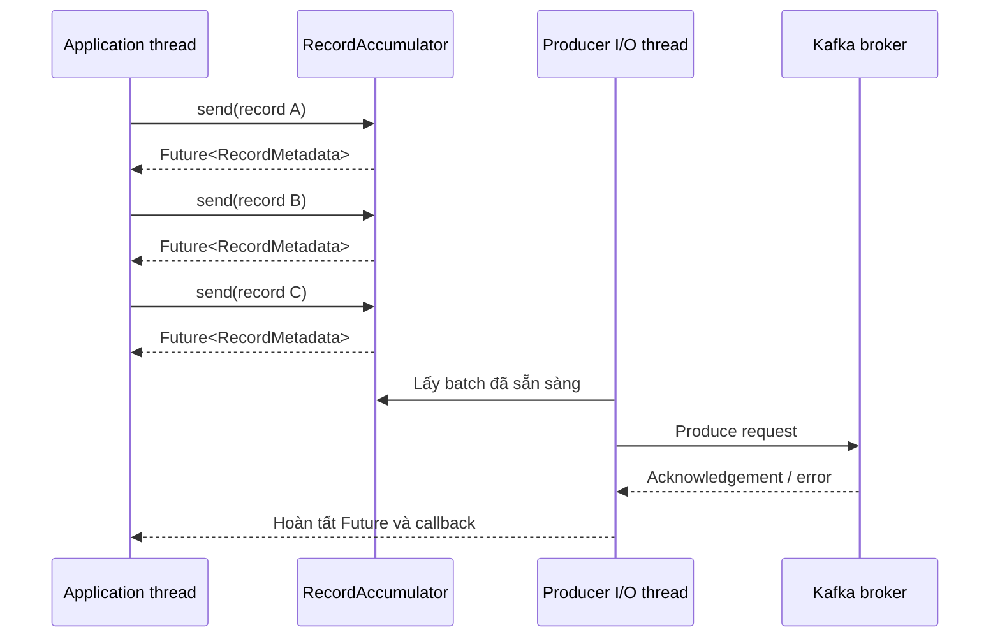
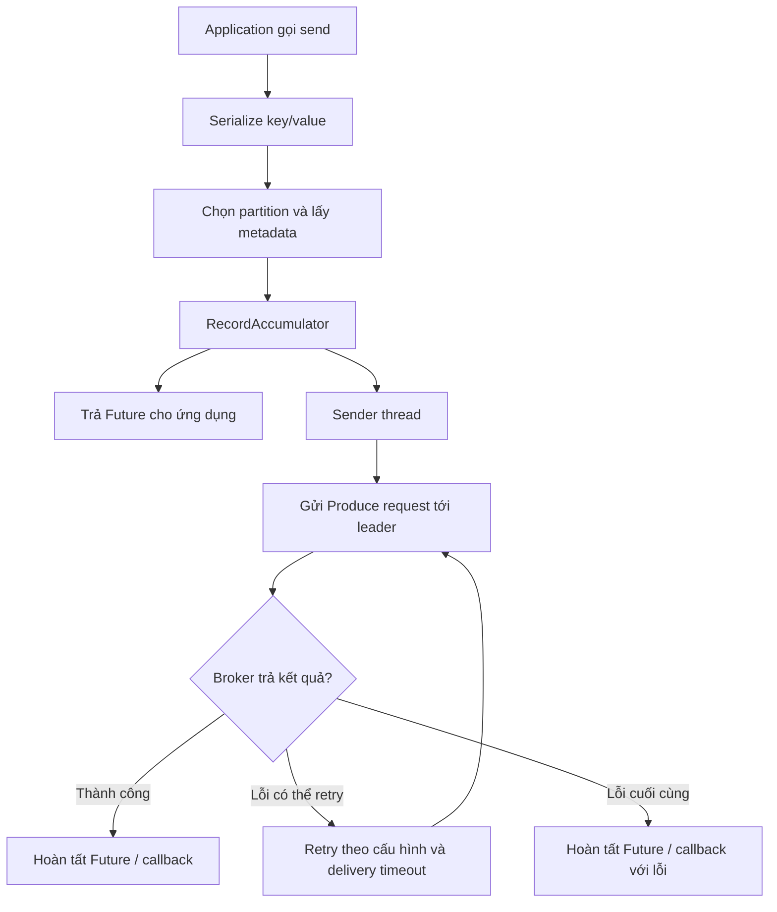

# Phân biệt gửi bất đồng bộ với chờ kết quả từng bản ghi

## Mục tiêu

Kafka Java Producer cung cấp API `send()` bất đồng bộ: ứng dụng gửi record vào producer, còn một luồng I/O nền gom batch và gửi request tới broker. Ứng dụng có thể tiếp tục làm việc trong lúc Kafka xử lý request, rồi nhận kết quả qua `Future` hoặc callback. Nếu gọi `get()` ngay sau mỗi `send()`, luồng ứng dụng sẽ chờ kết quả của từng record trước khi gửi record tiếp theo. Cách chờ này dễ hiểu nhưng thường làm giảm batching và throughput.

Sau bài học này, bạn có thể:

- Mô tả luồng xử lý của `KafkaProducer.send()` và vai trò của `Future<RecordMetadata>`.
- Phân biệt gửi bất đồng bộ với gửi rồi chờ kết quả từng record.
- Chọn callback, `Future.get()`, `flush()` hoặc `close()` theo vòng đời ứng dụng.
- Nhận biết các điểm mà `send()` vẫn có thể block dù API là bất đồng bộ.
- Xử lý lỗi đồng bộ, lỗi bất đồng bộ, timeout và interrupt đúng cách.
- Giữ ordering theo partition và tránh callback làm nghẽn luồng I/O của producer.
- Áp dụng hai cách gửi với Java Kafka Producer và Spring Kafka `KafkaTemplate`.

## 1. Hai cách chờ kết quả của cùng một API

Kafka Java Producer có một API gửi chính là `send(ProducerRecord)`. API này đưa record vào quy trình gửi bất đồng bộ và trả về `Future<RecordMetadata>`. Sự khác nhau giữa hai cách sử dụng nằm ở thời điểm ứng dụng chờ kết quả:

- **Bất đồng bộ:** gọi `send()` rồi tiếp tục xử lý. Khi broker hoàn tất theo cấu hình `acks`, producer hoàn thành future và gọi callback nếu được đăng ký.
- **Chờ từng record:** gọi `send(record).get()`. Luồng ứng dụng chặn tại `get()` cho tới khi future hoàn tất hoặc lỗi, rồi mới đi tới câu lệnh tiếp theo.



Ứng dụng không cần tạo một thread riêng cho mỗi record. `KafkaProducer` có các thành phần nội bộ để tích lũy record, tạo batch và gửi request. Cả cách bất đồng bộ lẫn cách gọi `get()` đều dùng cùng cơ chế gửi này; `get()` chỉ làm luồng gọi chờ kết quả.

## 2. Luồng xử lý bên trong `send()`

Ở mức khái quát, khi ứng dụng gọi:

```java
Future<RecordMetadata> future = producer.send(record);
```

Kafka Producer thực hiện các bước chính:

1. Kiểm tra producer còn hoạt động và kiểm tra record.
2. Serialize key và value theo serializer đã cấu hình.
3. Xác định partition, lấy metadata cần thiết nếu chưa có.
4. Đưa record vào `RecordAccumulator` để gom với các record khác cùng partition thành batch.
5. Trả về `Future<RecordMetadata>` cho ứng dụng.
6. Luồng I/O nền (`Sender`) lấy batch đủ điều kiện gửi, gửi Produce request tới broker leader của partition.
7. Khi request hoàn tất theo cấu hình `acks`, producer hoàn thành future và gọi callback (nếu có).

`RecordAccumulator` gom record theo partition. Một batch được gửi khi đủ lớn, khi hết thời gian chờ `linger.ms`, hoặc khi producer cần giải phóng buffer/được yêu cầu flush. `batch.size` là kích thước mục tiêu cho batch của mỗi partition; record lớn có thể tạo batch riêng. Nén thường được thực hiện trên batch, vì vậy nhiều record trong một batch có thể giảm overhead network và tăng hiệu quả compression.



`send()` trả về future sau khi record được chấp nhận vào luồng xử lý của producer, không phải sau khi broker đã xác nhận. Kết quả thành công có ý nghĩa theo `acks` đã cấu hình: ví dụ `acks=all` chờ ISR xác nhận theo chính sách replication. Nó không chứng minh consumer đã đọc record hoặc nghiệp vụ phía sau đã hoàn tất.

## 3. Gửi bất đồng bộ với callback

Callback được truyền trực tiếp vào `send(record, callback)`. Khi gửi thành công, callback nhận `RecordMetadata`; khi gửi thất bại, callback nhận exception.

```java
import org.apache.kafka.clients.producer.KafkaProducer;
import org.apache.kafka.clients.producer.ProducerRecord;
import org.apache.kafka.clients.producer.RecordMetadata;
import org.apache.kafka.clients.producer.Callback;

public class AsyncProducerExample {
    public static void main(String[] args) {
        Properties props = new Properties();
        props.put("bootstrap.servers", "localhost:9092");
        props.put("key.serializer",
                "org.apache.kafka.common.serialization.StringSerializer");
        props.put("value.serializer",
                "org.apache.kafka.common.serialization.StringSerializer");
        props.put("acks", "all");
        props.put("enable.idempotence", "true");

        try (KafkaProducer<String, String> producer =
                     new KafkaProducer<>(props)) {
            ProducerRecord<String, String> record =
                    new ProducerRecord<>("orders", "order-1001", "created");

            producer.send(record, (metadata, exception) -> {
                if (exception != null) {
                    System.err.println("Gửi thất bại: " + exception.getMessage());
                    return;
                }

                System.out.printf(
                        "Gửi thành công: topic=%s partition=%d offset=%d%n",
                        metadata.topic(), metadata.partition(), metadata.offset()
                );
            });

            // Chờ các record đã gửi hoàn tất trước khi thoát ví dụ.
            producer.flush();
        }
    }
}
```

Đoạn code cần các import `java.util.Properties` và Kafka client tương ứng. Ví dụ dùng `System.out` để dễ quan sát; trong ứng dụng thật, callback nên ghi metric/log nhanh hoặc chuyển công việc nặng sang executor riêng.

### 3.1. Callback chạy ở đâu?

Callback của producer được gọi bởi luồng I/O gửi request khi kết quả được xử lý. Vì vậy, callback không nên:

- Gọi một HTTP service chậm hoặc truy vấn database đồng bộ.
- Chờ `Future.get()` của một request khác.
- Thực hiện xử lý CPU nặng hoặc chờ lock lâu.
- Gọi `producer.flush()` từ callback.

Callback chậm có thể giữ chân luồng gửi và làm chậm các request khác. Nếu cần xử lý tiếp, hãy đẩy một tác vụ ngắn vào executor có giới hạn hàng đợi và có chính sách khi hàng đợi đầy. Không tạo thread mới vô hạn trong mỗi callback.

### 3.2. Callback và Future có thể dùng cùng lúc

`send(record, callback)` vẫn trả về `Future<RecordMetadata>`. Ứng dụng có thể chọn một cơ chế quan sát kết quả phù hợp. Không nên vừa chặn `get()` ngay lập tức vừa chờ callback cho cùng một record nếu không có lý do cụ thể; điều đó làm code phức tạp mà không tăng độ tin cậy.

## 4. Chờ kết quả từng record với `Future.get()`

Khi gọi `get()`, luồng hiện tại chờ cho đến khi producer hoàn tất request hoặc báo lỗi. Đây là cách dễ viết khi cần kết quả của record trước khi quyết định bước tiếp theo.

```java
import java.util.Properties;
import java.util.concurrent.ExecutionException;

import org.apache.kafka.clients.producer.KafkaProducer;
import org.apache.kafka.clients.producer.ProducerRecord;
import org.apache.kafka.clients.producer.RecordMetadata;

public class SyncPerRecordExample {
    public static void main(String[] args) {
        Properties props = new Properties();
        props.put("bootstrap.servers", "localhost:9092");
        props.put("key.serializer",
                "org.apache.kafka.common.serialization.StringSerializer");
        props.put("value.serializer",
                "org.apache.kafka.common.serialization.StringSerializer");
        props.put("acks", "all");
        props.put("enable.idempotence", "true");

        try (KafkaProducer<String, String> producer =
                     new KafkaProducer<>(props)) {
            for (int i = 1; i <= 3; i++) {
                ProducerRecord<String, String> record =
                        new ProducerRecord<>(
                                "orders", "order-" + i, "created");

                try {
                    RecordMetadata metadata = producer.send(record).get();
                    System.out.printf(
                            "topic=%s partition=%d offset=%d%n",
                            metadata.topic(), metadata.partition(), metadata.offset()
                    );
                } catch (InterruptedException e) {
                    Thread.currentThread().interrupt();
                    throw new IllegalStateException(
                            "Thread bị interrupt khi chờ Kafka", e);
                } catch (ExecutionException e) {
                    throw new IllegalStateException(
                            "Kafka không xác nhận được record", e.getCause());
                }
            }
        }
    }
}
```

Trong vòng lặp này, record thứ hai chỉ được gửi sau khi record thứ nhất đã hoàn tất future. Đây là **chờ từng record**, không phải một API gửi riêng khác của Kafka. Producer vẫn dùng luồng I/O nền để gửi dữ liệu; luồng ứng dụng chỉ bị chặn ở `get()`.

### 4.1. Khi nào chờ từng record có ích?

- Bước nghiệp vụ kế tiếp phụ thuộc vào offset hoặc kết quả xác nhận của record hiện tại.
- Lưu lượng thấp và code cần đơn giản, dễ quan sát.
- Công cụ quản trị hoặc tác vụ một lần cần báo lỗi ngay tại record đang gửi.
- Cần phản hồi đồng bộ cho một request và chấp nhận độ trễ tăng.

Không nên dùng chờ từng record cho luồng gửi khối lượng lớn chỉ vì muốn “chắc chắn Kafka đã nhận”. Hãy xác định chính sách `acks`, timeout và cách xử lý lỗi trước; `get()` không tự nâng mức durability.

## 5. So sánh hiệu năng và khả năng kiểm soát

| Tiêu chí | Gửi bất đồng bộ | Chờ từng record (`send().get()`) |
|---|---|---|
| Luồng ứng dụng | Tiếp tục sau khi enqueue record | Chặn đến khi future hoàn tất |
| Throughput | Thường cao hơn khi có nhiều record | Thường thấp hơn do chờ tuần tự |
| Batching | Dễ tích lũy nhiều record cùng partition | Khó gom batch từ cùng luồng vì chờ sau mỗi record |
| Latency của một record | Kết quả đến qua callback/future sau | Luồng gọi thấy kết quả ngay sau `get()` |
| Backpressure | Cần giới hạn số request đang chờ và theo dõi buffer | Việc chờ tạo một dạng backpressure tuần tự tự nhiên |
| Xử lý lỗi | Callback hoặc future hoàn tất lỗi | Bắt lỗi ngay tại `get()` |
| Độ phức tạp | Cần quản lý callback, outstanding sends và shutdown | Dễ hiểu hơn, nhưng có thể lãng phí thời gian chờ |
| Thích hợp | Luồng event, ingestion, tải nhiều record | Tác vụ ít record hoặc phụ thuộc kết quả từng bước |

### 5.1. Vì sao bất đồng bộ thường nhanh hơn?

Giả sử mỗi produce request mất trung bình 8 ms để hoàn tất. Nếu một thread gửi một record rồi chờ `get()` trước khi gửi record kế tiếp, tốc độ lý tưởng của thread đó bị giới hạn xấp xỉ 125 record/giây, chưa tính serialization và xử lý khác.

Nếu gửi bất đồng bộ, ứng dụng có thể enqueue nhiều record trước khi các request hoàn tất. Producer có cơ hội gom record thành batch, nén theo batch và gửi request theo cơ chế pipelining. Thông lượng thực tế còn phụ thuộc số partition, batch size, linger, broker, network, compression và số thread gọi producer.

Ví dụ ước lượng trên chỉ minh họa chi phí chờ tuần tự, không phải benchmark hay cam kết throughput của Kafka.

### 5.2. Chờ sau một nhóm record vẫn có thể giữ batching

Không nhất thiết phải chọn giữa “không bao giờ chờ” và “chờ sau mỗi record”. Có thể gửi nhiều record bất đồng bộ, sau đó chờ ở ranh giới batch bằng `flush()` hoặc thu thập các future rồi chờ ở cuối nhóm.

```java
for (Order order : orders) {
    ProducerRecord<String, String> record = new ProducerRecord<>(
            "orders", order.id(), order.toJson());
    producer.send(record);
}

// Chỉ chờ sau khi đã gửi hết nhóm record.
producer.flush();
```

Đây là một mẫu hữu ích cho import, batch job hoặc tác vụ có ranh giới hoàn tất rõ ràng. Với service chạy liên tục, tránh `flush()` sau mỗi record vì sẽ làm mất lợi ích của batching.

## 6. Những điểm `send()` vẫn có thể block

API bất đồng bộ không có nghĩa lời gọi `send()` luôn trả về tức thì. Trước khi record được đưa vào accumulator, producer có thể phải chờ một số điều kiện:

- **Metadata chưa sẵn sàng:** producer cần biết partition leader và có thể chờ metadata cập nhật.
- **Buffer đầy:** `RecordAccumulator` hết bộ nhớ trống vì broker chậm hoặc ứng dụng gửi nhanh hơn tốc độ drain.
- **Serialization/partitioning:** serializer và partitioner chạy trong luồng gọi `send()`; code tùy chỉnh chậm sẽ làm lời gọi chậm.
- **Kiểm tra trạng thái:** producer đã đóng hoặc record không hợp lệ có thể khiến lời gọi ném exception ngay.

`max.block.ms` giới hạn thời gian producer chờ metadata hoặc buffer trong các trường hợp được Kafka client quản lý. Nó không phải thời gian chờ acknowledgement của broker.

Phân biệt các cấu hình timeout:

| Cấu hình | Vai trò |
|---|---|
| `max.block.ms` | Giới hạn thời gian `send()` có thể block khi chờ metadata hoặc buffer cấp phát được |
| `request.timeout.ms` | Giới hạn thời gian chờ phản hồi cho một request tới broker |
| `delivery.timeout.ms` | Giới hạn tổng thời gian từ lúc `send()` trả về tới khi kết quả gửi thành công/thất bại, bao gồm batching, acknowledgement và retry |
| `linger.ms` | Thời gian producer có thể chờ thêm để gom batch trước khi gửi |
| `buffer.memory` | Dung lượng bộ nhớ producer dành cho record đang chờ gửi |
| `batch.size` | Kích thước mục tiêu của batch cho một partition |

Các giá trị mặc định và ràng buộc giữa timeout thay đổi theo phiên bản Kafka client. Hãy kiểm tra producer configuration reference của phiên bản đang sử dụng.

## 7. Xử lý lỗi đúng theo thời điểm phát sinh

Lỗi khi gửi có thể xuất hiện ở hai thời điểm khác nhau.

### 7.1. Lỗi đồng bộ ngay trong `send()`

Một số lỗi phát sinh trước khi producer có thể enqueue record, ví dụ:

- Serializer ném `SerializationException`.
- Producer đã đóng.
- Không lấy được metadata hoặc buffer trong giới hạn `max.block.ms`.
- Record không hợp lệ hoặc partitioner gặp lỗi.

Những lỗi này có thể được ném trực tiếp từ lời gọi `send()`. Nếu dùng callback, không nên giả định mọi lỗi đều đi qua callback; cần xử lý exception đồng bộ quanh lời gọi.

### 7.2. Lỗi bất đồng bộ sau khi `send()` trả về

Sau khi record được enqueue, lỗi có thể xuất hiện khi gửi request hoặc nhận phản hồi: broker không khả dụng, timeout, authorization failure, topic không tồn tại hoặc ISR không đạt min ISR. Producer tự retry một số lỗi có thể retry trong giới hạn cấu hình. Nếu hết thời gian hoặc gặp lỗi không thể retry, future hoàn tất với exception và callback nhận exception tương ứng.

Với `Future.get()`, lỗi gửi thường được bọc trong `ExecutionException`; nguyên nhân thực tế nằm ở `getCause()`. Với callback, kiểm tra tham số exception trước khi đọc metadata.

### 7.3. Không retry mù khi timeout

Nếu ứng dụng chờ future với timeout riêng và `get(timeout, unit)` ném `TimeoutException`, điều đó chỉ có nghĩa luồng gọi đã hết thời gian chờ. Nó không tự hủy produce request và cũng không chứng minh broker chưa ghi record. Request có thể hoàn tất sau đó.

Tương tự, lỗi timeout cuối cùng từ producer có thể để lại kết quả không xác định ở phía ứng dụng: record có thể đã được broker append nhưng acknowledgement không tới được client. Trước khi tự gửi lại bằng một thao tác mới, hãy cân nhắc producer idempotence, event ID ổn định và idempotency phía consumer để tránh tác động nghiệp vụ trùng.

### 7.4. Xử lý interrupt

Khi `Future.get()` ném `InterruptedException`, thường nên khôi phục trạng thái interrupt bằng `Thread.currentThread().interrupt()` rồi truyền lỗi lên tầng gọi hoặc dừng tác vụ theo chính sách ứng dụng. Không nuốt interrupt bằng cách chỉ log rồi tiếp tục vòng lặp.

## 8. Ordering khi gửi bất đồng bộ

Kafka đảm bảo thứ tự record trong một partition theo thứ tự chúng được append vào log. Producer thường gửi record cùng key tới cùng partition nếu dùng partitioner mặc định và số partition/chiến lược partitioning không thay đổi.

Gửi bất đồng bộ không tự làm mất thứ tự. Nếu một producer gọi `send(A)` rồi `send(B)` cho cùng partition, producer giữ thứ tự record theo cơ chế gửi của mình; callback cho các record cùng partition cũng được gọi theo thứ tự tương ứng. Với producer idempotent và cấu hình tương thích, Kafka xử lý retry để tránh đảo thứ tự do retry trong các điều kiện được hỗ trợ.

Tuy nhiên:

- Kafka không bảo đảm thứ tự toàn cục giữa các partition.
- Nhiều thread gọi `send()` đồng thời không có một thứ tự nghiệp vụ toàn cục nếu ứng dụng chưa đồng bộ thứ tự trước khi gọi producer.
- Nếu record không cùng key hoặc partition, chúng có thể được xử lý độc lập.
- Nếu ứng dụng gửi lại một event như một thao tác mới, idempotent producer không nhất thiết nhận diện đó là cùng event nghiệp vụ.

Ví dụ dùng `orderId` làm key:

```java
producer.send(new ProducerRecord<>("orders", orderId, "created"));
producer.send(new ProducerRecord<>("orders", orderId, "paid"));
producer.send(new ProducerRecord<>("orders", orderId, "shipped"));
```

Ba record có cùng key được định tuyến về cùng partition theo cùng partitioning strategy, nên thứ tự append của chúng được duy trì. Nếu cần bảo đảm trình tự nghiệp vụ giữa nhiều thread, hãy tuần tự hóa các lệnh gửi theo aggregate trước khi gọi `send()`.

## 9. Gửi bất đồng bộ có giới hạn outstanding request

Gửi hàng trăm nghìn record mà không kiểm soát số request đang chờ có thể làm tăng bộ nhớ sử dụng, queue nội bộ và áp lực lên broker. Cần có backpressure ở tầng ứng dụng.

Một cách đơn giản là dùng semaphore để giới hạn số lần gửi chưa hoàn tất. Khi gửi xong hoặc lỗi, callback giải phóng một permit:

```java
Semaphore inFlight = new Semaphore(500);

for (Order order : orders) {
    inFlight.acquire();

    ProducerRecord<String, String> record = new ProducerRecord<>(
            "orders", order.id(), order.toJson());

    try {
        producer.send(record, (metadata, exception) -> {
            try {
                if (exception != null) {
                    // Ghi nhận lỗi và chuyển xử lý theo chính sách ứng dụng.
                } else {
                    // Ghi nhận thành công bằng metadata.
                }
            } finally {
                inFlight.release();
            }
        });
    } catch (RuntimeException e) {
        // send() có thể ném lỗi đồng bộ trước khi callback được đăng ký.
        inFlight.release();
        throw e;
    }
}

producer.flush();
```

Đoạn minh họa cần import `java.util.concurrent.Semaphore`. Trong ứng dụng thật, nếu thread bị interrupt tại `acquire()`, hãy xử lý interrupt đúng cách. Nếu callback lỗi, cần có nơi lưu lỗi và chính sách retry/DLQ phù hợp; không chỉ log rồi bỏ qua nếu record là dữ liệu quan trọng.

Semaphore giới hạn số record đang chờ callback. `buffer.memory` vẫn là giới hạn bộ nhớ của producer; hai cơ chế có mục đích khác nhau. Có thể kết hợp giới hạn outstanding record với batch size, linger và giám sát producer metrics.

## 10. `flush()` và `close()`

`flush()` buộc producer gửi các record đang được buffer và chờ cho các request đã gửi trước thời điểm gọi hoàn tất. Nó hữu ích tại ranh giới batch hoặc trước khi một tác vụ ngắn kết thúc.

`close()` đóng producer, giải phóng tài nguyên và chờ các request đang xử lý theo cách đóng được cấu hình. Dùng try-with-resources để bảo đảm producer được đóng ngay cả khi code gặp exception.

Các lưu ý:

- Không gọi `flush()` sau từng record trong một luồng throughput cao.
- Không gọi `flush()` từ callback của producer.
- Không tạo một producer mới cho mỗi record; tái sử dụng một producer lâu dài vì producer thread-safe.
- Đóng producer ở lifecycle shutdown của ứng dụng, không đóng sau từng request web.
- Nếu ứng dụng cần dừng nhanh, chọn close timeout có chủ đích và hiểu rằng timeout đóng không biến request chưa xác nhận thành thành công.

## 11. Spring Kafka: `KafkaTemplate` bất đồng bộ và đồng bộ

Spring Kafka cung cấp `KafkaTemplate` để gửi record. Ở Spring Kafka 3.x, `KafkaTemplate.send()` trả về `CompletableFuture<SendResult<K,V>>`. Các phiên bản cũ hơn có thể dùng `ListenableFuture`; hãy đối chiếu API của dependency thực tế.

### 11.1. Gửi bất đồng bộ với `whenComplete`

```java
@Service
public class OrderEventPublisher {
    private final KafkaTemplate<String, String> kafkaTemplate;

    public OrderEventPublisher(KafkaTemplate<String, String> kafkaTemplate) {
        this.kafkaTemplate = kafkaTemplate;
    }

    public void publish(String orderId, String payload) {
        kafkaTemplate.send("orders", orderId, payload)
                .whenComplete((result, exception) -> {
                    if (exception != null) {
                        // Ghi metric/log và xử lý lỗi theo chính sách ứng dụng.
                        System.err.println("Publish thất bại: "
                                + exception.getMessage());
                        return;
                    }

                    RecordMetadata metadata = result.getRecordMetadata();
                    System.out.printf(
                            "topic=%s partition=%d offset=%d%n",
                            metadata.topic(), metadata.partition(), metadata.offset()
                    );
                });
    }
}
```

`whenComplete` đăng ký hành động khi future hoàn tất. Không gọi một dịch vụ chậm hoặc chờ đồng bộ trong callback. Nếu cần xử lý tiếp ở executor khác, dùng các biến thể `whenCompleteAsync`/`thenApplyAsync` với executor có giới hạn.

### 11.2. Chờ kết quả trong Spring Kafka

```java
public RecordMetadata publishAndWait(String orderId, String payload) {
    try {
        SendResult<String, String> result = kafkaTemplate
                .send("orders", orderId, payload)
                .get(5, TimeUnit.SECONDS);

        return result.getRecordMetadata();
    } catch (InterruptedException e) {
        Thread.currentThread().interrupt();
        throw new IllegalStateException("Bị interrupt khi chờ Kafka", e);
    } catch (ExecutionException e) {
        throw new IllegalStateException(
                "Kafka publish thất bại", e.getCause());
    } catch (TimeoutException e) {
        // Hết thời gian chờ ở thread gọi; request có thể vẫn hoàn tất sau đó.
        throw new IllegalStateException("Hết thời gian chờ kết quả Kafka", e);
    }
}
```

Đoạn code cần import `RecordMetadata`, `SendResult`, `ExecutionException`, `InterruptedException`, `TimeoutException` và `TimeUnit`. Timeout ở `get(5, SECONDS)` là giới hạn chờ của caller, khác với `delivery.timeout.ms` của Kafka producer.

### 11.3. Cấu hình producer trong Spring Boot

```yaml
spring:
  kafka:
    bootstrap-servers: localhost:9092
    producer:
      acks: all
      properties:
        enable.idempotence: true
        delivery.timeout.ms: 120000
        request.timeout.ms: 30000
        max.block.ms: 60000
        linger.ms: 5
        batch.size: 32768
```

Các con số là ví dụ để minh họa mối quan hệ giữa batching và timeout, không phải giá trị mặc định hoặc khuyến nghị cho mọi hệ thống. `acks` và idempotence ảnh hưởng semantics gửi; `linger.ms` và `batch.size` ảnh hưởng batching; timeout điều khiển thời gian chờ ở các lớp khác nhau. Hãy đo tải thực tế trước khi điều chỉnh.

## 12. Thực hành: so sánh async và chờ từng record

### 12.1. Chuẩn bị

Bạn cần một Kafka cluster đang hoạt động, topic `orders` và Kafka Java client. Có thể dùng cluster local với bootstrap server `localhost:9092`. Dùng cùng producer config cho cả hai phép đo để kết quả có thể so sánh.

```properties
bootstrap.servers=localhost:9092
key.serializer=org.apache.kafka.common.serialization.StringSerializer
value.serializer=org.apache.kafka.common.serialization.StringSerializer
acks=all
enable.idempotence=true
linger.ms=5
batch.size=32768
```

### 12.2. Thử nghiệm gửi bất đồng bộ

Gửi một nhóm record liên tiếp, sau đó gọi `flush()` ở cuối. Đo thời gian từ trước vòng lặp tới sau flush. Đếm số callback thành công và thất bại.

```java
long start = System.nanoTime();

for (int i = 0; i < 10_000; i++) {
    ProducerRecord<String, String> record = new ProducerRecord<>(
            "orders", "order-" + i, "created");
    producer.send(record, (metadata, exception) -> {
        if (exception != null) {
            // Tăng bộ đếm lỗi trong ứng dụng thử nghiệm.
        } else {
            // Tăng bộ đếm thành công.
        }
    });
}

producer.flush();
long elapsedMs = (System.nanoTime() - start) / 1_000_000;
System.out.println("Async elapsed ms=" + elapsedMs);
```

### 12.3. Thử nghiệm chờ từng record

Dùng cùng số record và producer config, nhưng gọi `get()` sau mỗi `send()`:

```java
long start = System.nanoTime();

for (int i = 0; i < 10_000; i++) {
    ProducerRecord<String, String> record = new ProducerRecord<>(
            "orders", "order-" + i, "created");
    producer.send(record).get();
}

long elapsedMs = (System.nanoTime() - start) / 1_000_000;
System.out.println("Sync-per-record elapsed ms=" + elapsedMs);
```

Trong bài thực hành hoàn chỉnh, hãy đặt mỗi phép đo trong một producer lifecycle riêng, bắt và ghi nhận exception đúng cách, đồng thời bảo đảm producer được đóng sau khi hoàn tất. Không chạy hai phép đo đồng thời nếu muốn so sánh công bằng.

### 12.4. Ghi nhận và giải thích kết quả

Ghi lại:

| Chỉ số | Async | Chờ từng record |
|---|---|---|
| Tổng thời gian | Ghi kết quả đo | Ghi kết quả đo |
| Record thành công/thất bại | Đếm callback | Đếm kết quả hoặc exception |
| Throughput (record/s) | Tính từ số record/thời gian | Tính từ số record/thời gian |
| Batch size trung bình | Quan sát producer metrics | Quan sát producer metrics |
| Request latency | Quan sát producer/broker metrics | Quan sát producer/broker metrics |

Kết quả async thường có throughput cao hơn do batching và pipelining. Chênh lệch thực tế phụ thuộc cluster, network, số partition, serializer, compression, `linger.ms`, `batch.size` và số thread gửi. Một phép đo local không đủ để chọn cấu hình production.

## 13. Các lỗi thường gặp

| Hiện tượng | Nguyên nhân có thể | Cách xử lý |
|---|---|---|
| `send()` chậm dù không gọi `get()` | Producer chờ metadata hoặc buffer; serializer/partitioner chạy lâu | Kiểm tra `max.block.ms`, metadata, `buffer.memory`, serializer và producer metrics |
| Async gửi xong chương trình thoát trước khi callback chạy | Producer bị đóng hoặc process kết thúc trước khi request hoàn tất | Gọi `flush()` ở ranh giới batch hoặc đóng producer đúng lifecycle |
| Callback không nhận được kết quả mong đợi | Lỗi phát sinh đồng bộ ngay trong `send()` hoặc callback code bị lỗi | Bắt exception quanh `send()` và kiểm tra exception trong callback |
| Throughput thấp khi gửi async | Flush mỗi record, batch nhỏ, linger bằng không, broker/network chậm | Gửi theo nhóm, đo batch size, điều chỉnh linger/batch và kiểm tra broker |
| Producer buffer đầy | Tốc độ gửi vượt tốc độ broker drain hoặc broker bị chậm | Tạo backpressure, giới hạn outstanding sends và kiểm tra broker/network |
| Ứng dụng gửi record trùng sau timeout | Caller timeout nhưng request cũ có thể đã được ghi | Dùng idempotence, event ID ổn định và consumer idempotency; tránh retry mù |
| Ordering sai theo nghiệp vụ | Gửi từ nhiều thread không được tuần tự hóa hoặc dùng key/partition khác nhau | Tuần tự hóa theo aggregate và dùng key ổn định |
| Callback làm chậm producer | Callback thực hiện I/O hoặc xử lý nặng | Chỉ làm công việc ngắn, chuyển xử lý nặng sang executor có giới hạn |
| `Future.get()` ném `ExecutionException` | Broker hoặc producer báo lỗi gửi | Kiểm tra `getCause()`, phân loại lỗi retryable và non-retryable |
| `get(timeout)` ném `TimeoutException` | Caller hết thời gian chờ | Không coi đó là bằng chứng record chưa ghi; đối soát và xử lý idempotent |

## 14. Checklist lựa chọn cách gửi

- [ ] Đã xác định có cần kết quả của từng record ngay trong luồng gọi hay không.
- [ ] Nếu gửi async, callback chỉ làm công việc ngắn và lỗi được quan sát đầy đủ.
- [ ] Có giới hạn số record outstanding hoặc cơ chế backpressure khi tải lớn.
- [ ] Producer được tái sử dụng và đóng ở lifecycle phù hợp.
- [ ] Không gọi `flush()` sau từng record trong luồng throughput cao.
- [ ] Đã phân biệt `max.block.ms`, `request.timeout.ms`, `delivery.timeout.ms` và timeout của `Future.get()`.
- [ ] Có xử lý exception đồng bộ tại `send()` và lỗi bất đồng bộ trong future/callback.
- [ ] Khi gặp timeout, không giả định record chắc chắn chưa được ghi.
- [ ] Ordering được thiết kế theo key/partition và đồng bộ thứ tự trước khi gọi producer từ nhiều thread.
- [ ] Idempotence và idempotency nghiệp vụ phù hợp với mức độ quan trọng của dữ liệu.

## 15. Câu hỏi tự kiểm tra

1. `KafkaProducer.send()` trả về khi nào? Future hoàn tất khi nào?
2. Vì sao `send()` được gọi là bất đồng bộ nhưng vẫn có thể block?
3. `send(record).get()` khác gì với `send(record, callback)`?
4. Vì sao chờ từng record thường làm giảm batching và throughput?
5. Producer xác nhận thành công theo `acks` có chứng minh consumer đã xử lý record không?
6. Lỗi nào có thể được ném trực tiếp từ `send()` và lỗi nào được báo qua callback/future?
7. Callback chạy trên luồng nào và vì sao không nên thực hiện HTTP request chậm trong callback?
8. `Future.get(timeout)` hết hạn có hủy produce request không?
9. Vì sao gửi async vẫn có thể giữ ordering trong cùng partition nhưng không có thứ tự toàn cục?
10. Khi nào nên gọi `flush()` và vì sao không nên gọi sau từng record?
11. Trong Spring Kafka 3.x, `KafkaTemplate.send()` trả về kiểu future nào? Cách chờ kết quả đồng bộ là gì?
12. Làm thế nào giới hạn số record đang chờ để tránh producer buffer bị quá tải?

## Tài liệu tham khảo

- [Apache Kafka — Producer API](https://kafka.apache.org/documentation/#producerapi): `KafkaProducer.send`, callback, future, flush và close.
- [Apache Kafka — Producer configuration](https://kafka.apache.org/documentation/#producerconfigs): `acks`, idempotence, `max.block.ms`, `delivery.timeout.ms`, batching và buffer.
- [Apache Kafka — Producer metrics](https://kafka.apache.org/documentation/#producer_monitoring): theo dõi request latency, batch size, buffer availability và hiệu năng producer.
- [Spring for Apache Kafka — Sending Messages](https://docs.spring.io/spring-kafka/reference/kafka/sending-messages.html): `KafkaTemplate`, `CompletableFuture`, callback và kết quả gửi.

> Gửi bất đồng bộ hay chờ từng record chỉ thay đổi cách ứng dụng chờ kết quả. Mức xác nhận replication vẫn do `acks` và cấu hình topic quyết định; producer acknowledgement cũng không thay thế xử lý idempotent ở tầng nghiệp vụ.
