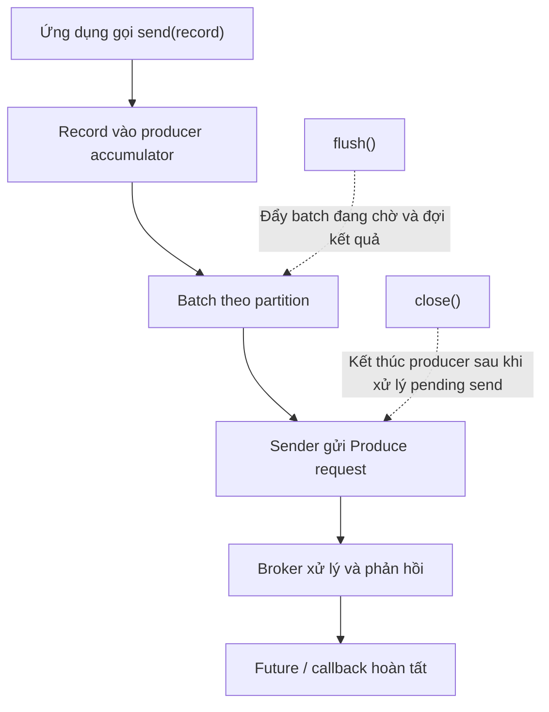
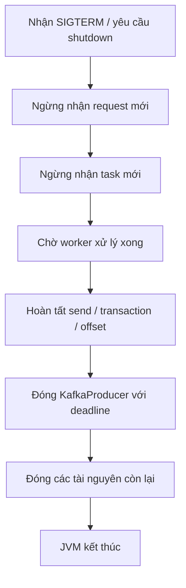

# flush, close và dừng ứng dụng có kiểm soát

Kafka Producer gửi record theo cơ chế bất đồng bộ. Sau khi ứng dụng gọi `send()`, record có thể vẫn nằm trong accumulator hoặc đang chờ broker xác nhận. Vì vậy, khi cần kết thúc một tác vụ, đóng service hoặc dừng JVM, ứng dụng phải có quy trình hoàn tất các lần gửi đang chờ và giải phóng tài nguyên producer.

Ba thao tác thường được nhắc cùng nhau là `flush()`, `close()` và shutdown có kiểm soát, nhưng chúng có vai trò khác nhau:

- `flush()` tạo một điểm chờ: đẩy các record đã gửi trước thời điểm gọi ra khỏi buffer và chờ kết quả gửi hoàn tất.
- `close()` kết thúc vòng đời producer: ngừng nhận gửi mới, chờ các request đang xử lý theo timeout và giải phóng thread, socket, buffer cùng tài nguyên liên quan.
- Shutdown có kiểm soát điều phối toàn bộ ứng dụng: ngừng nhận công việc mới, hoàn tất hoặc dừng worker, xử lý giao dịch/offset nếu có, rồi mới đóng producer và các thành phần phụ thuộc.

Hiểu đúng các bước này giúp tránh mất record còn trong buffer, tránh đóng producer khi worker vẫn đang gọi `send()`, và tránh giữ JVM sống quá lâu vì một thao tác gửi bị treo.

## 1. Vì sao cần flush và close?

`KafkaProducer.send()` thường trả về nhanh sau khi record được đưa vào buffer. Một thread nền của producer gom record theo partition, tạo batch, nén và gửi Produce request tới broker. Kết quả gửi được trả về qua `Future<RecordMetadata>` hoặc callback.



Nếu ứng dụng kết thúc ngay sau `send()` mà không chờ producer hoàn tất, record có thể chưa được gửi hoặc chưa nhận được kết quả xác nhận. Khi producer bị đóng cưỡng bức hoặc JVM kết thúc đột ngột, các record còn trong buffer có thể không được giao tới broker.

Producer hiện đại có cơ chế buffer và thread gửi riêng, nên ứng dụng không cần `flush()` sau từng record. Thông thường, hãy để producer batching tự nhiên trong lúc service chạy và chỉ tạo điểm flush khi thật sự cần một ranh giới hoàn tất.

## 2. `flush()` hoạt động như thế nào?

`flush()` làm cho các record đang được buffer tại thời điểm gọi có thể được gửi ngay, kể cả khi `linger.ms` chưa hết, rồi chặn thread gọi cho đến khi các lần gửi đã được gửi trước thời điểm flush hoàn tất. Các callback tương ứng cũng được gọi trước khi `flush()` trả về.

Ví dụ:

```java
try (KafkaProducer<String, String> producer = new KafkaProducer<>(props)) {
    producer.send(new ProducerRecord<>("orders", "order-1", "CREATED"));
    producer.send(new ProducerRecord<>("orders", "order-2", "CONFIRMED"));

    // Chờ các record đã gửi ở trên hoàn tất.
    producer.flush();

    // Producer vẫn mở và có thể tiếp tục nhận send() mới.
    producer.send(new ProducerRecord<>("orders", "order-3", "SHIPPED"));
}
```

Sau `flush()`, producer vẫn hoạt động bình thường. Ứng dụng có thể tiếp tục gửi record mới. `flush()` không đóng socket, không dừng sender thread và không giải phóng producer.

### Những gì flush bảo đảm và không bảo đảm

- Flush chờ các record đã gửi trước khi gọi hoàn tất ở phía producer, bao gồm thành công hoặc lỗi gửi.
- Flush có thể làm batch chưa đầy được gửi sớm, vì vậy nó ảnh hưởng đến hiệu quả batching và throughput.
- Flush không trả về danh sách kết quả từng record. Hãy kiểm tra callback hoặc `Future` để biết record cụ thể gửi thành công hay thất bại.
- Flush không tự tăng mức durability. Kết quả xác nhận vẫn phụ thuộc `acks`, replication factor, ISR và `min.insync.replicas`.
- Flush không đồng nghĩa broker đã gọi `fsync` cho từng record. Kafka dựa nhiều vào page cache của hệ điều hành và cơ chế replication; flush ở client chỉ là thao tác vòng đời gửi của producer.
- Flush không tự commit một Kafka transaction. Với producer transactional, ứng dụng vẫn phải gọi `commitTransaction()` hoặc `abortTransaction()` theo kết quả nghiệp vụ.

`flush()` thường phù hợp khi ứng dụng cần một barrier rõ ràng, chẳng hạn sau khi gửi một batch công việc và trước khi thực hiện bước tiếp theo. Không nên gọi flush sau mỗi record vì sẽ phá batching, làm tăng số request nhỏ và giảm throughput.

### Lỗi gửi phải được quan sát qua callback hoặc Future

`flush()` chờ cho các lần gửi hoàn tất nhưng không biến mọi lỗi bất đồng bộ thành một exception tổng hợp để ứng dụng xử lý. Hãy ghi nhận lỗi trong callback hoặc chờ `Future` khi cần kết quả từng record.

```java
producer.send(record, (metadata, exception) -> {
    if (exception != null) {
        logger.error("Không gửi được event", exception);
        return;
    }

    logger.debug("Đã ghi topic={}, partition={}, offset={}",
            metadata.topic(), metadata.partition(), metadata.offset());
});

producer.flush();
```

Lỗi có thể xảy ra ngay trong lúc gọi `send()` (ví dụ lỗi serialization hoặc producer đã đóng), hoặc xảy ra bất đồng bộ sau đó (ví dụ timeout, broker unavailable). Cần xử lý cả exception đồng bộ tại nơi gọi và exception truyền vào callback/Future.

## 3. `close()` kết thúc vòng đời KafkaProducer

`close()` giải phóng tài nguyên của producer. Producer sẽ hoàn tất các request đang chờ trong giới hạn thời gian đóng, dừng sender thread và đóng các tài nguyên mạng/buffer mà nó sở hữu. Sau khi đóng, không được tiếp tục gọi `send()` hoặc sử dụng producer như một client đang hoạt động.

Hai cách đóng thường dùng:

```java
producer.close();
```

Hoặc chỉ định deadline:

```java
producer.close(Duration.ofSeconds(20));
```

`close()` không truyền timeout sẽ chờ các lần gửi đang chờ hoàn tất theo semantics của API. `close(Duration)` giới hạn thời gian chờ; nếu hết thời gian mà producer chưa hoàn tất mọi request, producer có thể bị đóng cưỡng bức và các lần gửi còn pending có thể thất bại. Chọn timeout dựa trên SLA shutdown và thời gian gửi thực tế, không đặt một giá trị quá ngắn khiến mọi lần bảo trì đều làm rơi dữ liệu đang chờ.

Sau khi gọi `close()`, producer không còn dùng được. Hãy quản lý producer như một tài nguyên có vòng đời rõ ràng và chỉ có một thành phần chịu trách nhiệm đóng nó.

## 4. Dùng try-with-resources cho ứng dụng Java ngắn hạn

Với chương trình chạy một lần, batch job hoặc command-line producer, `try-with-resources` là cách đơn giản để đảm bảo `close()` được gọi ngay cả khi xử lý phát sinh exception.

```java
Properties props = new Properties();
props.put(ProducerConfig.BOOTSTRAP_SERVERS_CONFIG, "localhost:9092");
props.put(ProducerConfig.KEY_SERIALIZER_CLASS_CONFIG,
        StringSerializer.class.getName());
props.put(ProducerConfig.VALUE_SERIALIZER_CLASS_CONFIG,
        StringSerializer.class.getName());
props.put(ProducerConfig.ACKS_CONFIG, "all");
props.put(ProducerConfig.ENABLE_IDEMPOTENCE_CONFIG, "true");

try (KafkaProducer<String, String> producer = new KafkaProducer<>(props)) {
    for (int i = 1; i <= 100; i++) {
        ProducerRecord<String, String> record = new ProducerRecord<>(
                "orders", "order-" + i, "CREATED");

        producer.send(record, (metadata, error) -> {
            if (error != null) {
                logger.error("Send failed", error);
            }
        });
    }

    // Tùy chọn: tạo barrier tường minh trước khi chạy bước tiếp theo.
    producer.flush();
}
// Khi rời khỏi khối try, close() được gọi tự động.
```

Trong ví dụ, `flush()` là tùy chọn nếu mục đích duy nhất là đóng producer ngay sau vòng lặp, vì `close()` cũng chờ xử lý các lần gửi đang chờ. Flush tường minh có ích khi cần biết toàn bộ callback đã hoàn tất trước khi chạy thêm logic trong cùng khối try.

Nếu một record gửi thất bại, callback ghi nhận lỗi nhưng chương trình ví dụ vẫn tiếp tục. Batch job thực tế cần tổng hợp lỗi và quyết định exit code, retry hoặc chuyển record lỗi sang nơi lưu trữ phù hợp. Không nên chỉ log lỗi rồi báo job thành công nếu yêu cầu nghiệp vụ đòi hỏi mọi record phải được giao.

## 5. Dừng service dài hạn theo trình tự

Một service chạy liên tục có thể nhận công việc từ HTTP, scheduler, queue nội bộ hoặc consumer. Khi nhận tín hiệu dừng, không nên đóng producer ngay lập tức nếu worker vẫn có thể gọi `send()`.

Trình tự shutdown thường dùng:

1. **Ngừng nhận công việc mới:** tắt readiness hoặc ngừng nhận request/schedule mới.
2. **Dừng phát sinh công việc:** yêu cầu worker ngừng lấy task mới và hoàn tất task đang xử lý trong deadline.
3. **Chờ các lần send đang chờ:** chờ Future/callback hoặc gọi `flush()` sau khi mọi worker đã ngừng gửi.
4. **Hoàn tất giao dịch:** nếu dùng Kafka transaction, commit hoặc abort transaction một cách tường minh; nếu consume-transform-produce, phối hợp output và offset theo thiết kế.
5. **Đóng producer:** gọi `close(Duration)` với timeout phù hợp.
6. **Đóng các tài nguyên còn lại:** consumer, executor, connection pool và các thành phần ứng dụng theo đúng dependency order.



Nếu worker không dừng trước deadline, cần có chính sách rõ ràng: chờ thêm trong giới hạn, đánh dấu task chưa hoàn tất để xử lý lại ở lần chạy sau, hoặc kết thúc cưỡng bức và chấp nhận rủi ro record pending. Không để một thread vô hạn giữ JVM sống hoặc đóng producer trong khi thread khác vẫn gửi dữ liệu.

## 6. Dùng shutdown hook trong Java

JVM shutdown hook hữu ích để phản ứng với tín hiệu kết thúc bình thường như SIGTERM hoặc lệnh dừng tiến trình. Hook chạy trong giai đoạn shutdown, vì vậy nên làm ít việc, có timeout và không phụ thuộc vào một thao tác có thể chờ vô hạn.

Ví dụ service có một worker chạy nền và queue nội bộ:

```java
AtomicBoolean accepting = new AtomicBoolean(true);
BlockingQueue<ProducerRecord<String, String>> queue =
        new LinkedBlockingQueue<>();
KafkaProducer<String, String> producer = new KafkaProducer<>(props);
CountDownLatch workerStopped = new CountDownLatch(1);

Thread worker = new Thread(() -> {
    try {
        while (accepting.get() || !queue.isEmpty()) {
            ProducerRecord<String, String> record =
                    queue.poll(200, TimeUnit.MILLISECONDS);
            if (record != null) {
                producer.send(record, (metadata, error) -> {
                    if (error != null) {
                        logger.error("Send failed", error);
                    }
                });
            }
        }
    } catch (InterruptedException e) {
        Thread.currentThread().interrupt();
    } finally {
        workerStopped.countDown();
    }
}, "kafka-publisher");

worker.start();

Runtime.getRuntime().addShutdownHook(new Thread(() -> {
    // Ngừng nhận task mới; worker tiếp tục drain queue hiện có.
    accepting.set(false);

    boolean stopped = false;
    try {
        stopped = workerStopped.await(15, TimeUnit.SECONDS);
        if (!stopped) {
            logger.warn("Publisher worker chưa dừng trong shutdown deadline");
        }
    } catch (InterruptedException e) {
        Thread.currentThread().interrupt();
    }

    if (stopped) {
        // Chỉ đóng producer sau khi worker đã ngừng sử dụng nó.
        producer.close(Duration.ofSeconds(20));
    } else {
        // Ghi nhận shutdown không hoàn tất; không đóng producer dưới worker đang chạy.
        logger.error("Publisher worker chưa dừng; shutdown không thể hoàn tất an toàn");
    }
}, "kafka-shutdown"));
```

Đây là ví dụ khung để minh họa thứ tự lifecycle. Service thực tế cần ngừng nguồn tạo task trước khi đặt `accepting=false`, giới hạn thời gian drain queue và xác định cách xử lý queue còn lại khi hết deadline. Đoạn mã không interrupt worker khi hết thời gian chờ, vì việc đó có thể bỏ qua queue chưa xử lý; producer chỉ được đóng sau khi worker đã dừng. Nếu worker vẫn hoạt động, shutdown được ghi nhận là không hoàn tất và process manager có thể phải kết thúc tiến trình khi hết grace period. Hãy ghi nhận task chưa hoàn tất và áp dụng chính sách retry/replay phù hợp.

Shutdown hook không chạy trong mọi tình huống: `Runtime.halt()`, process bị kill cưỡng bức, máy mất điện hoặc container bị kết thúc ngay lập tức có thể bỏ qua hook. Vì vậy, durability phải dựa vào acknowledgement, replication và thiết kế retry; không được xem shutdown hook là cơ chế bảo đảm dữ liệu.

## 7. Giữ callback ngắn và tách khỏi điều phối shutdown

Callback của producer thường được thực thi trên I/O thread gửi request. Callback nên ngắn và không chặn để sender tiếp tục xử lý các batch và callback khác. Không đặt logic điều phối vòng đời ứng dụng trong callback hoặc dựa vào callback để chờ toàn bộ producer đóng.

Nên giới hạn callback ở các việc như:

- Ghi metric thành công/thất bại.
- Ghi log có kiểm soát.
- Đưa lỗi vào queue để một worker riêng xử lý.
- Hoàn thành một future/promise hoặc phát tín hiệu cho lifecycle coordinator.

Callback có thể phát tín hiệu cho lifecycle coordinator hoặc đưa lỗi vào queue. Việc dừng worker, flush và close nên được điều phối từ thread quản lý vòng đời ứng dụng sau khi nguồn công việc mới đã dừng.

## 8. Producer transaction và shutdown

Với producer transactional, `flush()` chỉ chờ các lần gửi hoàn tất; nó không quyết định transaction được commit hay abort. Ứng dụng phải quản lý transaction state tường minh:

```java
producer.initTransactions();

try {
    producer.beginTransaction();
    producer.send(new ProducerRecord<>("orders", "order-42", "CONFIRMED"));
    // Các output/offset liên quan được gửi trong cùng transaction.
    producer.commitTransaction();
} catch (Exception e) {
    producer.abortTransaction();
    throw e;
}
```

Khi shutdown, không bắt đầu transaction mới sau khi ứng dụng đã ngừng nhận công việc. Với transaction đang mở, hãy áp dụng chính sách commit nếu toàn bộ nghiệp vụ hoàn tất hoặc abort nếu chưa hoàn tất. Đừng chỉ gọi `flush()` rồi giả định dữ liệu transactional đã visible với consumer `read_committed`.

Trong mô hình consume-transform-produce, nếu cần atomicity giữa output records và offset input, dùng `sendOffsetsToTransaction()` trong cùng transaction theo API và group metadata tương ứng. Việc commit offset consumer độc lập rồi mới đóng producer có thể tạo khoảng trống hoặc duplicate tùy thứ tự lỗi.

## 9. Tích hợp với Spring Kafka

Trong ứng dụng Spring, thường dùng `KafkaTemplate` thay vì tự tạo `KafkaProducer` trong từng service. `KafkaTemplate` gửi bất đồng bộ và trả về `CompletableFuture<SendResult<K, V>>` ở các phiên bản Spring Kafka hiện đại.

Ví dụ:

```java
@Service
public class OrderPublisher {
    private final KafkaTemplate<String, String> kafkaTemplate;

    public OrderPublisher(KafkaTemplate<String, String> kafkaTemplate) {
        this.kafkaTemplate = kafkaTemplate;
    }

    public CompletableFuture<SendResult<String, String>> publish(
            String orderId, String event) {
        return kafkaTemplate.send("orders", orderId, event);
    }
}
```

Ứng dụng có thể đợi `CompletableFuture` khi nghiệp vụ cần biết kết quả gửi, hoặc gắn callback để ghi nhận lỗi. `KafkaTemplate.flush()` có thể dùng khi cần flush producer được template quản lý; không nên gọi sau từng message vì làm giảm batching.

Vòng đời producer trong Spring thường được quản lý bởi `ProducerFactory` và Spring ApplicationContext. Khi context dừng, bean lifecycle sẽ hủy factory và đóng các producer mà factory quản lý. Do đó:

- Không tự đóng producer nội bộ lấy ra từ `KafkaTemplate` trong từng service.
- Để Spring quản lý shutdown của `ProducerFactory` theo lifecycle bean.
- Nếu ứng dụng có worker riêng, hãy dừng worker trước khi context đóng producer factory.
- Nếu cấu hình producer gắn theo thread, cần giải phóng producer thread-bound theo API của `ProducerFactory` tương ứng.
- Dùng cơ chế graceful shutdown của framework/container để dành đủ thời gian cho request đang xử lý và callback gửi.

Tên API và lifecycle chi tiết có thể thay đổi theo phiên bản Spring Kafka. Kiểm tra phiên bản dependency của dự án trước khi áp dụng ví dụ hoặc cấu hình cụ thể.

## 10. Timeout và các nguyên nhân khiến shutdown kéo dài

Shutdown có thể chậm vì producer đang chờ:

- Metadata cho topic/partition chưa có hoặc broker chưa sẵn sàng.
- Buffer đầy khiến thread gọi `send()` chờ giải phóng memory đến `max.block.ms`.
- Broker xử lý Produce request chậm hoặc request timeout.
- `acks=all` phải chờ replication/ISR.
- Callback của ứng dụng chạy lâu hoặc bị block.
- Transaction chưa được commit/abort.
- Worker vẫn tiếp tục tạo record trong lúc shutdown.

Các cấu hình có liên quan:

| Cấu hình | Vai trò |
|---|---|
| `max.block.ms` | Thời gian tối đa một số thao tác như `send()` chờ metadata hoặc buffer allocation |
| `request.timeout.ms` | Thời gian client chờ broker phản hồi một request |
| `delivery.timeout.ms` | Tổng thời gian producer cho phép giao một record, gồm batching và retry |
| `retries` / `retry.backoff.ms` | Chính sách thử gửi lại khi gặp lỗi retriable |
| `linger.ms` | Thời gian gom batch trước khi gửi khi batch chưa đầy |
| `acks` | Điều kiện broker xác nhận Produce request |

Không cần đặt tất cả timeout bằng nhau. `delivery.timeout.ms` phải phù hợp với `request.timeout.ms`, `linger.ms` và retry budget theo ràng buộc của phiên bản Kafka client. Shutdown timeout của ứng dụng/container nên lớn hơn khoảng thời gian dành cho worker drain và producer close, có thêm biên cho log/cleanup.

Ví dụ, nếu service được cấp 45 giây để dừng, có thể dành 15 giây để ngừng nhận và drain worker, 20 giây cho producer close, phần còn lại cho cleanup. Đây chỉ là cách phân bổ minh họa; phải đo thời gian thực tế và đồng bộ với `terminationGracePeriodSeconds` của Kubernetes hoặc timeout của process manager.

## 11. Kiểm tra producer đã dừng an toàn

Sau khi triển khai graceful shutdown, cần xác minh bằng quan sát và thử nghiệm:

1. Gửi một lượng record có thể đếm được, sau đó yêu cầu service dừng bình thường.
2. Xác nhận service ngừng nhận task mới trước khi producer đóng.
3. Đếm callback thành công, lỗi gửi và task còn pending tại thời điểm shutdown.
4. Đọc lại topic bằng consumer độc lập để đối chiếu số record và key/event ID.
5. Lặp lại thử nghiệm khi broker tạm unavailable hoặc ISR giảm để xem retry và close timeout.
6. Gửi SIGTERM rồi so sánh với SIGKILL; xác nhận ứng dụng có cảnh báo khi không thể shutdown graceful.
7. Theo dõi shutdown duration, producer error rate, request latency, retry rate và buffer pool wait.

Nếu cần đảm bảo không bỏ sót nghiệp vụ, hãy dùng event ID duy nhất và đối soát nguồn công việc với record đã xác nhận. Producer callback thành công không thay thế việc kiểm tra nghiệp vụ đầu-cuối nếu hệ thống còn database hoặc dịch vụ ngoài Kafka.

## 12. Những hiểu nhầm thường gặp

- **“Gọi `send()` xong là record đã nằm trên broker.”** `send()` thường chỉ đưa record vào buffer; kết quả đến sau qua callback/Future.
- **“`flush()` đóng producer.”** Flush chỉ chờ các lần gửi đã được đưa vào producer hoàn tất; producer vẫn dùng tiếp được.
- **“`close()` chỉ giải phóng socket.”** Close còn chờ xử lý các request đang pending theo timeout và kết thúc các thread/tài nguyên producer.
- **“Flush bảo đảm broker đã fsync.”** Flush là barrier phía client, không phải lệnh fsync cho từng record trên broker.
- **“Close luôn giao thành công mọi record.”** Close có timeout có thể force close và làm các record pending thất bại.
- **“Flush báo lỗi tổng hợp nếu một record gửi thất bại.”** Hãy quan sát callback/Future để biết kết quả từng record.
- **“Shutdown hook bảo đảm chạy khi JVM kết thúc.”** Hook có thể không chạy khi process bị kill cưỡng bức hoặc máy mất điện.
- **“Có thể đóng producer trước khi worker dừng.”** Worker còn gọi `send()` sau close sẽ gặp lỗi và có thể làm mất công việc đang xử lý.
- **“Flush tương đương commit transaction.”** Transaction phải được commit hoặc abort tường minh.

## 13. Checklist triển khai

- [ ] Producer được tạo một lần theo vòng đời service/job và được tái sử dụng.
- [ ] Mọi lỗi gửi được ghi nhận qua callback/Future; không chỉ dựa vào `flush()`.
- [ ] `flush()` chỉ dùng ở ranh giới cần chờ, không gọi sau từng record.
- [ ] `close(Duration)` có timeout phù hợp với SLA shutdown.
- [ ] Worker ngừng nhận task mới và hoàn tất/drain task trước khi producer đóng.
- [ ] Callback của producer ngắn; lifecycle coordinator chịu trách nhiệm flush/close sau khi worker dừng.
- [ ] Transaction được commit/abort tường minh trước khi kết thúc producer.
- [ ] Shutdown hook hoặc lifecycle framework có timeout và xử lý trường hợp worker không dừng.
- [ ] Spring `ProducerFactory` được để framework quản lý; không đóng producer nội bộ từ service.
- [ ] Đã thử SIGTERM, broker unavailable, timeout và đối soát record sau shutdown.

`flush()` là điểm chờ hoàn tất các lần gửi đã được producer nhận; `close()` kết thúc tài nguyên producer; graceful shutdown phối hợp toàn bộ worker và transaction của ứng dụng. Khi ngừng nhận việc mới trước, chờ worker hoàn tất, kiểm tra kết quả gửi rồi đóng producer trong một deadline rõ ràng, service có thể dừng dự đoán được và giảm nguy cơ mất record đang chờ.
