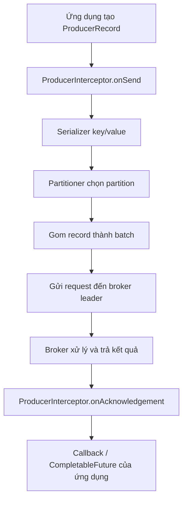

# ProducerInterceptor và giới hạn sử dụng

`ProducerInterceptor` là một extension point của Kafka Producer API cho phép ứng dụng quan sát hoặc điều chỉnh record ở hai thời điểm: ngay trước khi producer xử lý record để gửi đi và khi broker trả kết quả gửi. Interceptor hữu ích cho các tác vụ xuyên suốt như bổ sung header truy vết, gắn metadata của ứng dụng và thu thập metric gửi thành công/thất bại.

Trong hệ thống Java/Spring Kafka, interceptor nằm bên trong Kafka producer client. Nó không thay thế `KafkaTemplate`, serializer, partitioner, callback của từng lần gửi hay transaction. Vì interceptor chạy trên đường gửi dữ liệu, logic bên trong cần ngắn, an toàn khi chạy đồng thời và không làm thay đổi ý nghĩa nghiệp vụ của event ngoài dự kiến.

## 1. ProducerInterceptor nằm ở đâu trong luồng gửi?

Khi ứng dụng gọi `KafkaProducer.send()` hoặc `KafkaTemplate.send()`, producer thực hiện một chuỗi bước trước khi record được gửi đến broker. Interceptor được gọi trước serializer và quá trình chọn partition; sau khi broker phản hồi, interceptor nhận callback xác nhận.



Sơ đồ thể hiện thứ tự khái quát. Các chi tiết nội bộ như metadata lookup, retry, accumulator và sender thread được Kafka client quản lý. Interceptor không phải một bộ lọc ở broker và cũng không chạy trên consumer.

Hai callback chính của `ProducerInterceptor`:

| Method | Thời điểm | Mục đích |
|---|---|---|
| `onSend(ProducerRecord<K,V>)` | Trước serialization và partition assignment | Quan sát hoặc trả về record đã được điều chỉnh |
| `onAcknowledgement(RecordMetadata, Exception)` | Khi lần gửi được xác nhận hoặc thất bại | Ghi nhận kết quả gửi và metric |
| `configure(Map<String, ?>)` | Khi Kafka khởi tạo interceptor | Đọc cấu hình producer được truyền vào |
| `close()` | Khi producer đóng interceptor | Giải phóng tài nguyên mà interceptor sở hữu |

## 2. `onSend`: quan sát hoặc điều chỉnh record trước khi gửi

`onSend` nhận `ProducerRecord<K,V>` gồm topic, partition tùy chọn, timestamp, key, value và headers. Method có thể trả lại chính record ban đầu hoặc tạo một record mới với metadata đã điều chỉnh.

Các tác vụ phù hợp:

- Bổ sung header `trace-id`, `correlation-id` hoặc tên service phát event nếu thông tin chưa có.
- Thêm metadata kỹ thuật nhỏ để hỗ trợ tracing hoặc phân tích luồng dữ liệu.
- Chuẩn hóa một số metadata vận chuyển đã được quy định rõ trong hợp đồng kỹ thuật.
- Đếm số record được gửi theo topic hoặc loại event bằng metric nhẹ.

Ví dụ, Order Service muốn thêm header `x-producer-service=order-service` để hỗ trợ truy vết. Interceptor sao chép headers trước khi bổ sung để tránh sửa trực tiếp tập header đang được dùng bởi thành phần khác:

```java
package com.example.kafka;

import java.nio.charset.StandardCharsets;
import java.util.Map;

import org.apache.kafka.clients.producer.ProducerInterceptor;
import org.apache.kafka.clients.producer.ProducerRecord;
import org.apache.kafka.clients.producer.RecordMetadata;
import org.apache.kafka.common.header.Headers;
import org.apache.kafka.common.header.internals.RecordHeaders;

public class ProducerServiceHeaderInterceptor
        implements ProducerInterceptor<String, String> {

    private static final String HEADER = "x-producer-service";
    private static final byte[] SERVICE =
        "order-service".getBytes(StandardCharsets.UTF_8);

    @Override
    public ProducerRecord<String, String> onSend(
            ProducerRecord<String, String> record) {

        if (record.headers().lastHeader(HEADER) != null) {
            return record;
        }

        Headers headers = new RecordHeaders(record.headers());
        headers.add(HEADER, SERVICE);

        return new ProducerRecord<>(
            record.topic(),
            record.partition(),
            record.timestamp(),
            record.key(),
            record.value(),
            headers
        );
    }

    @Override
    public void onAcknowledgement(
            RecordMetadata metadata,
            Exception exception) {
        // Ghi metric nhẹ; metadata có thể null khi gửi thất bại.
    }

    @Override
    public void configure(Map<String, ?> configs) {
        // Đọc cấu hình bổ sung nếu interceptor cần.
    }

    @Override
    public void close() {
        // Giải phóng tài nguyên nếu có.
    }
}
```

Ví dụ dùng `String` cho key và value để tập trung vào interceptor. Trong ứng dụng thực tế, kiểu generic phải khớp với serializer và dữ liệu mà producer gửi. Header value là byte array; với chuỗi, ví dụ dùng UTF-8. Việc kiểm tra header đã tồn tại giúp tránh thêm nhiều bản sao khi record đi qua các interceptor hoặc luồng retry ở tầng ứng dụng.

### Những thay đổi cần cân nhắc kỹ

`onSend` chạy trước khi serializer và partitioner xử lý record, vì vậy thay đổi một số trường có thể tác động trực tiếp đến cách Kafka định tuyến dữ liệu:

| Trường bị thay đổi | Tác động có thể có |
|---|---|
| `topic` | Record có thể được gửi sang luồng dữ liệu khác và chịu ACL/schema/retention khác |
| `key` | Partitioner có thể chọn partition khác, ảnh hưởng ordering theo key |
| `partition` | Có thể ép record vào partition cụ thể và làm lệch phân phối tải |
| `timestamp` | Có thể làm sai ý nghĩa thời điểm event hoặc ảnh hưởng xử lý theo thời gian |
| `value` | Thay đổi payload mà consumer nhận được, có thể phá vỡ event contract |
| `headers` | Thay đổi metadata mà consumer và hệ thống tracing đọc được |

Nếu yêu cầu nghiệp vụ là kiểm tra payload, tạo event ID, chọn topic theo loại event hoặc bảo đảm key theo aggregate, hãy thực hiện rõ ràng ở service/factory trước khi gọi `send()`. Không nên giấu quy tắc domain quan trọng trong interceptor dùng chung.

## 3. `onAcknowledgement`: quan sát kết quả gửi

`onAcknowledgement` được gọi khi record đã nhận được kết quả xác nhận từ broker hoặc khi lần gửi thất bại. Method nhận hai tham số:

- `metadata`: metadata của record được broker xác nhận, gồm topic, partition, offset, timestamp và thông tin liên quan. Khi gửi thất bại, giá trị này có thể là `null`.
- `exception`: lỗi nếu lần gửi thất bại; khi gửi thành công, giá trị thường là `null`.

Ví dụ ghi nhận kết quả:

```java
@Override
public void onAcknowledgement(
        RecordMetadata metadata,
        Exception exception) {

    if (exception != null) {
        failedSends.increment();
        return;
    }

    if (metadata != null) {
        acknowledgedSends.increment();
        // Có thể ghi metric theo topic/partition.
        // Không nên dùng eventId hoặc offset làm label có cardinality cao.
    }
}
```

Trong ví dụ hoàn chỉnh, `failedSends` và `acknowledgedSends` có thể là `LongAdder` hoặc metric counter thread-safe được tạo trong interceptor. Nếu dùng registry như Micrometer, cần quản lý vòng đời registry và tag có cardinality thấp; tránh tạo metric mới cho từng event ID.

Callback này phản ánh kết quả gửi theo cấu hình producer, ví dụ `acks=all`. Nó không chứng minh Payment Service hay consumer khác đã đọc và xử lý event. Nó cũng không thay thế kết quả của `KafkaTemplate.send()` mà code gọi gửi có thể dùng để xử lý riêng cho từng record.

Trong Spring Kafka 3.x, nếu cần xử lý kết quả gửi gắn với một lệnh nghiệp vụ cụ thể, thường nên dùng `CompletableFuture` trả về từ `KafkaTemplate`:

```java
kafkaTemplate.send("orders.events", orderId, event)
    .whenComplete((result, exception) -> {
        if (exception != null) {
            // Ghi nhận lỗi hoặc chuyển sang cơ chế retry phù hợp.
            return;
        }

        RecordMetadata metadata = result.getRecordMetadata();
        // Có thể ghi nhận topic, partition và offset của record.
    });
```

`ProducerInterceptor.onAcknowledgement` phù hợp với quan sát chung ở cấp producer; future của từng lần gọi phù hợp với logic ứng dụng cần biết chính xác lần gửi đó thành công hay thất bại.

## 4. Cấu hình ProducerInterceptor trong Kafka Java

Kafka producer hỗ trợ cấu hình một hoặc nhiều interceptor qua thuộc tính `interceptor.classes`. Ví dụ với Java properties:

```java
import java.util.Properties;

import org.apache.kafka.clients.producer.KafkaProducer;
import org.apache.kafka.clients.producer.ProducerConfig;
import org.apache.kafka.common.serialization.StringSerializer;

Properties props = new Properties();
props.put(ProducerConfig.BOOTSTRAP_SERVERS_CONFIG,
          "localhost:9092");
props.put(ProducerConfig.KEY_SERIALIZER_CLASS_CONFIG,
          StringSerializer.class.getName());
props.put(ProducerConfig.VALUE_SERIALIZER_CLASS_CONFIG,
          StringSerializer.class.getName());
props.put(ProducerConfig.INTERCEPTOR_CLASSES_CONFIG,
          ProducerServiceHeaderInterceptor.class.getName());

KafkaProducer<String, String> producer =
    new KafkaProducer<>(props);
```

Kafka client tạo interceptor từ class được khai báo trong cấu hình và gọi `configure()` trong quá trình khởi tạo. Vì vậy, không nên mặc định rằng một interceptor được khai báo theo cách này sẽ được Spring tạo như bean `@Component` hoặc tự động nhận dependency qua `@Autowired`. Nếu interceptor cần cấu hình, có thể đọc các producer properties trong `configure(Map)`; nếu cần dependency do Spring quản lý, cần thiết kế `ProducerFactory`/producer lifecycle tương ứng và kiểm tra cách tích hợp với phiên bản Spring Kafka đang dùng.

### Cấu hình với Spring Boot

Có thể truyền cấu hình interceptor qua `spring.kafka.producer.properties`:

```yaml
spring:
  kafka:
    bootstrap-servers: localhost:9092
    producer:
      key-serializer: org.apache.kafka.common.serialization.StringSerializer
      value-serializer: org.apache.kafka.common.serialization.StringSerializer
      properties:
        interceptor.classes: com.example.kafka.ProducerServiceHeaderInterceptor
```

Ví dụ cấu hình trên khớp với interceptor `ProducerInterceptor<String, String>` đã viết ở phần trước. Nếu ứng dụng dùng JSON serializer và value là `OrderCreated`, cần khai báo interceptor với generic `ProducerInterceptor<String, OrderCreated>` và cấu hình serializer tương ứng. Với Spring Kafka phiên bản cũ hơn 3.x, API gửi có thể trả `ListenableFuture` thay cho `CompletableFuture`; hãy dùng đúng kiểu future theo phiên bản đang triển khai.

Khi cấu hình nhiều interceptor, truyền danh sách class theo cú pháp mà Kafka client hỗ trợ. Mỗi interceptor sẽ được khởi tạo và tham gia vào chuỗi callback của producer. Hãy giữ số lượng interceptor nhỏ và có trách nhiệm rõ ràng để tránh khó truy vết thứ tự biến đổi record.

## 5. Thread safety và hiệu năng

Một producer có thể được nhiều application thread dùng đồng thời. `onSend` có thể được gọi từ các thread đang gọi `send()`, còn `onAcknowledgement` thường chạy trên I/O thread của producer. Vì vậy, cùng một instance interceptor có thể được truy cập đồng thời từ nhiều thread.

Các nguyên tắc cần tuân thủ:

- Dùng cấu trúc dữ liệu thread-safe cho counter hoặc trạng thái dùng chung; không giữ biến mutable không được đồng bộ.
- Giữ callback ngắn và không block.
- Không gọi HTTP, database hoặc hệ thống bên ngoài trong `onSend`/`onAcknowledgement`.
- Không gọi `KafkaProducer.send()` đệ quy từ interceptor; việc này dễ tạo vòng lặp hoặc gây nghẽn producer.
- Không serialize/deserialize payload lần nữa nếu không thực sự cần.
- Tránh log toàn bộ value, thông tin cá nhân, token hoặc secret.
- Không tạo metric label có cardinality cao như event ID, customer ID hoặc offset.

Đặc biệt, `onAcknowledgement` thường chạy trên I/O thread. Một callback ghi log đồng bộ tới hệ thống chậm hoặc gọi HTTP có thể làm chậm việc xử lý response cho các record khác, kéo theo tăng latency và backlog trong producer.

## 6. Giới hạn và các trường hợp không nên dùng interceptor

`ProducerInterceptor` là hook ở phía client, nên có một số giới hạn quan trọng:

1. **Không phải cơ chế bảo đảm giao hàng.** Interceptor không thay thế `acks`, retry, idempotence, replication hoặc transaction.
2. **Không bảo đảm exactly-once.** Muốn xử lý giao dịch Kafka cần cấu hình transactional producer, `transactional.id` và consumer phù hợp; interceptor không tạo transaction.
3. **Không xác nhận xử lý downstream.** `onAcknowledgement` chỉ phản ánh kết quả gửi tới Kafka theo chính sách xác nhận, không cho biết consumer đã hoàn thành nghiệp vụ.
4. **Không phải nơi chặn record đáng tin cậy.** Kafka client bảo vệ luồng gửi trước lỗi phát sinh trong interceptor và ghi log lỗi; không dựa vào việc ném exception trong `onSend` để từ chối nghiệp vụ. Hãy validate trước `KafkaTemplate.send()` nếu dữ liệu không hợp lệ phải bị từ chối.
5. **Không thay thế callback/future riêng của lần gửi.** Khi một service cần cập nhật trạng thái cho đúng request hoặc event, hãy dùng kết quả gửi trả về từ API producer.
6. **Không nên chứa logic nghiệp vụ phức tạp.** Quy tắc chọn topic, tạo event, tính key hoặc thay đổi payload nên nằm ở tầng application/domain để dễ kiểm thử và quan sát.
7. **Có thể tác động tới ordering và routing.** Thay key, partition hoặc topic trong interceptor có thể làm thay đổi phân phối dữ liệu mà người gọi không nhìn thấy.
8. **Phụ thuộc cấu hình của từng producer.** Chỉ producer được cấu hình interceptor mới chạy hook đó; producer khác hoặc luồng gửi khác không tự động được áp dụng.

### Khi nào nên chọn cơ chế khác?

| Nhu cầu | Cơ chế phù hợp hơn |
|---|---|
| Kiểm tra dữ liệu bắt buộc trước khi gửi | Validation ở service/application layer |
| Chuyển object thành byte | Serializer |
| Chọn partition theo key hoặc thuật toán riêng | Partitioner |
| Xử lý thành công/thất bại cho một lần gửi | Callback hoặc future của `KafkaTemplate.send()` |
| Đảm bảo ghi database và phát event nhất quán | Transactional Outbox hoặc CDC |
| Đảm bảo nhiều thao tác Kafka trong một transaction | Kafka transactional producer |
| Theo dõi trace xuyên service | OpenTelemetry hoặc tracing instrumentation tương thích Kafka |
| Đo metric gửi chung cho producer | ProducerInterceptor hoặc instrumentation/metrics tích hợp |

## 7. Kiểm thử interceptor

Nên kiểm tra cả record trước khi gửi lẫn kết quả callback. Với ví dụ thêm header, các trường hợp cần có:

- Header được thêm khi record chưa có `x-producer-service`.
- Header hiện có được giữ nguyên, không bị thêm trùng ngoài ý muốn.
- Topic, key, value, timestamp và partition được giữ nguyên.
- Nhiều lần gọi `onSend` không làm record tăng header không kiểm soát.
- `onAcknowledgement` xử lý đúng cả `metadata` thành công và `exception` thất bại.
- Counter/metric vẫn an toàn khi nhiều thread gọi callback đồng thời.

Ví dụ unit test đơn giản cho việc thêm header:

```java
@Test
void addsServiceHeaderAndPreservesRecordFields() {
    var interceptor = new ProducerServiceHeaderInterceptor();
    var original = new ProducerRecord<>(
        "orders.events", 1, 123L, "order-42", "payload");

    var result = interceptor.onSend(original);

    assertEquals("orders.events", result.topic());
    assertEquals(1, result.partition());
    assertEquals("order-42", result.key());
    assertEquals("payload", result.value());
    assertEquals(123L, result.timestamp());
    assertNotNull(result.headers().lastHeader("x-producer-service"));
}
```

Trong integration test, có thể dùng `@EmbeddedKafka` từ `spring-kafka-test` hoặc Testcontainers để gửi record thật, rồi đọc record từ topic và xác minh header, key, value, partition và offset. Cần có test cho cấu hình producer thực tế vì unit test không chứng minh class interceptor đã được Kafka client khởi tạo từ `interceptor.classes`.

## 8. Checklist sử dụng trong production

- Interceptor chỉ làm một nhiệm vụ kỹ thuật nhỏ, có mô tả và owner rõ ràng.
- Không thay đổi key/topic/timestamp/value nếu không có hợp đồng và kiểm thử cụ thể.
- Header không chứa secret hoặc dữ liệu nhạy cảm; tên và encoding được thống nhất.
- Callback không block, không gọi dịch vụ ngoài và không gửi record đệ quy.
- Trạng thái nội bộ và metric thread-safe, có giới hạn cardinality.
- Lỗi interceptor được log/monitor nhưng không được dùng thay validation nghiệp vụ.
- `onAcknowledgement` không bị hiểu nhầm là xác nhận consumer đã xử lý event.
- Producer vẫn có cấu hình `acks`, retry, idempotence và transaction theo yêu cầu nghiệp vụ.
- Đã kiểm tra cấu hình trong Spring Boot/Kafka client và xác minh interceptor thực sự được gọi.

`ProducerInterceptor` phù hợp để bổ sung metadata kỹ thuật và quan sát kết quả gửi ở cấp producer. Giữ interceptor nhỏ, không block và không chứa quy tắc nghiệp vụ giúp luồng gửi Kafka dễ kiểm soát. Với validation, xử lý kết quả từng event, ordering, retry hoặc giao dịch, hãy dùng đúng cơ chế ở tầng application, producer API, partitioner hay transaction thay vì dồn trách nhiệm vào interceptor.
