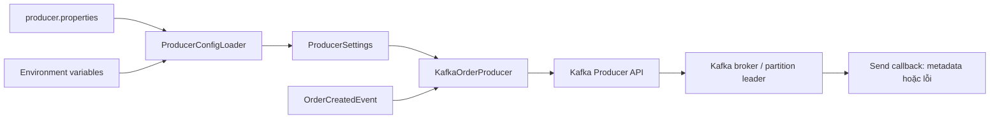

# Xây dựng producer Java hoàn chỉnh với cấu hình ngoài mã nguồn

Một Kafka producer dùng trong ứng dụng thực tế cần làm được nhiều việc hơn việc gọi `send()`: đọc cấu hình theo môi trường, kết nối đến đúng cluster, serialize dữ liệu, chọn key để giữ ordering, xử lý callback và lỗi gửi, kiểm soát retry, rồi đóng producer có trật tự khi ứng dụng dừng. Các giá trị thay đổi giữa local, staging và production phải được đưa ra ngoài mã nguồn; thông tin xác thực phải được cấp từ secret store hoặc cơ chế bảo mật của môi trường triển khai.

Bài này xây dựng một Java producer độc lập bằng Kafka Producer API, dùng Java 17, Maven và Kafka client. Ứng dụng đọc `bootstrap.servers`, topic và các tham số batching từ file properties bên ngoài, cho phép biến môi trường ghi đè các cấu hình tương ứng, gửi event JSON có key, nhận metadata trong callback và chờ toàn bộ lần gửi hoàn tất trước khi đóng producer.

Producer mẫu bật `acks=all` và idempotence để tăng độ tin cậy khi retry. Đây là nền tảng để mở rộng sang Spring Kafka: `KafkaTemplate` dùng cùng Kafka producer client và các nguyên tắc cấu hình, partition key, batching, callback, timeout và quản lý secret vẫn được áp dụng.

## 1. Kiến trúc ứng dụng và luồng gửi

Ứng dụng có các thành phần:

| Thành phần | Trách nhiệm |
|---|---|
| `ProducerConfigLoader` | Đọc file cấu hình bên ngoài, áp dụng biến môi trường và kiểm tra giá trị |
| `ProducerSettings` | Giữ topic và Kafka client properties sau khi đã kiểm tra |
| `OrderCreatedEvent` | Mô hình sự kiện nghiệp vụ cần gửi |
| `KafkaOrderProducer` | Serialize event, tạo record, gửi bất đồng bộ và xử lý callback |
| `ProducerApplication` | Khởi tạo ứng dụng, phát dữ liệu mẫu, đợi kết quả và đóng producer |



Quy trình gửi một event:

1. Đọc và kiểm tra cấu hình trước khi mở kết nối.
2. Tạo event có `eventId` duy nhất và `orderId` ổn định.
3. Serialize event thành JSON.
4. Dùng `orderId` làm key để các event của cùng đơn hàng đi vào cùng partition.
5. Gửi record bất đồng bộ; callback nhận metadata hoặc exception.
6. Chờ các future hoàn tất ở điểm cần xác nhận kết quả, rồi đóng producer để giải phóng tài nguyên.

## 2. Chuẩn bị Java và Maven project

Yêu cầu môi trường:

| Công cụ | Yêu cầu |
|---|---|
| JDK | Java 17 trở lên |
| Maven | Maven 3.8 trở lên hoặc Maven Wrapper |
| Kafka | Một cluster có broker listener mà máy chạy ứng dụng truy cập được |
| IDE | IntelliJ IDEA, Eclipse hoặc VS Code có Java support |

Tạo cấu trúc project:

```text
kafka-java-producer/
├── config/
│   └── producer.properties
├── pom.xml
└── src/
    └── main/
        └── java/
            └── com/example/kafkaproducer/
                ├── ProducerApplication.java
                ├── config/
                │   ├── ProducerConfigLoader.java
                │   └── ProducerSettings.java
                ├── event/
                │   └── OrderCreatedEvent.java
                └── producer/
                    └── KafkaOrderProducer.java
```

File `config/producer.properties` nằm ngoài `src/main/resources`, vì vậy không được đóng gói mặc định vào JAR. Khi triển khai, có thể mount file này từ thư mục cấu hình bên ngoài hoặc chỉ định đường dẫn khác khi chạy ứng dụng.

Tạo `pom.xml`:

```xml
<?xml version="1.0" encoding="UTF-8"?>
<project xmlns="http://maven.apache.org/POM/4.0.0"
         xmlns:xsi="http://www.w3.org/2001/XMLSchema-instance"
         xsi:schemaLocation="http://maven.apache.org/POM/4.0.0
         https://maven.apache.org/xsd/maven-4.0.0.xsd">
    <modelVersion>4.0.0</modelVersion>

    <groupId>com.example</groupId>
    <artifactId>kafka-java-producer</artifactId>
    <version>1.0.0</version>

    <properties>
        <maven.compiler.release>17</maven.compiler.release>
        <project.build.sourceEncoding>UTF-8</project.build.sourceEncoding>
        <kafka.version>3.9.1</kafka.version>
        <jackson.version>2.18.2</jackson.version>
    </properties>

    <dependencies>
        <dependency>
            <groupId>org.apache.kafka</groupId>
            <artifactId>kafka-clients</artifactId>
            <version>${kafka.version}</version>
        </dependency>
        <dependency>
            <groupId>com.fasterxml.jackson.core</groupId>
            <artifactId>jackson-databind</artifactId>
            <version>${jackson.version}</version>
        </dependency>
        <dependency>
            <groupId>com.fasterxml.jackson.datatype</groupId>
            <artifactId>jackson-datatype-jsr310</artifactId>
            <version>${jackson.version}</version>
        </dependency>
        <dependency>
            <groupId>org.slf4j</groupId>
            <artifactId>slf4j-simple</artifactId>
            <version>1.7.36</version>
            <scope>runtime</scope>
        </dependency>
    </dependencies>

    <build>
        <plugins>
            <plugin>
                <groupId>org.apache.maven.plugins</groupId>
                <artifactId>maven-compiler-plugin</artifactId>
                <version>3.13.0</version>
                <configuration>
                    <release>${maven.compiler.release}</release>
                </configuration>
            </plugin>
            <plugin>
                <groupId>org.codehaus.mojo</groupId>
                <artifactId>exec-maven-plugin</artifactId>
                <version>3.5.0</version>
            </plugin>
        </plugins>
    </build>
</project>
```

Các phiên bản trong POM là bộ phiên bản minh họa. Khi triển khai, chọn Kafka client tương thích với cluster và dependency policy của tổ chức; nâng phiên bản thư viện có kiểm thử thay vì thay đổi ngẫu nhiên từng dependency.

## 3. Tạo file cấu hình ngoài mã nguồn

Tạo `config/producer.properties`:

```properties
# Application setting: removed before KafkaProducer is created.
app.topic=orders.created

# Bootstrap addresses are seed brokers, not a proxy for every request.
bootstrap.servers=localhost:9092
client.id=orders-java-producer

# Reliability settings.
acks=all
enable.idempotence=true
retries=2147483647
max.in.flight.requests.per.connection=5

# Batching and compression.
batch.size=32768
linger.ms=5
buffer.memory=33554432
compression.type=lz4

# Timeouts in milliseconds.
request.timeout.ms=30000
delivery.timeout.ms=120000
max.block.ms=60000

# Security for local development. Use SSL/SASL_SSL in secured environments.
security.protocol=PLAINTEXT
```

Ý nghĩa các cấu hình chính:

| Thuộc tính | Vai trò |
|---|---|
| `bootstrap.servers` | Danh sách broker seed để client lấy metadata |
| `client.id` | Định danh client trong log và metric broker |
| `acks=all` | Chờ xác nhận từ các replica hiện có trong ISR |
| `enable.idempotence=true` | Hạn chế duplicate do retry của cùng producer session |
| `retries` | Số lần Kafka client có thể retry lỗi retriable trong giới hạn delivery timeout |
| `max.in.flight.requests.per.connection` | Số request chưa nhận phản hồi tối đa trên một kết nối |
| `batch.size` | Kích thước mục tiêu của batch theo partition |
| `linger.ms` | Thời gian chờ thêm record để gom batch |
| `buffer.memory` | Bộ nhớ đệm record đang chờ gửi |
| `compression.type` | Codec nén batch, ví dụ `lz4`, `zstd`, `gzip`, `snappy` hoặc `none` |
| `request.timeout.ms` | Thời gian chờ phản hồi cho một request |
| `delivery.timeout.ms` | Tổng thời gian tối đa để một record được gửi thành công hoặc báo lỗi |
| `max.block.ms` | Giới hạn thời gian một số thao tác gửi chờ metadata hoặc buffer có chỗ trống |

`batch.size` là kích thước mục tiêu, không phải bảo đảm mọi batch đều đầy. Batch có thể được gửi sớm khi hết `linger.ms`, khi buffer cần giải phóng hoặc khi điều kiện gửi khác xảy ra. `delivery.timeout.ms` phải lớn hơn hoặc bằng tổng `request.timeout.ms` và `linger.ms` theo yêu cầu của Kafka producer.

Không đặt username/password thật trong file properties được commit vào Git. File mẫu chỉ chứa cấu hình không nhạy cảm; credential sẽ được cấp qua biến môi trường, secret manager, mounted secret file hoặc cơ chế bảo mật do nền tảng triển khai cung cấp.

`acks=all` chờ tất cả replica đang thuộc ISR xác nhận, không nhất thiết là tất cả replica đã được phân công ban đầu. Với topic có replication factor ba và yêu cầu tối thiểu hai bản sao đồng bộ, hãy đặt `min.insync.replicas=2` ở topic hoặc broker. Nếu ISR giảm xuống một, Kafka sẽ từ chối ghi `acks=all` để bảo vệ durability. Ví dụ tạo topic trên cluster ba broker:

```bash
kafka-topics.sh \
  --bootstrap-server broker-1:9092 \
  --create \
  --topic orders.created \
  --partitions 3 \
  --replication-factor 3 \
  --config min.insync.replicas=2
```

Với lab chỉ có một broker, dùng replication factor một và min ISR một; cấu hình đó chỉ kiểm tra luồng gửi cục bộ, không kiểm chứng khả năng chịu lỗi broker.

## 4. Nạp cấu hình và ghi đè bằng biến môi trường

Thứ tự ưu tiên của ứng dụng:

1. Đọc file properties được chỉ định.
2. Áp dụng biến môi trường tương ứng nếu biến đó có giá trị.
3. Điền các giá trị mặc định an toàn cho những thuộc tính chưa khai báo.
4. Kiểm tra cấu hình trước khi khởi tạo Kafka producer.

Tạo `ProducerSettings.java`:

```java
package com.example.kafkaproducer.config;

import java.util.Properties;

public record ProducerSettings(String topic, Properties kafkaProperties) {
}
```

Tạo `ProducerConfigLoader.java`:

```java
package com.example.kafkaproducer.config;

import org.apache.kafka.common.serialization.StringSerializer;

import java.io.IOException;
import java.io.Reader;
import java.nio.charset.StandardCharsets;
import java.nio.file.Files;
import java.nio.file.Path;
import java.util.Map;
import java.util.Properties;

public final class ProducerConfigLoader {
    private static final Map<String, String> ENV_OVERRIDES = Map.ofEntries(
            Map.entry("KAFKA_BOOTSTRAP_SERVERS", "bootstrap.servers"),
            Map.entry("KAFKA_CLIENT_ID", "client.id"),
            Map.entry("KAFKA_SECURITY_PROTOCOL", "security.protocol"),
            Map.entry("KAFKA_SASL_MECHANISM", "sasl.mechanism"),
            Map.entry("KAFKA_SASL_JAAS_CONFIG", "sasl.jaas.config"),
            Map.entry("KAFKA_SSL_TRUSTSTORE_LOCATION", "ssl.truststore.location"),
            Map.entry("KAFKA_SSL_TRUSTSTORE_PASSWORD", "ssl.truststore.password"),
            Map.entry("KAFKA_SSL_KEYSTORE_LOCATION", "ssl.keystore.location"),
            Map.entry("KAFKA_SSL_KEYSTORE_PASSWORD", "ssl.keystore.password"),
            Map.entry("KAFKA_ACKS", "acks"),
            Map.entry("KAFKA_COMPRESSION_TYPE", "compression.type"),
            Map.entry("KAFKA_LINGER_MS", "linger.ms"),
            Map.entry("KAFKA_BATCH_SIZE", "batch.size"),
            Map.entry("KAFKA_BUFFER_MEMORY", "buffer.memory"),
            Map.entry("KAFKA_REQUEST_TIMEOUT_MS", "request.timeout.ms"),
            Map.entry("KAFKA_DELIVERY_TIMEOUT_MS", "delivery.timeout.ms"),
            Map.entry("KAFKA_MAX_BLOCK_MS", "max.block.ms")
    );

    private ProducerConfigLoader() {
    }

    public static ProducerSettings load(Path configPath) throws IOException {
        Properties properties = new Properties();

        try (Reader reader = Files.newBufferedReader(configPath, StandardCharsets.UTF_8)) {
            properties.load(reader);
        }

        applyEnvironmentOverrides(properties);

        String topic = properties.getProperty("app.topic", "orders.created").trim();
        properties.remove("app.topic");

        properties.putIfAbsent("client.id", "orders-java-producer");
        properties.putIfAbsent("acks", "all");
        properties.putIfAbsent("enable.idempotence", "true");
        properties.putIfAbsent("retries", "2147483647");
        properties.putIfAbsent("max.in.flight.requests.per.connection", "5");
        properties.putIfAbsent("batch.size", "32768");
        properties.putIfAbsent("linger.ms", "5");
        properties.putIfAbsent("buffer.memory", "33554432");
        properties.putIfAbsent("compression.type", "lz4");
        properties.putIfAbsent("request.timeout.ms", "30000");
        properties.putIfAbsent("delivery.timeout.ms", "120000");
        properties.putIfAbsent("max.block.ms", "60000");

        // This application serializes event JSON to String before sending.
        properties.setProperty("key.serializer", StringSerializer.class.getName());
        properties.setProperty("value.serializer", StringSerializer.class.getName());

        validate(topic, properties);
        return new ProducerSettings(topic, properties);
    }

    private static void applyEnvironmentOverrides(Properties properties) {
        ENV_OVERRIDES.forEach((environmentName, propertyName) -> {
            String value = System.getenv(environmentName);
            if (value != null && !value.isBlank()) {
                properties.setProperty(propertyName, value.trim());
            }
        });
    }

    private static void validate(String topic, Properties properties) {
        if (topic.isBlank()) {
            throw new IllegalArgumentException("app.topic must not be blank");
        }

        String bootstrapServers = properties.getProperty("bootstrap.servers", "").trim();
        if (bootstrapServers.isBlank()) {
            throw new IllegalArgumentException("bootstrap.servers is required");
        }

        String acks = properties.getProperty("acks", "all")
                .trim().toLowerCase(java.util.Locale.ROOT);
        properties.setProperty("acks", acks);
        if (!"all".equalsIgnoreCase(acks) && !"-1".equals(acks)) {
            throw new IllegalArgumentException(
                    "This producer requires acks=all (or -1) for the configured durability policy");
        }

        if (!Boolean.parseBoolean(properties.getProperty("enable.idempotence", "true"))) {
            throw new IllegalArgumentException("enable.idempotence must be true");
        }

        int retries = Integer.parseInt(properties.getProperty("retries"));
        int maxInFlight = Integer.parseInt(
                properties.getProperty("max.in.flight.requests.per.connection"));
        if (retries < 1 || maxInFlight < 1 || maxInFlight > 5) {
            throw new IllegalArgumentException(
                    "Idempotent producer requires retries > 0 and max.in.flight.requests.per.connection between 1 and 5");
        }

        long requestTimeout = Long.parseLong(properties.getProperty("request.timeout.ms"));
        long deliveryTimeout = Long.parseLong(properties.getProperty("delivery.timeout.ms"));
        long linger = Long.parseLong(properties.getProperty("linger.ms"));
        if (deliveryTimeout < requestTimeout + linger) {
            throw new IllegalArgumentException(
                    "delivery.timeout.ms must be >= request.timeout.ms + linger.ms");
        }

        String protocol = properties.getProperty("security.protocol", "PLAINTEXT")
                .trim().toUpperCase(java.util.Locale.ROOT);
        properties.setProperty("security.protocol", protocol);
        if (!Map.of("PLAINTEXT", true, "SSL", true,
                "SASL_PLAINTEXT", true, "SASL_SSL", true).containsKey(protocol)) {
            throw new IllegalArgumentException("Unsupported security.protocol: " + protocol);
        }

        if (protocol.startsWith("SASL_")) {
            require(properties, "sasl.mechanism");
            require(properties, "sasl.jaas.config");
        }
    }

    private static void require(Properties properties, String name) {
        if (properties.getProperty(name, "").isBlank()) {
            throw new IllegalArgumentException(name + " is required for SASL connections");
        }
    }
}
```

Loader cố định serializer thành `StringSerializer` vì lớp producer sẽ chuyển event thành JSON string trước khi gửi. `app.topic` là cấu hình riêng của ứng dụng nên được lấy ra và xóa khỏi `Properties` trước khi truyền vào Kafka client.

Việc kiểm tra `acks`, idempotence và số request in-flight giúp tránh một cấu hình vô tình làm yếu chính sách durability của ví dụ. Nếu nghiệp vụ cần `acks=1` hoặc producer không idempotent, hãy thiết kế một profile khác, đánh giá rủi ro và thay đổi kiểm tra tương ứng có chủ đích.

## 5. Định nghĩa event nghiệp vụ

Tạo `OrderCreatedEvent.java`:

```java
package com.example.kafkaproducer.event;

import java.math.BigDecimal;
import java.time.Instant;

public record OrderCreatedEvent(
        String eventId,
        String orderId,
        String customerId,
        BigDecimal amount,
        Instant occurredAt
) {
}
```

`eventId` là định danh duy nhất để đối chiếu và hỗ trợ consumer xử lý idempotent. `orderId` là key của Kafka record, giúp các sự kiện của cùng đơn hàng thường được định tuyến đến cùng partition. `occurredAt` ghi thời điểm nghiệp vụ phát sinh; timestamp của event không thay thế timestamp broker hoặc offset.

Không nên dùng một object Java bất kỳ làm key mà không xác định rõ quy tắc serialize. Trong ví dụ, key là chuỗi `orderId`, dễ quan sát bằng CLI và ổn định giữa các phiên bản ứng dụng.

## 6. Xây dựng KafkaOrderProducer

Tạo `KafkaOrderProducer.java`:

```java
package com.example.kafkaproducer.producer;

import com.example.kafkaproducer.config.ProducerSettings;
import com.example.kafkaproducer.event.OrderCreatedEvent;
import com.fasterxml.jackson.core.JsonProcessingException;
import com.fasterxml.jackson.databind.ObjectMapper;
import com.fasterxml.jackson.databind.SerializationFeature;
import com.fasterxml.jackson.datatype.jsr310.JavaTimeModule;
import org.apache.kafka.clients.producer.KafkaProducer;
import org.apache.kafka.clients.producer.ProducerRecord;
import org.apache.kafka.clients.producer.RecordMetadata;
import org.slf4j.Logger;
import org.slf4j.LoggerFactory;

import java.nio.charset.StandardCharsets;
import java.time.Duration;
import java.util.concurrent.CompletableFuture;

public class KafkaOrderProducer implements AutoCloseable {
    private static final Logger log = LoggerFactory.getLogger(KafkaOrderProducer.class);

    private final String topic;
    private final KafkaProducer<String, String> producer;
    private final ObjectMapper objectMapper;

    public KafkaOrderProducer(ProducerSettings settings) {
        this.topic = settings.topic();
        this.producer = new KafkaProducer<>(settings.kafkaProperties());
        this.objectMapper = new ObjectMapper()
                .registerModule(new JavaTimeModule())
                .disable(SerializationFeature.WRITE_DATES_AS_TIMESTAMPS);
    }

    public CompletableFuture<RecordMetadata> send(OrderCreatedEvent event) {
        CompletableFuture<RecordMetadata> result = new CompletableFuture<>();
        final String json;

        try {
            json = objectMapper.writeValueAsString(event);
        } catch (JsonProcessingException exception) {
            result.completeExceptionally(exception);
            return result;
        }

        ProducerRecord<String, String> record =
                new ProducerRecord<>(topic, event.orderId(), json);
        record.headers().add("event-type", "OrderCreated".getBytes(StandardCharsets.UTF_8));
        record.headers().add("event-id", event.eventId().getBytes(StandardCharsets.UTF_8));

        try {
            producer.send(record, (metadata, exception) -> {
                if (exception != null) {
                    log.error("Kafka send failed for eventId={}", event.eventId(), exception);
                    result.completeExceptionally(exception);
                    return;
                }

                log.info("Sent eventId={} topic={} partition={} offset={}",
                        event.eventId(), metadata.topic(),
                        metadata.partition(), metadata.offset());
                result.complete(metadata);
            });
        } catch (RuntimeException exception) {
            // send() can fail synchronously, for example if the producer is closed
            // or the metadata/buffer wait exceeds max.block.ms.
            result.completeExceptionally(exception);
        }

        return result;
    }

    @Override
    public void close() {
        producer.close(Duration.ofSeconds(10));
    }
}
```

Producer được tạo một lần và dùng lại trong suốt vòng đời ứng dụng. `KafkaProducer` là thread-safe; không tạo một producer mới cho từng record vì việc đó làm tăng kết nối, buffer, thread và overhead khởi tạo.

`send()` trả về ngay sau khi record được đưa vào luồng gửi bất đồng bộ. Callback chạy khi Kafka client nhận kết quả hoặc lỗi. Khi thành công, `RecordMetadata` cho biết topic, partition, offset và timestamp. Khi lỗi, future hoàn tất exceptional để lớp gọi có thể tổng hợp kết quả.

Có hai nhóm lỗi cần phân biệt:

- Lỗi đồng bộ ngay tại lời gọi `send()`, ví dụ producer đã đóng, cấu hình không hợp lệ hoặc thao tác chờ metadata/buffer vượt `max.block.ms`.
- Lỗi bất đồng bộ trong callback, ví dụ broker không phản hồi trong thời gian cho phép, authorization thất bại hoặc request cuối cùng hết retry/delivery timeout.

Không ghi password, JAAS config hoặc toàn bộ `Properties` vào log. Log event ID, topic, partition, offset và loại lỗi là đủ cho việc điều tra thông thường.

## 7. Tạo ứng dụng gửi dữ liệu và đóng producer đúng cách

Tạo `ProducerApplication.java`:

```java
package com.example.kafkaproducer;

import com.example.kafkaproducer.config.ProducerConfigLoader;
import com.example.kafkaproducer.config.ProducerSettings;
import com.example.kafkaproducer.event.OrderCreatedEvent;
import com.example.kafkaproducer.producer.KafkaOrderProducer;
import org.apache.kafka.clients.producer.RecordMetadata;
import org.slf4j.Logger;
import org.slf4j.LoggerFactory;

import java.math.BigDecimal;
import java.nio.file.Path;
import java.time.Instant;
import java.util.ArrayList;
import java.util.List;
import java.util.UUID;
import java.util.concurrent.CompletableFuture;
import java.util.concurrent.TimeUnit;

public class ProducerApplication {
    private static final Logger log = LoggerFactory.getLogger(ProducerApplication.class);

    public static void main(String[] args) throws Exception {
        String configFile = args.length > 0
                ? args[0]
                : System.getenv().getOrDefault(
                        "PRODUCER_CONFIG", "config/producer.properties");
        int count = args.length > 1 ? Integer.parseInt(args[1]) : 10;

        if (count < 1) {
            throw new IllegalArgumentException("record count must be greater than zero");
        }

        ProducerSettings settings = ProducerConfigLoader.load(Path.of(configFile));
        log.info("Starting producer: topic={}, bootstrap.servers={}, client.id={}",
                settings.topic(),
                settings.kafkaProperties().getProperty("bootstrap.servers"),
                settings.kafkaProperties().getProperty("client.id"));

        try (KafkaOrderProducer producer = new KafkaOrderProducer(settings)) {
            List<CompletableFuture<RecordMetadata>> sends = new ArrayList<>();

            for (int i = 1; i <= count; i++) {
                OrderCreatedEvent event = new OrderCreatedEvent(
                        UUID.randomUUID().toString(),
                        "ORD-%05d".formatted(i),
                        "CUS-%02d".formatted(i % 10),
                        BigDecimal.valueOf(100_000L + i * 1_000L),
                        Instant.now()
                );
                sends.add(producer.send(event));
            }

            CompletableFuture.allOf(sends.toArray(CompletableFuture[]::new))
                    .get(2, TimeUnit.MINUTES);

            log.info("Successfully acknowledged {} records", sends.size());
        } catch (Exception exception) {
            log.error("Producer execution failed", exception);
            throw exception;
        }
    }
}
```

Ứng dụng gửi một loạt record bất đồng bộ rồi đợi toàn bộ future. Khi mọi future hoàn tất thành công, ứng dụng thoát khỏi try-with-resources và producer được đóng. `close(Duration)` cho Kafka client một khoảng thời gian để hoàn tất các request đang chờ và giải phóng tài nguyên.

Trong hệ thống chạy liên tục, không nên lưu vô hạn mọi future trong một danh sách. Hãy giới hạn số record đang chờ xác nhận, chia thành từng cửa sổ gửi hoặc dùng cơ chế backpressure. Nếu producer phát nhanh hơn broker có thể nhận, buffer sẽ đầy và thao tác gửi có thể chờ đến `max.block.ms` hoặc thất bại.

## 8. Cấu hình bảo mật bằng biến môi trường

Với cluster dùng SASL/SCRAM qua TLS, file properties có thể giữ các tham số không nhạy cảm:

```properties
security.protocol=SASL_SSL
sasl.mechanism=SCRAM-SHA-512
```

Credential được truyền qua biến môi trường hoặc secret injection của nền tảng. Ví dụ PowerShell cho môi trường lab:

```powershell
$env:KAFKA_SECURITY_PROTOCOL = "SASL_SSL"
$env:KAFKA_SASL_MECHANISM = "SCRAM-SHA-512"
$env:KAFKA_SASL_JAAS_CONFIG = 'org.apache.kafka.common.security.scram.ScramLoginModule required username="<username>" password="<password>";'
$env:KAFKA_SSL_TRUSTSTORE_LOCATION = "C:\secrets\kafka-truststore.jks"
$env:KAFKA_SSL_TRUSTSTORE_PASSWORD = "<truststore-password>"
```

Biến môi trường chỉ là cách minh họa để cấp cấu hình động. Trong production, ưu tiên secret manager hoặc mounted secret có quyền truy cập giới hạn; tránh ghi credential vào shell history, file cấu hình được commit, log hoặc thông tin tiến trình. Xóa biến môi trường khỏi phiên terminal sau khi thử nghiệm.

Với TLS dùng truststore mặc định của JVM, có thể cấu hình truststore bằng JVM options thay vì đưa password vào properties. Với mTLS, cần cấu hình keystore và certificate client phù hợp. Tên DNS trong certificate phải khớp hostname broker được quảng bá cho client.

Nếu dùng `SASL_PLAINTEXT`, thông tin xác thực không được mã hóa bởi TLS; chỉ sử dụng khi network và chính sách bảo mật cho phép. Với môi trường production, thường ưu tiên `SASL_SSL` hoặc `SSL`.

## 9. Chạy producer

Từ thư mục gốc project, kiểm tra JDK và Maven:

```powershell
java -version
mvn -version
```

Build project:

```powershell
mvn clean package
```

Chạy và gửi 10 record bằng cấu hình mặc định:

```powershell
mvn exec:java "-Dexec.mainClass=com.example.kafkaproducer.ProducerApplication" "-Dexec.args=config/producer.properties 10"
```

Có thể thay đường dẫn file cấu hình và số record:

```powershell
mvn exec:java "-Dexec.mainClass=com.example.kafkaproducer.ProducerApplication" "-Dexec.args=config/producer.properties 100"
```

Hoặc ghi đè bootstrap server bằng biến môi trường mà không sửa file:

```powershell
$env:KAFKA_BOOTSTRAP_SERVERS = "localhost:9092"
mvn exec:java "-Dexec.mainClass=com.example.kafkaproducer.ProducerApplication" "-Dexec.args=config/producer.properties 10"
```

Để đọc file cấu hình từ vị trí khác, truyền đường dẫn ở tham số đầu tiên:

```powershell
mvn exec:java "-Dexec.mainClass=com.example.kafkaproducer.ProducerApplication" "-Dexec.args=C:/app-config/producer.properties 10"
```

Khi gửi thành công, log có dạng:

```text
Sent eventId=... topic=orders.created partition=1 offset=0
Sent eventId=... topic=orders.created partition=2 offset=0
Successfully acknowledged 10 records
```

Partition và offset cụ thể phụ thuộc metadata và dữ liệu hiện có. Vì `orderId` là key, các event có cùng `orderId` sẽ được định tuyến đến cùng partition theo partitioner hiện tại; các đơn hàng khác nhau có thể nằm ở partition khác.

## 10. Xác minh record trên Kafka

Mở terminal khác và đọc topic từ đầu:

```bash
kafka-console-consumer.sh \
  --bootstrap-server localhost:9092 \
  --topic orders.created \
  --from-beginning \
  --property print.key=true \
  --property print.partition=true \
  --property print.offset=true
```

Consumer hiển thị key `ORD-...`, payload JSON, partition và offset. Xác nhận các trường `eventId`, `orderId`, `customerId`, `amount` và `occurredAt` có giá trị đúng. Nếu topic có dữ liệu cũ, kết quả đọc từ đầu sẽ bao gồm cả record trước lần chạy hiện tại; có thể lọc theo `eventId` hoặc thời gian để đối chiếu.

Kiểm tra topic và số partition:

```bash
kafka-topics.sh \
  --bootstrap-server localhost:9092 \
  --describe \
  --topic orders.created
```

Nếu topic chưa tồn tại và broker tắt auto-create, tạo topic trước bằng `kafka-topics.sh --create` hoặc dùng quy trình quản trị topic của ứng dụng. Producer không tự tạo topic trong ví dụ này.

## 11. Xử lý lỗi và retry

Kafka producer tự retry một số lỗi retriable trong giới hạn `delivery.timeout.ms`. Với idempotence bật, producer dùng producer ID và sequence number để broker nhận biết retry của cùng producer session, giúp tránh duplicate do retry ở tầng protocol.

| Lỗi/hiện tượng | Nguyên nhân thường gặp | Cách xử lý |
|---|---|---|
| `TimeoutException` khi gửi | Broker chậm, network lỗi, buffer đầy hoặc request không được xác nhận đúng hạn | Kiểm tra broker/network, request timeout, delivery timeout và buffer wait |
| `NotEnoughReplicas` | ISR thấp hơn `min.insync.replicas` khi producer dùng `acks=all` | Khôi phục replica và kiểm tra ISR; không giảm ngưỡng chỉ để che lỗi |
| `NotLeaderOrFollowerException` | Metadata cũ hoặc partition vừa đổi leader | Kafka client refresh metadata và retry; kiểm tra broker leader nếu kéo dài |
| `SerializationException` | Payload không serialize được hoặc serializer không khớp kiểu | Kiểm tra event, ObjectMapper và serializer cấu hình |
| `TopicAuthorizationException` | Principal không có quyền ghi topic | Kiểm tra ACL/RBAC và principal đang sử dụng |
| `SaslAuthenticationException` | Cơ chế SASL hoặc credential không hợp lệ | Kiểm tra mechanism, JAAS config và secret được inject |
| `SSLHandshakeException` | Certificate, truststore, hostname hoặc TLS protocol không khớp | Kiểm tra CA, SAN hostname và truststore/keystore |
| `BufferExhaustedException` hoặc thao tác gửi bị block | Ứng dụng phát nhanh hơn tốc độ broker xác nhận | Giới hạn in-flight ở tầng ứng dụng, theo dõi buffer và throughput |

Không nên viết vòng lặp tự gửi lại mọi lỗi trong callback mà không phân loại. Một timeout có thể xảy ra sau khi broker đã append record nhưng response bị mất; gửi lại ở tầng ứng dụng có thể tạo event trùng. Dùng idempotent producer cho retry protocol và dùng `eventId` cùng consumer idempotency để xử lý duplicate ở tầng nghiệp vụ.

`delivery.timeout.ms` giới hạn tổng thời gian producer cố gắng giao record, bao gồm retry. Tăng timeout không sửa được broker hoặc network hỏng; nó chỉ kéo dài thời gian ứng dụng chờ trước khi nhận lỗi cuối cùng.

## 12. Batching, throughput và backpressure

Producer gom record theo từng topic-partition. Các tham số `batch.size`, `linger.ms`, `buffer.memory` và `compression.type` ảnh hưởng đến hiệu quả gom lô:

| Tình huống | Hướng điều chỉnh cần đo |
|---|---|
| Batch thường nhỏ, lưu lượng đều | Thử tăng `linger.ms` hoặc `batch.size` |
| Latency p95/p99 quá cao | Giảm linger, kiểm tra broker/network và thời gian serialize |
| CPU cao khi nén | So sánh `lz4`, `zstd`, `snappy`, `gzip` và `none` trên payload thực |
| Buffer thường xuyên đầy | Giảm tốc độ phát, tăng năng lực broker hoặc điều chỉnh `buffer.memory` có giới hạn |
| Một partition nóng | Kiểm tra key distribution; một key có lưu lượng quá lớn sẽ dồn vào một partition |

Không tăng mọi tham số cùng lúc. Giữ nguyên dữ liệu, số partition và mức `acks`, rồi thay một nhóm tham số và đo throughput, p95/p99 latency, CPU, network và buffer wait. Với dữ liệu cần ordering theo đơn hàng, không bỏ key chỉ để chia tải; cần đánh giá phân bố `orderId` và thiết kế partition phù hợp.

## 13. Nguyên tắc đưa producer vào vận hành

- Đưa `bootstrap.servers`, topic, timeout, compression và các tham số producer ra file cấu hình hoặc cấu hình môi trường.
- Không commit password, JAAS config hoặc private key vào Git.
- Dùng nhiều broker seed và bảo đảm mọi `advertised.listeners` có thể truy cập từ môi trường chạy ứng dụng.
- Chọn `acks`, idempotence và `min.insync.replicas` theo yêu cầu durability của topic.
- Dùng key ổn định theo thực thể nếu cần ordering trong partition.
- Tái sử dụng một producer lâu dài; không tạo producer cho từng record.
- Xử lý cả lỗi đồng bộ và callback bất đồng bộ.
- Giới hạn số record đang chờ và thiết kế backpressure.
- Đóng producer có thời hạn khi ứng dụng dừng.
- Theo dõi send rate, request latency, batch size, record queue time, buffer available bytes, retry và error rate.
- Dùng `eventId` để đối chiếu và làm consumer idempotent khi tác động nghiệp vụ không thể giao dịch cùng Kafka.

## 14. Mở rộng cùng Spring Kafka

Khi chuyển sang Spring Boot 3 và Spring Kafka 3, Spring Kafka quản lý Kafka client thông qua `ProducerFactory` và `KafkaTemplate`. Cấu hình tương ứng có thể đặt trong `application.yml` hoặc external config:

```yaml
spring:
  kafka:
    bootstrap-servers: ${KAFKA_BOOTSTRAP_SERVERS:localhost:9092}
    producer:
      acks: all
      key-serializer: org.apache.kafka.common.serialization.StringSerializer
      value-serializer: org.springframework.kafka.support.serializer.JsonSerializer
      properties:
        enable.idempotence: true
        max.in.flight.requests.per.connection: 5
        compression.type: lz4
        linger.ms: 5
        batch.size: 32768
```

Producer service gửi event với key:

```java
import java.util.concurrent.CompletableFuture;

import com.example.kafkaproducer.event.OrderCreatedEvent;
import org.springframework.kafka.core.KafkaTemplate;
import org.springframework.kafka.support.SendResult;
import org.springframework.stereotype.Service;

@Service
public class OrderEventPublisher {
    private final KafkaTemplate<String, OrderCreatedEvent> kafkaTemplate;

    public OrderEventPublisher(
            KafkaTemplate<String, OrderCreatedEvent> kafkaTemplate) {
        this.kafkaTemplate = kafkaTemplate;
    }

    public CompletableFuture<SendResult<String, OrderCreatedEvent>> publish(
            OrderCreatedEvent event) {
        return kafkaTemplate.send("orders.created", event.orderId(), event);
    }
}
```

Spring quản lý vòng đời producer theo application context; không cần tự tạo và đóng KafkaProducer bên trong mỗi service. Ứng dụng vẫn phải xử lý future/callback, lỗi gửi và quy tắc retry phù hợp. Với Spring Boot, nên dùng dependency management của Spring Boot để chọn phiên bản Spring Kafka tương thích, tránh tự nâng riêng Kafka client mà không kiểm tra ma trận tương thích.

## 15. Bài tập thực hành và tiêu chí hoàn thành

Thực hiện các bài tập sau:

1. Chạy producer với `localhost:9092`, gửi 10 event và xác minh key, JSON, partition, offset.
2. Đổi `KAFKA_BOOTSTRAP_SERVERS` sang endpoint khác mà không sửa file cấu hình; xác nhận biến môi trường được ưu tiên.
3. Đổi `app.topic` trong file cấu hình và xác minh record được gửi vào topic mới.
4. Đổi `linger.ms` và `batch.size`, gửi cùng số lượng record rồi so sánh latency và throughput.
5. Dừng broker trong cluster lab, quan sát callback lỗi/retry và thời điểm producer gửi thành công trở lại.
6. Cấu hình `SASL_SSL` bằng secret môi trường trong cluster lab bảo mật và xác nhận không có credential trong log.
7. Thử cấu hình `acks=1`; xác nhận loader từ chối vì profile producer này yêu cầu `acks=all`.

Ứng dụng đạt yêu cầu khi:

- Đọc được cấu hình từ file ngoài mã nguồn.
- Biến môi trường ghi đè được thuộc tính đã khai báo trong file.
- Từ chối cấu hình thiếu bootstrap server hoặc làm yếu chính sách idempotence/acks của profile.
- Gửi được JSON event có key ổn định và header `event-type`, `event-id`.
- Callback ghi nhận metadata khi thành công và chuyển lỗi cho future khi thất bại.
- Đợi các lần gửi hoàn tất và đóng producer có thời hạn.
- Không ghi credential hoặc toàn bộ Kafka properties vào log.

## 16. Ghi nhớ

| Thành phần | Vai trò |
|---|---|
| External properties | Cấu hình có thể thay đổi theo môi trường mà không sửa source |
| Environment override | Cấp cấu hình runtime và secret từ môi trường triển khai |
| `bootstrap.servers` | Điểm bắt đầu tìm cluster và metadata |
| `acks=all` + idempotence | Tăng độ tin cậy khi gửi và retry |
| Record key | Định tuyến partition và giữ thứ tự theo thực thể trong partition |
| Callback/Future | Nhận kết quả gửi bất đồng bộ |
| `delivery.timeout.ms` | Giới hạn tổng thời gian giao record |
| `batch.size` và `linger.ms` | Điều khiển cơ chế gom batch |
| `close(Duration)` | Hoàn tất request đang chờ và giải phóng producer |

Một producer Java hoàn chỉnh phải quản lý cả cấu hình, dữ liệu, kết nối, retry, lỗi và vòng đời tài nguyên. Khi tách cấu hình khỏi mã nguồn, kiểm tra chính sách durability, dùng key ổn định, gửi bất đồng bộ có kiểm soát và đóng producer đúng cách, ứng dụng có thể triển khai nhất quán giữa các môi trường và dễ dàng mở rộng sang Spring Kafka.
