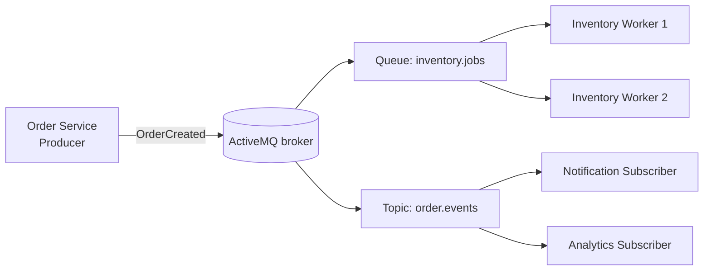
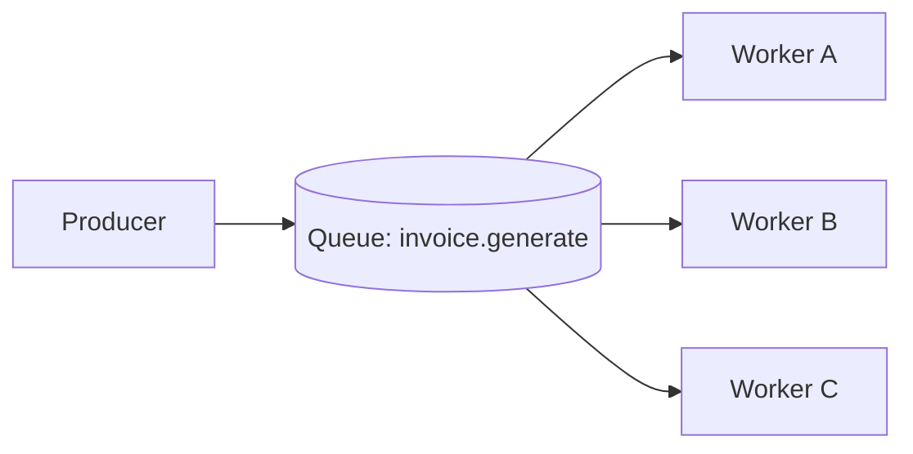
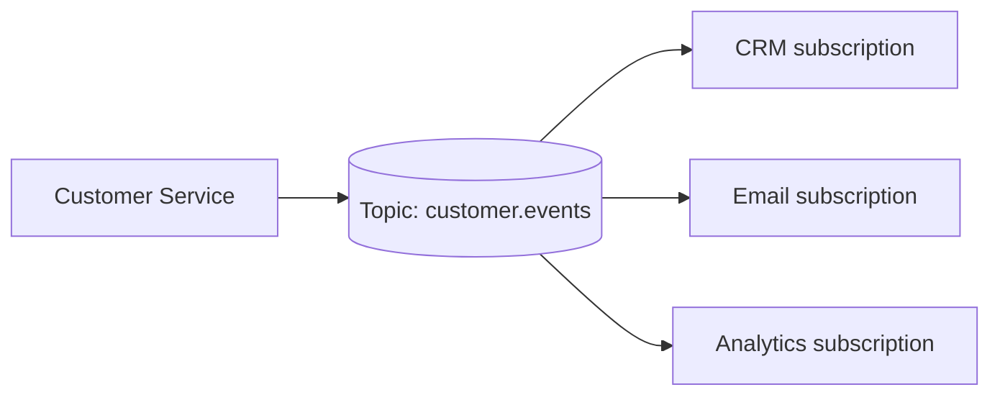
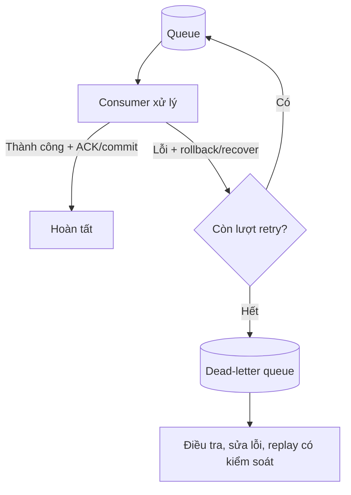

# ActiveMQ là gì và vai trò của broker trong tích hợp ứng dụng

> **Chương:** Tổng quan ActiveMQ  
> **Phạm vi:** Apache ActiveMQ Classic và Apache ActiveMQ Artemis, giao tiếp bất đồng bộ, queue/topic, routing và JMS trong ứng dụng Java.

## 1. Mục tiêu học tập

Sau bài này, bạn có thể:

- Giải thích ActiveMQ, *message broker*, producer, consumer, destination và lý do cần broker khi tích hợp nhiều ứng dụng.
- Phân biệt **queue (point-to-point)** với **topic (publish/subscribe)**; đọc được luồng định tuyến một thông điệp.
- Nhận ra sự khác nhau giữa **ActiveMQ Classic** và **ActiveMQ Artemis**, đặc biệt là mô hình destination và address.
- Viết chương trình Java đơn giản gửi và nhận message qua **JMS**.
- Phân tích tác động của persistence, acknowledgment, transaction, redelivery, dead-letter queue (DLQ), bảo mật và giám sát đến độ tin cậy của hệ thống.
- Chọn trường hợp nên dùng broker và nhận diện giới hạn của giao tiếp bất đồng bộ.

## 2. Vấn đề tích hợp: vì sao cần một message broker?

Giả sử hệ thống bán hàng có các dịch vụ **Order**, **Inventory**, **Payment** và **Notification**. Khi đơn hàng được tạo, Order cần thông báo cho các dịch vụ khác. Nếu Order gọi HTTP trực tiếp đến từng dịch vụ, mã nguồn phải biết địa chỉ của nhiều bên nhận, phải xử lý timeout/lỗi mạng của từng bên và có thể bị chậm khi một dịch vụ đang quá tải.

Với broker, Order gửi một **message** đại diện cho sự kiện, chẳng hạn `OrderCreated`, đến ActiveMQ. Các dịch vụ quan tâm tự nhận và xử lý theo nhịp riêng. Broker đứng giữa, nhận, lưu giữ theo cấu hình, định tuyến và phân phối message.



Sơ đồ thể hiện **hai cách sử dụng độc lập**: queue giao việc cho một nhóm worker, topic phát sự kiện cho nhiều nhóm quan tâm. Một ứng dụng có thể chủ động gửi tới cả hai destination; broker không tự nhân bản một message từ queue sang topic nếu chưa có cấu hình routing phù hợp.

### 2.1 Broker thực hiện những công việc gì?

| Vai trò | Ý nghĩa trong hệ thống |
|---|---|
| Tiếp nhận | Producer gửi message qua giao thức mà broker hỗ trợ; broker xác thực và kiểm tra quyền gửi. |
| Định tuyến | Chuyển message tới queue/topic hoặc các hàng đợi gắn với address theo loại định tuyến. |
| Đệm tải | Giữ message khi consumer chưa sẵn sàng, giúp hấp thụ chênh lệch tốc độ gửi và xử lý. |
| Lưu bền | Có thể ghi message bền vững để tồn tại sau sự cố broker, tùy chế độ gửi và cấu hình lưu trữ. |
| Phân phối | Gửi message tới consumer, quản lý subscription, acknowledgment và việc giao lại khi cần. |
| Kiểm soát vận hành | Áp chính sách quyền truy cập, giới hạn tài nguyên, TTL, retry, DLQ và cung cấp số liệu giám sát. |

**Bất đồng bộ** có nghĩa producer thường không cần chờ consumer hoàn thành nghiệp vụ để tiếp tục. Tuy nhiên producer vẫn có thể phải chờ kết nối, broker xác nhận gửi hoặc bộ đệm sẵn chỗ. Broker giúp **giảm phụ thuộc về thời điểm hoạt động**, nhưng không tự loại bỏ phụ thuộc về **hợp đồng dữ liệu**: hai bên vẫn phải thống nhất schema, ý nghĩa sự kiện và cách thay đổi phiên bản.

### 2.2 So với gọi HTTP trực tiếp

| Tiêu chí | HTTP đồng bộ trực tiếp | Message broker |
|---|---|---|
| Kết quả ngay | Phù hợp khi cần response trong cùng request. | Thường phù hợp xử lý nền, event; muốn phản hồi phải thiết kế luồng riêng. |
| Khi bên nhận tạm dừng | Bên gọi dễ bị timeout hoặc phải retry. | Message có thể chờ trong queue/subscription nếu chính sách giữ message cho phép. |
| Điều tiết tải | Cần tự thiết kế hàng đợi/giới hạn request. | Queue có thể hấp thụ đỉnh tải, nhưng backlog và dung lượng vẫn có giới hạn. |
| Nhiều bên quan tâm | Bên gọi thường biết các endpoint. | Topic cho nhiều subscriber nhận cùng sự kiện. |
| Độ phức tạp | Luồng dễ theo dõi trong request/response. | Cần quản lý message trùng, thứ tự, retry, độ trễ và quan sát luồng phân tán. |

**Quy tắc thực dụng:** dùng HTTP/gRPC cho yêu cầu cần phản hồi tức thời; cân nhắc broker cho công việc nền, tích hợp lỏng giữa các dịch vụ và sự kiện có nhiều bên tiêu thụ. Hai mô hình thường tồn tại cùng nhau.

## 3. Apache ActiveMQ là gì? Classic khác Artemis thế nào?

**Apache ActiveMQ** là hệ sinh thái message broker mã nguồn mở thuộc Apache, cung cấp cơ chế trao đổi message giữa các ứng dụng. Hai dòng broker cần phân biệt:

| Khía cạnh | ActiveMQ Classic | ActiveMQ Artemis |
|---|---|---|
| Dòng sản phẩm | Broker truyền thống, API và cấu hình theo kiến trúc Classic. | Broker có kiến trúc riêng, được thiết kế hướng hiệu năng và mở rộng hiện đại. |
| Khái niệm đích | **Queue** và **Topic** là mô hình JMS quen thuộc. | **Address** nhận message; **queue** gắn với address; routing type thường là **ANYCAST** hoặc **MULTICAST**. |
| JMS | Hỗ trợ ứng dụng Java dùng JMS. | Cũng hỗ trợ JMS; cần chọn bộ client/API phù hợp với phiên bản và namespace. |
| Lưu trữ và vận hành | Thường gặp KahaDB và cơ chế quản trị của Classic. | Sử dụng kiến trúc journal/ha/routing và cách cấu hình riêng của Artemis. |
| Chuyển đổi | Ứng dụng hiện hữu có thể phụ thuộc các tính năng, header, destination và cấu hình Classic. | Không thể giả định thay broker là tương đương hoàn toàn: phải kiểm tra protocol, destination, persistence, bảo mật, redelivery và HA. |

**Classic và Artemis là hai broker khác nhau**, không phải hai tên cho cùng một tiến trình. Với dự án mới, cần đánh giá yêu cầu giao thức, tải, quản trị, khả năng tương thích và phiên bản được tổ chức hỗ trợ; với hệ thống đang chạy, ưu tiên kiểm chứng các ràng buộc tích hợp hiện có.

### 3.1 Các thành phần trong đường đi của message

- **Producer:** ứng dụng tạo và gửi message.
- **Consumer:** ứng dụng nhận và xử lý message.
- **Connection / Session:** các đối tượng phía client quản lý kết nối và ngữ cảnh gửi/nhận; với JMS, Session còn liên quan acknowledgment/transaction.
- **Destination:** địa chỉ logic để producer gửi và consumer nhận; trong JMS thường là Queue hoặc Topic.
- **Broker:** tiến trình tiếp nhận, định tuyến, quản lý subscription, lưu trữ, giao lại message.
- **Persistence store:** bộ nhớ đĩa/journal lưu message và metadata theo cấu hình.
- **DLQ:** điểm đến của message không xử lý được sau khi vượt chính sách giao lại.

**Điểm lưu ý về Artemis:** một address với routing type **ANYCAST** thường định tuyến message vào một hàng đợi phù hợp để một consumer trong nhóm xử lý; **MULTICAST** chuyển bản sao tới các queue subscription được gắn với address. Việc có bao nhiêu queue, tự tạo hay tạo trước phụ thuộc cấu hình address-setting và client. Vì vậy không nên đồng nhất mọi address với một JMS queue.

## 4. Queue, topic và routing

### 4.1 Queue: chia việc giữa các consumer

Queue phù hợp với tác vụ mà **mỗi lần giao thành công chỉ cần một consumer xử lý**, ví dụ tạo hóa đơn PDF, cập nhật kho hoặc gửi email theo hàng đợi công việc.



Ba worker là các *competing consumers*: mỗi message được broker phân phối cho một consumer tại một thời điểm. Nếu worker lỗi trước khi xác nhận thành công, cùng message có thể được **redeliver** cho worker đó hoặc worker khác. Do vậy "một consumer xử lý" **không đồng nghĩa code nghiệp vụ chắc chắn chạy đúng một lần**.

### 4.2 Topic: phát sự kiện đến nhiều nhóm đăng ký

Topic phù hợp với sự kiện mà **nhiều hệ thống cần biết**, ví dụ `CustomerRegistered` để CRM, Email Service và Analytics cùng cập nhật trạng thái riêng.



Trong JMS, subscriber **không bền vững** thường chỉ nhận khi subscription đang hoạt động. Subscriber **durable** có thể giữ message phù hợp khi client tạm ngắt, với điều kiện subscription được tạo đúng và message/broker đáp ứng chính sách lưu giữ. Durable subscription cần danh tính ổn định, quản lý vòng đời và theo dõi backlog; không mặc nhiên có với mọi consumer topic.

### 4.3 Phân biệt bằng bài toán nghiệp vụ

| Bài toán | Lựa chọn điển hình | Giải thích |
|---|---|---|
| 10.000 ảnh cần resize bởi 8 worker | Queue | Mỗi ảnh cần một worker thực hiện; tăng số worker để chia tải. |
| Khi đơn hàng tạo, Kho, Email và BI đều phải nhận thông tin | Topic | Mỗi hệ thống cần bản sao sự kiện để xử lý độc lập. |
| Một yêu cầu thanh toán cần kết quả ngay trong màn hình checkout | HTTP/gRPC hoặc luồng phối hợp có timeout | Broker không cung cấp response đồng bộ như HTTP theo mặc định. |
| Gửi công việc nền nhưng phải đảm bảo không trừ tiền hai lần | Queue + xử lý idempotent | Retry/redelivery có thể gây lặp nếu nghiệp vụ thiếu cơ chế chống trùng. |

### 4.4 Những dữ liệu thường có trong một message

Ví dụ message nghiệp vụ:

```json
{
  "eventId": "evt-2026-000123",
  "eventType": "OrderCreated",
  "schemaVersion": 1,
  "orderId": "ORD-101",
  "occurredAt": "2026-11-17T07:00:00Z",
  "totalVnd": 125000
}
```

**Body** chứa payload (JSON, text hoặc bytes), còn **header/properties** giúp điều khiển việc giao message. Với JMS, các trường thường gặp gồm `JMSMessageID` (ID message do provider cấp), `JMSCorrelationID` (liên kết request/reply), `JMSReplyTo`, `JMSExpiration`, `JMSDeliveryMode`, `JMSPriority` và `JMSRedelivered`. Ứng dụng nên tự gán `eventId` ổn định khi retry cùng một sự kiện; không coi `JMSMessageID` là khóa nghiệp vụ toàn cục giữa nhiều lần xuất bản.

Đối với hợp đồng sự kiện, cần nêu rõ kiểu dữ liệu, phiên bản schema, timezone, hành vi khi thiếu trường và nguyên tắc tương thích ngược. Không gửi bí mật, token hoặc dữ liệu nhạy cảm không cần thiết trong payload.

## 5. JMS đóng vai trò gì?

**Java Message Service (JMS)** là API Java chuẩn hóa các thao tác với message: tạo connection/session, producer/consumer, queue/topic, gửi, nhận và xác nhận. **JMS không phải bản thân broker**: ActiveMQ cung cấp implementation phía client và server; một broker khác cũng có thể cung cấp JMS client riêng.

Luồng xử lý phổ biến:

1. Chọn implementation client tương ứng broker và phiên bản API.
2. Tạo `ConnectionFactory`, mở `Connection`, tạo `Session`.
3. Producer tạo `Message` và gửi vào destination.
4. Broker nhận, định tuyến, có thể ghi bền và phân phối.
5. Consumer nhận message, xử lý nghiệp vụ, xác nhận hoặc rollback/recover khi lỗi.

**Vấn đề namespace:** các ứng dụng JMS cũ thường import `javax.jms.*`, còn hệ Jakarta Messaging mới dùng `jakarta.jms.*`. Hai namespace không tự hoán đổi cho nhau; dependency và mã nguồn phải khớp với client mà bạn chọn. Ví dụ bên dưới cố ý dùng **ActiveMQ Classic 5.x + JMS kiểu `javax.jms`** để minh họa, không phải cấu hình cho Artemis.

## 6. Thực hành Java: producer và consumer với ActiveMQ Classic

**Điều kiện:** JDK 17, Maven và một broker **ActiveMQ Classic 5.x** đang chạy, chấp nhận kết nối TCP tại `tcp://localhost:61616`. Bạn có thể dùng broker thử nghiệm trong máy cá nhân; với môi trường có authentication, khai báo biến môi trường `BROKER_USER` và `BROKER_PASSWORD`. Địa chỉ, cổng và chính sách tự tạo queue phải tuân theo cấu hình broker thực tế.

Tạo dự án Maven với cấu trúc `src/main/java/demo/ActiveMqIntro.java`.

**Ví dụ `pom.xml`:**

```xml
<project xmlns="http://maven.apache.org/POM/4.0.0"
         xmlns:xsi="http://www.w3.org/2001/XMLSchema-instance"
         xsi:schemaLocation="http://maven.apache.org/POM/4.0.0 https://maven.apache.org/xsd/maven-4.0.0.xsd">
    <modelVersion>4.0.0</modelVersion>
    <groupId>demo</groupId>
    <artifactId>activemq-intro</artifactId>
    <version>1.0-SNAPSHOT</version>
    <properties>
        <maven.compiler.release>17</maven.compiler.release>
        <project.build.sourceEncoding>UTF-8</project.build.sourceEncoding>
    </properties>
    <dependencies>
        <dependency>
            <groupId>org.apache.activemq</groupId>
            <artifactId>activemq-client</artifactId>
            <version>5.18.3</version>
        </dependency>
    </dependencies>
    <build>
        <plugins>
            <plugin>
                <groupId>org.codehaus.mojo</groupId>
                <artifactId>exec-maven-plugin</artifactId>
                <version>3.3.0</version>
            </plugin>
        </plugins>
    </build>
</project>
```

**Ví dụ `ActiveMqIntro.java`:**

```java
package demo;

import java.util.UUID;
import javax.jms.Connection;
import javax.jms.DeliveryMode;
import javax.jms.Message;
import javax.jms.MessageConsumer;
import javax.jms.MessageProducer;
import javax.jms.Queue;
import javax.jms.Session;
import javax.jms.TextMessage;
import org.apache.activemq.ActiveMQConnectionFactory;

public final class ActiveMqIntro {
    public static void main(String[] args) throws Exception {
        if (args.length != 1 ||
                (!"produce".equals(args[0]) && !"consume".equals(args[0]))) {
            System.err.println("Usage: produce | consume");
            return;
        }

        String url = System.getenv().getOrDefault(
                "BROKER_URL", "tcp://localhost:61616");
        String user = System.getenv("BROKER_USER");
        String password = System.getenv("BROKER_PASSWORD");
        ActiveMQConnectionFactory factory = new ActiveMQConnectionFactory(url);

        Connection connection = user == null || user.isBlank()
                ? factory.createConnection()
                : factory.createConnection(user, password);
        try {
            Session session = connection.createSession(
                    false, Session.AUTO_ACKNOWLEDGE);
            try {
                Queue queue = session.createQueue("orders.created.demo");
                if ("produce".equals(args[0])) {
                    MessageProducer producer = session.createProducer(queue);
                    try {
                        producer.setDeliveryMode(DeliveryMode.PERSISTENT);
                        TextMessage event = session.createTextMessage(
                                "OrderCreated: ORD-101");
                        event.setStringProperty("eventId",
                                UUID.randomUUID().toString());
                        producer.send(event);
                        System.out.println("Sent: " + event.getText());
                    } finally {
                        producer.close();
                    }
                } else {
                    MessageConsumer consumer = session.createConsumer(queue);
                    try {
                        connection.start(); // Bắt đầu phân phối message.
                        Message message = consumer.receive(10_000);
                        if (message == null) {
                            System.out.println("No message in 10 seconds.");
                        } else if (message instanceof TextMessage) {
                            System.out.println("Received: "
                                    + ((TextMessage) message).getText());
                        } else {
                            System.out.println("Received non-text message.");
                        }
                    } finally {
                        consumer.close();
                    }
                }
            } finally {
                session.close();
            }
        } finally {
            connection.close();
        }
    }
}
```

Chạy lần lượt trong thư mục có `pom.xml`:

```bash
mvn -q compile exec:java -Dexec.mainClass=demo.ActiveMqIntro -Dexec.args=produce
mvn -q compile exec:java -Dexec.mainClass=demo.ActiveMqIntro -Dexec.args=consume
```

**Kỳ vọng:** lệnh đầu ghi một text message vào queue `orders.created.demo`; lệnh sau nhận và in `OrderCreated: ORD-101`. Chạy consumer lần nữa khi queue đã trống sẽ báo không nhận được message trong 10 giây. Nếu broker không cho phép tự tạo destination, quản trị viên phải tạo queue trước.

**Giới hạn của demo:** `AUTO_ACKNOWLEDGE` thuận tiện để học API, nhưng nếu consumer nhận xong rồi mới ghi database và tiến trình chết giữa chừng, hệ thống có thể coi message đã hoàn tất trong khi nghiệp vụ chưa hoàn tất. Với nghiệp vụ cần phục hồi chính xác, đọc phần acknowledgment, transaction và idempotency bên dưới.

## 7. Điều gì quyết định độ tin cậy của việc giao message?

### 7.1 Persistence khác acknowledgment

- **Persistent delivery:** producer yêu cầu broker lưu message theo cơ chế bền vững; khả năng chịu mất điện còn phụ thuộc cấu hình journal/store, đồng bộ ghi và HA. Không phải mọi message đã gửi đều tự động bền nếu đặt chế độ non-persistent.
- **Acknowledgment:** consumer xác nhận đã nhận/xử lý message theo cách API quy định. ACK là tín hiệu ở tầng messaging; nó không tự chứng minh giao dịch database bên ngoài đã commit.
- **Transaction:** gom việc gửi/nhận trong một ngữ cảnh giao dịch của session; commit xác nhận, rollback có thể khiến message được giao lại.

Ví dụ, broker đã nhận message nhưng worker chết trước khi ACK: message có thể được giao lại. Ngược lại, worker đã ghi database nhưng chết trước khi ACK: broker cũng có thể giao lại, tạo **xử lý trùng**. Vì thế thiết kế hệ thống đáng tin cậy thường dựa vào **at-least-once delivery + consumer idempotent**, thay vì giả định *exactly-once end-to-end*.

### 7.2 Các chế độ nhận và xác nhận thường gặp trong JMS

| Chế độ | Cơ chế | Dùng khi nào / chú ý |
|---|---|---|
| `AUTO_ACKNOWLEDGE` | Session tự xác nhận theo quy tắc JMS khi receive/listener hoàn tất. | Đơn giản cho demo và công việc ít rủi ro; tránh hiểu nhầm ACK là commit nghiệp vụ. |
| `CLIENT_ACKNOWLEDGE` | Ứng dụng gọi `message.acknowledge()`. | Muốn chủ động ACK sau xử lý; **ACK có thể áp dụng cho toàn bộ message đã giao trong cùng session**, không riêng một message. |
| `DUPS_OK_ACKNOWLEDGE` | Cho phép xác nhận lười, chấp nhận khả năng nhận trùng cao hơn. | Chỉ dùng khi consumer chịu được duplicate và chính sách phù hợp. |
| Session transacted | Gọi `session.commit()` sau thành công, `session.rollback()` khi lỗi. | Gom ACK và send trong session JMS; database ngoài session không tự nằm trong giao dịch đó. |

Phác thảo cách nhận với session transacted:

```java
Session session = connection.createSession(true, Session.SESSION_TRANSACTED);
MessageConsumer consumer = session.createConsumer(queue);
connection.start();
Message message = consumer.receive(10_000);
if (message != null) {
    try {
        processBusiness(message); // Hàm nghiệp vụ do ứng dụng tự triển khai.
        session.commit();        // ACK message nhận trong giao dịch JMS.
    } catch (Exception failure) {
        session.rollback();      // Cho phép broker giao lại theo chính sách.
        throw failure;
    }
}
```

Đoạn trên chỉ minh họa cơ chế; khi triển khai cần đóng tài nguyên, giới hạn số lần xử lý, đặt timeout và quyết định thứ tự commit giữa database và JMS. Nếu cần đồng bộ sự kiện với việc ghi database, nghiên cứu **transactional outbox**; nếu consumer ghi dữ liệu, dùng khóa nghiệp vụ/`eventId` để loại duplicate. Chỉ xem xét XA/distributed transaction khi thật sự cần và hiểu chi phí vận hành.

### 7.3 Redelivery, poison message và DLQ



**Redelivery** là gửi lại message không được xử lý thành công. Nên đặt chính sách số lần thử, thời gian chờ/backoff và xử lý lỗi phân biệt:

- **Lỗi tạm thời:** timeout tới dịch vụ khác, hết kết nối database; retry có giới hạn và backoff.
- **Lỗi dữ liệu không thể xử lý:** schema không hợp lệ, mã nghiệp vụ không tồn tại; đưa DLQ sớm để tránh kẹt queue.
- **Poison message:** message luôn làm consumer lỗi; không để retry vô hạn gây nghẽn hoặc tăng chi phí.

Ở **ActiveMQ Classic**, dead-letter mặc định thường liên quan queue `ActiveMQ.DLQ` và cấu hình `redeliveryPolicy` / `deadLetterStrategy`. Ở **Artemis**, admin cần cấu hình `dead-letter-address` và `max-delivery-attempts` trong address settings. Tên DLQ, số lần thử và thời điểm chuyển tới DLQ **không nên giả định giống nhau** giữa các broker hoặc môi trường.

Khi replay từ DLQ phải lưu nguyên nhân lỗi, kiểm tra duplicate, giới hạn tốc độ và ghi log sự kiện đã replay; không tự động đẩy lại tất cả message chưa phân loại.

### 7.4 Thứ tự và khả năng nhận trùng

Queue thường giúp duy trì trật tự gửi trong các điều kiện đơn giản, nhưng **nhiều producer, nhiều consumer, redelivery, priority, selector và prefetch** có thể làm thứ tự quan sát khi xử lý khác đi. Đừng thiết kế tính đúng đắn dựa trên thứ tự toàn cục nếu chưa có cơ chế như khóa theo aggregate, một consumer cho một partition/nhóm, hoặc kiểm tra version.

Một consumer tốt nên thỏa tính **idempotent**: cùng `eventId` được nhận hai lần vẫn tạo ra đúng một tác động nghiệp vụ. Ví dụ lưu `eventId` đã xử lý vào bảng có unique constraint cùng transaction ghi trạng thái đơn hàng; lần xử lý trùng sẽ bị bỏ qua có kiểm soát.

## 8. Bảo mật và vận hành broker

### 8.1 Bảo mật tối thiểu cho môi trường thật

1. **Authentication:** cấp tài khoản riêng cho ứng dụng, quản lý secret bên ngoài mã nguồn, xoay vòng thông tin đăng nhập.
2. **Authorization:** cấp quyền gửi/nhận theo destination/address, áp nguyên tắc ít quyền nhất.
3. **Transport security:** dùng TLS cho kết nối client-broker, xác thực chứng chỉ và mã hóa đường truyền khi qua mạng không tin cậy.
4. **Network isolation:** giới hạn port broker, cổng management và web console; tránh mở công khai Internet.
5. **Payload hygiene:** giảm dữ liệu nhạy cảm, kiểm soát log và chuẩn hóa schema; không cho dữ liệu từ message điều khiển thực thi mã không kiểm soát.

Tên user, password hoặc cổng ở môi trường development chỉ là cấu hình ví dụ; production phải theo chính sách của tổ chức và cấu hình broker đã triển khai.

### 8.2 Các chỉ số cần giám sát

| Chỉ số | Vì sao cần theo dõi |
|---|---|
| Queue depth / backlog | Biết lượng việc đang chờ; tăng liên tục thường báo consumer chậm hoặc ngừng hoạt động. |
| Enqueue / dequeue rate | So sánh tốc độ vào và ra, phát hiện tích lũy tải. |
| Consumer count | Phát hiện nhóm xử lý mất kết nối hoặc scale chưa đủ. |
| Redelivery count và DLQ depth | Phát hiện lỗi nghiệp vụ, schema, phụ thuộc ngoài hoặc cấu hình retry bất hợp lý. |
| Message age / processing latency | Đánh giá thời gian từ gửi đến xử lý; backlog nhỏ chưa chắc độ trễ thấp. |
| Disk, journal/store, memory, connection count | Ngăn broker hết tài nguyên, đầy đĩa hoặc cạn kết nối. |

Kèm theo metric là **log có correlation ID**, alert theo SLO, dashboard, kiểm thử khôi phục sau mất broker, backup và kế hoạch HA/failover. Thử nghiệm cần bao gồm: consumer dừng đột ngột, broker restart, message độc, backlog lớn và xử lý trùng sau reconnect.

### 8.3 Tình huống vận hành: worker xử lý chậm

Giả sử producer đưa 500 message/phút nhưng các worker chỉ xử lý được 300 message/phút. Backlog tăng khoảng **200 message/phút** khi tốc độ giữ nguyên. Queue giúp producer và consumer không phải chạy đồng thời, song không làm biến mất chênh lệch năng lực. Cần tăng consumer hợp lý, tối ưu công việc, đặt giới hạn gửi, chia nhóm tải và kiểm tra dung lượng store. Nếu mở thêm worker khiến database phía sau quá tải, phải áp **backpressure** và giới hạn concurrency thay vì scale vô hạn.

## 9. Những lỗi thiết kế thường gặp

| Hiểu nhầm | Cách hiểu đúng |
|---|---|
| “Gửi thành công là nghiệp vụ đã hoàn thành.” | Producer chỉ biết message được broker/client chấp nhận theo ngữ nghĩa xác nhận gửi; xử lý nghiệp vụ xảy ra sau đó. |
| “Queue đảm bảo xử lý đúng một lần.” | Redelivery có thể gây xử lý lại; cần idempotency/deduplication ở tầng nghiệp vụ. |
| “Topic luôn lưu sự kiện cho mọi người đăng ký trong tương lai.” | Phụ thuộc durable subscription, thời điểm tạo, retention và chính sách lưu trữ. |
| “Dùng persistent message là không mất dữ liệu trong mọi tình huống.” | Còn phụ thuộc durability, journal, thiết lập đồng bộ đĩa, topology và kịch bản sự cố. |
| “Cứ có nhiều consumer là nhanh hơn.” | Consumer có thể tranh chấp tài nguyên và làm quá tải phụ thuộc phía sau. |
| “Classic và Artemis thay thế nhau không cần kiểm thử.” | Có khác biệt kiến trúc, cấu hình, client, routing, DLQ và HA. |

## 10. Checklist thiết kế một luồng tích hợp bằng ActiveMQ

Trước khi đưa một luồng message vào production, hãy trả lời:

1. Đây là **command giao việc** (queue) hay **event cho nhiều bên** (topic)? Ai sở hữu contract?
2. Message có `eventId`, `schemaVersion`, timestamp và khóa nghiệp vụ đủ để truy vết/chống trùng chưa?
3. Khi consumer ngừng 30 phút, broker có phải giữ message không? Mức tồn backlog và TTL cho phép là bao nhiêu?
4. Điểm nào ACK/commit? Thao tác database có thể lặp an toàn không?
5. Retry khi nào, backoff ra sao, khi nào chuyển DLQ, ai có quyền replay?
6. Broker/client dùng **Classic hay Artemis**, giao thức nào, namespace JMS nào, bảo mật và tài nguyên ra sao?
7. Có dashboard, alert, thử nghiệm restart và tài liệu xử lý sự cố chưa?

## 11. Câu hỏi tự kiểm tra

1. Một producer muốn phát `PaymentCompleted` cho hệ thống hóa đơn và hệ thống thống kê. Bạn chọn queue hay topic, vì sao?
2. Trong queue có hai consumer; consumer A đã ghi database nhưng chết trước khi ACK. Điều gì có thể xảy ra và bạn xử lý thế nào?
3. Nếu dự án Java dùng `jakarta.jms`, có thể thay trực tiếp bằng ví dụ Classic `javax.jms` ở trên không? Những thành phần nào phải đối chiếu?
4. Backlog tăng liên tục khi producer có tốc độ cao hơn consumer. Bạn sẽ xem metric nào và đưa ra biện pháp gì?
5. Khi một message bị lỗi schema nhiều lần, retry vô hạn và replay DLQ hàng loạt có rủi ro gì?

**Kết luận:** ActiveMQ tạo một tầng trung gian để các ứng dụng trao đổi message bất đồng bộ. **Queue** dùng cho chia việc, **topic** dùng cho phát sự kiện, còn broker chịu trách nhiệm tiếp nhận, định tuyến, lưu giữ và phân phối theo chính sách. Độ tin cậy thực tế chỉ có được khi kết hợp đúng JMS client, persistence, acknowledgment, transaction, idempotency, DLQ, bảo mật và vận hành; broker không thay thế thiết kế nhất quán dữ liệu của ứng dụng.
