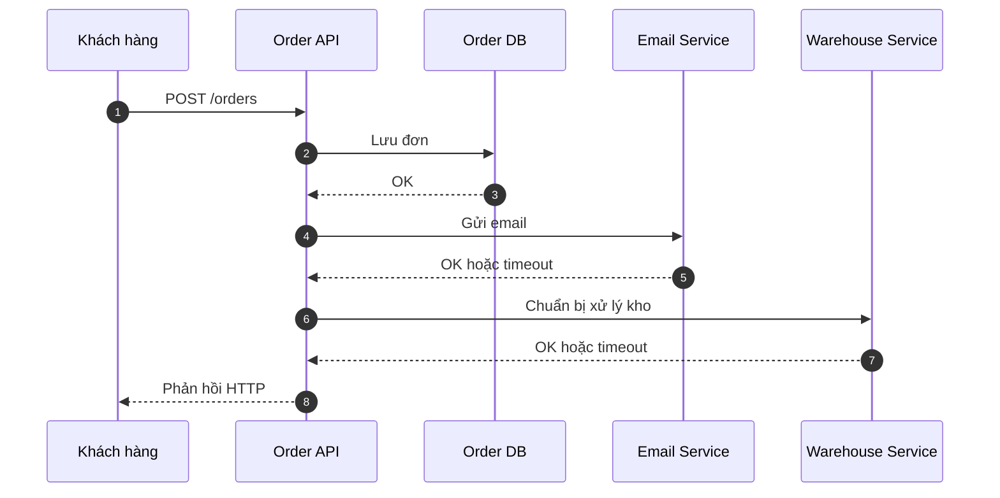
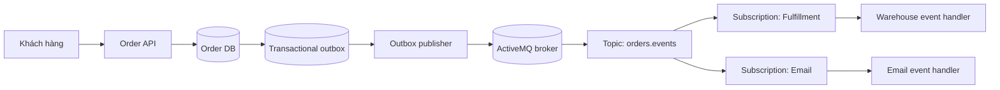
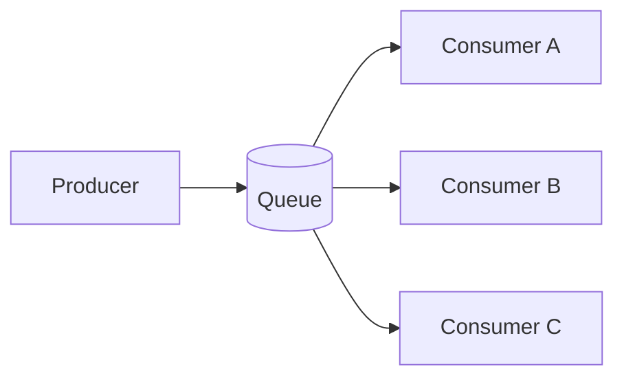
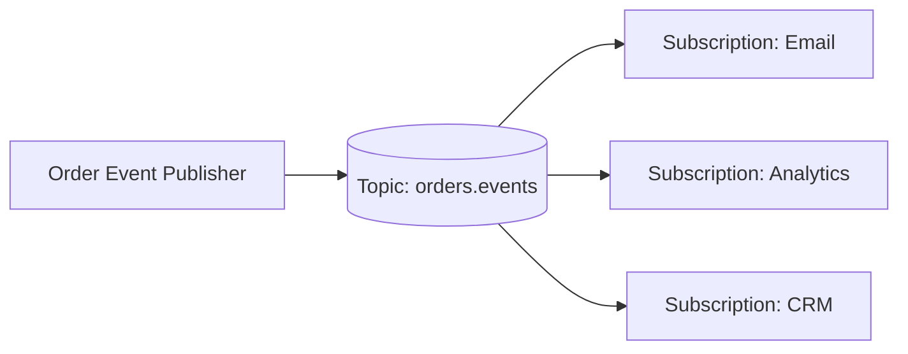
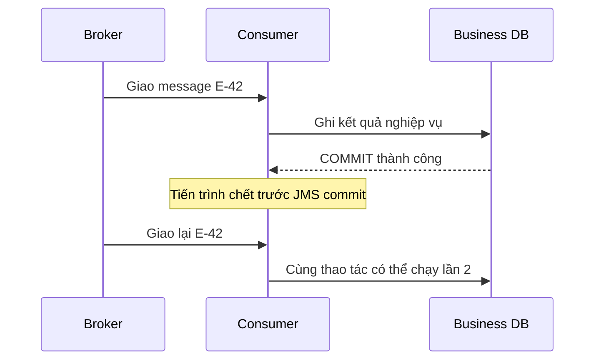
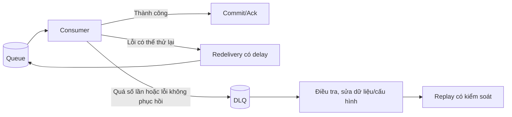

# Bài toán tách rời hệ thống, xử lý bất đồng bộ và hấp thụ tải đột biến

> **Chương:** Tổng quan ActiveMQ  
> **Phạm vi:** Apache ActiveMQ Classic, ActiveMQ Artemis, queue, topic và JMS trong giao tiếp bất đồng bộ giữa các dịch vụ.

## 1. Kết quả cần đạt

Sau bài học, bạn có thể:

1. Giải thích vì sao chuỗi lời gọi đồng bộ làm các dịch vụ phụ thuộc vào thời gian phản hồi và trạng thái hoạt động của nhau.
2. Thiết kế luồng **producer → broker → consumer** để tách thời điểm phát sinh công việc khỏi thời điểm xử lý công việc.
3. Phân biệt **queue** để phân phối công việc với **topic** để phát sự kiện đến nhiều bên quan tâm; liên hệ cách ActiveMQ Classic và Artemis định tuyến thông điệp.
4. Tính xấp xỉ lượng thông điệp tồn đọng khi tải đầu vào tăng cao hơn năng lực xử lý, từ đó xác định giới hạn của việc dùng broker làm bộ đệm.
5. Nhận diện các yêu cầu về acknowledgment, transaction, redelivery, dead-letter queue (DLQ), idempotency, bảo mật và quan sát vận hành.

**Tư duy cốt lõi:** Broker không làm cho một tác vụ tốn 500 ms tự nhiên chạy còn 5 ms. Broker cho phép dịch vụ tiếp nhận yêu cầu **ghi nhận công việc một cách đáng tin cậy**, trả lời sớm khi phù hợp, rồi để consumer xử lý công việc theo năng lực thực tế. Độ trễ của *toàn bộ quy trình nghiệp vụ* vẫn phải được đo và quản lý.

## 2. Bài toán: một yêu cầu kéo theo quá nhiều lời gọi

Giả sử hệ thống thương mại điện tử có API tạo đơn hàng. Sau khi ghi đơn vào cơ sở dữ liệu, hệ thống cần thực hiện ba việc:

- Gửi email xác nhận qua nhà cung cấp bên ngoài.
- Cập nhật chỉ mục tìm kiếm hoặc dữ liệu phân tích.
- Chuẩn bị tác vụ chuyển đơn đến kho.

Nếu API gọi tất cả thành phần theo kiểu đồng bộ, luồng điển hình sẽ là:



Thiết kế này đơn giản khi hệ thống nhỏ, nhưng nảy sinh ba dạng phụ thuộc:

| Phụ thuộc | Biểu hiện | Hậu quả |
|---|---|---|
| **Theo thời gian** | API phải chờ email/kho trả lời. | Thời gian phản hồi tăng theo các tác vụ phía sau. |
| **Theo tình trạng hoạt động** | Email Service chậm hoặc ngắt kết nối. | API có thể timeout dù đơn hàng đã được ghi thành công. |
| **Theo năng lực tải** | Một đợt khuyến mãi tạo hàng nghìn đơn mỗi giây. | Lượng kết nối, luồng xử lý và retry dồn vào hệ thống phụ thuộc. |

Ví dụ, ghi đơn mất 40 ms nhưng email thỉnh thoảng mất 3 giây. Nếu API chờ email, người mua cũng phải chờ. Đáng ngại hơn, sau khi cơ sở dữ liệu đã lưu đơn, API có thể timeout và khách gửi lại yêu cầu: nếu không có khóa chống trùng, hệ thống có thể tạo hai đơn. Tăng timeout chỉ kéo dài thời gian chờ, không giải quyết sự phụ thuộc.

Không phải bước nào cũng nên đưa vào hàng đợi. Chẳng hạn, nếu nghiệp vụ chỉ được phép xác nhận đặt hàng **sau khi kiểm tra tồn kho hoặc xác thực thanh toán**, cần xác định chính xác điểm nhất quán phải đạt trước khi trả kết quả thành công. Gửi email và cập nhật dữ liệu phân tích thường có thể làm sau; quyết định trừ tiền hay giữ hàng phụ thuộc vào quy tắc nghiệp vụ.

## 3. Giải pháp: đặt broker giữa nơi tạo việc và nơi làm việc

Trong kiến trúc messaging, các vai trò có thể tách như sau:

- **Producer** tạo và gửi message mô tả công việc hoặc sự kiện đã xảy ra.
- **Message broker** tiếp nhận, lưu/định tuyến và chuyển message đến đúng đích theo cấu hình.
- **Consumer** nhận message, thực hiện nghiệp vụ và xác nhận khi xử lý xong.
- **Destination** là đích logic, thường là queue hoặc topic đối với API JMS.



Sơ đồ dùng **transactional outbox** để minh họa cách phát thông điệp gắn với việc lưu đơn, còn topic phân phối bản sao sự kiện đến các subscription phù hợp. Nếu cần nhiều worker cùng chia công việc từ một queue, sử dụng mô hình queue ở phần 4; không mặc định broker tự nhân bản một queue message sang nhiều queue khác. Một hệ thống nhỏ có thể gửi thẳng từ producer đến broker để học cách JMS hoạt động; khi cần đảm bảo đơn đã lưu thì sớm muộn cũng có sự kiện tương ứng, outbox giải quyết một khoảng lỗi quan trọng (phần 8).

Luồng xử lý mới:

1. Order API xác thực dữ liệu, thực hiện các điều kiện nghiệp vụ cần đồng bộ và lưu đơn.
2. Hệ thống ghi nhận ý định phát sự kiện `OrderCreated` rồi chuyển nó đến broker.
3. API có thể trả `201 Created` khi đơn đã tồn tại và hợp đồng API cho phép các tác vụ hậu xử lý chạy sau. Trạng thái đơn nên phản ánh rõ bước tiếp theo, chẳng hạn `PENDING_FULFILLMENT`.
4. Consumer nhận message, xử lý và xác nhận. Nếu worker tạm ngừng, broker giữ message còn đủ điều kiện lưu trữ/tiếp tục giao lại theo chính sách.

**Tách rời không có nghĩa là không còn ràng buộc.** Producer và consumer vẫn cần thống nhất schema message, ý nghĩa nghiệp vụ, danh tính sự kiện, quyền truy cập và chính sách xử lý lỗi. Họ chỉ không cần hoạt động cùng lúc hoặc triển khai cùng một bản phát hành.

### Command và event: đừng đặt tên tùy tiện

Hai loại message thường gặp có ý nghĩa khác nhau:

| Loại | Ví dụ | Ý nghĩa |
|---|---|---|
| **Command** | `PrepareShipment { orderId }` | Yêu cầu một thành phần thực hiện hành động cụ thể; thường có một nhóm worker chịu trách nhiệm. |
| **Event** | `OrderCreated { eventId, orderId, occurredAt }` | Thông báo một sự kiện đã xảy ra; nhiều hệ thống có thể độc lập phản ứng. |

Hãy tránh nhét đối tượng Java đã tuần tự hóa vào message như một hợp đồng tích hợp lâu dài. JSON/Avro/Protobuf với `schemaVersion` và quy tắc tương thích thường dễ phối hợp giữa nhiều ngôn ngữ, dù vẫn phải kiểm soát kiểu dữ liệu và thay đổi schema.

## 4. Queue, topic và routing trong ActiveMQ

### Queue: một công việc được một consumer xử lý ở mỗi lần giao

Với queue `orders.fulfillment`, nhiều consumer có thể cạnh tranh nhận việc. Trong cùng một lần giao thành công, mỗi message được chuyển cho **một** consumer của queue; nếu consumer lỗi trước khi xác nhận, message có thể được giao lại.



Queue thích hợp cho tạo vận đơn, chuyển đổi tệp, gửi email theo job, xử lý thanh toán theo các điều kiện kiểm soát phù hợp. Tăng số consumer có thể tăng thông lượng khi công việc đủ độc lập và hệ thống phía sau còn năng lực. **Không mặc định đảm bảo thứ tự toàn cục** khi có nhiều consumer hoặc redelivery; những nghiệp vụ phải tuần tự theo `orderId` cần thiết kế phân vùng/nhóm message và kiểm tra tính chất của broker, consumer.

### Topic: một sự kiện có nhiều bên đăng ký

Với topic `orders.events`, mỗi subscription phù hợp có thể nhận bản sao của cùng một sự kiện. Ví dụ, một bên cập nhật báo cáo, một bên gửi email, một bên cập nhật hệ thống chăm sóc khách hàng.



Trong JMS, **subscription không bền (non-durable)** thường bỏ lỡ các message phát khi subscriber vắng mặt; **durable subscription** cho phép broker giữ những message đủ điều kiện cho subscriber tạm offline, trong giới hạn retention, tài nguyên và chính sách đã cấu hình. Không được suy luận rằng mọi subscriber topic đều tự động nhận lại sự kiện từ quá khứ.

### ActiveMQ Classic và Artemis không dùng cùng mô hình nội bộ

| Khía cạnh | ActiveMQ Classic | ActiveMQ Artemis |
|---|---|---|
| Cách người dùng JMS nhìn thấy | `Queue` và `Topic`. | Vẫn hỗ trợ `Queue` và `Topic` qua JMS. |
| Khái niệm định tuyến nổi bật | Destination queue/topic; có các cơ chế cấu hình như virtual destinations. | **Address** có một hoặc nhiều queue; routing type **anycast** hoặc **multicast**. |
| Phân phối phổ biến | Queue chia việc giữa consumer; topic phát đến subscription. | Anycast thường dùng cho phân phối một bản tin đến một queue; multicast dùng cho phát đến nhiều queue/subscription phù hợp. |
| Client Java | Chọn ActiveMQ Classic JMS client phù hợp với phiên bản broker/API. | Chọn Artemis JMS client phù hợp với phiên bản broker/API. |

Nói cách khác, queue/topic là mô hình dễ hình dung ở lớp ứng dụng; khi triển khai Artemis phải kiểm tra **address, queue, routing type và auto-create settings** thực tế. Đặt tên destination giống nhau chưa đủ để chứng minh mọi message được định tuyến giống nhau giữa hai sản phẩm. Không tự động coi hai broker có cùng cơ chế lưu trữ, cấu hình retry hay cơ chế HA.

## 5. Tại sao broker hấp thụ được tải đột biến?

Nếu tốc độ vào (**arrival rate**) tăng trong ngắn hạn vượt tốc độ consumer xử lý (**service rate**), broker có thể giữ message chờ. Khi tải hạ xuống, consumer tiếp tục tiêu thụ backlog.

Ký hiệu:

- `λ` (*lambda*): số message mới đến mỗi giây.
- `μ` (*mu*): tổng số message xử lý thành công mỗi giây của các consumer.
- `T`: thời gian tải cao kéo dài, tính bằng giây.
- `B`: số message đang tồn đọng trong hàng chờ.

Nếu `λ > μ`, bỏ qua các yếu tố phức tạp khác và giả sử đầu hàng đợi rỗng, số message tăng thêm xấp xỉ:

\[
B \approx (\lambda - \mu)\,T
\]

### Ví dụ tính dung lượng cho đợt flash sale

Giả sử:

- Bình thường: `λ_base = 500 message/giây`.
- Trong 60 giây cao điểm: `λ_peak = 6.000 message/giây`.
- Toàn bộ worker có khả năng xử lý bền vững `μ = 2.000 message/giây`.
- Payload trung bình mỗi message là `2 KB` (chỉ để ước tính).

Backlog cuối đợt cao điểm:

\[
B = (6.000 - 2.000) \times 60 = 240.000\ \text{message}
\]

Dung lượng **payload thuần** xấp xỉ `240.000 × 2 KB = 480 MB`. Dung lượng thực của broker có thể cao hơn đáng kể do header, index, journal, metadata, cơ chế persistence, bản sao HA và cấu hình khác. Không dùng 480 MB làm con số cấp phát đĩa duy nhất.

Sau đợt tăng tải, lượng message mới quay về 500/giây. Tốc độ giảm backlog ròng là `2.000 - 500 = 1.500 message/giây`; thời gian cần để xóa hết backlog xấp xỉ:

\[
T_{drain} = \frac{240.000}{1.500} = 160\ \text{giây}
\]

Ở cuối cao điểm, một message mới đi vào queue FIFO đang có 240.000 message phía trước có thể phải chờ cỡ `240.000 / 2.000 = 120 giây` trước khi được xử lý, chưa tính các biến động và chi phí thực tế. Vì vậy, **API nhanh hơn không đồng nghĩa với nghiệp vụ hoàn tất nhanh hơn**.

### Khi nào việc đệm tải thất bại?

Broker chỉ giúp khi lượng vượt tải **có giới hạn** và về sau tồn tại khoảng thời gian `μ > λ` để tiêu backlog. Nếu đầu vào liên tục 2.500/giây trong khi worker tối đa 2.000/giây, backlog sẽ tăng mãi cho đến khi chạm giới hạn đĩa/bộ nhớ/chính sách broker.

Để xây dựng hệ thống an toàn, cần phối hợp:

1. **Bounded capacity:** đặt hạn mức tài nguyên, quota, kích thước message và chính sách khi queue đầy; biết producer sẽ bị chặn, lỗi hay chịu flow control như thế nào.
2. **Backpressure/rate limiting:** giảm tốc độ nhận yêu cầu, áp dụng admission control hoặc phản hồi quá tải có chủ đích khi cần; không đẩy vô hạn vào broker.
3. **Scale consumer có kiểm soát:** tăng worker nếu CPU, cơ sở dữ liệu và API downstream còn dư địa; tăng worker quá mức có thể khiến DB sập trước broker.
4. **Theo dõi tuổi message:** ngoài queue depth, đo thời gian từ `createdAt/enqueuedAt` đến khi xử lý xong; hàng đợi ngắn nhưng mỗi job chạy hàng phút vẫn có thể vi phạm SLA.
5. **Ưu tiên và tách tải hợp lý:** phân biệt job ngắn/dài, nghiệp vụ khẩn/không khẩn bằng queue hoặc cấu trúc xử lý thích hợp để tránh một loại job chiếm hết năng lực.

Đừng nhìn một con số throughput trong benchmark rồi coi đó là bảo đảm vận hành. Message nhỏ/lớn, persistent/non-persistent, giao dịch, đường truyền, ổ đĩa, số subscriber và kiểu acknowledgment đều ảnh hưởng đến kết quả.

## 6. Producer/consumer Java bằng JMS: ví dụ tối thiểu

**Giới hạn ví dụ:** Đoạn mã dùng **ActiveMQ Classic JMS client tương thích API `javax.jms`** để minh họa. Bạn cần broker Classic chạy ở `tcp://localhost:61616`, client dependency `org.apache.activemq:activemq-client` thuộc nhánh hỗ trợ `javax.jms`, và cấu hình xác thực phù hợp với môi trường local. Artemis dùng client factory/package riêng (ví dụ `org.apache.activemq.artemis.jms.client.ActiveMQConnectionFactory`); chọn dependency cùng namespace JMS với phiên bản broker/client đang dùng. Ứng dụng dùng Jakarta JMS mới có thể nhập `jakarta.jms` thay vì `javax.jms`; không trộn hai namespace trong cùng ví dụ.

### 6.1. Producer gửi một công việc vào queue

```java
import javax.jms.Connection;
import javax.jms.DeliveryMode;
import javax.jms.MessageProducer;
import javax.jms.Queue;
import javax.jms.Session;
import javax.jms.TextMessage;
import org.apache.activemq.ActiveMQConnectionFactory;
import java.util.UUID;

public final class OrderProducer {
    public static void main(String[] args) throws Exception {
        ActiveMQConnectionFactory factory =
            new ActiveMQConnectionFactory("tcp://localhost:61616");
        Connection connection = factory.createConnection();

        try {
            Session session = connection.createSession(
                false, Session.AUTO_ACKNOWLEDGE);
            try {
                Queue queue = session.createQueue("orders.fulfillment");
                MessageProducer producer = session.createProducer(queue);
                try {
                    producer.setDeliveryMode(DeliveryMode.PERSISTENT);

                    TextMessage message = session.createTextMessage(
                        "{\"orderId\":\"ORD-1001\",\"schemaVersion\":1}");
                    message.setStringProperty("eventId",
                        UUID.randomUUID().toString());
                    message.setStringProperty("eventType", "PrepareShipment");

                    producer.send(message);
                    System.out.println("Đã gửi messageId="
                        + message.getJMSMessageID());
                } finally {
                    producer.close();
                }
            } finally {
                session.close();
            }
        } finally {
            connection.close();
        }
    }
}
```

`DeliveryMode.PERSISTENT` yêu cầu cơ chế gửi bền vững theo ngữ nghĩa JMS, nhưng mức an toàn khi mất điện còn phụ thuộc chính sách persistence và xác nhận ghi của broker. Producer phải xử lý lỗi `send()` và không kết luận rằng message đã vào broker nếu chưa nhận được kết quả gửi phù hợp. Với đơn hàng trong DB, gửi thành công vẫn chưa tự tạo giao dịch nguyên tử giữa DB và broker.

### 6.2. Consumer nhận và xác nhận trong JMS transaction

```java
import javax.jms.Connection;
import javax.jms.Message;
import javax.jms.MessageConsumer;
import javax.jms.Queue;
import javax.jms.Session;
import javax.jms.TextMessage;
import org.apache.activemq.ActiveMQConnectionFactory;

public final class OrderConsumer {
    public static void main(String[] args) throws Exception {
        ActiveMQConnectionFactory factory =
            new ActiveMQConnectionFactory("tcp://localhost:61616");
        Connection connection = factory.createConnection();

        try {
            Session session = connection.createSession(
                true, Session.SESSION_TRANSACTED);
            try {
                Queue queue = session.createQueue("orders.fulfillment");
                MessageConsumer consumer = session.createConsumer(queue);
                try {
                    connection.start();
                    while (!Thread.currentThread().isInterrupted()) {
                        Message message = consumer.receive(1000);
                        if (message == null) {
                            continue;
                        }
                        try {
                            if (!(message instanceof TextMessage)) {
                                throw new IllegalArgumentException(
                                    "Chỉ hỗ trợ TextMessage");
                            }
                            TextMessage text = (TextMessage) message;
                            String eventId = text.getStringProperty("eventId");

                            // Minh họa việc xử lý; trong hệ thống thật cần
                            // logic nghiệp vụ và chống xử lý trùng lặp.
                            process(eventId, text.getText());
                            session.commit(); // Xác nhận message đã xử lý.
                        } catch (Exception exception) {
                            session.rollback(); // Message có thể được giao lại.
                            System.err.println("Xử lý lỗi: "
                                + exception.getMessage());
                        }
                    }
                } finally {
                    consumer.close();
                }
            } finally {
                session.close();
            }
        } finally {
            connection.close();
        }
    }

    private static void process(String eventId, String payload) {
        System.out.println("Processing event=" + eventId
            + ", payload=" + payload);
    }
}
```

Ở consumer này, `commit()` đánh dấu giao dịch **JMS** thành công; `rollback()` cho phép giao lại theo chính sách broker/client. Phương thức `process()` chỉ in log để demo nên **chưa tương đương một xử lý nghiệp vụ an toàn**. Với cập nhật DB thật, transaction DB và transaction JMS là hai ranh giới riêng nếu không có một cơ chế phối hợp đã được thiết kế. Cần idempotency để chịu được trường hợp DB đã commit nhưng JVM chết trước khi JMS commit.

Trong ứng dụng thực, nên cấu hình dừng consumer có trật tự, timeout, retry/redelivery có khoảng nghỉ, pool tài nguyên, quan sát lỗi và xử lý secret bằng môi trường/secret manager. Không hardcode username/password production hoặc để cổng quản trị mở công khai.

## 7. Vì sao nhận được message không có nghĩa là xử lý thành công?

Các điểm hỏng phổ biến nằm **giữa** bước giao message và bước hoàn tất nghiệp vụ:



Trên thực tế, giao lại có thể xảy ra sau mất kết nối, timeout, rollback, crash hoặc broker failover. Vì thế cần phân biệt:

| Ngữ nghĩa | Ý nghĩa thực tế | Điều cần chú ý |
|---|---|---|
| **At-most-once** | Message có thể thất lạc ở một số thời điểm lỗi, nhưng không chủ đích giao lại. | Phù hợp một số telemetry ít quan trọng; không dùng mù quáng cho tác vụ cần chắc chắn. |
| **At-least-once** | Hệ thống có thể giao lại cho đến khi được xác nhận hoặc hết chính sách retry. | Có thể xử lý trùng; đây là giả định thực tế cho nhiều workflow quan trọng. |
| **Exactly-once ở cấp nghiệp vụ** | Hiệu ứng nghiệp vụ chỉ xảy ra một lần đối với cùng một định danh. | Cần ràng buộc idempotency/giao dịch ở nơi lưu hiệu ứng; không suy ra chỉ từ tên cấu hình broker. |

**Acknowledgment:** `AUTO_ACKNOWLEDGE` để thư viện JMS tự xác nhận theo ngữ nghĩa của phiên làm việc; `CLIENT_ACKNOWLEDGE` để ứng dụng chủ động xác nhận, nhưng một lần `acknowledge()` có thể xác nhận **mọi** message đã tiêu thụ trong cùng session, không phải riêng message đang cầm. **Transacted session** thường rõ ràng hơn khi cần `commit()` hoặc `rollback()` cả một đơn vị xử lý JMS.

**Idempotency:** mỗi message nên có `eventId`/`commandId` ổn định qua các lần giao lại. Ví dụ consumer ghi `processed_messages(event_id)` với ràng buộc `UNIQUE`, đồng thời cập nhật nghiệp vụ trong **cùng một giao dịch DB**. Nếu `eventId` đã xử lý, consumer bỏ qua hiệu ứng lần hai rồi vẫn xác nhận message. Kiểm tra bằng `SELECT` riêng rồi `INSERT` không nguyên tử dễ gây race condition khi hai worker chạy đồng thời; hãy dùng unique constraint hoặc thao tác upsert an toàn.

**Thứ tự xử lý:** khi một đơn thay đổi `Created → Paid → Shipped`, message có thể tới khác thứ tự kỳ vọng nếu được phát từ nhiều nguồn hoặc có retry. Thiết kế state machine và kiểm tra phiên bản trạng thái (`version`) để ngăn việc `Created` đến muộn ghi đè `Shipped`. Nếu cần tuần tự theo khóa, cân nhắc grouping/partitioning và kiểm tra hành vi thực tế của broker.

## 8. Bài toán hai lần ghi: lưu DB xong nhưng không gửi được message

Giả sử Order API làm:

```text
1. INSERT INTO orders ...     -> COMMIT thành công
2. producer.send(OrderCreated) -> kết nối broker bị đứt
```

Đơn hàng đã có trong DB nhưng các hệ thống hậu xử lý không biết tới nó. Đổi thứ tự cũng không tự giải quyết: gửi message trước rồi DB rollback khiến consumer thấy một sự kiện không thực sự thành công.

**Transactional outbox** giải quyết bằng cách ghi đơn hàng và bản ghi sự kiện chờ gửi trong **cùng một DB transaction**:

```sql
BEGIN;

INSERT INTO orders (order_id, status)
VALUES ('ORD-1001', 'PENDING_FULFILLMENT');

INSERT INTO outbox (event_id, event_type, aggregate_id, payload, published_at)
VALUES ('E-1001', 'OrderCreated', 'ORD-1001',
        '{"orderId":"ORD-1001","schemaVersion":1}', NULL);

COMMIT;
```

Một **outbox publisher** đọc các bản ghi chưa gửi, gửi đến broker, rồi đánh dấu đã phát. Khi publisher chết ngay sau khi `send()` thành công nhưng trước lúc đánh dấu DB, nó có thể gửi lần nữa. Vì vậy outbox kết hợp với **consumer idempotent**; outbox không có nghĩa là không bao giờ có message trùng.

Các lựa chọn triển khai publisher gồm polling có khóa/claim phù hợp và change data capture (CDC). Cần giám sát độ trễ outbox, số dòng chưa phát và cách dọn dữ liệu đã phát. Với nghiệp vụ phức tạp qua nhiều dịch vụ, có thể dùng saga để quản lý trạng thái, timeout và bù trừ; saga không thay thế yêu cầu idempotency.

## 9. Retry, redelivery và DLQ: lỗi nào nên thử lại?

Không phải lỗi nào cũng cần lặp vô hạn:

| Loại lỗi | Ví dụ | Ứng xử gợi ý |
|---|---|---|
| **Tạm thời** | DB timeout ngắn, HTTP 503 từ dịch vụ đối tác. | Retry có giới hạn với delay/backoff và giám sát. |
| **Dữ liệu không hợp lệ** | JSON hỏng, `schemaVersion` không hỗ trợ. | Ghi thông tin lỗi, chuyển vùng cách ly/DLQ sau chính sách phù hợp. |
| **Xung đột nghiệp vụ** | Đơn đã hủy nhưng có lệnh xuất kho. | Xử lý theo state machine hoặc ghi kết quả từ chối có chủ đích; tránh retry vô nghĩa. |
| **Lỗi hệ thống kéo dài** | DB mất kết nối nhiều phút. | Circuit breaker ở downstream, hạn chế tốc độ retry, cảnh báo và kiểm soát backlog. |

Luồng mong muốn:



DLQ (dead-letter queue) giữ message không thể xử lý theo chính sách đã áp dụng. Tên DLQ, số lần redelivery, delay, exponential backoff, TTL và cách xử lý poison message **khác nhau theo Classic/Artemis và cấu hình broker/client**. Không mặc định mọi lần `rollback()` sẽ dẫn đến DLQ sau đúng một con số cố định. Với client Classic, cấu hình redelivery policy và quy trình poison acknowledgment là những điểm phải kiểm chứng; với Artemis, kiểm tra các thiết lập address như `max-delivery-attempts`, `redelivery-delay`, `dead-letter-address` theo phiên bản đang chạy.

Khi replay DLQ, luôn giữ định danh message hoặc ánh xạ tới định danh cũ, ghi lại nguyên nhân thất bại, ngăn replay dồn dập và dùng idempotency. Tránh tạo vòng lặp vô hạn `DLQ → queue chính → DLQ` mà không có người quan sát.

## 10. Vận hành broker đáng tin cậy

### Tập tín hiệu cần giám sát

| Tín hiệu | Câu hỏi cần trả lời |
|---|---|
| **Queue depth / message count** | Backlog đang tăng hay giảm? Có đang gần ngưỡng tài nguyên? |
| **Oldest message age / end-to-end latency** | Có công việc nào chờ quá SLA? |
| **Enqueue/dequeue/ack rate** | Tốc độ phát và xử lý có cân bằng không? |
| **Redelivery count và DLQ growth** | Lỗi có lặp lại hoặc message không thể xử lý đang tích tụ không? |
| **Consumer count, busy time, processing duration** | Worker có đang hoạt động và liệu có cần thêm năng lực? |
| **Disk/journal/memory usage, connections** | Broker có nguy cơ chạm giới hạn lưu trữ hoặc kết nối? |
| **Outbox pending và publish lag** | Message chưa tới broker do vấn đề ở producer/outbox? |

Với hàng đợi tăng mạnh, kiểm tra **cả producer lẫn consumer**: đôi khi sự cố nằm ở DB phía sau, còn broker chỉ thể hiện backlog. Cảnh báo nên xét đồng thời mức backlog, tốc độ tăng, tuổi message và ngưỡng khả năng phục hồi. Một queue có 100.000 message nhưng tiêu thụ 50.000/giây rất khác queue có 1.000 message và consumer đã chết.

### An toàn dữ liệu, bảo mật và triển khai

- **Persistence và HA:** message persistent cần broker bật lưu trữ bền vững, chính sách replication/backup/failover phù hợp và kiểm thử khôi phục. Có bản sao broker không thay thế backup hoặc kiểm thử mất điện.
- **Bảo mật kênh truyền:** sử dụng TLS cho đường truyền cần bảo vệ; không để các connector broker và giao diện quản trị truy cập công khai không kiểm soát.
- **Xác thực và phân quyền:** cấp tài khoản/role cho producer, consumer và operator theo queue/topic cần thiết; tách quyền publish, consume và quản trị.
- **Tài nguyên:** áp dụng limit về disk, memory, connection, message size; kiểm tra các chính sách flow control, paging và address/queue settings của đúng sản phẩm.
- **Hợp đồng message:** không đặt mật khẩu, token hay dữ liệu nhạy cảm dư thừa vào payload/log; dùng correlation ID, event ID, schema version và chính sách retention thích hợp.
- **Nâng cấp và chuyển đổi:** ActiveMQ Classic và Artemis là hai dòng sản phẩm khác kiến trúc; kiểm tra client protocol, destination mapping, transaction và cấu hình vận hành trước khi chuyển broker.

## 11. Thực hành: quan sát khả năng hấp thụ tải

**Chuẩn bị:** một broker ActiveMQ Classic local, một queue `orders.fulfillment`, chương trình producer/consumer Java ở phần 6 và khả năng quan sát message count qua công cụ quản trị tương ứng. Đây là bài thực hành local; không gửi message thử nghiệm vào queue production.

1. **Đo đường cơ sở:** chạy một consumer, gửi một message bằng `OrderProducer`, xác nhận consumer nhận và queue trở lại rỗng. Ghi nhận `JMSMessageID` và `eventId`.
2. **Giả lập consumer chậm:** sửa `process()` trong mã demo để ngủ 200 ms mỗi message bằng `Thread.sleep(200)` và xử lý `InterruptedException` phù hợp. Một consumer khi đó chỉ xử lý tối đa khoảng 5 message/giây, chưa kể overhead.
3. **Tạo burst:** thay producer demo thành vòng lặp gửi 100 message có `eventId` khác nhau. Trong khi producer gửi nhanh hơn consumer, quan sát message count tăng, rồi giảm dần sau khi producer dừng.
4. **Thử cạnh tranh xử lý:** mở thêm hai consumer cùng queue. Quan sát các message được phân cho worker và thời gian tiêu backlog thay đổi; kiểm tra giới hạn downstream trước khi suy rộng sang production.
5. **Thử failure:** làm `process()` ném exception có chủ đích cho một `eventId`. Quan sát `rollback()`, redelivery, giới hạn retry và DLQ theo **cấu hình thực tế**. Dừng thí nghiệm khi phát hiện retry nóng; cần cấu hình delay và số lần thử lại hữu hạn.
6. **Thử lại sau lỗi:** khôi phục code xử lý hoặc sửa nguyên nhân lỗi, kiểm tra khả năng replay an toàn và quan sát duplicate. Nêu cơ chế đảm bảo một email/vận đơn không được tạo hai lần trong sản phẩm thật.

### Câu hỏi tự kiểm tra

1. Nếu worker xử lý 300 message/giây còn producer phát 450 message/giây liên tục, queue sẽ ra sao? Cần thay đổi điều gì để hệ thống ổn định lâu dài?
2. Vì sao trả HTTP `201` ngay sau khi `producer.send()` chưa chứng minh đơn hàng đã được lưu vào DB?
3. Vì sao `DeliveryMode.PERSISTENT` không tự giải quyết lỗi “DB commit thành công nhưng gửi broker thất bại”?
4. Khi có ba consumer cùng một queue, message có tự động được giao cho cả ba không? Khi nào cần topic/durable subscription?
5. Nếu một consumer đã gửi email nhưng chết trước khi `session.commit()`, bạn ngăn gửi email trùng như thế nào?

Gợi ý cho câu 1: backlog tăng xấp xỉ `150 message/giây`; về lâu dài phải giảm lượng vào hoặc tăng năng lực xử lý bền vững vượt lượng vào, đồng thời thiết lập giới hạn và cảnh báo.

## 12. Kết luận và nguyên tắc thiết kế

ActiveMQ giúp các dịch vụ giao tiếp bất đồng bộ qua broker, cho phép hệ thống chủ động điều tiết thời điểm thực hiện công việc. **Queue** phù hợp để phân phối một công việc giữa các worker; **topic** phù hợp để phát sự kiện đến nhiều subscriber. **ActiveMQ Classic** và **Artemis** cùng đáp ứng các nhu cầu messaging phổ biến nhưng có mô hình định tuyến và cách cấu hình riêng, đặc biệt với address và anycast/multicast của Artemis.

Khi thiết kế cho tải đột biến, luôn trả lời bốn câu hỏi: *Message có được ghi nhận đáng tin cậy không? Năng lực xử lý có bắt kịp tổng lượng đến về lâu dài không? Nếu consumer xử lý lặp thì nghiệp vụ có an toàn không? Nếu hệ thống lỗi kéo dài thì ai biết và khôi phục bằng cách nào?* Một broker chỉ phát huy hiệu quả khi đi cùng giới hạn dung lượng, cơ chế retry/DLQ, idempotency và quan sát vận hành. Đây là nền tảng để phát triển ứng dụng producer/consumer Java có khả năng phục hồi trước tải cao và lỗi thực tế.
