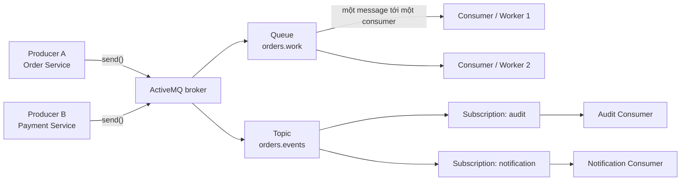
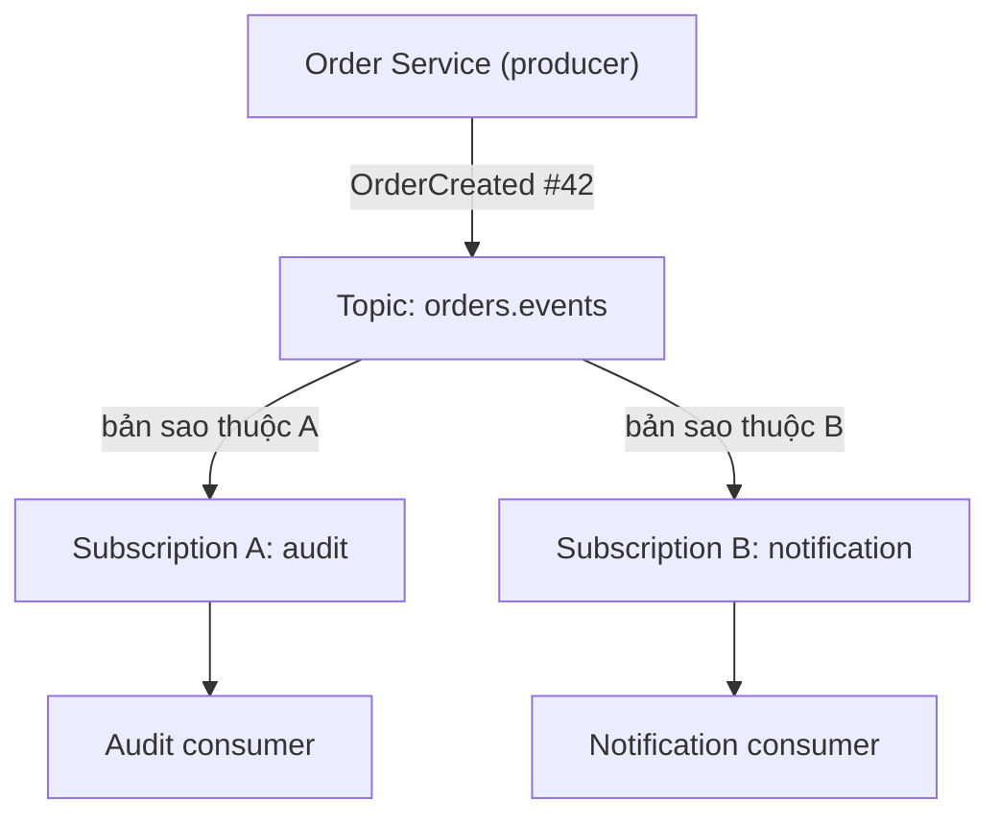
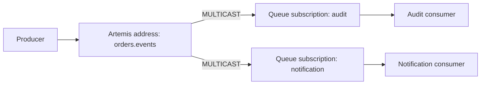
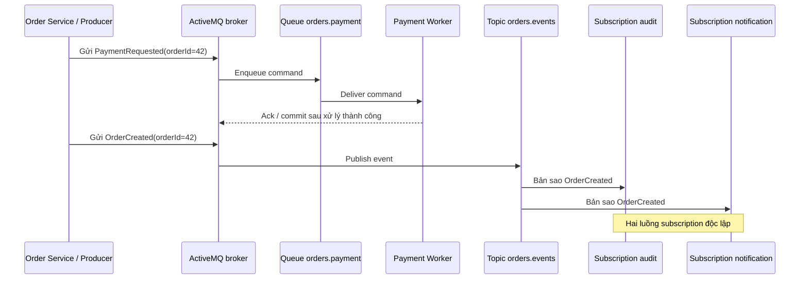
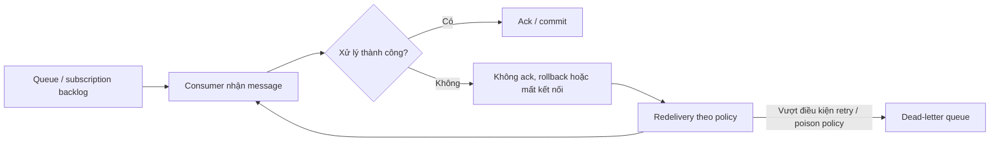

# Quan hệ giữa producer, broker, destination, consumer và subscription

> **Chương:** Tổng quan ActiveMQ  
> **Phạm vi:** Apache ActiveMQ Classic, ActiveMQ Artemis và mô hình giao tiếp bất đồng bộ qua JMS.

Khi xây dựng hệ thống bất đồng bộ, câu hỏi cốt lõi không chỉ là “gửi message bằng cách nào?” mà còn là “message được lưu ở đâu, ai có quyền nhận, bao nhiêu bên nhận được và điều gì xảy ra khi bên nhận tạm thời ngắt kết nối?”. Năm khái niệm **producer**, **broker**, **destination**, **consumer** và **subscription** cùng trả lời các câu hỏi đó. Hiểu rõ quan hệ của chúng giúp chọn đúng **queue** hay **topic**, đồng thời lý giải hành vi acknowledgment, redelivery và dead-letter queue (DLQ).

## 1. Mục tiêu học tập

Sau bài này, bạn có thể:

- Phân biệt vai trò của producer, broker, destination, consumer và subscription trong một luồng message.
- Giải thích tại sao nhiều consumer của một queue thường **chia nhau công việc**, còn nhiều subscription của một topic có thể **nhận các bản sao riêng** của cùng sự kiện.
- Phân biệt consumer đang kết nối với subscription được broker quản lý; hiểu non-durable, durable và shared subscription.
- Liên hệ cách biểu diễn queue/topic qua JMS với mô hình **address – routing type – queue** của ActiveMQ Artemis.
- Theo dõi một message từ lúc gửi đến khi được xác nhận, gửi lại hoặc chuyển vào DLQ; nhận ra những giả định sai thường gặp khi triển khai.

## 2. Năm thành phần nằm ở đâu trong kiến trúc?



| Thành phần | Vai trò | Phân biệt quan trọng |
|---|---|---|
| **Producer** | Ứng dụng/thành phần tạo và gửi message đến một destination. | Producer không cần biết consumer nào đang chạy, nhưng phải biết cách kết nối broker và gửi đúng destination. |
| **Broker** | Tiếp nhận, định tuyến, lưu trữ khi cần, phân phối message và theo dõi trạng thái giao nhận. | Broker là trung gian điều phối; không đồng nghĩa với queue hay topic. |
| **Destination** | Đích logic producer gửi tới và consumer đăng ký nhận từ đó, thường là **queue** hoặc **topic** trong JMS. | Tên destination và kiểu destination đều quan trọng; trùng tên chuỗi không có nghĩa queue và topic là một. |
| **Consumer** | Đầu nhận đang xử lý message qua API hoặc listener. | Một consumer là phiên nhận đang hoạt động; ngắt kết nối thì phiên nhận chấm dứt. |
| **Subscription** | Quan hệ đăng ký nhận từ **topic**; broker dùng quan hệ này để quyết định bản sao sự kiện nào thuộc về ai. | Subscription có thể tồn tại ngắn hạn hoặc bền vững, thậm chí tồn tại khi không có consumer đang kết nối. |

Một producer có thể gửi đến nhiều destination; nhiều producer có thể cùng gửi một destination. Một destination có thể có nhiều consumer. Riêng với topic, cần thêm khái niệm **subscription** vì “bao nhiêu consumer kết nối?” và “bao nhiêu luồng nhận sự kiện độc lập?” là hai câu hỏi khác nhau.

### Message đi qua những bước nào?

1. Producer tạo message gồm **body**, **headers** và **properties** (chẳng hạn `JMSMessageID`, `JMSCorrelationID`, `eventType`).
2. Producer gửi message đến destination thông qua một connection/session do JMS client tạo. Gửi thành công ở phía API không đồng nghĩa nghiệp vụ của consumer đã hoàn thành.
3. Broker xác định đích, áp dụng cấu hình routing, quyền truy cập, thời hạn sống (TTL), persistence và các chính sách liên quan.
4. Broker đưa message vào hàng đợi phù hợp hoặc tạo tuyến phân phối đến các subscription của topic.
5. Consumer nhận message, xử lý nghiệp vụ, rồi xác nhận theo acknowledgment mode hoặc transaction.
6. Sau khi xác nhận hợp lệ, broker có thể loại bỏ trạng thái chờ của message; nếu thất bại, message có thể được giao lại hoặc cuối cùng chuyển vào DLQ tùy cấu hình.

Một số bước diễn ra bất đồng bộ và có thể dùng cơ chế prefetch/buffering. Vì vậy không nên đồng nhất “producer vừa gửi”, “consumer đã nhận” và “nghiệp vụ đã xử lý thành công”.

## 3. Queue: nhiều consumer cạnh tranh xử lý cùng một tập công việc

**Queue** phù hợp khi mỗi message đại diện cho một đơn vị công việc cần được **một** worker xử lý thành công. Ví dụ: `orders.work` chứa yêu cầu tính phí một đơn hàng.

```text
Producer A ─┐
            ├──> Queue: orders.work ──┬──> Worker 1
Producer B ─┘                         └──> Worker 2

Message M1 được giao cho một worker tại một thời điểm;
M2 có thể được giao cho worker còn lại.
```

Hai worker tiêu thụ từ **cùng một queue** tạo ra mô hình *competing consumers*. Broker quyết định worker nào nhận từng message dựa trên trạng thái kết nối, credit/prefetch, mức tải và cơ chế điều phối. Không được giả định phân phối luân phiên tuyệt đối 1–2–1–2.

Với một message đơn lẻ:

- Broker thường lưu message cho đến khi giao nhận hoàn tất theo chế độ xác nhận tương ứng, hoặc khi message bị hết hạn/bị loại theo chính sách.
- Nếu worker nhận message nhưng chết trước khi xác nhận, broker có thể **redeliver** message cho worker khác hoặc cho lần kết nối sau.
- Vì có thể xảy ra redelivery, yêu cầu “mỗi message chỉ giao đúng một lần trong mọi tình huống” không phải bảo đảm mặc định. Cần thiết kế nghiệp vụ **idempotent** để xử lý trùng an toàn.
- Việc có hai consumer không làm broker tự nhân đôi message để cả hai cùng xử lý độc lập. Muốn hai hệ thống độc lập cùng nhận sự kiện, nên dùng topic với hai subscription.

**Ví dụ:** Một queue `invoice.generate` nhận 1.000 yêu cầu tạo hóa đơn. Ba worker cùng kết nối queue này để chia tải; về mặt nghiệp vụ mỗi yêu cầu chỉ nên tạo một hóa đơn. Nếu một worker lỗi, thông điệp có thể quay lại để được xử lý tiếp. Hệ thống phải chặn tạo hóa đơn trùng bằng mã yêu cầu hoặc ràng buộc duy nhất ở dữ liệu.

## 4. Topic: một sự kiện, nhiều luồng tiếp nhận độc lập

**Topic** phù hợp với sự kiện mà nhiều hệ thống quan tâm, chẳng hạn `orders.events` phát sự kiện `OrderCreated`. Producer gửi **một** message vào topic, còn broker định tuyến theo các subscription đang tồn tại và các chính sách lưu giữ của chúng.



Trong ví dụ này, **Audit Service** và **Notification Service** xử lý cùng sự kiện theo hai mục đích khác nhau. Việc một bên xác nhận message của mình không có nghĩa bên kia đã xác nhận. Mỗi subscription có vị trí giao nhận và chính sách lưu trữ riêng.

Điểm then chốt:

- **Topic** là địa chỉ phát sự kiện ở tầng API; **subscription** xác định luồng nhận của một phía quan tâm; **consumer** là tiến trình/đối tượng kết nối để lấy message từ luồng đó.
- Một consumer chỉ nhận các message phù hợp với subscription và selector (nếu có).
- Với **non-durable subscription**, nếu consumer không hoạt động tại lúc phát thì nhìn chung message phát trong khoảng đó không được giữ riêng cho nó.
- Với **durable subscription** đã đăng ký, broker có thể giữ các message phù hợp khi consumer tạm ngắt kết nối. Việc giữ vẫn chịu TTL, giới hạn lưu trữ và chính sách broker.
- Topic thông thường không phải *event log* có thể đọc lại mọi message từ đầu theo offset tùy ý như một số hệ thống streaming. Durable subscription chỉ duy trì luồng nhận kể từ thời điểm đăng ký hợp lệ, theo các điều kiện cấu hình.

### 4.1. Consumer và subscription không phải cùng một đối tượng

Hãy hình dung **subscription** là một “hộp thư” nhận bản sao sự kiện, còn **consumer** là người đang mở hộp thư để đọc:

```text
Topic orders.events
    ├── Subscription audit-durable  ─── Consumer audit-1 (đang online)
    └── Subscription billing-durable ─── (chưa có consumer online)
                                  vẫn có thể giữ message cho billing
```

Hình dung này đặc biệt trực quan trên Artemis, nơi một subscription topic thường được hiện thực bằng một queue gắn với address multicast. Với Classic, broker có cơ chế quản lý subscription riêng; không nên suy rằng cấu trúc vật lý của hai broker hoàn toàn giống nhau.

### 4.2. Các loại subscription thường gặp

| Loại | Khi consumer ngắt kết nối | Ai nhận từng message trong subscription? | Trường hợp dùng |
|---|---|---|---|
| **Non-durable** | Thường không lưu backlog riêng trong thời gian offline. | Consumer đang gắn với subscription. | Dashboard trực tuyến, thông báo tạm thời. |
| **Durable, không shared** | Broker giữ backlog phù hợp sau khi subscription được tạo, theo chính sách. | Thông thường một consumer hoạt động cho danh tính subscription tại một thời điểm. | Audit, đồng bộ sự kiện cần chịu được thời gian ngắt kết nối. |
| **Shared non-durable** | Không cung cấp bảo đảm lưu backlog offline kiểu durable. | Nhiều consumer cùng chia nhau message của **một** subscription. | Nhiều instance xử lý song song khi đang online. |
| **Shared durable** | Giữ backlog của subscription trong thời gian offline, theo chính sách. | Nhiều consumer cạnh tranh nhận message **trong cùng subscription**. | Nhóm instance scale ngang cho cùng một chức năng. |

Shared subscription thuộc các API JMS 2.0+ và mức hỗ trợ thực tế phụ thuộc client/broker/phiên bản. Hai consumer thuộc **hai subscription riêng** thường mỗi bên có một bản sao; hai consumer thuộc **cùng shared subscription** chia nhau một luồng message. Đó là lý do số consumer không thể dùng thay cho số subscription khi dự đoán fan-out.

Trong JMS kiểu truyền thống, danh tính durable subscription gắn với **client ID** của connection và **subscription name**. Một consumer đóng kết nối không tự động xóa durable subscription; thao tác `unsubscribe` mới yêu cầu hủy đăng ký và phần trạng thái liên quan khi điều kiện cho phép. Không tùy ý đổi client ID/subscription name giữa các lần triển khai nếu cần nhận lại backlog cũ.

## 5. Cùng năm khái niệm, hai cách broker tổ chức đích

Apache ActiveMQ có hai dòng sản phẩm cần phân biệt:

- **ActiveMQ Classic**: Trong JMS, ứng dụng thường làm việc trực tiếp với `Queue` và `Topic`. Broker duy trì hàng đợi, topic và metadata subscription tương ứng. Các *virtual topic* là khả năng cấu hình riêng của Classic, không phải đặc tính mặc định của mọi JMS topic.
- **ActiveMQ Artemis**: Ở tầng core, broker định tuyến qua **address**, **routing type** và **queue**. Routing type thường là `ANYCAST` hoặc `MULTICAST`. JMS queue/topic được ánh xạ lên các cấu trúc này để cung cấp hành vi quen thuộc cho ứng dụng.

| Góc nhìn | ActiveMQ Classic | ActiveMQ Artemis |
|---|---|---|
| API JMS queue | Producer gửi tới `Queue`; các consumer của queue cạnh tranh nhận. | Thông thường ứng với address/queue theo **ANYCAST**: một message được định tuyến tới một queue đích thích hợp. |
| API JMS topic | Producer gửi tới `Topic`; broker phát tới các subscription thích hợp. | Thông thường ứng với address **MULTICAST**: một message được định tuyến tới từng queue subscription phù hợp gắn với address. |
| Subscription durable | Broker quản lý danh tính và backlog durable subscription. | Thường có một queue bền vững đại diện cho subscription, có thể còn tồn tại khi consumer offline. |
| Nhiều consumer | Cùng queue thì chia tải; trên topic phải xét subscription nào đang được dùng. | Cùng queue thì chia tải; khác queue trên cùng multicast address thì nhận các bản sao độc lập. |



**Lưu ý routing của Artemis:** `ANYCAST` chọn một queue phù hợp cho message trong các queue anycast gắn với address; `MULTICAST` định tuyến bản sao đến các queue multicast phù hợp. Sau đó consumer cạnh tranh **bên trong từng queue**. Address có thể được cấu hình nhiều routing type, nhưng cách dùng kết hợp phải được thiết kế chủ đích; không suy từ tên address rằng mọi consumer sẽ tự nhận bản sao. Việc tự tạo address/queue/subscription phụ thuộc cấu hình auto-create và quyền truy cập của broker.

Do đó, khi chẩn đoán lỗi trên Artemis, nên hỏi đủ ba câu: **producer gửi tới address nào?**, **message được định tuyến tới queue nào theo routing type nào?**, **consumer đang đọc queue nào?** Chỉ kiểm tra mỗi tên topic là chưa đủ.

## 6. Ví dụ nghiệp vụ: đặt hàng với command và event

Giả sử có bốn dịch vụ:

1. **Order Service** nhận đơn hàng.
2. **Payment Worker** thực hiện yêu cầu thanh toán.
3. **Audit Service** lưu dấu vết tạo đơn.
4. **Notification Service** gửi thông báo.

Một cách thiết kế:



**Command** “hãy xử lý thanh toán” là công việc dành cho một worker: dùng queue. **Event** “đơn hàng đã được tạo” có thể được nhiều chức năng quan sát: dùng topic. Nếu triển khai nhiều Payment Worker, chúng dùng chung queue. Nếu triển khai nhiều Audit Worker và muốn chia tải **trong một luồng audit**, cần dùng shared subscription hoặc một mô hình queue thích hợp; tạo nhiều durable subscription độc lập sẽ làm mỗi subscription nhận một bản sao và có thể ghi audit trùng.

Hai lần gửi trong sơ đồ là **hai message riêng**. Broker không tự sao chép message từ `orders.payment` sang `orders.events` nếu ứng dụng/cấu hình chưa yêu cầu. Việc cùng có `orderId=42` chỉ là khóa tương quan. Nếu cần bảo đảm thay đổi cơ sở dữ liệu và phát event không bị lệch nhau sau crash, có thể cân nhắc **transactional outbox**; JMS transaction đơn lẻ không tự bảo đảm tính nguyên tử với mọi cơ sở dữ liệu ngoài.

## 7. Thực hành JMS với ActiveMQ Classic

Ví dụ sau minh họa ba vai trò:

- `send`: producer gửi một command vào queue và một event vào topic.
- `worker`: consumer xử lý một message từ queue và acknowledge sau khi xử lý.
- `audit`: durable subscriber đọc event từ topic; dùng lại danh tính subscription qua các lần chạy.

Ví dụ sử dụng API **`javax.jms`** phổ biến với ActiveMQ Classic 5.x. Nếu dùng client Jakarta Messaging (`jakarta.jms`) hoặc Artemis, cần chọn dependency và `ConnectionFactory` tương ứng, thống nhất namespace của toàn bộ mã nguồn; không trộn `javax.jms` và `jakarta.jms` trong cùng đoạn mã.

Dependency Maven minh họa cho Classic 5.x:

```xml
<dependency>
    <groupId>org.apache.activemq</groupId>
    <artifactId>activemq-client</artifactId>
    <version>5.18.4</version>
</dependency>
```

Broker mẫu được giả định lắng nghe `tcp://localhost:61616`, có destination phù hợp và cho phép kết nối theo cấu hình hiện tại. Trong môi trường có authentication/TLS, phải cấu hình connection cho đúng thay vì dùng mặc định.

```java
import javax.jms.Connection;
import javax.jms.ConnectionFactory;
import javax.jms.DeliveryMode;
import javax.jms.JMSException;
import javax.jms.Message;
import javax.jms.MessageConsumer;
import javax.jms.MessageProducer;
import javax.jms.Queue;
import javax.jms.Session;
import javax.jms.TextMessage;
import javax.jms.Topic;
import org.apache.activemq.ActiveMQConnectionFactory;

public final class MessageRelationsDemo {
    private static final String URL = "tcp://localhost:61616";

    public static void main(String[] args) throws Exception {
        if (args.length != 1) {
            throw new IllegalArgumentException("Dùng: send | worker | audit");
        }
        ConnectionFactory factory = new ActiveMQConnectionFactory(URL);
        switch (args[0]) {
            case "send":
                send(factory);
                break;
            case "worker":
                consumeQueue(factory);
                break;
            case "audit":
                consumeDurableTopic(factory);
                break;
            default:
                throw new IllegalArgumentException("Vai trò không hợp lệ");
        }
    }

    private static void send(ConnectionFactory factory) throws JMSException {
        Connection connection = factory.createConnection();
        try {
            Session session = connection.createSession(
                false, Session.AUTO_ACKNOWLEDGE);

            Queue queue = session.createQueue("orders.payment");
            MessageProducer commandProducer = session.createProducer(queue);
            commandProducer.setDeliveryMode(DeliveryMode.PERSISTENT);
            TextMessage command = session.createTextMessage(
                "PaymentRequested: orderId=42");
            command.setStringProperty("kind", "PaymentRequested");
            commandProducer.send(command);

            Topic topic = session.createTopic("orders.events");
            MessageProducer eventProducer = session.createProducer(topic);
            eventProducer.setDeliveryMode(DeliveryMode.PERSISTENT);
            TextMessage event = session.createTextMessage(
                "OrderCreated: orderId=42");
            event.setStringProperty("kind", "OrderCreated");
            eventProducer.send(event);

            System.out.println("Đã gửi command và event riêng biệt.");
            commandProducer.close();
            eventProducer.close();
            session.close();
        } finally {
            connection.close();
        }
    }

    private static void consumeQueue(ConnectionFactory factory)
            throws JMSException {
        Connection connection = factory.createConnection();
        try {
            Session session = connection.createSession(
                false, Session.CLIENT_ACKNOWLEDGE);
            MessageConsumer consumer = session.createConsumer(
                session.createQueue("orders.payment"));
            connection.start();

            Message message = consumer.receive(15000);
            if (message instanceof TextMessage) {
                String command = ((TextMessage) message).getText();
                System.out.println("Payment Worker xử lý: " + command);
                // Thực tế: chỉ acknowledge sau khi xử lý nghiệp vụ thành công.
                message.acknowledge();
            } else {
                System.out.println("Không có TextMessage trong 15 giây.");
            }
            consumer.close();
            session.close();
        } finally {
            connection.close();
        }
    }

    private static void consumeDurableTopic(ConnectionFactory factory)
            throws JMSException {
        Connection connection = factory.createConnection();
        try {
            // Phải đặt trước khi start; giữ ổn định qua các lần chạy.
            connection.setClientID("audit-service-demo");
            Session session = connection.createSession(
                false, Session.CLIENT_ACKNOWLEDGE);
            Topic topic = session.createTopic("orders.events");
            MessageConsumer consumer = session.createDurableSubscriber(
                topic, "orders-audit-v1");
            connection.start();

            Message message = consumer.receive(15000);
            if (message instanceof TextMessage) {
                System.out.println("Audit nhận: "
                    + ((TextMessage) message).getText());
                message.acknowledge();
            } else {
                System.out.println("Không có event trong 15 giây.");
            }
            consumer.close();
            session.close();
            // Không unsubscribe: subscription vẫn tồn tại sau khi đóng.
        } finally {
            connection.close();
        }
    }
}
```

### Trình tự kiểm chứng

1. Khởi động broker Classic đã cấu hình và chạy vai trò `audit` **một lần** để tạo durable subscription `audit-service-demo / orders-audit-v1`. Nếu hết 15 giây mà chưa có message, chương trình kết thúc và subscription vẫn được đăng ký.
2. Khi vai trò `audit` đang offline, chạy `send`. Một command vào `orders.payment`; một event vào `orders.events`. Việc gửi hai message trong ví dụ không phải một transaction chung.
3. Chạy `worker`: nhận command từ queue và xác nhận sau khi in kết quả xử lý mô phỏng.
4. Chạy lại `audit` với **cùng** client ID và subscription name: có thể nhận event đã phát trong thời gian offline, miễn message chưa hết hạn và broker còn giữ backlog theo chính sách.
5. Chạy thêm một `worker` khi queue đã hết message: không có message mới để nhận. Tạo **một durable subscription khác** (danh tính khác) trước lần phát event tiếp theo để quan sát hai subscription độc lập nhận bản sao riêng.

Ví dụ dùng `CLIENT_ACKNOWLEDGE` để chỉ rõ thời điểm xác nhận. Theo JMS, gọi `acknowledge()` trong mode này có thể xác nhận **toàn bộ message đã tiêu thụ trong cùng session** tính đến lúc gọi; demo nhận một message mỗi session nên dễ quan sát. Không được suy rằng mỗi lời gọi luôn chỉ xác nhận duy nhất đối tượng message hiện tại.

Nếu chạy trên Artemis, ý tưởng producer/consumer/subscription vẫn tương tự, nhưng factory và dependency cần tương thích phiên bản JMS/Jakarta mà Artemis client cung cấp. Khi cần xem đường đi thực tế, hãy kiểm tra address, routing type và queue subscription trên console hoặc công cụ quản trị của Artemis.

## 8. Acknowledgment, transaction và redelivery làm thay đổi trạng thái nào?

Mô hình producer → broker → destination → consumer chưa đủ để kết luận “đã xử lý thành công”. Broker còn cần biết **khi nào message được xem là đã tiêu thụ**.

| Cơ chế | Hành vi chính | Hệ quả vận hành |
|---|---|---|
| `AUTO_ACKNOWLEDGE` | JMS session tự xác nhận theo ngữ nghĩa nhận thành công hoặc listener xử lý xong. | Đơn giản; cần hiểu điểm xác nhận trước khi đặt logic nghiệp vụ có thể thất bại. |
| `CLIENT_ACKNOWLEDGE` | Ứng dụng gọi `message.acknowledge()`; việc xác nhận áp dụng cho message đã tiêu thụ trên session theo quy tắc JMS. | Có thể trì hoãn xác nhận sau khi xử lý; phải cẩn thận khi một session nhận nhiều message. |
| `DUPS_OK_ACKNOWLEDGE` | Cho phép xác nhận trễ theo lô; có thể tăng hiệu quả nhưng dễ nhận trùng khi lỗi. | Chỉ phù hợp khi xử lý trùng an toàn. |
| **Transacted session** | `commit()` xác nhận các lần nhận và hoàn tất các lần gửi trong transaction của session; `rollback()` dẫn đến giao lại message đã nhận khi điều kiện cho phép. | Xử lý theo nhóm thao tác JMS; acknowledgment mode truyền vào session không quyết định xác nhận khi session transacted. |

Ví dụ trong một consumer dùng transaction:

```java
Session session = connection.createSession(true, Session.SESSION_TRANSACTED);
MessageConsumer consumer = session.createConsumer(
    session.createQueue("orders.payment"));
connection.start();

Message message = consumer.receive(10000);
if (message != null) {
    try {
        // Ghi nhận/xử lý nghiệp vụ tại đây.
        processPayment(message);
        session.commit();    // Xác nhận lần nhận trong JMS transaction.
    } catch (Exception failure) {
        session.rollback();  // Message có thể được giao lại.
    }
}
```

`processPayment(message)` là hàm nghiệp vụ giả định, được lược bớt để tập trung vào transaction. Nếu hàm này ghi cơ sở dữ liệu ngoài broker, cần cơ chế bảo đảm nhất quán riêng; `session.commit()` không tự commit một database transaction độc lập.

Một luồng lỗi điển hình:



Không có một số lần retry hay tên DLQ cố định cho mọi cài đặt. Classic và Artemis có các cơ chế **redelivery policy**, **dead-letter strategy/address**, TTL, giới hạn tài nguyên và chính sách vận hành riêng. Trong thực tế, cần kiểm tra cấu hình phía client và broker trước khi kết luận message có được gửi lại hay chuyển DLQ hay không.

**Một điểm dễ sai:** Message được giao lại có thể khiến side effect chạy hai lần, ngay cả khi producer chỉ gửi một lần (chẳng hạn worker đã ghi dữ liệu nhưng chết trước lúc ack). Hãy dùng `messageId` hoặc khóa nghiệp vụ như `orderId + commandType` để chống xử lý trùng; đừng chỉ dựa vào việc broker xóa message sau ack.

## 9. Subscription selector, thứ tự và vòng đời

**Message selector** giúp consumer/subscription lọc theo header hoặc property của JMS message, không tự phân tích nội dung JSON trong body. Ví dụ:

```java
// Chỉ nhận event có property kind == "OrderCreated".
MessageConsumer consumer = session.createConsumer(
    session.createTopic("orders.events"),
    "kind = 'OrderCreated'");
```

Trong durable subscription, thay đổi selector hoặc topic gắn với một subscription hiện hữu có thể kéo theo quy tắc tái tạo subscription và tác động backlog, tùy API/phiên bản. Khi thay đổi cấu hình, cần lên kế hoạch migration thay vì lặng lẽ đổi tên hoặc bộ lọc.

Về thứ tự:

- Một producer gửi lần lượt vào một destination không bảo đảm mọi consumer trong hệ thống hoàn thành xử lý theo đúng thứ tự đó, nhất là khi có nhiều worker, transaction, retry hoặc selector.
- Topic có các luồng subscription độc lập; Audit Service và Notification Service có thể xử lý cùng event ở các thời điểm khác nhau.
- Nếu nghiệp vụ cần xử lý theo thứ tự cho từng `orderId`, phải thiết kế chiến lược tuần tự hóa/partition/message group phù hợp với broker và tải thực tế; không giả định tự có khi tăng số consumer.

Về vòng đời:

- **Producer đóng kết nối:** message đã được broker chấp nhận theo bảo đảm gửi tương ứng vẫn có thể tiếp tục được phân phối.
- **Queue consumer offline:** message chưa được tiêu thụ có thể nằm lại trong queue, theo chính sách persistence/expiry.
- **Non-durable topic subscriber offline:** thường bỏ lỡ những event phát trong lúc không đăng ký.
- **Durable topic subscriber offline:** backlog có thể tiếp tục tích lũy kể từ khi subscription được tạo, nhưng vẫn chịu giới hạn và TTL.
- **Xóa durable subscription:** đánh mất điểm tiếp tục và backlog liên quan; cần xác định rõ tác động trước khi thao tác trên môi trường thật.

`DeliveryMode.PERSISTENT` yêu cầu khả năng lưu bền của message theo ngữ nghĩa JMS và cấu hình broker; nó không có nghĩa lưu vĩnh viễn, cũng không thay thế backup, high availability, TTL hay quy trình xử lý lỗi.

## 10. Chẩn đoán sự cố dựa trên năm thành phần

Khi producer nói “đã gửi” nhưng consumer nói “không nhận”, hãy lần theo quan hệ giữa các thành phần:

| Quan sát | Câu hỏi cần kiểm tra |
|---|---|
| Producer gửi không thành công | ConnectionFactory, địa chỉ broker, quyền `send`, TLS/credential, lỗi network và timeout có đúng không? |
| Queue có backlog tăng nhưng không ai xử lý | Có consumer hoạt động trên **đúng queue** không? Consumer có bị pause, thiếu credit, đang mắc ở xử lý nghiệp vụ hoặc mất kết nối không? |
| Queue có nhiều worker nhưng tải lệch | Prefetch/credit, độ dài tác vụ, transaction, selector, consumer priority và message group có ảnh hưởng không? |
| Topic có event nhưng một dịch vụ không nhận | Dịch vụ đó có **subscription riêng** không? Đăng ký trước hay sau lúc phát? Non-durable hay durable? Selector có lọc mất không? |
| Durable subscriber reconnect nhưng không thấy backlog | Client ID/subscription name có được giữ nguyên không? Subscription đã từng tạo chưa? Message có hết hạn, bị xóa, bị chuyển DLQ hoặc chưa được route tới subscription không? |
| Artemis nhận ở address nhưng thiếu message trong queue mong muốn | Address, routing type `ANYCAST/MULTICAST`, queue binding, auto-create và quyền consumer có khớp không? |
| Message xuất hiện lại sau xử lý | Ack/commit có thực sự hoàn tất không? Có crash, rollback hoặc redelivery? Side effect có idempotent không? |
| Không thấy message lỗi trong queue chính | Có redelivery limit, expiry address hoặc DLQ/dead-letter address được cấu hình không? |

Khi quan sát metric, nên phân biệt **message count/backlog**, **delivering/in-flight count**, **consumer count**, **subscription count**, **expired count** và **DLQ count**. Chúng phản ánh các giai đoạn khác nhau của vòng đời message; chỉ nhìn số consumer hoặc chỉ thấy log “sent” là không đủ.

## 11. Tự kiểm tra hiểu biết

**Tình huống A:** Hai instance của Payment Worker cùng đọc `orders.payment`. Producer gửi một command; cả hai có bắt buộc nhận command đó không?

**Trả lời:** Không. Hai worker cạnh tranh trên một queue; thông thường một worker nhận message để xử lý. Nếu xử lý lỗi trước ack, message có thể được giao lại.

**Tình huống B:** Audit và Notification đều phải nhận `OrderCreated`, kể cả khi Audit tạm dừng triển khai. Cấu hình nào hợp lý?

**Trả lời:** Dùng topic với **hai subscription độc lập**. Audit dùng durable subscription được tạo trước thời gian offline; Notification chọn durable hay non-durable tùy yêu cầu. Nếu cả hai consumer gắn vào cùng một shared subscription thì chúng chia nhau message, không bảo đảm mỗi dịch vụ nhận một bản sao.

**Tình huống C:** Một durable subscription có ba consumer cùng chia tải. Broker phát một event đến topic. Có ba lần xử lý trong subscription này không?

**Trả lời:** Không mặc định. Nếu broker/client hỗ trợ **shared durable subscription**, ba consumer là ba đầu nhận cạnh tranh trong cùng một subscription; một message thuộc subscription thường được một consumer xử lý thành công, trừ các tình huống giao lại.

**Tình huống D:** Trên Artemis, producer gửi tới `orders.events` nhưng queue subscription của Audit rỗng. Cần nhìn đâu trước?

**Trả lời:** Xác nhận address `orders.events` có routing type `MULTICAST` thích hợp, queue subscription của Audit đã được tạo và gắn đúng address, selector/quyền phù hợp, rồi kiểm tra TTL, expiry và trạng thái consumer.

## 12. Ghi nhớ để thiết kế đúng

**Producer gửi message tới destination thông qua broker. Broker phân phối message cho consumer theo kiểu destination và trạng thái subscription.** Với queue, các consumer thường cạnh tranh xử lý một luồng công việc. Với topic, broker tạo tuyến nhận theo từng subscription; nhiều subscription độc lập có thể nhận những bản sao khác nhau, còn nhiều consumer trong một shared subscription chia nhau cùng một luồng. Acknowledgment và transaction quyết định khi nào quá trình nhận được xác nhận; redelivery, DLQ và idempotency quyết định hệ thống phục hồi thế nào sau lỗi.

Khi chuyển giữa ActiveMQ Classic và Artemis, hãy giữ nguyên mô hình tư duy ở tầng JMS nhưng kiểm tra ánh xạ triển khai: **Classic dùng queue/topic và subscription theo mô hình broker của Classic; Artemis định tuyến dựa trên address, ANYCAST/MULTICAST và queue.** Hiểu đúng hai tầng này giúp giải thích cả đường đi bình thường lẫn các trường hợp message bị thiếu, nhận trùng hoặc tồn đọng.
