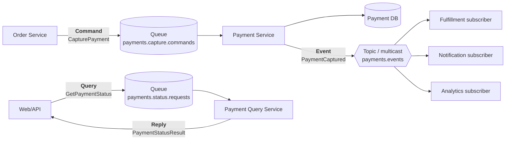

# Phân biệt lệnh, sự kiện và dữ liệu yêu cầu–phản hồi trong ActiveMQ

> **Phạm vi bài học:** Apache ActiveMQ Classic và ActiveMQ Artemis; thiết kế tương tác bất đồng bộ bằng queue, topic, định tuyến và JMS. Trọng tâm là **ý nghĩa của thông điệp**: lệnh (command), sự kiện (event) và yêu cầu–phản hồi (request–reply). Các ví dụ Java dùng **Jakarta Messaging/JMS với ActiveMQ Artemis**; nguyên tắc thiết kế cũng áp dụng cho ActiveMQ Classic.

## 1. Mục tiêu học tập

Sau bài này, bạn có thể:

1. Nhìn vào một yêu cầu nghiệp vụ để nhận ra đó là **lệnh**, **sự kiện** hay **truy vấn dữ liệu có phản hồi**.
2. Giải thích vì sao command thường dùng queue; event thường cần topic hoặc nhiều subscription; request–reply cần địa chỉ trả lời và mã liên kết.
3. Thiết kế contract thông điệp, định danh, correlation ID, idempotency key, acknowledgment và xử lý lỗi cho từng kiểu.
4. Mô tả cách ActiveMQ Classic và Artemis biểu diễn các mô hình này, kể cả **anycast/multicast** của Artemis.
5. Xây dựng producer/consumer JMS cơ bản và tránh hiểu sai về timeout, gửi lặp, transaction, redelivery và DLQ.

**Bài toán xuyên suốt:** Một hệ thống thương mại điện tử có dịch vụ Đơn hàng, Thanh toán, Kho hàng và Thông báo. Khi khách xác nhận đơn, hệ thống cần yêu cầu thu tiền, thông báo cho các dịch vụ liên quan khi tiền đã thu thành công, và cho phép giao diện hỏi trạng thái thanh toán.

## 2. Trước hết: ý nghĩa nghiệp vụ khác với kênh vận chuyển

Message broker nhận thông điệp từ producer rồi chuyển đến consumer theo địa chỉ và chính sách định tuyến. Nhưng broker **không tự suy ra** thông điệp có ý nghĩa nghiệp vụ gì chỉ nhờ nó nằm trong queue hay topic.

- **Command (lệnh):** “Hãy thực hiện hành động X.” Người gửi muốn một bên có trách nhiệm xử lý.
- **Event (sự kiện):** “X đã xảy ra.” Người phát công bố một sự thật để các bên quan tâm tự phản ứng.
- **Request–reply (yêu cầu–phản hồi):** “Hãy cung cấp thông tin/kết quả cho yêu cầu này.” Người gửi cần ghép một phản hồi với yêu cầu trước đó. Đây là **mẫu trao đổi**, có thể chứa truy vấn chỉ đọc hoặc một lệnh cần kết quả.

Ví dụ:

| Thông điệp | Cách đọc | Bản chất |
|---|---|---|
| `CapturePayment` | “Hãy thu tiền cho payment P” | Command |
| `PaymentCaptured` | “Payment P đã được thu thành công” | Event |
| `GetPaymentStatus` | “Trạng thái của payment P là gì?” | Request truy vấn |
| `PaymentStatusResult` | “Payment P đang ở trạng thái CAPTURED” | Reply dữ liệu |
| `CapturePayment` kèm `replyTo` | “Hãy thu tiền, rồi báo kết quả cho tôi” | **Command** dùng mẫu request–reply |

Điểm dễ nhầm: phản hồi không biến command thành event. Tương tự, một event có payload JSON rất nhiều trường vẫn là **sự kiện**, không phải “dữ liệu yêu cầu–phản hồi”. Phân loại dựa vào **ý định của người gửi và cam kết của người nhận**, không dựa vào cú pháp JSON, header hay tên destination.

### 2.1. Queue và topic truyền đạt điều gì?

- **Queue / point-to-point:** Một message thường được trao cho **một consumer** trong nhóm cùng nhận ở queue ấy; nhiều consumer giúp chia tải. Nếu consumer lỗi, broker có thể phát lại theo chính sách giao nhận.
- **Topic / publish–subscribe:** Một lần publish có thể được nhiều **subscription độc lập** nhận. Mỗi subscription sở hữu tiến trình xử lý, trạng thái acknowledgment và backlog riêng nếu được cấu hình bền vững.
- **JMS** cung cấp API message, producer, consumer, destination, session/context, acknowledgment, transaction, `JMSReplyTo` và `JMSCorrelationID`. JMS là giao diện; chi tiết lưu trữ, routing, redelivery và DLQ vẫn do broker cùng cấu hình quyết định.

Trong **ActiveMQ Classic**, JMS queue và topic là hai loại destination quen thuộc; consumer cạnh tranh trên queue, còn subscriber độc lập nghe topic. Trong **ActiveMQ Artemis**, một **address** có thể định tuyến **anycast** (đưa message tới một queue phù hợp, thường phục vụ work queue) hoặc **multicast** (chuyển tới nhiều queue/subscription gắn với address). JMS Queue thường ánh xạ vào cách dùng anycast; JMS Topic thường ánh xạ vào multicast. Cần kiểm tra cấu hình broker, vì cùng một tên address có thể có nhiều loại routing và việc tự tạo destination không phải lúc nào cũng được bật.

> **Quy tắc thiết kế:** Chọn command/event/request–reply theo ngữ nghĩa trước, rồi mới chọn queue/topic, subscription và routing để hiện thực mục tiêu giao nhận.

## 3. Command: yêu cầu một bên chịu trách nhiệm thực hiện

Một **lệnh** diễn tả ý định thay đổi trạng thái hoặc thực hiện tác vụ. Tên nên ở dạng mệnh lệnh: `ReserveInventory`, `CapturePayment`, `SendReceipt`, `GenerateInvoice`.

### 3.1. Đặc trưng

- **Có chủ sở hữu hành vi:** Dịch vụ Thanh toán chịu trách nhiệm thực hiện `CapturePayment`; người gửi không được tự giả định việc xử lý đã thành công sau khi gửi message.
- **Một lần xử lý logic:** Với queue và nhiều worker, mỗi thông điệp được phân phối cho một worker tại một thời điểm; nhưng lỗi và redelivery có thể khiến **một lệnh được thực thi thử nhiều lần**.
- **Có thể từ chối:** Lệnh có thể thất bại vì quy tắc nghiệp vụ (thẻ bị từ chối), thiếu dữ liệu, hoặc lỗi hạ tầng. Lỗi nghiệp vụ nên có trạng thái/kết quả rõ ràng; lỗi tạm thời có thể retry.
- **Cần idempotency:** Hai lần nhận `CapturePayment` với cùng `commandId` không được tạo hai lần thu tiền.
- **Có thể bất đồng bộ hoàn toàn:** Người gửi đưa lệnh vào queue và theo dõi kết quả bằng event hoặc truy vấn về sau; không nhất thiết phải đợi reply ngay.

Ví dụ hợp lý:

```text
Order Service ── CapturePayment ──> queue: payments.capture.commands
                                            │
                                   Payment Worker A/B
                                            │
                               kết quả nghiệp vụ ở phía Payment
```

Queue có hai worker A/B để chia tải; **không có nghĩa cả A và B phải cùng thu tiền**. Nếu lệnh cần gửi riêng cho nhiều đơn vị độc lập, hãy tạo các lệnh riêng cho từng đơn vị hoặc dùng sự kiện để chúng tự quyết định công việc của mình.

### 3.2. Contract mẫu của command

```json
{
  "messageId": "msg-cmd-1001",
  "commandId": "capture-pay-1001",
  "type": "CapturePayment",
  "schemaVersion": 1,
  "correlationId": "checkout-7001",
  "causationId": "order-confirmed-7001",
  "sentAt": "2026-11-17T07:00:00Z",
  "payload": {
    "paymentId": "pay-7001",
    "orderId": "ord-7001",
    "amountMinor": 125000,
    "currency": "VND"
  }
}
```

Ý nghĩa các trường:

- `commandId` là **khóa idempotency nghiệp vụ**. Một lệnh được gửi lại phải giữ nguyên định danh này.
- `messageId` định danh lần thông điệp/contract được phát. Không nên dựa duy nhất vào mã message do broker phát để chống lặp nghiệp vụ.
- `correlationId` nối các bước của cùng luồng checkout; `causationId` chỉ ra hành động/sự kiện trực tiếp tạo lệnh.
- `schemaVersion` giúp consumer kiểm soát tương thích khi payload thay đổi.
- `amountMinor` (đơn vị tiền nhỏ nhất của mô hình dữ liệu) tránh sai số dấu phẩy động; cần quy ước rõ cho từng loại tiền.

**Không** nhúng thông tin thẻ ngân hàng, token bí mật hoặc dữ liệu cá nhân không cần thiết vào payload và log.

### 3.3. Acknowledgment không đồng nghĩa thành công nghiệp vụ

Broker acknowledgment thường xác nhận **message đã được ứng dụng nhận/xử lý ở mức phiên giao nhận**, không phải “người dùng đã thanh toán thành công”. Dịch vụ phải ghi kết quả nghiệp vụ bền vững, sau đó mới hoàn tất acknowledgment/commit nhận message.

Nếu consumer crash giữa lúc gọi cổng thanh toán và lúc ack, broker có thể redeliver. Hệ thống thanh toán phải sử dụng idempotency key đến cả adapter/cổng thanh toán (nếu API hỗ trợ) và lưu trạng thái xử lý theo `commandId`. Đây là cách ngăn “thu tiền hai lần” trong thực tế.

## 4. Event: công bố một sự thật đã xảy ra

Một **sự kiện** mô tả thay đổi trạng thái đã được xác nhận: `OrderPlaced`, `PaymentCaptured`, `InventoryReserved`, `PaymentCaptureFailed`. Event thường đặt tên ở **thì quá khứ**, mang tính sự thật, không ra lệnh cho subscriber.

### 4.1. Đặc trưng

- **Producer không cần biết toàn bộ subscriber:** Thanh toán phát `PaymentCaptured`, còn Kho hàng, Giao vận, Báo cáo và Thông báo chọn xử lý theo nhu cầu.
- **Một event có thể có nhiều phản ứng độc lập:** Đặt lịch giao hàng, gửi hóa đơn, cập nhật báo cáo. Các bên không cần cùng hoàn thành đồng thời.
- **Sự kiện nên là sự thật bất biến:** Không sửa nội dung `PaymentCaptured` sau khi phát. Nếu có nghiệp vụ hoàn tiền, phát `PaymentRefunded` hoặc event phù hợp, không “hủy” event cũ bằng cách thay payload.
- **Không đảm bảo mọi subscriber đều nhận nếu cấu hình subscription không phù hợp:** Topic subscription không bền vững có thể bỏ lỡ message lúc offline. Muốn nhận lại sau downtime cần subscription/queue bền vững được thiết lập đúng, message còn trong thời hạn lưu giữ và chính sách broker cho phép.

Ví dụ:

```text
Payment Service
      │ PaymentCaptured
      ▼
topic: payments.events
      ├── durable subscription fulfillment ──> Fulfillment
      ├── durable subscription notification ──> Notification
      └── durable subscription analytics    ──> Analytics
```

Mỗi subscription là một luồng nhận **riêng**: Fulfillment xử lý chậm không nên chặn trực tiếp Notification, nhưng backlog, tài nguyên broker và chính sách dispatch vẫn cần được theo dõi.

### 4.2. Contract mẫu của event

```json
{
  "eventId": "evt-pay-7001-captured-v1",
  "eventType": "PaymentCaptured",
  "schemaVersion": 1,
  "aggregateId": "pay-7001",
  "aggregateVersion": 4,
  "correlationId": "checkout-7001",
  "causationId": "capture-pay-1001",
  "occurredAt": "2026-11-17T07:00:03Z",
  "payload": {
    "paymentId": "pay-7001",
    "orderId": "ord-7001",
    "capturedAmountMinor": 125000,
    "currency": "VND"
  }
}
```

`eventId` cho phép mỗi subscriber deduplicate độc lập; `aggregateId` và `aggregateVersion` giúp phát hiện thứ tự hoặc bản cập nhật cũ của cùng thực thể. Event có thể chứa dữ liệu cần thiết cho subscriber, nhưng không nên là bản sao toàn bộ bảng dữ liệu. Nếu cần dữ liệu lớn, cân nhắc tham chiếu đến nguồn có phân quyền và quy định rõ vòng đời dữ liệu.

**Event được đặt tên như một lệnh là dấu hiệu sai mô hình.** Chẳng hạn `SendWelcomeEmailEvent` đang chỉ định hành động cho một người nhận cụ thể; nếu mục tiêu là giao việc cho Notification Service thì `SendWelcomeEmail` là command hợp lý hơn. Nếu sự thật là người dùng đã đăng ký, hãy phát `UserRegistered` và để Notification tự chọn chính sách gửi thư.

### 4.3. Có được dùng queue cho event?

Có. Trong Artemis, event phát tới multicast address rồi tới **các queue subscription**; mỗi consumer tiếp tục đọc từ queue của subscription đó. Một pipeline event chỉ có một subscriber cũng có thể sử dụng queue nếu bạn quản lý rõ trách nhiệm và retention. Vì vậy “event = topic” là **mẫu triển khai phổ biến**, không phải định nghĩa ngữ nghĩa bất biến.

## 5. Request–reply: yêu cầu dữ liệu hoặc kết quả, rồi ghép phản hồi

**Request–reply** là mô hình trao đổi hai chiều: bên yêu cầu gửi message có thông tin nơi nhận phản hồi; bên phục vụ trả một message tương ứng. Đó có thể là:

1. **Query không làm thay đổi trạng thái:** `GetPaymentStatus` → `PaymentStatusResult`.
2. **Command có kết quả sớm:** `ValidateCoupon` hoặc `CapturePayment` → kết quả xác nhận, tùy yêu cầu nghiệp vụ.
3. **Tác vụ mất nhiều thời gian:** nên cân nhắc trả `Accepted`/`jobId` sớm, sau đó cập nhật tiến độ qua event và/hoặc query, thay vì giữ một request chờ quá lâu.

Ví dụ:

```text
Web/API ── GetPaymentStatus ──> queue: payments.status.requests
          correlationId=R1
          replyTo=temporary-reply-queue
                                          Payment Query Worker
Web/API <── PaymentStatusResult <──────────┘
          correlationId=R1
```

### 5.1. Ba chi tiết không được bỏ qua

- **`JMSReplyTo`:** địa chỉ destination mà phía nhận cần gửi phản hồi. Có thể là temporary queue cho vòng đời yêu cầu ngắn hoặc reply queue quản lý riêng cho client lâu dài.
- **`JMSCorrelationID`:** mã dùng để ghép reply với request. Đơn giản nhất là client sinh một UUID cho mỗi request rồi server **sao chép nguyên mã đó** sang reply. Một quy ước khác là dùng `JMSMessageID` của request; hai bên phải thống nhất một quy ước duy nhất.
- **Timeout và kết quả đến trễ:** nếu hết thời gian chờ, client chỉ biết **chưa nhận được kết quả**, không có bằng chứng rằng server không xử lý. Phải quyết định cách retry, tra cứu trạng thái và bỏ qua late reply.

**Temporary queue** thường gắn với kết nối của requester; requester disconnect thì reply đến sau có thể không còn nơi nhận. Không chọn temporary queue làm nơi giữ kết quả của công việc kéo dài nhiều phút/giờ.

### 5.2. Reply cũng cần contract

```json
{
  "requestId": "req-status-9001",
  "type": "GetPaymentStatus",
  "schemaVersion": 1,
  "payload": {
    "paymentId": "pay-7001"
  }
}
```

```json
{
  "requestId": "req-status-9001",
  "type": "PaymentStatusResult",
  "schemaVersion": 1,
  "ok": true,
  "payload": {
    "paymentId": "pay-7001",
    "status": "CAPTURED",
    "lastUpdatedAt": "2026-11-17T07:00:03Z"
  }
}
```

`requestId` trong payload dùng để truy vết nghiệp vụ; `JMSCorrelationID` trong JMS header dùng để ghép message trong đường vận chuyển. Hai mã có thể cùng giá trị nếu contract quy định như vậy. Với lỗi, trả mã lỗi ổn định như `PAYMENT_NOT_FOUND` hoặc `VALIDATION_FAILED`; không trả stack trace hay chi tiết nhạy cảm cho caller.

### 5.3. Vì sao không dùng request–reply cho mọi thứ?

Request–reply qua broker vẫn tạo **phụ thuộc thời gian**: caller phải đợi responder đủ nhanh. Nếu responder chậm, backlog tăng, timeout xuất hiện và caller có thể retry khi thao tác cũ vẫn chạy. Dùng event bất đồng bộ khi nhiều hệ thống chỉ cần biết kết quả cuối cùng; dùng request–reply khi caller thực sự cần dữ liệu/kết quả trong một thời hạn đã cam kết.

## 6. Bảng so sánh: chọn mẫu nào?

| Tiêu chí | Command | Event | Request–reply |
|---|---|---|---|
| Ý định | Yêu cầu làm việc | Thông báo việc đã xảy ra | Hỏi dữ liệu hoặc cần kết quả |
| Tên điển hình | `ReserveInventory` | `InventoryReserved` | `GetInventory` → `InventoryResult` |
| Chủ sở hữu | Một dịch vụ chịu trách nhiệm hành động | Nguồn phát xác nhận sự thật; nhiều subscriber tùy chọn | Một responder hoặc nhóm responder cho một request |
| Destination thường dùng | Queue chia tải | Topic/multicast + subscription bền vững | Request queue + reply destination |
| Kết quả kỳ vọng | Hoàn tất hoặc từ chối nghiệp vụ, thường qua event/trạng thái | Không bắt buộc có phản hồi cho producer | Reply được ghép bằng correlation ID |
| Lỗi thường gặp | Thực hiện lặp tạo tác dụng phụ | Bỏ lỡ event, xử lý trùng, lệch thứ tự | Timeout, reply đến trễ, ghép nhầm |
| Phòng vệ | Idempotency, ack/transaction, redelivery policy | Durable subscription, inbox dedup, versioned schema | Timeout, request ID, correlation, xử lý retry an toàn |

**Tình huống quyết định nhanh:**

- “Đề nghị dịch vụ Kho giữ 3 sản phẩm”: `ReserveInventory` → **command**.
- “Kho đã giữ 3 sản phẩm”: `InventoryReserved` → **event**.
- “Kho còn bao nhiêu sản phẩm của SKU A?”: `GetAvailableStock` → **request–reply/query**.
- “Tạo hóa đơn rồi cho tôi biết mã hóa đơn”: bản chất vẫn là **command**; nếu trả ngay, thêm **request–reply**, nếu xử lý lâu, phát event `InvoiceCreated` kèm mã hóa đơn.
- “Khi một đơn hàng được tạo, các dịch vụ tự quyết định hành động tiếp theo”: `OrderPlaced` → **event**.

## 7. Thiết kế luồng thanh toán hoàn chỉnh



Luồng khuyến nghị:

1. Order Service tạo `CapturePayment` với `commandId` bất biến và gửi tới command queue. Bản ghi nghiệp vụ chỉ nên đánh dấu `PAYMENT_PENDING`, chưa đánh dấu đã thu tiền.
2. Payment Service nhận command, kiểm tra idempotency, thực hiện nghiệp vụ với cổng thanh toán, lưu trạng thái và sự kiện dự kiến phát. Chỉ ack khi đã đạt điểm bền vững theo thiết kế.
3. Payment Service phát `PaymentCaptured` sau khi trạng thái đã được lưu. Dùng **transactional outbox** nếu cần tránh mất event giữa commit DB và gửi broker.
4. Fulfillment, Notification và Analytics có subscriber riêng. Mỗi bên lưu `eventId` đã xử lý khi cần chống lặp và tự quản lý retry/poison message.
5. Web/API hỏi `GetPaymentStatus` khi cần hiển thị, với timeout và correlation ID. Nếu query lỗi, UI không kết luận giao dịch chưa diễn ra; có thể hiển thị trạng thái chưa xác định và thử lại.

Nếu thất bại nghiệp vụ, Payment Service lưu trạng thái `DECLINED` và phát event như `PaymentCaptureDeclined` (nếu contract có), thay vì cứ để broker retry một lỗi không thể tự hồi phục. Nếu lỗi hạ tầng tạm thời, có thể rollback message để redelivery có kiểm soát.

### 7.1. Ai là nguồn sự thật?

- **Payment DB** là nguồn sự thật về kết quả thanh toán.
- **Event** là bản ghi một sự kiện có ý nghĩa đã xác nhận, giúp dịch vụ khác cập nhật bản sao cục bộ.
- **Query reply** là câu trả lời cho trạng thái ở thời điểm xử lý; không phải cam kết mọi dịch vụ khác đã cập nhật xong.
- **Broker** chịu trách nhiệm chuyển/lưu message theo cấu hình; broker không thay thế transaction nghiệp vụ hay cơ sở dữ liệu chuyên biệt.

## 8. Thực hành Java JMS với ActiveMQ Artemis

Ví dụ dưới đây dùng **Jakarta Messaging** (`jakarta.jms.*`) và client Artemis (`org.apache.activemq.artemis.jms.client.ActiveMQConnectionFactory`). Chọn phiên bản `artemis-jakarta-client` tương thích với môi trường broker của bạn. Nếu dự án dùng **ActiveMQ Classic** với JMS cũ, package thường là `javax.jms.*` và implementation connection factory khác; **không trộn `javax.jms` và `jakarta.jms` trong cùng ví dụ**.

Giả định có Artemis broker đang chạy, cho phép client kết nối và đã cấu hình các destination cần thiết (hoặc bật cơ chế auto-create phù hợp). Đặt biến môi trường `BROKER_URL`, `BROKER_USER` và `BROKER_PASSWORD` cho cấu hình thực; ví dụ mặc định URL `tcp://localhost:61616` chỉ để chạy thử trong môi trường tin cậy. Không hardcode tài khoản vào source.

### 8.1. Producer gửi command vào queue

```java
import jakarta.jms.DeliveryMode;
import jakarta.jms.JMSContext;
import jakarta.jms.JMSException;
import jakarta.jms.Queue;
import jakarta.jms.Session;
import jakarta.jms.TextMessage;
import org.apache.activemq.artemis.jms.client.ActiveMQConnectionFactory;

import java.util.UUID;

public final class CapturePaymentProducer {
    public static void main(String[] args) throws JMSException {
        String url = System.getenv().getOrDefault(
            "BROKER_URL", "tcp://localhost:61616");
        String user = System.getenv("BROKER_USER");
        String password = System.getenv("BROKER_PASSWORD");

        ActiveMQConnectionFactory factory =
            new ActiveMQConnectionFactory(url, user, password);

        try (JMSContext context =
                 factory.createContext(Session.AUTO_ACKNOWLEDGE)) {
            Queue commands =
                context.createQueue("payments.capture.commands");

            String commandId = UUID.randomUUID().toString();
            TextMessage message = context.createTextMessage(
                "{\"commandId\":\"" + commandId + "\"," +
                "\"type\":\"CapturePayment\"," +
                "\"paymentId\":\"pay-7001\"," +
                "\"amountMinor\":125000,\"currency\":\"VND\"}");

            message.setStringProperty("messageType", "command");
            message.setStringProperty("schemaVersion", "1");
            message.setJMSCorrelationID("checkout-7001");

            context.createProducer()
                .setDeliveryMode(DeliveryMode.PERSISTENT)
                .send(commands, message);

            System.out.println("Sent commandId=" + commandId);
        }
    }
}
```

`DeliveryMode.PERSISTENT` yêu cầu broker lưu message bền vững theo cơ chế và cấu hình của broker; nó **không** bảo đảm tác dụng phụ nghiệp vụ được thực hiện chính xác một lần. Với lỗi gửi không rõ kết quả, retry phải **giữ cùng `commandId`**; tạo UUID mới cho mỗi lần retry sẽ phá cơ chế chống lặp.

### 8.2. Consumer xử lý command trong JMS transaction

```java
import jakarta.jms.JMSConsumer;
import jakarta.jms.JMSContext;
import jakarta.jms.Message;
import jakarta.jms.Queue;
import jakarta.jms.Session;
import jakarta.jms.TextMessage;
import org.apache.activemq.artemis.jms.client.ActiveMQConnectionFactory;

public final class CapturePaymentConsumer {
    public static void main(String[] args) {
        String url = System.getenv().getOrDefault(
            "BROKER_URL", "tcp://localhost:61616");
        ActiveMQConnectionFactory factory =
            new ActiveMQConnectionFactory(
                url,
                System.getenv("BROKER_USER"),
                System.getenv("BROKER_PASSWORD"));

        try (JMSContext context =
                 factory.createContext(Session.SESSION_TRANSACTED)) {
            Queue commands =
                context.createQueue("payments.capture.commands");
            JMSConsumer consumer = context.createConsumer(commands);

            while (!Thread.currentThread().isInterrupted()) {
                Message incoming = consumer.receive(1000);
                if (incoming == null) {
                    continue;
                }

                try {
                    if (!(incoming instanceof TextMessage)) {
                        throw new IllegalArgumentException(
                            "Expected TextMessage");
                    }

                    String body = ((TextMessage) incoming).getText();

                    // Minh họa: thay bằng nghiệp vụ thực tế có
                    // kiểm tra idempotency + ghi DB bền vững.
                    handleCommandIdempotently(body);

                    context.commit(); // Hoàn tất tiêu thụ message
                } catch (Exception failure) {
                    context.rollback(); // Cho phép broker redeliver
                    System.err.println(failure.getMessage());
                }
            }
        }
    }

    private static void handleCommandIdempotently(String body) {
        // Demo quan sát message; KHÔNG phải triển khai
        // idempotency thanh toán thực tế.
        System.out.println("Received: " + body);
    }
}
```

Ở mode `SESSION_TRANSACTED`, `commit()` và `rollback()` điều khiển **JMS transaction** của phiên. Code minh họa chưa triển khai DB/idempotency; thay `handleCommandIdempotently` bằng xử lý nghiệp vụ có cơ chế chống lặp thật trước khi dùng trong sản xuất.

**Giới hạn quan trọng:** JMS transaction và transaction của SQL database **không tự động là một transaction nguyên tử**. Nếu lưu DB thành công nhưng process crash trước JMS commit, message có thể được giao lại. Dùng **inbox/idempotency** phía consumer; nếu vừa thay đổi DB vừa phải xuất event, dùng **outbox** để tránh mất event. Không kết luận “exactly once” chỉ vì dùng `SESSION_TRANSACTED`.

### 8.3. Producer công bố event tới topic

Khi kết quả đã được xác nhận và được phép phát event (ví dụ sau khi outbox ghi nhận), publish sang topic:

```java
import jakarta.jms.DeliveryMode;
import jakarta.jms.JMSContext;
import jakarta.jms.Topic;
import org.apache.activemq.artemis.jms.client.ActiveMQConnectionFactory;

// Ví dụ đặt trong hàm publishEvent(...)
ActiveMQConnectionFactory factory =
    new ActiveMQConnectionFactory(url, user, password);

try (JMSContext context = factory.createContext()) {
    Topic topic = context.createTopic("payments.events");
    context.createProducer()
        .setDeliveryMode(DeliveryMode.PERSISTENT)
        .send(topic,
            "{\"eventId\":\"evt-pay-7001-captured-v1\"," +
            "\"eventType\":\"PaymentCaptured\"," +
            "\"paymentId\":\"pay-7001\"}");
}
```

Đoạn này là **fragment**: `url`, `user`, `password` do hàm gọi cung cấp. Mỗi service quan tâm phải tạo subscription phù hợp. Đừng dựa vào một consumer topic thông thường để lưu event trong thời gian consumer offline.

### 8.4. Request–reply với temporary queue và correlation ID

Phía requester:

```java
import jakarta.jms.*;
import org.apache.activemq.artemis.jms.client.ActiveMQConnectionFactory;

import java.util.UUID;

// Fragment: url, user và password được cấu hình từ môi trường.
ActiveMQConnectionFactory factory =
    new ActiveMQConnectionFactory(url, user, password);

try (JMSContext context = factory.createContext()) {
    Queue requestQueue =
        context.createQueue("payments.status.requests");
    TemporaryQueue replyQueue = context.createTemporaryQueue();
    JMSConsumer replies = context.createConsumer(replyQueue);

    String correlationId = UUID.randomUUID().toString();
    TextMessage request = context.createTextMessage(
        "{\"type\":\"GetPaymentStatus\",\"paymentId\":\"pay-7001\"}");
    request.setJMSReplyTo(replyQueue);
    request.setJMSCorrelationID(correlationId);

    context.createProducer().send(requestQueue, request);

    Message reply = replies.receive(3000);
    if (reply == null) {
        throw new IllegalStateException("Request timed out");
    }
    if (!correlationId.equals(reply.getJMSCorrelationID())) {
        throw new IllegalStateException("Unexpected correlation ID");
    }
    System.out.println(((TextMessage) reply).getText());
}
```

Phía responder (fragment trong vòng nhận request, dùng `context` và `request` đã có):

```java
Destination replyTo = request.getJMSReplyTo();
String correlationId = request.getJMSCorrelationID();

if (replyTo != null && correlationId != null) {
    TextMessage response = context.createTextMessage(
        "{\"type\":\"PaymentStatusResult\"," +
        "\"status\":\"CAPTURED\"}");

    response.setJMSCorrelationID(correlationId);
    context.createProducer().send(replyTo, response);
}
```

Responder phải lấy trạng thái **thực** từ nguồn dữ liệu, thay cho `CAPTURED` hardcode trong minh họa. Đối với nhiều request song song cùng dùng chung reply queue, cần dispatcher/map correlation ID và xử lý reply trễ, không chỉ `receive()` tuần tự trên một consumer. Mọi địa chỉ reply cũng cần được kiểm soát bằng broker authorization; không tin tưởng mù quáng địa chỉ do client không xác thực cung cấp.

## 9. Bảo đảm giao nhận: ack, transaction, redelivery và DLQ

Lựa chọn ngữ nghĩa thông điệp phải đi cùng thiết kế lỗi. Cả command, event và request–reply đều có thể gặp mất kết nối, timeout, tiêu thụ lặp và thứ tự không như kỳ vọng.

| Cơ chế | Điều nó giúp làm | Điều nó **không** tự bảo đảm |
|---|---|---|
| Persistent delivery | Broker có thể giữ message qua sự cố theo cấu hình persistence | Business side effect chỉ chạy một lần |
| Acknowledgment | Broker biết thời điểm có thể hoàn tất việc giao message | Nghiệp vụ thành công nếu ack quá sớm |
| JMS local transaction | Commit/rollback thao tác JMS trong session/context | Tự động commit nguyên tử với database bên ngoài |
| Redelivery | Cho consumer cơ hội xử lý lại lỗi tạm thời | Retry là vô hạn hoặc không tạo tác dụng phụ lặp |
| DLQ (dead-letter queue) | Cô lập poison message sau số lần thử/quy tắc nhất định | Tự sửa nguyên nhân nghiệp vụ hoặc tự replay an toàn |
| Durable topic subscription | Giữ backlog cho subscriber được cấu hình phù hợp | Lưu mãi mãi bất chấp TTL, quota hoặc chính sách xóa |

### 9.1. Quy trình xử lý thất bại được khuyến nghị

1. **Lỗi tạm thời** (mạng, dependency gián đoạn): rollback/nack theo API và cấu hình broker; dùng delay/backoff, giới hạn số lần delivery để tránh vòng lặp nóng.
2. **Lỗi nghiệp vụ hợp lệ** (`INSUFFICIENT_STOCK`, `CARD_DECLINED`): ghi trạng thái từ chối và phát event/kết quả nghiệp vụ phù hợp; không tiếp tục retry cùng đầu vào như lỗi tạm thời.
3. **Poison message** (schema sai, dữ liệu không giải mã): quan sát lỗi, chuyển DLQ theo cấu hình, cảnh báo người vận hành. Khi replay phải giữ ID chống lặp và sửa nguyên nhân gốc.
4. **Consumer crash sau tác dụng phụ nhưng trước ack**: redelivery có thể xảy ra. Dùng bảng inbox với khóa duy nhất trên (`consumerName`, `messageId/eventId/commandId`) hoặc cơ chế idempotency phù hợp.
5. **Producer mất kết nối sau khi gửi**: trạng thái gửi có thể không rõ. Retry với cùng business ID, không mặc định gửi lại là một yêu cầu mới.

Ở ActiveMQ Classic và Artemis, tên DLQ, độ trễ redelivery, số lần thử, TTL, expiry và dead-letter address/policy **phụ thuộc cấu hình**. Không dựa vào giá trị mặc định mà chưa kiểm tra môi trường. Theo dõi queue depth, tuổi message lâu nhất, redelivery count, DLQ growth, số consumer đang hoạt động và latency xử lý.

### 9.2. Outbox và inbox cho tính nhất quán

Mô hình **outbox**:

```text
BEGIN DATABASE TRANSACTION
  cập nhật Payment = CAPTURED
  insert outbox(eventId="evt-...", type="PaymentCaptured", payload=...)
COMMIT DATABASE

Outbox Publisher:
  đọc bản ghi outbox chưa gửi
  publish event lên broker
  đánh dấu đã gửi / lưu checkpoint
```

Nếu publisher crash sau publish nhưng trước đánh dấu gửi, event có thể bị phát lại. Vì thế mỗi subscriber cần **inbox/dedup** theo `eventId`. Outbox giải quyết nguy cơ *DB đã commit nhưng event chưa được gửi*; inbox giải quyết nguy cơ *cùng event được xử lý nhiều lần*. Hai cơ chế bổ sung nhau, không làm mọi thành phần phân tán trở thành một transaction chung.

### 9.3. Thứ tự và khả năng song song

Một queue có nhiều consumer thường tối ưu throughput nhưng không mặc định giữ thứ tự **xử lý hoàn tất** giữa các worker. Nếu nghiệp vụ cần `PaymentAuthorized` trước `PaymentCaptured` theo cùng `paymentId`, hãy xét gộp các bước phụ thuộc vào cùng owner, dùng version/sequence để chặn event cũ, hoặc dùng **message grouping** như `JMSXGroupID` khi broker/client hỗ trợ và đã kiểm tra hành vi failover. Đừng dựa vào thời gian máy phát event làm thứ tự tuyệt đối.

## 10. Bảo mật và vận hành theo từng loại message

**Bảo mật:** Bật xác thực producer/consumer; cấp quyền tối thiểu theo destination (producer chỉ gửi vào queue/topic cần thiết, consumer chỉ đọc subscription được phép). Dùng TLS khi truyền qua mạng không tin cậy; bảo vệ credential bằng cơ chế secret management. Kiểm soát kích thước message, quota, TTL và quyền tạo queue/topic/temporary queue. Không ghi dữ liệu nhạy cảm trong payload, header, log hoặc DLQ mà chưa có chính sách bảo vệ.

**Khả năng quan sát:** Ghi `commandId`, `eventId`, `requestId`, `correlationId`, `causationId`, destination, attempt count và trạng thái xử lý vào structured log/tracing; tránh log bí mật. Theo dõi riêng:

- **Command:** hàng chờ lệnh, thời gian từ enqueue đến commit, số lệnh từ chối nghiệp vụ, retry và DLQ.
- **Event:** độ trễ của **từng subscription**, lag, số event bị xử lý lặp hoặc out-of-order.
- **Request–reply:** tỉ lệ timeout, latency theo percentile, late reply, số pending request và mức dùng reply queue.

**Thay đổi schema:** Thêm trường theo kiểu tương thích ngược, cân nhắc trường optional và version. Consumer nên nhận diện event/command type và version; không âm thầm coi payload không hiểu là thành công. Khi thay hành vi nghiệp vụ lớn, có thể cần version contract mới hoặc quá trình chuyển đổi producer/consumer có kiểm soát.

**Khởi động và khôi phục:** Trước khi đưa workload vào production, diễn tập consumer restart, broker restart, mất mạng, producer gửi trùng, event đến lệch thứ tự, DLQ replay và requester timeout sau khi server đã hoàn tất.

## 11. Các phản ví dụ thường gặp và cách sửa

| Thiết kế dễ sai | Vấn đề | Cách sửa |
|---|---|---|
| Publish `ChargeCustomer` lên topic để tất cả subscriber “nhận lệnh” | Nhiều bên có thể tạo cùng tác dụng phụ | Một command queue thuộc Payment Service |
| Publish `PaymentCaptured` lên queue chia tải duy nhất cho cả Kho và Thông báo | Chỉ một phía nhận mỗi event | Topic/multicast với subscription riêng cho từng phía |
| Coi `send()` thành công là “đơn đã thanh toán” | Gửi vào broker khác với thực thi nghiệp vụ | Chờ event/trạng thái đã commit |
| Mỗi retry `CapturePayment` sinh commandId mới | Không thể nhận diện yêu cầu trùng | Giữ business idempotency key |
| Dùng topic subscription không bền vững cho audit bắt buộc | Subscriber offline có thể mất event | Durable subscription, retention và kiểm tra backlog |
| Request timeout ⇒ gửi lại lệnh thu tiền như giao dịch mới | Thao tác cũ có thể đã thành công | Truy vấn trạng thái + retry có idempotency key |
| Gửi event ngay trước khi DB commit | Consumer nhìn thấy sự thật chưa được xác nhận | Transactional outbox |
| ACK trước khi DB ghi xong | Crash làm mất việc cần làm | Commit dữ liệu/idempotency trước khi ack đúng quy trình |
| Redelivery không giới hạn mọi lỗi | Poison message khiến queue tắc | Phân loại lỗi, backoff, DLQ và quy trình replay |
| Cho mọi client tạo/gửi vào mọi destination | Rủi ro giả mạo event, đọc trộm reply | AuthN/AuthZ theo producer/consumer và destination |

## 12. Bài tập thực hành có thể tự kiểm chứng

Hãy dùng một broker Artemis thử nghiệm, ba service giả lập và công cụ quan sát queue/topic của broker:

1. **Command:** chạy hai instance `CapturePaymentConsumer` cùng nghe `payments.capture.commands`; gửi một command. Kiểm tra một instance nhận message, sau đó mô phỏng lỗi trước commit để quan sát redelivery. Bổ sung storage idempotency để cùng `commandId` không tạo tác dụng phụ hai lần.
2. **Event:** tạo hai subscriber độc lập cho `payments.events`, ví dụ `fulfillment` và `notification`. Publish `PaymentCaptured`; xác nhận mỗi subscriber nhận bản dành cho mình. Cho một subscriber offline, phát event, khởi động lại để kiểm tra cấu hình durable subscription.
3. **Request–reply:** gửi `GetPaymentStatus` với `JMSReplyTo` và `JMSCorrelationID`. Cố ý để responder trả sau timeout: kiểm tra caller không coi timeout là kết quả `NOT_FOUND`.
4. **DLQ:** gửi message có schema không hợp lệ và cấu hình redelivery hữu hạn; quan sát DLQ, nguyên nhân lỗi và thử replay sau khi sửa consumer.
5. **Quan sát:** thu thập queue depth, redelivery count, độ trễ, correlation ID trong log; xác định nơi nghẽn khi consumer xử lý chậm.

**Tiêu chí hoàn thành:** Bạn giải thích được message đang dùng là command/event/query vì **ý nghĩa nghiệp vụ**; destination phù hợp với số bên cần nhận; mỗi đường lỗi có chiến lược timeout, retry, idempotency và theo dõi; sau broker/consumer restart vẫn có thể kiểm chứng kết quả bằng dữ liệu bền vững.

## 13. Câu hỏi tự kiểm tra

**Câu 1.** Một service phát `OrderPlaced`, rồi 3 service muốn nhận để thực hiện công việc khác nhau. Dùng một queue chung có đúng không?

**Giải đáp:** Không phù hợp nếu cả 3 đều phải biết event, vì các consumer trên cùng queue cạnh tranh nhau. Hãy dùng topic/multicast và các subscription độc lập, hoặc triển khai fan-out tương đương.

**Câu 2.** Client gửi `CapturePayment`, 3 giây sau request–reply timeout. Có được tạo một `CapturePayment` mới với ID mới không?

**Giải đáp:** Không thể kết luận command cũ thất bại chỉ vì timeout. Nên hỏi trạng thái theo `paymentId`/`commandId`, và nếu cần retry thì giữ idempotency key để tránh thu tiền trùng.

**Câu 3.** Consumer dùng `SESSION_TRANSACTED`, cập nhật SQL thành công nhưng crash trước JMS commit. Message có thể đến lại không?

**Giải đáp:** Có. JMS transaction không tự động commit nguyên tử với SQL. Consumer cần idempotency/inbox hoặc thiết kế transaction phân tán có chủ đích; outbox hỗ trợ phát event đáng tin cậy.

**Câu 4.** Một `PaymentCaptured` event có trường `amountMinor` và `currency`. Như vậy nó có phải “dữ liệu phản hồi” không?

**Giải đáp:** Không. Những trường đó là payload của sự thật đã xảy ra. Reply là message trả cho một request cụ thể, thường liên kết bằng `JMSCorrelationID`.

**Câu 5.** Dùng topic là đủ để bảo đảm mọi service nhận lại event khi offline?

**Giải đáp:** Chưa đủ. Phải xét durable subscription, thời gian tồn tại message, broker persistence, resource quota và retention/recovery policy.

## 14. Ghi nhớ

- **Command** là lời yêu cầu thực hiện tác vụ, có một owner chịu trách nhiệm, thường tới queue và phải chống lặp tác dụng phụ.
- **Event** là sự thật đã xảy ra, thường fan-out qua topic/multicast tới nhiều subscription độc lập; subscriber tự chịu trách nhiệm xử lý và deduplicate.
- **Request–reply** là cách trao đổi cần câu trả lời được ghép với request qua `replyTo` và correlation ID; bản thân request có thể là query hoặc command.
- **Queue/topic là cơ chế định tuyến**, không phải định nghĩa ý nghĩa message. ActiveMQ Classic dùng destination queue/topic; Artemis còn có mô hình address + anycast/multicast + queue/subscription.
- Độ tin cậy đến từ **thiết kế nghiệp vụ và vận hành cùng nhau**: persistence, acknowledgment, transaction, outbox/inbox, redelivery/DLQ, timeout, bảo mật và quan sát hệ thống.
