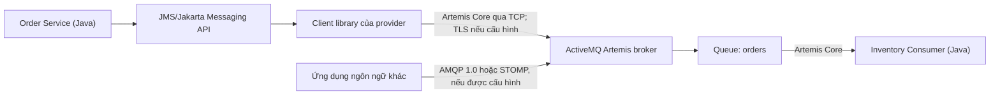
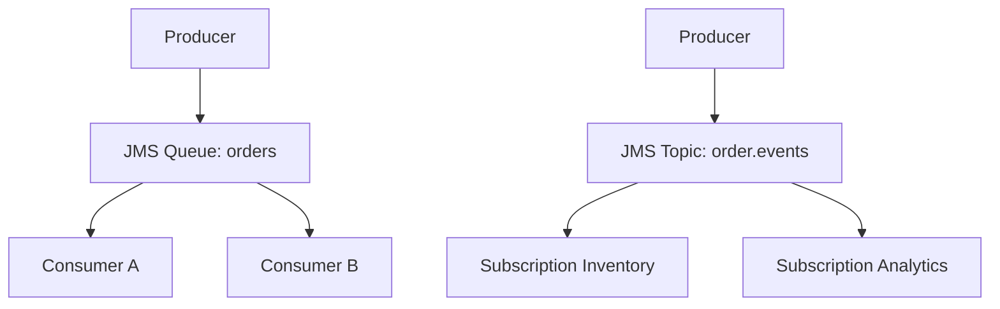

# Phân biệt JMS/Jakarta Messaging, giao thức truyền tin và sản phẩm broker

> **Chương:** Tổng quan ActiveMQ  
> **Phạm vi:** Apache ActiveMQ Classic, Apache ActiveMQ Artemis và các ứng dụng Java trao đổi thông điệp bất đồng bộ.

Khi bắt đầu làm việc với ActiveMQ, người học thường gặp ba kiểu câu hỏi:

- “Ứng dụng của tôi dùng **JMS** hay **Jakarta Messaging**?”
- “Hai hệ thống trao đổi qua **OpenWire, AMQP, STOMP, MQTT** hay một giao thức khác?”
- “Máy chủ tiếp nhận và lưu thông điệp là **ActiveMQ Classic** hay **ActiveMQ Artemis**?”

Ba câu hỏi này thuộc **ba tầng khác nhau**. JMS/Jakarta Messaging là **API và đặc tả lập trình của Java**; OpenWire, AMQP, STOMP, MQTT và Artemis Core là **giao thức trao đổi dữ liệu trên đường truyền**; ActiveMQ Classic và Artemis là **sản phẩm phần mềm broker** triển khai việc nhận, định tuyến, lưu trữ và phân phối thông điệp. Nhận diện đúng tầng giúp chọn client, cấu hình kết nối, thiết kế queue/topic và xử lý sự cố mà không nhầm lẫn trách nhiệm.

## 1. Bức tranh tổng thể: API, giao thức và broker

Xét hệ thống đặt hàng: dịch vụ Order phát sự kiện khi tạo đơn; dịch vụ Inventory tiếp nhận rồi trừ tồn kho. Hai dịch vụ cần tiếp tục chạy độc lập, nên Order gửi thông điệp vào broker thay vì gọi Inventory đồng bộ.



| Tầng | Trả lời câu hỏi | Ví dụ | Ai quy định? |
|---|---|---|---|
| **API / programming model** | Code Java gửi, nhận, xác nhận, giao dịch thông điệp bằng cách nào? | `jakarta.jms.ConnectionFactory`, `JMSContext`, `JMSProducer`, `Queue`, `Topic` | Đặc tả JMS/Jakarta Messaging; provider triển khai |
| **Wire protocol** | Client và broker mã hóa, trao đổi frame, mở phiên và xác nhận trên mạng bằng định dạng nào? | Artemis Core, OpenWire, AMQP 1.0, STOMP, MQTT | Định nghĩa riêng của từng giao thức |
| **Broker product** | Tiến trình nào giữ kết nối, quản lý địa chỉ/queue, lưu dữ liệu, điều phối consumer và phục hồi lỗi? | Apache ActiveMQ Classic, Apache ActiveMQ Artemis | Phần mềm broker và cấu hình vận hành |
| **Transport / bảo mật đường truyền** | Dữ liệu đi qua kênh vật lý và được bảo vệ thế nào? | TCP, TLS, WebSocket | Tầng vận chuyển và bảo mật |

Một chương trình có thể **viết bằng API Jakarta Messaging**, nhưng client của nó **nói giao thức Artemis Core** với **broker Artemis** qua **TCP được bảo vệ bởi TLS**. Không có mâu thuẫn nào: mỗi khái niệm mô tả một tầng.

**Quy tắc cốt lõi:** nhìn thấy `import jakarta.jms.*` chỉ cho biết API mà chương trình biên dịch cùng; nó **không** tự cho biết giao thức trên mạng hay sản phẩm broker phía sau.

## 2. JMS và Jakarta Messaging thực chất là gì?

**JMS (Java Message Service)** là đặc tả API cho ứng dụng Java trao đổi thông điệp thông qua một *messaging provider*. API chuẩn hóa những khái niệm như kết nối, destination, message, producer, consumer, acknowledgment, selector và giao dịch phiên. Ứng dụng gọi các interface của API; thư viện client do provider cung cấp thực hiện các thao tác thực tế.

Sau khi Java EE chuyển sang hệ sinh thái Jakarta EE, đặc tả mang tên **Jakarta Messaging**. Đổi tên đặc tả và đổi namespace Java là hai mốc riêng biệt:

| Dòng đặc tả | Namespace thường gặp | Điểm cần nhớ |
|---|---|---|
| JMS 1.1 | `javax.jms.*` | API cổ điển dùng `Connection`, `Session`, `MessageProducer`, `MessageConsumer` |
| JMS 2.0 | `javax.jms.*` | Bổ sung API đơn giản hóa như `JMSContext`, `JMSProducer` và hỗ trợ shared subscription |
| Jakarta Messaging 2.0 (Jakarta EE 8) | `javax.jms.*` | Tên đặc tả đã thuộc Jakarta nhưng package vẫn là `javax.jms` |
| Jakarta Messaging 3.0 trở lên (từ Jakarta EE 9) | `jakarta.jms.*` | Namespace chuyển sang `jakarta.jms`; cần thư viện client tương thích |

Do đó, **JMS 2.0 không đồng nghĩa với `jakarta.jms`**, và “đã dùng Jakarta Messaging” cũng chưa đủ để suy ra namespace nếu không biết phiên bản. Một ứng dụng import `javax.jms.ConnectionFactory` không thể trực tiếp gán cho đối tượng chỉ triển khai `jakarta.jms.ConnectionFactory`: đó là các kiểu Java khác nhau. Khi di chuyển ứng dụng, phải đồng bộ **API dependency, client library, framework và runtime**.

### 2.1. Những thành phần API quan trọng

| Thành phần | Ý nghĩa |
|---|---|
| `ConnectionFactory` | Tạo kết nối/ngữ cảnh đến messaging provider; interface chuẩn nhưng cách khởi tạo, URL và lựa chọn giao thức thường phụ thuộc client |
| `JMSContext` | API đơn giản hóa từ JMS 2.0, gộp vai trò connection/session và hỗ trợ `AutoCloseable` |
| `Queue` | Destination kiểu point-to-point: mỗi thông điệp được xử lý bởi một consumer trong nhóm nhận cạnh tranh, với điều kiện phân phối thành công |
| `Topic` | Destination kiểu publish/subscribe: các subscription phù hợp có thể nhận mỗi sự kiện |
| `Message`, `TextMessage`, `BytesMessage` | Thông điệp và kiểu payload; property và header chứa metadata |
| `JMSProducer`, `JMSConsumer` | Gửi và nhận thông điệp bằng API đơn giản hóa |
| `JMSMessageID`, `JMSCorrelationID` | Header hỗ trợ định danh thông điệp và liên kết các thông điệp trong một luồng trao đổi |
| `Message Selector` | Biểu thức lọc theo header/property, chẳng hạn `eventType = 'OrderCreated'` |

Ví dụ, code Java có thể phụ thuộc vào interface `ConnectionFactory` mà không cần biết broker cụ thể ở phần lớn logic nghiệp vụ. Tuy nhiên việc tạo factory, cấu hình retry/failover, destination và một số tính năng quản trị vẫn phụ thuộc **provider**. “API chuẩn” không có nghĩa là mọi cấu hình, mọi extension hoặc mọi hành vi broker đều giống nhau.

### 2.2. Queue và topic là mô hình phân phối, không phải tên giao thức

Với **queue**, hai consumer `C1` và `C2` cùng đọc `orders` thường chia nhau công việc: một bản thông điệp được gửi cho **một** consumer xử lý thành công. Nếu consumer gặp lỗi trước khi xác nhận, broker có thể phân phối lại tùy chính sách.

Với **topic**, một event `OrderCreated` có thể được chuyển tới cả subscription của Inventory lẫn Analytics. Một subscription không bền (*non-durable*) thường chỉ nhận các thông điệp xuất hiện khi đang hoạt động; **durable subscription** giúp lưu thông điệp phù hợp trong lúc subscriber tạm ngắt kết nối, theo cấu hình và giới hạn lưu giữ của broker. JMS 2.0 cũng có shared subscription, vì vậy không thể hiểu topic là “mọi tiến trình consumer đều luôn nhận một bản riêng” trong mọi cấu hình.



Trong Artemis, cấu trúc broker thường mô tả bằng **address**, **queue** và **routing type**:

- **Anycast:** thông điệp được định tuyến tới một queue phù hợp; nhiều consumer trên queue cạnh tranh nhận công việc.
- **Multicast:** thông điệp được định tuyến tới các queue subscription phù hợp; mỗi subscription có thể nhận một bản.

JMS `Queue` thường tương ứng với kiểu phân phối anycast và JMS `Topic` với multicast trong cấu hình Artemis phù hợp. Đây là **ánh xạ giữa mô hình JMS và mô hình routing nội bộ của Artemis**, không phải định nghĩa hai loại giao thức mới. Việc một lời gọi `context.createQueue("orders")` tạo đối tượng destination bên Java cũng **không bảo đảm** queue đã tồn tại trên broker: broker có thể yêu cầu khai báo trước hoặc cho phép tự tạo theo cấu hình.

## 3. Giao thức truyền tin: dữ liệu chạy trên mạng như thế nào?

**Wire protocol** quy định cách client và broker trao đổi frame/gói tin, metadata, kết nối, xác nhận và tín hiệu điều khiển. Hai client cùng cung cấp API JMS có thể dùng **hai giao thức khác nhau**. Ngược lại, một ứng dụng không viết bằng Java vẫn có thể gửi tới broker nếu có client giao thức mà broker hỗ trợ.

| Giao thức | Đặc trưng chính | Quan hệ với ActiveMQ và JMS | Tình huống thường gặp |
|---|---|---|---|
| **OpenWire** | Giao thức nhị phân gắn với ActiveMQ Classic | Protocol quen thuộc của client ActiveMQ Classic; Artemis có thể bật hỗ trợ tương thích OpenWire, nhưng không đồng nghĩa tương thích hoàn toàn mọi tính năng Classic | Hệ Java đang chạy với ActiveMQ Classic hoặc cần kết nối client Classic |
| **Artemis Core** | Giao thức nhị phân native của ActiveMQ Artemis | Thường được dùng bởi client Artemis JMS/Jakarta Messaging; đây là giao thức triển khai, không phải một phiên bản JMS | Ứng dụng Java kết nối trực tiếp Artemis |
| **AMQP 1.0** | Chuẩn giao thức messaging mở, có cơ chế link, transfer và settlement | Artemis có thể tiếp nhận AMQP 1.0; client hỗ trợ JMS qua AMQP (ví dụ một phiên bản phù hợp của Apache Qpid JMS) có thể cung cấp API JMS/Jakarta Messaging trên giao thức này | Tích hợp đa ngôn ngữ hoặc hệ sinh thái có client AMQP 1.0 |
| **STOMP** | Giao thức text-frame đơn giản | Artemis và Classic có thể hỗ trợ nếu bật connector/acceptor; STOMP tự nó không cung cấp toàn bộ API JMS | Script, ứng dụng đơn giản, client hỗ trợ STOMP |
| **MQTT** | Giao thức nhẹ cho mô hình publish/subscribe, có QoS và topic riêng | Artemis có thể hỗ trợ MQTT; QoS MQTT không ánh xạ một-một với acknowledgment hay transaction JMS | Thiết bị, telemetry, IoT |

**Không đánh đồng AMQP 1.0 và AMQP 0-9-1.** Chúng là các phiên bản giao thức khác nhau, không tương thích wire trực tiếp. Chẳng hạn RabbitMQ thường được biết đến với AMQP 0-9-1, còn một kết nối Artemis qua AMQP 1.0 phải sử dụng client nói **AMQP 1.0**. Tên “AMQP” một mình là chưa đủ để quyết định tương thích.

Tương tự, **TCP** là kênh vận chuyển, **TLS** bảo vệ kênh và **WebSocket** có thể đóng vai trò phương tiện chuyên chở giao thức ứng dụng. Chúng không phải bản thay thế cho JMS, OpenWire hoặc AMQP. URL kiểu `tcp://broker:61616` chỉ mô tả endpoint và transport; **không đủ để khẳng định** một cổng đang dùng giao thức nào, bởi broker có thể cấu hình acceptor nhận một hoặc nhiều protocol.

### 3.1. Giao thức không tự quyết định mọi hành vi nghiệp vụ

Giả sử Order gửi thông điệp `OrderCreated` qua AMQP 1.0 và Inventory dùng JMS để nhận qua Artemis Core. Broker **có thể** phối hợp hai kết nối này nếu giao thức, địa chỉ, routing, định dạng nội dung, kiểu message và mapping metadata tương thích. Tuy nhiên cần kiểm thử thực tế:

1. Tên destination hoặc địa chỉ có ánh xạ về đúng address/queue không?
2. Content type, encoding và kiểu body có được consumer hiểu đúng không?
3. Header, property, selector, expiration, priority, transaction và cơ chế xác nhận có được chuyển nghĩa nhất quán không?
4. Subscription, durable storage và retry có hoạt động như yêu cầu không?

Việc broker “hỗ trợ AMQP và JMS” **không** bảo đảm mọi kiểu thông điệp, mọi property và mọi extension được chuyển đổi trọn vẹn.

## 4. ActiveMQ Classic và ActiveMQ Artemis: hai sản phẩm broker

**Apache ActiveMQ Classic** và **Apache ActiveMQ Artemis** đều thuộc hệ sinh thái Apache ActiveMQ, nhưng là **hai dòng broker với kiến trúc, cấu hình và client native khác nhau**. Không nên xem “Artemis = đổi tên hoặc tăng phiên bản của Classic”.

| Tiêu chí | ActiveMQ Classic | ActiveMQ Artemis |
|---|---|---|
| Bản chất | Broker lâu đời trong dòng ActiveMQ Classic | Broker có kiến trúc riêng trong dòng Artemis |
| Giao thức native tiêu biểu | OpenWire | Artemis Core |
| Hỗ trợ protocol khác | Có các transport/protocol tùy cấu hình và phiên bản, như AMQP, STOMP, MQTT | Có khả năng hỗ trợ Artemis Core, AMQP 1.0, STOMP, MQTT và OpenWire qua acceptor phù hợp |
| Cách mô hình hóa destination | Khái niệm queue/topic kiểu ActiveMQ Classic và các chính sách đi kèm | Address, queue, routing type anycast/multicast; cung cấp ánh xạ JMS queue/topic |
| Thư viện client Java điển hình | Các client do ActiveMQ Classic cung cấp, với API namespace tùy phiên bản/artifact | Các client Artemis tương ứng `javax.jms` hoặc `jakarta.jms` tùy artifact/phiên bản |
| Di chuyển hệ thống | Cần kiểm tra URI, protocol, security, persistence, destination, policy, plugin và các tính năng đang dùng | Có thể nhận kết nối OpenWire ở mức tương thích, nhưng vẫn phải kiểm tra tính năng và vận hành thực tế |

Tên package Java thường thấy cũng khác:

```text
ActiveMQ Classic: org.apache.activemq.ActiveMQConnectionFactory
ActiveMQ Artemis: org.apache.activemq.artemis.jms.client.ActiveMQConnectionFactory
```

Hai class có cùng tên đơn giản `ActiveMQConnectionFactory` nhưng **khác package**. Ngoài việc biết class này thuộc sản phẩm nào, còn phải kiểm tra artifact phiên bản đang dùng triển khai `javax.jms.ConnectionFactory` hay `jakarta.jms.ConnectionFactory`.

Một broker chạy trong tiến trình riêng và thực hiện nhiều việc nằm **ngoài** đặc tả API JMS: quản lý file lưu trữ, quota, địa chỉ, permissions, retry/redelivery, dead-letter queue (DLQ), clustering, high availability, giám sát, nâng cấp và sao lưu. JMS định nghĩa cách ứng dụng tương tác với provider, còn cách cấu hình các phần này phụ thuộc sản phẩm và phiên bản broker.

## 5. Ví dụ Java: Jakarta Messaging API trên ActiveMQ Artemis

Mục tiêu của ví dụ là thấy rõ **ba tầng trong một đoạn code**: chương trình import `jakarta.jms` (API), khởi tạo `ActiveMQConnectionFactory` của Artemis (client provider) và gửi/nhận qua một broker Artemis đã chạy (thường dùng Artemis Core trên endpoint TCP được cấu hình).

**Điều kiện thực hành:**

- Dùng JDK tương thích với client Artemis đã chọn; dự án có dependency `org.apache.activemq:artemis-jakarta-client` với phiên bản phù hợp.
- Có broker Artemis đang chạy và lắng nghe endpoint được khai báo trong `BROKER_URL`; ví dụ `tcp://localhost:61616` chỉ áp dụng nếu broker thực sự cấu hình cổng đó.
- Có người dùng được cấp quyền gửi và tiêu thụ trên destination `orders`. Queue phải được tạo trước hoặc broker cho phép tự tạo theo chính sách.
- Đặt `BROKER_USER` và `BROKER_PASSWORD` trong môi trường chạy; ví dụ không nhúng bí mật trực tiếp trong source.

```java
import jakarta.jms.ConnectionFactory;
import jakarta.jms.DeliveryMode;
import jakarta.jms.JMSConsumer;
import jakarta.jms.JMSContext;
import jakarta.jms.Message;
import jakarta.jms.Queue;
import jakarta.jms.TextMessage;
import org.apache.activemq.artemis.jms.client.ActiveMQConnectionFactory;

public class OrderMessagingDemo {
    public static void main(String[] args) throws Exception {
        if (args.length != 1 ||
                (!"send".equals(args[0]) && !"receive".equals(args[0]))) {
            throw new IllegalArgumentException("Chon send hoac receive");
        }

        String brokerUrl = System.getenv().getOrDefault(
                "BROKER_URL", "tcp://localhost:61616");
        String user = System.getenv("BROKER_USER");
        String password = System.getenv("BROKER_PASSWORD");
        if (user == null || password == null) {
            throw new IllegalStateException(
                    "Can BROKER_USER va BROKER_PASSWORD");
        }

        // Factory thuộc Artemis; kiểu biến là interface của Jakarta Messaging.
        ConnectionFactory factory = new ActiveMQConnectionFactory(brokerUrl);

        try (JMSContext context = factory.createContext(
                user, password, JMSContext.AUTO_ACKNOWLEDGE)) {
            Queue orders = context.createQueue("orders");

            if ("send".equals(args[0])) {
                TextMessage message = context.createTextMessage(
                        "{\"orderId\":\"O-1001\",\"status\":\"CREATED\"}");
                message.setStringProperty("eventType", "OrderCreated");
                context.createProducer()
                        .setDeliveryMode(DeliveryMode.PERSISTENT)
                        .send(orders, message);
                System.out.println("Da gui don O-1001");
            } else {
                // Selector loc theo message property, khong loc JSON body.
                JMSConsumer consumer = context.createConsumer(
                        orders, "eventType = 'OrderCreated'");
                Message message = consumer.receive(10_000L);

                if (message instanceof TextMessage) {
                    String body = ((TextMessage) message).getText();
                    System.out.println("Da nhan: " + body);
                } else if (message == null) {
                    System.out.println("Het thoi gian cho, chua co message");
                } else {
                    System.out.println("Nhan message khac kieu TextMessage");
                }
            }
        }
    }
}
```

Chạy chế độ `send` để tạo thông điệp, sau đó chạy `receive` ở một tiến trình khác để nhận. Nếu queue trống thì `receive(10_000L)` trả về `null` sau tối đa 10 giây chờ. Có thể chạy nhiều consumer đồng thời để quan sát cách queue phân phối công việc.

Đọc ví dụ theo từng tầng:

1. **API:** `ConnectionFactory`, `JMSContext`, `Queue`, `TextMessage` và `JMSConsumer` đều thuộc `jakarta.jms`.
2. **Provider/client:** `org.apache.activemq.artemis.jms.client.ActiveMQConnectionFactory` là phần triển khai do Artemis cung cấp.
3. **Giao thức/transport:** client Artemis kết nối đến URL của broker; trong cấu hình thông thường client native giao tiếp bằng **Artemis Core qua TCP**. Kết nối TLS yêu cầu URL/chứng chỉ và acceptor tương ứng.
4. **Broker:** tiến trình Artemis chịu trách nhiệm xác thực, cấp quyền, tìm queue `orders`, lưu và phân phối thông điệp.

**Hai giới hạn quan trọng:** `DeliveryMode.PERSISTENT` là yêu cầu về chế độ phân phối bền vững, nhưng mức an toàn dữ liệu cuối cùng còn phụ thuộc persistence, cấu hình broker và tình huống lỗi. `AUTO_ACKNOWLEDGE` thích hợp để minh họa API; với `receive()` đồng bộ, acknowledgment có thể được thực hiện khi lời gọi nhận thành công **trước** khi nghiệp vụ phía sau xử lý xong. Vì thế không nên xem việc in ra console trong ví dụ như một workflow xử lý đơn hàng tin cậy đầy đủ.

### 5.1. Nếu thay đổi broker hoặc giao thức thì code thay đổi ở đâu?

Nếu chuyển từ Artemis client native sang một JMS client sử dụng AMQP 1.0, ứng dụng **có thể giữ** nhiều phần logic dựa trên `jakarta.jms`, nhưng phải đổi **client dependency, factory và cấu hình endpoint**. Với ActiveMQ Classic cũng cần chọn đúng client artifact, namespace và giao thức tương thích. Có trường hợp ứng dụng dùng lại interface nhưng hành vi destination, failover, selector hoặc policy vẫn cần điều chỉnh và kiểm thử.

Ngược lại, nếu giữ broker Artemis nhưng thay ứng dụng Java bằng JavaScript hay Python dùng STOMP/AMQP, phía client **không cần** `jakarta.jms`. Nó gọi API của thư viện ngôn ngữ đó và trao đổi bằng protocol mà hai đầu cùng hỗ trợ.

## 6. Acknowledgment, transaction, redelivery và DLQ nằm ở tầng nào?

Đây là chỗ dễ nhầm nhất khi thiết kế hệ thống tin cậy. **API JMS** có khái niệm acknowledgment và transaction; **wire protocol** có lệnh/khung truyền tương ứng; **broker** quyết định cách lưu trạng thái và thực thi chính sách redelivery, retry, DLQ. Các tầng phối hợp với nhau nhưng không đồng nhất.

| Cơ chế | Phần thuộc API JMS/Jakarta Messaging | Điều vẫn phụ thuộc broker/client |
|---|---|---|
| `AUTO_ACKNOWLEDGE` | Session/context tự xác nhận khi hoạt động nhận thành công theo ngữ nghĩa JMS | Thời điểm xử lý nội bộ, khôi phục khi mất mạng và chính sách phát lại |
| `CLIENT_ACKNOWLEDGE` | Ứng dụng gọi `message.acknowledge()` | Trong session, lệnh này thường xác nhận **toàn bộ** các thông điệp chưa được ack mà session đã tiêu thụ, không mặc nhiên chỉ một message |
| `DUPS_OK_ACKNOWLEDGE` | Cho phép xác nhận trì hoãn, nên có thể nhận trùng | Mức độ trì hoãn và vận hành phục hồi |
| `SESSION_TRANSACTED` | `commit()` xác nhận các thao tác JMS trong transaction của session; `rollback()` hủy và đưa thông điệp vào luồng phân phối lại | Backoff, lần redelivery tối đa, nơi gửi sau khi vượt ngưỡng, journal/persistence |
| **DLQ** | Không phải một kiểu destination hoặc hành vi được chuẩn JMS quy định thống nhất | Tên DLQ, policy dead-letter, loại lỗi, số lần thử và cách xử lý hoàn toàn theo sản phẩm/cấu hình |

Với consumer cần xử lý nghiệp vụ trước khi xác nhận, có thể dùng context giao dịch:

```java
// Minh hoa luong xu ly; factory, user va password duoc tao nhu vi du tren.
try (JMSContext ctx = factory.createContext(
        user, password, JMSContext.SESSION_TRANSACTED)) {
    Queue queue = ctx.createQueue("orders");
    Message message = ctx.createConsumer(queue).receive(10_000L);

    if (message != null) {
        try {
            // Thuc hien logic nghiep vu co kiem tra trung lap tai day.
            processOrderIdempotently(message);
            ctx.commit();   // Xac nhan transaction JMS sau khi xu ly.
        } catch (Exception ex) {
            ctx.rollback(); // Message co the duoc giao lai theo chinh sach.
            throw ex;
        }
    }
}
```

Đây là **đoạn minh họa luồng xử lý**, trong đó `processOrderIdempotently` là hàm nghiệp vụ cần tự triển khai. `ctx.commit()` chỉ bảo đảm transaction **trong phạm vi JMS session**. Nếu hàm nghiệp vụ ghi vào một database riêng, commit JMS và commit database **không tự động là một transaction nguyên tử**. Hệ thống nên thiết kế idempotency bằng mã đơn hàng/message ID nghiệp vụ, hoặc áp dụng một chiến lược transaction/outbox/inbox phù hợp.

Ví dụ sự cố:

1. Consumer đọc `O-1001` và ghi kết quả vào database.
2. Tiến trình chết **trước** khi commit transaction JMS.
3. Broker có thể redeliver `O-1001` cho consumer khác.
4. Nếu không kiểm tra trùng lặp, hệ thống có thể trừ tồn kho hai lần.

Đó là lý do “broker hỗ trợ persistent delivery” hoặc “MQTT QoS 2” **không** đủ để suy ra **exactly-once processing** xuyên suốt ứng dụng và database. Khi vận hành, cần kiểm tra retry/redelivery policy, DLQ, thời hạn lưu thông điệp, monitoring queue depth, consumer lag, xác thực, TLS và quyền gửi/nhận theo đúng broker đang dùng.

## 7. Đọc sơ đồ kiến trúc và lỗi kết nối bằng đúng thuật ngữ

### 7.1. Ba kiến trúc minh họa

| Kiến trúc | API ứng dụng | Wire protocol tiêu biểu | Broker |
|---|---|---|---|
| Java producer/consumer với Classic client | JMS qua `javax.jms` hoặc API tương thích theo artifact | OpenWire | ActiveMQ Classic |
| Java producer/consumer với Artemis Jakarta client | Jakarta Messaging qua `jakarta.jms` | Artemis Core | ActiveMQ Artemis |
| Java application dùng một JMS client dựa trên AMQP 1.0 | JMS/Jakarta Messaging tương ứng phiên bản client | AMQP 1.0 | Broker hỗ trợ AMQP 1.0, ví dụ Artemis |
| Một dịch vụ Python/JavaScript dùng STOMP client | API riêng của thư viện STOMP, **không phải JMS Java** | STOMP | Broker được bật hỗ trợ STOMP |

Mỗi hàng là một **cách kết hợp hợp lệ khi chọn đúng phiên bản và cấu hình**, không phải tuyên bố mọi broker đều hỗ trợ mọi tổ hợp mặc định.

### 7.2. Chẩn đoán theo tầng

| Triệu chứng | Nên kiểm tra tầng nào trước? | Hướng xác minh |
|---|---|---|
| Lỗi compiler: `javax.jms` không chuyển thành `jakarta.jms` | **API/dependency** | Namespace của source, API jar, client artifact, version framework |
| Không bắt tay được hoặc kết nối bị ngắt ngay | **Protocol/transport** | URL, cổng, acceptor, giao thức được bật, TCP/TLS, chứng chỉ và credentials |
| Producer gửi thành công nhưng consumer không nhận | **Destination/routing** | Queue/topic, Artemis address, anycast/multicast, auto-create, selector, subscription và quyền |
| Message được nhận lại sau khi consumer gặp lỗi | **Acknowledgment/transaction** | Commit/rollback, thời điểm ack, redelivery policy, idempotency |
| Message bị chuyển sang DLQ | **Broker policy** | Số lần thử, lỗi consumer, dead-letter address, độ trễ và cơ chế xử lý lại |
| Ứng dụng Classic chuyển sang Artemis nhưng không giữ nguyên hành vi | **Client + broker semantics** | Tính năng OpenWire tương thích, virtual destinations, selectors, persistence, security và failover |

Ví dụ về ngôn ngữ chính xác khi ghi tài liệu:

- Mơ hồ: “Dịch vụ kết nối JMS trên cổng 61616.”
- Rõ hơn: “Dịch vụ Java dùng API Jakarta Messaging, client Artemis giao tiếp bằng Artemis Core qua endpoint TCP do broker Artemis cấu hình.”
- Mơ hồ: “Cứ dùng AMQP là tự tương thích với JMS.”
- Rõ hơn: “Client hỗ trợ AMQP 1.0 và broker có acceptor AMQP 1.0; nếu ứng dụng dùng JMS thì cần thêm thư viện triển khai API JMS và kiểm tra việc ánh xạ destination/message.”

## 8. Chọn công nghệ theo yêu cầu thực tế

Không nên bắt đầu bằng câu “JMS hay ActiveMQ?” vì chúng không phải hai lựa chọn loại trừ nhau. Hãy ra quyết định lần lượt:

1. **Ứng dụng dùng ngôn ngữ và API nào?** Nếu là Java cần lập trình theo chuẩn, chọn `jakarta.jms` (hoặc `javax.jms` cho hệ cũ) và client hỗ trợ đúng namespace.
2. **Những bên nào phải giao tiếp với nhau?** Java-only có thể dùng native client. Hệ nhiều ngôn ngữ có thể ưu tiên giao thức mở như AMQP 1.0, nhưng cần xác minh hỗ trợ của từng client và broker.
3. **Broker nào phù hợp?** Đánh giá Classic hoặc Artemis theo hệ thống hiện có, tính năng thật sự sử dụng, hỗ trợ giao thức, mô hình queue/topic, performance, persistence, HA, công cụ quản trị và chi phí di chuyển.
4. **Thế nào là xử lý thành công?** Xác định lúc nào được ack/commit, có chấp nhận trùng lặp không, timeout/retry, DLQ và chiến lược chống xử lý lặp.
5. **Hệ thống vận hành ra sao?** Kiểm tra phân quyền, TLS, giới hạn tài nguyên, capacity, backlog, metrics, backup/restore và thử nghiệm failover trước khi đưa vào production.

Đối với bài toán đặt hàng, cấu hình hợp lý có thể là **Java + Jakarta Messaging + client Artemis + Artemis Core + ActiveMQ Artemis**, producer phát thông điệp persistent tới queue, consumer dùng transaction/idempotency, và operator theo dõi backlog cùng DLQ. Nếu có dịch vụ khác ngôn ngữ, có thể bổ sung acceptor AMQP 1.0 và kiểm thử mapping thay vì buộc dịch vụ đó dùng JMS.

## 9. Những ngộ nhận cần tránh

| Ngộ nhận | Cách hiểu đúng |
|---|---|
| “JMS là giao thức TCP.” | JMS/Jakarta Messaging là API và đặc tả; client triển khai protocol wire cụ thể. |
| “`jakarta.jms` là JMS 2.0.” | JMS 2.0 dùng `javax.jms`; namespace `jakarta.jms` xuất hiện từ Jakarta Messaging 3.0. |
| “Artemis chỉ là ActiveMQ Classic phiên bản mới.” | Hai dòng broker khác kiến trúc và mô hình cấu hình; migration cần kiểm thử. |
| “Queue chính là address Artemis.” | JMS Queue là destination API; Artemis phân biệt address, queue và routing type. |
| “Cổng 61616 cho biết chắc chắn đó là OpenWire.” | Cổng chỉ là endpoint; giao thức phụ thuộc acceptor và thư viện client. |
| “Có AMQP là mọi client AMQP đều nói chuyện được.” | Phải kiểm tra đúng phiên bản giao thức, ví dụ AMQP 1.0 khác AMQP 0-9-1. |
| “Persistent message bảo đảm nghiệp vụ không mất, không xử lý trùng.” | Persistence giúp chịu lỗi ở tầng broker theo cấu hình; vẫn phải quản lý ack, transaction, idempotency và độ bền dữ liệu bên ngoài. |
| “Client gọi `createQueue` thì broker chắc chắn tạo queue.” | Lời gọi tạo đối tượng destination ở API; việc tạo tài nguyên broker tùy chính sách auto-create/provisioning. |

## 10. Ghi nhớ khi đọc tài liệu hoặc thiết kế tích hợp

Khi thấy thuật ngữ bất kỳ, hãy xác định nó trả lời câu hỏi nào:

- **JMS/Jakarta Messaging:** *Ứng dụng Java lập trình bằng interface nào?*
- **OpenWire/Artemis Core/AMQP 1.0/STOMP/MQTT:** *Các endpoint trao đổi frame theo quy tắc nào?*
- **ActiveMQ Classic/ActiveMQ Artemis:** *Phần mềm nào nhận, giữ, định tuyến và giao message?*
- **TCP/TLS/WebSocket:** *Thông điệp được vận chuyển và bảo vệ qua kênh nào?*
- **Queue/topic và anycast/multicast:** *Thông điệp được phân phối cho những nhóm consumer nào?*
- **Ack/commit/redelivery/DLQ:** *Hệ thống xử lý thành công, lỗi và phát lại bằng cách nào?*

Muốn kết nối đáng tin cậy, phải mô tả **đủ cả API, phiên bản client, giao thức, endpoint, broker, topology và chính sách lỗi**. Đó là nền tảng để tiếp tục học producer/consumer Java, acknowledgment, transaction, redelivery, DLQ, bảo mật và vận hành ActiveMQ Classic hoặc Artemis trong hệ thống bất đồng bộ.
