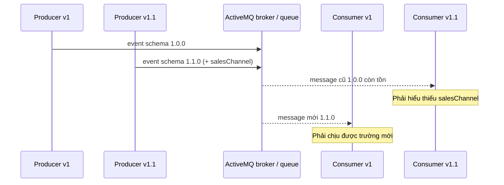
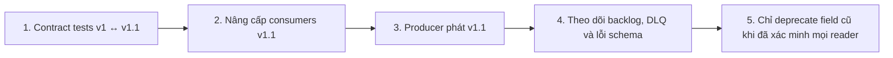

# Thiết kế schema, version và thay đổi hợp đồng tương thích

> **Chương:** Thiết kế thông điệp  
> **Phạm vi:** Hợp đồng của thông điệp trao đổi qua Apache ActiveMQ Classic hoặc ActiveMQ Artemis, tập trung vào JSON/JMS và chiến lược tiến hóa schema khi producer và consumer triển khai độc lập.  
> **Mục tiêu:** Thiết kế event có cấu trúc, đặt phiên bản có ý nghĩa, phân biệt tương thích ngược và tương thích xuôi, thay đổi schema an toàn khi còn message cũ trong queue, kiểm tra hợp đồng tự động và thử nghiệm gửi/nhận sự kiện nhiều phiên bản trên Artemis.

## 1. Tình huống: code mới gặp message cũ và ngược lại

Dịch vụ `Order Service` gửi `order.created` vào broker. Ban đầu consumer Billing chỉ biết các trường `orderId`, `totalMinor` và `currency`. Sau một thời gian, producer bổ sung `salesChannel` để phân tích nguồn đơn hàng.

Hai tình huống xảy ra đồng thời:

- **Producer mới → consumer cũ:** Billing chưa nâng cấp vẫn có thể nhận một event mới chứa trường `salesChannel`.
- **Producer cũ/message tồn đọng → consumer mới:** Billing đã nâng cấp có thể nhận message được phát trước đó nhiều giờ hoặc được replay từ DLQ, **chưa có** `salesChannel`.

Nếu deserializer cũ từ chối trường lạ, tình huống đầu lỗi. Nếu consumer mới bắt buộc `salesChannel`, tình huống sau lỗi. Cả hai là **lỗi hợp đồng dữ liệu**; broker vẫn có thể kết nối, định tuyến và lưu message hoàn toàn bình thường.



**Kết luận thiết kế:** Schema của event là **hợp đồng giữa các phiên bản phần mềm**, độc lập với phiên bản Java, broker và tốc độ triển khai. Kiểm thử chỉ hai instance chạy cùng version là chưa đủ.

## 2. Những thành phần cần có trong hợp đồng thông điệp

Không nên chỉ gửi một đối tượng Java được serialize rồi hy vọng consumer dùng cùng class. Một event có thể gồm **envelope** ổn định và **payload** nghiệp vụ:

```json
{
  "eventId": "evt-1001",
  "eventType": "order.created",
  "schemaVersion": "1.0.0",
  "occurredAt": "2026-11-17T07:00:00Z",
  "data": {
    "orderId": "ORD-1001",
    "totalMinor": 12999,
    "currency": "USD"
  }
}
```

| Trường | Hợp đồng cần quy định | Lý do |
| --- | --- | --- |
| `eventId` | ID ổn định, không đổi khi retry cùng sự kiện nghiệp vụ | Deduplication, tracing và đối soát |
| `eventType` | Tên sự kiện có ý nghĩa bất biến, ví dụ `order.created` | Chọn handler/contract đúng |
| `schemaVersion` | Phiên bản **hợp đồng payload/envelope**, không phải phiên bản broker | Reader xác định khả năng giải mã |
| `occurredAt` | Thời điểm sự kiện xảy ra, UTC theo RFC 3339 | Replay, phân tích trễ; khác `JMSTimestamp` |
| `data` | Trường nghiệp vụ có tên, kiểu, ý nghĩa và đơn vị tường minh | Tránh thay đổi ngầm làm hỏng consumer |

**Các quy ước phải ghi trong contract**, không chỉ trong mã:

1. **Đơn vị:** `totalMinor=12999` với `currency=USD` là 129,99 USD; không tự hiểu là 12.999 USD. Tránh `double`/`float` biểu diễn số tiền; dùng số nguyên đơn vị nhỏ nhất hoặc decimal có quy ước rõ ràng.
2. **Giá trị vắng mặt:** Trường không có (`absent`) và trường có giá trị JSON `null` không đương nhiên tương đương. Nếu `salesChannel` tùy chọn, quy định rõ absent/null được xử lý thế nào.
3. **Danh tính:** `eventId` của sự kiện khác `orderId` của thực thể và khác `JMSMessageID` do provider cấp. Khi retry cùng event, giữ `eventId`; khi có sự kiện nghiệp vụ mới, cấp eventId mới.
4. **Tính bất biến:** Event được đặt tên theo một sự kiện đã xảy ra. Đừng sửa lại ý nghĩa `order.created` thành “đơn hàng đã thanh toán”; đó là event khác.
5. **Thứ tự:** Một payload có `occurredAt` không bảo đảm broker phát/consumer xử lý theo thứ tự thời gian; nếu cần thứ tự theo `orderId` phải thiết kế thêm ordering/partitioning và xử lý lặp.

**Giới hạn của broker:** ActiveMQ Classic và Artemis vận chuyển message, lưu queue/topic, ACK và giao dịch theo cấu hình; **không tự kiểm tra JSON body có đúng JSON Schema của doanh nghiệp**. Việc xác thực/enforce schema thuộc thư viện producer, consumer, gateway hay dịch vụ schema registry nếu bạn triển khai.

## 3. Định nghĩa JSON Schema v1.0.0 có thể kiểm chứng

Ta chọn **JSON Schema Draft 2020-12** cho `order.created`. Ví dụ sau là tài liệu hợp đồng của payload; không cần sửa broker khi cập nhật schema.

```json
{
  "$schema": "https://json-schema.org/draft/2020-12/schema",
  "$id": "https://schemas.example.org/order-created/1.0.0.schema.json",
  "title": "OrderCreated v1",
  "type": "object",
  "required": [
    "eventId",
    "eventType",
    "schemaVersion",
    "occurredAt",
    "data"
  ],
  "properties": {
    "eventId": { "type": "string", "minLength": 1 },
    "eventType": { "const": "order.created" },
    "schemaVersion": {
      "type": "string",
      "pattern": "^1\\.[0-9]+\\.[0-9]+$"
    },
    "occurredAt": {
      "type": "string",
      "format": "date-time"
    },
    "data": {
      "type": "object",
      "required": ["orderId", "totalMinor", "currency"],
      "properties": {
        "orderId": { "type": "string", "minLength": 1 },
        "totalMinor": { "type": "integer", "minimum": 0 },
        "currency": {
          "type": "string",
          "pattern": "^[A-Z]{3}$"
        }
      },
      "additionalProperties": true
    }
  },
  "additionalProperties": true
}
```

Các quyết định có chủ đích:

- `required` liệt kê **những trường thật sự cần có**. `additionalProperties: true` ở cả envelope và `data` cho phép reader cũ chấp nhận thuộc tính mới khi chúng xuất hiện, nếu code cũng bỏ qua trường lạ.
- `eventType` sử dụng `const` vì sự kiện này chỉ có một ý nghĩa. Thay `eventType` bằng tên mới cần handler/contract khác.
- `schemaVersion` dùng biểu thức cho **major = 1** và cho phép minor/patch khác nhau. Nếu cố định `const: "1.0.0"` thì validator v1.0 sẽ **từ chối v1.1** chỉ vì số phiên bản, dù payload thay đổi theo hướng cộng thêm trường.
- `format: "date-time"` là thông tin để validator hiểu định dạng thời gian; tùy implementation và cấu hình JSON Schema, kiểm tra `format` có thể là annotation hoặc assertion. Nếu nghiệp vụ yêu cầu ngày hợp lệ, phải bật xác minh format hoặc tự parse theo RFC 3339.
- Schema không diễn đạt hết mọi ràng buộc nghiệp vụ: ví dụ `totalMinor` không thể âm nhưng vẫn cần xác minh currency có được hỗ trợ và `orderId` thực sự tồn tại trong nghiệp vụ.

`additionalProperties: true` là một **chính sách mở rộng** để reader cũ chấp nhận trường mới, có đánh đổi: validator có thể không bắt được lỗi gõ nhầm `curreny` nếu trường `currency` vẫn hợp lệ. Cần kết hợp kiểm thử producer theo schema **đúng phiên bản đang phát**, quy tắc kiểm tra trường không mong đợi và quan sát dữ liệu thực tế. Không chỉ bật chế độ “bỏ qua mọi lỗi” ở consumer.

### 3.1. Schema và body phải có cùng định danh

`$id` ở trên là URI đại diện cho **một bản schema bất biến**. Nó là ví dụ, không phải dịch vụ công khai có thật. Sau khi công bố `1.0.0`, **không sửa nội dung schema tại cùng `$id`**; nếu nội dung hợp đồng đổi, xuất bản một phiên bản mới có định danh mới.

`schemaVersion` trong body báo phiên bản dữ liệu được producer xuất. Trong hệ thống dùng registry, có thể truyền thêm **schema ID/fingerprint** để consumer lấy đúng writer schema; schema ID cũng phải bất biến và truy xuất được khi replay dữ liệu cũ.

## 4. Thay đổi tương thích: từ v1.0.0 lên v1.1.0

Yêu cầu mới: ghi nhận nguồn tạo đơn hàng.

**Message v1.1.0:**

```json
{
  "eventId": "evt-1002",
  "eventType": "order.created",
  "schemaVersion": "1.1.0",
  "occurredAt": "2026-11-17T08:00:00Z",
  "data": {
    "orderId": "ORD-1002",
    "totalMinor": 12999,
    "currency": "USD",
    "salesChannel": "WEB"
  }
}
```

**Điểm thay đổi trong JSON Schema v1.1.0** (minh họa phần `properties` của `data`, các phần còn lại giữ tương thích với `v1.0`):

```json
{
  "salesChannel": {
    "type": "string",
    "enum": ["WEB", "MOBILE", "PARTNER"],
    "description": "Kênh tạo đơn hàng; vắng mặt ở message v1.0"
  }
}
```

Tạo schema **mới** `1.1.0.schema.json` chứa toàn bộ schema v1.0 cộng khai báo trên; không thêm `salesChannel` vào danh sách `required`. Về phía consumer v1.1:

```java
JsonNode data = event.path("data");
String channel = data.hasNonNull("salesChannel")
        ? data.get("salesChannel").asText()
        : "UNKNOWN"; // quy tắc fallback do ứng dụng đặt ra
```

Consumer mới có thể đọc message v1.0 cũ bằng giá trị mặc định do **mã ứng dụng** quyết định. Consumer cũ vẫn đọc message v1.1 nếu bỏ qua trường lạ và chỉ yêu cầu major schema version 1.

**Không nhầm `default` của JSON Schema với thao tác biến đổi dữ liệu:** Keyword `"default": "UNKNOWN"` chỉ là annotation; quá trình JSON Schema validation **không tự chèn** trường `salesChannel` vào JSON thiếu nó. Nếu chọn quy tắc fallback, consumer hoặc thư viện mapping phải thực hiện tường minh.

### 4.1. Khi nào thay đổi bổ sung vẫn phá tương thích?

Thêm một trường có vẻ an toàn nhưng vẫn có thể làm hỏng consumer nếu:

- Consumer deserialize vào Java DTO bật `FAIL_ON_UNKNOWN_PROPERTIES`.
- Consumer kiểm tra **đúng bằng** `schemaVersion = "1.0.0"` hoặc kiểm tra `additionalProperties: false` theo schema cũ.
- Consumer có logic phụ thuộc thứ tự trường JSON, kích thước body, số lượng property hoặc hash toàn bộ body.
- Trường mới dùng tên trùng property cũ nhưng thay đổi ý nghĩa/kiểu, hoặc payload tăng vượt giới hạn message/quota.
- Producer tưởng “tùy chọn” nhưng thay đổi nghiệp vụ để **không gửi** trường cũ đang required.

Vì vậy, “tương thích theo schema” chỉ là một phần của **tương thích ở mức ứng dụng**; phải chạy consumer contract tests với dữ liệu thực.

## 5. Phân biệt backward, forward và full compatibility

Ký hiệu:

- `W_old`: event được ghi bởi producer/schema cũ.
- `W_new`: event được ghi bởi producer/schema mới.
- `R_old`: consumer dùng reader/schema cũ.
- `R_new`: consumer dùng reader/schema mới.

| Kiểu tương thích | Câu hỏi kiểm tra | Bắt buộc vượt qua |
| --- | --- | --- |
| **Backward** (ngược) | Consumer mới có đọc được dữ liệu producer cũ không? | `R_new(W_old)` |
| **Forward** (xuôi) | Consumer cũ có đọc được dữ liệu producer mới không? | `R_old(W_new)` |
| **Full** (hai chiều) | Hai kiểu consumer có xử lý được hai kiểu message không? | Cả `R_new(W_old)` và `R_old(W_new)` |

Ví dụ `v1.0 → v1.1`:

| Dữ liệu gửi | Consumer v1.0 | Consumer v1.1 | Kỳ vọng |
| --- | --- | --- | --- |
| v1.0 (không `salesChannel`) | Đọc được | Đọc được, fallback `UNKNOWN` | Cần backward |
| v1.1 (có `salesChannel`) | Đọc được nếu bỏ trường lạ | Đọc được | Cần forward |
| v2.0 (đổi cấu trúc amount, bỏ `totalMinor`) | **Không đọc được** theo v1 | **Không đọc được** theo v1 | Breaking change; phải có luồng nâng cấp |

**Không kết luận tương thích chỉ từ con số version.** Quy tắc “thay đổi minor luôn an toàn” là **chính sách cần enforce bằng schema diff và contract tests**; version tự nó chỉ là nhãn. Với định dạng nhị phân như Avro/Protobuf, quy tắc wire compatibility cần kiểm tra theo chính định dạng đó.

### 5.1. Những thay đổi thường gặp và chiều tương thích

| Thay đổi hợp đồng | Rủi ro chính | Gợi ý |
| --- | --- | --- |
| Thêm trường **tùy chọn**, reader cũ bỏ qua unknown | Thường tương thích hai chiều | Có fallback rõ ràng |
| Thêm trường **bắt buộc** không có giá trị khi đọc message cũ | Mất backward compatibility | Thêm optional trước, backfill/áp dụng default ở reader |
| Xóa trường cũ đang required | Reader cũ không đọc được message mới | Đánh dấu deprecated, giữ trong giai đoạn chuyển tiếp |
| Đổi `totalMinor` từ integer thành chuỗi `"12999"` | Reader/validator cũ lỗi kiểu, hoặc sai phép tính | Tạo trường mới rồi migrate |
| Đổi tên `totalMinor` thành `amountMinor` | Reader cũ không tìm thấy field | Song song hai field trong giai đoạn chuyển tiếp hoặc đổi major |
| Đổi ý nghĩa trường giữ nguyên tên | Nguy hiểm vì deserializer vẫn chạy nhưng nghiệp vụ sai | **Breaking semantic change**; tạo contract/event type mới |
| Thêm giá trị vào enum hiện hữu | Consumer cũ có thể không xử lý trong switch | Thiết kế `UNKNOWN` từ đầu hoặc kiểm tra tất cả reader |
| Đổi `null` thành absent hay ngược lại | Validator/mapping có thể xử lý khác | Ghi hợp đồng nullability và test cả hai trường hợp |
| Đổi đơn vị tiền hoặc timezone mà không đổi tên | Phá tương thích ngữ nghĩa, khó phát hiện | Trường mới với đơn vị rõ ràng + major version |
| Giảm thời gian retention/TTL | Consumer chậm hoặc replay không còn đủ dữ liệu | Thỏa thuận vận hành, không chỉ sửa JSON Schema |

### 5.2. Một ví dụ breaking v2.0

Giả sử thiết kế lại tiền từ hai field sang object:

```json
{
  "eventId": "evt-2001",
  "eventType": "order.created",
  "schemaVersion": "2.0.0",
  "occurredAt": "2026-11-17T09:00:00Z",
  "data": {
    "orderId": "ORD-2001",
    "amount": {
      "minorUnits": 12999,
      "currency": "USD"
    }
  }
}
```

Consumer v1 yêu cầu `data.totalMinor` và `data.currency`, nên không xử lý được dữ liệu này. Đổi số từ `1.1.0` thành `2.0.0` **không tự biến đổi** dữ liệu v2 về v1. Cần một trong các chiến lược ở phần tiếp theo.

## 6. Chính sách version và kế hoạch triển khai không gián đoạn

Một quy ước thực dụng với event:

- **MAJOR:** Đổi cấu trúc/ngữ nghĩa khiến ít nhất một consumer đang được hỗ trợ không xử lý được.
- **MINOR:** Thêm trường hoặc khả năng mới theo hướng tương thích mà bộ kiểm thử đã xác nhận.
- **PATCH:** Sửa mô tả, ví dụ, metadata hoặc ràng buộc không ảnh hưởng hành vi của các consumer đang hỗ trợ. Không sử dụng patch để lén thay nghĩa field.

Đây là **quy ước của nhóm**, không phải một quy tắc do JMS broker thực thi. Hợp đồng nên được quản lý như một artifact độc lập trong kho schema/registry, có review, lịch sử thay đổi và danh sách consumer phụ thuộc.

### 6.1. Triển khai v1.1 theo thứ tự expand → migrate → contract



Quy trình:

1. **Expand reader:** Consumer mới hiểu cả message v1 và v1.1; triển khai consumer trước.
2. **Đảm bảo consumer cũ vẫn an toàn:** Nếu rollout không đồng thời, những instance v1 còn hoạt động vẫn phải đọc được v1.1. Kiểm tra cấu hình unknown fields và chính sách major version.
3. **Mở producer:** Producer phát v1.1 với trường optional mới. Không thay đổi `eventType`/đơn vị/ngữ nghĩa field cũ.
4. **Quan sát thực tế:** Xem lỗi deserialization, số message bị quarantine, age của message cũ còn tồn, số lần redelivery và độ trễ từng nhóm consumer.
5. **Contract:** Chỉ xóa field cũ khi tất cả consumer hiện hữu **và dữ liệu tồn lưu/replay** đã được xử lý hoặc có adapter thích hợp.

Đối với hệ thống triển khai dài ngày, **consumer mới phải hiểu message cũ trong queue ngay cả khi producer cũ đã ngừng từ lâu**. Đó là lý do kiểm thử backward compatibility cần dữ liệu lưu trữ thực, không chỉ dữ liệu do producer hiện tại sinh ra.

### 6.2. Thay đổi breaking v2 có ba lựa chọn

| Chiến lược | Cách làm | Đánh đổi |
| --- | --- | --- |
| **Tạo event type hoặc destination mới** | Ví dụ `order.created.v2` hoặc `orders.created.v2`, để v1 chạy cho người đọc cũ | Tách hợp đồng rõ; tốn công vận hành hai luồng trong thời gian chuyển đổi |
| **Dual publish có kiểm soát** | Producer phát song song v1 và v2 vào hai contract/destination **riêng** trong thời gian migration | Tăng lưu lượng; cần tránh consumer xử lý cả hai như hai sự kiện nghiệp vụ khác nhau |
| **Adapter/upcaster** | Tại biên consumer, nhận v1 rồi chuyển thành mô hình nội bộ v2; hoặc dịch v2 về v1 nếu không mất thông tin | Giảm đổi producer; cần kiểm tra tính tương đương ngữ nghĩa và khả năng rollback |

**Tránh** phát v2 breaking vào cùng queue mà mọi consumer v1 đang đọc, rồi hy vọng consumer cũ “tự bỏ qua”. Một poison message không hiểu version có thể quay vòng redelivery đến DLQ và làm backlog phình ra.

Khi dual publish, cả hai bản phải mang **cùng nguồn sự kiện nghiệp vụ** (eventId/correlationId có quy ước) để downstream không tính tiền hoặc gửi email hai lần. Có thể tách message ID theo contract nhưng phải duy trì quan hệ với event gốc rõ ràng; điều quan trọng là consumer biết cách deduplicate theo nghiệp vụ.

## 7. JMS/ActiveMQ: truyền version qua body và message properties

JMS `TextMessage` có thể chứa JSON envelope. Một số metadata nên được lặp lại dưới dạng **JMS properties** để broker/consumer selector định tuyến mà không phải giải mã body:

| Dữ liệu | Ở JSON body | Ở JMS properties | Công dụng |
| --- | --- | --- | --- |
| `eventType` | Có | `eventType` | Consumer selector `eventType = 'order.created'` |
| `schemaVersion` | Có | `schemaVersion` | Chọn decoder/quan sát tỷ lệ version |
| `eventId` | Có | `eventId` | Tìm trace; chống trùng ở tầng nghiệp vụ |
| `occurredAt` | Có | Có thể tùy chọn | Ghi thời điểm nghiệp vụ; không thay bằng `JMSTimestamp` |
| `data` | Có | **Không** đưa toàn bộ payload thành nhiều properties | Tránh bành trướng header, message selector không cần payload |

Ví dụ selector JMS:

```java
MessageConsumer consumer = session.createConsumer(
        session.createQueue("orders.created"),
        "eventType = 'order.created'");
```

**Selector đọc JMS properties/headers, không parse JSON body**. Nếu `eventType` chỉ có trong JSON, selector trên không match. Đặt metadata lặp có nguy cơ hai nguồn mâu thuẫn; hãy tạo cả JSON và JMS properties từ **cùng một object hợp đồng**, và consumer kiểm tra khớp trước khi xử lý. Đừng để producer ghi `schemaVersion=1.0.0` trên header nhưng body v2.

**Không trộn schema version với JMS provider:** Các phiên bản ActiveMQ Classic/Artemis, JMS client, ứng dụng và payload có vòng đời riêng. Nâng cấp broker không làm `schemaVersion` của các message tồn đọng tự đổi.

### 7.1. Tại sao tránh `ObjectMessage` cho hợp đồng liên dịch vụ?

`ObjectMessage` serialize một Java object theo cơ chế Java serialization. Consumer bị phụ thuộc vào Java class, tên package, `serialVersionUID` và danh sách class được phép deserialize; dữ liệu cũ có thể không đọc được khi class đổi và deserialize object từ nguồn không tin cậy còn có rủi ro bảo mật.

Đối với liên dịch vụ và replay dài hạn, ưu tiên format có schema công khai như JSON/Avro/Protobuf. Với JSON, `TextMessage` dễ gỡ lỗi; với Avro/Protobuf, thường dùng `BytesMessage` và truyền schema ID/content type đi kèm. **Broker không tự hiểu và validate schema chỉ vì message là BytesMessage.**

## 8. Thực hành Java 17 với Artemis: phát v1/v1.1/v2, kiểm tra version khi nhận

Ví dụ dùng **Artemis Jakarta Messaging client** và Jackson để thao tác JSON. Tập trung vào hợp đồng: một consumer xử lý cả v1.0 và v1.1, còn v2 breaking được chuyển sang queue quarantine trong **cùng JMS transaction** để tránh vòng retry do lỗi schema cố định.

### 8.1. Broker Artemis: hai queue tách biệt

Tại `broker.xml` của instance Artemis, thêm hai address/queue trong `<addresses>` **đã có**:

```xml
<addresses>
    <address name="orders.created">
        <anycast>
            <queue name="orders.created"/>
        </anycast>
    </address>
    <address name="orders.schema-quarantine">
        <anycast>
            <queue name="orders.schema-quarantine"/>
        </anycast>
    </address>
</addresses>
```

Đây là **trích đoạn cấu hình**, không chèn thêm một `<addresses>` trùng lặp nếu section đã tồn tại. Tài khoản demo cần quyền SEND/CONSUME trên queue chính và SEND tới quarantine; broker cần persistence nếu muốn kiểm tra tồn tại message qua restart. Với Classic cũng có thể dùng queue tương đương, nhưng dependency và namespace client phải tương ứng từng nhánh.

### 8.2. Maven dependencies

```xml
<project xmlns="http://maven.apache.org/POM/4.0.0"
         xmlns:xsi="http://www.w3.org/2001/XMLSchema-instance"
         xsi:schemaLocation="http://maven.apache.org/POM/4.0.0
                             https://maven.apache.org/xsd/maven-4.0.0.xsd">
    <modelVersion>4.0.0</modelVersion>
    <groupId>example.messaging</groupId>
    <artifactId>schema-contract-demo</artifactId>
    <version>1.0.0</version>

    <properties>
        <maven.compiler.release>17</maven.compiler.release>
    </properties>

    <dependencies>
        <dependency>
            <groupId>org.apache.activemq</groupId>
            <artifactId>artemis-jakarta-client</artifactId>
            <version>2.38.0</version>
        </dependency>
        <dependency>
            <groupId>com.fasterxml.jackson.core</groupId>
            <artifactId>jackson-databind</artifactId>
            <version>2.17.2</version>
        </dependency>
    </dependencies>

    <build>
        <plugins>
            <plugin>
                <groupId>org.apache.maven.plugins</groupId>
                <artifactId>maven-compiler-plugin</artifactId>
                <version>3.13.0</version>
            </plugin>
            <plugin>
                <groupId>org.codehaus.mojo</groupId>
                <artifactId>exec-maven-plugin</artifactId>
                <version>3.5.0</version>
            </plugin>
        </plugins>
    </build>
</project>
```

Các số phiên bản ở đây nhằm cung cấp **một bộ ví dụ có thể tái lập**, không khẳng định là bản mới nhất hoặc phù hợp production. Không trộn `jakarta.jms` với `javax.jms`; Classic 5.x thông dụng dùng `javax.jms`, trong khi Artemis Jakarta client ở đây dùng `jakarta.jms`. Mã ví dụ minh họa validation thủ công tối thiểu; triển khai thật cần gắn JSON Schema validator cùng registry/schema version đã công bố.

### 8.3. Mã Java có phát version và cách xử lý schema không hỗ trợ

Tạo `src/main/java/example/messaging/ContractDemo.java`:

```java
package example.messaging;

import java.time.Instant;
import java.util.UUID;

import com.fasterxml.jackson.core.JsonProcessingException;
import com.fasterxml.jackson.databind.JsonNode;
import com.fasterxml.jackson.databind.ObjectMapper;
import com.fasterxml.jackson.databind.node.ObjectNode;

import jakarta.jms.ConnectionFactory;
import jakarta.jms.DeliveryMode;
import jakarta.jms.JMSContext;
import jakarta.jms.JMSException;
import jakarta.jms.Message;
import jakarta.jms.Queue;
import jakarta.jms.TextMessage;

import org.apache.activemq.artemis.jms.client.ActiveMQConnectionFactory;

public final class ContractDemo {
    private static final ObjectMapper JSON = new ObjectMapper();
    private static final String INPUT = "orders.created";
    private static final String QUARANTINE = "orders.schema-quarantine";

    private ContractDemo() {}

    public static void main(String[] args) throws Exception {
        if (args.length != 1) {
            throw new IllegalArgumentException(
                "Usage: ContractDemo send-v1|send-v11|send-v2|receive");
        }

        String url = System.getenv().getOrDefault(
                "BROKER_URL", "tcp://127.0.0.1:61616");
        String user = requiredEnv("BROKER_USER");
        String password = requiredEnv("BROKER_PASSWORD");
        ConnectionFactory factory = new ActiveMQConnectionFactory(url);

        switch (args[0]) {
            case "send-v1"  -> send(factory, user, password, "1.0.0");
            case "send-v11" -> send(factory, user, password, "1.1.0");
            case "send-v2"  -> send(factory, user, password, "2.0.0");
            case "receive"  -> receive(factory, user, password);
            default -> throw new IllegalArgumentException(
                    "Unknown mode: " + args[0]);
        }
    }

    private static String requiredEnv(String name) {
        String value = System.getenv(name);
        if (value == null || value.isBlank()) {
            throw new IllegalStateException("Missing env: " + name);
        }
        return value;
    }

    private static void send(ConnectionFactory factory, String user,
                             String password, String version)
            throws JMSException, JsonProcessingException {
        try (JMSContext context = factory.createContext(
                user, password, JMSContext.SESSION_TRANSACTED)) {

            ObjectNode event = JSON.createObjectNode();
            String eventId = UUID.randomUUID().toString();
            event.put("eventId", eventId);
            event.put("eventType", "order.created");
            event.put("schemaVersion", version);
            event.put("occurredAt", Instant.now().toString());

            ObjectNode data = event.putObject("data");
            data.put("orderId", "ORD-1001");

            if ("2.0.0".equals(version)) {
                // Breaking change: bỏ hai trường v1, thay bằng object.
                ObjectNode amount = data.putObject("amount");
                amount.put("minorUnits", 12999);
                amount.put("currency", "USD");
            } else {
                data.put("totalMinor", 12999);
                data.put("currency", "USD");
                if ("1.1.0".equals(version)) {
                    data.put("salesChannel", "WEB"); // optional mới
                }
            }

            TextMessage message = context.createTextMessage(
                    JSON.writeValueAsString(event));

            // Metadata lặp từ cùng object, dùng được cho JMS selectors.
            message.setStringProperty("eventId", eventId);
            message.setStringProperty("eventType", "order.created");
            message.setStringProperty("schemaVersion", version);

            context.createProducer()
                    .setDeliveryMode(DeliveryMode.PERSISTENT)
                    .send(context.createQueue(INPUT), message);
            context.commit();
            System.out.printf("Sent eventId=%s schemaVersion=%s%n",
                    eventId, version);
        }
    }

    private static void receive(ConnectionFactory factory, String user,
                                String password) throws JMSException {
        try (JMSContext context = factory.createContext(
                user, password, JMSContext.SESSION_TRANSACTED)) {

            Queue queue = context.createQueue(INPUT);
            Message incoming = context.createConsumer(queue).receive(5000);
            if (incoming == null) {
                System.out.println("No message");
                return;
            }

            if (!(incoming instanceof TextMessage text)) {
                context.rollback();
                throw new IllegalArgumentException("Expected TextMessage");
            }

            try {
                String violation = null;
                JsonNode event = null;

                try {
                    event = JSON.readTree(text.getText());
                    checkV1Contract(event, text);
                } catch (JsonProcessingException | IllegalArgumentException bad) {
                    violation = bad.getMessage();
                }

                if (violation != null) {
                    TextMessage rejected = context.createTextMessage(
                            text.getText());
                    String eventId = text.getStringProperty("eventId");
                    if (eventId != null) {
                        rejected.setStringProperty("eventId", eventId);
                    }
                    rejected.setStringProperty("rejectReason",
                            violation.length() > 200
                                    ? violation.substring(0, 200)
                                    : violation);

                    context.createProducer()
                            .setDeliveryMode(DeliveryMode.PERSISTENT)
                            .send(context.createQueue(QUARANTINE), rejected);

                    // ACK input và publish quarantine trong một JMS transaction.
                    context.commit();
                    System.out.println("Quarantined: " + violation);
                    return;
                }

                JsonNode data = event.path("data");
                String channel = data.hasNonNull("salesChannel")
                        ? data.get("salesChannel").asText()
                        : "UNKNOWN";

                // Điểm áp dụng nghiệp vụ: ở demo chỉ in log.
                System.out.printf("Processed %s: orderId=%s, "
                                + "totalMinor=%d, channel=%s%n",
                        event.path("eventId").asText(),
                        data.path("orderId").asText(),
                        data.path("totalMinor").asLong(), channel);

                context.commit(); // ACK sau khi xử lý demo thành công
            } catch (JMSException | RuntimeException failure) {
                context.rollback(); // không làm mất input nếu gửi quarantine lỗi
                throw failure;
            }
        }
    }

    private static void checkV1Contract(JsonNode event, Message message)
            throws JMSException {
        if (event == null || !event.isObject()) {
            throw new IllegalArgumentException("Envelope must be an object");
        }

        String eventId = requiredText(event, "eventId");
        String eventType = requiredText(event, "eventType");
        String version = requiredText(event, "schemaVersion");
        requiredText(event, "occurredAt");

        if (!"order.created".equals(eventType)) {
            throw new IllegalArgumentException("Unsupported eventType");
        }
        if (!version.matches("[0-9]+\\.[0-9]+\\.[0-9]+")) {
            throw new IllegalArgumentException("Malformed schemaVersion");
        }
        if (!version.startsWith("1.")) {
            throw new IllegalArgumentException(
                    "Unsupported schema major: " + version);
        }

        if (!eventId.equals(message.getStringProperty("eventId"))
                || !eventType.equals(message.getStringProperty("eventType"))
                || !version.equals(message.getStringProperty("schemaVersion"))) {
            throw new IllegalArgumentException(
                    "JMS properties and JSON envelope disagree");
        }

        JsonNode data = event.path("data");
        if (!data.isObject()) {
            throw new IllegalArgumentException("Missing data object");
        }
        requiredText(data, "orderId");
        String currency = requiredText(data, "currency");
        if (!currency.matches("[A-Z]{3}")) {
            throw new IllegalArgumentException("Invalid currency");
        }

        JsonNode amount = data.path("totalMinor");
        if (!amount.isIntegralNumber()
                || !amount.canConvertToLong()
                || amount.longValue() < 0) {
            throw new IllegalArgumentException("Invalid totalMinor");
        }
    }

    private static String requiredText(JsonNode object, String name) {
        JsonNode value = object.get(name);
        if (value == null || !value.isTextual() || value.asText().isBlank()) {
            throw new IllegalArgumentException(
                    "Missing or invalid field: " + name);
        }
        return value.asText();
    }
}
```

**Hai điểm cố ý đơn giản hóa:** (1) `checkV1Contract` minh họa kiểm tra phiên bản, field cốt lõi, kiểu tiền và sự nhất quán header/body; **chưa thay thế một JSON Schema validator đầy đủ**, chưa kiểm tra RFC 3339 hay enum `salesChannel`. (2) Mã chấp nhận bất kỳ `1.x.y` theo chính sách “mọi minor v1 đều tương thích”; trong production phải **kiểm thử/gắn schema registry và giới hạn phiên bản được hỗ trợ** nếu nhóm không bảo đảm tính tương thích của minor trong tương lai.

**Vì sao quarantine dùng transaction?** Khi gặp sai hợp đồng, một consumer không nên cứ rollback vô hạn cùng một message rồi chiếm queue. Mã tạo một bản ở queue quarantine và `commit()` để **xác nhận input + công bố bản lỗi trong cùng JMS local transaction**. Nếu gửi quarantine thất bại, `rollback()` cho phép message gốc được phát lại. Đây là một lựa chọn chính sách cho lỗi **không thể khắc phục bằng retry đơn thuần**. Nếu lỗi là sự cố tạm thời (DB/network), hãy rollback và dùng redelivery policy/DLQ, không phân loại nhầm là schema invalid.

### 8.4. Các bước chạy và kết quả dự kiến

Thiết lập `BROKER_USER` và `BROKER_PASSWORD` theo tài khoản broker; trên môi trường demo dùng broker URL mặc định. Chạy từ project Maven:

```bash
# 1. Gửi message v1.0 (không có salesChannel)
mvn -q compile exec:java -Dexec.mainClass=example.messaging.ContractDemo -Dexec.args=send-v1

# 2. Gửi message v1.1 (thêm salesChannel=WEB)
mvn -q compile exec:java -Dexec.mainClass=example.messaging.ContractDemo -Dexec.args=send-v11

# 3. Consumer v1.x xử lý mỗi message bằng một lần chạy
mvn -q compile exec:java -Dexec.mainClass=example.messaging.ContractDemo -Dexec.args=receive
mvn -q compile exec:java -Dexec.mainClass=example.messaging.ContractDemo -Dexec.args=receive

# 4. Cố ý gửi v2 breaking vào queue v1 để kiểm thử quarantine
mvn -q compile exec:java -Dexec.mainClass=example.messaging.ContractDemo -Dexec.args=send-v2
mvn -q compile exec:java -Dexec.mainClass=example.messaging.ContractDemo -Dexec.args=receive
```

**Kỳ vọng:**

- v1.0 được xử lý với `channel=UNKNOWN`.
- v1.1 được xử lý với `channel=WEB`.
- v2.0 không có `totalMinor`/`currency` và dùng major 2; consumer đưa vào `orders.schema-quarantine` cùng lý do `Unsupported schema major: 2.0.0`, không thực hiện business side effect.
- Queue quarantine có message nguyên bản để điều tra/replay có kiểm soát (cần quyền truy cập phù hợp). Các message v1 vẫn ở queue input nếu consumer chưa nhận; tránh dùng queue có backlog cũ khi so sánh kết quả.

Lệnh chạy `send-v2` chỉ để **kiểm thử trường hợp breaking change**, không phải hướng triển khai v2 vào production queue của consumer v1. Khi triển khai thật, dùng v2 destination/event type riêng hoặc consumer adapter đã được nâng cấp trước.

## 9. Contract tests: kiểm tra nhiều phiên bản trước khi triển khai

**Chỉ test schema mới bằng chính producer mới là chưa đủ.** Mỗi lần chỉnh schema cần có ma trận writer/reader với các payload cố định và tình huống thiếu/trường lạ.

### 9.1. Bộ mẫu tối thiểu cần lưu cùng hợp đồng

| Test case | Dữ liệu mẫu | Reader v1 | Reader v1.1 | Mục đích |
| --- | --- | --- | --- | --- |
| `v1_basic.json` | v1.0 với field cốt lõi | PASS | PASS | Backward |
| `v11_added_channel.json` | v1.1 có `salesChannel` | PASS* | PASS | Forward |
| `v11_no_channel.json` | v1.1 thiếu optional field | PASS | PASS với fallback | Optional đúng nghĩa |
| `v1_null_channel.json` | v1.0 nhưng `salesChannel: null` | Tùy chính sách | Fallback hoặc từ chối có chủ đích | Absent/null |
| `invalid_amount.json` | `totalMinor: "12999"` | FAIL | FAIL | Tránh đổi kiểu ngầm |
| `invalid_currency.json` | `currency: 840` | FAIL | FAIL | Kiểu/ràng buộc |
| `v2_breaking.json` | Không còn `totalMinor` | FAIL/quarantine | FAIL/quarantine | Phân biệt major |
| `unknown_enum.json` | Giá trị enum mới không được hỗ trợ | Tùy hành vi reader | Tùy chính sách | Rủi ro thay đổi enum |

`PASS*` chỉ đúng nếu reader v1 **bỏ qua unknown property** và không bắt version đúng bằng `1.0.0`. Các điều kiện này phải được ghi trong hợp đồng tiêu thụ.

### 9.2. Tiêu chí chặn release

Một pipeline review/CI thực dụng nên:

1. Validate mọi payload mẫu theo **writer schema** tương ứng.
2. So sánh thay đổi schema: trường bắt buộc, kiểu, nullability, enum, format, ý nghĩa và đơn vị.
3. Chạy **consumer cũ** với payload mới để kiểm tra forward compatibility nếu rollout yêu cầu.
4. Chạy **consumer mới** với payload cũ và message lưu từ production đã ẩn danh để kiểm tra backward compatibility.
5. Xác minh JMS metadata và JSON body không bất đồng; kiểm tra routing nếu selector dùng `eventType`/`schemaVersion`.
6. Thử redelivery/replay từ DLQ/retained queue để bảo đảm bản cũ vẫn đọc được sau deployment.
7. Chặn publish nếu thay đổi breaking nhưng vẫn dùng cùng contract/destination không có migration plan.

Nếu dùng schema registry, chính sách `BACKWARD`/`FORWARD`/`FULL` còn có biến thể **transitive** (so với toàn bộ phiên bản cũ, thay vì chỉ phiên bản ngay trước), tùy registry. Với queue tồn lâu và consumer nâng cấp chậm, kiểm tra **tất cả phiên bản còn có thể được đọc** thường quan trọng hơn chỉ so với bản trước.

## 10. Chọn JSON, Avro hay Protobuf và những ràng buộc evolution khác nhau

| Format | Thế mạnh | Điểm cần chú ý khi đổi schema |
| --- | --- | --- |
| JSON + JSON Schema | Dễ đọc/ghi log, đơn giản cho Java và hệ đa ngôn ngữ | Bên phát/nhận phải tự thực thi validation; `default` chỉ là annotation; reader cũ phải cho phép trường mới |
| Apache Avro | Binary gọn, schema resolution có quy tắc reader/writer rõ ràng | Cần xác định writer schema; thêm field cho reader mới thường cần `default` hợp lệ nếu dữ liệu writer cũ không có field |
| Protocol Buffers | Gọn, sinh code đa ngôn ngữ, field number hỗ trợ tương thích wire | **Không tái sử dụng field number**, reserve field đã xóa; xem xét tương thích enum, presence, oneof và wire type |

Lựa chọn format là một phần của contract; không thể chỉ đổi `TextMessage` sang `BytesMessage` rồi giả định mọi consumer đọc được. Nếu chuyển JSON sang Avro/Protobuf, thường cần **content type/schema ID** và một chiến lược triển khai song song hoặc adapter.

**Phân biệt default trong Avro và JSON Schema:** Avro có **schema resolution** dùng default của *reader schema* khi writer cũ không có trường tương ứng; JSON Schema `default` **không** tự bổ sung giá trị trong quá trình validate. Không áp dụng cơ học quy tắc evolution của định dạng này sang định dạng khác.

Một lựa chọn khác là sử dụng **CloudEvents** làm envelope chuẩn hóa `id`, `type`, `source`, `time`, `dataschema`. Khi đó `specversion` là phiên bản **đặc tả CloudEvents**, **không** phải phiên bản nghiệp vụ của `order.created`; `dataschema` nên trỏ tới schema của payload. Envelope tự định nghĩa trong bài là một mô hình minh họa, không được quảng cáo là tuân thủ CloudEvents khi thiếu các trường CloudEvents bắt buộc.

## 11. Sai lầm cần tránh khi vận hành hợp đồng nhiều phiên bản

| Sai lầm | Điều có thể xảy ra | Hướng xử lý |
| --- | --- | --- |
| Sửa nội dung `1.0.0.schema.json` tại cùng URI đã công bố | Replay lịch sử không tái lập, bản schema khác nhau dưới cùng version | Bất biến schema artifact, phát hành `1.1.0`/`2.0.0` mới |
| Coi version của broker/client là version của event | Consumer không biết dữ liệu thuộc contract nào | Đặt `schemaVersion`/schema ID riêng |
| Gắn mọi trường mới thành required | Consumer mới không đọc được message cũ | Optional + fallback, migration theo giai đoạn |
| Bật strict unknown field trên consumer v1 nhưng producer gửi v1.1 | Producer mới khiến consumer cũ từ chối message | Test forward và chọn permissive reader khi hợp đồng cho phép |
| Đổi đơn vị hoặc ý nghĩa field, giữ tên như cũ | Số liệu sai dù parse thành công | Contract major/event type mới; chuyển đổi dữ liệu rõ ràng |
| Lọc message theo JSON body bằng JMS selector | Selector không match, backlog không được xử lý | Set JMS properties ổn định và kiểm tra nhất quán |
| Đổi event type/schema nhưng không đổi ACL/quota/quarantine policy | Event lỗi chiếm queue hoặc lộ payload ở nơi không mong muốn | Cấp quyền có giới hạn, theo dõi quarantine, bảo vệ dữ liệu |
| Retry vô điều kiện khi consumer không hiểu major version | Lỗi schema cố định bị redeliver lặp | Quarantine/adapter có transaction và quy trình replay |
| Chỉ test consumer mới với producer mới | Không thấy lỗi rolling upgrade/replay | Ma trận `R_old/W_new` và `R_new/W_old` |
| Dùng schema validation làm thay business validation | Dữ liệu đúng kiểu nhưng sai quy tắc nghiệp vụ | Phân lớp: format → schema → business invariants |

**Dữ liệu nhạy cảm:** Chỉ đưa vào event những trường consumer có quyền và thực sự cần. Schema mới làm lộ thêm PII là thay đổi contract **và** quyền truy cập. Queue quarantine chứa body lỗi cũng có thể chứa dữ liệu nhạy cảm; cần ACL, retention và redaction trong log riêng.

## 12. Bài tập tình huống và tiêu chí hoàn thành

### Bài tập A — thiết kế v1.1 tương thích hai chiều

Hợp đồng v1.0 bắt buộc `orderId`, `totalMinor`, `currency`. Producer cần bổ sung `salesChannel` nhưng có ba consumer cũ chưa nâng cấp.

**Yêu cầu:** Sửa schema và code consumer để (1) v1.1 thêm `salesChannel` tùy chọn, (2) consumer mới đọc v1.0, (3) consumer cũ đọc v1.1, (4) JSON Schema validator không bị khóa ở `const schemaVersion=1.0.0`.

**Đáp án định hướng:** `salesChannel` không có trong `required`; consumer mới fallback `UNKNOWN` khi absent; consumer cũ bỏ qua trường lạ và chấp nhận schema major 1; test cả `R_new(W_old)` và `R_old(W_new)`.

### Bài tập B — kiểm tra thay đổi breaking

Nhóm muốn thay `totalMinor: 12999, currency: "USD"` bằng `amount: { minorUnits: 12999, currency: "USD" }`.

**Yêu cầu:** Xác định chiều tương thích bị phá và viết kế hoạch nâng cấp không làm consumer v1 bị lỗi do message v2.

**Đáp án định hướng:** Reader v1 không còn tìm thấy field bắt buộc, đây là breaking change; dùng major v2, adapter/dual publish trên destination hoặc event type riêng, theo dõi backlog/replay và chỉ dừng v1 khi toàn bộ reader cũ đã nâng cấp.

### Bài tập C — JSON Schema default

Consumer mới dựa vào JSON Schema:

```json
{
  "properties": {
    "salesChannel": { "type": "string", "default": "UNKNOWN" }
  }
}
```

Message cũ không có `salesChannel`. **Hỏi:** Sau khi validate, parser có tự thêm `salesChannel` không?

**Đáp án định hướng:** Không theo JSON Schema validation thông thường. `default` là annotation; phải xử lý fallback trong mapping/consumer hoặc dùng một công cụ biến đổi rõ ràng.

### Bài tập D — ma trận rollout

Hệ thống có producer v1, producer v1.1 và hai consumer tương ứng. Queue giữ message tối đa 7 ngày, consumer có thể ngừng 2 ngày.

**Yêu cầu:** Lập ma trận bốn cặp writer/reader, xác định fixture cho CI và điều kiện nào cần kiểm tra trước khi ngừng consumer v1.

**Đáp án định hướng:** Các cặp `R1(W1)`, `R1(W1.1)`, `R1.1(W1)`, `R1.1(W1.1)` phải PASS theo chính sách, cộng phép thử message tồn đọng và replay. Chỉ rút consumer v1 khi mọi nhóm phụ thuộc đã qua migration và không còn nhu cầu đọc/hỗ trợ contract v1 ở các hệ liên quan.

### Bài tập E — chạy Artemis và điều tra quarantine

Chạy `send-v1`, `send-v11`, hai lần `receive`, sau đó `send-v2` và `receive`. Ghi lại các giá trị `eventId`, `schemaVersion`, kết quả xử lý và số message trong `orders.schema-quarantine`.

**Yêu cầu:** Giải thích vì sao v1 được fallback, v1.1 được xử lý, còn v2 bị quarantine. Nếu gửi quarantine không thành công, inbound message phải ở trạng thái nào?

**Đáp án định hướng:** v1 và v1.1 thỏa contract major 1 với field bắt buộc; v2 phá cấu trúc và major. Nếu transaction gửi quarantine lỗi và rollback, input chưa được ACK/commit và có thể redeliver theo broker policy.

## 13. Tài liệu tham khảo

1. JSON Schema — [Understanding JSON Schema: Annotations](https://json-schema.org/understanding-json-schema/reference/annotations): `default` là annotation, không tự bổ sung field còn thiếu khi validate.
2. JSON Schema — [JSON Schema Validation Draft 2020-12](https://json-schema.org/draft/2020-12/json-schema-validation): `required`, `additionalProperties`, `type`, `format` và các quy tắc validation.
3. Apache Avro — [Specification, Schema Resolution](https://avro.apache.org/docs/1.11.1/specification/): quy tắc reader/writer schema và default khi thêm field.
4. Protocol Buffers — [Updating a Message Type](https://protobuf.dev/programming-guides/proto3/#updating): field numbers, wire compatibility và reserved fields.
5. Jakarta Messaging — [Jakarta Messaging 3.1 Specification](https://jakarta.ee/specifications/messaging/3.1/): `TextMessage`, message headers/properties, selectors và Session transaction.
6. Apache ActiveMQ Artemis — [Using JMS or Jakarta Messaging](https://artemis.apache.org/components/artemis/documentation/latest/using-jms): client, `ConnectionFactory` và cách gửi/nhận JMS.
7. CloudEvents — [CloudEvents Specification 1.0](https://github.com/cloudevents/spec/blob/main/cloudevents/spec.md): chuẩn envelope và thuộc tính `dataschema`, `specversion`.

> **Ghi nhớ:** Một hợp đồng thông điệp tương thích phải vượt qua **kiểm thử reader mới với message cũ** và **reader cũ với message mới** trong thời gian hai phiên bản cùng tồn tại. Giữ schema/version bất biến, không thay đổi âm thầm kiểu hay ý nghĩa trường, đặt fallback tường minh cho trường optional và có lộ trình riêng cho breaking change. ActiveMQ vận chuyển thông điệp đáng tin cậy theo cấu hình; **bảo đảm tiến hóa schema là trách nhiệm của các ứng dụng và quy trình quản lý hợp đồng**.
