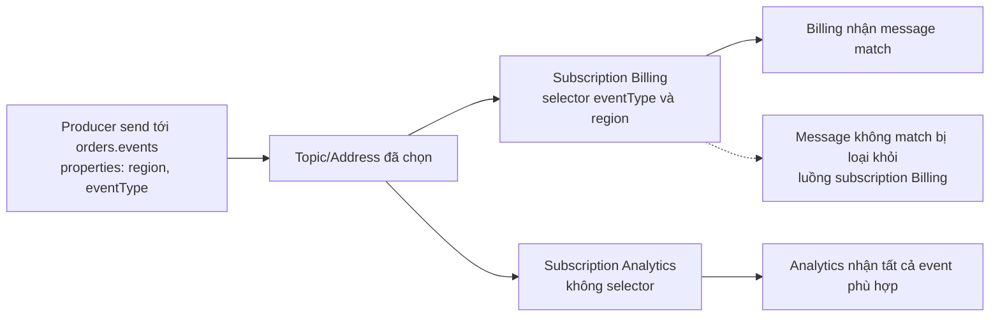
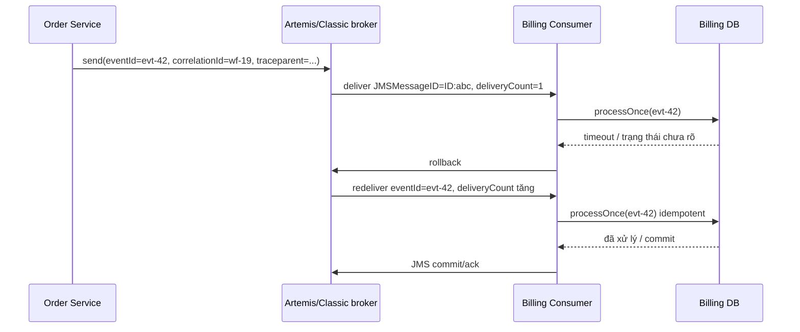

# Property cho selector, định tuyến và dấu vết xử lý

> **Chương:** Thiết kế thông điệp  
> **Ngữ cảnh:** Apache ActiveMQ Classic, Apache ActiveMQ Artemis và ứng dụng Java sử dụng JMS/Jakarta Messaging.  
> **Mục tiêu:** Thiết kế bộ property có kiểu dữ liệu rõ ràng để lọc đúng message, cấu hình đường đi tới queue/subscription, liên kết log giữa producer–broker–consumer và chẩn đoán redelivery mà không phụ thuộc vào body.

## 1. Bài toán xuyên suốt: sự kiện `OrderPlaced`

Một dịch vụ đặt hàng publish sự kiện `OrderPlaced` tới topic `orders.events`. Billing chỉ muốn sự kiện có `schemaVersion >= 2` ở khu vực `VN` hoặc `SG`; Analytics muốn nhận tất cả; worker cần lần theo sự kiện khi retry hay đi DLQ.

Thông điệp nên phân chia dữ liệu thành hai lớp:

```text
JMS destination: Topic orders.events
  |
  +-- JMS headers:
  |     JMSMessageID, JMSTimestamp, JMSCorrelationID,
  |     JMSDestination, JMSDeliveryMode, JMSRedelivered, ...
  |
  +-- JMS properties:
  |     eventType      = "OrderPlaced"   (String)
  |     schemaVersion  = 2               (int)
  |     region         = "VN"            (String)
  |     tenantId       = "tenant-17"     (String)
  |     amountCents    = 159900L         (long)
  |     eventId        = "evt-0042"      (String)
  |     traceparent    = "00-...-...-01" (String)
  |
  +-- Body: JSON/Avro/Protobuf theo hợp đồng nghiệp vụ,
        chứa orderId, items, currency, totals, ...
```

Trong đó:

- **Destination** cho biết producer gửi tới queue/topic nào. Chỉ thêm property `region="VN"` **không tự chuyển message** tới queue riêng cho VN.
- **Property** là metadata có kiểu dữ liệu; broker/JMS provider có thể đánh giá selector hoặc queue filter trước khi giao message.
- **JMS header** mang các trường giao thức chuẩn. Một số header do client đặt, một số do provider/broker tạo hoặc cập nhật.
- **Body** là nội dung nghiệp vụ. **JMS selector không đọc JSON body**; trường cần lọc phải được đưa thành property thích hợp.

Việc lặp một ít trường như `eventType` hoặc `orderId` giữa body và property có thể chấp nhận nếu có lý do định tuyến/quan sát, nhưng phải định nghĩa **nguồn chân lý** và bảo đảm producer không ghi hai giá trị mâu thuẫn.

## 2. Chọn JMS header, custom property hay nội dung body?

| Trường | Đặt ở đâu? | Ai tạo/quản lý? | Dùng để làm gì? |
|---|---|---|---|
| `JMSMessageID` | JMS header | Provider sau send | ID message do provider cấp, hỗ trợ chẩn đoán |
| `JMSTimestamp` | JMS header | Provider theo chính sách timestamp | Thời điểm send theo JMS; không phải thời điểm nghiệp vụ phát sinh |
| `JMSCorrelationID` | JMS header | Ứng dụng có thể đặt | Liên hệ request/reply hoặc nhiều message trong một workflow |
| `JMSReplyTo` | JMS header | Ứng dụng đặt khi cần | Destination để trả lời request/reply |
| `JMSPriority`, `JMSDeliveryMode` | JMS header | Producer/provider | Chính sách delivery, không thay contract nghiệp vụ |
| `JMSRedelivered` | JMS header | Provider | Gợi ý message đang được giao lại |
| `JMSXDeliveryCount` | JMSX property | Provider đặt khi nhận, theo khả năng/phiên bản | Số lượt delivery để log và chẩn đoán retry |
| `JMSXGroupID` | JMSX property | Producer | Nhóm message cho cơ chế grouping của broker |
| `eventType`, `schemaVersion` | Custom JMS properties | Producer theo message contract | Selector, compatibility, router/filter |
| `region`, `tenantId` | Custom JMS properties | Producer theo contract | Lọc message theo phân khúc; **không thay thế phân quyền** |
| `eventId` | Custom property, có thể lặp trong body | Hệ thống phát event | Idempotency, audit, đối soát qua redrive |
| `traceparent`, `tracestate` | Custom properties | Tracing instrumentation/producer | Liên kết distributed tracing qua async boundary |
| `orderId`, `items`, `customer` | Body | Nghiệp vụ | Dữ liệu xử lý; chỉ copy thành property khi thực sự cần selector/grouping |

**Hai loại ID dễ nhầm:**

- `JMSMessageID` giúp chẩn đoán **lần gửi JMS**. Khi message được bridge, republish hoặc redrive, message mới có thể có JMSMessageID khác.
- `eventId` là **ID nghiệp vụ bền vững qua retry/republish**, do ứng dụng cấp khi tạo event lần đầu; phù hợp khóa chống xử lý trùng.

`JMSCorrelationID` dùng để liên kết luồng yêu cầu hoặc workflow. Nó **không mặc nhiên là khóa idempotency** và cũng không mặc nhiên là trace ID của OpenTelemetry.

### 2.1. Ai được đặt trường nào?

Một số JMS header có setter trên `Message` nhưng provider có thể ghi đè chúng lúc send. Không tự đặt `JMSMessageID` để làm event ID; dùng `setStringProperty("eventId", ...)`. Các header được ứng dụng đặt có ý nghĩa điển hình: `JMSCorrelationID`, `JMSReplyTo`, `JMSType` (nếu contract sử dụng). `JMSRedelivered`, `JMSXDeliveryCount` được quan sát ở phía consumer, không giả làm trường producer tự điều khiển retry.

Trong JMS 1.1, JMSX là nhóm property đặc biệt, không phải không gian tên tùy ý cho ứng dụng. Chỉ dùng những property được JMS/provider định nghĩa (ví dụ `JMSXGroupID`) theo đúng semantics.

## 3. Quy tắc đặt tên và kiểu dữ liệu property

### 3.1. Kiểu value dùng được trong JMS

Custom property JMS hỗ trợ các kiểu nguyên thủy tương ứng Java và chuỗi:

| Java setter | Kiểu JMS property | Ví dụ thiết kế |
|---|---|---|
| `setStringProperty` | `String` | `eventType="OrderPlaced"`, `region="VN"` |
| `setIntProperty` | `int` | `schemaVersion=2` |
| `setLongProperty` | `long` | `amountCents=159900L`, `occurredAtEpochMs` |
| `setBooleanProperty` | `boolean` | `requiresReview=true` |
| `setByteProperty`, `setShortProperty` | `byte`, `short` | Cờ/giá trị nhỏ khi hợp đồng cần |
| `setFloatProperty`, `setDoubleProperty` | `float`, `double` | Số đo; tránh dùng floating-point cho tiền |

JMS property không phải nơi lưu object tùy ý, mảng JSON hay `Map`. Với giá tiền, dùng **đơn vị nhỏ nhất dạng số nguyên** (ví dụ cents), hoặc để biểu diễn tiền tệ chính xác trong body bằng schema phù hợp. Không dùng `double` để so sánh số tiền nếu có thể tránh.

### 3.2. Tên property phải hợp lệ cho selector

Tên property theo quy tắc định danh JMS, thông thường dùng dạng Java identifier. Đặt tên dạng `eventType`, `schemaVersion`, `tenantId`, `traceparent` hoặc `trace_id`.

Không chọn các tên như `x-trace-id` hoặc `order.id` nếu muốn tương thích với JMS selector: dấu `-`/`.` có ý nghĩa cú pháp hoặc không phải identifier chuẩn. Tránh tên trùng **keyword của selector** (`AND`, `OR`, `NULL`, `TRUE`, `FALSE`, `LIKE`, `IN`, `BETWEEN`...) và các namespace chuẩn/reserved như `JMS...` khi đặt custom key.

Tên **phân biệt hoa/thường**: `eventType` và `EventType` khác nhau. Định nghĩa constants/schema chung thay vì để mỗi service tự chọn tên.

### 3.3. Kiểu property là một phần của contract

```java
message.setIntProperty("schemaVersion", 2);
message.setLongProperty("amountCents", 159_900L);
message.setStringProperty("region", "VN");
```

Selector:

```sql
schemaVersion >= 2 AND amountCents >= 100000 AND region = 'VN'
```

Không gửi `schemaVersion="2"` dạng chuỗi nếu consumer/router kỳ vọng số. Đổi từ số sang chuỗi có thể khiến selector không match, dù log in ra cùng ký tự `2`. Với trường enum như `eventType`, công bố tập giá trị hợp lệ, dạng chữ hoa/thường và chính sách xử lý unknown value.

**Quy ước khuyến nghị cho event:**

| Key | Kiểu | Bắt buộc? | Ràng buộc |
|---|---|---|---|
| `eventType` | String | Có | Giá trị từ allowlist: `OrderPlaced`, `OrderCancelled`... |
| `schemaVersion` | int | Có | Số nguyên dương; phiên bản schema body |
| `eventId` | String | Có | Unique trong miền event; giữ nguyên qua retry/replay |
| `region` | String | Nếu có routing theo vùng | Enum ổn định: `VN`, `SG`... |
| `tenantId` | String | Nếu hệ thống đa tenant | ID canonical, tránh dữ liệu cá nhân |
| `amountCents` | long | Nếu có rule theo số tiền | Đơn vị cents và currency trong body/contract |
| `traceparent` | String | Khi tracing được bật | W3C Trace Context hợp lệ, không bịa trace ID |
| `occurredAtEpochMs` | long | Nếu cần event time | Millisecond UTC khi event nghiệp vụ phát sinh |

Không nhồi quá nhiều thuộc tính vào mỗi message: mỗi property làm tăng kích thước wire/storage và chi phí đánh giá selector. Đặt property khi có **consumer, broker filter, metric hoặc cơ chế audit cụ thể** cần nó.

## 4. Cơ chế JMS selector: lọc trên metadata, không đọc body

JMS selector là biểu thức điều kiện có cú pháp tương tự một tập con của SQL-92, được đánh giá dựa trên header/property có thể truy cập bởi selector.

Ví dụ:

```sql
eventType = 'OrderPlaced'
  AND schemaVersion >= 2
  AND region IN ('VN', 'SG')
```

**Ý nghĩa:** một consumer/subscription chỉ nhận message được selector đánh giá là `TRUE`. Nó không chuyển message sang destination khác và không chỉnh sửa body.

### 4.1. Toán tử và kiểu biểu thức thường dùng

| Mẫu selector | Chức năng |
|---|---|
| `eventType = 'OrderPlaced'` | So sánh string, có phân biệt chữ hoa/thường |
| `schemaVersion >= 2` | So sánh số |
| `amountCents BETWEEN 100000 AND 500000` | Khoảng số, bao gồm hai đầu |
| `region IN ('VN', 'SG')` | Tập giá trị |
| `eventType LIKE 'Order%'` | Pattern theo cú pháp LIKE; `%` là chuỗi bất kỳ |
| `requiresReview = TRUE` | So sánh boolean |
| `region IS NULL` | Property không hiện diện hoặc có giá trị NULL theo semantics |
| `NOT (region = 'VN')` | Phủ định biểu thức logic, vẫn chịu quy tắc UNKNOWN |
| `JMSType = 'OrderPlaced'` | Có thể xét header JMS chuẩn nếu contract đặt |
| `JMSPriority >= 5` | Ví dụ lọc theo header hỗ trợ; không dùng làm business priority thay `eventType` |

Selector dùng dấu nháy đơn cho chuỗi: `region = 'VN'`. Dấu nháy kép thường không thay thế được SQL string literal. Cẩn thận escape khi ghép chuỗi Java/XML.

**JMS selector không kiểm tra `orderId` nằm trong JSON body**:

```json
{
  "orderId": "ORD-42",
  "region": "VN"
}
```

Nếu producer chỉ có `"region":"VN"` trong JSON mà không gọi `setStringProperty("region","VN")`, selector `region = 'VN'` không tự mở JSON để đọc.

### 4.2. Logic ba giá trị: TRUE, FALSE, UNKNOWN

Selector tuân theo logic có **UNKNOWN** khi giá trị không có/một biểu thức không xác định. Chỉ `TRUE` được chọn.

Giả sử selector:

```sql
eventType = 'OrderPlaced' AND region = 'VN'
```

| eventType | region | Kết quả |
|---|---|---|
| `OrderPlaced` | `VN` | TRUE → nhận |
| `OrderCancelled` | `VN` | FALSE → không nhận |
| `OrderPlaced` | `SG` | FALSE → không nhận |
| `OrderPlaced` | **không có property** | UNKNOWN → không nhận |
| **không có property** | `VN` | UNKNOWN → không nhận |

Một số phép kết hợp UNKNOWN với FALSE/TRUE có kết quả theo bảng logic ba giá trị; không được suy diễn rằng `NOT (region = 'VN')` sẽ match message thiếu `region`. Nếu cần match cả missing region, viết rõ:

```sql
region IS NULL OR region <> 'VN'
```

Tốt hơn là định nghĩa các property **bắt buộc** trên producer và kiểm chứng schema trước publish, tránh dựa vào missing property để quyết định routing nghiệp vụ.

### 4.3. Kiểu dữ liệu không tự được ép theo ý ứng dụng

Với dữ liệu:

```java
message.setStringProperty("amountCents", "150000");
```

Selector số:

```sql
amountCents >= 100000
```

không đáng tin để match: property thực là `String`, còn literal là số. **Không coi conversion do `getStringProperty()` ở client là bảo đảm broker sẽ ép kiểu trong selector.** Cần dùng setter cùng kiểu và viết test với provider/version mục tiêu.

### 4.4. Selector là bất biến của consumer/subscription đang sống

Selector được truyền lúc tạo consumer/subscription:

```java
MessageConsumer consumer = session.createConsumer(
        queue,
        "eventType = 'OrderPlaced' AND region = 'VN'"
);
```

Muốn đổi selector, thường phải đóng và tạo lại consumer hoặc quản lý lại durable subscription theo quy tắc provider. Với durable topic subscription, thay selector có thể đụng identity/backlog cũ. Đừng cập nhật rule trong cấu hình ứng dụng mà mặc định queue đang tồn tại sẽ đổi filter đúng ý.

### 4.5. Selector không phải hệ thống bảo mật

`tenantId = 'tenant-17'` chỉ là **bộ lọc message**, không chứng minh user được quyền xem tenant đó. Một client có quyền consume rộng có thể tạo selector khác hoặc không dùng selector. Muốn cô lập dữ liệu, phải áp **authentication, authorization và cách phân vùng destination** ở broker và/hoặc tầng nghiệp vụ; không dựa vào selector tự chọn bởi client.

## 5. Routing trong Classic và Artemis: property đi vào quyết định nào?

Khác nhau giữa **chọn destination** và **lọc trong destination** là mấu chốt.



### 5.1. ActiveMQ Classic: destination trước, selector sau

Trong Classic:

- Producer chọn `Queue` hoặc `Topic` (hoặc cơ chế routing/virtual destination được cấu hình trước).
- Consumer tạo selector để nhận subset message trên queue/topic.
- Với **queue**, nhiều consumer có selector khác nhau vẫn dùng **cùng backlog queue**. Message không match consumer A có thể phù hợp consumer B; nếu không ai match, message có thể tiếp tục chờ.
- Với **topic**, mỗi subscription có đường nhận riêng; selector xác định event phù hợp cho subscription đó. Durable subscription phải được đăng ký trước khi offline nếu muốn broker giữ backlog tương ứng.

**Không nhầm:** hai consumer trên cùng queue, mỗi consumer dùng selector theo `region`, không có nghĩa Classic tự sinh `queue.VN` và `queue.SG`. Nếu cần hai queue có backlog độc lập, phải chủ động thiết kế destination/virtual destination hoặc phần chuyển tiếp message.

Các cơ chế riêng như **Virtual Topics**, broker plugins hoặc Camel có thể dùng property làm một phần rule phức tạp; phải mô tả rõ cấu hình, không suy ra từ JMS API mặc định.

### 5.2. Artemis: address routing rồi queue filter/consumer selector

Artemis phân biệt:

- **Address** và kiểu routing `ANYCAST` hoặc `MULTICAST`.
- **Queue gắn với address** có thể có **filter** lưu trong broker configuration.
- **JMS consumer selector** áp cho consumer/subscription theo hợp đồng JMS.

Ví dụ publish `OrderPlaced` vào **JMS Topic `orders.events`** trên Artemis: address `orders.events` dùng `MULTICAST`, queue cho Billing có filter `region = 'VN'`, queue Analytics không filter. Billing chỉ được enqueue message match; Analytics nhận bản sao của mọi event phù hợp với address.

**Đừng đồng nhất queue filter với consumer selector:**

| Đặc tính | Queue filter ở Artemis | JMS consumer selector |
|---|---|---|
| Nơi khai báo | Queue/broker configuration hoặc management | Khi tạo JMS consumer/subscription |
| Khi nào áp dụng | Thường trong quá trình routing/enqueue vào queue | Trong việc chọn message cho consumer/subscription |
| Message không match | Không được thêm vào queue đã có filter đó | Với queue dùng chung, message có thể vẫn tồn tại để consumer khác nhận |
| Thay đổi điều kiện | Cần quản lý cấu hình/queue lifecycle | Cần tạo lại consumer; durable subscription có ràng buộc identity |
| Phạm vi | Tất cả consumer của queue bị ảnh hưởng | Consumer/subscription xác định |

Không cấu hình cả **JMS-managed durable subscription** và một **broker-managed multicast queue** cùng mục tiêu mà không đối chiếu queue thực. Hai cơ chế có thể sinh **hai bản sao độc lập**, tăng storage và gây xử lý trùng.

## 6. Ví dụ Artemis `broker.xml`: fan-out theo property

Giả sử cần:

- Queue Billing chỉ nhận `OrderPlaced` schema v2+, khu vực `VN` hoặc `SG`.
- Queue Analytics nhận mọi event trong topic.
- Các instance Billing cùng đọc **một queue** để chia tải.

Tạo hai queue dưới một multicast address:

```xml
<!-- Đoạn đặt trong phần <addresses> của broker.xml Artemis -->
<addresses>
  <address name="orders.events">
    <multicast>
      <queue name="billing.orders.v2" durable="true">
        <filter string="eventType = 'OrderPlaced' AND
                        schemaVersion &gt;= 2 AND
                        region IN ('VN', 'SG')"/>
      </queue>

      <queue name="analytics.orders.all" durable="true"/>
    </multicast>
  </address>
</addresses>
```

**Cần lưu ý khi áp dụng:**

1. Đây là **broker-managed multicast queues**, không phải queue tự động được tạo khi dùng `Session.createDurableSubscriber`. JMS client muốn đọc chính queue này có thể dùng **FQQN** của Artemis.
2. `filter` đọc các **message properties** tương ứng: `eventType` (String), `schemaVersion` (int), `region` (String).
3. Message không match filter **không vào queue Billing**, dù có thể vào Analytics.
4. `&gt;=` là cách escape ký tự `>` trong XML attribute; broker nhìn thấy biểu thức `>=`.
5. Queue bền vững (`durable="true"`) không đồng nghĩa mọi message tự trở thành persistent. Producer vẫn cần delivery mode/transaction/persistence đáp ứng hợp đồng.
6. `orders.events` phải thực sự được publisher gửi như **JMS Topic**/MULTICAST. Nếu producer tạo JMS Queue cùng tên hoặc gửi từ protocol khác, phải kiểm tra routing type.

Consumer JMS Artemis đọc queue đã được quản trị với **Fully Qualified Queue Name**:

```java
Queue billingQueue =
    session.createQueue("orders.events::billing.orders.v2");
MessageConsumer billingConsumer =
    session.createConsumer(billingQueue);
```

Hai instance Billing dùng cùng FQQN và mỗi instance có Session/consumer riêng sẽ cạnh tranh nhận message trong **một** queue Billing. Analytics dùng `orders.events::analytics.orders.all`.

**Không có routing tự động theo property nếu queue filter chưa tồn tại.** Việc producer gửi `region="VN"` đơn thuần không tự tạo queue `billing.orders.v2` hay chuyển tên destination.

### 6.1. Kiểm thử mapping property

| Message | `eventType` | `schemaVersion` | `region` | Queue Billing | Queue Analytics |
|---|---|---:|---|---|---|
| M1 | OrderPlaced | 2 | VN | Có | Có |
| M2 | OrderPlaced | 3 | SG | Có | Có |
| M3 | OrderPlaced | 1 | VN | Không | Có |
| M4 | OrderCancelled | 2 | VN | Không | Có |
| M5 | OrderPlaced | 2 | US | Không | Có |
| M6 | OrderPlaced | 2 | *thiếu property* | Không (UNKNOWN) | Có |

Nếu chưa có consumer, các số đo mong đợi là **Billing: 2**, **Analytics: 6** message pending sau khi publish đủ sáu message trong môi trường queue mới/sạch, không TTL và không có lỗi. Khi đã bật consumer, số pending có thể giảm; đối chiếu thêm enqueue/ack counters thay vì suy từ pending đơn lẻ.

### 6.2. Khi JMS durable subscription tự tạo queue

Nếu chọn **JMS-managed durable subscriptions** thay vì queue thủ công, dùng:

```java
connection.setClientID("billing-service");
Topic orders = session.createTopic("orders.events");

MessageConsumer subscription = session.createDurableSubscriber(
    orders,
    "billing-orders-v2",
    "eventType = 'OrderPlaced' AND schemaVersion >= 2 " +
    "AND region IN ('VN', 'SG')",
    false // noLocal
);
```

Lúc này JMS provider tạo/quản lý subscription queue theo identity và selector. **Không đồng thời cấu hình queue `billing.orders.v2` cho cùng một mục tiêu nếu không chủ động muốn hai queues.** Tên queue durable do provider đặt có thể khác tên tùy chọn ở ví dụ XML; hãy xem broker management để xác nhận.

## 7. Java JMS: producer đặt property có kiểu và định danh truy vết

Ví dụ dùng **JMS 1.1-style `javax.jms`** để áp dụng cho client ActiveMQ Classic hoặc Artemis tương ứng. `ConnectionFactory` được inject/cấp bởi ứng dụng; dependency và endpoint phụ thuộc provider. Nếu dùng Jakarta Messaging 3.x, chuyển import và client artifact sang `jakarta.jms`.

### 7.1. Producer publish một event persistent

```java
import javax.jms.Connection;
import javax.jms.ConnectionFactory;
import javax.jms.DeliveryMode;
import javax.jms.JMSException;
import javax.jms.MessageProducer;
import javax.jms.Session;
import javax.jms.TextMessage;
import javax.jms.Topic;

public final class OrderEventPublisher {
    public static void publish(
            ConnectionFactory factory,
            String eventId,          // giữ nguyên qua retry/outbox relay
            String workflowId,       // id tương quan của workflow
            String tenantId,
            String region,
            long amountCents,
            String traceparent,
            String jsonBody) throws JMSException {

        Connection connection = factory.createConnection();
        try {
            Session session = connection.createSession(
                    true, Session.SESSION_TRANSACTED);
            try {
                Topic topic = session.createTopic("orders.events");
                MessageProducer producer = session.createProducer(topic);
                try {
                    producer.setDeliveryMode(DeliveryMode.PERSISTENT);

                    TextMessage m = session.createTextMessage(jsonBody);
                    m.setStringProperty("eventType", "OrderPlaced");
                    m.setIntProperty("schemaVersion", 2);
                    m.setStringProperty("eventId", eventId);
                    m.setStringProperty("tenantId", tenantId);
                    m.setStringProperty("region", region);
                    m.setLongProperty("amountCents", amountCents);
                    m.setLongProperty(
                            "occurredAtEpochMs", System.currentTimeMillis());

                    if (traceparent != null && !traceparent.isEmpty()) {
                        // Trong app thật: validate theo W3C Trace Context.
                        m.setStringProperty("traceparent", traceparent);
                    }
                    if (workflowId != null && !workflowId.isEmpty()) {
                        m.setJMSCorrelationID(workflowId);
                    }

                    try {
                        producer.send(m);    // destination là JMS Topic
                        session.commit();   // commit transaction JMS
                        System.out.println("sent JMSMessageID="
                                + m.getJMSMessageID()
                                + ", eventId=" + eventId);
                    } catch (JMSException | RuntimeException e) {
                        try {
                            session.rollback();
                        } catch (JMSException rollbackError) {
                            e.addSuppressed(rollbackError);
                        }
                        throw e;
                    }
                } finally {
                    producer.close();
                }
            } finally {
                session.close();
            }
        } finally {
            connection.close();
        }
    }
}
```

Trong mã thật:

- `eventId` được sinh **một lần khi tạo event/outbox record**, rồi được relay giữ nguyên qua những lần retry. Không tạo UUID mới trước mỗi lần republish cùng một event.
- `occurredAtEpochMs` nên lấy từ **thời điểm sự kiện nghiệp vụ** (trong code trên là thời điểm publish minh họa); nếu relay publish muộn, dùng event time đã lưu trong outbox.
- `traceparent` phải được tracing library **inject đúng context của thao tác publish**; không dùng chuỗi giả hoặc copy span ID bừa bãi.
- `tenantId`, `region`, `eventType` được validate theo allowlist/hợp đồng trước khi send.
- `JMSCorrelationID` có thể là workflow ID; nếu hệ thống request/reply dùng quy ước khác, cần ghi rõ contract.
- `session.commit()` xác nhận transaction JMS theo provider/config; chưa chứng minh các consumer đã xử lý event.

### 7.2. In thông tin trên phía consumer và kiểm tra property

```java
import javax.jms.JMSException;
import javax.jms.Message;

public final class MessageAudit {
    public static void logReceived(Message m) throws JMSException {
        String eventId = m.getStringProperty("eventId");
        String eventType = m.getStringProperty("eventType");
        int schemaVersion = m.getIntProperty("schemaVersion");
        String region = m.getStringProperty("region");

        int deliveryCount = m.propertyExists("JMSXDeliveryCount")
                ? m.getIntProperty("JMSXDeliveryCount") : -1;

        String traceparent = m.propertyExists("traceparent")
                ? m.getStringProperty("traceparent") : null;

        System.out.printf(
                "eventId=%s type=%s version=%d region=%s "
                        + "jmsMessageId=%s correlationId=%s "
                        + "redelivered=%s deliveryCount=%d traceparent=%s%n",
                eventId,
                eventType,
                schemaVersion,
                region,
                m.getJMSMessageID(),
                m.getJMSCorrelationID(),
                m.getJMSRedelivered(),
                deliveryCount,
                traceparent);
    }
}
```

Đây là mã để học cách đọc metadata; trong production, chỉ ghi **trường được phép log**, có giới hạn độ dài/sampling và không lộ trace baggage/PII hoặc secret. Tốt hơn là đưa `eventId`, `workflowId`, `traceId` đã trích xuất vào structured logging context thay vì format string tự do.

**Không chỉ dựa vào `JMSXDeliveryCount` để bảo đảm số lần xử lý nghiệp vụ.** Giá trị có thể chịu provider/redelivery/bridge behavior; counter chưa bằng số business side effects. Dùng DB idempotency/audit để xác định event nào đã thực sự được xử lý.

## 8. Consumer selector: ví dụ queue và durable topic

### 8.1. Queue consumer với selector

```java
Session session = connection.createSession(
        true, Session.SESSION_TRANSACTED);

Queue queue = session.createQueue("orders.process");

MessageConsumer vnConsumer = session.createConsumer(
        queue,
        "eventType = 'ProcessOrder' AND region = 'VN'"
);
```

Giả sử queue có message region VN và SG, `vnConsumer` chỉ đủ điều kiện nhận VN. **Message SG không bị xóa vì không match** và có thể tiếp tục chờ consumer khác. Nếu không có consumer phù hợp, queue có thể tích tụ message, tạo backlog/flow control. Với nhiều tenant/vùng lớn, cân nhắc chia destination rõ ràng thay vì một queue chứa hàng loạt message không có consumer phù hợp.

### 8.2. Topic durable subscriber với selector

```java
Connection connection = factory.createConnection();
try {
    connection.setClientID("billing-service");

    Session session = connection.createSession(
            true, Session.SESSION_TRANSACTED);
    try {
        Topic topic = session.createTopic("orders.events");
        MessageConsumer consumer = session.createDurableSubscriber(
                topic,
                "billing-orders-v2",
                "eventType = 'OrderPlaced' AND schemaVersion >= 2 " +
                "AND region IN ('VN','SG')",
                false
        );
        try {
            connection.start();

            Message m = consumer.receive(5_000L);
            if (m != null) {
                try {
                    MessageAudit.logReceived(m);
                    // Production: ghi DB idempotent theo eventId
                    // rồi mới commit JMS.
                    session.commit();
                } catch (JMSException | RuntimeException e) {
                    session.rollback();
                    throw e;
                }
            }
        } finally {
            consumer.close();
        }
    } finally {
        session.close();
    }
} finally {
    connection.close();
}
```

Tạo durable subscription **trước** khi publisher phát message mà Billing cần nhận trong lúc offline. Một topic không có subscription phù hợp không tự lưu lịch sử để subscriber tạo sau đọc lại. Nếu thay `clientID`/subscription name hoặc selector, phải có kế hoạch subscription lifecycle/backlog; việc tạo tên mới có thể sinh queue mới, không tiếp tục backlog cũ.

Khi dùng shared subscription JMS 2.0/Jakarta để scale nhiều instance, **mỗi instance có Session/consumer riêng** nhưng cùng shared subscription identity; không chia sẻ cùng một đối tượng `MessageConsumer` giữa nhiều thread.

## 9. Trace và correlation xuyên producer → broker → consumer

Cần phân biệt ít nhất **bốn mức định danh**:

| Định danh | Phạm vi | Trường khuyến nghị | Có nên giữ nguyên qua retry/redrive? |
|---|---|---|---|
| Business entity ID | Một đơn hàng/hóa đơn | `orderId` trong body (property nếu phải group/filter) | Có, theo nghiệp vụ |
| Business event ID | Một lần thay đổi trạng thái/event logic | `eventId` trong property/body | **Có**, dùng dedupe |
| Workflow/correlation ID | Một chuỗi thao tác hoặc request/reply | `JMSCorrelationID` hoặc property có hợp đồng riêng | Thường có, theo workflow |
| Distributed trace context | Một chuỗi spans có quan hệ nhân quả | `traceparent`/`tracestate` | Trích xuất và tạo child/link span theo tracing; **không tái sử dụng cứng một span ID** |
| Broker message ID | Một message được JMS provider gửi | `JMSMessageID` | Không giả định; republish có thể cấp ID mới |

### 9.1. Ví dụ dòng đời để điều tra DLQ



**Các khóa dùng khi tra log:**

```text
eventId:       evt-42
correlationId: wf-19
traceId:       lấy từ traceparent theo W3C
jmsMessageId:  ID:abc
destination:   orders.events -> queue Billing
consumer:      billing-instance-3
deliveryCount: 2
outcome:       DB_ALREADY_APPLIED / JMS_COMMITTED
```

Khi message chuyển DLQ hoặc redrive qua một producer mới, `JMSMessageID` có thể thay đổi nhưng `eventId` nên giữ nguyên. Cần lưu nguồn ban đầu (`originalDestination` hay metadata do broker cung cấp) và quan hệ với lần xử lý mới; **tên trường broker-origin khác giữa Classic và Artemis**, không tạo giả định rằng hai broker cùng một bộ DLQ properties.

### 9.2. Propagation của W3C Trace Context

Một chuỗi `traceparent` hợp lệ có dạng:

```text
00-0123456789abcdef0123456789abcdef-0123456789abcdef-01
^^  ^^^^^^^^^^^^^^^^^^^^^^^^^^^^^^^^ ^^^^^^^^^^^^^^^^ ^^
ver trace-id                         parent-id        flags
```

Trong một hệ thống đã dùng OpenTelemetry:

1. Producer có span hiện tại; instrumentation **inject** trace context vào property JMS khi gửi.
2. Consumer **extract** context từ message trước khi xử lý.
3. Consumer tạo span riêng phù hợp ngữ nghĩa messaging: parent-child hoặc span link theo tracing convention và loại xử lý.
4. Log trong consumer gắn `traceId`/`spanId` từ span hiện tại, đồng thời gắn `eventId` và `JMSMessageID`.
5. Khi retry, bản message có thể mang cùng extracted context; mỗi lần xử lý có **span mới**, giúp nhìn thấy từng attempt thay vì ghi đè dấu vết.

`traceparent` phục vụ **tracing**, không phải unique message key hoặc token bảo mật. `tracestate` có thể chứa dữ liệu từ các tracing vendor; hạn chế giá trị không tin cậy và tuyệt đối không đưa credential vào metadata.

### 9.3. Khi nào dùng `JMSCorrelationID` trong request/reply?

Với request/reply JMS, producer có thể đặt một correlation ID ứng dụng; responder thường trả lại ID đó để requester ghép reply với request. Một số integration quy ước correlation ID bằng JMSMessageID của request; **đây là hai quy ước khác nhau**, phải thống nhất cả hai đầu.

```java
request.setJMSCorrelationID("wf-19");
request.setJMSReplyTo(replyQueue);

// Responder:
String correlationId = received.getJMSCorrelationID();
TextMessage reply = session.createTextMessage("OK");
reply.setJMSCorrelationID(correlationId);
producer.send(received.getJMSReplyTo(), reply);
```

Nếu phản hồi dùng `JMSMessageID` của request làm correlation, responder phải đọc đúng header **sau khi message thực sự được gửi**, không tạo ID giả trước send. Với reply queue dùng chung, requester có thể tạo selector `JMSCorrelationID = 'wf-19'`, nhưng cần tránh selector ghép từ input không kiểm soát.

## 10. Tương tác của property với retry, DLQ và transaction

Một thiết kế property tốt giúp chẩn đoán sự cố nhưng không thay thế cơ chế giao nhận.

### 10.1. Redelivery và lần xử lý nghiệp vụ

- `JMSRedelivered` là header báo message có khả năng đang được giao lại.
- `JMSXDeliveryCount` biểu diễn số lần delivery theo JMS/provider.
- `eventId` giúp consumer quyết định event đã được xử lý ở database hay chưa.
- `JMSCorrelationID`/`traceparent` giúp nhóm các log và trace của quá trình.

Với `SESSION_TRANSACTED`, nếu consumer rollback, broker có thể redeliver theo policy và cuối cùng route tới DLQ. Khi consumer đã commit DB nhưng chết trước JMS commit, event có thể được giao lại. **Đánh dấu event đã xử lý trong cùng DB transaction với side effect**; không chỉ giữ một `Set<String>` trong RAM JVM.

### 10.2. Property là metadata để lọc, không phải nơi chứa bí mật

Các property được truyền qua broker, có thể xuất hiện trong console, JMX, log, DLQ, tracing exporter hoặc công cụ support. Tránh:

- `accessToken`, mật khẩu, full payment card, nội dung cá nhân nhạy cảm.
- SQL/selector fragments nhận trực tiếp từ người dùng.
- Dữ liệu định danh cá nhân ở property khi không thực sự cần.
- Trace baggage quá lớn, số lượng custom property không giới hạn.

Dùng TLS/ACL cho client-broker, quyền consume riêng theo destination/tenant và masking/logging policy. **Một selector theo `tenantId` không tạo ra isolation bảo mật.**

### 10.3. Gửi lại từ DLQ: giữ business ID, quản lý transport ID

Khi redrive:

1. Đọc message gốc trong DLQ; trích xuất `eventId`, `eventType`, `schemaVersion` và metadata nguồn.
2. Xác minh nguyên nhân poison message đã được xử lý (schema, rule, dependency hoặc permissions).
3. Gửi lại tới đích được phê duyệt với **cùng `eventId`**, có thể bổ sung metadata audit redrive.
4. Không kỳ vọng giữ nguyên `JMSMessageID`, `JMSTimestamp` và mọi header provider-generated.
5. Quan sát kết quả xử lý theo `eventId` và lưu mapping attempt/original message nếu cần điều tra.
6. Cân nhắc `JMSCorrelationID` và trace context; tạo span cho thao tác redrive, tránh làm sai chuỗi nhân quả.

Một bộ property thiếu `eventId` có thể khiến consumer không biết message redrive là event cũ hay event mới, từ đó dễ tạo tác dụng phụ trùng lặp.

## 11. Hiệu năng và quản trị schema của property

### 11.1. Chỉ filter ở broker khi có lợi ích thực

Lợi ích của selector: consumer không cần deserialize/xử lý những message không phù hợp, và với multicast queue filter, message không phù hợp có thể không bị lưu trong queue đó.

Chi phí: broker phải đọc/evaluate metadata cho message, giữ selector/subscription state và có thể bị ảnh hưởng khi rule phức tạp hoặc tạo quá nhiều subscriptions/queues. Với hàng trăm tenant và hàng chục rule thay đổi liên tục, chưa chắc một topic với rất nhiều selector là phương án hiệu quả nhất.

**Khi đánh giá lựa chọn:**

| Nhu cầu | Cách thường phù hợp |
|---|---|
| 2–5 nhóm subscriber, filter ổn định | Topic + durable subscriptions có selector hoặc multicast queue filters |
| Một nhóm worker cùng làm một loại tác vụ | Queue + consumer cạnh tranh, ít selector |
| Tenant cần cô lập bảo mật mạnh | Destination/namespace/ACL tách biệt theo kiến trúc, không chỉ selector |
| Quy tắc phụ thuộc dữ liệu sâu trong JSON | Ứng dụng/router chuyên trách hoặc biến trường cần thiết thành property |
| Filter thay đổi thường xuyên và cần replay lịch sử | Thiết kế event store/commit log hoặc lưu trữ bổ sung; JMS topic không mặc định replay lịch sử |
| Phân phối theo `orderId` để giữ thứ tự từng nhóm | Message grouping/partitioning có kiểm chứng, không chỉ selector |

### 11.2. Versioning property và selector

Giả sử v1 có `eventType="OrderPlaced"` nhưng không có `schemaVersion`. Consumer mới dùng:

```sql
eventType = 'OrderPlaced' AND schemaVersion >= 2
```

Message v1 không match vì missing `schemaVersion` trả UNKNOWN. Đây có thể là **chủ đích** nếu chỉ muốn v2; nếu consumer cần nhận cả v1 để migrate, phải có rule tương thích:

```sql
eventType = 'OrderPlaced' AND
(schemaVersion IS NULL OR schemaVersion >= 2)
```

Không phải rule nào cũng nên mở cho v1: nếu body schema không tương thích, nhận message rồi xử lý sai còn nguy hiểm hơn bỏ qua. Nên khai báo rõ:

- Property nào **required** từ version nào?
- Giá trị mặc định của message legacy có hợp lệ không?
- Selector mới có bỏ sót durable backlog cũ không?
- Điều gì xảy ra khi nâng cấp producer trước consumer hoặc ngược lại?
- Có cần tạo subscription v2 song song rồi drain v1 không?

Thay đổi tên/kiểu property trong hệ thống đa consumer là **thay đổi giao thức ứng dụng**, cần contract tests và kế hoạch rollout.

### 11.3. Lọc quá nhiều bằng selector có thể tạo backlog “không ai muốn”

Nếu một queue nhận cả VN, SG và US, nhưng tất cả consumers chỉ có selector `region='VN'`, message SG/US vẫn có thể nằm chờ trong queue và làm đầy tài nguyên. Trong queue point-to-point, selector không nhất thiết tương đương route sang queue khác.

Cần dashboard cảnh báo queue pending tăng, consumer count, message age và kiểm tra có vùng nào không có consumer/selector match. Với multicast, queue filter rõ ràng thường phù hợp hơn khi muốn mỗi nhóm có backlog riêng và một tập message xác định.

## 12. Kịch bản kiểm chứng cụ thể

### Bài thực hành A — Kiểu dữ liệu và logic ba giá trị

Chuẩn bị queue test sạch, tạo consumer với:

```sql
eventType = 'OrderPlaced' AND
schemaVersion >= 2 AND
region IN ('VN', 'SG')
```

Gửi 6 message như bảng phần 6.1: có trường hợp thiếu `region`, khác `eventType`, sai version. Sau đó gửi thêm một message có `schemaVersion` dưới dạng String `"2"`.

**Kiểm tra:** chỉ message thực sự match mới được consumer selector nhận. Không coi string `"2"` tương đương numeric `2`. Với message không match trong queue, hãy thêm consumer không selector để kiểm chứng chúng vẫn có thể nằm ở queue.

### Bài thực hành B — Artemis multicast queue filters

Cấu hình `orders.events` với hai multicast queues như phần 6, chưa bật consumers. Gửi M1–M6 theo bảng.

**Tiêu chí chấp nhận:** queue Billing được enqueued 2 message, queue Analytics được enqueued 6 message. Kiểm tra count theo queue và routing type `MULTICAST`; không chỉ nhìn tổng count ở address.

### Bài thực hành C — So sánh queue filter và consumer selector

1. Với queue Billing có broker-side filter, thử gửi M5 `region='US'`. Xác nhận M5 **không được enqueue** vào Billing.
2. Với queue work chung chứa M5, tạo consumer có selector `region='VN'`. Xác nhận M5 không được consumer đó nhận nhưng message vẫn có thể còn pending.
3. Dùng consumer khác không selector để nhận M5.

**Tiêu chí chấp nhận:** giải thích được vị trí áp filter khác nhau và khả năng giữ backlog khác nhau.

### Bài thực hành D — Trace ID, event ID và JMSMessageID qua retry

1. Publish event `eventId='evt-42'`, `JMSCorrelationID='wf-19'` và `traceparent` hợp lệ.
2. Consumer ghi log sau receive: `eventId`, `JMSMessageID`, `JMSRedelivered`, `JMSXDeliveryCount` (nếu hỗ trợ), correlation ID, trace.
3. Cố tình rollback một lần rồi commit lần nhận tiếp theo.
4. Đối chiếu cùng `eventId` qua các attempts; kiểm tra cờ redelivery/counter và số bản ghi DB đã xử lý.
5. Trong môi trường test riêng, redrive message qua producer mới và quan sát `JMSMessageID` có thể thay đổi.

**Tiêu chí chấp nhận:** business side effect không nhân đôi; log có thể nối các attempts bằng `eventId`/correlation, kể cả khi transport message ID thay đổi.

### Bài thực hành E — Selector không phải authorization

Trên broker test, cho một consumer đã xác thực quyền rộng trên một queue; thử selector `tenantId='tenant-17'` rồi selector `tenantId='tenant-18'`.

**Tiêu chí chấp nhận:** quan sát rằng selector là tham số do client chọn; nếu quyền consume ở broker không phân tách tenant, selector không có chức năng bảo mật. Thiết kế ACL/destination phù hợp trước khi triển khai đa tenant.

### Bài thực hành F — Thay đổi property khi nâng schema

Cho producer v1 thiếu `schemaVersion` và producer v2 đặt `schemaVersion=2` cùng gửi vào topic test.

- Durable subscription S1: `eventType='OrderPlaced'`.
- Durable subscription S2: `eventType='OrderPlaced' AND schemaVersion >= 2`.
- Durable subscription S3: `eventType='OrderPlaced' AND (schemaVersion IS NULL OR schemaVersion >= 2)`.

**Tiêu chí chấp nhận:** xác minh S1 và S3 nhận cả v1/v2 trong điều kiện phù hợp, S2 chỉ nhận v2; đồng thời consumer thật sự hiểu được body version tương ứng. Tạo subscription **trước** các lần publish muốn kiểm thử offline delivery.

### Mẫu kết quả thí nghiệm

| Test case | Destination / Routing | Selector hoặc filter | Property thực tế | Số enqueued/received | Nhận xét |
|---|---|---|---|---|---|
| A: numeric property | Queue, consumer selector | `schemaVersion >= 2` | `int=2` | | |
| A: sai kiểu | Queue, consumer selector | `schemaVersion >= 2` | `String="2"` | | |
| B: queue filter | Topic/MULTICAST | Billing: `region IN (...)` | `region='US'` | | |
| C: consumer selector | Queue/ANYCAST | `region='VN'` | `region='US'` | | |
| D: redelivery | Queue/topic subscription | Không | `eventId='evt-42'` | | |
| F: legacy schema | Topic/MULTICAST | `schemaVersion IS NULL OR ...` | Thiếu property | | |

## 13. Những lỗi thiết kế thường gặp

| Lỗi | Hậu quả | Cách sửa |
|---|---|---|
| Đặt `region` trong JSON body nhưng không đặt JMS property | Selector luôn UNKNOWN/không match | Copy vào typed property ở producer theo contract |
| `schemaVersion` lúc int lúc String | Routing/selector không nhất quán | Schema validation, thống nhất `setIntProperty` |
| Dùng `JMSMessageID` làm idempotency key xuyên republish | Event logic được xử lý trùng sau redrive | Dùng `eventId` ổn định |
| Chỉ dựa vào `JMSXDeliveryCount` để đếm số lần business xử lý | Nhầm delivery attempts với DB transactions | Dùng audit/idempotency trong DB |
| Dùng `tenantId` selector làm quyền truy cập | Client khác có thể đổi selector | Authorization theo destination/role và business checks |
| Thay selector durable subscription mà không quản lý backlog | Bỏ sót/tạo queue mới hoặc orphan subscription | Rollout plan, inventory queues, drain/reconcile |
| Cho mọi consumer selector khác nhau trên một queue duy nhất | Message không match tồn đọng | Queue filtering/routing có thiết kế, monitor backlog |
| Chèn secret vào `traceparent`/custom property | Rò rỉ qua DLQ/console/logs | W3C format + data-minimization |
| Tự set `JMSMessageID` hoặc `JMSXDeliveryCount` | Sai semantics transport | Để provider quản lý, dùng property app riêng |
| Dùng `traceId` như `eventId` | Một trace có thể chứa nhiều events; retry khó dedupe | Tách trace context và business event identity |
| Tạo selector động từ user input không escape/allowlist | Selector sai cú pháp hoặc chọn dữ liệu không mong muốn | Dùng selector tĩnh/allowlist, validation, ACL |
| Nhiều property per-message không có nhu cầu | Tăng wire/store và chi phí filter | Giữ tập metadata tối thiểu có mục đích rõ |

## 14. Checklist khi chốt hợp đồng message

- [ ] Mỗi property có **tên, kiểu, ý nghĩa, required/optional và enum/range** rõ ràng.
- [ ] Selector được viết trên **header/property**, không dựa vào field chỉ nằm trong body.
- [ ] Test đủ `TRUE`, `FALSE`, `UNKNOWN`, thiếu property và sai kiểu.
- [ ] Broker destination/routing type được cấu hình; property **không tự tạo tuyến**.
- [ ] Với Artemis, phân biệt **queue filter** và **JMS consumer selector**.
- [ ] Với Classic, hiểu selector trên queue chung không tạo bản sao độc lập.
- [ ] Durable subscription được tạo đúng thời điểm, có kế hoạch đổi selector/identity.
- [ ] Có `eventId` ổn định xuyên retry/redrive, idempotency phía consumer.
- [ ] Phân biệt `JMSMessageID`, `JMSCorrelationID` và W3C `traceparent`.
- [ ] Metadata logging đủ để chẩn đoán DLQ nhưng không lộ dữ liệu nhạy cảm.
- [ ] Multi-tenant có ACL/broker isolation; selector không được dùng như tường bảo mật.
- [ ] Contract tests chạy trên **đúng client + broker + protocol + version** của production.
- [ ] Property được kiểm chứng khi nâng schema và khi consumer/producers deploy lệch phiên bản.

## 15. Tài liệu tham khảo

1. [Jakarta Messaging Specification](https://jakarta.ee/specifications/messaging/): hợp đồng JMS/Jakarta headers, properties, message selectors và delivery.
2. [ActiveMQ Classic — Selectors](https://activemq.apache.org/components/classic/documentation/selectors): biểu thức selectors và ngữ nghĩa lọc.
3. [Apache ActiveMQ Artemis — Filter Expressions](https://artemis.apache.org/components/artemis/documentation/latest/filter-expressions.html): queue filters và cú pháp điều kiện.
4. [Apache ActiveMQ Artemis — Address Model](https://artemis.apache.org/components/artemis/documentation/latest/address-model.html): address, anycast/multicast queue và routing.
5. [W3C Trace Context](https://www.w3.org/TR/trace-context/): `traceparent`, `tracestate` và cách truyền ngữ cảnh truy vết.

> **Ghi nhớ:** **Destination xác định nơi message được gửi; property/selector xác định message nào phù hợp trong tuyến đã thiết kế; `eventId`, correlation ID và trace context giúp chứng minh chuyện gì xảy ra sau đó.** Đúng tên *và* đúng kiểu property, hiểu ba giá trị của selector, và giữ ID nghiệp vụ ổn định qua retry mới tạo được một hợp đồng message đáng tin cậy.
