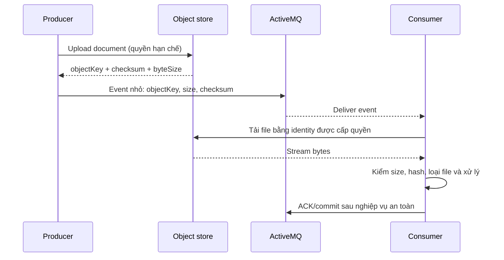
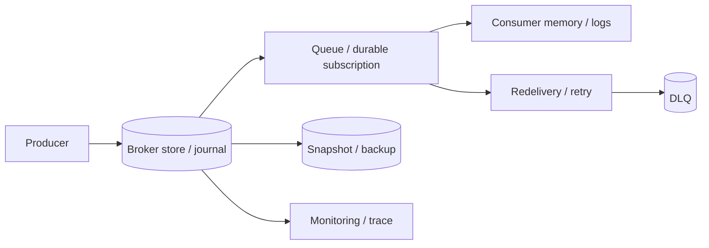
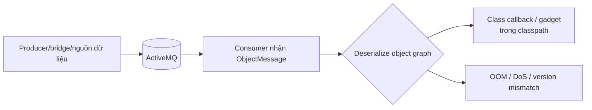

# Giới hạn kích thước, dữ liệu nhạy cảm và rủi ro Java serialization

> **Chương:** Thiết kế thông điệp  
> **Phạm vi:** Thiết kế payload và chính sách bảo vệ message khi trao đổi qua **Apache ActiveMQ Classic** hoặc **ActiveMQ Artemis**. Trọng tâm là giới hạn kích thước, giảm lộ dữ liệu nhạy cảm và tránh rủi ro thực thi mã do **Java native serialization / JMS `ObjectMessage`**. Ví dụ JMS dùng **ActiveMQ Classic 5.x với `javax.jms`**; phần Artemis nêu riêng các cơ chế tài nguyên tương ứng.

## 1. Kết quả học tập và tình huống cần giải quyết

Một dịch vụ lập chứng từ phát sự kiện `DocumentReady` tới broker. Nếu producer đính kèm cả file PDF 12 MiB, thông tin người thuê nhà, địa chỉ và token tải file vào một message, hệ thống gặp đồng thời ba vấn đề:

1. **Kích thước:** consumer chậm hoặc broker gặp sự cố có thể khiến hàng nghìn file 12 MiB tích lũy trong store, bộ nhớ, mạng và backlog.
2. **Dữ liệu nhạy cảm:** bản sao message xuất hiện ở queue/topic, DLQ, bản sao lưu, log và thiết bị của subscriber có thể tồn tại lâu hơn mong muốn.
3. **Giải mã không an toàn:** nếu dùng `ObjectMessage` truyền đối tượng Java, dữ liệu đến từ producer hoặc tầng tích hợp khác có thể kích hoạt **Java deserialization** khi consumer gọi `getObject()`.

Giải pháp thường là phát một **message nhỏ, có schema rõ ràng**, chỉ mang định danh và tham chiếu an toàn đến object store có kiểm soát. Cùng với đó, ứng dụng áp giới hạn kích thước trước khi gửi và trước khi xử lý, broker giới hạn tài nguyên, consumer xác thực dữ liệu, và tổ chức có chính sách retention/DLQ.

Ví dụ envelope được đề xuất:

```json
{
  "eventId": "evt-20261117-001",
  "eventType": "DocumentReady",
  "schemaVersion": 1,
  "documentId": "doc-1842",
  "objectKey": "exports/doc-1842.pdf",
  "objectSizeBytes": 12582912,
  "sha256": "b4f3e8b6c1f69ce3c2c6bdcc1f78aee7ce7385303b3c3183d59c998597863114"
}
```

`objectKey` là **khóa nội bộ** do ứng dụng định nghĩa, không phải URL tùy ý do phía gửi cung cấp để consumer tự tải qua Internet. Giá trị SHA-256 trong ví dụ chỉ minh họa định dạng; ứng dụng thật phải tính checksum từ **đúng nội dung file**. Không suy ra rằng việc gửi checksum trong message tự bảo đảm tính xác thực: nguồn checksum và payload cũng cần được tin cậy, xác thực và phân quyền.

## 2. Xác định giới hạn kích thước ở đúng lớp

Không tồn tại một giá trị “kích thước message tối đa của ActiveMQ” áp dụng cho mọi phiên bản, mọi protocol và mọi cấu hình. Người thiết kế phải phân biệt:

| Lớp giới hạn | Đơn vị và mục tiêu | Khi vượt ngưỡng thường xảy ra gì? |
|---|---|---|
| **Schema/payload của ứng dụng** | Byte UTF-8/byte nhị phân của **một message nghiệp vụ**; giới hạn do đội hệ thống quy định. | Producer từ chối gửi; consumer từ chối xử lý hoặc chuyển luồng lỗi có kiểm soát. |
| **Giao thức/transport** | Kích thước frame/packet, giới hạn bộ giải mã, buffer và đôi khi timeout. | Kết nối bị từ chối, đóng, báo lỗi frame hoặc lỗi gửi. |
| **Memory của destination/address** | Tổng bộ nhớ hoặc dung lượng message được broker theo dõi cho một nhóm destination. | Flow control, paging, block, fail hoặc chính sách khác tùy broker. |
| **Disk/store và backlog** | Tổng dữ liệu chưa được tiêu thụ, journal, paging, durable subscription, DLQ và overhead. | Producer chậm/bị chặn, broker hết dung lượng hoặc gặp lỗi vận hành. |
| **Consumer** | Bộ nhớ/heap, kích thước object, giới hạn parse/decompress và thời gian xử lý. | OutOfMemoryError, timeout, CPU tăng hoặc mất ổn định tiến trình. |
| **Dịch vụ ngoài broker** | HTTP body size, object store, database field, API gateway hoặc quota của downstream. | Công việc thất bại dù broker vẫn nhận được message. |

**Điểm mấu chốt:** cấu hình broker có `memoryLimit` hoặc `max-size-bytes` **không tương đương** việc giới hạn kích thước của **từng payload**. Đó có thể là ngân sách tài nguyên của cả destination/address, trong đó nhiều message cùng đóng góp vào tổng sử dụng. Ngược lại, giới hạn frame ở protocol có thể từ chối một frame lớn nhưng không giải quyết backlog của hàng triệu message nhỏ.

### 2.1 Đặt budget theo dạng dữ liệu và SLO

Một chính sách minh họa cho hệ thống xử lý chứng từ:

| Loại message | Budget ứng dụng minh họa | Cách xử lý |
|---|---:|---|
| Event chỉ chứa ID và trạng thái | Mục tiêu ≤ 16 KiB; ngưỡng cứng 64 KiB | Dùng JSON có schema và validate. |
| Command mang vài trường metadata | Ngưỡng cứng 256 KiB | Kiểm tra byte trước SEND và trước parse. |
| File PDF, ảnh, video, dữ liệu export | Không nhúng trực tiếp vào event | Lưu ở object store, gửi object key + size + checksum. |
| Tệp nén hoặc nội dung giải nén lớn | Ngưỡng byte nén **và** giới hạn giải nén | Chặn zip/decompression bomb, validate định dạng. |

Các con số trên là **quy ước minh họa**, không phải mặc định của ActiveMQ Classic/Artemis và cũng không phải khuyến nghị cố định cho mọi sản phẩm. Chọn budget dựa trên throughput cao điểm, số subscriber, SLA xử lý, retention, storage, giới hạn của thư viện client và mức chấp nhận mất/gián đoạn dịch vụ.

**Đo byte, không đếm ký tự:** chuỗi `"đơn hàng"` có nhiều byte UTF-8 hơn số ký tự hiển thị. Trong Java, `String.length()` đếm UTF-16 code units, **không** phải số byte trên đường truyền. Nếu chuẩn payload là UTF-8 JSON:

```java
byte[] utf8 = json.getBytes(java.nio.charset.StandardCharsets.UTF_8);
if (utf8.length > 256 * 1024) {
    throw new IllegalArgumentException("Message payload exceeds 256 KiB");
}
```

Đây mới là kiểm tra **body** phía ứng dụng; wire size vẫn có header, frame, mã hóa giao thức và overhead riêng. Với `BytesMessage`, kiểm tra số byte gốc theo contract thay vì mặc định mọi payload là UTF-8.

### 2.2 Vì sao message lớn gây rủi ro ngay cả khi broker có đĩa?

Giả sử 100 message/giây, mỗi message **256 KiB**, consumer bị dừng **120 giây**:

```text
100 message/s × 256 KiB = 25 MiB/s
25 MiB/s × 120 s = 3.000 MiB ≈ 2,93 GiB payload tồn đọng
```

Con số **chưa tính** metadata, journal/index, bản sao, replication, persistent store, dữ liệu của DLQ hay các subscriber topic. Nếu cùng payload được phát cho 20 subscription durable riêng biệt, tổng dữ liệu cần giao/lưu có thể lớn hơn nhiều so với một queue công việc. Chi phí tăng theo **số lần phân phối, số bản sao thực tế và thời gian backlog**, không thể chỉ nhìn kích thước file của một message.

Với tốc độ nhập `λ` và tốc độ xử lý `μ` (message/giây), backlog tăng xấp xỉ:

```text
backlog_growth_messages_per_second = max(0, λ - μ)
backlog_growth_bytes_per_second ≈ backlog_growth_messages_per_second
                                  × average_payload_bytes
```

Muốn tính dung lượng an toàn, cộng thêm phần dự phòng cho tốc độ đỉnh, khôi phục sau lỗi, thay đổi kích thước payload và bộ nhớ JVM. Không dùng giá trị trung bình duy nhất để cấp phát disk.

## 3. Broker thực sự làm gì khi hết tài nguyên?

### 3.1 ActiveMQ Classic: flow control và system usage

ActiveMQ Classic có cơ chế **producer flow control** và các ngân sách tài nguyên như **memory**, **store** và **temporary store**. Một policy minh họa cho queue:

```xml
<!-- Đoạn con đặt trong policyEntries hiện có của Classic activemq.xml -->
<policyEntry queue="app.safe.>" producerFlowControl="true"
             memoryLimit="64 mb"/>
```

`memoryLimit="64 mb"` là **ngân sách memory cho destination theo policy**, không phải khẳng định “mỗi message không được quá 64 MiB”. `producerFlowControl="true"` cho phép broker làm chậm/chặn producer trong những trường hợp tài nguyên sử dụng vượt ngưỡng theo chính sách. Nó không tự thay thế budget message tại ứng dụng.

Ví dụ ngân sách cấp broker, **chỉ mang tính cấu trúc tham khảo**:

```xml
<!-- Đặt bên trong broker Classic, hợp nhất với systemUsage hiện có -->
<systemUsage>
    <systemUsage>
        <memoryUsage>
            <memoryUsage limit="512 mb"/>
        </memoryUsage>
        <storeUsage>
            <storeUsage limit="10 gb"/>
        </storeUsage>
        <tempUsage>
            <tempUsage limit="2 gb"/>
        </tempUsage>
    </systemUsage>
</systemUsage>
```

Lưu ý cấu hình `systemUsage` thực tế có thể đã tồn tại với persistence adapter, temp store và các thuộc tính khác. **Không tạo thêm một cấu hình trùng hoặc thay nguyên block hiện hữu**; cần ghép giá trị vào đúng vị trí theo phiên bản Classic và mức tài nguyên máy. Kiểm tra trên broker lab trước khi triển khai thật.

Ngoài ra, một số OpenWire connector có thể giới hạn **frame**:

```xml
<transportConnector name="openwire-lab"
    uri="tcp://127.0.0.1:61616?wireFormat.maxFrameSize=1048576"/>
```

Thông số `wireFormat.maxFrameSize` được hiểu trong **bộ mã hóa/transport OpenWire**, nên phải xác minh với client/Classic version và cách frame được đóng gói. Không dùng riêng một giới hạn transport rồi kết luận ứng dụng đã có “logical message max = 1 MiB” trên cả STOMP, MQTT, JMS hoặc HTTP bridge. Các connector khác có cấu hình kích thước riêng.

### 3.2 Artemis: address paging và chính sách khi đầy

Artemis quản lý tài nguyên theo **address settings**. Một ví dụ:

```xml
<!-- Đoạn con trong <address-settings> của Artemis broker.xml -->
<address-setting match="app.safe.#">
    <max-size-bytes>67108864</max-size-bytes>
    <address-full-policy>BLOCK</address-full-policy>
</address-setting>
```

`max-size-bytes=67.108.864` tương đương **64 MiB** ở cấp **address**, không phải max body size. Với `BLOCK`, producer có thể bị chặn khi address chạm ngưỡng theo cơ chế broker/protocol. Ngoài `BLOCK`, Artemis còn hỗ trợ các kiểu xử lý khi đầy như **PAGE**, **FAIL** hoặc **DROP** tùy phiên bản/cấu hình. Lựa chọn `DROP` không phù hợp cho công việc bắt buộc giao vì nó có thể làm mất message; `PAGE` chuyển áp lực sang disk nên vẫn phải giám sát dung lượng.

**Large-message support** của Artemis giúp xử lý payload lớn bằng đường lưu trữ/chuyển từng phần phù hợp hơn trong một số trường hợp. Các lựa chọn như `minLargeMessageSize` phía client và chính sách lưu large messages phải được đối chiếu với phiên bản/protocol sử dụng. Tính năng này **không làm biến mất** chi phí network, disk, backlog, quyền truy cập hoặc rủi ro xử lý một file cực lớn; cũng không tự áp được cho mọi client STOMP/MQTT.

### 3.3 Cách chọn phản ứng khi message quá lớn

| Trường hợp | Hành động mong muốn |
|---|---|
| Producer tạo payload vượt budget nghiệp vụ | **Từ chối ngay tại producer**, báo lỗi có mã rõ ràng, lưu file ngoài broker nếu phù hợp. |
| Consumer nhận message vượt budget từ nguồn khác/phiên bản cũ | **Không parse sâu, không deserialize**; ghi metric, phân loại lỗi và đưa qua luồng cách ly/DLQ theo chính sách. |
| Broker cạn memory hoặc disk | Bật flow control/paging/fail phù hợp, giám sát, xử lý backlog và giới hạn tốc độ gửi. |
| Payload chứa file lớn nhưng được phép tải | Truyền **tham chiếu có kiểm soát**, kiểm tra checksum, giới hạn số byte tải, quota và TTL của object. |
| Producer bị block do flow control | Áp timeout và retry có backoff; không spin retry vô hạn hay tạo hàng đợi vô hạn trong RAM client. |

**Đường lỗi là một phần thiết kế:** nếu broker từ chối SEND, ứng dụng phải biết liệu event đã được ghi nhận hay chưa. Khi trạng thái không chắc chắn, retry có thể tạo duplicate. Dùng `eventId` ổn định, outbox khi nguồn sự kiện từ database và consumer idempotent để giữ an toàn.

## 4. Khi nào dùng tham chiếu thay vì nhúng nội dung?

Với file PDF/ảnh hoặc tài liệu chứa PII, có thể dùng mô hình **claim check**:



**Ưu điểm:** backlog chứa metadata nhỏ, người nhận chỉ tải nội dung khi cần, object store có chính sách truy cập/retention độc lập. **Chi phí:** phải quản lý vòng đời file, giao dịch giữa upload và publish, khả năng file đã bị xóa khi consumer retry, và xác thực tính toàn vẹn.

Một thiết kế an toàn cần:

- Chỉ nhận `objectKey` ở **namespace/prefix được phép**, dùng SDK của object store với endpoint đã cấu hình cố định. **Không lấy URL tùy ý trong message rồi HTTP GET**; nếu có URL phải chống SSRF, redirect, truy cập mạng nội bộ và DNS rebinding.
- Kiểm tra `objectSizeBytes` được khai báo và giới hạn **số byte thực tải**; đối chiếu SHA-256 sau khi đọc, không chỉ tin header `Content-Length`.
- Dùng quyền đọc hạn chế theo tenant/ngữ cảnh và hạn sử dụng phù hợp, tránh đặt **pre-signed URL dài hạn** hoặc access token trong queue.
- Có cleanup cho object “upload thành công nhưng không publish được”, và giữ object đủ lâu cho retry/DLQ mà không giữ vô hạn.
- Xác định khi nào ACK: nếu xử lý file thất bại, cần retry có giới hạn hoặc chuyển DLQ; nếu nghiệp vụ đã commit nhưng JMS ACK thất bại, phải chống trùng.

**Chunking nhiều message** chỉ nên dùng nếu hệ thống có nhu cầu streaming qua broker được thiết kế rõ. Khi tách file thành N message, cần quản lý `chunkId`, thứ tự, checksum tổng, thiếu/mất chunk, timeout, cleanup và giao dịch khi ráp. Với file lớn và nhiều consumer, object store + event tham chiếu thường đơn giản hơn.

## 5. Dữ liệu nhạy cảm sống ở đâu sau khi message đã được gửi?

Một message không biến mất chỉ vì consumer log “Processed”. Tùy configuration, cùng payload có thể hiện diện ở nhiều nơi:



| Vị trí | Rủi ro chính | Kiểm soát phù hợp |
|---|---|---|
| Producer/app log | Log cả payload, token hoặc PII khi debug lỗi. | Chỉ log ID, type, byte count, trạng thái; cấu hình redaction. |
| Broker journal/page/store | File trên disk, tệp tạm và backup chứa dữ liệu còn truy cập được. | Mã hóa ổ đĩa/volume, ACL, backup encryption, retention. |
| Topic nhiều subscription | Một message có thể đến nhiều nhóm không cần dữ liệu. | Phân quyền publish/consume theo destination, tối thiểu hóa payload. |
| Retry/redelivery | Payload đi lại qua nhiều process, kéo dài thời gian tồn tại. | Retry cap, backoff, idempotency, hạn chế log lỗi. |
| Dead-letter queue | Dữ liệu “độc” có thể nằm lâu vì không ai xử lý. | Quyền DLQ riêng, TTL/retention, quy trình replay/redact/delete. |
| Metrics/APM/tracing | Tag/span chứa tên khách, email, object key nhạy cảm. | Chỉ dùng ID giả danh; không biến PII thành label có cardinality cao. |
| Consumer heap/dump | Heap dump có thể chứa message và token nguyên bản. | Phân quyền debug/dump, xử lý artifact như dữ liệu nhạy cảm, giới hạn retention. |

### 5.1 Phân loại trường dữ liệu trước khi tạo schema

| Nhóm dữ liệu | Ví dụ | Đề xuất trong message |
|---|---|---|
| **Định danh kỹ thuật** | `eventId`, `documentId`, `schemaVersion` | Thường cần thiết; vẫn phải xét khả năng dùng để tra ngược PII. |
| **Thuộc tính nghiệp vụ không nhạy cảm** | `eventType`, timestamp UTC, trạng thái xử lý | Có thể gửi nếu consumer thật sự cần. |
| **PII** | Họ tên, email, số điện thoại, địa chỉ, ID giấy tờ | Hạn chế; ưu tiên ID/tham chiếu, quyền truy xuất ở nguồn chính. |
| **Dữ liệu tài chính/y tế/nhạy cảm cao** | Số tài khoản, chi tiết hồ sơ cá nhân | Hạn chế tối đa; dùng dịch vụ chuyên biệt và chính sách truy cập rõ. |
| **Bí mật truy cập** | Password, refresh token, API key, private key | **Không gửi trong payload/header/message property.** Dùng secret management và identity của service. |
| **Nội dung file** | Bản scan, hóa đơn, hợp đồng | Dùng storage có ACL/mã hóa và message chỉ chứa tham chiếu. |

**JMS header/property cũng là dữ liệu**, có thể bị log, hiển thị trong broker console hoặc sao chép sang hệ thống giám sát. Đừng đưa email/token vào `JMSCorrelationID`, `JMSReplyTo`, message selector property hoặc destination name. `JMSXGroupID` mang key nghiệp vụ cũng cần xem xét khả năng lộ thông tin.

### 5.2 TTL và expiration không phải chính sách xóa dữ liệu hoàn chỉnh

Ví dụ producer JMS đặt TTL:

```java
producer.setTimeToLive(30 * 60 * 1000L); // 30 phút
producer.send(message);
```

TTL giúp message **hết hiệu lực giao** theo ngữ nghĩa provider, nhưng không chứng minh mọi bản sao byte đã bị xóa khỏi journal, backup, DLQ, log, heap dump hoặc downstream. Cấu hình expiry address/queue của Artemis, DLQ của Classic, backup rotation và chính sách xóa dữ liệu cần được xét **riêng**. Một DLQ có retention vô hạn có thể vi phạm chính sách dữ liệu ngay cả khi queue chính chỉ giữ vài giờ.

**Quyền truy cập** là lớp phòng thủ quan trọng: producer chỉ được SEND nơi cần, consumer chỉ được READ đúng destination, quản trị console và DLQ có quyền riêng. Selector chỉ lọc message để phân phối, **không phải cơ chế cô lập bảo mật giữa tenant**. Nếu multi-tenant, tách namespace/destination và ACL phù hợp; tuyệt đối không chỉ dựa vào `tenantId` nằm trong payload.

### 5.3 Mã hóa và khả năng xử lý sự cố

- **TLS khi truyền:** dùng đúng connector/acceptor hỗ trợ TLS, xác thực chứng chỉ server; với yêu cầu cao có thể áp mTLS.
- **Mã hóa khi lưu:** bảo vệ broker storage, paging, backup và object store; khóa giải mã được quản lý độc lập, xoay vòng và hạn chế truy cập.
- **Mã hóa payload đầu cuối:** phù hợp nếu broker/operator không được đọc nội dung. Tuy nhiên nó ảnh hưởng selectors, indexing và công cụ vận hành; cần thiết kế quản lý khóa, rotation và xử lý DLQ có thể giải mã hợp lệ.
- **Quan sát an toàn:** log `eventId`, `type`, `payloadBytes`, `consumerName`, `deliveryCount`, lỗi validation dạng mã; tránh log body hoặc exception chứa toàn bộ payload.

Mã hóa không thay thế việc giảm dữ liệu: cùng một payload bí mật nhưng được lưu ở 12 hệ thống vẫn làm tăng bề mặt rủi ro.

## 6. Java serialization: vì sao JMS ObjectMessage đáng ngại?

**Java native serialization** (thường dùng với `java.io.Serializable`) đóng gói **object graph** vào byte. JMS `ObjectMessage` cho phép message chứa đối tượng Java được serialize rồi deserialized ở phía consumer.

Ví dụ cách làm **nên tránh** ở ranh giới nhận dữ liệu:

```java
// MẪU RỦI RO: không dùng cho message đến từ nguồn không tin cậy.
ObjectMessage incoming = (ObjectMessage) consumer.receive();
Object value = incoming.getObject(); // Có thể kích hoạt deserialization.
OrderCommand command = (OrderCommand) value;
```

Rủi ro không nằm ở phép cast `OrderCommand`, mà ở bước **`getObject()`** hoặc các điểm thư viện thực hiện deserialization. Cơ chế Java có thể gọi các callback/logic của class trong object graph, ví dụ `readObject`, `readResolve` và chuỗi gadget từ các dependency hiện diện trên classpath. Với dữ liệu crafted và gadget phù hợp, hậu quả có thể là thực thi mã không mong muốn, rò rỉ dữ liệu hoặc denial-of-service; **không cần người viết consumer chủ động gọi một hàm nguy hiểm**.

Ngay cả khi không có gadget khai thác, ObjectMessage vẫn gây:

1. **Tương thích kém:** class name, `serialVersionUID`, hierarchy và dependency phải được đồng bộ; thay đổi version làm consumer lỗi.
2. **Nguy cơ tài nguyên:** object graph sâu/rộng, collection lớn và allocation trong lúc parse có thể gây OOM/CPU spike.
3. **Ràng buộc ngôn ngữ:** Python/Go/Node.js khó tiêu thụ Java-serialized object một cách tương thích, trái với mục tiêu tích hợp đa ngôn ngữ.
4. **Khó kiểm toán:** schema khó quản lý, payload mờ đối với kiểm thử contract và công cụ quan sát.
5. **Rủi ro khi bridge:** một connector/protocol converter có thể chuyển bytes nhưng không bảo đảm payload mang ý nghĩa đúng với consumer phía kia.

### 6.1 Trust boundary: producer nội bộ vẫn có thể trở thành nguồn độc hại

Không nên dùng lý do “broker chỉ trong mạng nội bộ” để cho phép deserialize tùy ý. Một account producer bị lộ, service đã bị tấn công, message replay từ DLQ hoặc nguồn bridge khác có thể đưa payload độc hại đến consumer. **Chữ ký/TLS/authentication** xác nhận đường truyền/identity theo cấu hình, nhưng không tự khiến một Java object graph an toàn để giải mã.



**Ưu tiên:** từ chối `ObjectMessage` ở ranh giới ngoài hệ thống tin cậy, truyền dữ liệu thuần theo schema rõ ràng (JSON, Protobuf, Avro… tùy yêu cầu), validate trước khi dùng và tuyệt đối không bật deserialization đa hình tùy ý theo tên class do người gửi quyết định.

### 6.2 ActiveMQ Classic: danh sách package đáng tin cậy là lớp giảm thiểu

ActiveMQ Classic cung cấp cơ chế **trusted packages** cho Java ObjectMessage ở các phiên bản hỗ trợ. Với Classic JMS client, ví dụ khai báo allowlist:

```java
import java.util.Collections;
import org.apache.activemq.ActiveMQConnectionFactory;

ActiveMQConnectionFactory factory =
        new ActiveMQConnectionFactory("tcp://127.0.0.1:61616");
factory.setTrustedPackages(
        Collections.singletonList("com.example.messaging.dto"));
```

Chỉ đưa package DTO **đã rà soát** vào danh sách. Các object lồng nhau có thể yêu cầu thêm class/package hợp lệ; kiểm thử chính xác cấu trúc payload và dependency. Classic còn có cấu hình môi trường/system property `org.apache.activemq.SERIALIZABLE_PACKAGES` trong các phiên bản hỗ trợ; phạm vi ảnh hưởng có thể khác cấu hình trên từng connection factory/client.

**Không dùng `trustAllPackages=true` hoặc wildcard cho mọi package để “sửa lỗi” deserialization**. Một allowlist chỉ giảm bề mặt class được phép khôi phục, **không bảo đảm các class được phép là vô hại** và không giới hạn độ sâu, số object, kích thước payload. Nếu hệ thống cũ vẫn bắt buộc dùng ObjectMessage, cần thêm kiểm soát nguồn gửi, deserialization filter ở JVM nơi phù hợp, giới hạn tài nguyên, cập nhật dependency và kế hoạch chuyển sang schema dữ liệu thuần.

**Artemis có client JMS, cơ chế bảo vệ deserialization và cấu hình riêng theo phiên bản.** Không bê nguyên property hoặc tên method của Classic sang Artemis. Với một triển khai Artemis thật, phải xác minh phiên bản client/broker, danh sách allow/deny khi deserialize và chính sách lớp JVM trước khi chấp nhận ObjectMessage. Nếu chưa chứng minh được biên an toàn, **đổi định dạng payload** là cách thiết kế bền vững hơn.

### 6.3 Những việc chỉ kiểm soát format chưa giải quyết được

Ngay cả JSON cũng có thể gây lỗi nếu:

- Parse một object/array lồng nhau rất sâu hoặc số trường quá lớn.
- Tin trường `className` để tự load class hoặc bật polymorphic typing không hạn chế.
- Giải nén chuỗi/gói dữ liệu mà không đặt giới hạn sau giải nén.
- Cho phép tham chiếu URL trong JSON trỏ đến mạng nội bộ hoặc endpoint nhạy cảm.
- Không kiểm tra version/schema rồi dùng dữ liệu sai kiểu để cập nhật database.

Do đó định dạng an toàn phải đi kèm **size limit, depth limit, schema validation, allowlist enum, authorization và timeout**. Mục tiêu là xác nhận một **data contract**, không khôi phục một object graph có hành vi tùy ý.

## 7. Thực hành Java JMS: TextMessage với giới hạn byte và schema

Lab sau tạo hai chế độ `send` và `receive` trên **ActiveMQ Classic 5.x**, sử dụng `javax.jms.TextMessage` và JSON với DTO kiểu `record` của Java 17. Nội dung message **không chứa dữ liệu cá nhân** và chỉ mang object key minh họa. Chương trình kiểm tra kích thước byte **trước gửi và trước parse**, kiểm tra schema/field và commit JMS transaction sau khi validation thành công.

**Giả định:** broker Classic TCP tại `tcp://127.0.0.1:61616`, queue `lab.safe.envelopes` tồn tại hoặc broker được phép tạo tự động; tài khoản tùy cấu hình qua `BROKER_USER`, `BROKER_PASSWORD`. File PDF không được tải trong demo; object key chỉ phục vụ contract.

### 7.1 Cấu hình Gradle

`settings.gradle`:

```groovy
rootProject.name = 'safe-message-lab'
```

`build.gradle`:

```groovy
plugins {
    id 'java'
    id 'application'
}

repositories {
    mavenCentral()
}

java {
    toolchain {
        languageVersion = JavaLanguageVersion.of(17)
    }
}

dependencies {
    implementation 'org.apache.activemq:activemq-client:5.18.3'
    implementation 'com.fasterxml.jackson.core:jackson-databind:2.17.2'
}

application {
    mainClass = 'lab.SafeMessageLab'
}
```

Phiên bản thư viện được cố định để minh họa API; trước khi dùng production phải đối chiếu phiên bản được tổ chức hỗ trợ và cập nhật bản vá bảo mật. `javax.jms` trong ví dụ phù hợp nhánh client Classic 5.x nêu trên; không tự đổi import thành `jakarta.jms` mà giữ nguyên dependency.

### 7.2 Mã nguồn đầy đủ

Tạo `src/main/java/lab/SafeMessageLab.java`:

```java
package lab;

import com.fasterxml.jackson.databind.DeserializationFeature;
import com.fasterxml.jackson.databind.ObjectMapper;
import java.nio.charset.StandardCharsets;
import java.util.UUID;
import javax.jms.Connection;
import javax.jms.DeliveryMode;
import javax.jms.JMSException;
import javax.jms.Message;
import javax.jms.MessageConsumer;
import javax.jms.MessageProducer;
import javax.jms.Queue;
import javax.jms.Session;
import javax.jms.TextMessage;
import org.apache.activemq.ActiveMQConnectionFactory;

public final class SafeMessageLab {
    private static final int MAX_BODY_BYTES = 256 * 1024;
    private static final long MAX_REFERENCED_FILE_BYTES = 20L * 1024 * 1024;
    private static final String QUEUE = "lab.safe.envelopes";
    private static final ObjectMapper JSON = new ObjectMapper()
            .enable(DeserializationFeature.FAIL_ON_UNKNOWN_PROPERTIES)
            .enable(DeserializationFeature.FAIL_ON_TRAILING_TOKENS);

    public record DocumentReady(
            String eventId,
            int schemaVersion,
            String objectKey,
            long objectSizeBytes) {
    }

    private SafeMessageLab() { }

    public static void main(String[] args) throws Exception {
        if (args.length != 1 ||
                (!"send".equals(args[0]) && !"receive".equals(args[0]))) {
            System.err.println("Usage: send | receive");
            return;
        }

        String url = env("BROKER_URL", "tcp://127.0.0.1:61616");
        String user = System.getenv("BROKER_USER");
        String password = System.getenv("BROKER_PASSWORD");
        ActiveMQConnectionFactory factory =
                new ActiveMQConnectionFactory(url);

        Connection connection = user == null || user.isBlank()
                ? factory.createConnection()
                : factory.createConnection(user, password);
        Session session = null;
        try {
            session = connection.createSession(
                    true, Session.SESSION_TRANSACTED);
            Queue queue = session.createQueue(QUEUE);
            if ("send".equals(args[0])) {
                send(session, queue);
            } else {
                connection.start();
                receive(session, queue);
            }
        } catch (Exception failure) {
            if (session != null) {
                try {
                    session.rollback();
                } catch (JMSException rollbackError) {
                    failure.addSuppressed(rollbackError);
                }
            }
            throw failure;
        } finally {
            try {
                if (session != null) {
                    session.close();
                }
            } finally {
                connection.close();
            }
        }
    }

    private static void send(Session session, Queue queue)
            throws Exception {
        DocumentReady data = new DocumentReady(
                UUID.randomUUID().toString(),
                1,
                "exports/doc-1842.pdf",
                12L * 1024 * 1024);
        validate(data);

        String payload = JSON.writeValueAsString(data);
        int bytes = utf8Bytes(payload);
        if (bytes > MAX_BODY_BYTES) {
            throw new IllegalArgumentException("Payload too large: " + bytes);
        }

        MessageProducer producer = session.createProducer(queue);
        try {
            producer.setDeliveryMode(DeliveryMode.PERSISTENT);
            producer.setTimeToLive(3_600_000L); // TTL: 1 giờ.
            TextMessage msg = session.createTextMessage(payload);
            msg.setStringProperty("eventType", "DocumentReady");
            msg.setStringProperty("eventId", data.eventId());
            producer.send(msg);
            session.commit();
            System.out.println("SENT eventId=" + data.eventId()
                    + " payloadBytes=" + bytes);
        } finally {
            producer.close();
        }
    }

    private static void receive(Session session, Queue queue)
            throws Exception {
        MessageConsumer consumer = session.createConsumer(queue);
        try {
            Message message = consumer.receive(10_000);
            if (message == null) {
                System.out.println("No message in 10 seconds");
                return;
            }
            if (!(message instanceof TextMessage)) {
                throw new IllegalArgumentException(
                        "Unsupported JMS message type");
            }
            String payload = ((TextMessage) message).getText();
            if (payload == null || utf8Bytes(payload) > MAX_BODY_BYTES) {
                throw new IllegalArgumentException("Missing/oversized body");
            }

            DocumentReady data = JSON.readValue(payload, DocumentReady.class);
            validate(data);
            if (!data.eventId().equals(
                    message.getStringProperty("eventId"))) {
                throw new IllegalArgumentException("Event ID mismatch");
            }

            // Nơi triển khai thật: kiểm tra quyền objectKey, tải có quota,
            // kiểm hash, ghi database idempotent rồi MỚI commit JMS.
            System.out.println("ACCEPTED eventId=" + data.eventId()
                    + " objectSizeBytes=" + data.objectSizeBytes());
            session.commit();
        } finally {
            consumer.close();
        }
    }

    private static void validate(DocumentReady data) {
        if (data.schemaVersion() != 1
                || data.eventId() == null
                || !data.eventId().matches("[a-f0-9-]{36}")
                || data.objectKey() == null
                || !data.objectKey().matches(
                        "exports/[A-Za-z0-9_-]{1,64}\\.pdf")
                || data.objectSizeBytes() <= 0
                || data.objectSizeBytes() > MAX_REFERENCED_FILE_BYTES) {
            throw new IllegalArgumentException("Invalid envelope");
        }
    }

    private static int utf8Bytes(String text) {
        return text.getBytes(StandardCharsets.UTF_8).length;
    }

    private static String env(String name, String fallback) {
        String value = System.getenv(name);
        return value == null || value.isBlank() ? fallback : value;
    }
}
```

**Chạy thử** sau khi broker và Gradle đã sẵn sàng:

```bash
gradle run --args="send"
gradle run --args="receive"
```

Nếu dùng Gradle Wrapper, thay `gradle` bằng `./gradlew` trên Linux/macOS hoặc `.\gradlew.bat` trên Windows. Kết quả thường là một dòng `SENT eventId=... payloadBytes=...` rồi `ACCEPTED eventId=... objectSizeBytes=12582912`. Producer đã chuyển một **message JSON rất nhỏ** mang tham chiếu đến file 12 MiB, không gửi 12 MiB qua broker.

**Các giới hạn chủ ý của lab:**

- `receive` chỉ validate envelope và ghi một dòng log an toàn; nó **chưa tải file, kiểm checksum, phân quyền tenant hay ghi database**. Mã production phải làm các bước đó trước `session.commit()`.
- Regex chỉ bảo vệ **định dạng sơ bộ** của key. Quyền đối với file phải do object store/ứng dụng xác thực theo **identity và tenant**, không được suy ra chỉ từ prefix `exports/`.
- Kiểm tra body bằng `String.getBytes(UTF_8)` không giới hạn hoàn toàn kích thước frame/wire. Đặt thêm giới hạn tại gateway, connector và broker theo yêu cầu thực.
- Nếu message sai schema bị rollback liên tục, sẽ thành **poison message**. Cần policy số lần redelivery, DLQ, alert và quy trình kiểm tra an toàn, không retry vô hạn.
- Transaction JMS chỉ bảo vệ send/receive trên JMS session; nó không tự tạo transaction phân tán với object store hoặc database.

### 7.3 Kiểm chứng xử lý message quá lớn

Thay đổi producer lab để gửi chuỗi dài hơn `MAX_BODY_BYTES` và xác nhận chương trình **từ chối trước khi SEND**. Sau đó thử bằng một producer không tuân contract gửi message vượt ngưỡng vào **queue thử nghiệm**: consumer phải báo lỗi validation mà **không parse JSON/đọc ObjectMessage**, số lượt giao lại và DLQ phải nằm trong chính sách đã cấu hình.

Với dữ liệu nén, kiểm cả **kích thước tải**, **kích thước sau giải nén** và **giới hạn CPU/thời gian**. Ví dụ một file nén 100 KiB có thể bung thành hàng trăm MiB; chỉ đặt max compressed bytes là chưa đủ.

## 8. Kiểm thử rủi ro ObjectMessage và deserialization một cách an toàn

Không cần tạo gadget khai thác để đánh giá thiết kế. Thử trên môi trường lab có data sạch:

1. Gửi `TextMessage` JSON hợp lệ; consumer phải xử lý mà không dùng Java native deserialization.
2. Gửi `ObjectMessage` hoặc message type lạ vào **queue thử nghiệm** bằng producer nội bộ do đội kiểm thử kiểm soát; consumer theo contract JSON phải **từ chối theo loại message**, không gọi `getObject()`.
3. Kiểm thử ObjectMessage của hệ thống **legacy bắt buộc hỗ trợ** bằng một DTO đơn giản thuộc package đã allowlist; xác nhận class ngoài allowlist bị chặn ở client/boundary phù hợp.
4. Test message JSON quá sâu, quá lớn, thiếu trường, sai `schemaVersion`, `eventId` lặp và object key sai định dạng; xác nhận consumer phân loại lỗi, không ghi dữ liệu và không log toàn payload.
5. Đo heap/CPU khi gửi message gần max size và có nhiều consumer; kiểm tra khi broker đầy memory/disk.

Không chạy payload không tin cậy hoặc thử gadget deserialization trên broker production. Mục tiêu QA là **chứng minh boundary từ chối dữ liệu không hợp lệ** và hợp đồng message không phụ thuộc vào binary class graph.

## 9. Những failure mode cần thiết kế trước khi phát hành

| Sự cố | Hậu quả nếu thiết kế yếu | Biện pháp |
|---|---|---|
| Producer gửi file 100 MiB vào queue có hàng nghìn job | Backlog/disk/memory tăng nhanh, consumer OOM. | Payload budget, object-store reference, producer flow control, quota. |
| Producer gửi JSON bị nén rất nhỏ nhưng giải nén cực lớn | CPU/heap DoS ở consumer. | Max compressed bytes + max expanded bytes + timeout/depth. |
| Một topic chia sẻ payload PII cho nhiều subscriber | Rò rỉ ngoài phạm vi cần biết. | Tách destination và ACL, payload tối thiểu, tải PII theo quyền riêng. |
| DLQ lưu nguyên số căn cước và hợp đồng trong nhiều tháng | Dữ liệu nhạy cảm tồn quá lâu. | DLQ ACL, retention, redaction và xử lý xóa/replay được kiểm toán. |
| Consumer deserialize ObjectMessage từ tài khoản bị xâm nhập | Gadget execution/DoS hoặc lộ dữ liệu. | Tránh ObjectMessage; allowlist/filter nếu legacy, bảo vệ producer account. |
| Đổi version class Java giữa producer và consumer | `ClassNotFoundException` hoặc `InvalidClassException`. | Schema dữ liệu thuần có version và contract test. |
| Broker chặn producer vì flow control | Request kéo dài, retry dồn, thiếu phản hồi rõ. | Timeout, backoff, circuit breaker, outbox và telemetry. |
| Producer upload file rồi lỗi trước publish | Object rác tồn tại mãi. | Reconciliation/cleanup cho object không có event tương ứng. |
| Consumer ACK rồi mới tải file, tải thất bại | Message đã mất khỏi queue, nghiệp vụ chưa hoàn tất. | ACK/commit sau trạng thái an toàn, retry và idempotency. |
| Message có URL do client nhập rồi consumer tự fetch | SSRF và truy cập mạng nội bộ. | Object key thuộc namespace cho phép, SDK endpoint cố định. |

## 10. Checklist review thiết kế và bảo mật message

Trước khi đưa luồng message qua ActiveMQ Classic/Artemis vào production, hãy xác nhận:

- [ ] Có **ngưỡng byte của từng loại event/command**, kiểm tra tại producer và consumer; không nhầm với `memoryLimit`/`max-size-bytes` của broker.
- [ ] Dữ liệu file lớn được lưu ngoài broker; message chỉ có object key/size/hash hợp lệ; file được phân quyền và có lifecycle.
- [ ] Broker có giới hạn memory/store/address, flow control/paging/fail policy và alert theo backlog, disk/heap.
- [ ] Consumer đặt giới hạn kích thước trước khi parse, giới hạn độ sâu và giải nén; không chấp nhận nội dung không đúng schema.
- [ ] Không chuyển object Java tùy ý bằng `ObjectMessage`; nếu legacy bắt buộc, có allowlist/filter phiên bản cụ thể và kế hoạch di trú.
- [ ] Không có secret/PII không cần thiết trong body, header, destination, correlation ID, log hoặc trace.
- [ ] TLS, broker ACL, DLQ/management permissions, disk/backup encryption và quyền object store được kiểm chứng.
- [ ] TTL, redelivery, DLQ, backup retention và dữ liệu trong các hệ thống downstream được quản lý nhất quán.
- [ ] Có `eventId` ổn định qua retry, consumer idempotent, log tối thiểu và cảnh báo poison message.
- [ ] Đã thử message lớn, message độc, crash/restart, storage đầy, invalid schema, class không tin cậy và replay từ DLQ.

### Câu hỏi tự kiểm tra

1. Vì sao `memoryLimit="64 mb"` của Classic và `max-size-bytes` của Artemis không đủ để bảo đảm từng message tối đa 64 MiB?
2. Một queue nhận 100 message/s × 256 KiB, consumer dừng hai phút. Chưa tính overhead, cần khoảng bao nhiêu dung lượng backlog?
3. Vì sao việc giới hạn `json.length()` có thể sai khi payload chứa tiếng Việt hoặc emoji?
4. Một message hết TTL nhưng bản sao vẫn nằm trong DLQ, backup hoặc log. Điều đó ảnh hưởng thế nào đến chính sách xóa dữ liệu?
5. Tại sao ép kiểu `(OrderCommand)` sau `ObjectMessage.getObject()` không ngăn được gadget deserialization?
6. Nếu bật trusted packages cho một legacy consumer, còn những rủi ro nào chưa được giải quyết?
7. Với event chứa file, cần kiểm soát gì để `objectKey` không trở thành đường dẫn đọc tùy ý hoặc điểm khởi phát SSRF?
8. Nếu database commit rồi JVM chết trước JMS ACK, làm thế nào tránh thực hiện lại nghiệp vụ khi message redeliver?

**Kết luận:** Một thiết kế message an toàn bắt đầu bằng **payload nhỏ, có giới hạn byte và schema xác định**, tiếp tục bằng **quản lý dữ liệu nhạy cảm trên toàn vòng đời** từ producer đến DLQ/backup, và kết thúc ở **consumer chỉ xử lý dữ liệu sau validation**. ActiveMQ Classic và Artemis hỗ trợ flow control, store/paging, routing và độ bền phù hợp, nhưng các tính năng đó không thay thế giới hạn payload của ứng dụng. Đặc biệt, **JMS `ObjectMessage` và Java native deserialization không nên là định dạng tích hợp qua ranh giới tin cậy**: dùng dữ liệu thuần có schema, kiểm tra loại/kích thước, bảo vệ quyền truy cập và xử lý trùng sẽ đáng tin cậy, dễ bảo trì và an toàn hơn.
