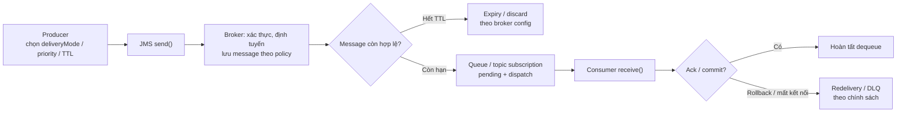

# Lựa chọn persistent, non-persistent, priority và time-to-live khi gửi message

> **Chương:** Producer  
> **Module:** `INTEGRATION_MESSAGING_MESSAGE_BROKER_ACTIVEMQ` — Apache ActiveMQ Classic và Artemis, queue/topic/routing, Java JMS và vận hành messaging đáng tin cậy.  
> **Trọng tâm:** Bốn lựa chọn QoS **ngay tại producer**: `DeliveryMode.PERSISTENT`, `DeliveryMode.NON_PERSISTENT`, `JMSPriority` (0–9), và `time-to-live` (TTL). Mục tiêu là biết cách chọn theo yêu cầu nghiệp vụ, cấu hình Java/JMS, hiểu chính xác bảo đảm của broker Classic/Artemis, và tự kiểm chứng khi restart, backlog, hết hạn hoặc có cạnh tranh nhận message.

## 1. Bài toán: không phải message nào cũng có giá trị như nhau

Một nền tảng bán hàng phát bốn loại message:

| Message | Yêu cầu nghiệp vụ | Cấu hình đề xuất ban đầu |
|---|---|---|
| `CapturePayment` | Không được “quên” yêu cầu thu tiền chỉ vì broker restart; tránh xử lý tiền hai lần | **PERSISTENT**, priority thông thường, TTL dựa trên hạn xử lý nghiệp vụ |
| `InventoryReservationExpiring` | Có ý nghĩa trước thời hạn giữ hàng; đến muộn sẽ sai | **PERSISTENT**, TTL phù hợp deadline, priority có thể cao nếu thực sự cần |
| `UserTypingIndicator` | Chỉ mang thông tin thời gian thực; cũ vài giây là vô dụng | **NON_PERSISTENT**, priority thấp, TTL vài giây |
| `SecurityIncidentDetected` | Cần xử lý sớm và không để mất khi broker có sự cố | **PERSISTENT**, priority cao, TTL theo chính sách tiếp nhận sự cố |

Bảng chỉ là **đầu vào của thiết kế**. Không có một công thức “mọi command = PERSISTENT + priority 9 + TTL 0”. Phải trả lời riêng bốn câu hỏi:

1. **Mất message khi broker gặp lỗi có chấp nhận được không?** → delivery mode.
2. **Trong cùng một destination có message cần được ưu tiên hơn không?** → priority.
3. **Sau bao lâu message không còn giá trị để chuyển tới consumer?** → TTL.
4. **Nếu message đã được giao, nhưng việc xử lý nghiệp vụ không thành công thì làm gì?** → acknowledgment, retry, idempotency và quy trình lỗi, **không phải** chỉ cấu hình ba header trên.

### 1.1. Mô hình dòng đời



**Delivery mode** chủ yếu liên quan khả năng broker giữ message khi gặp lỗi. **Priority** tác động đến quyết định dispatch **khi có lựa chọn**. **TTL** đặt giới hạn thời gian hợp lệ của việc giao message. Ba lựa chọn này **không thay thế** cơ chế business transaction.

## 2. Tên, giá trị và mặc định theo JMS

Producer JMS có ba thuộc tính gửi cơ bản: `deliveryMode`, `priority`, `timeToLive`. Với những cấu hình JMS mặc định thường dùng:

| Lựa chọn | Giá trị | Mặc định JMS | Đơn vị / ý nghĩa |
|---|---|---|---|
| Delivery mode | `DeliveryMode.PERSISTENT` hoặc `DeliveryMode.NON_PERSISTENT` | `PERSISTENT` | Yêu cầu độ bền gửi |
| Priority | `0` đến `9` | `4` | Mức ưu tiên; số lớn hơn là cao hơn |
| TTL | `0` hoặc số mili giây không âm | `0` | `0` nghĩa là **không tự hết hạn theo TTL do producer đặt** |
| `JMSExpiration` | `0` hoặc timestamp epoch milliseconds | Được provider tính khi send | Thời điểm hết hạn tuyệt đối |
| `JMSPriority` | `0`–`9` | Được provider gán lúc send | Header người nhận có thể quan sát |
| `JMSDeliveryMode` | `PERSISTENT` / `NON_PERSISTENT` | Được provider gán lúc send | Header người nhận có thể quan sát |

**Các giá trị trên là yêu cầu/thông tin JMS.** Broker có thể có giới hạn resource, TTL policy, address settings, hoặc tối ưu lưu trữ riêng. Kỳ vọng thực tế phải được đối chiếu với **JMS headers mà message nhận được và hành vi end-to-end**.

Hai API gửi phổ biến:

**JMS 1.1 (vẫn dùng được với Classic 5.x):**

```java
MessageProducer producer = session.createProducer(queue);

// Các lựa chọn làm mặc định cho lần gửi tiếp theo của producer này.
producer.setDeliveryMode(DeliveryMode.PERSISTENT);
producer.setPriority(7);
producer.setTimeToLive(30_000L);
producer.send(message);

// Hoặc cấu hình RIÊNG cho một lời gọi send, không đổi mặc định:
producer.send(message, DeliveryMode.NON_PERSISTENT, 2, 2_000L);
```

**JMS 2.0 / Jakarta Messaging simplified API:**

```java
JMSProducer producer = context.createProducer()
    .setDeliveryMode(DeliveryMode.PERSISTENT)
    .setPriority(7)
    .setTimeToLive(30_000L);

producer.send(queue, "payload");
```

Với `MessageProducer.send(message, mode, priority, ttl)`, các đối số QoS áp dụng **cho lần gửi đó**. Với `JMSProducer`, các setter fluent cập nhật cấu hình của **producer instance** cho những lần `send` sau. Do vậy khi tái sử dụng một producer cho các loại message khác nhau, phải kiểm soát trạng thái setter để tránh vô tình gửi loại message quan trọng với TTL quá ngắn hoặc priority quá cao.

## 3. PERSISTENT: chính xác là đang yêu cầu broker bảo đảm điều gì?

### 3.1. Ý nghĩa theo hợp đồng JMS

`DeliveryMode.PERSISTENT` yêu cầu JMS provider có biện pháp lưu trữ để message **không bị mất chỉ vì provider gặp lỗi** sau khi đã chấp nhận gửi thành công theo semantics của phiên/giao dịch. Provider thường ghi message xuống persistent store và phục hồi sau restart/recovery.

```text
Producer
  | send(PERSISTENT)
  v
Broker  ────> persistent message store
  |           journal / KahaDB / JDBC ...
  |                  |
  |                  v
  |            recovery sau broker restart
  v
Queue pending ──> Consumer ──> ack / commit ──> trạng thái hoàn tất
```

**Điều PERSISTENT không hứa:**

- Không có nghĩa **message không thể bị xóa**: message có thể được consumer ack, hết TTL, bị purge/quản trị xóa hoặc đi vào expiry/DLQ.
- Không có nghĩa **tác dụng phụ nghiệp vụ chỉ chạy đúng một lần**. Crash sau khi ghi SQL, trước khi ack JMS vẫn có thể khiến redelivery.
- Không có nghĩa **đã được consumer xử lý** chỉ vì `send()` hay JMS `commit()` trả về thành công.
- Không chống được mọi kiểu mất dữ liệu vật lý như hỏng disk, volume bị xóa, mất cả cụm storage hoặc cấu hình sai durability.
- Không tự nhân bản dữ liệu sang broker khác, không tự migrate store giữa **ActiveMQ Classic** và **Artemis**.

Với producer dùng session có transaction, message thường được xem là được chốt sau khi **session commit thành công**. Nếu producer crash trước commit, broker có thể rollback giao dịch và message không tồn tại ở queue. Nếu mất mạng ngay sát lúc commit, outcome có thể **không xác định từ phía client**: phải dùng idempotency key và kiểm tra trạng thái thay vì gửi lại như một nghiệp vụ mới.

### 3.2. Khi nào chọn PERSISTENT?

Nên chọn cho các message mà việc mất bản giao sẽ khiến hệ thống **bỏ quên một nghĩa vụ nghiệp vụ**, chẳng hạn lệnh xuất hóa đơn, hoàn tiền, thay đổi đơn hàng hoặc sự kiện quan trọng phục vụ nhiều subscriber.

Tuy nhiên, **PERSISTENT + TTL ngắn** vẫn có thể hợp lý: ví dụ lệnh giữ chỗ chỉ cần được xử lý trong cửa sổ 30 giây. Khi hết hạn phải có cơ chế cập nhật trạng thái/compensation; không để producer đơn phương cho rằng lệnh đã hoàn tất.

Để message PERSISTENT thực sự có ích sau restart, cần thêm các điều kiện:

1. Broker bật persistence và store hoạt động, flush/sync theo mức độ bền được chọn.
2. Destination tồn tại với độ bền cần thiết; với topic cần **durable subscription** hoặc queue tương ứng nếu yêu cầu nhận khi subscriber offline.
3. Message còn hạn, chưa bị ack, xóa hoặc chuyển nơi lưu khác.
4. Container mới khôi phục đúng data volume / JDBC database của broker và không gặp lỗi tương thích storage.
5. Có monitoring cho journal/disk, expired/dead-letter messages và backlog.

### 3.3. Chi phí của PERSISTENT

Persistent delivery có thể tăng I/O ghi, flush, index/store usage và độ trễ xác nhận gửi; mức độ phụ thuộc batching, disk, journal sync và broker version. Khi disk chậm hoặc store sắp đầy, **producer có thể chậm hoặc bị flow control**, bất kể consumer có nhanh hay không.

Đừng giảm durability chỉ vì một benchmark ảo cho thấy `NON_PERSISTENT` nhanh hơn. Hãy định lượng **mức mất dữ liệu có thể chấp nhận** và kiểm thử recovery trước, rồi mới tối ưu batching/connection reuse, journal và storage.

## 4. NON_PERSISTENT: giảm yêu cầu độ bền, không đồng nghĩa “mất ngay khi restart”

`DeliveryMode.NON_PERSISTENT` nói với JMS provider rằng ứng dụng **không yêu cầu bảo toàn message trước lỗi của provider** ở mức như PERSISTENT. Broker có thể dùng tối ưu ít ghi đồng bộ hơn; một số implementation vẫn có thể tạm ghi/paging một phần dữ liệu ra disk khi có áp lực bộ nhớ.

### 4.1. Dùng cho luồng có thể bỏ qua dữ liệu cũ

Ví dụ phù hợp:

- Chỉ báo gõ phím, trạng thái đang hoạt động của người dùng.
- Telemetry sample có tần suất cao mà mất một vài mẫu chấp nhận được.
- Snapshot mới liên tục thay thế snapshot cũ, miễn consumer có cách lấy giá trị hiện hành khác.
- Thông báo UI mang tính tức thời và có thể tái tạo.

**NON_PERSISTENT không phù hợp** khi mất một message đơn lẻ khiến hệ thống rơi vào trạng thái khó khôi phục, như lệnh trừ tiền hoặc ghi nhận giao dịch pháp lý.

### 4.2. Thử nghiệm đúng và sai

Giả sử gửi hai message:

```text
P-01  PERSISTENT      priority=4   TTL=0
NP-01 NON_PERSISTENT  priority=4   TTL=0
```

Sau khi restart broker:

- Nếu thấy `P-01` còn trong queue sau **restart/recovery đúng cách**, phép thử phù hợp với kỳ vọng độ bền.
- Nếu thấy `NP-01` biến mất, đó là hành vi được phép theo delivery mode.
- **Nếu `NP-01` vẫn còn**, cũng **không thể kết luận cấu hình sai**: provider có thể đã giữ được message trong lần restart thuận lợi. `NON_PERSISTENT` là “không có cam kết phải giữ”, **không phải “bắt buộc xóa khi restart”**.

**Tách rõ broker restart với container recreate:** Với Docker, không gắn lại đúng volume có thể làm cả persistent store của broker mới trống. Nếu test PERSISTENT mà không xác nhận mount/store, bạn có thể nhầm lỗi triển khai container với tính năng JMS.

## 5. Priority 0–9: gợi ý sắp xếp dispatch, không phải hàng đợi tuyệt đối

JMS định nghĩa **10 mức ưu tiên**, từ `0` thấp nhất tới `9` cao nhất. `4` là mức mặc định. Thực tế thường chia:

- `0`–`4`: message thông thường.
- `5`–`9`: message cần xử lý sớm hơn.

Producer có thể gửi message `JMSPriority=9` sau một message `JMSPriority=1`, nhưng điều đó **không đảm bảo** priority 9 sẽ luôn là message được consumer nhận đầu tiên.

### 5.1. Những điều priority KHÔNG bảo đảm

1. Message ưu tiên thấp đã **dispatch/prefetch** tới consumer không bị broker thu hồi chỉ vì message ưu tiên cao vừa đến.
2. Một consumer đang xử lý message thấp lâu không bị interrupt để nhường CPU cho message cao.
3. Khi queue chưa bật dispatch theo ưu tiên (hoặc store/dispatcher không hỗ trợ/không cấu hình), `JMSPriority` có thể là header để quan sát mà chưa đổi thứ tự xử lý.
4. Nhiều consumer, network bridge, redelivery, transaction và message grouping có thể khiến thứ tự **hoàn tất** khác thứ tự gửi hoặc thứ tự broker dispatch.
5. Ưu tiên cao không có nghĩa producer được bỏ qua quota, giới hạn store, authorization hay ack.
6. Priority áp dụng trong phạm vi **destination/queue và cơ chế dispatch**; không có một thứ tự ưu tiên toàn cục cho mọi queue/topic trong broker.

JMS provider được kỳ vọng cố gắng chuyển message ưu tiên cao sớm hơn khi có điều kiện, nhưng **không có bảo đảm strict priority ordering**. Với SLA cứng cho message khẩn, cân nhắc **queue chuyên biệt + consumer capacity riêng**, thay vì phụ thuộc duy nhất vào `priority=9`.

### 5.2. Cấu hình Classic để quan sát prioritized dispatch

Trong ActiveMQ Classic, nếu muốn thử ưu tiên trên queue, cần kiểm tra broker có bật **prioritizedMessages** cho destination hay không. Fragment trong `<destinationPolicy>` / `<policyEntries>` của `conf/activemq.xml`:

```xml
<policyEntry queue="lab.qos.>" prioritizedMessages="true" />
```

Nếu broker đã có `destinationPolicy`, **gộp `policyEntry` vào cấu hình hiện tại**; đừng tạo nhiều `destinationPolicy` cạnh tranh. Thuộc tính này phục vụ cơ chế prioritized message dispatch trong Classic, nhưng thứ tự quan sát còn phụ thuộc store, prefetch, consumer và phiên bản. Cần kiểm tra broker log/management cùng kết quả nhận thực tế.

Ví dụ tên queue trong lab là `lab.qos.orders`, nên khớp wildcard `lab.qos.>`.

Trong **Artemis**, priority được thể hiện trong message và queue dispatch của Artemis theo semantics của provider, không sử dụng `prioritizedMessages` của XML Classic. Không chép cấu hình destination policy Classic sang `broker.xml` của Artemis.

### 5.3. Vì sao prefetch làm thử nghiệm sai kết luận?

Giả sử một consumer đã kết nối và broker chuyển trước 100 message priority 1 vào vùng prefetch của consumer. Sau đó producer gửi một message priority 9. Consumer có thể vẫn đang xử lý các message thấp đã được giao; bạn không thể dùng kết quả đó để kết luận “priority không hoạt động”.

Để kiểm tra **dispatch priority** có ý nghĩa:

1. Bảo đảm queue ban đầu rỗng, **chưa có consumer nhận**.
2. Gửi nhiều message priority thấp và cao; commit chúng **trước khi consumer start**.
3. Cấu hình cơ chế priority ở broker (đối với Classic) và dùng prefetch nhỏ nếu cần giảm nhiễu.
4. Khởi chạy một consumer mới, ghi lại `JMSPriority` cùng thứ tự thực nhận.
5. Lặp lại nhiều lần và mô tả kết quả là **hành vi đã đo của broker cụ thể**, không khái quát thành bảo đảm của JMS.

Với ActiveMQ Classic client, có thể giới hạn queue prefetch trong lab:

```java
ActiveMQConnectionFactory factory =
    new ActiveMQConnectionFactory("tcp://127.0.0.1:61616");
ActiveMQPrefetchPolicy prefetch = new ActiveMQPrefetchPolicy();
prefetch.setQueuePrefetch(1);
factory.setPrefetchPolicy(prefetch);
```

`ActiveMQPrefetchPolicy` thuộc `org.apache.activemq`. Đó là **cấu hình client Classic**, không phải API JMS chuẩn; nếu dùng client native Artemis, cần kiểm tra cách chỉnh consumer window/prefetch của Artemis thay vì copy class này.

### 5.4. Đừng biến priority thành quyền ưu tiên vĩnh viễn

Nếu traffic khẩn luôn nhiều và broker thực sự ưu tiên message priority cao, message priority thấp có thể bị **starvation**. Đo oldest-message-age, latency theo class và thiết kế capacity/queue riêng cho workload chậm. Việc đặt tất cả message ở priority 9 làm **mất ý nghĩa phân loại**.

## 6. Time-to-live (TTL): đến hạn thì thông điệp không còn được giao như thông thường

`timeToLive` là **khoảng thời gian tính bằng mili giây**, được khai báo khi producer gửi. Với TTL dương, provider tính `JMSExpiration` theo thời điểm gửi và thời hạn đó. TTL 0 có nghĩa là **không đặt thời hạn hết hạn qua trường này**.

Ví dụ nếu message được gửi lúc `2026-11-17T07:00:00.000Z` với TTL `5_000`:

```text
send at         07:00:00.000Z
TTL             5,000 ms
JMSExpiration   ~07:00:05.000Z

07:00:00 ─────── message hợp lệ để dispatch ──────┐
                                                   │
07:00:05                                       hết hạn
                                                   │
                                      expiry / discard policy
```

Độ chính xác mốc thời gian còn phụ thuộc timestamp provider và đồng hồ của các máy; cần đồng bộ thời gian hệ thống nếu dùng SLA sát giây.

### 6.1. TTL bắt đầu từ lúc nào?

- TTL được áp dụng khi **producer gửi** message; không phải từ lúc consumer bắt đầu đọc.
- TTL không được tự động “reset” sau broker restart, queue backlog, failover hay redelivery.
- Với message đã có `JMSExpiration`, mỗi lần redelivery **không tự gia hạn** giá trị expiration.
- `setTimeToLive(0)` **không** phải “gửi ngay”; nó nghĩa là không đặt expiration dựa trên TTL gửi. Thời điểm dispatch có thể còn bị chặn bởi delay, consumer availability, selector, transaction hay quota.

Một message đã hết hạn thường không nên được dispatch tới consumer thông thường theo JMS semantics. Tuy vậy việc **dọn record khỏi store** có thể do job expiry chạy định kỳ, nên queue metrics/file journal có thể còn phản ánh message một lúc. Đừng lấy việc file chưa co lại để kết luận TTL không hoạt động.

### 6.2. TTL và deadline nghiệp vụ là hai tầng khác nhau

Ví dụ yêu cầu giữ hàng:

```json
{
  "commandId": "reserve-ord-801",
  "type": "ReserveInventory",
  "orderId": "ord-801",
  "deadlineAt": "2026-11-17T07:00:30Z"
}
```

Producer gửi với TTL gần bằng khoảng thời gian còn lại đến `deadlineAt`. **Nhưng** nếu broker bỏ message vì hết hạn, service đặt hàng vẫn cần cơ chế cập nhật `EXPIRED`/`FAILED` và trả lại thông tin cho caller. Broker không tự hoàn thành saga hoặc bù trừ tồn kho.

Vì vậy với công việc quan trọng có deadline, nên có cả:

- **TTL ở broker:** hạn chế message vô nghĩa tiếp tục được giao.
- **Deadline trong contract:** consumer kiểm tra lại thời hạn trước khi tạo tác dụng phụ và hệ thống điều phối theo dõi trạng thái quá hạn.

### 6.3. TTL khác delayed delivery và retry delay

| Cơ chế | Mục đích | Ví dụ |
|---|---|---|
| **TTL** | Không giao message thông thường sau khi hết hạn | Tín hiệu UI chỉ có giá trị 5 giây |
| **Delivery delay** | Chưa được phép giao **trước** một thời điểm | Nhắc thanh toán sau 10 phút |
| **Redelivery delay** | Trì hoãn **lần thử lại** sau rollback/error | Retry lỗi mạng sau 3 giây |
| **Business deadline** | Quy tắc nghiệp vụ về hạn hoàn tất | Giữ hàng phải xong trước 17:00 |

Nếu `deliveryDelay=10s` nhưng `TTL=5s`, message có thể **hết hạn trước khi từng được phát cho consumer**. Không dùng TTL như một cách lên lịch xử lý; muốn scheduling thì cần cơ chế được provider hỗ trợ và có bài test riêng.

### 6.4. Khi message hết hạn nó đi đâu?

**Không phải mọi message hết TTL đều tự tới cùng một DLQ.**

- **ActiveMQ Classic:** xử lý message expired theo destination policy/dead-letter strategy và các thuộc tính liên quan. Có môi trường chuyển expired messages vào DLQ, có môi trường không lưu lại theo cấu hình.
- **ActiveMQ Artemis:** có thể cấu hình `expiry-address` để broker chuyển expired message sang một address/queue chuyên theo dõi; nếu không có thiết kế expiry phù hợp, message có thể bị loại bỏ theo policy hiện hành.
- Message hết hạn là tình huống khác với **poison message** bị chuyển DLQ sau nhiều lần delivery thất bại. Nên giám sát riêng expiry và DLQ để biết SLA/quality của producer.

Ví dụ fragment Artemis bên trong `<address-settings>`:

```xml
<address-setting match="lab.qos.#">
  <expiry-address>ExpiryQueue</expiry-address>
</address-setting>
```

Và khai báo address/queue nhận expiry nếu broker chưa có, fragment **bên trong `<addresses>`**:

```xml
<address name="ExpiryQueue">
  <anycast>
    <queue name="ExpiryQueue" />
  </anycast>
</address>
```

Đây là cách **giữ dấu vết message hết hạn** cho lab; vận hành production cần đặt retention, quyền truy cập, kích thước queue expiry và quy trình xử lý an toàn. Không nhầm `expiry-address` với `dead-letter-address`. Cấu hình XML Artemis **khác với** policy của Classic.

## 7. Tổ hợp QoS nên chọn theo loại message

| Use case | Delivery mode | Priority | TTL tham khảo | Vì sao |
|---|---|---:|---|---|
| Thanh toán/hoàn tiền | PERSISTENT | 4–6 | 0 hoặc deadline có thiết kế riêng | Không bỏ nghĩa vụ; tính đúng của nghiệp vụ cần idempotency |
| Tạo đơn hàng/hóa đơn | PERSISTENT | 4 | Theo hạn còn giá trị, có thể 0 | Tránh mất việc khi broker restart; theo dõi backlog |
| Báo động bảo mật | PERSISTENT | 7–9 | Tùy yêu cầu điều tra, thường không quá ngắn | Cần ưu tiên, không bỏ bằng chứng do gián đoạn ngắn |
| Sự kiện clickstream có thể mất mẫu | NON_PERSISTENT | 1–3 | Vài giây đến vài phút theo SLA | Dữ liệu cũ ít giá trị, tối ưu thông lượng |
| Presence/typing indicator | NON_PERSISTENT | 0–2 | 2–10 giây | Trạng thái nhanh lỗi thời, ưu tiên thấp |
| Yêu cầu kiểm tra tồn kho tức thời | Theo khả năng khôi phục | 4–6 | Bằng timeout/deadline phù hợp | Reply trễ có thể vô dụng, nhưng mất request cũng có chi phí |
| Email marketing không khẩn | PERSISTENT nếu bắt buộc gửi | 1–3 | Theo chiến dịch | Có thể chấp nhận chậm, tránh tranh tài nguyên với payment |

**Các khoảng TTL chỉ minh họa phương pháp chọn**, không phải giá trị tối ưu toàn hệ thống. TTL hợp lý phải xuất phát từ SLA thực, thời gian backlog dự kiến, chi phí bỏ message và đường xử lý expired. Nếu lựa chọn TTL ngắn hơn thời gian queue thường chờ thì chính producer đã tạo điều kiện làm mất việc có chủ đích.

**Tránh cấu hình bốn tham số theo một “profile” duy nhất cho toàn bộ queue**: một queue có thể nhận nhiều loại message với deadline khác nhau. Nếu yêu cầu priority và tốc độ xử lý quá khác biệt, tách queue chuyên biệt thường dễ vận hành/đảm bảo SLO hơn.

## 8. Lab chạy được với Java JMS: gửi, duyệt header và kiểm tra dispatch

Lab dùng **ActiveMQ Classic 5.19.x JMS client** (`javax.jms`). Client Classic OpenWire có thể kết nối broker Classic hoặc **Artemis đã bật OpenWire**, nhưng chính sách priority/expiry phải cấu hình theo từng broker. Không trộn `javax.jms` của ví dụ này với `jakarta.jms` khi copy source.

### 8.1. Yêu cầu môi trường

- JDK 17, Maven 3.9+, broker ActiveMQ Classic có OpenWire endpoint `tcp://127.0.0.1:61616`. Nếu dùng Artemis, cấu hình Netty acceptor chấp nhận `OPENWIRE` và tạo queue anycast phù hợp.
- Tài khoản thử nghiệm có quyền send/browse/consume queue `lab.qos.orders`; có thể set `BROKER_USER` và `BROKER_PASSWORD`, hoặc bỏ user nếu broker lab cho phép anonymous.
- Không chạy consumer nền đọc queue này khi thử priority/TTL.
- Nếu test restart, broker có persistent store và **cùng storage** sau restart/recreate.

### 8.2. Maven `pom.xml`

```xml
<project xmlns="http://maven.apache.org/POM/4.0.0"
         xmlns:xsi="http://www.w3.org/2001/XMLSchema-instance"
         xsi:schemaLocation="http://maven.apache.org/POM/4.0.0
                             https://maven.apache.org/xsd/maven-4.0.0.xsd">
  <modelVersion>4.0.0</modelVersion>
  <groupId>demo.messaging</groupId>
  <artifactId>producer-qos-lab</artifactId>
  <version>1.0-SNAPSHOT</version>

  <properties>
    <maven.compiler.release>17</maven.compiler.release>
    <project.build.sourceEncoding>UTF-8</project.build.sourceEncoding>
  </properties>

  <dependencies>
    <dependency>
      <groupId>org.apache.activemq</groupId>
      <artifactId>activemq-client</artifactId>
      <version>5.19.12</version>
    </dependency>
  </dependencies>

  <build>
    <plugins>
      <plugin>
        <groupId>org.apache.maven.plugins</groupId>
        <artifactId>maven-compiler-plugin</artifactId>
        <version>3.14.1</version>
      </plugin>
      <plugin>
        <groupId>org.codehaus.mojo</groupId>
        <artifactId>exec-maven-plugin</artifactId>
        <version>3.5.1</version>
      </plugin>
    </plugins>
  </build>
</project>
```

### 8.3. Java `ProducerQosLab`

Tạo file `src/main/java/demo/ProducerQosLab.java`:

```java
package demo;

import org.apache.activemq.ActiveMQConnectionFactory;

import javax.jms.Connection;
import javax.jms.DeliveryMode;
import javax.jms.JMSException;
import javax.jms.Message;
import javax.jms.MessageConsumer;
import javax.jms.MessageProducer;
import javax.jms.Queue;
import javax.jms.QueueBrowser;
import javax.jms.Session;
import javax.jms.TextMessage;

import java.time.Instant;
import java.util.Enumeration;

public final class ProducerQosLab {
    private static final String QUEUE_NAME = "lab.qos.orders";

    public static void main(String[] args) throws Exception {
        if (args.length == 0) {
            usage();
            return;
        }

        String url = System.getenv().getOrDefault(
                "BROKER_URL", "tcp://127.0.0.1:61616");
        String user = System.getenv("BROKER_USER");
        String password = System.getenv("BROKER_PASSWORD");

        ActiveMQConnectionFactory factory =
                new ActiveMQConnectionFactory(url);
        // Lab: giảm nhiễu prefetch khi quan sát thứ tự,
        // vẫn không tạo bảo đảm strict priority ordering.

        try (Connection connection =
                     user == null || user.isBlank()
                             ? factory.createConnection()
                             : factory.createConnection(user, password)) {
            connection.start();

            switch (args[0]) {
                case "send" -> send(connection, args);
                case "browse" -> browse(connection);
                case "consume" -> {
                    if (args.length != 2) {
                        usage();
                        return;
                    }
                    consume(connection, Integer.parseInt(args[1]));
                }
                default -> usage();
            }
        }
    }

    private static void send(Connection connection, String[] args)
            throws JMSException {
        if (args.length != 5) {
            usage();
            return;
        }

        String businessId = args[1];
        int mode = switch (args[2].toLowerCase()) {
            case "persistent" -> DeliveryMode.PERSISTENT;
            case "nonpersistent" -> DeliveryMode.NON_PERSISTENT;
            default -> throw new IllegalArgumentException(
                    "delivery must be persistent or nonpersistent");
        };

        int priority = Integer.parseInt(args[3]);
        long ttlMillis = Long.parseLong(args[4]);

        if (priority < 0 || priority > 9 || ttlMillis < 0) {
            throw new IllegalArgumentException(
                    "priority 0..9 and ttlMillis >= 0 required");
        }

        Session session =
                connection.createSession(true, Session.SESSION_TRANSACTED);
        try {
            Queue queue = session.createQueue(QUEUE_NAME);
            MessageProducer producer = session.createProducer(queue);
            try {
                TextMessage message = session.createTextMessage(
                        "work:" + businessId);
                message.setStringProperty("businessId", businessId);

                // Chọn QoS riêng cho LẦN send này.
                producer.send(message, mode, priority, ttlMillis);
                session.commit();

                System.out.println("SENT " + businessId);
                printHeaders(message);
            } finally {
                producer.close();
            }
        } catch (JMSException | RuntimeException failure) {
            session.rollback();
            throw failure;
        } finally {
            session.close();
        }
    }

    private static void browse(Connection connection) throws JMSException {
        Session session =
                connection.createSession(false, Session.AUTO_ACKNOWLEDGE);
        try {
            Queue queue = session.createQueue(QUEUE_NAME);
            QueueBrowser browser = session.createBrowser(queue);
            try {
                Enumeration<?> messages = browser.getEnumeration();
                int count = 0;

                while (messages.hasMoreElements()) {
                    Message message = (Message) messages.nextElement();
                    printHeaders(message);
                    count++;
                }
                System.out.println("BROWSED count=" + count);
            } finally {
                browser.close();
            }
        } finally {
            session.close();
        }
    }

    private static void consume(Connection connection, int max)
            throws JMSException {
        if (max < 1 || max > 1000) {
            throw new IllegalArgumentException("max must be 1..1000");
        }

        Session session =
                connection.createSession(true, Session.SESSION_TRANSACTED);
        try {
            Queue queue = session.createQueue(QUEUE_NAME);
            MessageConsumer consumer = session.createConsumer(queue);
            try {
                for (int i = 0; i < max; i++) {
                    Message message = consumer.receive(2000L);
                    if (message == null) {
                        System.out.println("NO_MORE_MESSAGES");
                        break;
                    }

                    printHeaders(message);
                    // Lab chỉ ghi log. Handler thật phải hoàn tất
                    // nghiệp vụ có idempotency trước commit.
                    session.commit();
                    System.out.println("CONSUMED_AND_COMMITTED");
                }
            } finally {
                consumer.close();
            }
        } catch (JMSException | RuntimeException failure) {
            session.rollback();
            throw failure;
        } finally {
            session.close();
        }
    }

    private static void printHeaders(Message message) throws JMSException {
        int deliveryMode = message.getJMSDeliveryMode();
        long expiration = message.getJMSExpiration();

        System.out.printf(
                "businessId=%s, mode=%s, priority=%d, "
                + "expiration=%s, redelivered=%s, messageId=%s%n",
                message.getStringProperty("businessId"),
                deliveryMode == DeliveryMode.PERSISTENT
                        ? "PERSISTENT" : "NON_PERSISTENT",
                message.getJMSPriority(),
                expiration == 0L
                        ? "NO_TTL"
                        : Instant.ofEpochMilli(expiration).toString(),
                message.getJMSRedelivered(),
                message.getJMSMessageID());
    }

    private static void usage() {
        System.out.println(
                "send <businessId> persistent|nonpersistent <0..9> <ttlMs>");
        System.out.println("browse");
        System.out.println("consume <max>");
    }
}
```

**Tại sao code có transaction?** Producer muốn phân biệt “đã cấu hình QoS” và “lần gửi đã được chốt” nên dùng `Session.SESSION_TRANSACTED` và `session.commit()`. Consumer trong lab cũng commit sau từng message để log cho thấy message được lấy khỏi queue. Những giao dịch này chỉ quản lý JMS, **không** có cơ sở dữ liệu hay tác dụng phụ nghiệp vụ.

**Tại sao `QueueBrowser`?** `browse` cho phép xem `JMSDeliveryMode`, `JMSPriority`, `JMSExpiration` của các message đang chờ mà **không tiêu thụ chúng**. QueueBrowser không phải snapshot nhất quán của queue nếu có producer/consumer hoạt động đồng thời; vì thế nên dùng queue lab cô lập và không chạy worker nền.

**Tại sao không dùng chính `JMSMessageID` để chống lặp?** Message ID do provider cấp sau send; nếu producer retry một command logic, có thể phát sinh message ID mới. Dùng `businessId`/idempotency key ổn định cho nghiệp vụ và lưu trạng thái xử lý ở consumer.

### 8.4. Chạy lệnh gửi với các QoS khác nhau

Đặt biến môi trường theo broker lab. Bash:

```bash
export BROKER_URL='tcp://127.0.0.1:61616'
export BROKER_USER='labuser'
export BROKER_PASSWORD='lab-only-password'
```

PowerShell:

```powershell
$env:BROKER_URL = 'tcp://127.0.0.1:61616'
$env:BROKER_USER = 'labuser'
$env:BROKER_PASSWORD = 'lab-only-password'
```

Nếu broker không yêu cầu đăng nhập, bỏ `BROKER_USER` để code gọi `createConnection()` không đối số. Dùng tài khoản thực của lab; không commit secret.

Gửi ba message:

```bash
mvn -q compile exec:java '-Dexec.mainClass=demo.ProducerQosLab' '-Dexec.args=send payment-101 persistent 4 0'

mvn -q compile exec:java '-Dexec.mainClass=demo.ProducerQosLab' '-Dexec.args=send urgent-101 persistent 9 60000'

mvn -q compile exec:java '-Dexec.mainClass=demo.ProducerQosLab' '-Dexec.args=send typing-101 nonpersistent 1 3000'

mvn -q compile exec:java '-Dexec.mainClass=demo.ProducerQosLab' '-Dexec.args=browse'
```

Bảng cần tự ghi:

| ID | Delivery mode header | Priority header | Expiration header |
|---|---|---:|---|
| `payment-101` | PERSISTENT | 4 | `NO_TTL` / `JMSExpiration=0` |
| `urgent-101` | PERSISTENT | 9 | Khoảng 60 giây sau thời điểm send |
| `typing-101` | NON_PERSISTENT | 1 | Khoảng 3 giây sau thời điểm send |

`typing-101` có thể đã hết hạn ngay trước lệnh `browse` vì Maven mỗi lần chạy đều khởi động JVM; đó là kết quả **đúng**, không phải code gửi thiếu message. Muốn kiểm chứng chính xác header, dùng TTL dài hơn trong lần đo đầu, hoặc viết integration test chạy các bước trong cùng một JVM để hạn chế độ trễ khởi động.

### 8.5. Thí nghiệm 1 — TTL làm mất giá trị giao trễ

Với queue lab riêng chưa có worker:

```bash
mvn -q compile exec:java '-Dexec.mainClass=demo.ProducerQosLab' '-Dexec.args=send expire-fast persistent 4 2000'
```

Đợi **lâu hơn 2 giây** rồi dùng:

```bash
mvn -q compile exec:java '-Dexec.mainClass=demo.ProducerQosLab' '-Dexec.args=browse'
mvn -q compile exec:java '-Dexec.mainClass=demo.ProducerQosLab' '-Dexec.args=consume 10'
```

Message `expire-fast` không còn được kỳ vọng giao bình thường sau TTL. Nếu broker có `expiry-address` hoặc policy đưa expired message vào DLQ/expiry queue, tìm tại nơi đó. Nếu message đã được consumer khác nhận **trước TTL**, việc xử lý có thể vẫn đang tiếp diễn; TTL không phải cơ chế hủy các tác vụ đã bắt đầu.

**Kiểm chứng:** ghi lại `JMSExpiration` của lần gửi, thời gian thực hiện `browse` và `consume`, số expired messages tại broker; không suy rằng message đã bị xóa vật lý ngay đúng mili giây expiration.

### 8.6. Thí nghiệm 2 — ưu tiên dispatch

Ở queue lab rỗng và trước khi chạy consumer, gửi message ưu tiên thấp trước:

```bash
mvn -q compile exec:java '-Dexec.mainClass=demo.ProducerQosLab' '-Dexec.args=send low-a persistent 1 0'
mvn -q compile exec:java '-Dexec.mainClass=demo.ProducerQosLab' '-Dexec.args=send low-b persistent 1 0'
mvn -q compile exec:java '-Dexec.mainClass=demo.ProducerQosLab' '-Dexec.args=send high-a persistent 9 0'
mvn -q compile exec:java '-Dexec.mainClass=demo.ProducerQosLab' '-Dexec.args=send high-b persistent 9 0'

mvn -q compile exec:java '-Dexec.mainClass=demo.ProducerQosLab' '-Dexec.args=consume 4'
```

Nếu Classic bật `prioritizedMessages="true"` và không bị nhiễu bởi dispatch/prefetch, bạn có thể quan sát priority 9 trước priority 1. Nếu FIFO xuất hiện, đối chiếu **broker policy**, trạng thái queue khi consumer kết nối, client prefetch, store và version trước khi kết luận.

**Tiêu chí thực hành:** ghi thực tế thứ tự nhận và giải thích cơ chế có thể làm thứ tự khác; không viết unit test bắt buộc một thứ tự tuyệt đối vì JMS không cam kết điều đó.

### 8.7. Thí nghiệm 3 — restart khi còn pending PERSISTENT

1. Gửi `persist-test` với `PERSISTENT`, TTL 0, không chạy consumer.
2. `browse` để ghi `businessId`, `JMSDeliveryMode` và `JMSMessageID`.
3. Restart broker **có giữ persistent store**; nếu dùng Docker, bảo đảm mount cùng named volume.
4. `browse` lại để tìm message; sau đó `consume 1` (nếu queue chỉ còn đúng một message) rồi xem queue giảm.
5. Lặp lại với một `NON_PERSISTENT` message, ghi kết quả nhưng **không đặt kỳ vọng nó bắt buộc phải biến mất**.

Nếu `PERSISTENT` không còn sau restart, cần kiểm tra ack trước restart, TTL, expiry/DLQ, store, journal sync và volume; **chỉ nhìn queue trống chưa đủ kết luận**.

## 9. Mẫu code ngắn với JMSContext/JMSProducer (Artemis Jakarta)

Ứng dụng mới dùng **Artemis Jakarta client** có thể thiết lập cùng QoS bằng API fluent; vẫn là ý nghĩa JMS như ở Classic 5.x.

Dependency ví dụ:

```xml
<dependency>
  <groupId>org.apache.artemis</groupId>
  <artifactId>artemis-jakarta-client</artifactId>
  <version>2.57.0</version>
</dependency>
```

Code Java SE (`jakarta.jms`):

```java
import jakarta.jms.DeliveryMode;
import jakarta.jms.JMSContext;
import jakarta.jms.JMSProducer;
import jakarta.jms.Queue;
import org.apache.activemq.artemis.jms.client.ActiveMQConnectionFactory;

// Fragment trong method có url, user, password do caller cấu hình.
try (ActiveMQConnectionFactory factory =
         new ActiveMQConnectionFactory(url, user, password);
     JMSContext context =
         factory.createContext(JMSContext.SESSION_TRANSACTED)) {

    Queue queue = context.createQueue("lab.qos.orders");

    JMSProducer producer = context.createProducer()
        .setDeliveryMode(DeliveryMode.PERSISTENT)
        .setPriority(8)
        .setTimeToLive(15_000L);

    producer.send(queue, "urgent-work");
    context.commit();
}
```

**Lưu ý:**

- `artemis-jakarta-client` dùng `jakarta.jms`; ví dụ Classic trước đó dùng `javax.jms`. Chọn đúng dependency, **không trộn namespace**.
- `JMSContext` quản lý connection/session và là `AutoCloseable`. `JMSProducer` không cần/không có `close()`.
- Một producer fluent dùng lại sẽ **giữ** cấu hình priority/TTL cho các lần gửi tiếp theo; với nhiều loại message, dùng cấu hình riêng từng nhánh hoặc tạo producer riêng.
- Nếu cần `deliveryDelay`, đó là tính năng **khác TTL** và phải kiểm tra hỗ trợ thực tế ở provider/version đang dùng.
- Thông tin riêng của Classic (`prioritizedMessages`, Classic prefetch policy) không tự áp dụng cho Artemis.

## 10. Đo đúng điều cần đo trong production

Chỉ nhìn số lần gọi `send()` không đủ để đánh giá QoS. Tối thiểu cần phân tách những nhóm metric sau:

| Nhóm | Chỉ số cần theo dõi | Ý nghĩa |
|---|---|---|
| Producer | `send` error/timeout, JMS transaction commit latency, throughput theo delivery mode | Có bao nhiêu lần gửi đã được provider chấp nhận/commit |
| Queue | pending count, dispatched/inflight count, oldest message age | Backlog và độ trễ có vượt TTL/SLA không |
| Expiry | expired count, expiry address/queue depth và thời gian lưu | Có đang bỏ nhiều message vì chọn TTL quá ngắn không |
| Priority | latency/p95/p99 theo priority class, starvation của class thấp | Priority có tạo ra hiệu quả thực và có công bằng không |
| Persistence | store/journal usage, disk I/O latency, flow control, fsync policy | Persistent sends có đe dọa throughput và recovery không |
| Consumer | ack/rollback/redelivery, DLQ count, business outcome, idempotency duplicate | Message được xử lý an toàn hay chỉ được giao thành công |
| Broker lifecycle | restart/recovery time, journal errors, volume identity | PERSISTENT có thật sự còn qua sự cố không |

### 10.1. Các bẫy thực tế đáng chú ý

**Bẫy A — “PERSISTENT nghĩa là không bao giờ mất”.**  
Sai nếu message hết TTL, đã ack, bị xóa, volume khác hoặc consumer xử lý xong. Persistence là **bảo đảm khi provider failure trong điều kiện cấu hình đúng**, không phải lưu trữ vô hạn.

**Bẫy B — “NON_PERSISTENT phải biến mất sau restart”.**  
Sai. Provider có thể vẫn giữ được trong một số tình huống; ứng dụng chỉ không được **phụ thuộc** vào điều đó.

**Bẫy C — “Priority 9 luôn chạy trước priority 1”.**  
Sai khi message đã prefetch, broker chưa bật prioritized dispatch hoặc có nhiều consumer. Muốn SLA khẩn cấp ổn định, phân bổ worker/queue riêng và theo dõi độ trễ.

**Bẫy D — “TTL bằng timeout của producer”.**  
Sai. TTL giới hạn **giá trị giao message sau send**; timeout của lời gọi gửi là chuyện transport/broker phản hồi; consumer deadline và request/reply timeout lại là hợp đồng khác.

**Bẫy E — “Expired message tự động retry hoặc tự chuyển DLQ”.**  
Sai. Message expired có thể bị loại hoặc chuyển expiry address tùy broker. Retry lỗi xử lý và dead-letter sau redelivery cần policy khác.

**Bẫy F — “Hết TTL hủy luôn tác vụ đang chạy”.**  
Sai. Nếu message đã đến consumer trước khi expire, TTL không đảm bảo hủy một REST call/SQL transaction đang thực hiện. Với deadline nghiêm ngặt, consumer phải tự kiểm tra `deadlineAt` và bảo vệ side effect.

**Bẫy G — “Send PERSISTENT xong là exactly-once”.**  
Sai. Producer có thể không biết chắc outcome khi mạng lỗi đúng thời điểm commit; consumer có thể redeliver sau crash. Dùng `businessId` và idempotency/inbox/outbox tùy yêu cầu.

### 10.2. Khuyến nghị thiết kế policy theo message class

Định nghĩa trong tài liệu contract cho mỗi loại message:

```yaml
# Ví dụ biểu diễn CHÍNH SÁCH nghiệp vụ; không phải cấu hình broker.
messageType: InventoryReservationRequested
deliveryMode: PERSISTENT
priority: 6
ttlMillis: 30000
businessDeadlineField: deadlineAt
idempotencyField: commandId
expirationHandling: mark-reservation-expired-and-notify-caller
```

Việc ghi rõ `expirationHandling` ngăn hệ thống coi “broker đã bỏ message hết hạn” là trạng thái thành công nghiệp vụ. Priority cần có **mục tiêu đo được** (ví dụ p95 dưới X giây khi queue tồn backlog), nếu không, việc chỉnh số priority chỉ là hình thức.

## 11. Câu hỏi tình huống có đáp án

**Câu 1.** Một command thu tiền được gửi `PERSISTENT`, priority 9, TTL 5 giây. Broker mất 8 giây để xử lý backlog. Có chắc command được thực thi không?

**Giải đáp:** Không. Command có thể expire trước khi được dispatch. Priority 9 không vượt qua tất cả backlog/in-flight; phải đo latency, chọn TTL theo deadline thật và có cơ chế báo kết quả quá hạn.

**Câu 2.** Hai message priority 1 và 9 đã được broker dispatch vào một consumer có prefetch lớn. Message nào được xử lý trước?

**Giải đáp:** Phụ thuộc thứ tự đã giao tới client và logic xử lý; broker có thể không sắp xếp lại message đã prefetch. JMS không yêu cầu strict priority ordering.

**Câu 3.** `NON_PERSISTENT` message vẫn còn sau broker restart sạch. Có trái JMS không?

**Giải đáp:** Không. Loại delivery này không yêu cầu provider bảo vệ message trước lỗi; provider vẫn **được phép** giữ message trong hoàn cảnh thuận lợi.

**Câu 4.** Producer gửi `PERSISTENT` trong `SESSION_TRANSACTED` nhưng quên `commit()`, đóng session. Message có được giữ bền vững không?

**Giải đáp:** Giao dịch chưa commit bị rollback khi session đóng; không được coi là một lần gửi chốt thành công.

**Câu 5.** Message có TTL 3 giây và redelivery delay 5 giây sau lần xử lý đầu thất bại. Nó có thể không được gửi lại không?

**Giải đáp:** Có. Expiration không tự gia hạn theo lần redelivery; message có thể hết hạn trước thời điểm retry đủ điều kiện. Cần thiết kế TTL và retry window nhất quán.

**Câu 6.** Một event quan trọng đã được `PERSISTENT` publish lên topic, nhưng subscriber offline lâu ngày không thấy event. Có thể là lỗi gì?

**Giải đáp:** Subscriber có thể không durable/chưa được tạo khi publish, TTL hết, broker store/policy không giữ dữ liệu, hoặc đã ack ở subscription tương ứng. Persistent ở producer **không tự tạo durable subscription**.

**Câu 7.** Client gửi thành công nhưng message không còn trong queue. Cách xác minh nào phân biệt message đã được xử lý với message đã expire?

**Giải đáp:** Đối chiếu message/business ID với logs và trạng thái nghiệp vụ, queue enqueue/dequeue/expired counts, expiry address, ack/commit và DLQ. Quan sát queue trống đơn lẻ không đủ.

## 12. Checklist thực hành

- [ ] Tôi biết khi nào cần `PERSISTENT` và hiểu NON_PERSISTENT là không yêu cầu durability qua provider failure.
- [ ] Tôi chỉ định `priority` trong khoảng 0–9 và kiểm chứng broker có thực sự ưu tiên dispatch khi queue có backlog.
- [ ] Tôi biết `TTL=0` không đặt expiration và TTL dương tính bằng **mili giây từ lúc send**.
- [ ] Tôi đọc được `JMSDeliveryMode`, `JMSPriority`, `JMSExpiration` từ message trong `QueueBrowser`.
- [ ] Tôi phân biệt `JMSExpiration` với request timeout, delivery delay, redelivery delay và business deadline.
- [ ] Tôi thử PERSISTENT qua restart với **đúng persistent store**, không dùng kết quả NON_PERSISTENT làm bảo đảm.
- [ ] Tôi kiểm tra expiry/DLQ policy và biết cách báo kết quả nghiệp vụ khi command quá hạn.
- [ ] Tôi có idempotency key, xử lý trạng thái gửi không rõ, metrics của producer/broker/consumer và quy trình khôi phục.

## 13. Tài liệu tham khảo

- [Jakarta Messaging — MessageProducer (delivery mode, priority, TTL, send overload)](https://jakarta.ee/specifications/messaging/3.1/apidocs/jakarta.messaging/jakarta/jms/messageproducer).
- [Jakarta Messaging — JMSProducer](https://jakarta.ee/specifications/messaging/3.1/apidocs/jakarta.messaging/jakarta/jms/jmsproducer).
- [Jakarta Messaging — Message: JMSDeliveryMode, JMSPriority, JMSExpiration](https://jakarta.ee/specifications/messaging/3.1/apidocs/jakarta.messaging/jakarta/jms/message).
- [Apache ActiveMQ Classic — Message Priority](https://activemq.apache.org/components/classic/documentation/message-priority).
- [Apache ActiveMQ Classic — Message Expiration](https://activemq.apache.org/components/classic/documentation/message-expiration).
- [Apache ActiveMQ Artemis — Message Expiry](https://artemis.apache.org/components/artemis/documentation/latest/message-expiry.html).
- [Apache ActiveMQ Artemis — Address Settings](https://artemis.apache.org/components/artemis/documentation/latest/address-settings.html).
- [Apache ActiveMQ Artemis — Persistence](https://artemis.apache.org/components/artemis/documentation/latest/persistence.html).
