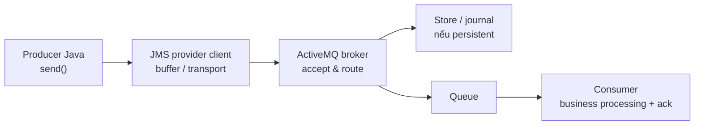

# Phân biệt gửi đồng bộ, gửi bất đồng bộ và xác nhận từ broker

> **Chương:** Producer  
> **Phạm vi:** JMS/Jakarta Messaging producer với Apache ActiveMQ Artemis, đối chiếu ActiveMQ Classic. Trọng tâm là **mốc hoàn tất phương thức gửi**, **xác nhận từ broker**, **độ bền thông điệp** và **kết quả gửi không chắc chắn**.

## 1. Bài toán: producer ghi “SENT” thì điều gì đã xảy ra?

Order Service gửi `OrderCreated(eventId=E-101)` vào queue `lab.producer.confirm`, rồi ứng dụng hoặc mạng bị gián đoạn. Đội vận hành cần biết: broker đã nhận chưa? Dữ liệu có nằm trong journal chưa? Consumer đã xử lý chưa? Có nên gửi lại không?

Không thể trả lời tất cả chỉ dựa vào việc Java `send(...)` trở về. Cần phân biệt **bốn mốc**:

1. **API return:** `MessageProducer.send(...)` trở về trên thread gọi. Với overload bất đồng bộ, return có thể xảy ra **trước** khi send hoàn tất.
2. **Provider completion/broker confirmation:** client hoàn tất thao tác gửi theo contract JMS và cơ chế confirmation của provider. Chế độ chờ phản hồi broker có thể thay đổi theo phiên bản/cấu hình.
3. **Broker persistence:** message đã được broker định tuyến và lưu bền vững theo delivery mode, transaction, journal sync, lưu trữ/HA. Mức chịu lỗi thực tế tùy cấu hình.
4. **Consumer business completion:** consumer nhận, xử lý nghiệp vụ, xác nhận/commit. Producer **không** tự biết mốc này khi chỉ gọi send.



**Ba câu hỏi thuộc ba bình diện khác nhau:** gửi **đồng bộ** hay **bất đồng bộ** nói về cách API trả quyền điều khiển và báo kết quả; **broker confirmation** nói về điều mà client/provider chờ từ server; **consumer acknowledgment** là kết quả ở đầu nhận. Chúng không phải một loại ACK duy nhất.

Một lời gọi gửi đồng bộ có thể được cấu hình để không chờ cùng một mức broker acknowledgment như lời gọi đồng bộ khác. Một lời gọi bất đồng bộ vẫn có thể báo thành công qua `CompletionListener` sau khi provider hoàn tất công việc. Cần biết **cả API lẫn cấu hình client/broker** để đánh giá bảo đảm.

## 2. Đồng bộ, bất đồng bộ và xác nhận khác nhau thế nào?

| Hình thức | Thread gọi chờ gì? | Cách quan sát kết quả | Điều không được suy ra |
|---|---|---|---|
| `producer.send(message)` | Lời gọi gửi truyền thống hoàn tất; có thể block do transport, broker, flow control hoặc chế độ chờ server | Return bình thường hoặc ngoại lệ từ send | Không chứng minh consumer xử lý, cũng không tự tiết lộ mức journal sync |
| `producer.send(message, listener)` | Khởi tạo gửi bất đồng bộ theo JMS 2.0+/Jakarta; có thể tiếp tục trước khi hoàn tất | `onCompletion` / `onException`; lỗi khởi tạo vẫn có thể ném ngay | Return của async send chưa phải kết quả gửi |
| `JMSProducer.setAsync(listener)` | Tương tự trên API `JMSContext` đơn giản hóa | `CompletionListener` | Không phải một giao thức wire mới |
| Client chờ **broker send confirmation** | Phụ thuộc cơ chế chờ ở provider/protocol | Thành công/thất bại theo contract và config client | Không phải consumer `Message.acknowledge()` |
| Producer transacted session | `commit()` mới kết thúc JMS transaction gửi | Kết quả `commit()` hoặc lỗi | `send` trước commit không bảo đảm transaction đã hoàn tất |

### 2.1. Gửi đồng bộ vẫn thuộc kiến trúc messaging bất đồng bộ

```text
Producer thread          JMS client                Broker                 Consumer
      | send(message)        |                       |                         |
      |--------------------->| ---- transfer ------>|                         |
      |                      |<-- reply (nếu chờ) --|                         |
      |<-- send() return ----|                       |  queue giữ thông điệp   |
      | tiếp tục công việc   |                       | --- delivery ---------->|
      |                      |                       |<-- consumer ack --------|
```

Producer không phải chờ consumer đang online. Vì vậy “đồng bộ ở method send” **không** đồng nghĩa “giao tiếp đồng bộ kiểu HTTP request/response với consumer”.

### 2.2. Bất đồng bộ không có nghĩa send luôn trả về ngay

Một lệnh async có thể phải serialize message, lấy buffer/socket, chờ credit/producer flow control hoặc báo lỗi ngay trước khi return. Khi broker bị chậm, client có thể áp dụng **backpressure** nhằm tránh dùng hết RAM. Async làm thay đổi cách theo dõi *completion*, không cam kết độ trễ bằng 0.

Không dùng thứ tự các dòng log của thread và callback làm bằng chứng về thứ tự broker ghi journal: callback có thể chạy rất nhanh ở thread khác.

## 3. JMS CompletionListener nói gì?

JMS 2.0 bổ sung khả năng gửi bất đồng bộ, được giữ trong Jakarta Messaging. Với package `jakarta.jms`:

```java
void onCompletion(jakarta.jms.Message message);
void onException(jakarta.jms.Message message, Exception exception);
```

- `onCompletion` báo provider đã hoàn tất send thành công theo ngữ nghĩa của provider.
- `onException` báo send bất đồng bộ thất bại.
- `send(...)` **vẫn có thể ném exception ngay** do tham số, session/connection hoặc việc khởi tạo gửi gặp lỗi, nên callback không thay thế xử lý ngoại lệ quanh send.

**Trong lúc chưa thấy callback**, trạng thái cần theo dõi là *pending*. Nếu ứng dụng chờ quá thời hạn hoặc mất kết nối, kết quả có thể **unknown outcome**, vì message có thể đã đến broker nhưng confirmation chưa tới client.

Callback nên chỉ ghi trạng thái nhỏ, cập nhật một cấu trúc dữ liệu thread-safe hoặc báo tín hiệu cho executor. Tránh gọi JMS trên chính `Session` trong callback, làm I/O lâu, đóng session từ callback hoặc sửa message đang gửi. Đặc biệt không dùng chung một `Session` đồng thời từ các thread khác nhau.

## 4. Lab: hai cách gửi trên cùng queue Artemis

Thí nghiệm sử dụng Jakarta Messaging API `jakarta.jms`, client `artemis-jakarta-client` và broker Artemis. Cần JDK 17, Maven và broker đang chạy. Ví dụ version `2.38.0` là version client ghim cho lab; chọn artifact/version tương thích với broker, JDK khi áp dụng.

### 4.1. Destination và môi trường

- Broker lắng nghe endpoint mà `BROKER_URL` chỉ đến (ví dụ `tcp://localhost:61616`) và có user có quyền `send` vào `lab.producer.confirm`.
- Nếu không bật auto-create, chèn **phần tử address** này vào khối `<addresses>` đang có của `broker.xml` rồi áp dụng cấu hình theo phiên bản broker:

```xml
<address name="lab.producer.confirm">
    <anycast>
        <queue name="lab.producer.confirm"/>
    </anycast>
</address>
```

- Tạm dừng consumer khi kiểm tra queue depth để không bị nhầm “queue trống” với “consumer đã nhận/ack”.
- Đặt mật khẩu qua biến môi trường; code ví dụ không chứa credential thực.

### 4.2. Cấu hình Maven

```xml
<project xmlns="http://maven.apache.org/POM/4.0.0"
         xmlns:xsi="http://www.w3.org/2001/XMLSchema-instance"
         xsi:schemaLocation="http://maven.apache.org/POM/4.0.0
           https://maven.apache.org/xsd/maven-4.0.0.xsd">
    <modelVersion>4.0.0</modelVersion>
    <groupId>lab.messaging</groupId>
    <artifactId>producer-confirm-lab</artifactId>
    <version>1.0.0</version>
    <properties>
        <maven.compiler.release>17</maven.compiler.release>
        <project.build.sourceEncoding>UTF-8</project.build.sourceEncoding>
        <artemis.version>2.38.0</artemis.version>
    </properties>
    <dependencies>
        <dependency>
            <groupId>org.apache.activemq</groupId>
            <artifactId>artemis-jakarta-client</artifactId>
            <version>${artemis.version}</version>
        </dependency>
    </dependencies>
    <build>
        <plugins>
            <plugin>
                <groupId>org.apache.maven.plugins</groupId>
                <artifactId>maven-compiler-plugin</artifactId>
                <version>3.13.0</version>
            </plugin>
            <plugin>
                <groupId>org.codehaus.mojo</groupId>
                <artifactId>exec-maven-plugin</artifactId>
                <version>3.3.0</version>
            </plugin>
        </plugins>
    </build>
</project>
```

### 4.3. Chương trình producer Java

Tạo `src/main/java/ProducerSendSemanticsLab.java`:

```java
import jakarta.jms.CompletionListener;
import jakarta.jms.Connection;
import jakarta.jms.ConnectionFactory;
import jakarta.jms.DeliveryMode;
import jakarta.jms.JMSException;
import jakarta.jms.Message;
import jakarta.jms.MessageProducer;
import jakarta.jms.Queue;
import jakarta.jms.Session;
import jakarta.jms.TextMessage;
import org.apache.activemq.artemis.jms.client.ActiveMQConnectionFactory;

import java.util.concurrent.CountDownLatch;
import java.util.concurrent.TimeUnit;
import java.util.concurrent.atomic.AtomicReference;

public final class ProducerSendSemanticsLab {
    private static final String QUEUE = "lab.producer.confirm";

    public static void main(String[] args) throws Exception {
        if (args.length != 2 ||
                (!"sync".equals(args[0]) && !"async".equals(args[0]))) {
            throw new IllegalArgumentException(
                "Usage: sync <eventId> | async <eventId>");
        }
        String mode = args[0];
        String eventId = args[1];
        if (eventId.isBlank()) {
            throw new IllegalArgumentException("eventId must not be blank");
        }

        String url = System.getenv().getOrDefault(
                "BROKER_URL", "tcp://localhost:61616");
        String user = System.getenv().getOrDefault("BROKER_USER", "lab");
        String password = System.getenv("BROKER_PASSWORD");
        if (password == null || password.isBlank()) {
            throw new IllegalStateException("Set BROKER_PASSWORD");
        }

        ConnectionFactory factory = new ActiveMQConnectionFactory(url);
        Connection connection = factory.createConnection(user, password);
        try {
            // Non-transacted: tach completion callback khoi commit().
            Session session = connection.createSession(
                    false, Session.AUTO_ACKNOWLEDGE);
            try {
                Queue destination = session.createQueue(QUEUE);
                MessageProducer producer = session.createProducer(destination);
                try {
                    producer.setDeliveryMode(DeliveryMode.PERSISTENT);
                    producer.setTimeToLive(0L);
                    TextMessage message = session.createTextMessage(
                            "OrderCreated:" + eventId);
                    message.setStringProperty("eventId", eventId);
                    message.setStringProperty("eventType", "OrderCreated");

                    if ("sync".equals(mode)) {
                        sendSynchronously(producer, message, eventId);
                    } else {
                        sendAsynchronously(producer, message, eventId);
                    }
                } finally {
                    producer.close();
                }
            } finally {
                session.close();
            }
        } finally {
            connection.close();
        }
    }

    private static void sendSynchronously(MessageProducer producer,
                                          TextMessage message,
                                          String eventId) throws JMSException {
        long start = System.nanoTime();
        producer.send(message);
        long elapsedMs = TimeUnit.NANOSECONDS.toMillis(
                System.nanoTime() - start);
        System.out.printf(
                "SYNC_RETURN eventId=%s jmsMessageId=%s callMs=%d%n",
                eventId, message.getJMSMessageID(), elapsedMs);
    }

    private static void sendAsynchronously(MessageProducer producer,
                                            TextMessage message,
                                            String eventId)
            throws JMSException, InterruptedException {
        CountDownLatch done = new CountDownLatch(1);
        AtomicReference<Exception> failure = new AtomicReference<>();
        long start = System.nanoTime();

        producer.send(message, new CompletionListener() {
            @Override
            public void onCompletion(Message sentMessage) {
                long elapsedMs = TimeUnit.NANOSECONDS.toMillis(
                        System.nanoTime() - start);
                System.out.printf(
                        "ASYNC_CALLBACK_OK eventId=%s elapsedMs=%d%n",
                        eventId, elapsedMs);
                done.countDown();
            }

            @Override
            public void onException(Message failedMessage,
                                    Exception exception) {
                failure.set(exception);
                System.err.println(
                        "ASYNC_CALLBACK_FAILED eventId=" + eventId);
                done.countDown();
            }
        });
        long returnedMs = TimeUnit.NANOSECONDS.toMillis(
                System.nanoTime() - start);
        System.out.printf(
                "ASYNC_SEND_RETURN eventId=%s callMs=%d%n",
                eventId, returnedMs);

        // Cho completion signal truoc khi dong producer/session.
        if (!done.await(30, TimeUnit.SECONDS)) {
            System.err.println("UNKNOWN_OUTCOME eventId=" + eventId);
            // Timeout cua app khong chung minh broker chua nhan.
            return;
        }
        Exception error = failure.get();
        if (error != null) {
            throw new IllegalStateException(
                    "Asynchronous send failed for eventId=" + eventId,
                    error);
        }
    }
}
```

**Đọc chính xác ví dụ:** `producer.send(message)` là gửi theo API đồng bộ. `producer.send(message, CompletionListener)` là gửi theo API bất đồng bộ, có hai signal thành công/thất bại từ callback. Trong chế độ async, `ASYNC_SEND_RETURN` chỉ có nghĩa phương thức đã trở về, trong khi `ASYNC_CALLBACK_OK` mới là bằng chứng provider đã báo hoàn tất send. Callback và return có thể được in gần như cùng lúc hoặc đảo thứ tự in do scheduling, nên không so thứ tự log để kết luận lúc broker ghi journal.

**Vì sao không dùng `connection.start()`?** `start()` điều khiển việc giao message tới consumer; producer có thể gửi với connection chưa start. Ví dụ cũng dùng `AUTO_ACKNOWLEDGE` chỉ vì `createSession` yêu cầu một giá trị ack mode cho session non-transacted; ở đây không có consumer nên không phát sinh consumer acknowledgment.

**Vì sao có `CountDownLatch`?** Để chờ completion trước khi đóng producer/session/connection. Ứng dụng thật cần theo dõi send còn pending, giới hạn in-flight và graceful shutdown. Sau 30 giây không callback, kết quả là **không xác định**, không phải bằng chứng chắc chắn thất bại. Dù ví dụ đóng resource để kết thúc lab, broker vẫn có thể đã nhận message.

### 4.4. Lệnh chạy và kết quả

Bash/WSL:

```bash
export BROKER_URL='tcp://localhost:61616'
export BROKER_USER='lab'
export BROKER_PASSWORD='replace-with-local-lab-secret'

mvn -q compile exec:java -Dexec.mainClass=ProducerSendSemanticsLab -Dexec.args="sync E-101"
mvn -q compile exec:java -Dexec.mainClass=ProducerSendSemanticsLab -Dexec.args="async E-102"
```

PowerShell:

```powershell
$env:BROKER_URL = 'tcp://localhost:61616'
$env:BROKER_USER = 'lab'
$env:BROKER_PASSWORD = 'replace-with-local-lab-secret'

mvn -q compile exec:java -Dexec.mainClass=ProducerSendSemanticsLab -Dexec.args="sync E-101"
mvn -q compile exec:java -Dexec.mainClass=ProducerSendSemanticsLab -Dexec.args="async E-102"
```

Một lần chạy thành công có thể in:

```text
SYNC_RETURN eventId=E-101 jmsMessageId=ID:... callMs=...
ASYNC_SEND_RETURN eventId=E-102 callMs=...
ASYNC_CALLBACK_OK eventId=E-102 elapsedMs=...
```

**Cần kiểm tra broker:** trong Artemis management console xem queue `lab.producer.confirm`, chỉ số messages added, ready/delivering, consumer count và message properties `eventId`. Trên một queue sạch không có consumer và không có expiry, hai lần gửi thành công sẽ tạo hai message. Nếu queue vẫn trống, kiểm tra queue bindings, routing, auto-create, TTL và consumer khác trước khi kết luận callback sai.

## 5. Artemis: cơ chế chờ xác nhận từ broker

Khi sử dụng **Artemis native client**, hành vi chờ server khi gửi còn chịu ảnh hưởng của những tùy chọn **riêng của Artemis Core**, bên cạnh contract của JMS/Jakarta Messaging. Không trộn lẫn chúng với `Message.acknowledge()` ở phía consumer.

### 5.1. `blockOnDurableSend` và `blockOnNonDurableSend`

- `blockOnDurableSend`: điều khiển việc client chờ server xác nhận thao tác gửi đối với message **durable/persistent** theo ngữ nghĩa Artemis.
- `blockOnNonDurableSend`: điều khiển việc chờ server với message **non-durable**.

Ví dụ cấu hình implementation trên Artemis connection factory:

```java
ActiveMQConnectionFactory factory =
        new ActiveMQConnectionFactory("tcp://localhost:61616");
factory.setBlockOnDurableSend(true);
factory.setBlockOnNonDurableSend(false);

// Cấu hình factory trước khi tạo Connection.
```

Đây là các setting **provider-specific**. Giá trị mặc định, mức xác nhận, sự phối hợp với JMS asynchronous send và phiên bản client phải được kiểm tra trên Artemis thực sự chạy. Khi client đợi broker response, latency có thể tăng theo network/server/disk; khi không đợi, lời gọi có thể tiến nhanh hơn nhưng trạng thái khi kết nối đứt có thể khó kết luận hơn.

**Cấu hình chờ broker không phải công tắc bật/tắt callback.** Có thể bật asynchronous send trên API với `CompletionListener`, nhưng provider vẫn phải xử lý flow control; callback không thay thế các điều kiện durability. Ngược lại, việc gọi `producer.send(message)` theo API đồng bộ không đồng nghĩa đã yêu cầu chờ journal sync ở tất cả cấu hình.

### 5.2. Broker đã nhận khác broker đã ghi bền vững

Với Artemis sử dụng journal, hai tùy chọn server được dùng để điều khiển journal synchronization cho các thao tác tương ứng:

```xml
<!-- Ví dụ bên trong phần <core> của broker.xml.
     Đánh giá theo SLA và khả năng lưu trữ của broker. -->
<journal-sync-non-transactional>true</journal-sync-non-transactional>
<journal-sync-transactional>true</journal-sync-transactional>
```

Không nên hiểu rằng chỉ hai dòng cấu hình đủ để bảo đảm không thể mất message. Còn có persistence enablement, loại journal, transaction boundary, filesystem/disk cache, failover/replication, quyền ghi volume, TTL/expiry và thao tác consumer. “Bền vững” phải được gắn với một **loại lỗi cần chịu được**, chẳng hạn restart sạch, crash tiến trình, hỏng đĩa hoặc chuyển active broker sang backup.

```text
Producer PERSISTENT
   |
   v
Client transport / server send confirmation
   |
   v
Broker accept & route den binding/queue
   |
   v
Journal/storage flush theo cau hinh
   |
   v
Consumer business processing + ack/commit (doc lap)
```

Sự kiện **broker nhận message** không đồng nhất với sự kiện **broker đồng bộ dữ liệu đủ bền vững**, và cả hai không đồng nhất với **consumer xử lý xong**. Thời điểm client được báo thành công còn phụ thuộc ngữ nghĩa provider và tùy chọn đang bật; cần đo và kiểm chứng theo cấu hình thực tế.

### 5.3. Bảng quyết định về độ bền và xác nhận

| Cơ chế | Tác động | Không giải quyết |
|---|---|---|
| `DeliveryMode.PERSISTENT` | Yêu cầu JMS provider xử lý message bằng chế độ phân phối bền vững | Không tự commit transaction hay xác nhận consumer |
| `blockOnDurableSend=true` (Artemis) | Client chờ send confirmation với durable message theo cơ chế Artemis | Không bảo đảm database consumer đã commit |
| `blockOnNonDurableSend=true` (Artemis) | Có thể tăng việc chờ broker cho message non-durable | Không biến non-durable thành persistent |
| `journal-sync-non-transactional=true` | Tác động việc đồng bộ journal của thao tác non-transactional | Không loại trừ mọi lỗi disk/HA hay xử lý trùng |
| `journal-sync-transactional=true` | Tác động việc đồng bộ journal của thao tác transactional | Không khiến `send()` tự là `commit()` |
| `CompletionListener` | Báo kết quả hoàn tất send bất đồng bộ theo provider | Không phải ACK consumer hay business outcome |

**Điểm thiết kế:** nếu tính tin cậy yêu cầu chặt chẽ, hãy chọn persistent delivery, thời điểm producer nhận confirmation, ranh giới commit, chế độ đồng bộ journal và cấu hình HA như **một tổ hợp**, rồi kiểm thử restart/failure. Không quyết định chỉ dựa vào tên phương thức `send`.

## 6. Transaction: `send()` chưa thay thế `commit()`

Trong một JMS transacted `Session`, các lần gửi có thể nằm chung transaction. Mốc hoàn tất nhóm thao tác là `session.commit()`, không phải từng lời gọi `producer.send(...)`. Ví dụ dưới đây nằm trong vòng đời `Connection` đã được khởi tạo:

```java
Session tx = connection.createSession(
        true, Session.SESSION_TRANSACTED);
try {
    Queue queue = tx.createQueue("lab.producer.confirm");
    MessageProducer producer = tx.createProducer(queue);
    try {
        producer.setDeliveryMode(DeliveryMode.PERSISTENT);
        for (int i = 1; i <= 3; i++) {
            TextMessage message = tx.createTextMessage(
                    "BatchOrder-" + i);
            message.setStringProperty("batchId", "B-202");
            producer.send(message);
        }
        tx.commit();  // Mốc hoàn tất JMS transaction.
    } catch (JMSException exception) {
        tx.rollback();
        throw exception;
    } finally {
        producer.close();
    }
} finally {
    tx.close();
}
```

Ở đây chọn **API gửi đồng bộ trong transacted session** để làm rõ ranh giới commit. Trước `commit()`, dù ba lần `send()` không ném lỗi, transaction gửi chưa được xác nhận hoàn tất. Nếu `rollback()`, các lần gửi trong transaction bị hủy theo ngữ nghĩa JMS. Nếu `commit()` lỗi lúc đứt mạng, vẫn có khả năng **unknown outcome**: broker đã commit nhưng phản hồi không tới ứng dụng.

Không thay `session.commit()` bằng việc quan sát `CompletionListener`. Việc phối hợp async send và transaction cần tuân thủ đặc tả cùng giới hạn/behavior của provider; ví dụ trong bài giữ chúng **ở hai phép thử riêng** để không lẫn mốc gửi và mốc transaction.

### 6.1. Vẫn còn biên giới giữa database và broker

Đoạn mã phía Order Service có thể gặp sự cố:

```text
DB commit Order O-1001             -> SUCCESS
JMS send/commit broker response    -> UNKNOWN_OUTCOME
Application retry same event      -> MAY BE DUPLICATE
```

JMS transaction chỉ quản lý thao tác JMS trong session tương ứng; nó **không tự gộp** transaction database Order Service. Khi yêu cầu không bỏ sót event gắn với DB commit, một phương án là **transactional outbox**: ghi order và outbox event cùng một DB transaction, một publisher gửi outbox với event ID ổn định và có khả năng retry. Consumer phải có idempotency vì retry có thể gửi lại một sự kiện đã được broker nhận.

## 7. Phân loại lỗi và trạng thái gửi không xác định

Không viết retry kiểu:

```java
try {
    producer.send(message);
} catch (JMSException e) {
    // SAI: gia dinh broker chac chan CHUA nhan lan gui dau.
    producer.send(message);
}
```

Nếu broker nhận message nhưng phản hồi bị mất, gửi lại có thể gây **hai lần tác dụng nghiệp vụ**. Giữ `eventId` ổn định để consumer kiểm tra trùng lặp; `JMSMessageID` do provider gán cho từng send không phải là khóa nghiệp vụ ổn định xuyên retry.

| Trạng thái quan sát | Diễn giải hợp lý | Hướng xử lý |
|---|---|---|
| Đồng bộ `send()` trả bình thường | Send hoàn tất theo contract/config provider | Ghi event ID, kiểm tra broker metrics nếu cần; chưa chứng minh consumer xử lý |
| Async send return, **chưa** callback | Đang chờ kết quả | Theo dõi in-flight, không đánh dấu completed |
| `onCompletion` được gọi | Provider báo hoàn tất send thành công | Ghi nhận producer completion; đánh giá durability theo cấu hình |
| `onException` hoặc `send` ném lỗi | Lỗi được báo; mức chắc chắn broker đã/ chưa nhận tùy thời điểm | Phân loại lỗi, retry có kiểm soát và idempotency |
| Không nhận callback trước deadline | **Unknown outcome**, không chắc chắn bị mất | Ghi pending state, đối soát và retry idempotent |
| Mất connection lúc chờ broker confirmation | Response có thể bị mất sau khi broker xử lý | Không mặc nhiên kết luận broker chưa nhận |
| Consumer báo đã ack | Có thêm thông tin từ đầu nhận | Phân biệt consumer ack và business transaction riêng |

### 7.1. Artemis duplicate detection: hỗ trợ nhưng có giới hạn

Artemis có cơ chế phát hiện duplicate message ở broker qua duplicate detection ID. Có thể dùng property chuyên biệt trên message JMS:

```java
String eventId = "E-101"; // Giữ nguyên khi retry cùng business event.
TextMessage message = session.createTextMessage(
        "OrderCreated:" + eventId);
message.setStringProperty("eventId", eventId);
message.setStringProperty("_AMQ_DUPL_ID", eventId);
producer.send(message);
```

`_AMQ_DUPL_ID` **không phải thuộc tính JMS di động giữa mọi broker**. Phải kiểm tra cache lưu duplicate IDs, phạm vi address, độ bền cache và chính sách broker/version. Nếu cache không còn chứa ID hoặc event được gửi sang một đích khác, broker có thể nhận lại. Vì thế duplicate detection là lớp phòng vệ bổ sung, **không thay** unique constraint/inbox/idempotency phía consumer.

Một event ID nên được sinh **một lần cho một business event**, được lưu bền vững (như outbox), dùng chung giữa các lần retry và ghi vào logs/tracing. Không sinh ID mới mỗi lần gọi `send()` nếu vẫn là một sự kiện cũ.

## 8. ActiveMQ Classic: gửi không chờ transport khác callback JMS

ActiveMQ Classic có client `org.apache.activemq.ActiveMQConnectionFactory` và, với những phiên bản tương ứng, các tùy chọn provider như `useAsyncSend` và `alwaysSyncSend`. Chúng điều chỉnh việc **OpenWire client chờ broker response trong quá trình gửi**; đây **không** phải chính overload `send(message, CompletionListener)` của JMS 2.0.

| Tiêu chí | ActiveMQ Artemis | ActiveMQ Classic |
|---|---|---|
| Giao thức native phổ biến | Artemis Core | OpenWire |
| Tùy chọn client send confirmation | `blockOnDurableSend`, `blockOnNonDurableSend` | `useAsyncSend`, `alwaysSyncSend` theo client/version |
| Namespace Java | `artemis-jakarta-client` dùng `jakarta.jms` | Nhiều client Classic cũ dùng `javax.jms`; chọn artifact đúng version |
| Async send bằng `CompletionListener` | Dùng khi client Jakarta/JMS 2.0+ hỗ trợ | Chỉ dùng khi client thực sự hỗ trợ API callback; không suy từ `useAsyncSend` |
| Persistent storage | Artemis journal/persistence/HA | KahaDB hoặc persistence adapter theo cấu hình Classic |

Trong một ứng dụng Classic bật `useAsyncSend`, lời gọi Java `send(message)` vẫn có hình thức **API đồng bộ**, nhưng cơ chế transport có thể gửi không chờ cùng mức broker reply. Ngược lại, API async có listener là cơ chế báo completion về Java. Hai tầng này không thể thay thế bằng cách đổi tên setting. Chuyển Classic sang Artemis phải kiểm tra version, protocol, persistence, transaction semantics và mức confirmation, không chỉ đổi host/port.

## 9. Kiểm thử thực tế và đo đúng mốc

Thực hiện trên một queue lab tách biệt, ghi **event ID, logs, trạng thái queue và thời điểm** cho từng ca:

| Ca kiểm thử | Thao tác | Kết quả/bằng chứng cần đối chiếu |
|---|---|---|
| **Sync success** | Gửi `sync E-201` khi broker hoạt động, chưa có consumer | `SYNC_RETURN`, message ID và `messages added` tại queue |
| **Async success** | Gửi `async E-202` | Có return và `ASYNC_CALLBACK_OK`; không dựa vào thứ tự log giữa hai thread |
| **Consumer offline** | Tắt consumer, gửi persistent | Send có thể hoàn tất mà consumer chưa chạy; backlog tăng nếu queue/storage hợp lệ |
| **Endpoint sai** | Đặt `BROKER_URL` đến endpoint không có broker, cấu hình connection timeout phù hợp | Phân biệt connection/JMSException với timeout callback |
| **Broker mất kết nối giữa send** | Thử trên broker lab cô lập | Có thể gặp lỗi hoặc unknown outcome; sau restart đối soát event ID |
| **Transaction rollback** | Trong transacted session, gửi rồi `rollback` | Message gửi trong transaction rollback không được commit |
| **Backpressure** | Đẩy tải có kiểm soát và quan sát giới hạn broker | API call latency, callback latency, queue/paging/disk và producer flow control |
| **Retry cùng event ID** | Gửi lại một sự kiện có khóa ổn định | Đánh giá broker duplicate detection (nếu dùng) và consumer idempotency |

### 9.1. Đừng gọi tất cả là “send latency”

```text
t0 = ngay truoc loi goi send
t1 = sau khi send(...) return
t2 = luc CompletionListener hoan tat (async)
t3 = luc metric/log broker cho thay message duoc route/luu
t4 = luc consumer business commit

Sync API call latency       = t1 - t0
Async API call latency      = t1 - t0
Async completion latency    = t2 - t0
End-to-end business latency = t4 - t0
```

`t3` không luôn có thể quan sát từ producer với độ chính xác cao; broker, client và consumer có thể sử dụng đồng hồ không đồng bộ. Không lấy `t1-t0` của async send so với `t2-t0` của chế độ khác rồi kết luận throughput hoặc durability đã tốt hơn. Đo latency phải gắn với **mốc và điều kiện hoàn tất**.

### 9.2. Điều cần xem ở Artemis management

Các metric hữu ích trên đúng queue/address:

- **Messages added**, **message count/ready** và **delivering**: phân biệt route thành công, tồn đọng và đang được consumer xử lý.
- **Acknowledged/consumer count**: tránh chẩn đoán sai nếu consumer xử lý nhanh.
- **Producer count**, binding/routing, quyền gửi, expiry/DLQ: kiểm tra đúng destination và nguyên nhân message “biến mất”.
- **Paging, memory, disk, producer flow control, logs và connection drops**: tìm nguyên nhân callback trễ, send bị chặn hoặc kết quả gửi không xác định.
- **Journal/persistence/failover logs**: kiểm tra mức phục hồi dữ liệu sau restart/crash, không chỉ nhìn thông báo send thành công.

Queue count bằng 0 không chứng minh producer không gửi: consumer có thể đã ack, message hết hạn hoặc được chuyển sang queue khác. Khi thử send confirmation, hãy ngừng consumer và đối chiếu **message ID/eventId cùng messages added**.

## 10. Chọn chiến lược producer theo nhu cầu

| Hoàn cảnh | Hướng lựa chọn | Điều kiện đi kèm |
|---|---|---|
| Lưu lượng vừa, muốn xử lý lỗi ngay trên thread gọi | `MessageProducer.send` đồng bộ, cơ chế chờ broker phù hợp | Không đánh đồng return với business success |
| Nhiều message, không muốn thread gọi chờ mọi completion | JMS async send + `CompletionListener` | Giới hạn in-flight, theo dõi callback, shutdown sạch |
| Muốn nhóm message là một đơn vị transaction JMS | Transacted `Session` + `commit()` | Kiểm tra lỗi/unknown outcome khi commit |
| Phát event gắn với DB transaction | Transactional outbox + retry | Event ID ổn định, consumer idempotency |
| Muốn message sống qua broker restart/crash | `PERSISTENT` + persistence/journal sync/HA | Kiểm thử recovery với đúng failure mode |
| Muốn tác dụng nghiệp vụ không lặp | Idempotent consumer/inbox/unique key | Provider send confirmation không thể bảo đảm DB side effects |

**Checklist review producer trước production:**

1. Định nghĩa rõ thành công ở mốc **API return**, **completion callback**, **broker confirmation**, **JMS commit** hay **consumer business commit**.
2. Quyết định sync/async dựa trên yêu cầu latency, throughput, số in-flight và khả năng quan sát kết quả.
3. Cấu hình `DeliveryMode`, Artemis blocking send, journal sync, broker persistence/HA phù hợp mục tiêu độ bền.
4. Có timeout, giới hạn hàng chờ, graceful shutdown và quản lý callback thread-safe; không đóng session khi còn gửi đang pending mà không xử lý outcome.
5. Lưu event ID ổn định và trạng thái gửi đủ bền để retry sau crash; có chiến lược xử lý unknown outcome, outbox/deduplication.
6. Thử nghiệm lỗi thực với broker, mạng, storage, consumer offline, retry và backpressure; so sánh metric từng mốc.

## 11. Bài tập tự kiểm tra

**Bài 1 — Bốn mốc:** Một producer báo `send` thành công lúc 10:00:00.100, broker đã route message, consumer commit database lúc 10:00:03.200. Hãy chỉ ra ở 10:00:00.100 điều gì đã biết và chưa biết.

**Bài 2 — Đo async:** Chạy `sync E-301` và `async E-302`, đo API return/callback latency, kiểm tra queue. Giải thích tại sao thứ tự in log không chứng minh thứ tự journal flush.

**Bài 3 — Unknown outcome:** Broker đã nhận sự kiện nhưng confirmation bị mất. Producer timeout, restart thấy message trong queue. Hãy xây dựng retry strategy dùng `eventId` ổn định, outbox và xử lý idempotent.

**Bài 4 — Transaction:** Trong transacted session, gửi ba message rồi `rollback()`; gửi ba message khác và `commit()`. Đối chiếu số message nhận được và phân biệt rõ role của `PERSISTENT` với `commit()`.

**Bài 5 — So sánh công nghệ:** Giải thích sự khác nhau giữa `CompletionListener`, Artemis `blockOnDurableSend` và Classic `useAsyncSend`. Chúng điều khiển ba điều gì và tại sao không đổi chéo các tên này?

**Bài 6 — Quyết định thiết kế:** Order Service phát 3.000 sự kiện/giây, request HTTP không được giữ lâu, database và broker không cùng transaction. Đề xuất producer pipeline, giới hạn in-flight, tracking callback, outbox và bộ metric tối thiểu.

**Tiêu chí hoàn thành:** bạn phân biệt được **gửi đồng bộ theo API**, **gửi bất đồng bộ qua callback** và **xác nhận của broker**; chạy được hai mode trên Artemis; giải thích đúng mốc của `send`, `onCompletion`, `commit` và consumer ack; thiết kế được xử lý **unknown outcome** với event ID bền vững, retry/idempotency và cấu hình persistence phù hợp.
