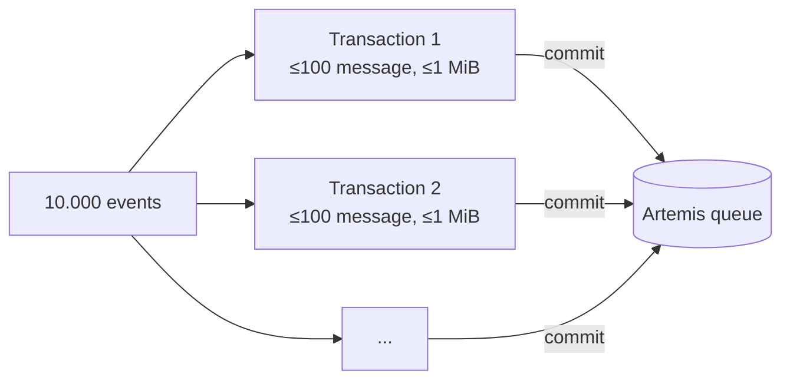

# Gửi nhiều thông điệp trong một giao dịch và giới hạn kích thước lô

> **Chương:** Producer  
> **Phạm vi:** Apache ActiveMQ Classic và Artemis, Java JMS/Jakarta Messaging. Trọng tâm là cách producer gom nhiều message vào **một giao dịch JMS**, chọn ranh giới `commit` và giới hạn kích thước lô để cân bằng throughput, latency và tài nguyên broker.

## 1. Vấn đề: gửi 10.000 sự kiện mà không mở 10.000 giao dịch

Một dịch vụ đồng bộ đơn hàng cần phát 10.000 message `OrderCreated` vào queue `orders.events`. Hai cách cực đoan đều có vấn đề:

- **`commit` sau từng message:** dễ xác định kết quả của từng message, nhưng làm tăng số lần xác nhận giao dịch, chi phí ghi nhận và round trip (tùy provider).
- **`commit` một lần sau 10.000 message:** giảm số lần commit, nhưng giữ transaction lớn, tăng độ trễ quan sát, nhu cầu tài nguyên và phạm vi phải gửi lại khi lỗi.

Cách thực tế là **gửi theo nhiều giao dịch có giới hạn**; ví dụ mỗi giao dịch tối đa **100 message** hoặc **1 MiB payload ước lượng**, chạm điều kiện nào trước thì commit rồi bắt đầu lô tiếp theo.



**Điểm mấu chốt:** một **lô ứng dụng** chỉ thực sự là **một giao dịch JMS** nếu các lệnh `send` nằm trong cùng transacted `Session`/`JMSContext` và cùng được kết thúc bằng một `commit()`. Việc gọi `send` nhiều lần liên tiếp trên session không giao dịch **không** tự tạo ranh giới atomic.

## 2. Ranh giới một local JMS transaction

Trong JMS, `Session` hoặc `JMSContext` tạo ở chế độ `SESSION_TRANSACTED` bao phủ những thao tác gửi/nhận được thực hiện trong phiên đó. Với producer thuần, cơ chế cơ bản là:

```text
Transaction #1 (JMSContext SESSION_TRANSACTED)
  send(M1)
  send(M2)
  send(M3)
  commit()              → Broker chốt cả M1, M2, M3

Transaction #2
  send(M4)
  send(M5)
  rollback()            → Không chốt M4 và M5

Transaction #3
  send(M6)
  commit()              → Broker chốt M6
```

| Thao tác | Hệ quả trên lô đang mở |
| --- | --- |
| `send(message)` | Đưa lệnh gửi vào transaction hiện tại; message chưa được coi là đã commit |
| `commit()` thành công | Chốt các lệnh gửi của transaction, tạo ranh giới có thể quan sát từ consumer |
| `rollback()` thành công | Hủy các lệnh gửi của **transaction chưa commit** |
| `commit()` thất bại do mất kết nối | Kết quả có thể **không xác định từ phía client**: broker có thể đã commit trước khi response mất |
| `close()` khi còn transaction chưa commit | Transaction chưa commit không phải dữ liệu đã chốt; lifecycle/rollback được provider xử lý |
| Mở transaction mới sau `commit` | Các message gửi tiếp thuộc transaction kế tiếp |

**Phạm vi atomicity:** các thao tác JMS trong cùng local transaction của một session, do provider/broker đó quản lý. Nó **không tự bao gồm** thao tác ghi database, HTTP request, Kafka publish hoặc lệnh JMS từ một session/connection khác. Muốn phối hợp database và broker phải thiết kế outbox/XA theo khả năng và yêu cầu nghiệp vụ.

Trong Java SE dùng `JMSContext.SESSION_TRANSACTED`, ứng dụng chủ động gọi `commit`/`rollback`. Nếu ứng dụng chạy trong container-managed JTA transaction, cách điều khiển giao dịch có thể do container quản lý; không sao chép cơ chế local `commit()` vào môi trường đó mà chưa kiểm tra hợp đồng framework.

### Thực tế phía broker

Artemis và Classic có thể khác nhau về journal, send acknowledgment và buffer, nhưng **giao dịch JMS** là ranh giới logic. Consumer khác thường chỉ thấy message của transaction gửi **sau khi commit hoàn tất**. Nếu giao dịch chưa được commit, đừng dùng `JMSMessageID` hay log “sent” làm bằng chứng rằng message đã có thể xử lý.

## 3. Vì sao cần giới hạn lô theo **count** và **bytes**

Một giới hạn `100 message/lô` chưa đủ: 100 message JSON nhỏ 1 KiB khác hoàn toàn 100 message 5 MiB.

| Tham số | Điều được giới hạn | Rủi ro nếu bỏ qua |
| --- | --- | --- |
| `maxMessagesPerTransaction` | Số lần gửi JMS trong một transaction | Transaction chứa quá nhiều thao tác; rollback tốn kém |
| `maxEstimatedPayloadBytes` | Tổng byte payload trong một transaction | Lô ít message nhưng mỗi message rất lớn |
| `maxSingleMessageBytes` | Kích thước một payload đơn lẻ | Một message vượt cả lô, gây tràn bộ nhớ hoặc vượt policy |
| `maxBatchAge` (tùy chọn) | Khoảng đợi trước khi commit một lô chưa đầy | Event volume thấp phải đợi lâu mới thấy kết quả |
| `maxInFlightTransactions` | Số transaction producer xử lý đồng thời | Tăng áp lực broker/connection khi nhiều producer chạy song song |

Ví dụ quy ước khởi đầu để **đo thử**, không phải giá trị tối ưu phổ quát:

```text
maxMessagesPerTransaction = 100
maxEstimatedPayloadBytes  = 1_048_576 bytes  (1 MiB)
maxSingleMessageBytes     =   262_144 bytes  (256 KiB)
```

Nếu message trung bình 8 KiB, ngưỡng 1 MiB tương đương khoảng 128 payload; lô sẽ chạm **count 100** trước. Nếu message trung bình 20 KiB, ngưỡng byte khiến lô dừng ở khoảng **51 message**. Vì mỗi message mang thêm header, properties và overhead mã hóa, đây chỉ là **ước lượng phía ứng dụng**, không phải kích thước byte chính xác trên wire hoặc trong journal.

**Nguyên tắc:** kiểm tra kích thước **trước khi gửi message kế tiếp**. Nếu thêm message sẽ vượt ngưỡng, commit những message đang có; sau đó bắt đầu transaction mới bằng message hiện tại. Nếu riêng message đã vượt `maxSingleMessageBytes`, áp dụng chính sách riêng (từ chối, lưu blob rồi gửi URI, hoặc xử lý large message), tránh tạo lô vượt ngưỡng một cách âm thầm.

### Giới hạn lô không phải giới hạn message của broker

Ba đại lượng rất khác nhau:

1. **Batch budget:** giới hạn do ứng dụng tự đặt cho **tổng nhiều message** trong một transaction.
2. **Single-message/wire-size limit:** giới hạn packet/frame/body do client, broker hoặc giao thức đặt cho **một message**; không có một số byte tối đa JMS chung cho mọi provider.
3. **Address memory/disk policy:** Artemis `max-size-bytes`, paging, disk usage và flow control quản lý **tài nguyên của address/broker**, không phải `maxBytesPerJmsTransaction`.

Đừng sử dụng `page-size-bytes` hoặc `max-size-bytes` trong `broker.xml` như một “giới hạn 1 lô producer” trực tiếp.

## 4. Code thực hành: Artemis Jakarta JMS với lô có hai ngưỡng

Ví dụ dùng **Java 17+**, `jakarta.jms` và **Apache ActiveMQ Artemis**. Giả định broker lắng nghe `tcp://localhost:61616`, queue `orders.events` tồn tại hoặc được phép auto-create và tài khoản có quyền gửi.

Maven dependency minh họa:

```xml
<dependency>
    <groupId>org.apache.artemis</groupId>
    <artifactId>artemis-jakarta-client</artifactId>
    <version>2.50.0</version>
</dependency>
```

Từ Artemis 2.50.0, Maven groupId là `org.apache.artemis`. Với client Artemis `javax.jms`, dùng `artemis-jms-client` cùng dòng phiên bản và đổi import; bản chất transaction tương tự.

### 4.1. Producer tự chia giao dịch theo count và byte UTF-8

File `BoundedBatchProducer.java`:

```java
import java.nio.charset.StandardCharsets;

import jakarta.jms.DeliveryMode;
import jakarta.jms.JMSContext;
import jakarta.jms.JMSProducer;
import jakarta.jms.Queue;
import jakarta.jms.TextMessage;

import org.apache.activemq.artemis.jms.client.ActiveMQConnectionFactory;

public final class BoundedBatchProducer {
    private static final int MAX_MESSAGES = 100;
    private static final long MAX_BATCH_BYTES = 1_048_576L; // 1 MiB
    private static final int MAX_MESSAGE_BYTES = 262_144;   // 256 KiB

    public static void main(String[] args) {
        String url = requiredEnv("ARTEMIS_URL");
        String user = requiredEnv("ARTEMIS_USER");
        String password = requiredEnv("ARTEMIS_PASSWORD");

        ActiveMQConnectionFactory factory =
                new ActiveMQConnectionFactory(url);

        try (JMSContext context = factory.createContext(
                user, password, JMSContext.SESSION_TRANSACTED)) {

            Queue destination = context.createQueue("orders.events");
            JMSProducer producer = context.createProducer()
                    .setDeliveryMode(DeliveryMode.PERSISTENT);

            int pendingCount = 0;
            long pendingBytes = 0;
            int committedBatches = 0;

            try {
                // Giả lập 250 events; production đọc từ outbox/source bền vững.
                for (int i = 1; i <= 250; i++) {
                    String eventId = "evt-" + i;
                    String json = "{\"eventId\":\"" + eventId
                            + "\",\"orderId\":\"O-" + i + "\"}";

                    // Dự toán payload bytes; JMS frame thực tế có overhead.
                    int bytes = json.getBytes(StandardCharsets.UTF_8).length;
                    if (bytes > MAX_MESSAGE_BYTES) {
                        throw new IllegalArgumentException(
                                "Payload too large: " + eventId);
                    }

                    // Chốt lô cũ TRƯỚC KHI thêm message sẽ vượt ngưỡng.
                    if (pendingCount > 0 &&
                            (pendingCount >= MAX_MESSAGES ||
                             pendingBytes + bytes > MAX_BATCH_BYTES)) {
                        context.commit();
                        committedBatches++;
                        System.out.println("Committed batch #"
                                + committedBatches + " count=" + pendingCount
                                + " estimatedBytes=" + pendingBytes);
                        pendingCount = 0;
                        pendingBytes = 0;
                    }

                    TextMessage message = context.createTextMessage(json);
                    message.setStringProperty("eventType", "OrderCreated");
                    message.setStringProperty("eventId", eventId);

                    producer.send(destination, message);
                    pendingCount++;
                    pendingBytes += bytes;
                }

                // Chốt phần dư khi nguồn dữ liệu kết thúc.
                if (pendingCount > 0) {
                    context.commit();
                    committedBatches++;
                    System.out.println("Committed final batch #"
                            + committedBatches + " count=" + pendingCount
                            + " estimatedBytes=" + pendingBytes);
                }
            } catch (RuntimeException failure) {
                // Chỉ transaction đang mở mới có thể rollback.
                // Nếu commit() vừa lỗi, kết quả phía broker có thể chưa rõ.
                try {
                    context.rollback();
                } catch (RuntimeException rollbackFailure) {
                    failure.addSuppressed(rollbackFailure);
                }
                throw failure;
            }
        }
    }

    private static String requiredEnv(String name) {
        String value = System.getenv(name);
        if (value == null || value.isBlank()) {
            throw new IllegalStateException("Missing env: " + name);
        }
        return value;
    }
}
```

Biến môi trường (đổi theo broker test):

```text
ARTEMIS_URL=tcp://localhost:61616
ARTEMIS_USER=orders_app
ARTEMIS_PASSWORD=<secret cấp từ môi trường>
```

Với 250 message nhỏ như ví dụ, dự kiến chương trình thực hiện **ba commit** với số message tương ứng **100, 100, 50**. Số lần commit trên **không** chứng minh mỗi message đã được consumer xử lý; nó chỉ cho biết producer đã chốt lô gửi. Nếu cần xác minh, xem queue metrics và chạy consumer test.

**Giải thích các ranh giới trong code:**

- Một `JMSContext` ở chế độ `SESSION_TRANSACTED` giữ transaction hiện tại. Không cần gọi `begin()` trước lô kế tiếp: sau `commit()`, các thao tác gửi tiếp thuộc transaction mới.
- `JMSProducer` được tái sử dụng cho nhiều message để tránh tạo producer object mỗi vòng lặp.
- Điều kiện `pendingBytes + bytes > MAX_BATCH_BYTES` được kiểm tra **trước `send`**. Cần dùng biến kiểu `long` cho bộ đếm byte để tránh overflow khi cấu hình ngưỡng lớn.
- `getBytes(UTF_8).length` tính số byte **văn bản JSON**, không bao gồm JMS header, properties, frame và mã hóa của provider. Duy trì **headroom** khi hệ thống có giới hạn thực ở transport hoặc storage.
- Nếu một lần `send` thất bại trước `commit`, `rollback` hủy phần chưa commit của transaction hiện tại. **Các lô đã commit trước đó vẫn tồn tại**.
- Nếu `commit` lỗi do disconnect đúng lúc, không thể kết luận broker chắc chắn chưa commit. Logic retry cần dựa trên nguồn sự kiện bền vững và business ID để tránh duplicate.

### 4.2. Có cần một `MessageProducer` cho từng message?

**Không.** `JMSProducer`/`MessageProducer` có thể gửi nhiều message trong cùng transaction. Việc tái sử dụng producer giúp giảm tạo object và dễ kiểm soát delivery mode/priority/TTL nhất quán. Mỗi message vẫn có body và properties riêng; đừng thay đổi một `Message` đang được gửi bất đồng bộ trước khi provider cho phép tái sử dụng.

Trong hệ thống multi-thread, **không chia sẻ một `Session`/`JMSContext` cho nhiều luồng xử lý đồng thời**. Tạo session/context theo worker hoặc dùng framework/pool bảo đảm tính tuần tự đúng JMS. Nếu mỗi thread mở transaction riêng thì không còn “một transaction chung cho cả 100 message” chỉ vì chúng cùng trỏ đến một queue.

## 5. Cấu hình broker Artemis liên quan tới lô lớn

Artemis sử dụng address storage, paging và flow control để tránh một producer/transaction lớn làm cạn tài nguyên. Ví dụ trích đoạn phần `<address-settings>` trong `broker.xml`:

```xml
<address-settings>
    <address-setting match="orders.events">
        <max-size-bytes>104857600</max-size-bytes>
        <page-size-bytes>10485760</page-size-bytes>
        <address-full-policy>PAGE</address-full-policy>
    </address-setting>
</address-settings>
```

| Setting | Ý nghĩa đúng | Liên hệ với producer batching |
| --- | --- | --- |
| `max-size-bytes` | Ngưỡng kích thước address trong bộ nhớ theo cơ chế accounting của broker | Không phải trần byte của **một** JMS transaction |
| `page-size-bytes` | Kích thước mục tiêu của mỗi paging file | Không phải kích thước tối đa của một message hoặc một lô |
| `address-full-policy=PAGE` | Khi address đạt ngưỡng, broker dùng paging theo chính sách | Hỗ trợ tránh giữ mọi backlog trong memory, nhưng tăng I/O |
| `address-full-policy=BLOCK` | Tạo backpressure: producer có thể bị chặn/chờ khi address đầy | Batch quá lớn có thể làm thời gian gửi/commit tăng đáng kể |
| `address-full-policy=FAIL` | Từ chối thao tác khi vượt giới hạn theo policy | Code phải nhận diện lỗi và quyết định rollback/retry |

Các con số **100 MiB** và **10 MiB** ở trên là ví dụ để quan sát paging, không phải mặc định an toàn cho mọi broker. Cần thiết lập theo RAM, disk I/O, throughput, backlog, chính sách lưu trữ và phiên bản Artemis.

**Quan sát quan trọng:** Broker có thể nhận nhiều message chưa commit và phải quản lý tài nguyên cho transaction đang mở; việc bật paging **không miễn phí**, cũng không thay thế việc giới hạn số message/byte ở producer. Nếu nhiều producer cùng gửi lô lớn, tổng tài nguyên sử dụng có thể vượt mức một producer đơn lẻ.

### 5.1. Large message là một vấn đề khác

Artemis có cơ chế xử lý **large message** khi một message đơn lẻ có body lớn, với ngưỡng và cách truyền/ghi phụ thuộc client/protocol (`minLargeMessageSize` của Artemis CORE client là một ví dụ cấu hình). Khả năng truyền large message **không có nghĩa** nên nhồi hàng trăm large message vào cùng transaction. Cần phân biệt:

```text
Một message 20 MiB        → vấn đề large-message handling
200 message × 100 KiB     → vấn đề tổng kích thước transaction/lô
Hàng triệu message tồn đọng → vấn đề backlog, paging, disk quota
```

Nếu message quá lớn, cân nhắc lưu nội dung ở object storage và gửi metadata, URI, checksum hoặc content ID qua JMS. Với loại dữ liệu bắt buộc truyền qua broker, kiểm chứng giới hạn transport/frame, large-message support, rollback và failover đúng phiên bản client.

## 6. Chiến lược chọn kích thước lô: throughput, latency và chi phí lỗi

Không có “batch size tốt nhất” cho mọi ActiveMQ deployment. Chọn bằng đo thực tế với **message size distribution** thay vì chỉ đo số message trung bình.

| Lô nhỏ | Lô lớn |
| --- | --- |
| Commit thường xuyên, chi phí cố định có thể cao | Ít commit hơn, có thể tăng throughput |
| Message sớm được consumer nhìn thấy | Message có thể chờ commit lâu hơn |
| Rollback ít message hơn | Rollback ảnh hưởng nhiều message hơn |
| Giữ ít dữ liệu pending trong transaction | Áp lực journal, memory, paging, disk lớn hơn |
| Dễ kiểm soát timeout từng lần commit | Commit lớn có thể kéo dài hoặc tăng rủi ro timeout |

**Phương pháp benchmark:** giữ cùng kiểu message, delivery mode, persistence, số producer, số consumer và broker configuration. Thử lần lượt `maxMessages=1`, `20`, `100`, `500`, đồng thời giữ byte budget. Ghi:

- Throughput: message được **commit thành công/giây**, không chỉ số lượt `send()` gọi.
- Latency: thời gian từ lúc message sẵn sàng gửi đến lúc `commit` hoàn tất; đo p50/p95/p99.
- Broker: heap, GC, journal/disk IOPS, paging, queue depth, producer blocking.
- Reliability: tỷ lệ `commit` timeout, rollback, số message cần replay, duplicate business ID.
- Đặc tính nguồn: kích thước payload p95/p99, tần suất arrival, mức chênh giữa message nhỏ và lớn.

Nếu nguồn event đến **rải rác**, giữ lô chờ đủ 100 message làm tăng độ trễ không cần thiết. Thêm **giới hạn thời gian** (ví dụ commit phần hiện có sau một khoảng được chọn theo SLO). Với các producer bất đồng bộ nhiều thread, thiết kế cơ chế flush trong **luồng sở hữu JMSContext** thay vì để timer thread gọi `commit` đồng thời trên cùng context.

Đừng tăng lô chỉ vì muốn “nhanh hơn”: khi broker đã bị giới hạn bởi disk hoặc consumer chậm, lô lớn có thể khiến `commit` và backpressure tệ hơn mà không tăng throughput tổng.

## 7. Khi `commit` timeout: tránh retry mù quáng cả lô

Giả sử gửi `M1..M100`, broker đã ghi nhận commit, nhưng TCP mất đúng lúc phản hồi quay về:

```mermaid
sequenceDiagram
    participant P as Producer
    participant B as Broker
    P->>B: send M1..M100 (transacted)
    P->>B: commit()
    B-->>B: Commit được chốt
    B--xP: Phản hồi commit mất trên mạng
    Note over P: Timeout/exception; chưa biết commit đã thành công hay chưa
    P->>B: Retry M1..M100 ?
    Note over B: Có nguy cơ nhận thêm bản sao nghiệp vụ
```

Lúc này gọi `rollback()` **không thể khẳng định** sẽ xóa những message broker **đã commit**. Việc retry nguyên lô dựa riêng vào exception có thể sinh duplicate.

Cách thiết kế an toàn hơn:

1. Mỗi sự kiện có **`eventId` cố định**, không được sinh ID mới khi retry.
2. Giữ nguồn sự kiện ở **outbox hoặc một nguồn có khả năng replay**. Chỉ đánh dấu hoàn tất khi có xác nhận đáng tin cậy; nếu trạng thái commit không rõ, chấp nhận khả năng gửi lại.
3. Consumer xử lý **idempotent** theo `eventId` (ví dụ unique constraint/processed-event table) để replay không tạo tác dụng nghiệp vụ hai lần.
4. Artemis có cơ chế **duplicate detection** theo header/property riêng của broker; chỉ dùng khi hiểu rõ khả năng, phạm vi cache/retention và quy ước ID. Không coi đó là thay thế mọi kiểm soát idempotency.
5. Nếu một message lỗi vì payload không hợp lệ, **tách/quarantine** message đó; đừng retry vô hạn cả batch không thể commit.

### Nhiều destination trong một transaction

Một transacted JMS session có thể gửi tới **nhiều queue** rồi `commit` chung, miễn mọi thao tác thuộc cùng session/provider và transaction được hỗ trợ. Ví dụ:

```java
// context: JMSContext đã tạo ở chế độ SESSION_TRANSACTED.
JMSProducer producer = context.createProducer();

producer.send(context.createQueue("orders.created"), "O-1001");
producer.send(context.createQueue("audit.orders"), "created O-1001");

context.commit();
```

Đây là **một local JMS transaction**, nhưng vẫn **không bao gồm database** và không đảm bảo điều kiện atomicity nếu hai destination thực ra nằm trên hai broker độc lập qua hai context riêng.

## 8. Bài thực hành có tiêu chí kiểm chứng

**Môi trường:** Artemis broker test, queue `orders.events`, producer ở mục 4, một consumer hoặc console để đọc message count. Không chạy bài thử lỗi trên dữ liệu production.

1. **Baseline:** Gửi 250 message nhỏ với giới hạn `100 message/lô` và `1 MiB/lô`. Xác nhận log có ba commit (100, 100, 50). Kiểm tra queue có 250 message đã commit khi chưa có consumer.
2. **Rollback có chủ đích:** Trước lần commit đầu tiên, chèn `throw new IllegalStateException("test failure")` sau `send` thứ 37. Xác nhận `rollback` và queue không nhận 37 message chưa commit. Khôi phục code sau test.
3. **Đổi ngưỡng count:** Đặt `MAX_MESSAGES=20`. Với 250 message nhỏ, kỳ vọng 13 transaction (12 lô 20, một lô 10), nếu không phát sinh lỗi.
4. **Đổi ngưỡng byte:** Tạo payload khoảng 16 KiB và giữ `MAX_BATCH_BYTES=1 MiB`; kiểm tra việc commit xảy ra vì byte budget trước khi chạm 100 message. Với giới hạn **256 KiB/message**, trường hợp một message khoảng 300 KiB phải bị từ chối trước `send`.
5. **Tạo backlog:** Tạm dừng consumer, quan sát `address-size`/paging và thời gian `commit` khi queue tích tụ. Với `PAGE`, theo dõi paging file; khi thử `BLOCK` chỉ thay trên broker test và phải đặt call timeout phù hợp.
6. **Sự cố giữa commit:** Mô phỏng mất mạng ngay lúc `commit` trên môi trường kiểm soát. Không kỳ vọng xác định ngay commit thành công hay chưa; ghi `eventId` và tìm duplicate khi replay.
7. **Hai producer đồng thời:** Chạy hai tiến trình với ID sự kiện khác nhau. So sánh tốc độ tổng và thời gian commit; kiểm tra memory/paging thay vì mặc định nhân đôi batch size sẽ nhân đôi throughput.

### Câu hỏi tự kiểm tra

- **Gửi 100 message trên một `AUTO_ACKNOWLEDGE` session rồi gọi `send` 100 lần có phải một JMS transaction không?** Không; cần `SESSION_TRANSACTED` và một `commit()`.
- **`max-size-bytes` của Artemis có phải giới hạn byte cho một transaction?** Không; đó là ngưỡng tài nguyên address/broker theo policy.
- **Nếu chỉ giới hạn số message mà không đo byte thì có an toàn với message lớn không?** Không.
- **`rollback()` có hủy message đã commit trong batch trước không?** Không.
- **`commit()` timeout có chứng minh broker chưa chốt transaction không?** Không; outcome có thể bất định với client.
- **Một transaction JMS có tự commit database business cùng lúc không?** Không; cần chiến lược tích hợp riêng.
- **Tại sao một lô 500 message có thể chậm hơn 5 lô 100 message?** Vì chi phí bộ nhớ, I/O, paging, blocking và thời gian commit phụ thuộc tải thực tế.

## 9. Checklist triển khai producer batching

- [ ] Tạo một transacted `Session`/`JMSContext` cho đường gửi cần atomicity.
- [ ] Có ngưỡng **count**, **tổng payload byte ước lượng** và **single-message byte**.
- [ ] Kiểm tra ngưỡng trước khi `send`; commit phần dư khi nguồn kết thúc hoặc đạt giới hạn thời gian.
- [ ] Không chia sẻ cùng `JMSContext` cho nhiều thread đồng thời.
- [ ] Tái sử dụng producer, tạo message mới với `eventId` ổn định khi retry.
- [ ] Rõ phạm vi rollback: chỉ lô chưa commit; lô trước đã chốt vẫn tồn tại.
- [ ] Có chiến lược đối phó `commit` outcome không rõ (outbox/replay/idempotency).
- [ ] Không nhầm byte budget của ứng dụng với `max-size-bytes`/`page-size-bytes` của Artemis.
- [ ] Đã kiểm tra paging/flow-control, size distribution, latency và disk I/O dưới tải.
- [ ] Đã thử với broker thật: commit, rollback, payload lớn, disconnect và consumer chậm.

## Tài liệu tham khảo

- [Jakarta Messaging 3.1 Specification — transacted session và message send](https://jakarta.ee/specifications/messaging/3.1/jakarta-messaging-spec-3.1.html).
- [Apache ActiveMQ Artemis — Using JMS](https://artemis.apache.org/components/artemis/documentation/latest/using-jms.html).
- [Apache ActiveMQ Artemis — Paging](https://artemis.apache.org/components/artemis/documentation/latest/paging.html).
- [Apache ActiveMQ Artemis — Producer Flow Control](https://artemis.apache.org/components/artemis/documentation/latest/flow-control.html).
- [Apache ActiveMQ Artemis — Large Messages](https://artemis.apache.org/components/artemis/documentation/latest/large-messages.html).
